# 条件扩散模型入门：条件怎么编码、怎么注入去噪网络

> 视频来源：[条件扩散模型_零基础详解](https://www.bilibili.com/video/BV1yFyZzeESF/)（Bilibili · UP 主「DIFFUSION 公开课」）｜时长约 9.5 分钟
> 导读：这支视频把「条件扩散模型」拆成三层讲：条件是什么、条件怎么变成向量、条件怎么进入去噪网络。本文聚焦前两层与两种注入方式（通道拼接、交叉注意力），并把交叉注意力的 QKV 矩阵形状一步步算完；条件丢弃只讲到「训练时随机丢掉条件，为无分类器引导留出无条件分支」，引导强度与分布偏移留给下一小节。字幕为 AI 生成，术语与符号已按上下文订正（「去造」→ 去噪、「前空间」→ 潜空间）。

## 本讲要解决的核心问题（SCQA）

**背景**：普通扩散模型学的是从随机噪声里生成一张合理的图片，也就是去逼近数据分布 $p(x)$。DDPM 那一套前向加噪、反向去噪的流程，网络只需要看两个输入：带噪状态 $x_t$ 和时间步 $t$。

**冲突**：可我们真正想要的是「按我的要求生成」——给一个类别标签、一句话、一张参考图，模型就该往那个方向画。只学 $p(x)$ 的网络不知道「要求」是什么，它只会随机采样出数据分布里的任意一个样本。

**疑问**：条件要怎样才能进入网络？是拼在输入上、塞进中间层，还是别的方式？条件本身又怎么从「一只猫坐在窗边」这句话变成网络能吃的数字？

**回答（中心思想）**：条件扩散模型比普通扩散模型只多学一件事——在**满足某个要求的前提下**生成。要求就是条件 $c$，它先经过**条件编码器**变成向量或向量序列，再用**通道拼接**或**交叉注意力**等方式注入去噪网络，于是预测函数从 $\hat{\epsilon}=\epsilon_\theta(x_t,t)$ 变成 $\hat{\epsilon}=\epsilon_\theta(x_t,t,c)$。关键在于分清两个变量：被加噪、被去噪的是**生成变量** $x_t$；条件 $c$ 是**额外信息**，它不参与加噪，只在每一步去噪时被反复参考。[【跳转到 00:00】](https://www.bilibili.com/video/BV1yFyZzeESF/?t=0)

## 一、条件扩散多出来的那个输入：条件变量 $c$

### 1.1 条件只是「影响」生成，不是「保证」生成

条件可以是类别标签（猫 / 狗 / 汽车）、一句话（「一只猫坐在窗边」），也可以是另一张图。视频给了一个很贴切的类比：把去噪网络想成一位画家，从一团噪点开始一步步擦出图像；普通扩散是让画家随便画，条件扩散是递给他一份**任务书**——「画一只坐在窗边的橘猫」。[【跳转到 00:25】](https://www.bilibili.com/video/BV1yFyZzeESF/?t=25)

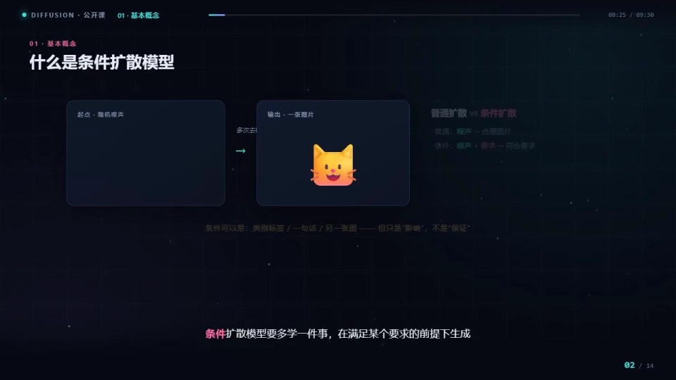

这里有个容易被忽略的细节：**画家不是先随便画完再筛选，而是在每一步去噪时都参考任务书**。这一点决定了条件注入的位置——它必须进入去噪网络的每一次前向，而不是只在最后做一次过滤。[【跳转到 00:50】](https://www.bilibili.com/video/BV1yFyZzeESF/?t=50)

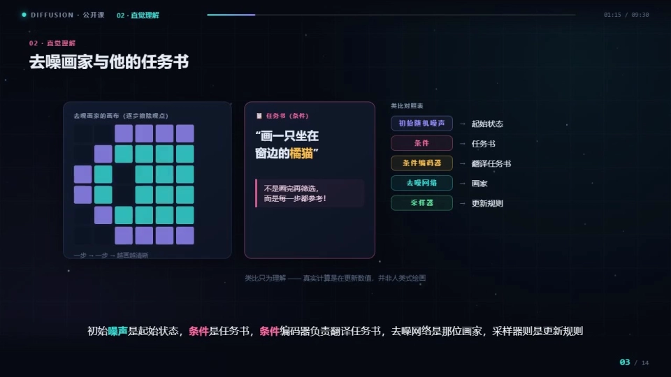

### 1.2 数学上只多了一个 $c$，分布上从 $p(x)$ 变成 $p(x \mid c)$

落到公式上，差别小得几乎看不出来：

$$
\text{无条件：}\quad \hat{\epsilon}=\epsilon_\theta(x_t,\,t)
\qquad
\text{条件：}\quad \hat{\epsilon}=\epsilon_\theta(x_t,\,t,\,c)
$$

其中 $x_t$ 是仍含噪声的图像状态，$t$ 是噪声等级，$c$ 就是条件。[【跳转到 01:15】](https://www.bilibili.com/video/BV1yFyZzeESF/?t=75)

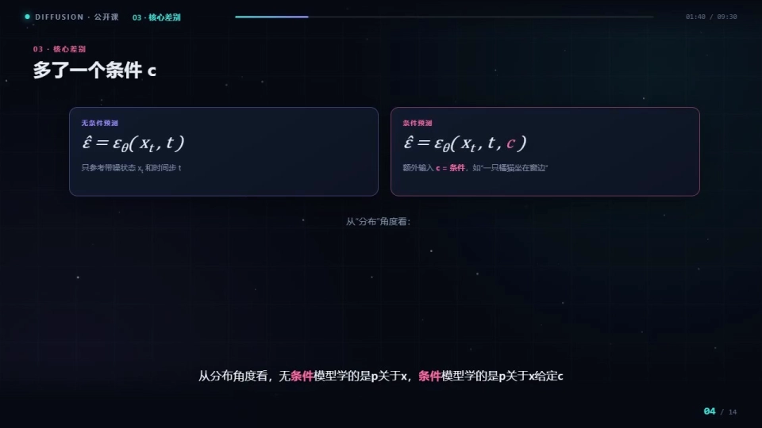

从分布角度看，无条件模型学的是 $p(x)$，条件模型学的是 $p(x \mid c)$。注意条件**收窄了范围，但不会唯一确定每一个像素**：同一个「橘猫坐在窗边」，可以有无数种构图、光照和毛色。这就是为什么条件生成仍然保留多样性——条件约束的是「往哪个方向画」，不是「画成哪一张」。[【跳转到 01:40】](https://www.bilibili.com/video/BV1yFyZzeESF/?t=100)

### 1.3 三路特征汇入同一个去噪网络

把整个系统摊开看，去噪网络的输入其实有三路：

1. **条件**（标签 / 文字 / 图像）→ 条件编码器 → 条件特征；
2. **当前带噪状态** $x_t$ → 状态特征；
3. **时间步** $t$ → 时间嵌入。

三路特征汇合后一起送进条件去噪网络，输出噪声（或原图、速度）预测，采样器据此更新状态，得到下一状态，循环直到产出最终样本。[【跳转到 02:05】](https://www.bilibili.com/video/BV1yFyZzeESF/?t=125)

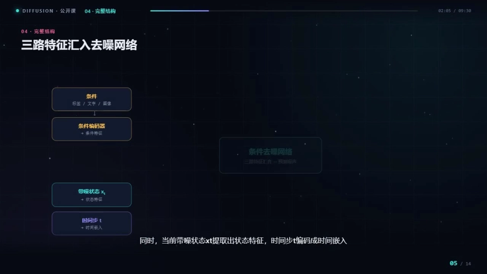

于是「设计一个条件系统」被压缩成三个必须回答的问题，本文后面就按这三问展开：

- 条件是什么形式？
- 条件怎样变成网络特征？
- 条件特征怎样影响去噪网络？

## 二、条件要先变成向量：标签查表，文本过编码器

网络的输入只能是数字，所以第一步永远是**编码**。[【跳转到 02:30】](https://www.bilibili.com/video/BV1yFyZzeESF/?t=150)

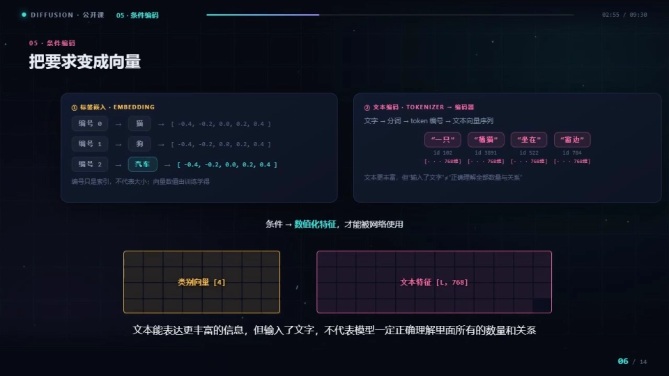

**类别标签**用可学习的嵌入层（embedding）：编号 0、1、2 分别代表猫、狗、汽车，查表映射成一个类别向量，比如四维的 $[-0.4,-0.2,0.8,0.2]$。这里有个初学者常踩的坑：**编号只是索引，不代表大小关系**——「汽车 = 2」不意味着汽车比猫「大」，向量里的数值是训练学出来的。

**文本**要复杂一些：文字先经过分词器（tokenizer）切成 token 编号，再送进文本编码器，得到一串文本向量。比如「一只」「橘猫」「坐在」「窗边」各对应一个 768 维向量，整句是形状 $[L, 768]$ 的序列。文本能表达更丰富的信息，但**输入了文字，不代表模型一定正确理解里面所有的数量和关系**——这也是后面「条件不是硬性保证」的伏笔。

## 三、注入方式一：通道拼接（把条件当成额外的信息通道）

第一种方式最简单：沿通道维把条件拼到带噪图像上。[【跳转到 02:55】](https://www.bilibili.com/video/BV1yFyZzeESF/?t=175)

以手写数字为例，带噪图片形状是 $[B, 1, 28, 28]$（$B$ 是批量，1 是图像通道，$28\times28$ 是空间尺寸）。类别编号先查表得到四维向量，形状 $[B,4]$，再扩展到和图片同宽高，成为 $[B,4,28,28]$ 的条件特征图。然后沿通道维拼接：

$$
[B,\,1,\,28,\,28]\ \oplus\ [B,\,4,\,28,\,28]\ =\ [B,\,5,\,28,\,28]
$$

送进 U 型网络后，输出仍然是 $[B,1,28,28]$ 的噪声预测——**输出的形状不变，变的是输入多了几条通道**。[【跳转到 03:20】](https://www.bilibili.com/video/BV1yFyZzeESF/?t=200)

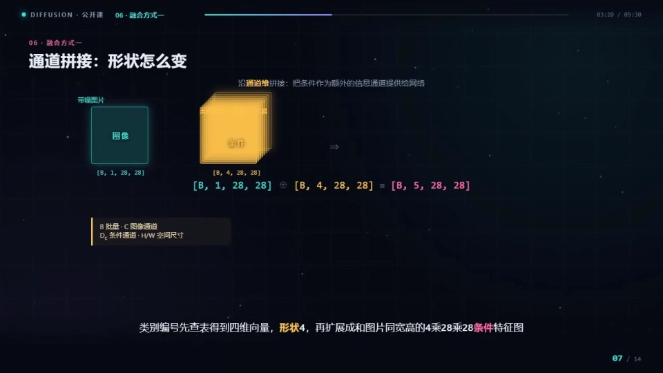

要强调一句：这不是把条件「画进图片」，而是给网络多几条信息通道，让它在每个空间位置上都能读到条件。这种方式实现简单、几乎不增加结构复杂度，缺点是条件的表达能力受限于「必须铺成和特征图同宽高」——文本这种变长序列就很难直接铺。

## 四、注入方式二：交叉注意力（让图像去查文字）

文生图的核心是第二种方式：**交叉注意力**（cross-attention）。一句话概括分工：**图像特征产生 query（查询），文本特征产生 key 和 value（键和值）**，让图像去「查」文字。[【跳转到 03:45】](https://www.bilibili.com/video/BV1yFyZzeESF/?t=225)

标准注意力公式是：

$$
\text{Attention}(Q,K,V)=\text{softmax}\!\left(\frac{QK^{\top}}{\sqrt{d_k}}\right)V
$$

和自注意力（self-attention）的区别只在 QKV 的来源：自注意力的 QKV 都来自同一组特征，交叉注意力的 Q 来自视觉、K 和 V 来自文本。直观说，**自注意力让图像内部交流，交叉注意力让图像去参考文字**。

### 4.1 先把 QKV 算清楚：形状与参数

视频给了一组具体数字，值得跟着算一遍：图像特征 $X$ 有 64 个视觉 token、每个 768 维，形状 $[64,768]$；文本特征 $C$ 有 77 个 token、每个也是 768 维，形状 $[77,768]$。[【跳转到 04:10】](https://www.bilibili.com/video/BV1yFyZzeESF/?t=250)

准备三个可学习的权重矩阵 $W_Q,W_K,W_V$，每个形状都是 $[768,768]$。**参数形状的规则**：输入维度 768 决定行数，输出维度 768 决定列数。

$$
Q = X W_Q:\ [64,768]\times[768,768]\Rightarrow[64,768]
$$

$$
K = C W_K:\ [77,768]\times[768,768]\Rightarrow[77,768]
\qquad
V = C W_V:\ [77,768]\times[768,768]\Rightarrow[77,768]
$$

内维 768 对齐消掉，这就是求 QKV 的全部过程：**图像只算 Q，文本算 K 和 V**，三组权重各自独立学习。[【跳转到 04:35】](https://www.bilibili.com/video/BV1yFyZzeESF/?t=275) [【跳转到 05:00】](https://www.bilibili.com/video/BV1yFyZzeESF/?t=300)

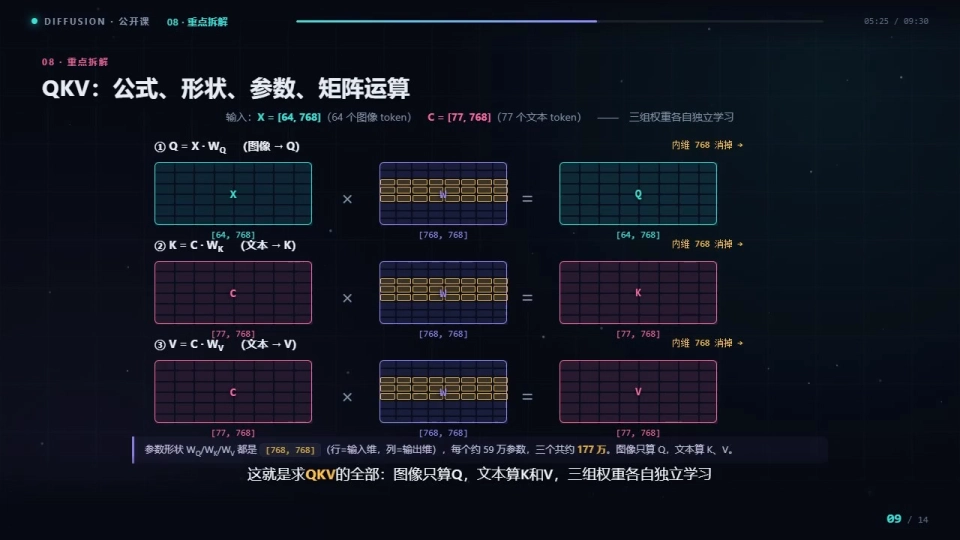

顺带算一下参数量：每个权重矩阵 $768\times768\approx59$ 万参数，三个加起来约 177 万。这部分参数就是「让图像学会查文字」的可学习接口。

### 4.2 再算注意力：从分数矩阵到输出

- **第四步**，$Q$ 乘 $K^{\top}$：$[64,768]\times[768,77]\Rightarrow[64,77]$，得到分数矩阵 $S$。每一行是一个图像 token，每一列是一个文本 token，**分数表示两者相关程度**。
- **第五步**，每个元素除以 $\sqrt{d_k}$ 稳定训练，再对每一行做 softmax，形状不变还是 $[64,77]$，但每行加起来等于 1，成为注意力权重 $A$。
- **第六步**，$A$ 乘 $V$：$[64,77]\times[77,768]\Rightarrow[64,768]$。[【跳转到 05:25】](https://www.bilibili.com/video/BV1yFyZzeESF/?t=325) [【跳转到 05:50】](https://www.bilibili.com/video/BV1yFyZzeESF/?t=350)

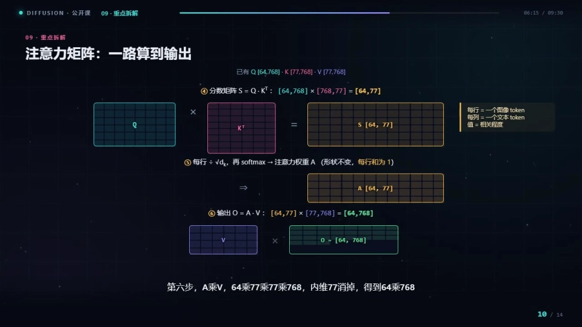

注意最后一步的形状：**输出 $[64,768]$ 和最初的图像特征 $X$ 完全一样**，所以可以直接加回原特征、传到下一层。整个过程 64×768 进、64×768 出，中间用文本信息重新加权了每个图像位置——这就是文本条件融进图像的方式。

## 五、训练与采样：条件在每一步都参与

### 5.1 训练：加噪的是图片，不是文字

训练时的配对很朴素：拿一张「橘猫坐在窗边」的图，先给它加噪得到 $x_t$，文字经过文本编码器得到条件 $c$；网络接收 $x_t$、$t$、$c$ 预测噪声，把预测噪声和真实加进去的噪声比较，算均方误差，更新参数。[【跳转到 06:15】](https://www.bilibili.com/video/BV1yFyZzeESF/?t=375)

$$
x_t=\sqrt{\bar{\alpha}_t}\,x_0+\sqrt{1-\bar{\alpha}_t}\,\epsilon,
\qquad
\hat{\epsilon}=\epsilon_\theta(x_t,t,c)
$$

$$
\mathcal{L}=\mathbb{E}\left[\left\|\epsilon-\epsilon_\theta(x_t,t,c)\right\|^2\right]
$$

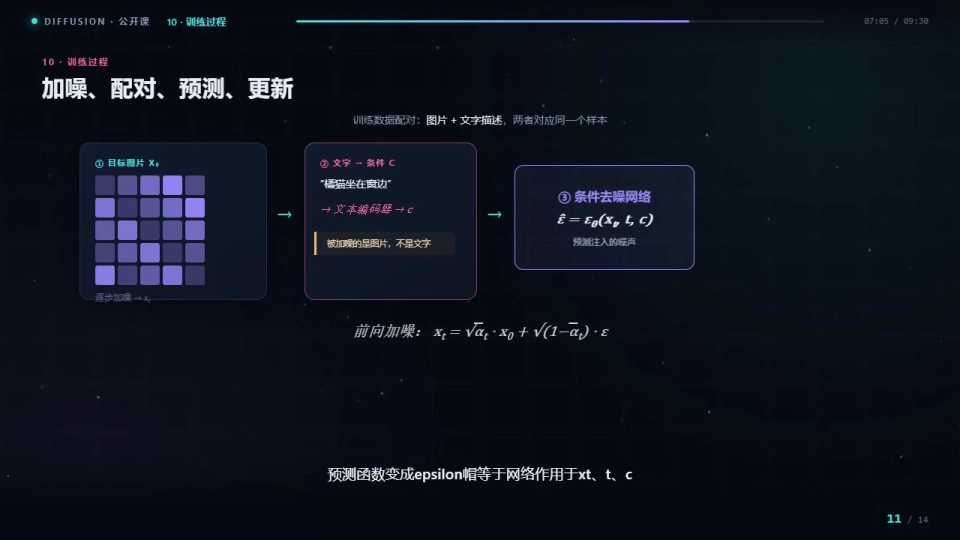

这里必须点明一个初学者最容易混淆的地方：**被加噪的是目标图像，不是文字**。文字作为额外信息提供，不会按同样规则逐步加噪。[【跳转到 07:05】](https://www.bilibili.com/video/BV1yFyZzeESF/?t=425) 换句话说：

- **生成变量**是 $x_t$，它在时间轴上被加噪、被去噪，形状和输出对齐；
- **条件变量**是 $c$，它没有时间轴，每一时刻都是同一个 $c$，只是被反复读取。

分清这两者，才能理解后面所有「条件怎么注入」「条件怎么丢」的操作。

### 5.2 采样：条件在每一步都持续参与

生成时先把提示词编码成条件特征，准备随机噪声 $x_T$，然后反复执行：当前状态 + 时间步 + 条件送进网络预测，采样器更新，直到结束。[【跳转到 07:30】](https://www.bilibili.com/video/BV1yFyZzeESF/?t=450)

### 5.3 条件丢弃：为「无条件分支」留一个开关

视频在这里补了一个常被混淆的概念：**CFG（无分类器引导）不等于条件扩散**。经典 CFG 的做法是：**训练时随机丢弃一部分条件**，让同一个网络同时学会有条件和无条件两种预测；采样时每步算两次——有条件的 $\hat{\epsilon}_{\text{cond}}$ 和无条件的 $\hat{\epsilon}_{\text{uncond}}$，再组合：

$$
\hat{\epsilon}_{\text{guided}}=\hat{\epsilon}_{\text{uncond}}+s\left(\hat{\epsilon}_{\text{cond}}-\hat{\epsilon}_{\text{uncond}}\right)
$$

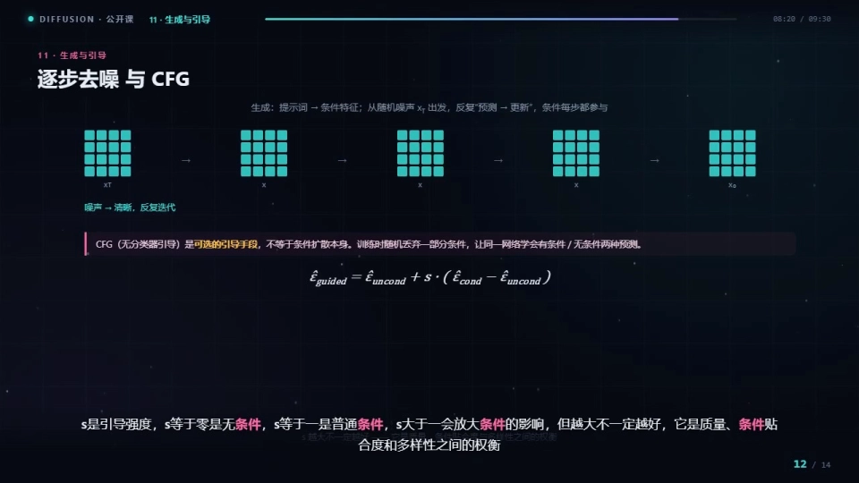

本小节只关心「丢弃」这个动作发生在哪里、为了什么：它发生在**训练侧、在把条件送进网络之前**——把条件换成一个空条件（或用固定的空嵌入），于是同一套权重在「有 $c$」和「无 $c$」两种输入下都被训练过。目的很直接：采样时要算 $\hat{\epsilon}_{\text{uncond}}$，如果网络从没见过无条件的输入，就无从算起。[【跳转到 07:55】](https://www.bilibili.com/video/BV1yFyZzeESF/?t=475)

至于 $s$ 取多大、为什么 $s>1$ 会牺牲多样性、分布会怎么偏移，那是引导采样（下一小节 5.1.2）的主题，这里只记住公式的骨架。

## 六、两个容易混淆的维度：条件扩散 vs 潜空间扩散

视频最后把条件扩散放进更大的结构里：再往上一步是**潜空间扩散**——先用 VAE 把图片压缩到紧凑的潜空间，扩散在潜空间里进行，最后用 VAE 解码器还原成图片。加入文字条件后，文字特征通过交叉注意力进入去噪网络，可选地再做 CFG 组合，采样更新得到最终潜变量，再解码成图片。[【跳转到 08:20】](https://www.bilibili.com/video/BV1yFyZzeESF/?t=500)

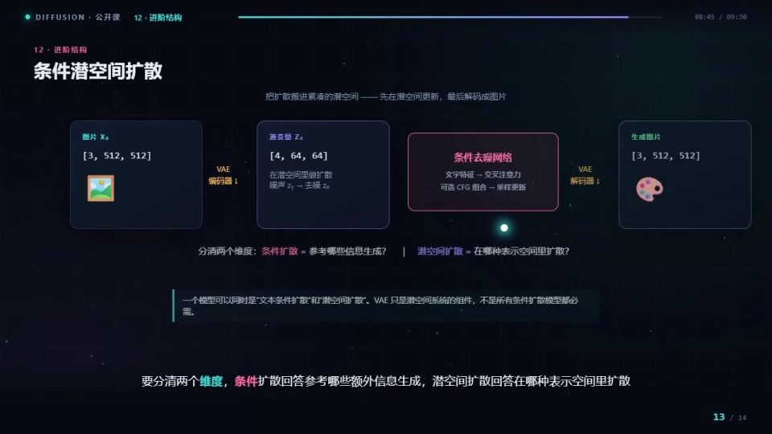

要分清两个**正交**的维度：

| 维度 | 回答的问题 |
| --- | --- |
| 条件扩散 | 参考哪些额外信息生成？ |
| 潜空间扩散 | 在哪种表示空间里扩散？ |

一个模型可以同时是「文本条件扩散」和「潜空间扩散」，Stable Diffusion 就是这种组合。这也提醒我们：条件注入是**接口层面**的设计，与骨干在像素空间还是潜空间无关。

## 七、优势与局限

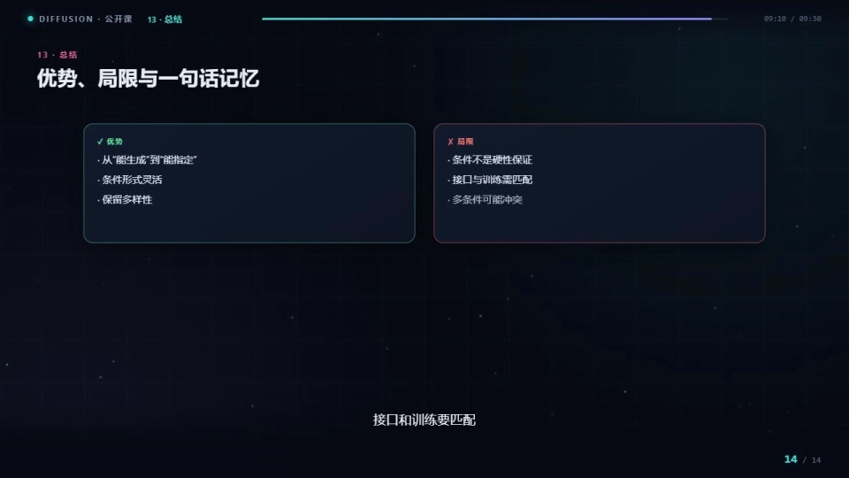

- **优势**：从「能生成」到「能指定条件」；条件形式灵活（标签、文本、图像都行）；仍然保留多样性。
- **局限**：条件不是硬性保证——输入两个物体，不保证严格输出两个；接口和训练要匹配——训练时怎么注入，采样时就得怎么注入；多个条件可能互相冲突。[【跳转到 08:45】](https://www.bilibili.com/video/BV1yFyZzeESF/?t=525) [【跳转到 09:10】](https://www.bilibili.com/video/BV1yFyZzeESF/?t=550)

## 小结

- 条件扩散只比普通扩散多学一件事：**在满足要求的前提下生成**，公式上只是多了一个输入 $c$，分布上从 $p(x)$ 变成 $p(x \mid c)$。
- 条件必须先**编码**成向量：类别标签查嵌入表，文本经分词器 + 文本编码器得到 $[L,768]$ 的序列。
- **通道拼接**把条件铺成与特征图同宽高的通道再拼上，实现简单，输出形状不变。
- **交叉注意力**让图像产生 Q、文本产生 K/V，输出形状与输入图像特征一致，可以直接加回原特征——这是文生图的核心注入方式。
- 训练时被加噪的是**生成变量** $x_t$，条件 $c$ 只是额外信息，不参与加噪。
- **条件丢弃**发生在训练侧、条件送进网络之前，目的是让同一网络学会无条件预测，为采样时的无分类器引导留出分支；引导强度与分布偏移留给 5.1.2。

## 关键术语速查

| 术语 | 一句话解释 |
| --- | --- |
| 条件变量 $c$ | 标签、文本、参考图等额外信息，不参与加噪，只在每一步被读取 |
| 生成变量 $x_t$ | 被加噪、被去噪的目标状态，形状与网络输出对齐 |
| 条件编码器 | 把条件翻译成向量或向量序列的模块（嵌入层 / 文本编码器） |
| 通道拼接 | 把条件扩成与特征图同宽高后沿通道维拼上，作为额外信息通道 |
| 交叉注意力 | 图像特征出 Q、条件特征出 K/V，让图像按相关性读取条件 |
| 条件丢弃 | 训练时随机把条件置空，使同一网络同时具备条件与无条件预测能力 |
| 潜空间扩散 | 在 VAE 压缩后的潜表示上做扩散，与「条件扩散」是两个正交维度 |