# 分类器引导与无分类器引导：引导强度如何把采样推向条件类别

> 视频来源：[Classifier and Classifier-Free Diffusion Guidance](https://www.youtube.com/watch?v=90GlJcpMrm8)（YouTube · NPTEL-NOC IITM，讲者 Vineeth N B，IIT-H）｜时长约 15 分钟
> 简要导读：这支短片把两条引导路线放在同一页上讲：先讲分类器引导怎么训练、怎么用梯度扰动去噪轨迹，并给出「引导强度就是温度」的解释；再讲无分类器引导如何用条件丢弃把分类器消掉。本文按它的顺序梳理，并对照两者的实现代价。

## 本讲要解决的核心问题（SCQA）

**背景**：扩散模型从噪声一步步走到图像，学的是整个数据分布，因此能给出多样化的样本。

**冲突**：正因为过程是随机的，你没法直接要求它「给我一张柯基犬」——不加干预时，生成结果无法控制。

**疑问**：怎样把生成导向某个类别？用外部分类器的梯度去扰动去噪轨迹（分类器引导）是一个办法，但它要额外训练一个能处理高噪声的分类器；能不能不要这个分类器？

**回答（中心思想）**：两条路线做的是同一件事——**放大「条件信号」那部分分布**。分类器引导用 $\gamma\nabla_{x_t}\log p(y\mid x_t)$ 实现，效果等价于把条件分布升到 $\gamma$ 次方，也就是给条件项单独调温度；无分类器引导则用条件丢弃训练一个「会装傻」的模型，把分类器项改写成条件与无条件预测之差 $\hat\epsilon=\epsilon_\theta(x_t,t,\phi)+\gamma\left[\epsilon_\theta(x_t,t,y)-\epsilon_\theta(x_t,t,\phi)\right]$，从而在推理时彻底不需要分类器。

## 一、问题：无条件生成不可控

这一讲之前，扩散模型做的都是**无条件生成**：从噪声出发，一步步得到一张来自（或近似来自）原始数据分布的图像（[【跳转到 02:00】](https://www.youtube.com/watch?v=90GlJcpMrm8&t=120)）。

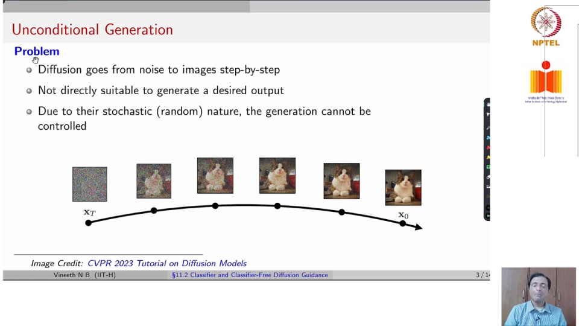

这种方式适合得到**多样化**的结果，但不一定能得到你想要的某个类别的输出，因为扩散过程本身带有随机性。所以本节要问的是：**能不能把生成导向某个特定类别？** 幻灯片上列了两篇原始论文——分类器引导（Dhariwal & Nichol, 2021）和无分类器引导（Ho & Salimans, 2021 workshop），这一讲就把这两条路线讲清楚（[【跳转到 01:05】](https://www.youtube.com/watch?v=90GlJcpMrm8&t=65)）。

## 二、分类器引导：用外部分类器的梯度扰动去噪轨迹

分类器引导的思路是：**在反向过程里扰动去噪轨迹**，把它推向某个特定类别，从而生成属于该类别的图像。具体分两步（[【跳转到 02:50】](https://www.youtube.com/watch?v=90GlJcpMrm8&t=170)）：

1. **先训练一个带噪图像分类器**：给它一张图和它的若干加噪版本，训练它输出类别标签，得到 $p(y\mid x)$。
2. **采样时用它的梯度扰动噪声**：分类器冻结，取 $\gamma\nabla_{x_t}\log p(y\mid x_t)$，乘上系数 $\gamma$ 后加到预测出的噪声上。

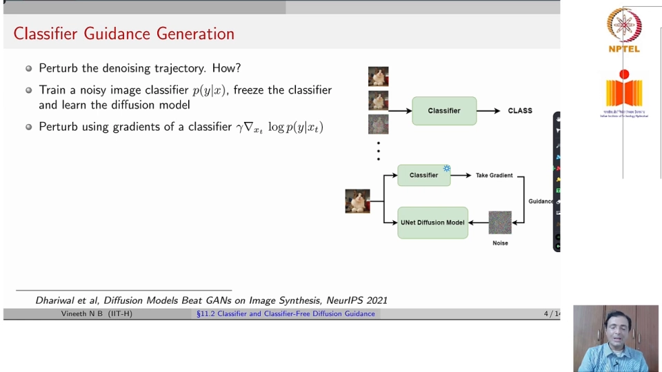

### 2.1 为什么这样能行：把条件拆进得分里

我们原本要学的是反向过程 $p_\theta(x_{t-1}\mid x_t)$，它对应 $\nabla_x\log p_\theta(x_t)$。现在希望这个量里带上类别信息，于是可以写成（[【跳转到 04:55】](https://www.youtube.com/watch?v=90GlJcpMrm8&t=295)）：

$$
\nabla_x\log p_\theta(x_t\mid y)=\nabla_x\log p_\theta(x_t)+\nabla_x\log p_\theta(y\mid x_t)
$$

第一项就是标准 DDPM 里已经用过的那一项，它近似给出 $-\frac{1}{\sqrt{\bar\alpha_t}}\epsilon_\theta(x_t,t)$；第二项来自分类器，记作 $\phi$，它预测给定带噪 $x_t$ 时的 $y$。于是新噪声就是「原来的噪声」再减去「分类器梯度乘以系数」（[【跳转到 05:45】](https://www.youtube.com/watch?v=90GlJcpMrm8&t=345)）：

$$
\hat\epsilon=\epsilon_\theta(x_t)-\sqrt{1-\bar\alpha_t}\,\gamma\nabla_{x_t}\log p_\phi(y\mid x_t)
$$

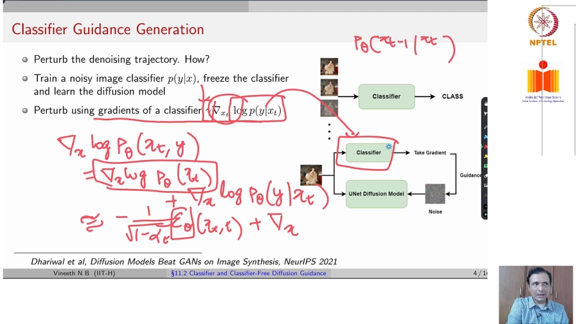

除了这个新噪声，DDPM 的其余流程完全不变。把这套更新写进 DDIM 采样就是下面的算法（[【跳转到 08:41】](https://www.youtube.com/watch?v=90GlJcpMrm8&t=521)）：

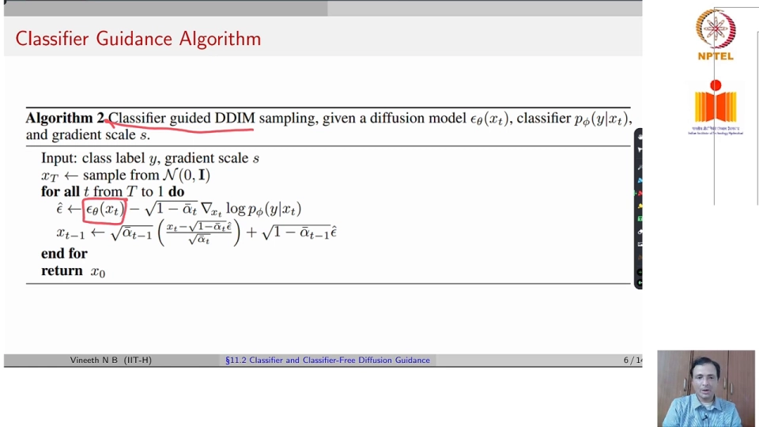

### 2.2 引导强度 $\gamma$ 到底是什么：给条件项单独调温度

把梯度还原成概率，就能看清 $\gamma$ 的作用。按贝叶斯公式 $p(x_t\mid y)=p(x_t)p(y\mid x_t)/p(y)$，去掉与 $x$ 无关的 $p(y)$，得到（[【跳转到 07:01】](https://www.youtube.com/watch?v=90GlJcpMrm8&t=421)）：

$$
p_\gamma(x_t\mid y)\propto p(x_t)\cdot p(y\mid x_t)^{\gamma}
$$

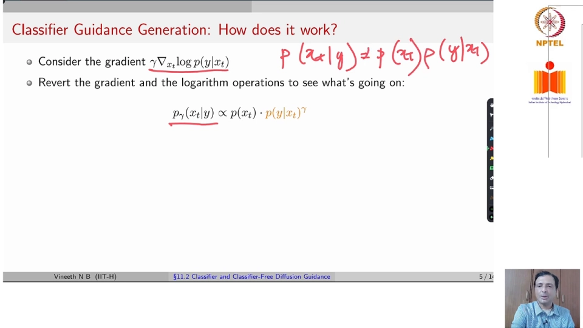

因为对数里乘了 $\gamma$，去掉对数之后 $\gamma$ 就变成了指数。这相当于给这个分布设定了一个**温度**：$\gamma$ 是逆温度参数，是一个可调旋钮，告诉我们预测噪声时想给条件分布多大的权重（[【跳转到 07:26】](https://www.youtube.com/watch?v=90GlJcpMrm8&t=446)）。

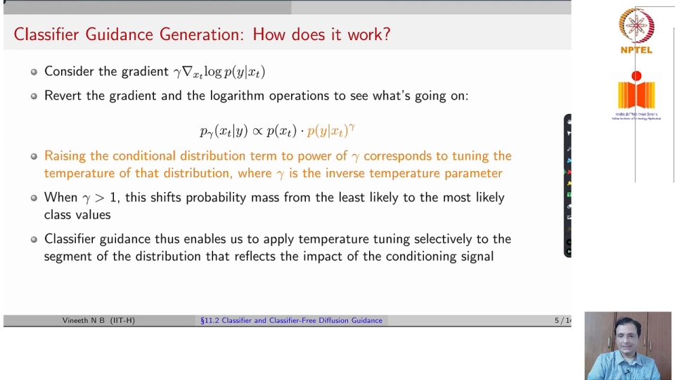

当 $\gamma>1$ 时，概率质量会从「可能不太可能的类别」转移到「最可能的类别」上。所以分类器引导让我们可以对**影响条件信号的那部分分布**做选择性的温度调节——注意是「选择性」：温度只加在条件项上，不是给整个分布升温（[【跳转到 07:51】](https://www.youtube.com/watch?v=90GlJcpMrm8&t=471)）。

### 2.3 效果：$\gamma=1$ 不够，$\gamma=10$ 才像

以「彭布罗克威尔士柯基」为条件类别，$\gamma=1.0$ 时生成的样本并不令人信服；$\gamma=10.0$ 时图像与类别明显更一致（[【跳转到 09:30】](https://www.youtube.com/watch?v=90GlJcpMrm8&t=570)）。

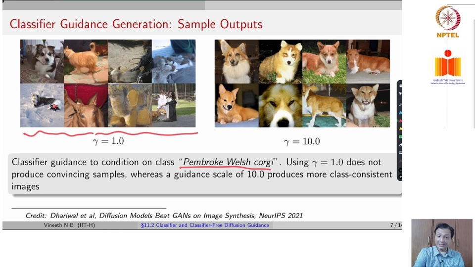

### 2.4 局限：三个绕不过去的成本

分类器引导有三条明确的局限（[【跳转到 09:48】](https://www.youtube.com/watch?v=90GlJcpMrm8&t=588)）：

1. **需要一个专门为引导训练的分类器**，也就是多一个网络。
2. **这个分类器必须能处理很高的噪声水平**。因为你要在反向过程的各个噪声时间步上都用它，它得适应那种噪声程度的图像。
3. **分类器梯度本身可能不完美**，会给出错误的方向，把噪声引到别处去（[【跳转到 10:13】](https://www.youtube.com/watch?v=90GlJcpMrm8&t=613)）。

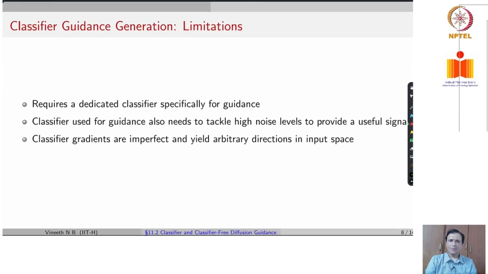

## 三、无分类器引导：让扩散模型自己提供扰动

为了绕开独立分类器，Ho 等人的做法是**让扩散模型自己来提供引导所需的扰动**（[【跳转到 10:38】](https://www.youtube.com/watch?v=90GlJcpMrm8&t=638)）。

### 3.1 训练侧：条件丢弃

训练一个带**条件丢弃（conditioning dropout）**的条件扩散模型：把条件信息 $y$ 去掉，让模型变成无条件模型。实践中，你把用来预测噪声的 $y$ 换成一个特殊输入值，它表示「没有任何条件信息」，并在不同迭代中这样做。这样条件模型和无条件模型可以用**同一个神经网络**学到（[【跳转到 11:02】](https://www.youtube.com/watch?v=90GlJcpMrm8&t=662)）。

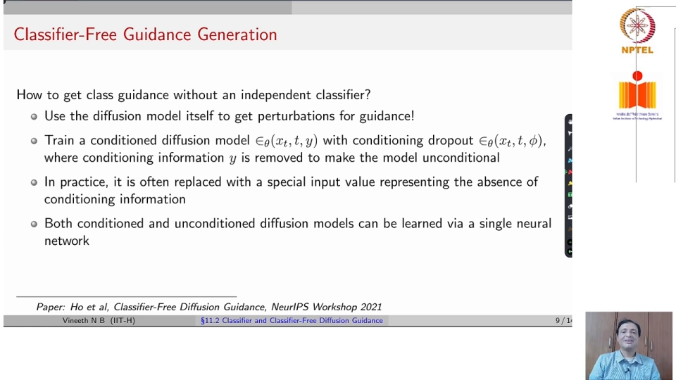

### 3.2 推理侧：分类器项 = 条件得分 − 无条件得分

为什么这样就能替代分类器？还是从贝叶斯公式出发：

$$
p(y\mid x_t)=\frac{p(x_t\mid y)\,p(y)}{p(x_t)}
$$

取对数后对 $x$ 求梯度，与 $x$ 无关的项（$p(y)$）梯度为零，于是只剩两项之差（[【跳转到 11:52】](https://www.youtube.com/watch?v=90GlJcpMrm8&t=712)）：

$$
\nabla_{x_t}\log p(y\mid x_t)=\nabla_{x_t}\log p(x_t\mid y)-\nabla_{x_t}\log p(x_t)
$$

也就是说，分类器项可以理解成**一个条件项加一个与 $y$ 无关的无条件项**。把它代进分类器引导的公式，就得到无分类器引导的噪声（[【跳转到 12:42】](https://www.youtube.com/watch?v=90GlJcpMrm8&t=762)）：

$$
\hat\epsilon_\theta(x_t,t,y)=\epsilon_\theta(x_t,t,\phi)+\gamma\left(\epsilon_\theta(x_t,t,y)-\epsilon_\theta(x_t,t,\phi)\right)
$$

这里 $\phi$ 表示「没有 $y$」，可以把它当成一个特殊类别标签，意思是「没有任何标签」。这个式子的含义很直白：**从无条件出发，朝条件的方向走 $\gamma$ 步**（[【跳转到 12:17】](https://www.youtube.com/watch?v=90GlJcpMrm8&t=737)）。

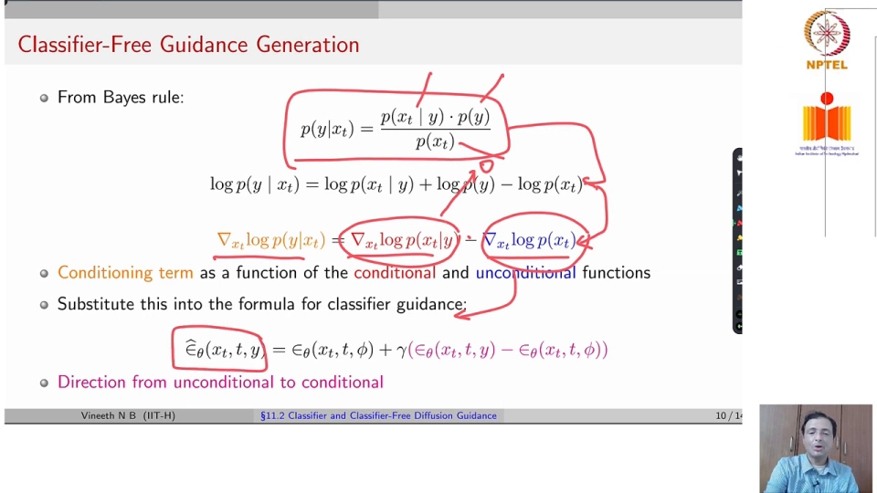

### 3.3 训练算法

整体算法是：从数据集采样带条件的样本 $(x,c)$，然后以概率 $p_{\text{uncond}}$ 随机丢弃条件（$c\leftarrow\varnothing$），再采样噪声、加噪、回归噪声，用梯度下降更新去噪模块（[【跳转到 13:07】](https://www.youtube.com/watch?v=90GlJcpMrm8&t=787)）：

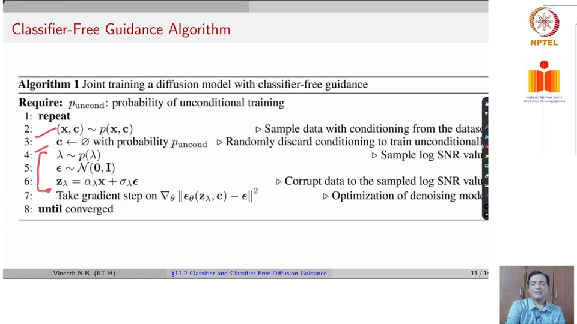

关键结论：**训练初期你确实需要一个分类器，但推理阶段就不需要了**（[【跳转到 13:32】](https://www.youtube.com/watch?v=90GlJcpMrm8&t=812)）。

### 3.4 $\gamma$ 的两端：0 是无条件，1 是标准条件模型

无分类器引导下，$\gamma$ 的语义很干净：$\gamma=0$ 时恢复无条件模型，$\gamma=1$ 时得到标准的条件模型（[【跳转到 14:02】](https://www.youtube.com/watch?v=90GlJcpMrm8&t=842)）。

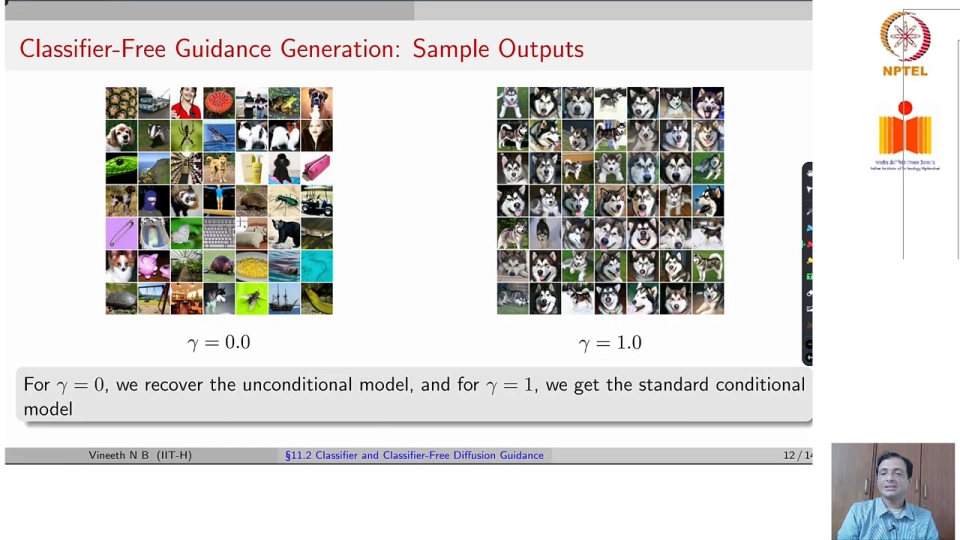

值得注意的是，即使 $\gamma=1$，它也能生成对应特定类别的图像——而分类器引导在 $\gamma=1$ 时做不到这一点。

## 四、两条路线的对照

### 4.1 为什么无分类器引导效果更好

课上给的解释比较直观（[【跳转到 14:18】](https://www.youtube.com/watch?v=90GlJcpMrm8&t=858)）：

- 现在的「分类器」**来自生成模型本身**：是生成图像的扩散模型自己被引向了这个类别。
- 来自生成模型的梯度**可能比来自分类器的梯度更稳健**，因为分类器未必适应带噪图像分布。
- **训练一个生成模型总是比训练一个生成模型加一个分类器更容易**。
- 条件丢弃在训练流程里实现起来非常简单（[【跳转到 14:53】](https://www.youtube.com/watch?v=90GlJcpMrm8&t=893)）。

### 4.2 对照表

| 维度 | 分类器引导 | 无分类器引导（CFG） |
| --- | --- | --- |
| 引导信号来源 | 外部分类器的梯度 $\gamma\nabla_{x_t}\log p(y\vert x_t)$ | 条件与无条件预测之差 $\epsilon_\theta(x_t,t,y)-\epsilon_\theta(x_t,t,\phi)$ |
| 需要几个模型 | 扩散模型 + 一个专门训练的分类器 | 一个模型，两种输入模式 |
| 训练侧改动 | 额外训练带噪分类器 | 以概率 $p$ 丢弃条件标签 |
| 推理侧额外开销 | 每步一次分类器前向与反传 | 每步两次去噪网络前向（条件 + 无条件） |
| 条件可以是文本吗 | 困难：似然与梯度都难算 | 可以：条件只是网络的输入 |
| $\gamma$ 的语义 | 条件项的温度，$\gamma>1$ 才明显生效 | $\gamma=0$ 无条件，$\gamma=1$ 标准条件模型 |
| 主要风险 | 分类器不适应噪声、梯度方向不可靠 | 引导过强时多样性下降、样本偏离数据分布 |

## 小结

- 无条件扩散模型能给出多样化样本，但无法指定类别；引导就是把这个过程「推」向条件。
- 分类器引导用冻结的带噪分类器梯度修正噪声估计，等价于把条件分布升到 $\gamma$ 次方，即只对条件项调温度。
- 它的代价是必须多训练一个能处理高噪声的分类器，且梯度未必可靠；条件换成文本时更难处理。
- 无分类器引导用条件丢弃让同一个网络学会条件与无条件两种模式，再把分类器项写成两者之差，推理时不再需要分类器。
- 引导强度 $\gamma$ 决定「朝条件方向走多远」：$\gamma$ 越大条件一致性越强，但这是在用多样性换一致性。

## 关键术语速查

| 术语 | 一句话解释 |
| --- | --- |
| 无条件生成 | 不指定类别或提示，直接从数据分布采样的生成方式 |
| 分类器引导 | 用外部分类器对带噪样本的梯度扰动去噪轨迹，把样本推向目标类别 |
| 引导强度 $\gamma$ | 放大条件项梯度的系数；等价于条件分布的温度参数 |
| 带噪图像分类器 | 在加噪图像上训练的分类器，能在反向过程各噪声水平上给出类别概率 |
| 条件丢弃（conditioning dropout） | 训练时以一定概率把条件换成特殊符号，使同一网络也能做无条件预测 |
| 无分类器引导（CFG） | 用条件与无条件噪声预测之差代替分类器梯度，$\hat\epsilon=\epsilon(\phi)+\gamma\left[\epsilon(y)-\epsilon(\phi)\right]$ |
| 特殊符号 $\phi$ | 表示「没有条件」的输入值，相当于一个「空标签」类别 |
| 温度调节 | 把分布升到 $\gamma$ 次方，使概率质量向最可能的取值集中 |