# 无分类器引导：不训练分类器也能强化提示词

> 视频来源：[MIT 6.S184: Flow Matching and Diffusion Models - Lecture 03B - Classifier-free Guidance](https://www.youtube.com/watch?v=8oWZ1bHwyRI)（YouTube · Peter Holderrieth，MIT）｜时长约 39 分钟
> 简要导读：这一讲从「把提示词当输入」的朴素引导出发，先用贝叶斯公式推出分类器引导，再把这个分类器改写成两个向量场之差，从而得到无分类器引导（CFG）。本文按这条推导链走一遍，并说明引导强度 $w$ 换来了什么、又付出了什么。

## 本讲要解决的核心问题（SCQA）

**背景**：扩散模型和流模型已经能从纯噪声生成逼真的图像，训练目标就是把向量场 $u_t(x)$ 学出来，让样本沿着它从噪声走到数据。

**冲突**：我们并不想只要「一张图」，我们要「一辆用蔬菜做的汽车」这样的图。最直接的办法是把提示词 $y$ 也喂进网络，让网络学条件向量场 $u_t(x\mid y)$——理论上这就够了。但实测发现，这样生成的柯基犬图像要么构图跑偏，要么干脆出错，根本贴不住提示。

**疑问**：既然条件已经在网络里了，为什么结果还是贴不住提示？要怎样才能把生成「推」向提示，而且不必额外训练一个分类器？

**回答（中心思想）**：引导的本质是把向量场里「依赖提示的那一部分」放大。分类器引导用外部分类器的梯度 $\nabla_x\log p_t(y\mid x)$ 完成这件事，代价是要多训练一个能处理带噪图像的网络；无分类器引导则证明这一项恰好等于两个向量场之差，于是只要训练一个会「装傻」的网络（以一定概率丢掉标签），就能用 $\tilde u_t^w=(1-w)u_t^\theta(x\mid\varnothing)+w\,u_t^\theta(x\mid y)$ 达到同样效果，代价是每个采样步要跑两次前向。

## 一、朴素引导：把提示词塞进网络，理论上就够了

先约定两个词。**无引导（unguided）**就是随便生成一张图；**引导（guided）**是生成符合某段具体提示的图，比如「一只在烤蛋糕的猫」。所谓引导，就是让模型不只生成点东西，而是生成**符合要求**的东西（[【跳转到 00:45】](https://www.youtube.com/watch?v=8oWZ1bHwyRI&t=45)）。

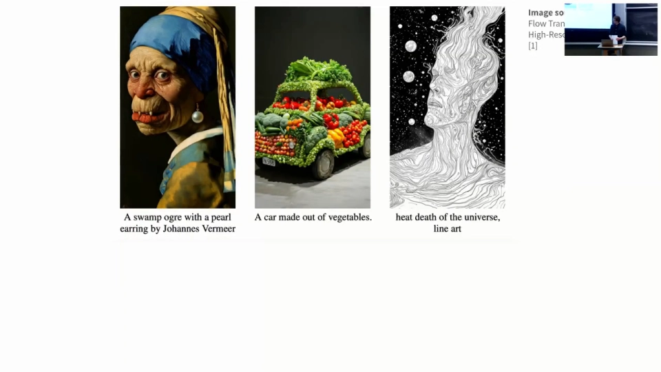

做法上，数据分布从「只有图像」变成「成对的图像和提示」$(x,y)$。流模型原本学的是 $u_t^\theta(x)$，现在让它多一个输入：

$$
u_t^\theta(x\mid y)
$$

这就是**引导后的向量场**（guided vector field）。训练损失一字不改，只是采样时从数据集里取的是「图像 + 提示」这一对，而不是单独的图像（[【跳转到 02:15】](https://www.youtube.com/watch?v=8oWZ1bHwyRI&t=135)）。采样也一字不改：挑一个提示 $y$，初始化 $X_0\sim p_{\text{init}}$，然后积分

$$
\mathrm{d}X_t = u_t^\theta(X_t\mid y)\,\mathrm{d}t,\qquad t=0\to 1
$$

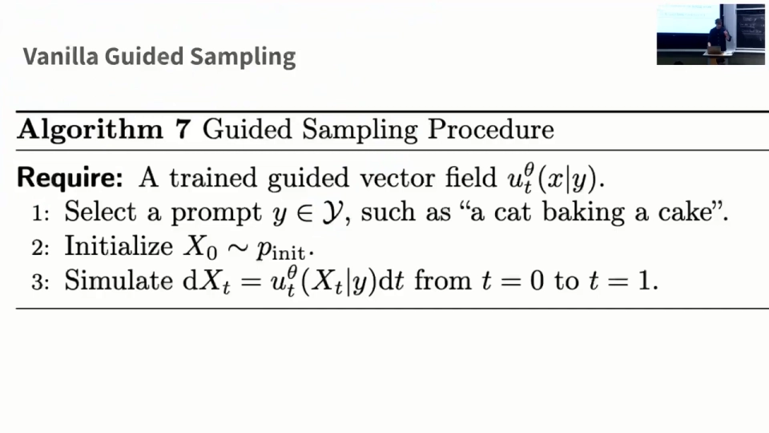

用讲课人的话说：「我们其实什么也没做，只是多插了一个输入而已。」（[【跳转到 04:48】](https://www.youtube.com/watch?v=8oWZ1bHwyRI&t=288)）

## 二、冲突：理论上够，实测贴不住提示

如果世界完全符合理论，到这里就该结束了——这个过程就是在从「给定提示的条件数据分布」里采样。但实际观察到的效果并不理想。用一个在 ImageNet 上训练的模型、提示设为「柯基犬」，生成的图是这样（[【跳转到 05:34】](https://www.youtube.com/watch?v=8oWZ1bHwyRI&t=334)）：

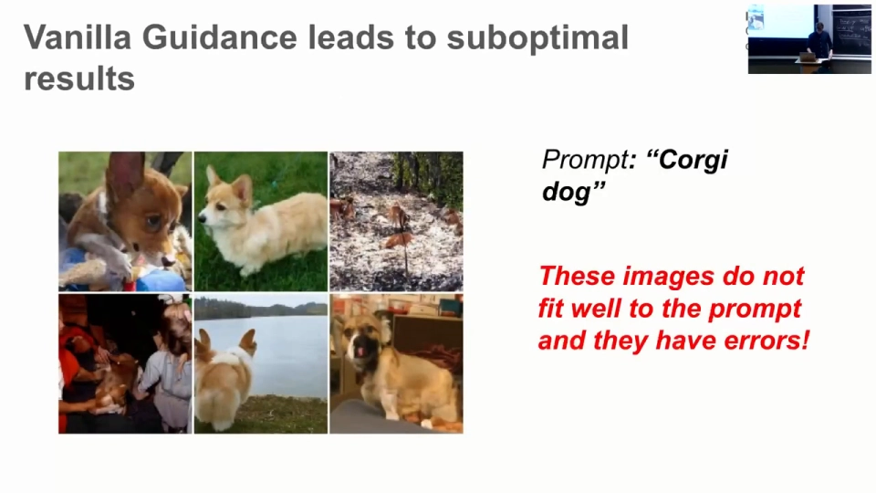

图像有点东倒西歪，虽然带着一点狗的调子，但不是我们要的东西。于是问题变成：**怎么把依赖提示的那部分强化起来？**

课上有人追问：为什么不让条件向量场本身也依赖提示（比如让加噪日程依赖提示）？回答是原则上都可以，只是记号会变得很重，实践中大家不这么做——真正在实践中被广泛采用的，是下面这条路线（[【跳转到 06:52】](https://www.youtube.com/watch?v=8oWZ1bHwyRI&t=412)）。

## 三、分类器引导：用贝叶斯公式把「条件」拆开

第一件工具是贝叶斯公式。对带噪图像 $x$ 和提示 $y$：

$$
p_t(x\mid y)=\frac{p_t(y\mid x)\,p_t(x)}{p_t(y)}
$$

取对数，乘积变成求和：

$$
\log p_t(x\mid y)=\log p_t(y\mid x)+\log p_t(x)-\log p_t(y)
$$

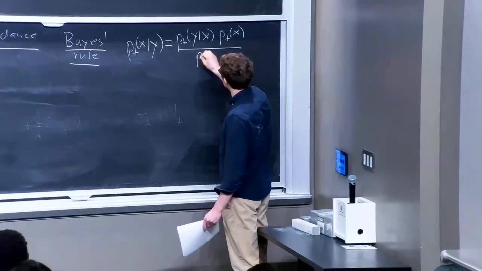

接着对 $x$ 求梯度。**对数密度的梯度就是得分（score）**，这正是前面几讲反复铺垫得分的原因。最后一项 $\log p_t(y)$ 与 $x$ 无关，梯度为零，直接扔掉：

$$
\nabla_x\log p_t(x\mid y)=\nabla_x\log p_t(y\mid x)+\nabla_x\log p_t(x)
$$

也就是说，**给定提示后的得分 = 分类器的对数梯度 + 无条件得分**。再把它换算回向量场，就得到引导后向量场的分解（[【跳转到 11:46】](https://www.youtube.com/watch?v=8oWZ1bHwyRI&t=706)）：

$$
u_t^{\text{target}}(x\mid y)=u_t^{\text{target}}(x)+a_t\,\nabla_x\log p_t(y\mid x)
$$

其中 $a_t$ 是得分与向量场互换时的已知系数。第一项与提示无关，第二项完全由提示决定——后者就是**分类器**：给定图像 $x$，它回答「属于这个提示/类别的概率是多少」。

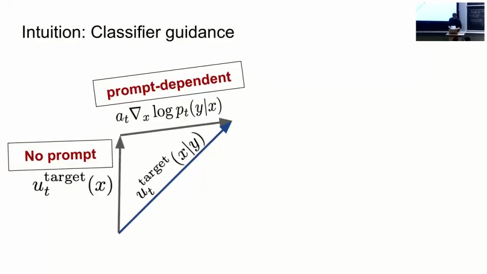

既然生成结果贴不住提示，最自然的想法就是**把依赖提示的那部分放大**：把图中蓝色的方向换成更长的红色方向，用一个权重 $W$ 去放大分类器那一项（[【跳转到 15:47】](https://www.youtube.com/watch?v=8oWZ1bHwyRI&t=947)）：

$$
\tilde u_t^w(x\mid y)=u_t^{\text{target}}(x)+w\,a_t\,\nabla_x\log p_t(y\mid x)
$$

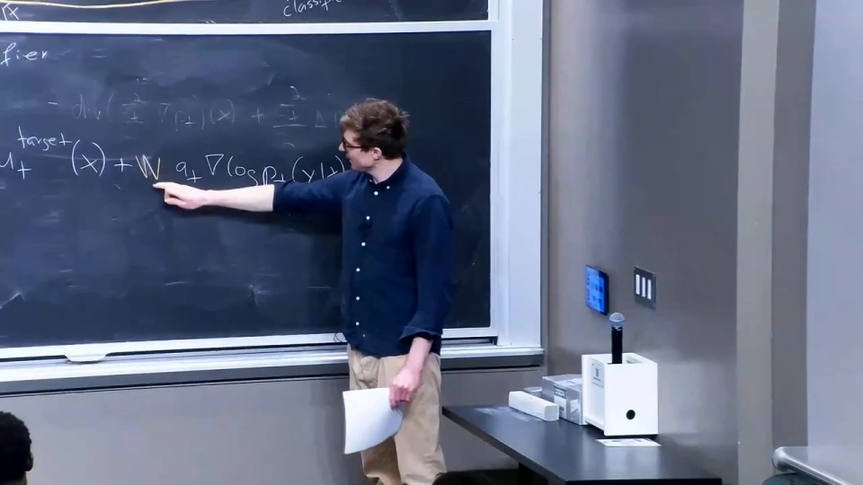

这就是**分类器引导**（classifier guidance）。操作上分两步：先训练一个「给定带噪 $x$ 时 $y$ 的概率」的分类器，再在采样时把它的梯度加上去（[【跳转到 18:01】](https://www.youtube.com/watch?v=8oWZ1bHwyRI&t=1081)）。

## 四、为什么分类器引导不是终点

课上当场做了批判：这条路有什么不好？

1. **要额外训练一个分类器**。既要训练向量场，又要训练分类器，工作量直接翻倍，还要维护两个模型。
2. **不能直接拿现成的分类器**。这里的 $x$ 是带噪数据，分类器必须在带噪数据上训练，还得在各个噪声水平上都可用。
3. **条件一旦是文本就麻烦了**。如果 $y$ 是一长串文本而不是一个类别，这个似然很难算，梯度也很难算（[【跳转到 19:11】](https://www.youtube.com/watch?v=8oWZ1bHwyRI&t=1151)）。

所以要问的是：能不能在**不训练分类器**的前提下，达到「放大分类器」同样的效果？

## 五、无分类器引导：分类器其实就是两个向量场之差

关键一步是反过来用贝叶斯公式。既然

$$
\nabla_x\log p_t(x\mid y)=\nabla_x\log p_t(y\mid x)+\nabla_x\log p_t(x)
$$

那么分类器那一项就等于

$$
\nabla_x\log p_t(y\mid x)=\nabla_x\log p_t(x\mid y)-\nabla_x\log p_t(x)
$$

也就是**引导得分减去无引导得分**。把它代回分类器引导的式子，分类器就消失了，剩下的全是向量场（[【跳转到 24:30】](https://www.youtube.com/watch?v=8oWZ1bHwyRI&t=1470)）：

$$
\tilde u_t^w(x)=(1-w)\,u_t^\theta(x\mid\varnothing)+w\,u_t^\theta(x\mid y)
$$

这里 $\varnothing$ 是「空 token」，表示「不告诉你提示是什么」。等价的写法是

$$
\tilde u_t^w(x)=u_t^\theta(x\mid\varnothing)+w\left[u_t^\theta(x\mid y)-u_t^\theta(x\mid\varnothing)\right]
$$

即「无条件向量场 + $w$ 倍的两者之差」。换成预测噪声 $\epsilon$ 的写法就是 $\tilde\epsilon=\epsilon_\theta(x_t,\varnothing)+w\left[\epsilon_\theta(x_t,y)-\epsilon_\theta(x_t,\varnothing)\right]$——很多论文把权重写成 $1+w$ 的形式，只是把 $w$ 的定义平移了一下，本质是同一个式子。

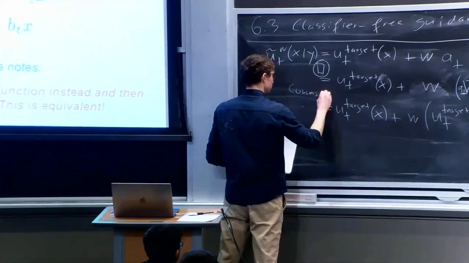

这个式子了不起的地方在于：**它里面已经没有分类器了**。我们想强化的是分类器的作用，但把它写成了不需要真的学分类器的形式——那个分类器完全是假设出来的，它并不真的存在，只是理论上算出的这个差应该对应它。这就是「无分类器」这个名字的来历（[【跳转到 28:54】](https://www.youtube.com/watch?v=8oWZ1bHwyRI&t=1734)）。

顺便看清 $w$ 的两端：$w=1$ 时后面一项消失，退化成普通条件模型；$w=0$ 时退化成无条件模型。$w>1$ 才是「放大依赖提示的部分，同时减掉更多无条件部分」。

## 六、一个网络怎么同时给出条件和无条件

到这一步还剩一个问题：式子里有 $u_t^\theta(x\mid y)$ 和 $u_t^\theta(x\mid\varnothing)$ 两个量，看起来还是两个模型。解决办法是一个极简的技巧：**定义一个空 token $\varnothing$**，用它告诉网络「这次我不告诉你提示是什么」，让同一个网络既能被条件化、也能被「去条件化」（[【跳转到 27:26】](https://www.youtube.com/watch?v=8oWZ1bHwyRI&t=1646)）。

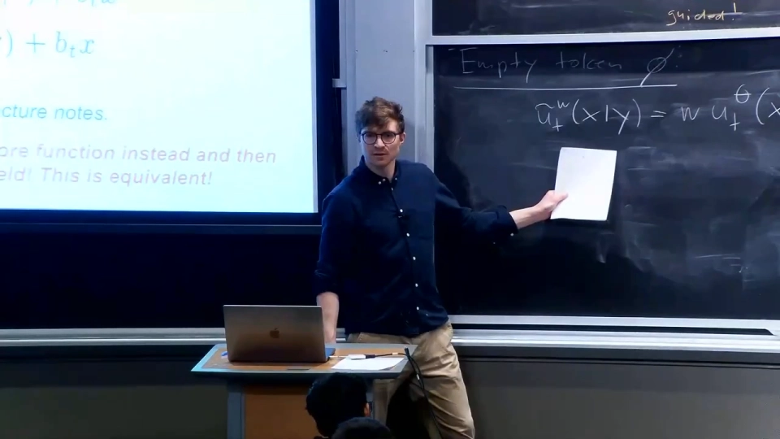

训练侧只需要改一处：以一定概率 $p$ 把标签丢掉。从数据集采一对 $(z,y)$，采随机时间 $t$ 和噪声 $\epsilon$，把噪声加到数据上，然后**以概率 $p$ 把 $y$ 换成 $\varnothing$**，再算损失（[【跳转到 31:07】](https://www.youtube.com/watch?v=8oWZ1bHwyRI&t=1867)）：

$$
\mathcal{L}(\theta)=\left\|u_t^\theta(x\mid y)-u_t^{\text{target}}(x\mid z)\right\|^2,\qquad y\leftarrow\varnothing\ \text{以概率}\ p
$$

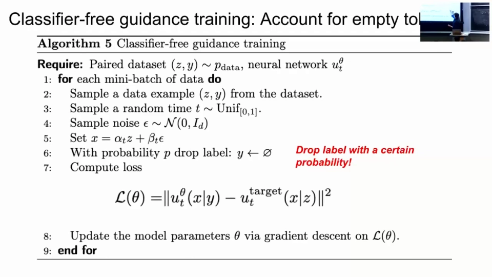

比如 20% 的时间不告诉模型提示是什么。这样它既要学会跟随提示，也要学会在不知道提示时该怎么办。改动极小，这正是它漂亮的地方：所有东西都摊销进一个流程里，不需要两个网络（[【跳转到 31:32】](https://www.youtube.com/watch?v=8oWZ1bHwyRI&t=1892)）。

## 七、采样：把向量场换成加权向量场

采样流程和朴素引导一样，只是把向量场换成 CFG 向量场，然后照旧模拟 ODE（[【跳转到 32:16】](https://www.youtube.com/watch?v=8oWZ1bHwyRI&t=1936)）：

$$
\mathrm{d}X_t=\left[(1-w)u_t^\theta(X_t\mid\varnothing)+w\,u_t^\theta(X_t\mid y)\right]\mathrm{d}t,\qquad t=0\to 1
$$

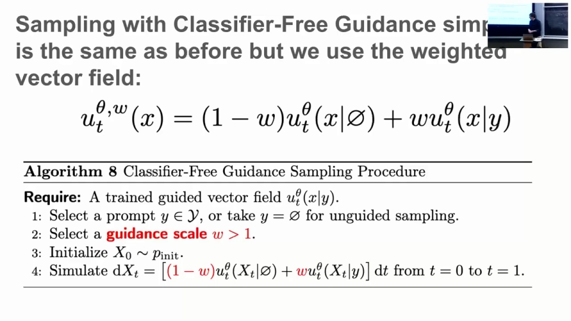

效果对比很直观：同一个「柯基犬」提示，$w=1.0$ 时还是那批构图散乱的图；$w=4.0$ 时图像明显更贴合文本（[【跳转到 30:01】](https://www.youtube.com/watch?v=8oWZ1bHwyRI&t=1801)）。

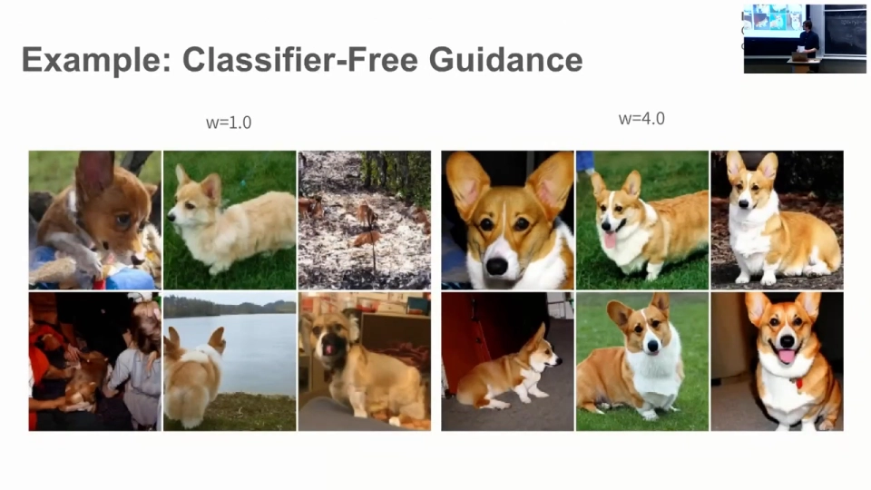

课上给了一个量级感受：某个流模型用的引导强度是 4，也就是把「条件与无条件之差」这一项的贡献放大了 3 倍（因为 $4-1=3$）。他还说得很直接：这些模型没有它根本不行，你在网上看到的假视频，几乎一定是用无分类器引导生成的（[【跳转到 32:41】](https://www.youtube.com/watch?v=8oWZ1bHwyRI&t=1961)）。

## 八、代价与边界：它已经不在数据分布里了

**第一，它不再是「从数据分布采样」。** 这门课之前所有的推导都在从数据分布里采样；如果训练完美、分布完美，理论上根本不需要引导。但实测效果不够好，于是我们引入这个启发式，本质上换了一个分布：引导会把样本往真正定义某个条件的那些区域压，让它们坍缩到模式附近（[【跳转到 34:18】](https://www.youtube.com/watch?v=8oWZ1bHwyRI&t=2058)）。

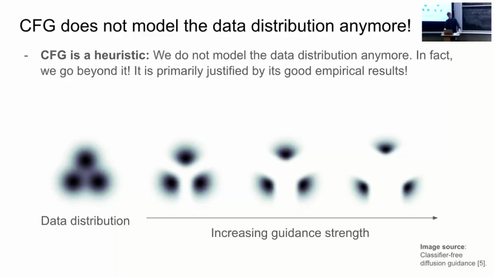

有意思的是，如果拿现代模型生成的图像去衡量图文对齐度，再和互联网上随机采到的图文对相比，它甚至更好——因为互联网数据本身有错误描述。也就是说，我们第一次走出了数据分布：**图文对齐可以比数据更好，代价是不再从同一个分布里采样，多样性会损失**（[【跳转到 34:48】](https://www.youtube.com/watch?v=8oWZ1bHwyRI&t=2088)）。

**第二，$w$ 调太大图像会过饱和、坍缩到模式。** 给「猫」时，除了猫本身之外的所有变化都会消失；反过来把 $w$ 调小（甚至小于 1），就会弱化提示，生成一张「尽可能不像猫」的图（[【跳转到 36:54】](https://www.youtube.com/watch?v=8oWZ1bHwyRI&t=2214)）。

**第三，每个采样步要跑两次前向。** 条件一次、无条件一次，效率直接减半。这是这个方法必须承认的代价（[【跳转到 37:19】](https://www.youtube.com/watch?v=8oWZ1bHwyRI&t=2239)）。

课上对「这样做到底合不合理」的总结是：它能被推导出来，也有很好的启发式解释，但**主要还是靠优秀的实验结果支撑**（[【跳转到 36:06】](https://www.youtube.com/watch?v=8oWZ1bHwyRI&t=2166)）。

## 小结

- 朴素引导只是把提示 $y$ 作为额外输入喂进向量场，理论上就该从条件分布采样，实测却贴不住提示。
- 分类器引导用贝叶斯公式把条件得分拆成「无条件得分 + 分类器对数梯度」，再放大分类器那一项：$\tilde u_t^w=u_t^{\text{target}}+w\,a_t\nabla_x\log p_t(y\mid x)$。
- 分类器引导的代价是必须额外训练一个能在带噪数据上工作的分类器，且文本条件难以处理。
- 无分类器引导把分类器改写成「引导得分 − 无条件得分」，于是只需一个网络：$\tilde u_t^w=(1-w)u_t^\theta(x\mid\varnothing)+w\,u_t^\theta(x\mid y)$。
- 一个网络同时给出条件和无条件预测，靠的是空 token $\varnothing$ 与训练时按概率丢标签。
- $w$ 越大条件一致性越强，但样本会向模式坍缩、过饱和，并彻底离开数据分布；同时每步两次前向让采样成本翻倍。

## 关键术语速查

| 术语 | 一句话解释 |
| --- | --- |
| 引导（guidance） | 在采样时额外施加一个方向，让生成结果更贴合给定条件 |
| 朴素引导（vanilla guidance） | 只把提示作为网络额外输入，不对向量场做任何加权 |
| 得分（score） | 对数密度的梯度 $\nabla_x\log p_t(x)$，指向密度上升最快的方向 |
| 分类器引导 | 用外部分类器的梯度 $\nabla_x\log p_t(y\vert x)$ 修正去噪方向，并乘以强度 $w$ |
| 无分类器引导（CFG） | 用条件与无条件预测之差替代分类器梯度，$\tilde u_t^w=(1-w)u_t^\theta(x\vert\varnothing)+w\,u_t^\theta(x\vert y)$ |
| 空 token（$\varnothing$） | 表示「提示缺失」的特殊输入，让同一网络也能做无条件预测 |
| 条件丢弃（label dropout） | 训练时以概率 $p$ 把标签换成空 token，使网络学会无条件预测 |
| 引导强度 $w$ | 放大「依赖提示的那部分」的系数；$w=1$ 退化为普通条件模型，$w>1$ 才产生引导效果 |
| 模式坍缩 | 引导过强时样本集中到少数模式上，多样性下降、图像过饱和 |