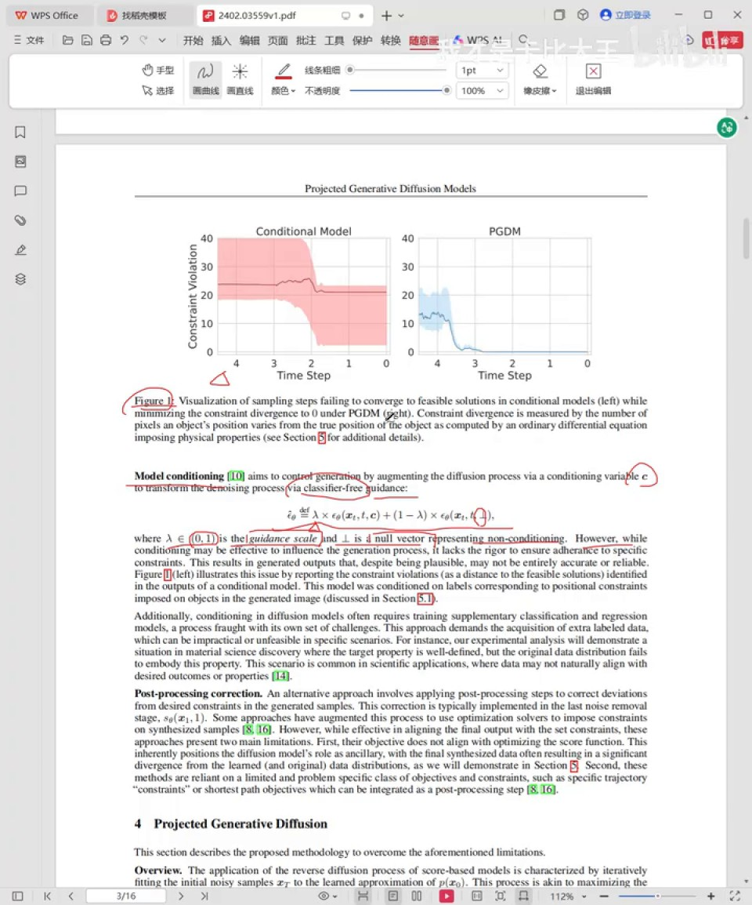
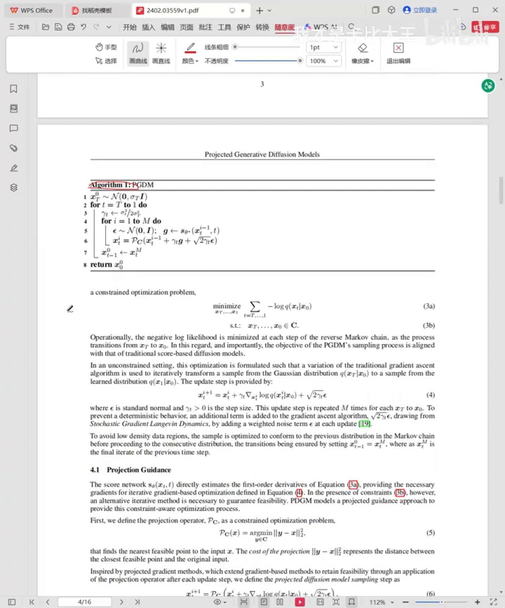
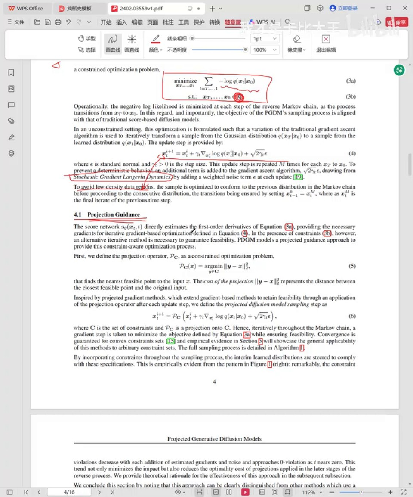
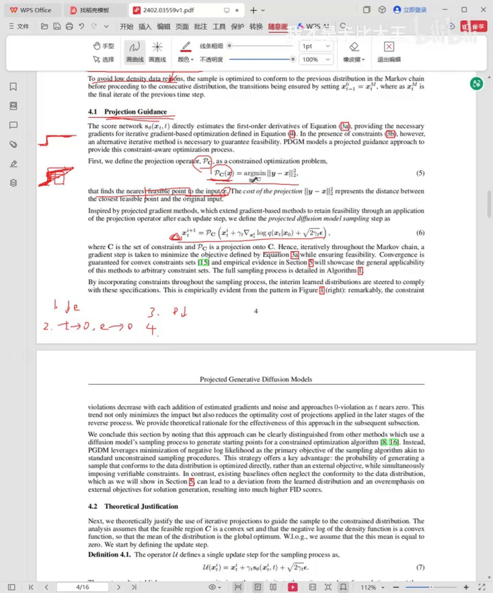
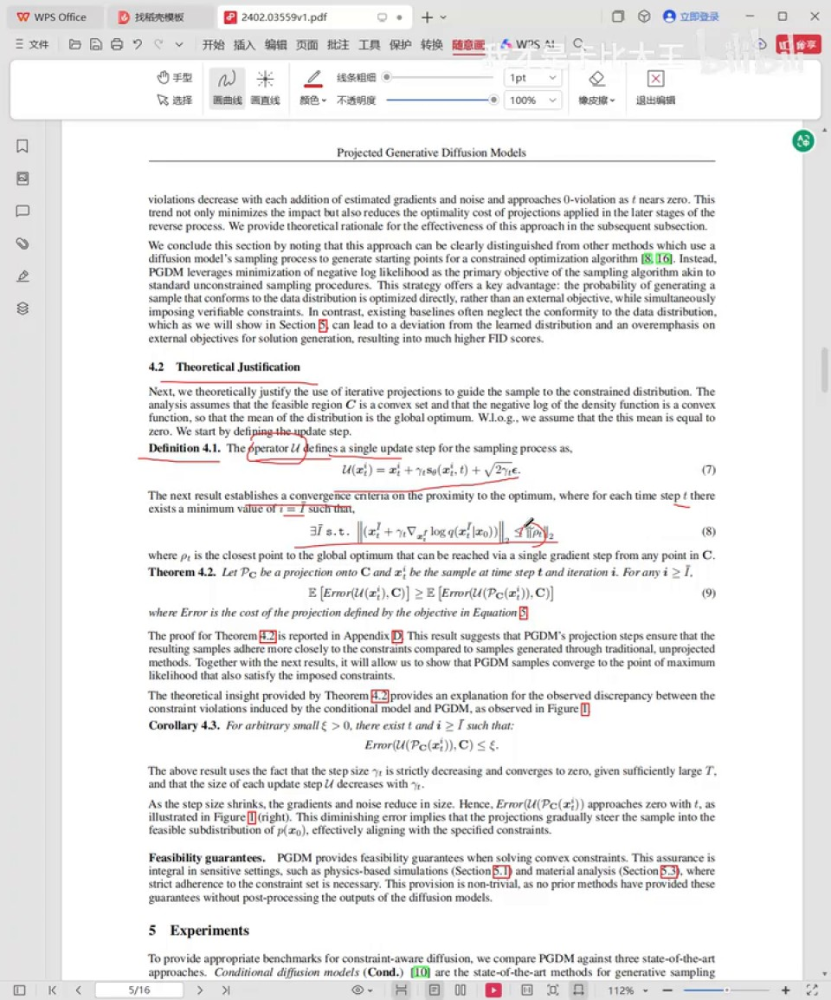
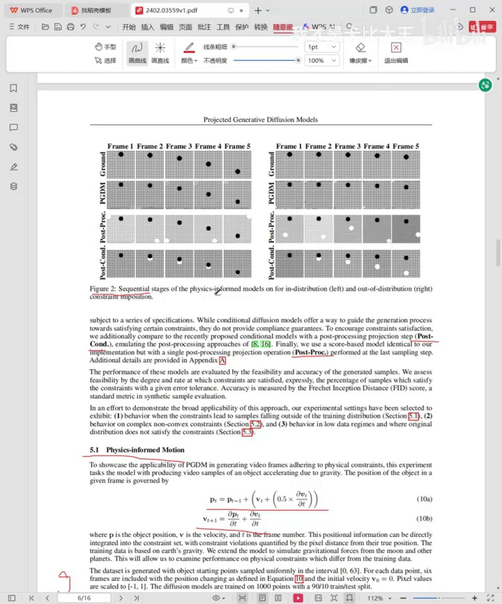
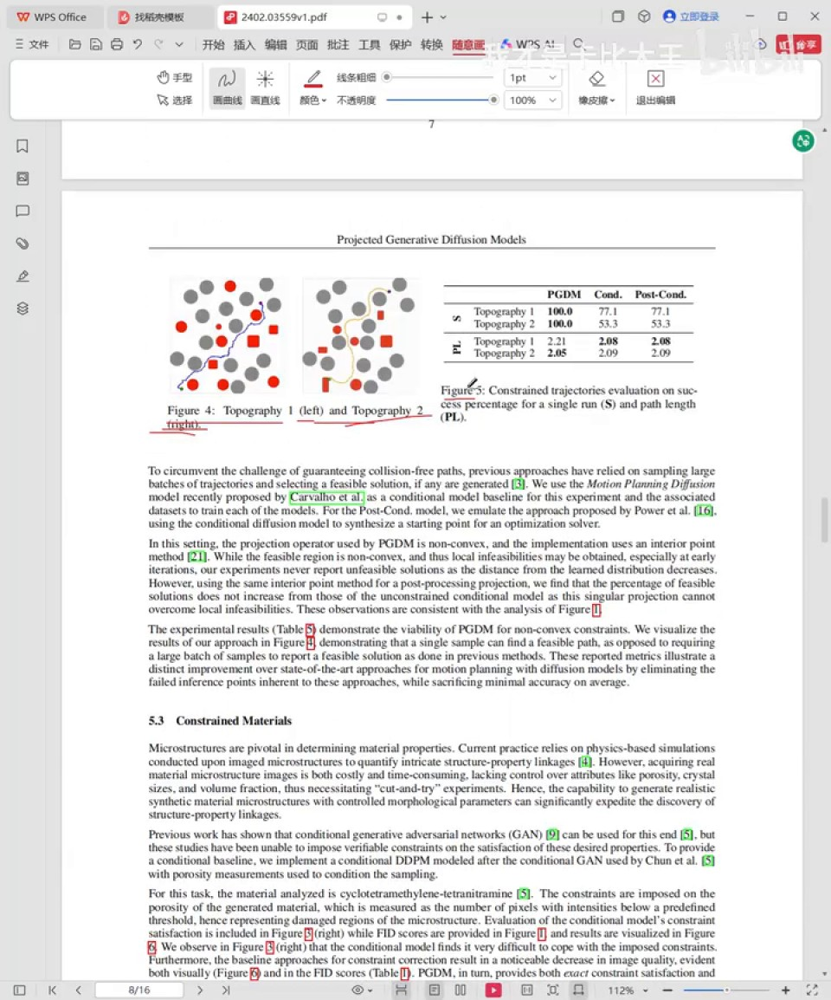
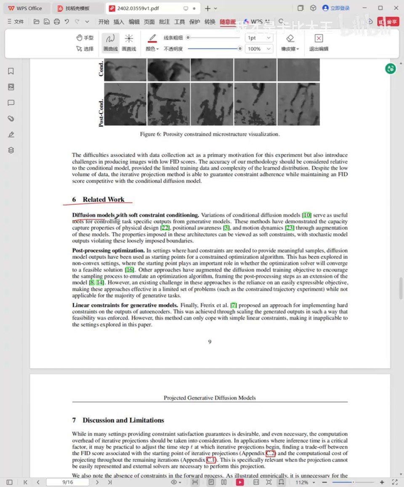
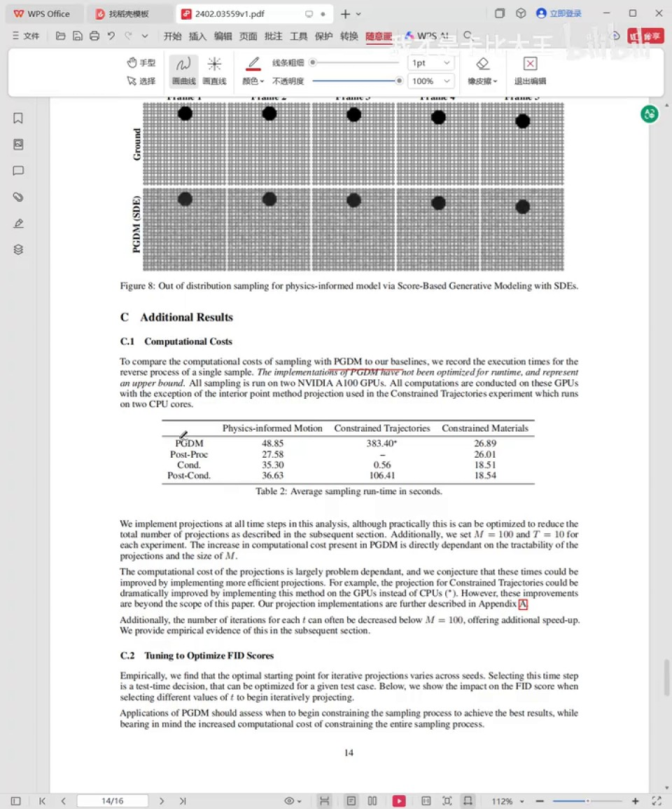

# 扩散模型的硬约束与软约束：投影、条件化与后处理修正

> 视频来源：[PGDM: 用于满足约束的投影生成扩散模型](https://www.bilibili.com/video/BV1ArgCz6EUQ/)（Bilibili · 星之卡比大王o_0）｜时长约 34 分钟
> 导读：这是一篇论文精读（Projected Generative Diffusion Models for Constraint Satisfaction）。讲者按"问题—两条常规路线—PGDM 方法—理论—实验—局限"的顺序逐页念读并随手标注，本文把这条线索整理成一篇可独立阅读的笔记，公式编号沿用论文原编号。

## 本讲要解决的核心问题（SCQA）

**背景**：扩散模型能生成高度逼真的样本，但它的输出带有内在随机性——同一份训练数据，每次采样得到的样本都不一样。

**冲突**：很多场景不只要求"像真的"，还要求生成结果**符合既定规范、物理规律或工程原理**。更麻烦的是，在科学和工程这类数据稀缺的领域，已有的数据里根本找不到与目标约束对齐的样本，没法靠"用带约束的数据训练"来解决。

**疑问**：既然不能靠数据，能不能在采样过程里就把约束加上去？加在哪里、怎么加，才能既严格合规又不把生成质量搞坏？

**回答（中心思想）**：PGDM 把基于得分的反向采样过程重新解释成一个**约束优化问题**，并在每一步更新之后做一次**投影**，把样本拉回可行集合 $C$。与"用条件化施加软约束"和"采样结束后再做后处理修正"相比，它的约束是逐步、全程生效的，因此既能严格满足约束，又能保持与训练分布的一致性。

## 一、约束满足：生成模型的新要求

扩散模型通过逐步把噪声加到数据上、再系统地反向去噪来生成样本，被广泛应用于图像生成、自动化、化学科学研究等领域。但在一些场景中，它面临新的挑战：不仅要生成类似真实世界样本的数据，还必须符合既定的规范、物理规律或工程原理，而传统扩散模型无法确保这样的精度。[【跳转到 00:50】](https://www.bilibili.com/video/BV1ArgCz6EUQ/?t=50)

一种替代做法是在与这些约束对齐的数据分布上训练扩散模型。然而即使这样训练可行，扩散模型内在的随机性也不会自动保证生成结果符合预期标准。更现实的问题是：已有的数据中可能根本找不到与特定约束对齐的样本——这在数据稀缺的科学与工程场景中尤为常见。训练数据有限，但生成结果仍然需要满足严格的约束或精度标准。[【跳转到 01:40】](https://www.bilibili.com/video/BV1ArgCz6EUQ/?t=100)

论文的贡献可以概括为四点：

1. 提出 PGDM 框架，能在任意约束下生成高保真且合规的内容；
2. 提供理论基础，定义约束集合，并解释它如何在保证合规的同时达到高精度生成；
3. 在多个实际应用中验证有效性：受物理引导的运动、轨迹规划、形态属性生成、视频生成等；
4. 展示在数据稀缺条件下生成分布外样本的能力。[【跳转到 03:26】](https://www.bilibili.com/video/BV1ArgCz6EUQ/?t=206)

## 二、两条常规路线，各有各的漏洞

视频在进入方法之前，先把预备知识和已有做法过了一遍：扩散模型的前向过程用转移核把数据逐步扰动为高斯分布，$\beta_t$ 是一组小常数，使最终分布接近高斯；反向过程用训练好的去噪器把 $x_T$ 逐步转回真实样本。而基于得分的模型不直接预测噪声，而是建模每个噪声水平下数据分布的对数概率梯度，训练一个网络 $s_\theta(x_t,t)$ 去逼近它。

在这个基础上，要让输出"合规"，主流做法有两种。

### 2.1 路线一：模型条件化（软约束）

第一种是对模型做条件化：引入一个条件变量 $c$，用无分类器引导（classifier-free guidance）来增强扩散过程：

$$
\tilde\epsilon_\theta = \lambda \cdot \epsilon_\theta(x_t, t, c) + (1-\lambda)\cdot \epsilon_\theta(x_t, t, \varnothing)
$$

其中 $\lambda$ 是引导比例，取值在 0 到 1 的开区间内；$\varnothing$ 表示无条件，也就是用一个空向量代表"没有条件"。 [【跳转到 08:51】](https://www.bilibili.com/video/BV1ArgCz6EUQ/?t=531)

视频指出这种方式的根本问题：它有助于引导生成，但**缺乏对特定约束的严格遵循**，生成的输出虽然看起来合理，却可能并不准确或可靠。论文图一左边就展示了采样步骤在条件模型中未能收敛到可行解的情况——这个模型是通过标签条件化训练的，用于在生成图像时施加位置信息约束，结果仍然存在约束违背。[【跳转到 10:06】](https://www.bilibili.com/video/BV1ArgCz6EUQ/?t=606)

条件化还有一层实践障碍：它常常需要在训练时额外附加一个分类或回归模型，这可能需要大量标注数据；而在很多科学与工程场景下这并不可行。比如材料科学中我们可能知道目标属性，但原始数据分布并不体现这种属性。

### 2.2 路线二：后处理修正

第二种是后处理修正：在采样之后加一个修正步骤，把偏离目标约束的结果调整回来。这样的修正一般在最后一步做噪声移除时进行（也就是 $s_\theta(x_1,1)$ 那一段），用优化器在生成的样本上施加约束。[【跳转到 11:21】](https://www.bilibili.com/video/BV1ArgCz6EUQ/?t=681)

视频复述了论文给出的两个局限：

- **目标不一致**：优化器的目标函数与扩散模型 score function 的优化目标并不一致，最终可能导致结果偏离训练分布；
- **适用面窄**：只适用于特定类型的任务或约束（比如轨迹优化），缺少普适性。[【跳转到 12:11】](https://www.bilibili.com/video/BV1ArgCz6EUQ/?t=731)

## 三、PGDM：把采样重构成约束优化

### 3.1 核心思想

PGDM 的核心思想是：把传统的、基于 score 的反向过程视为一个约束优化问题，在每一步更新、逐步采样，使每个样本都更接近目标分布 $p(x_0)$。

区别在于约束的位置。在传统的 score-based 模型里，样本在整个反向过程中都是没有约束的；而 PGDM 的每一步采样都被限制在一个**可行集合**当中，从而确保样本符合指定的约束。视频里的说法很形象：相当于给了你一个可行集合空间，每一步采样都只能在这个空间里选择。[【跳转到 13:51】](https://www.bilibili.com/video/BV1ArgCz6EUQ/?t=831)

数学上，它求解的是这样一个优化问题（论文式 3a、3b）：

$$
\min_{x_T,\dots,x_1} \sum_{t=T,\dots,1} -\log q(x_t \mid x_0)
\qquad \text{s.t.}\qquad
x_T,\dots,x_0 \in C
$$

其中 $C$ 就是 constraint，即约束集合。算法一是它的伪代码：外层从 $t=T$ 到 1，内层做 $M$ 次更新，每次先算梯度、再投影。[【跳转到 14:16】](https://www.bilibili.com/video/BV1ArgCz6EUQ/?t=856)

### 3.2 无约束更新：随机梯度朗之万动力学

先看没有约束时怎么走。这一步基于随机梯度朗之万动力学（SGLD），并加入噪声项来避免陷入低密度区域（论文式 4）：

$$
x_i^{t+1} = x_i^t + \gamma_t \nabla_{x_i^t} \log q(x_i^t \mid x_0) + \sqrt{2\gamma_t}\,\epsilon
$$

其中 $\epsilon$ 是标准正态噪声，$\gamma_t > 0$ 是步长。这个更新对每个 $x_t$ 重复 $M$ 次。加入 $\sqrt{2\gamma_t}\epsilon$ 这一项是为了避免确定性行为——否则就成了普通的梯度上升。[【跳转到 14:41】](https://www.bilibili.com/video/BV1ArgCz6EUQ/?t=881)

### 3.3 投影引导：把越界的点拉回可行域

有了梯度，还需要一个机制保证"更新之后仍然在可行域内"。PGDM 定义了一个**投影算子**（论文式 5）：

$$
\mathcal{P}_C(x) = \arg\min_{y \in C} \left\| y - x \right\|_2^2
$$

它表示把当前点 $x$ 投影到最近的可行点上[【跳转到 15:56】](https://www.bilibili.com/video/BV1ArgCz6EUQ/?t=956)，$\|y-x\|_2^2$ 就是投影的代价（到最近可行点的距离）。这种方法属于投影梯度法的扩展。

把投影嵌进更新，就得到 PGDM 的采样步（论文式 6）：

$$
x_i^{t+1} = \mathcal{P}_C\left( x_i^t + \gamma_t \nabla_{x_i^t} \log q(x_i^t \mid x_0) + \sqrt{2\gamma_t}\,\epsilon \right)
$$

也就是说：先做一次无约束的梯度加噪声更新，再投影回 $C$。[【跳转到 18:26】](https://www.bilibili.com/video/BV1ArgCz6EUQ/?t=1106)视频特别强调，这一步在保留 score function 优化目标的同时，又生成了符合给定约束 $C$ 的结果。

### 3.4 一个直观例子：路径规划里的"投影"

讲者用一个自己构造的例子帮助理解投影方向：假设有一个障碍物，用 A* 算法从这个点规划到那个点，它大概应该那样走；但扩散模型生成出来的轨迹因为不确定，可能是另一个样子，有可能穿过障碍物。扩散有很多时间步，每个时间步都会有一个点；凡是落在可行域外、不满足约束的点，就把它投影到最近的可行点上。

这样一路投影下来，最后得到的轨迹始终落在 A* 给出的可行域里，因此也符合预期。讲者同时提醒自己：投影方向到底怎么定，还要看后面的公式。

## 四、理论保证：为什么逐步投影不会把结果带偏

视频对理论部分的态度是"知道原理就行，不必细究"，但还是把结论念了一遍。理论分析假设可行区域 $C$ 是凸集合，并且负对数密度函数也是凸函数，整个分布的最小值就是全局最优解。

先定义单步更新算子 $\mathcal{U}$（论文式 7）：

$$
\mathcal{U}(x_i^t) = x_i^t + \gamma_t s_\theta(x_i^t, t) + \sqrt{2\gamma_t}\,\epsilon
$$

再给出收敛标准：对每一个时刻 $t$，存在一个最小的 $i$，使得从约束集合 $C$ 中的任意点出发，可以通过一步梯度更新到达最近的最优解。

在这个前提下，论文给出两个结论：

- **定理 4.2**：若 $\mathcal{P}_C$ 是投影算子，则对任意足够大的迭代次数 $i$，使用投影引导的误差期望**小于等于**不投影时的误差期望。讲者的复述是：使用 PGDM 投影引导，更新过程的误差会更小。
- **推论 4.3**：对任意小的 $\varepsilon > 0$，存在足够大的 $i$，使得 $L$ 误差小于等于 $\varepsilon$。随着时间步减小，步长 $\gamma_t$ 严格递减，噪声和梯度也减小，从而误差趋近于零。[【跳转到 23:51】](https://www.bilibili.com/video/BV1ArgCz6EUQ/?t=1431)

视频把这条趋势和论文图一右边对应起来：约束违背量随采样推进越来越小，最后趋近于 0。

## 五、实验：三类场景，三种基线

论文设计了三类对比：后处理（Post-Proc）、条件模型（Cond.）、条件模型加后处理（Post-Cond.），并在三个场景上验证。

### 5.1 受物理引导的运动

第一个实验要求模型生成视频帧，模拟物体在重力作用下做加速运动，物体位置由公式给出：

$$
p_t = p_{t-1} + \left( v_t + 0.5 \times \frac{\partial v_t}{\partial t} \right),
\qquad
v_{t+1} = \frac{\partial p_t}{\partial t} + \frac{\partial v_t}{\partial t}
$$

实验场景包括训练中出现过的真实重力加速度 $g$，以及一个没有见过的重力场（比如月球引力）[【跳转到 24:53】](https://www.bilibili.com/video/BV1ArgCz6EUQ/?t=1493)；用 PGDM 去预测新重力场下的结果，再与观测结果对比。

图二展示的是分布内（左）与分布外（右）约束下，PGDM、Post-Proc、Post-Cond 的视频生成过程。视频提到表一的结论：PGDM 在 FID（图像质量）上几乎等同于条件模型，而在物理精度上明显优于其他方法。

### 5.2 受限的轨迹

这是讲者最关注的实验：模拟机器人路径规划，要求路径满足三个条件——光滑且路径长度最短、无碰撞（collision-free）、满足任意地形约束。路径的形式是一个点的序列，使用的是 Coverhole 等人提出的数据集（图示的 topography 地形）。[【跳转到 27:13】](https://www.bilibili.com/video/BV1ArgCz6EUQ/?t=1633)

结果是：PGDM 在两个地形上都做到 100% 成功率，而条件模型与条件模型加后处理分别只有 77.1% 与 53.3%；三种方法的路径长度相近，PGDM 并没有损失最优性。讲者的评价是：它毕竟是投影到受限几何上的，成功率百分之百并不意外。

由此得到的结论是：在非凸的可行域当中，PGDM 仍然保持极高的可行性；而后处理方法或调教模型在不可行区域容易失败。逐步投影策略增强了非凸问题下的稳定性与鲁棒性。[【跳转到 28:43】](https://www.bilibili.com/video/BV1ArgCz6EUQ/?t=1723)

### 5.3 受限材料

第三个实验是在材料微结构生成上施加孔隙率约束，对比不同孔隙率下生成的图像。讲者因为与自己方向无关，只做了简单带过。

## 六、相关工作：软约束、硬约束与"半硬"方案

这一节正好是本文最关心的概念区分。视频把相关工作分成三类。

| 路线 | 做法 | 性质 | 局限 |
| --- | --- | --- | --- |
| 软约束条件化 | 条件扩散模型引导输出满足特定任务目标，如物理设计属性、位置感知、运动动态 | 软约束 | 生成结果常因随机性而偏离约束 |
| 后处理优化 | 需要严格满足硬约束时，把扩散模型生成的样本作为约束优化器的初始值 | 硬约束（事后施加） | 非凸场景能否收敛无法保证；需要精确表达的目标函数，适用性受限；路径规划实验中效果不佳 |
| 线性约束生成模型 | 把自编码器输出缩放以满足线性约束 | 硬约束（结构内保证） | 只能处理简单场景，不适用于本文这种复杂约束任务 |

这三种路线的差别，本质上是**约束在什么时候、以什么方式进入采样**：软约束在训练或引导阶段"施加影响"，允许轻微违反；事后硬约束在采样结束后"强行修正"，但可能破坏分布或无法收敛；PGDM 则把投影放进每一步采样，让约束与去噪同时进行。

## 七、局限与开放问题

视频最后念了论文自己承认的局限，讲者也补了一句自己的判断。

- **计算负担大**：迭代投影的代价很高。[【跳转到 31:10】](https://www.bilibili.com/video/BV1ArgCz6EUQ/?t=1870)在推理时间关键的任务中，可以从中间的某个时刻才开始投影，在生成质量与效率（FID）之间取得平衡（附录 C.2）。
- **依赖外部求解器**：投影本身可能需要外部求解器，代价会更高（附录 C.1）。运行时间对比表显示 PGDM 的时间明显更长。[【跳转到 32:13】](https://www.bilibili.com/video/BV1ArgCz6EUQ/?t=1933)
- **前向过程没有约束**：论文没有在前向过程中引入约束，也就是训练数据不必满足约束；但投影对样本的扰动会增加分布偏移的风险，从而影响学到的分布质量与 FID 分数。
- **复杂约束的表示仍是开放问题**：如何在多任务的大规模模型中表示复杂约束，还没有答案。

讲者的总结是：PGDM 把基于 score 的采样过程重构成一个可迭代的约束优化过程，每一步执行一次投影，从而能生成高保真、且严格满足复杂非凸约束或物理原理的样本。[【跳转到 33:21】](https://www.bilibili.com/video/BV1ArgCz6EUQ/?t=2001)

## 小结

- 扩散模型的随机性使它无法自动满足物理规律或工程规范，而数据稀缺时又无法靠"用合规数据训练"解决。
- 软约束（条件化 + 无分类器引导）只能"引导"，缺乏严格遵循；还需要额外的分类或回归模型与标注数据。
- 后处理修正把约束放在采样末尾，目标与 score 优化不一致，容易偏离训练分布，且只适用于特定约束类型。
- PGDM 把采样写成带约束的优化问题：每步先做 SGLD 更新，再用投影算子 $\mathcal{P}_C$ 拉回可行集合。
- 理论上，投影引导使误差期望不大于不投影的情形，且误差随时间步推进趋近于零。
- 实验上，路径规划的成功率从 77.1%/53.3% 提升到 100%，同时没有牺牲路径长度；代价是更高的计算开销。

## 关键术语速查

| 术语 | 一句话解释 |
| --- | --- |
| 软约束 | 通过条件化或引导"施加影响"的约束，允许生成结果轻微违反 |
| 硬约束 | 必须严格满足的约束，违反即视为失败 |
| 可行集合 $C$ | 所有满足约束的样本组成的集合，采样必须落在其中 |
| 投影算子 $\mathcal{P}_C$ | 把任意点映射到 $C$ 中离它最近的点的算子 |
| SGLD | 随机梯度朗之万动力学，梯度上升加噪声的采样更新规则 |
| 后处理修正 | 采样结束后用优化器把结果拉回约束的做法 |
| FID | 衡量生成图像质量的常用指标，越低越好 |