# 从似然到精确率与召回率：评估指标各自的盲区

> 视频来源：[Lesson 17 of 20: Evaluating Generative Models | Fundamentals of Generative Modelling](https://www.youtube.com/watch?v=q4JHbYp62Rs)（YouTube · Fundamentals of Generative Modelling 课程第 17 讲）｜时长约 43 分钟
> 简要导读：这是一节「每个指标都手算一遍」的评估课。它先用一个反直觉的谜题说明单一指标不可靠，再依次拆解似然、IS、FID、精确率/召回率各自在测什么、会怎么被骗，最后给出把真实性（有效性）与分布覆盖分开报告的做法。本文聚焦四个评价维度的定义、度量方式与彼此张力；采样预算对 FID 的系统偏差只点到为止，实验设计与筛选偏差不在本文范围。

## 本讲要解决的核心问题（SCQA）

**背景**：微调一个生成模型之后，你总要回答一个问题——新模型比原来的好吗？分类器有现成的答案（留出集上的准确率），生成模型没有。

**冲突**：最常用的样本指标是 FID，越低越好。可讲者一开场就给了一个让人不舒服的例子。

**疑问**：为什么一个标准指标会偏爱「模糊」而不是「丢掉一半数据」？有没有办法把这两种失败分别命名？

**回答（中心思想）**：因为 FID 把两种完全不同的失败折进了一个数里——**样本不像数据**（有效性/真实性不足）和**漏掉了部分数据**（分布覆盖不足）。要分开它们，得用**精确率**与**召回率**：精确率量真实性，召回率量覆盖。而在此之前，还得先明白似然、IS 这些指标各自在测什么、各自会被什么骗——**没有任何一个数字能代表生成质量**。

## 一、一个谜题：FID 为什么偏爱模糊

讲者构造了一个只有 600 个点的二维数据集：两个圆形簇，分别以 $-3$ 和 $+3$ 为中心。两个模型试图复制它：

- **模型 1**：所有样本都从右边那个簇里取。于是每一张样本看起来都和真实数据一模一样，但它**丢掉了一半的数据**。
- **模型 2**：把样本摊成一片又宽又模糊的云，两个簇都盖住了，但大多数样本落在没有真实数据的地方。

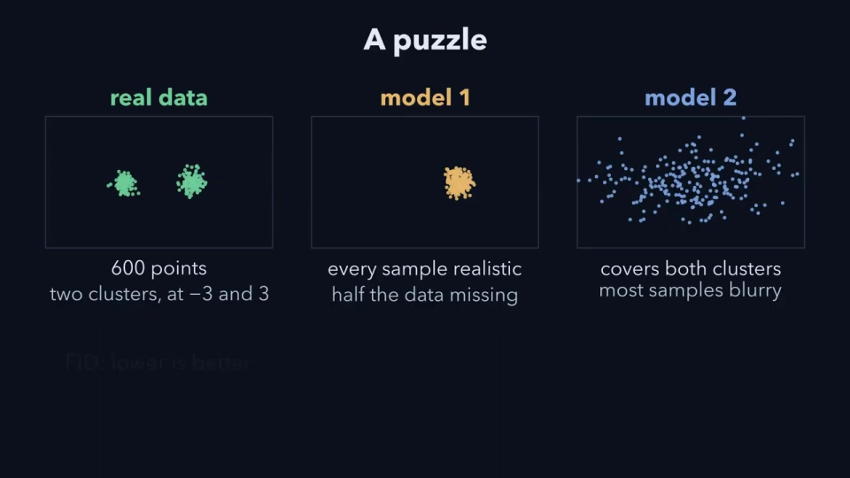

[【跳转到 00:00】](https://www.youtube.com/watch?v=q4JHbYp62Rs&t=0)

用 FID 打分（越低越好）：**丢了一半数据的模型 1 得 13.7，模糊的模型 2 得 1.4**——模糊的那个好了十倍。

这就是本讲要解开的谜题。

## 二、一个模型有三种用途，一个分数不够用

在拆指标之前，讲者先立了一个前提：**生成模型有三种用途，每种用途需要自己的度量，而这些度量可以互相矛盾。**

| 用途 | 在问什么 | 对应度量 |
| --- | --- | --- |
| 密度估计 | 给定一张图，它有多可能？ | 似然 / bits per dimension |
| 采样生成 | 能不能造出看起来真实的新图？ | IS、FID、KID、精确率/召回率 |
| 表示学习 | 内部特征能不能让别的任务更容易？ | 线性探针、聚类纯度 |

所以「哪个模型更好」这个问题本身是不完整的——必须先说清按哪种用途评判。

### 2.1 似然测的是压缩，不是样本质量

对自回归模型和流模型可以算出精确似然，对 VAE 和扩散模型只能算下界。通用的分数是测试集上的 NLL（负对数似然），再除以像素个数换成 **bits per dimension（bpd）**，这样不同尺寸的图像之间也能比较。

讲者给了一个极有说服力的反例：把一个好模型和纯噪声按 1% : 99% 混合。此时 100 个样本里有 99 个是雪花噪声，但似然几乎没感觉——混合分布的密度至少是好模型的 1%，所以 NLL 最多上升 $\log 100 \approx 4.6$ nats/image，摊到 3072 个值上只有约 **0.002 bpd**。一个 3.000 bpd 的模型最多变成 3.002。

反方向同样失效：一个把训练集背下来再回放的模型，样本完美无缺，但对任何没背过的测试图给出零概率，**测试 NLL 是无穷大**。

这两个极端合起来说明：**似然和样本质量可以在两个方向上都不一致。** 似然适合压缩和密度估计，不适合判断生成得好不好。

### 2.2 IS：用分类器判样本，但从不看真实数据

第一个专门的样本指标是 Inception Score（IS，Salimans 等，2016）。它把样本喂给一个预训练分类器，要求两件事：

1. **每个样本都容易识别**——预测尖锐，概率集中在一个类上；
2. **整体上样本有变化**——把所有样本的预测平均起来，这个平均值接近平坦。

IS 用每个样本的预测与平均预测之间的 KL 散度把两者合起来：

$$
\mathrm{IS} = \exp\left(\frac{1}{M}\sum_{j=1}^{M} \mathrm{KL}\left(p(y \mid x_j) \,\Big\|\, \frac{1}{M}\sum_{j=1}^{M} p(y \mid x_j)\right)\right)
$$

在 10 类的设定下，IS 读起来像「有效类别数」：只生成一个类得 1（最低），5 个类得 5，10 个类均匀且自信得 10。讲者给了五个生成器的对照：自信且 10 类等频 → 10；永远是同一类、或永远不确定 → 1；自信地只出 5 个类 → 5；自信但预测有噪声 → 约 3.4。

再算一个不均匀的例子：一半样本是 A 类、四分之一是 B、四分之一是 C，每个样本的预测都是尖锐的。此时每个样本的 KL 就是 $-\log(\text{该类的份额})$，平均 KL 是类别份额的熵，约 1.04 nats，取 $e$ 的幂得约 2.83——落在 2 和 3 之间，因为混合不均匀。

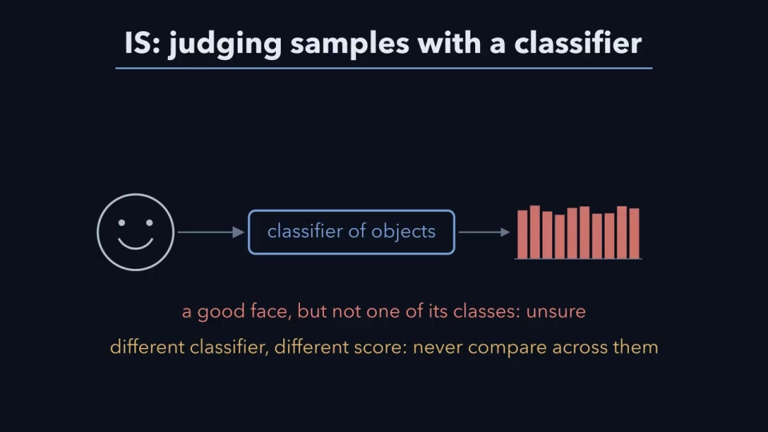

[【跳转到 19:29】](https://www.youtube.com/watch?v=q4JHbYp62Rs&t=1169)

讲者点出 IS 的两个盲区：

- **它从不看真实数据。** 所以它无法判断样本是否像训练集，只能判断分类器能不能认出来。
- **它忽略类内多样性。** 一个「每类只生成一张完美图然后无限重复」的生成器照样得 10 分。

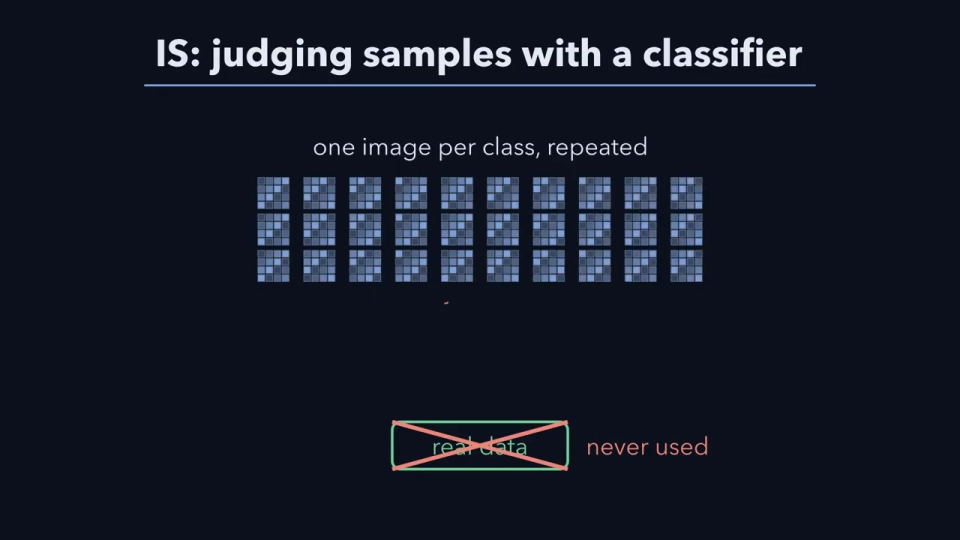

[【跳转到 20:19】](https://www.youtube.com/watch?v=q4JHbYp62Rs&t=1219)

这里就已经出现了「有效性」与「多样性」的第一次分离：IS 能感知有效性（分类器认得出）和**类别层面**的多样性，但对**类内**的多样性完全无感，也对「像不像训练集」完全无感。这正是后面「新颖性」必须单独考量的原因。

## 三、FID：把两种失败折成一个数

FID（Heusel 等，2017）直接比较真实样本和生成样本：把两组图都过一遍预训练网络，各取一个特征向量，然后对两组特征各拟合一个高斯（均值 + 协方差），用两个高斯之间的 Fréchet 距离（也叫 2-Wasserstein 距离）作为分数。

$$
\mathrm{FID} = \lVert \mu_r - \mu_g \rVert^2 + \mathrm{tr}\left(\Sigma_r + \Sigma_g - 2\left(\Sigma_r^{1/2}\Sigma_g\Sigma_r^{1/2}\right)^{1/2}\right)
$$

第一项是均值之差的平方，第二项由协方差的迹构成。越低越好，0 表示两个高斯完全一致。

### 3.1 三个小例子：一个数说不出「往哪个方向错了」

在二维、真实协方差为单位阵的设定下：

- 均值平移 1 → FID $=1$
- 标准差翻倍 → FID $=2$
- 把所有样本坍缩到均值上 → FID $=2$

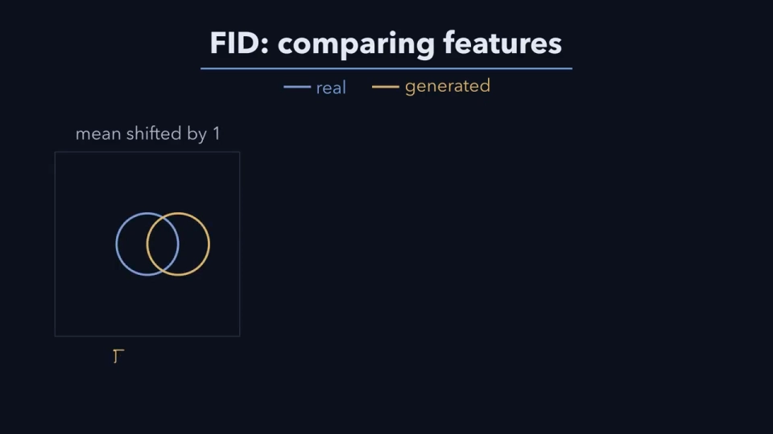

[【跳转到 22:24】](https://www.youtube.com/watch?v=q4JHbYp62Rs&t=1344)

看后两个：**一个样本撒得太开的模型，和一个只生成同一张图的模型，拿到了一样的分数。** 同样地，一维下标准差 1.4 和 0.6 的 FID 都是 $0.16$——**太宽和太窄，只要偏离量相同，得分就相同**。

再看一个二维的完整计算：真实特征是标准正态，生成特征沿第一轴平移 2、标准差放大到 3 倍。平移给出均值项 $2^2=4$；三倍散布在两个维度上各给出 $(3-1)^2=4$ 的方差差，共 8；所以 FID $= 12$。

这就是本节的核心论点：**一个数说不出模型是往哪个方向错的。**

### 3.2 更严重的盲区：只看均值和协方差

两个集合只要有相同的均值和协方差，FID 就是 0——**哪怕它们的形状完全不同**。

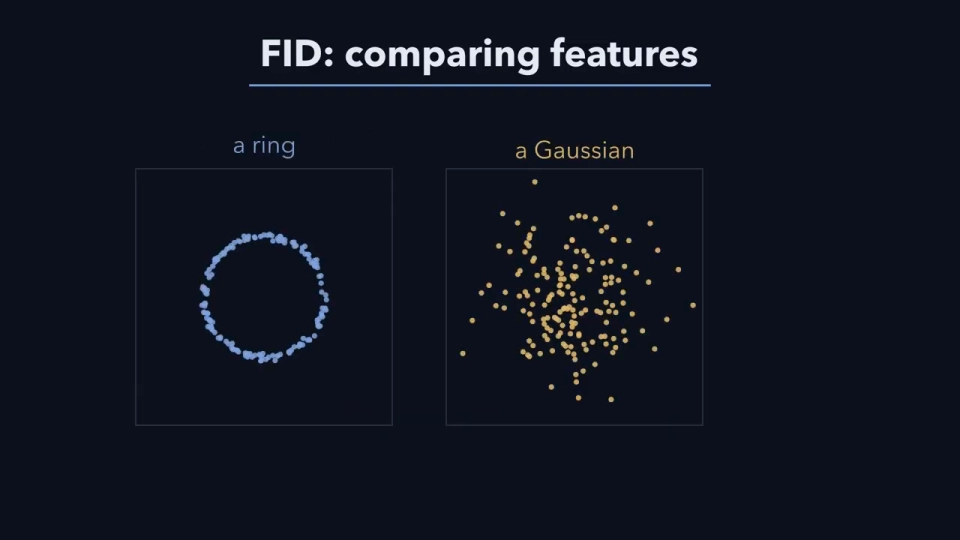

[【跳转到 21:34】](https://www.youtube.com/watch?v=q4JHbYp62Rs&t=1294)

一个环形的真实分布和一个填满圆盘的生成分布，在 FID 眼里可以是「完全一致」。这是把整个分布压缩成两个矩（一阶矩和二阶矩）必然付出的代价。

### 3.3 FID 的第二个问题：把两种失败混在一起

讲者把 FID 的问题总结成两条，第二条正是本文的重点：

> 模型可以以两种方式失败：**造出完全不像数据的样本**，或者**漏掉一部分数据**。FID 把两者折进同一个数。

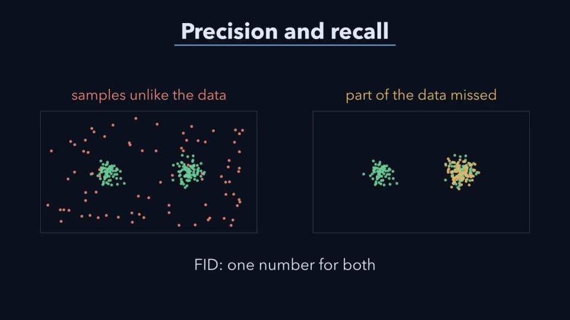

[【跳转到 27:49】](https://www.youtube.com/watch?v=q4JHbYp62Rs&t=1669)

（FID 的第一条问题是估计偏差：样本数 $N$ 越少，FID 越偏高，偏差约按 $D(D+5)/(2N)$ 增长。这属于采样预算问题，本文不展开。）

## 四、精确率与召回率：把真实性（有效性）和覆盖分开

精确率与召回率分别度量上面那两种失败（kNN 版本，Kynkäänniemi 等，2019，只需要样本）：

- **精确率（precision）**：生成的样本里，有多大比例**看起来像真实数据**？——它量的是**真实性**。
- **召回率（recall）**：真实数据里，有多大比例**模型能产生出来**？——它量的是**覆盖**。

具体做法是画球：

1. 在每个真实点周围画一个球，半径到它第 5 个真实近邻。真实点密集的地方球就小，这些球合起来标出了「真实数据住在哪里」。
2. 一个生成样本只要落进任何一个真实球里，就计入精确率。精确率就是落进去的比例。
3. 召回率把角色对调：在每个生成样本周围画球到它第 5 个生成近邻，数有多少真实点落进这些球里。

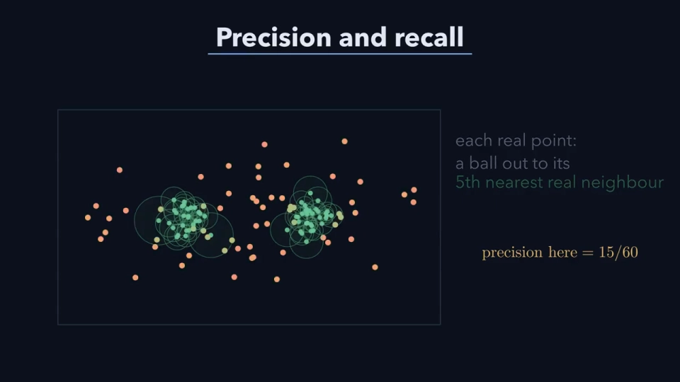

[【跳转到 28:39】](https://www.youtube.com/watch?v=q4JHbYp62Rs&t=1719)

$k$ 的选择决定测试有多严格：$k$ 小则球小，只有非常靠近真实点的样本才算数；$k$ 大则球大，连簇与簇之间的空隙也会被覆盖。

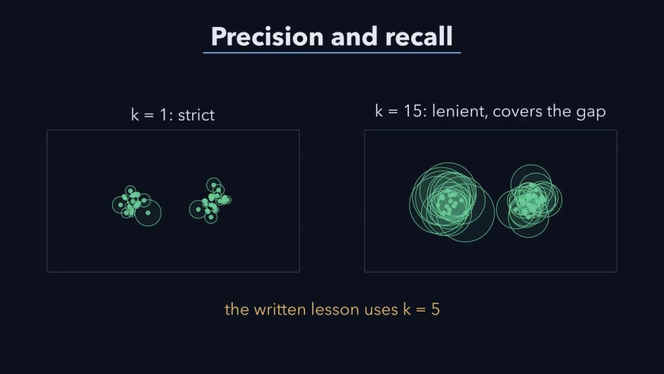

[【跳转到 29:04】](https://www.youtube.com/watch?v=q4JHbYp62Rs&t=1744)

### 4.1 回到谜题：两个数各自命名一种失败

- 与真实分布相同的模型：精确率和召回率都接近 1。
- **丢模式的模型（model 1）**：精确率 $=1$，召回率 $\approx 0.54$。它生成的每个样本都真实，但只覆盖了约一半数据。
- **模糊的模型（model 2）**：精确率 $\approx 0.39$，召回率 $=1$。它什么都覆盖，但大多数样本落在没有真实数据的地方。

现在 FID 的排序也说得通了：FID 只通过高斯看每一组数据。真实数据（两个簇，各在零点两侧三个单位）沿第一轴有很宽的散布；模糊云有几乎一样的均值和相近的散布，所以它的高斯很接近；而丢模式模型的均值移动了三个单位、散布也收缩了，于是 FID 给它差了十倍的分数。顺带一提，在这个例子中即使是完美模型，因为 600 个点的采样噪声，FID 也有约 0.4——模糊模型的 1.4 离它并不远。

### 4.2 精确率的已知弱点：离群点会把它抬高

讲者用一条直线上的例子演示。真实点位于 $0, 1, 2, 3, 10$，生成样本位于 $0.5, 5, 12, 20$，$k=1$（球到最近邻）。

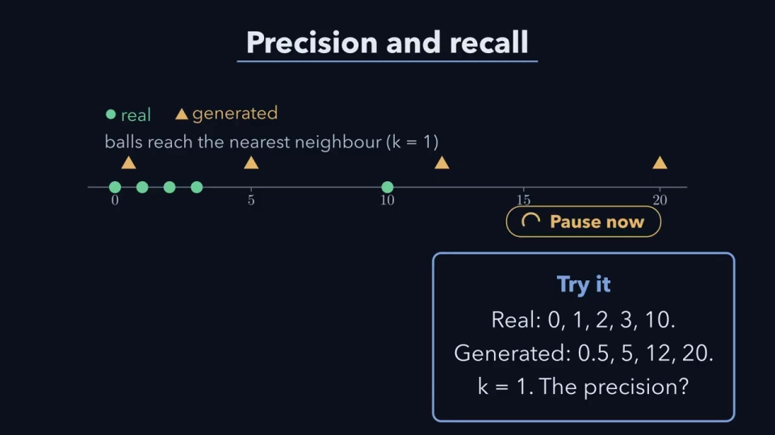

[【跳转到 31:09】](https://www.youtube.com/watch?v=q4JHbYp62Rs&t=1869)

位于 10 的那个点很孤单，它的最近邻在 7 个单位之外，于是它的球从 3 一直延伸到 17。结果 $0.5$、$5$、$12$ 都落进了某个球里，只有 $20$ 没有，精确率是 $3/4$。

注意 $5$ 这个样本：它之所以被算作「真实」，**完全是因为一个离群点把球撑大了**。这是精确率的一个已知弱点——真实数据里的离群点会抬高精确率。这也说明为什么「有效性」这一维度不能只靠一个阈值判定：判定标准本身会被数据的离群点污染。

## 五、新颖性：为什么它必须单独看

本讲没有给出一个叫「novelty」的专门指标，但它从两个方向说明了「与训练集的关系」为什么必须单独考量，而不能从上面任何一个数里读出来。

### 5.1 IS 根本不看真实数据

IS 的第一个盲区就是：它从不与真实数据比较，因此**无法判断样本是否像训练集**，只能判断分类器认不认得。一个把训练集背下来再回放的模型，IS 可以很高。

### 5.2 背训练集的模型：样本完美，似然无穷

反过来，似然也能被「记忆」骗。讲者举的例子是：一个存储训练集并回放的模型，样本完美，但对任何没存储过的测试图给出零概率，**测试 NLL 是无穷大**。真实模型落在这两个极端之间——VAE 常常似然好但样本模糊（因为必须覆盖每张训练图，概率被摊到图与图之间的空隙里），GAN 样本尖锐却根本没有似然可算。

### 5.3 一个可操作的思路：最近邻距离

视频里反复用到的工具是**最近邻距离**：精确率/召回率里的球半径就是「到第 k 个近邻的距离」。同一套工具可以直接用来衡量新颖性——把生成样本到训练集的最近邻距离算出来，距离过小意味着与训练集重合（记忆/复制），距离过大意味着脱离了数据分布。这是从本讲的 kNN 机制自然延伸出的做法，视频本身没有展开，此处仅作为衔接说明。

### 5.4 有些失败只能靠人看

讲者还提醒：有些问题特征统计抓不到，比如画错的手、读不出来的文字。让人看真实图和生成图、判断哪个是哪个，虽然慢且贵，但能抓到这类问题。这也是「单一指标不能代表生成质量」的最后一道保险。

## 六、把指标并排看：每个都有盲区

| 指标 | 需要什么 | 度量什么 | 会被什么骗 |
| --- | --- | --- | --- |
| 似然 / bpd | 一个密度 | 压缩率 | 99% 样本是噪声时几乎不动 |
| IS | 样本 + 分类器 | 预测尖锐且多样 | 从不看真实数据；忽略类内多样性 |
| FID / KID | 真实与生成的特征 | 两组特征的距离 | 只看均值与协方差；$N$ 小时偏高 |
| 精确率 / 召回率 | 真实与生成的特征 | 真实性与覆盖 | 真实数据里的离群点会抬高精确率 |

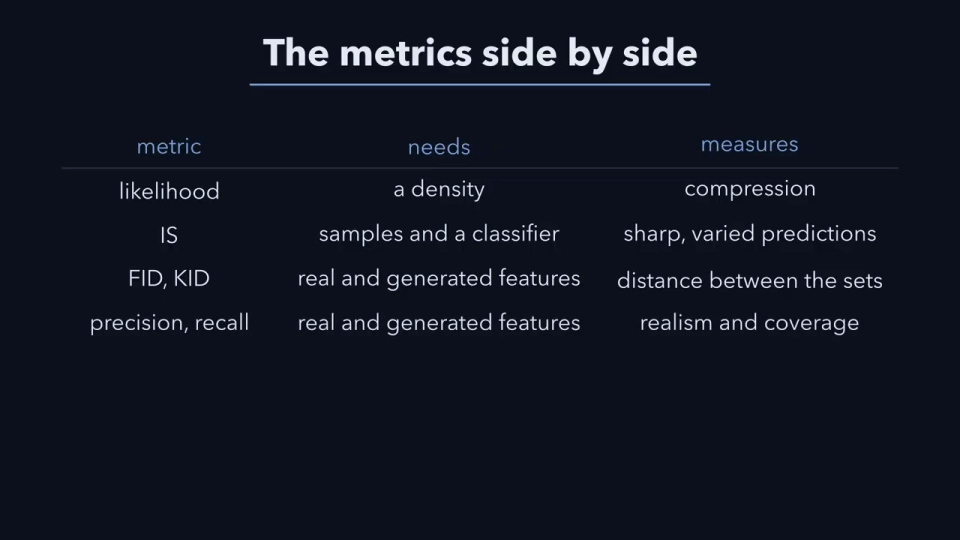

[【跳转到 36:36】](https://www.youtube.com/watch?v=q4JHbYp62Rs&t=2196)

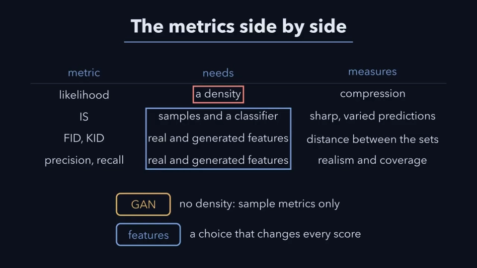

[【跳转到 37:01】](https://www.youtube.com/watch?v=q4JHbYp62Rs&t=2221)

这张表回答的就是本节的学习目标：**为什么单一指标不能代表生成质量。**

- 只追**有效性**（精确率/真实性）：会塌缩到少数「安全」的样本上——只要每张图都足够真，精确率就满分，丢掉的模式完全不影响它。谜题里的模型 1 就是这种极端。
- 只追**覆盖**（召回率）：会产出大量无意义的样本——只要每个真实模式都被碰到过一次，召回率就满分，样本有多假不影响它。模型 2 就是这种极端。
- 只追**新颖性**（离训练集越远越好）：会滑向无意义样本，因为「不像训练集」和「不像任何合法数据」在数值上无法区分。
- 只追**似然**：会被噪声和记忆两头骗。

**这四个维度之间存在真实的张力**，而且这种张力在同一个模型内部就存在：把生成分布收紧，真实性上升、覆盖下降；放开，覆盖上升、真实性下降。所以正确的做法不是找一个更好的单一指标，而是**成对报告**——讲者给出的实用建议是：固定特征网络、预处理和 $N$，报告 FID 或 KID 加上精确率与召回率，如果模型有似然就再加一个留出集似然；然后与起始模型在完全相同的设置下比较，并且报告多次独立采样的标准差——只有当两个模型的差距大于这个标准差时，这个差距才有意义。

## 小结

- 生成模型有三种用途（密度估计、采样生成、表示学习），每种需要自己的度量，**度量之间可以互相矛盾**。
- **似然测的是压缩，不是样本质量**：99% 样本变成噪声，bpd 只涨约 0.002；而背下训练集的模型样本完美、似然却是无穷大。
- **IS** 用分类器判样本，能感知「有效性」和类别层面的多样性，但**从不看真实数据**（无法判断像不像训练集），也**忽略类内多样性**（每类一张图重复也能满分）。
- **FID** 把两种失败折进一个数：样本不像数据、漏掉部分数据。太宽和太窄同分，坍缩与过度分散同分，形状完全不同但矩相同的两组分布还能得 0。
- **精确率量真实性（有效性），召回率量覆盖**：丢模式的模型精确率 1、召回率 0.54；模糊模型精确率 0.39、召回率 1。每个数各自命名一种失败。
- 精确率会被真实数据里的**离群点**抬高——判定标准本身会被数据污染。
- **新颖性必须单独看**：IS 不看真实数据、似然会被记忆骗；最近邻距离是同一套 kNN 工具的自然延伸；而有些失败（画错的手、读不出的文字）只能靠人看。
- 四个维度之间存在真实张力，**单一指标不能代表生成质量**；正确做法是固定设置、成对报告、并给出多次采样的标准差。

## 关键术语速查

| 术语 | 一句话解释 |
| --- | --- |
| bits per dimension（bpd） | 把 NLL 换算成「每个像素值多少比特」，等价于压缩率，可跨图像尺寸比较 |
| 去量化（dequantization） | 给整数像素值加 0–1 均匀噪声，让连续密度与离散像素可以公平比较 |
| IS（Inception Score） | 用分类器判断样本是否「预测尖锐且整体多样」，读作有效类别数 |
| FID | 真实与生成特征两个高斯之间的 Fréchet 距离，越低越好 |
| KID | 特征之间的核距离（MMD 的无偏估计），用来消除 FID 的样本数偏差 |
| 精确率（precision） | 生成样本中落进真实近邻球的比例，量真实性/有效性 |
| 召回率（recall） | 真实点中落进生成近邻球的比例，量分布覆盖 |
| 模式丢弃（mode dropping） | 只生成部分模式，精确率高而召回率低 |
| 模式坍塌（mode collapse） | 生成器塌缩到极少数输出，精确率高、召回率极低 |
| 线性探针（linear probe） | 冻结模型、在特征上训练线性分类器，用其准确率评估表示质量 |