# 密度与覆盖：用两个数分开保真度与多样性

> 视频来源：[Reliable Fidelity and Diversity Metrics for Generative Models - ICML2020](https://www.youtube.com/watch?v=_XwsGkryVpk)（YouTube · Muhammad Ferjad Naeem，论文宣讲）｜时长约 16 分钟
> 简要导读：这是 ICML 2020 论文 *Reliable Fidelity and Diversity Metrics for Generative Models* 的作者宣讲。它先说清「保真度」和「多样性」是两件不同的事，再指出当时通用的精确率/召回率（precision/recall）有两个致命缺陷，最后给出替代指标 **density（密度）** 与 **coverage（覆盖）**，并提醒还有一个常被忽略的环节——特征嵌入空间。本文只讲这四个维度的定义、度量方式与彼此张力；采样预算、任务成功率等实验设置问题不在本文范围。

## 本讲要解决的核心问题（SCQA）

**背景**：评估生成模型时，大家习惯看一个数——FID。FID 越低越好，而且经验上确实和人的主观判断相关：看起来更真实的那组图，FID 通常更低。

**冲突**：可是「生成得好」其实是两件事：**保真度（fidelity）**，即每一张假图有多真实；**多样性（diversity）**，即真实数据里的各种变化被假数据捕捉到多少。FID 会把这两件事混进一个数里。当两个模型的 FID 相同时，你无法在不看图的情况下判断谁更多样、谁更真实。

**疑问**：能不能把这两件事拆成两个数？已经被提出的精确率/召回率为什么不够用？拆开之后，怎么保证这两个数本身是可靠的？

**回答（中心思想）**：精确率/召回率虽然把「真实性」和「覆盖」拆开了，但它们的估计值依赖样本数、维度、近邻个数和嵌入分布族，**在真实分布与生成分布完全相同时甚至给不出 100%**；改用 **density** 与 **coverage** 这一对指标，可以在分布相同时得到可解析的期望值（density 期望为 1，coverage 期望接近 1），并且对离群点稳健、能稳定地暴露模式丢弃。此外，指标算在哪个嵌入空间里，本身就是一个必须交代的评估环节。

## 一、评估指标要回答的是「哪个模型更好」，而「好」有两个维度

### 1.1 为什么需要数字

讲者开篇放了两组人脸图：左边一组明显崩坏，右边一组看起来正常。他说，评估指标的作用就是「用数字去排序和分析模型」——把这种肉眼可辨的差别变成一个可以比较的量。

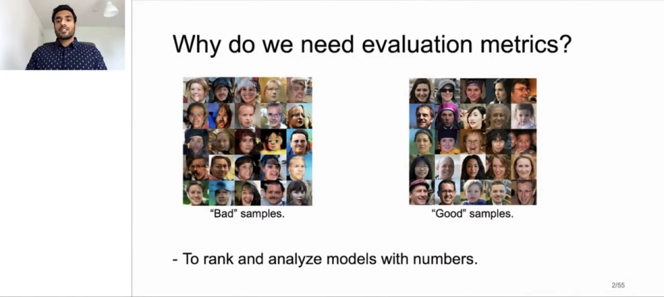

[【跳转到 00:14】](https://www.youtube.com/watch?v=_XwsGkryVpk&t=14)

### 1.2 保真度与多样性是两个正交的问题

讲者把生成性能拆成两条：

- **保真度（fidelity）**：每一份假数据有多真实。
- **多样性（diversity）**：真实数据里的各种变化，被假数据捕捉得有多好。

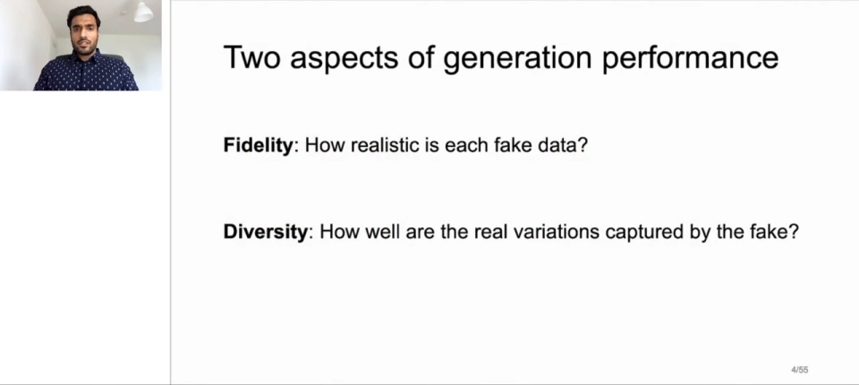

[【跳转到 00:39】](https://www.youtube.com/watch?v=_XwsGkryVpk&t=39)

注意这里的措辞差別：保真度是**逐个样本**的性质（这张图像不像真的），多样性是**整体分布**的性质（真实数据里那些不同的样子，模型有没有都覆盖到）。后面所有指标的分歧，根源都在这个「逐样本 vs 整体分布」的区别上。

### 1.3 FID 对两者都「有反应」，但不能把两者分开

讲者用两组对比图说明：FID 确实能感知保真度——更好看的那组 FID 更低；FID 也确实能感知多样性——更丰富的那组 FID 也更低。

问题出在第三步：**当两个模型拿到相同的 FID 时，你无法在不人工看图的情况下排出谁更多样、谁更真实。** FID 是一个标量，两个方向的退化可以互相抵消，最后落在同一个数上。

这正是本讲的出发点：需要一个能把「真实性」和「覆盖」拆开的度量。

## 二、精确率与召回率：把一个问题拆成两个

### 2.1 定义

已有的做法是借用分类里的精确率/召回率（Sajjadi 等，NeurIPS 2018；Kynkäänniemi 等，NeurIPS 2019）：

- **精确率（precision，对应保真度）**：在所有假样本中，有多大比例**靠近**真实流形？
- **召回率（recall，对应多样性）**：在所有真样本中，有多大比例**靠近**假流形？

「靠近」用 kNN 半径来定义：以每个点为球心，画一个到它第 k 个近邻那么大的球，所有球的并集就是这条流形的近似。

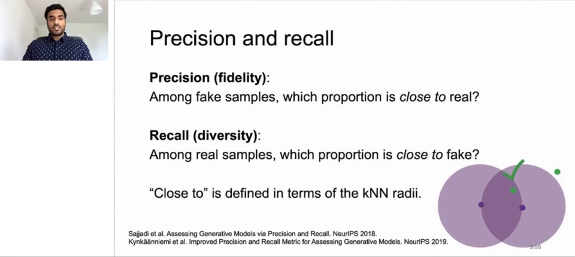

[【跳转到 01:29】](https://www.youtube.com/watch?v=_XwsGkryVpk&t=89)

### 2.2 怎么算：一个具体例子

讲者用一张图走了一遍流程。紫色点是真实数据点，绿色点是生成器输出的样本。第一步，用 k 近邻近似出真实流形（图里 k=1，每个紫点一个球）。

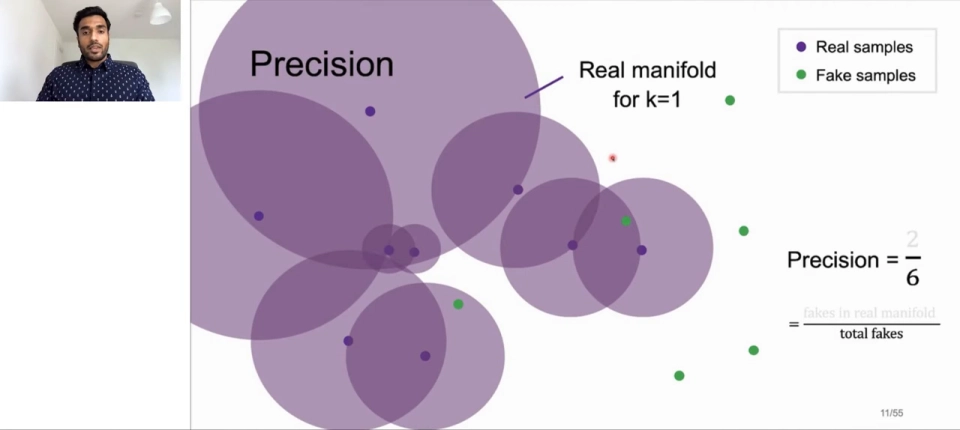

[【跳转到 02:03】](https://www.youtube.com/watch?v=_XwsGkryVpk&t=123)

6 个生成样本里只有 2 个落进这些球，所以精确率是 $2/6$。召回率对称计算：这次把流形建在假样本上，再看 9 个真样本里有多少落进去——7 个，于是召回率是 $7/9$。

写成公式就是：

$$
\text{precision} := \frac{1}{M}\sum_{j=1}^{M}\mathbb{1}\left[\,Y_j \in \mathrm{manifold}(X_1,\dots,X_N)\,\right]
$$

其中 $X$ 是真实样本、$Y$ 是生成样本，$\mathrm{manifold}(X_1,\dots,X_N) := \bigcup_{i=1}^{N} B(X_i, \mathrm{NND}_k(X_i))$，即每个真实点以它到第 k 近邻的距离为半径的球的并集。召回率把 $X$ 与 $Y$ 的角色对调即可。

讲者总结：**从根本上说，精确率与召回率确实分别捕捉了保真度和多样性。** 但接下来他要讲的是这两个指标的根本问题。

## 三、精确率与召回率的两个致命缺陷

### 3.1 缺陷一：对离群点极其敏感

设想两组完全不相交的数据点。按定义，精确率和召回率应该都是 0%，这是对的。

但只要第二组分布附近出现**一个**离群点，情况就变了：这个离群点的最近邻在很远的地方，于是它的球被撑得极大，把两组分布都罩了进去。此时计算出来的重叠是 100%——**尽管两个分布根本不相交**。

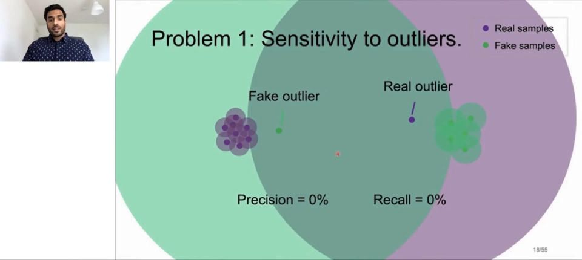

[【跳转到 03:18】](https://www.youtube.com/watch?v=_XwsGkryVpk&t=198)

### 3.2 缺陷二：真实分布等于生成分布时，也给不出 100%

更严重的是另一个方向。讲者构造了一个真实分布与生成分布**实际上重叠**的例子，此时精确率和召回率只给出约 63%——离理想值 100% 差得很远。

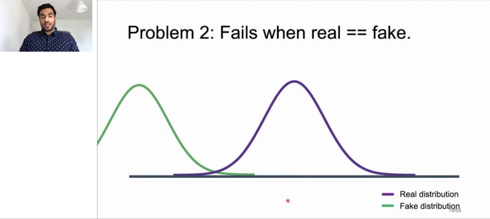

[【跳转到 03:34】](https://www.youtube.com/watch?v=_XwsGkryVpk&t=214)

这意味着什么？意味着**你没法判断「63%」到底是模型不好，还是指标本身的天花板。** 一个指标如果在「完美模型」上都不给满分，它就没有可解释的绝对刻度，只能勉强用于相对比较。

### 3.3 依赖一串超参数，且多样性侧不稳定

讲者指出，这个偏差不是个例，它会随着一串超参数漂移，指标的**期望值**取决于：

- 样本数量；
- 计算所用的维度；
- 计算所用的近邻个数 k；
- 嵌入所来自的分布族。

还有一条与多样性直接相关的隐患：**召回率把流形建在假样本上**。而生成器的输出本身可能不稳定，于是这个流形对每个模型、每个 checkpoint 都要重算一遍——参照物在动，比较就不可靠。

## 四、密度与覆盖：把「数个数」换成「数密度」

针对上面两个缺陷，作者提出 **density（密度）** 修精确率、**coverage（覆盖）** 修召回率。

### 4.1 density：修掉「离群点把流形撑大」

思路的差别很直观。精确率把每个近邻球当成「要么在里面、要么在外面」，取并集；density 则把球做**叠加**，落在密集区域的样本得分高，落在稀疏区域的样本得分低。

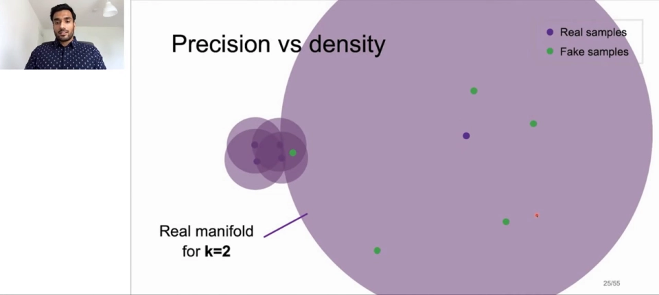

[【跳转到 05:03】](https://www.youtube.com/watch?v=_XwsGkryVpk&t=303)

举个具体例子（k=2）：4 个假样本只落进 1 个球，各得 1 分；1 个假样本落在有 3 个球重叠的密集区，得 3 分。于是

$$
\text{density} = \frac{1 + 1 + 1 + 1 + 3}{k \cdot M} = \frac{7}{2 \times 6} \approx 58\%
$$

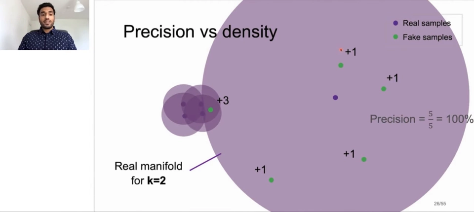

[【跳转到 05:33】](https://www.youtube.com/watch?v=_XwsGkryVpk&t=333)

注意这个对比：同一批样本，精确率说 100%（全在流形里），density 说 58%。差别就在于 density **不把「落在某个球里」当成二元事件**，而是按重叠的球数计分。一个离群点撑出来的大球，只能贡献 1 分，撑不出满分。

数学形式：

$$
\text{density} := \frac{1}{kM}\sum_{j=1}^{M}\sum_{i=1}^{N}\mathbb{1}\left[\,Y_j \in B(X_i, \mathrm{NND}_k(X_i))\,\right]
$$

即：对每个生成样本，遍历所有真实点，数有多少个真实点的球把它罩住了，再除以 $k$ 和生成样本数。

### 4.2 coverage：把参照物换成真实数据

召回率的问题在参照物不稳定。coverage 的做法是把流形**建在真实样本上**：

- 好处一：更稳定，因为它不随 checkpoint 变化；
- 好处二：每个数据集只需要算一次，此后所有模型、所有 checkpoint 都对着同一个东西比。

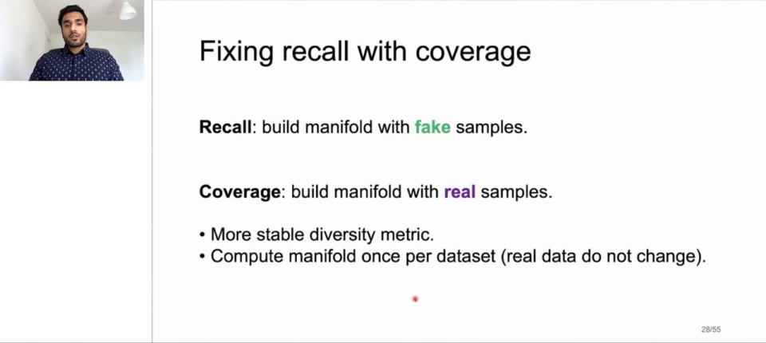

[【跳转到 06:14】](https://www.youtube.com/watch?v=_XwsGkryVpk&t=374)

先看召回率的公式：把流形建在假样本上（图中绿色球，k=1），再看 7 个真样本里有多少落进去——全部落进去，召回率就是 $7/7 = 100\%$。

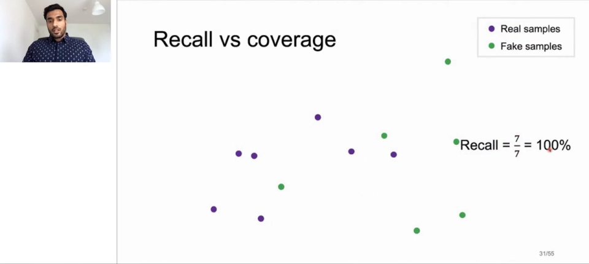

[【跳转到 06:45】](https://www.youtube.com/watch?v=_XwsGkryVpk&t=405)

它的公式与流形定义写在一起是这样的：

$$
\text{recall} := \frac{1}{N}\sum_{i=1}^{N}\mathbb{1}\left[\,X_i \in \mathrm{manifold}(Y_1,\dots,Y_M)\,\right],\qquad \mathrm{manifold}(X_1,\dots,X_N) := \bigcup_{i=1}^{N} B\bigl(X_i, \mathrm{NND}_k(X_i)\bigr)
$$

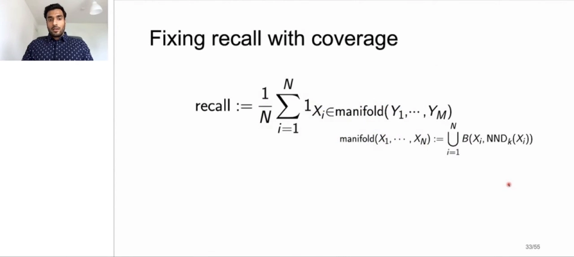

[【跳转到 07:18】](https://www.youtube.com/watch?v=_XwsGkryVpk&t=438)

计算方式也变了。召回率数的是「有多少真样本落进假流形」，coverage 数的是「真实流形的这些球里，有多少个**至少被一个生成样本碰到过**」。在讲者所用的同一批样本上，把流形改建到真实样本上后，7 个球里只有 3 个被生成样本占据，于是 coverage 是 $3/7 \approx 43\%$——而召回率给的是 100%。公式：

$$
\text{coverage} := \frac{1}{N}\sum_{i=1}^{N}\mathbb{1}\left[\,\exists\, j \text{ s.t. } Y_j \in B(X_i, \mathrm{NND}_k(X_i))\,\right]
$$

与召回率的公式对照可以看出，唯一的改动是把指示函数里的「$X_i \in$ 假流形」换成了「真实球里存在某个 $Y_j$」。

这个「至少被碰到一次」的写法，正是**分布覆盖**的直接度量：它不问每个真样本被贴近了多少次，只问这个模式**有没有被生成到**。所以它对「只生成高概率模式、把稀有模式整个丢掉」这种失败特别敏感。

### 4.3 理论性质：分布相同时有可解析的期望值

这是作者最看重的一点。当真实分布与生成分布**完全相同**时：

$$
\mathbb{E}[\text{density}] = 1
$$

而 coverage 的期望值是一个可以写出来的表达式，在 $M$、$N$、$k$ 足够大时接近 1。

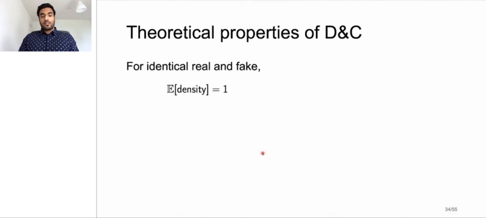

[【跳转到 07:43】](https://www.youtube.com/watch?v=_XwsGkryVpk&t=463)

关键性质是：**这个期望值与分布类型无关，也与分布维度无关。** 换成任意形状、任意维度的数据，完美模型就该得 1。而论文里证明了，**精确率/召回率不存在这样的估计**——这正是它们在完美模型上只给 63% 的原因。

有了这个刻度，超参数的选择也有了依据：取 $M=N=10{,}000$，然后不断增大 $k$，直到在相同分布上能检测到至少 95% 的匹配；这样定下来 $k=5$。

## 五、三个实验：指标真的能分辨不同的失败吗

### 5.1 实验一：对离群点的稳健性

在 CelebA 上训练 StyleGAN，生成大量样本，按最近邻距离把它们分成 inlier 和 outlier，然后逐步往样本集里掺入离群点，观察多样性指标怎么变。

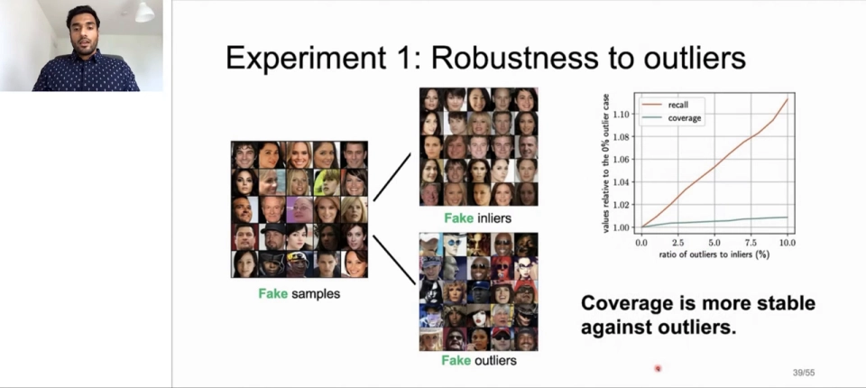

[【跳转到 09:30】](https://www.youtube.com/watch?v=_XwsGkryVpk&t=570)

结果：**召回率随离群点比例上升而虚高约 12%，coverage 相对平稳。** 这验证了 4.1 节的机制——召回率的球会被离群点撑大，coverage 的球建在真实数据上，撑不大。

### 5.2 实验二：能不能发现模式丢弃

用 MNIST 模拟模式丢弃：一开始真假样本里 0 到 9 各数字比例相同，然后逐轮提高「0」的比例，直到假样本里只剩下数字 0。

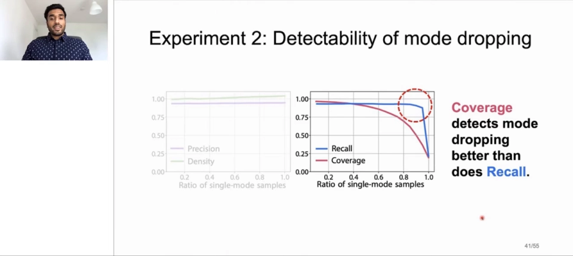

[【跳转到 10:08】](https://www.youtube.com/watch?v=_XwsGkryVpk&t=608)

结果很说明问题：**召回率直到「全丢光」才变化，而 coverage 一路稳定下降。** 也就是说，coverage 能在模型刚开始丢模式时就报警，提示你该去看看模型了；召回率则会一直给你「没事」的假消息。

### 5.3 实验三：保真度与多样性的权衡

第三个实验用 StyleGAN 的潜空间截断（truncation）来人为制造权衡：截断参数 $\psi$ 越大，样本越多样、越不真实。

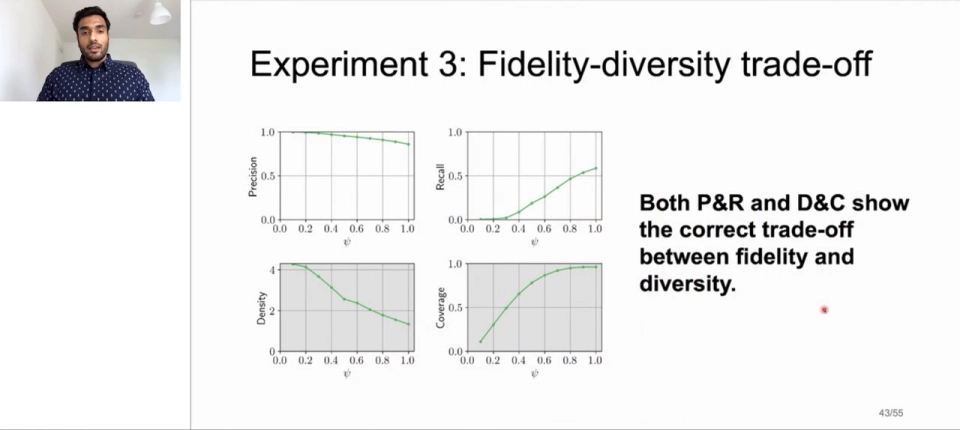

[【跳转到 10:46】](https://www.youtube.com/watch?v=_XwsGkryVpk&t=646)

四个指标都正确地捕捉到了这个权衡：保真度侧（precision、density）随 $\psi$ 单调下降，多样性侧（recall、coverage）随 $\psi$ 单调上升。

这个实验其实点出了本节最核心的张力：**保真度和多样性在同一个模型里是此消彼长的。** 你把生成分布收紧，样本更真实但覆盖更窄；你把它放开，覆盖更全但样本更假。任何单一标量指标都会在这个权衡上给出模棱两可的答案——这正是为什么必须至少成对报告。

## 六、被忽略的一环：指标算在哪个嵌入空间里

### 6.1 像素域的距离没有意义

讲者提醒，评估流程里还有一环常被当成既定事实：**距离是在哪个空间里算的**。在像素域里算距离没有意义——把图像平移一个像素，几乎所有像素值都变了，但内容没变。所以评估时要把图像嵌入到一个特征空间，业界普遍用 ImageNet 预训练模型。

问题在于：这些模型是在 ImageNet 的真实图像上训练的，代表的是「我们周围的自然世界」。而生成模型的应用正在往医学图像、声音生成等领域扩散，讲者假设这些嵌入**不会带来公平的评估**——从简单的 MNIST，到复杂如生成音频的频谱图，都可能失真。

### 6.2 随机初始化的 CNN 也能用

解决办法出人意料地简单：**用随机初始化的 CNN 当嵌入函数**。好处是它不依赖任何特定数据集，作用相当于对图像集合做一次非线性随机投影（此前工作已表明这种嵌入空间可用于感知距离和图像修复）。

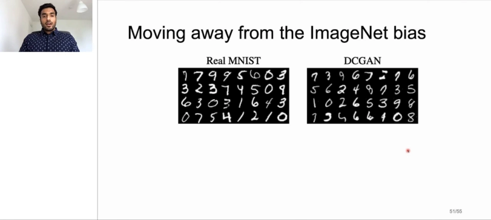

[【跳转到 13:29】](https://www.youtube.com/watch?v=_XwsGkryVpk&t=809)

讲者做了三组验证：

1. **截断实验**：把 VGG16 换成随机初始化空间，4096 维下保真度-多样性权衡仍能被捕捉；因为不再受训练约束，甚至可以只保留 64 维，权衡照样清楚。
2. **MNIST + DCGAN**：用 ImageNet 嵌入评估，会把一个明显学会了数字表示、各类都输出的模型排得很差，与人的判断不符；换成随机初始化网络后，数值更符合人的判断。
3. **声音生成（WaveGAN）**：用训练过的嵌入空间算，多样性接近 0，会误判成模式坍塌；换成随机嵌入空间后，结果更贴近人的判断。

这条结论对「有效性」这一维度尤其重要：**同一批样本，换一个嵌入空间，「像不像真的」的判定就会变。** 所以报告任何保真度/多样性数字时，必须连同嵌入空间一起交代，否则数字不可比。

## 小结

- **保真度（有效性）与多样性是两个正交的问题**：前者是逐样本的性质，后者是整体分布的性质。FID 对两者都有反应，但会把它们混成一个数，同分时无法排序。
- **精确率与召回率**把两者拆开：精确率问「假样本有多少靠近真实流形」，召回率问「真样本有多少靠近假流形」，靠近用 kNN 半径定义。
- 但它们有两个根本缺陷：**对离群点极敏感**（一个离群点能把 0% 重叠变成 100%），以及**在真实分布等于生成分布时也给不出 100%**（例子里只有 63%），且期望值随样本数、维度、k 和嵌入分布族漂移。
- **density** 用球的叠加代替并集，修掉了「离群点撑大流形」的问题：落在密集区得分高，落在稀疏区得分低。
- **coverage** 把流形建在真实数据上，数「有多少真实模式至少被生成到一次」，因而更稳定，也直接对应**分布覆盖**。
- 两者有可解析的期望值（分布相同时 density 期望为 1，coverage 接近 1），且**与分布类型和维度无关**——这是精确率/召回率给不出的绝对刻度。
- 实验显示：离群点让召回率虚高 12% 而 coverage 稳定；模式丢弃时召回率直到全丢光才动、coverage 稳步下降；截断实验里四个指标都正确反映了保真度与多样性的此消彼长。
- **嵌入空间本身是评估的一部分**：像素域距离无意义，ImageNet 预训练嵌入有领域偏置，随机初始化 CNN 在 MNIST 和声音生成上更接近人的判断。

## 关键术语速查

| 术语 | 一句话解释 |
| --- | --- |
| 保真度（fidelity） | 每一份生成样本有多真实，是逐样本的性质 |
| 多样性（diversity） | 真实数据中的各种变化被生成样本捕捉了多少，是整体分布的性质 |
| 精确率（precision） | 假样本中落在真实流形（kNN 球并集）内的比例，衡量真实性 |
| 召回率（recall） | 真样本中落在假流形内的比例，衡量覆盖 |
| kNN 半径 | 每个点到它第 k 个近邻的距离，用来给「靠近」一个可计算的尺度 |
| density（密度） | 精确率的改良版：按生成样本被多少个真实近邻球罩住计分，再除以 $kM$ |
| coverage（覆盖） | 召回率的改良版：真实流形的球中，至少被一个生成样本碰到的比例 |
| 模式丢弃（mode dropping） | 生成器只输出部分模式、把其余模式整个丢掉，覆盖率会明显下降 |
| 截断（truncation） | 收紧生成器潜空间采样范围以换取保真度、牺牲多样性的手段，参数常记作 $\psi$ |
| 嵌入空间（embedding space） | 计算样本间距离所用的特征空间，选择不同会改变所有指标数值 |