# 非共价相互作用：范德华力、氢键、离子键与疏水作用

> 视频来源：[生物化学 1.3 非共价相互作用](https://www.bilibili.com/video/BV18MgHzXEsR/)（Bilibili · 中国农业大学 MOOC，杨海莲教授）｜时长约 17 分钟
> 简要导读：一支课堂录屏讲完四类非共价相互作用的来源、几何条件与键能，并用 ATP、盐桥、球蛋白折叠和磷脂双分子层说明它们在细胞里的用途。本文按“先看单个作用力，再看水环境如何改变它们的合力”重排，字幕中的“集团”统一订正为“基团”、“即兴”订正为“极性”、“汤基”订正为“羰基”、“苞米地”订正为“胞嘧啶”。

## 本讲要解决的核心问题（SCQA）

**背景**：细胞里大部分体积是水，蛋白质、核酸、膜由共价键连成的链构成。共价键很强，C–C 键约 348 kJ/mol，C=O 键约 712 kJ/mol，一旦断裂就很难在生理条件下复原。

**冲突**：但生命里大量关键事件是可逆、快速、可调节的——蛋白质自己折成特定形状，抗原与抗体贴合并能解离，磷脂在水里自发排成双层膜。这些过程如果靠共价键，既太强又不可逆。

**疑问**：那这些“贴上去、又能松开”的力从哪来？它们各自有多强，又为什么都离不开水？

**回答（中心思想）**：生命用四类非共价相互作用——范德华力、氢键、电荷之间的相互作用（离子键／盐桥）和疏水相互作用——来完成识别、折叠与组装。它们单个键能只有共价键的百分之几到几十分之一，但作用距离、方向性和数量各不相同；把它们放在水环境里，水的高介电常数削弱电荷作用，水的氢键网络又把非极性基团“推”到一起，于是“弱作用 × 大量 × 水环境”共同决定了蛋白质怎么折叠、分子怎么结合、膜怎么形成。

## 一、四类非共价相互作用：弱、可逆、靠数量取胜

这节课把生物系统中的非共价键相互作用分成四个方面：范德华相互作用、氢键、电荷之间的相互作用，以及疏水相互作用 [【跳转到 00:20】](https://www.bilibili.com/video/BV18MgHzXEsR/?t=20)。

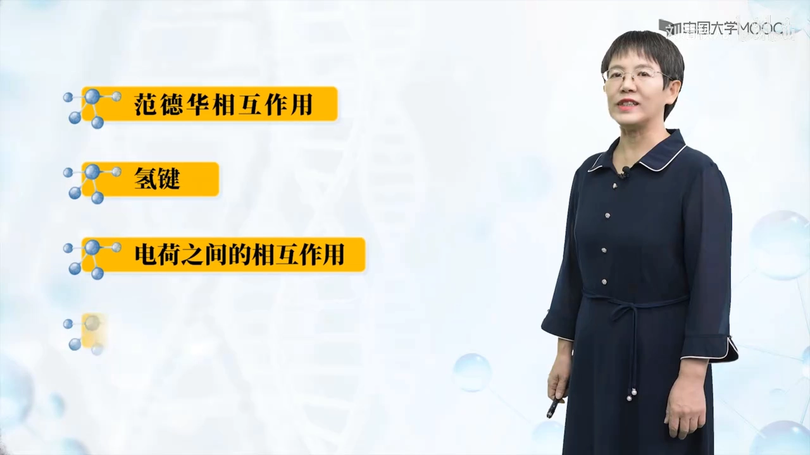

理解这四类作用力，要始终抓住三个量：**键能**（一个作用有多强）、**作用距离**（两个基团要靠近到什么程度才起作用）、**几何约束**（有没有方向性和饱和性）。前两个决定“能不能粘住”，第三个决定“粘成什么形状”。课程最后用一张表把三者并列比较，本文先把每一类讲清楚，再回到这张表。

## 二、范德华力：三种偶极来源，一个 0.4–0.6 纳米的最佳距离

### 2.1 三种来源都源于“电荷分布不均匀”

范德华力常被当作“最弱、最没特点”的力，其实它包含三种来源不同的吸引 [【跳转到 01:26】](https://www.bilibili.com/video/BV18MgHzXEsR/?t=86)：

- **极性基团之间**：两个基团本身都不带电，但各自有固有偶极（一端偏正、一端偏负），靠近时正负端相互吸引，本质是静电相互作用。
- **极性基团与非极性基团之间**：极性基团的固有偶极产生电场，使相邻的非极性基团电子云变形、极化，产生**诱导偶极**，两者再相互吸引。
- **非极性基团之间**：核外电子云不断运动、原子核不断振动，某一瞬间电荷分布不对称，产生**瞬间偶极**，两个瞬间偶极之间同样相互吸引。

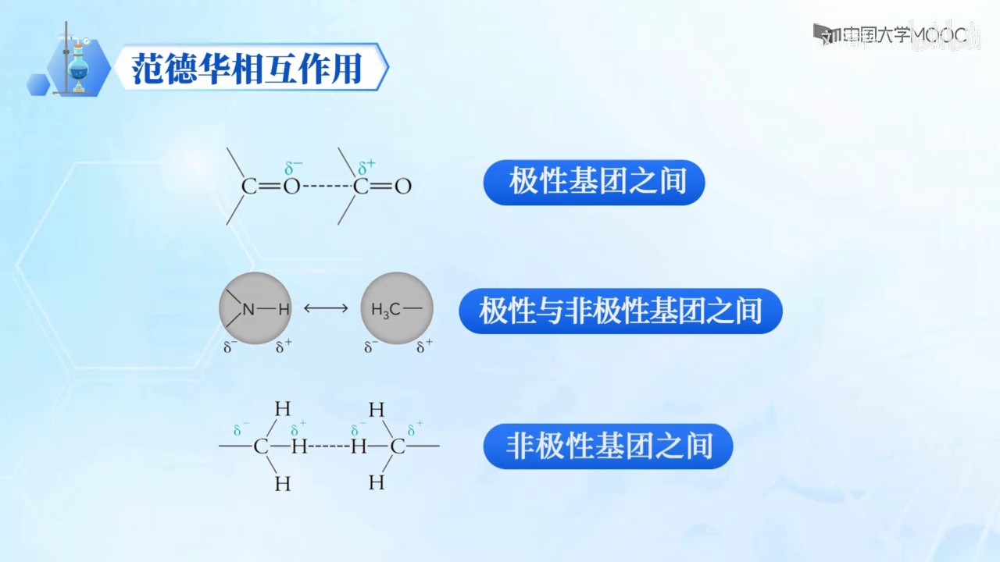

三者都属于范德华力；日常说“范德华力”时，多数情况下指的是非极性基团之间的那一种 [【跳转到 01:26】](https://www.bilibili.com/video/BV18MgHzXEsR/?t=86)。这也解释了为什么疏水口袋里的烷基侧链之间仍有吸引力——它们不带电、没有氢键供体，只剩瞬间偶极可用。

### 2.2 范德华半径与势能曲线

描述范德华作用要引入**范德华半径**：它度量“一种原子允许另一种原子与它接近到什么程度” [【跳转到 01:42】](https://www.bilibili.com/video/BV18MgHzXEsR/?t=102)。课程表格给出的常见元素范德华半径为 H 约 0.1 nm、O 0.14 nm、N 0.15 nm、C 0.17 nm、S 0.185 nm、P 0.19 nm。

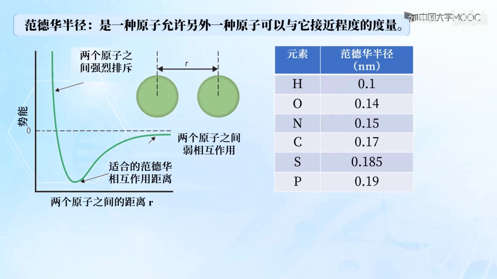

把两个原子之间的距离作为横轴、势能作为纵轴，就得到一条典型的范德华势能曲线 [【跳转到 02:07】](https://www.bilibili.com/video/BV18MgHzXEsR/?t=127)：

- 距离太近、两个原子的范德华半径发生重叠时，电子云强烈排斥，势能急剧升高；
- 距离太远时，相互作用弱到可以忽略；
- 只有中间这一段“合适的范德华相互作用距离”才是吸引的。

课程给出的经验值是：两个原子相距 **0.4–0.6 nm** 时相互吸引 [【跳转到 02:57】](https://www.bilibili.com/video/BV18MgHzXEsR/?t=177)。这个窗口很窄，意味着范德华力对**形状互补**极其敏感：两个分子表面要像模具一样贴合，才能让大量原子对同时落进这个距离区间；多一个甲基造成空间冲突，势能就会转为排斥。后面讲分子对接、蛋白–配体亲和力时反复出现的“形状互补”，物理基础就在这里。

## 三、氢键：两个电负性原子分享一个氢

### 3.1 形成条件与键长

氢键的经典图像是：氧带部分负电、氢带部分正电，二者之间是共价键；附近另一个带负电的氧对这个氢也有吸引，这个额外的吸引就是氢键 [【跳转到 03:24】](https://www.bilibili.com/video/BV18MgHzXEsR/?t=204)。

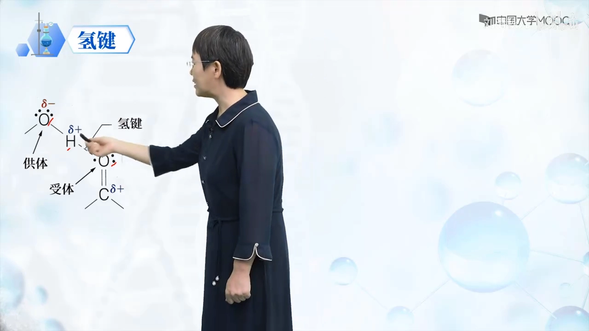

形成氢键需要**两端都是电负性较强的原子**。课程给出的电负性数值为 H 2.2、C 2.55、S 2.58、N 3.04、O 3.44、F 3.98 [【跳转到 05:48】](https://www.bilibili.com/video/BV18MgHzXEsR/?t=348)。因此生物体系里的氢键几乎都由 N–H 或 O–H 提供氢，受体也是 N 或 O。

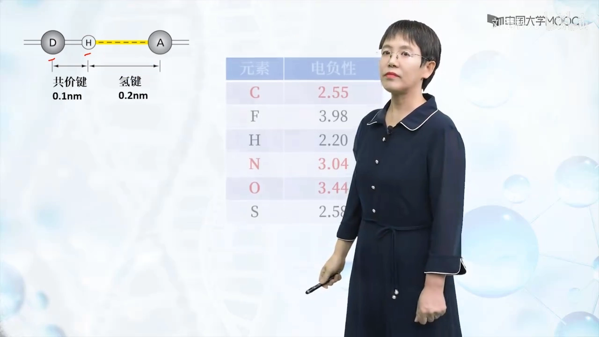

氢键的键长约为共价键的两倍（共价键 0.1 nm 量级，氢键 0.2 nm 量级）[【跳转到 05:32】](https://www.bilibili.com/video/BV18MgHzXEsR/?t=332)。碳的电负性太小，所以**碳上的氢不能形成氢键** [【跳转到 06:14】](https://www.bilibili.com/video/BV18MgHzXEsR/?t=374)——这条限制在判断蛋白–配体相互作用时很实用：疏水碳氢接触只能算范德华力，不能算氢键。

### 3.2 饱和性与方向性

氢键有两个区别于范德华力的几何特征：

- **饱和性**：D–H 中的氢通常只能与一个受体原子 A 结合形成氢键，所以 D–H 是供体、A 是受体，一个氢只能配一个受体。原因是氢原子很小，而供体和受体原子都相对较大，第二个受体挤不进来 [【跳转到 06:44】](https://www.bilibili.com/video/BV18MgHzXEsR/?t=404)。
- **方向性**：三个原子在一条直线上时是强氢键；不在一条直线上时是弱氢键 [【跳转到 06:54】](https://www.bilibili.com/video/BV18MgHzXEsR/?t=414)。

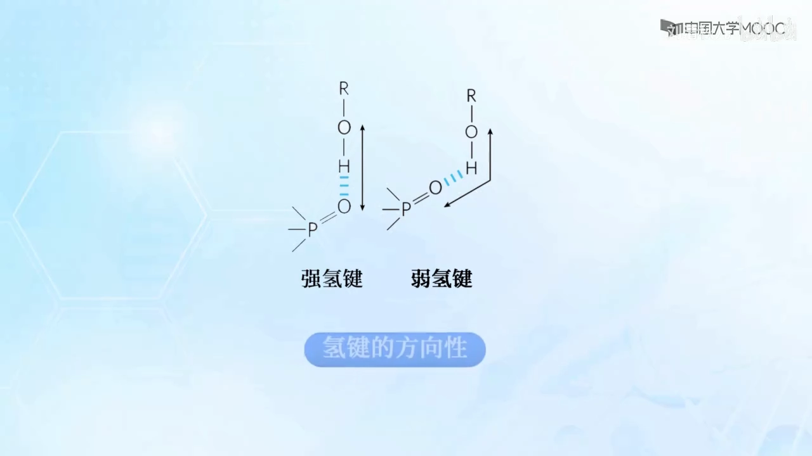

饱和性加方向性，使氢键成为**有指向的“扣子”**，而不像范德华力那样只要求贴得近。这正是核酸碱基配对能精确复制、蛋白二级结构能有规则重复的原因。

### 3.3 生物体内的氢键：碱基配对与蛋白主链

课程举了两类典型例子 [【跳转到 04:22】](https://www.bilibili.com/video/BV18MgHzXEsR/?t=262)：

- **核酸**：鸟嘌呤与胞嘧啶（G–C）配对完全靠氢键——一处 N–H 与 O 之间、一处 N–H 与 N 之间。碱基上氢键供体与受体的位置固定，所以配对具有特异性。
- **蛋白质**：主链上 N–H 与羰基碳上的氧之间形成氢键 [【跳转到 04:47】](https://www.bilibili.com/video/BV18MgHzXEsR/?t=287)。

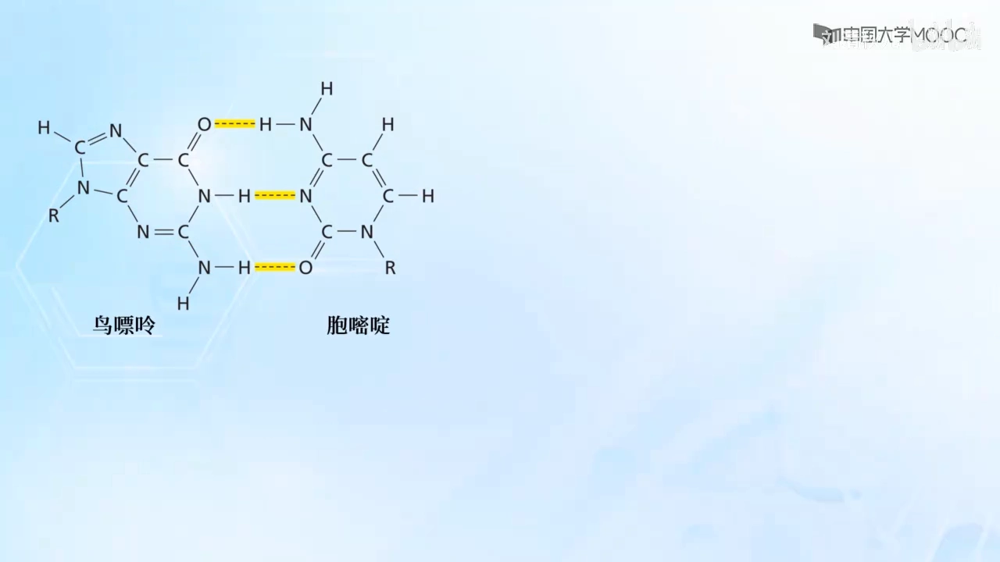

## 四、电荷之间的相互作用：库仑定律与水的高介电常数

### 4.1 从库仑定律到介电常数

两个带电质点之间的作用力用库仑定律描述 [【跳转到 07:51】](https://www.bilibili.com/video/BV18MgHzXEsR/?t=471)：

$$
F = k\frac{q_1 q_2}{\varepsilon r^2}
$$

其中 $F$ 是两个带电质点之间的作用力，$k$ 是常数，$r$ 是它们之间的距离，$\varepsilon$ 是介质的介电常数。把 $\varepsilon$ 这一项盖住，剩下的就是真空中的库仑定律 [【跳转到 07:46】](https://www.bilibili.com/video/BV18MgHzXEsR/?t=466)。

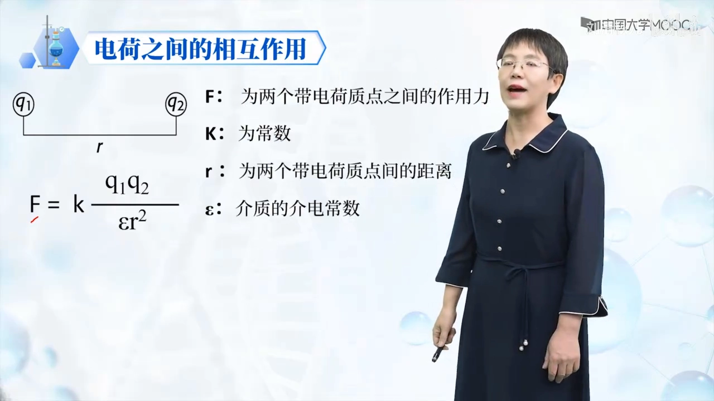

**介电常数**是度量溶剂“降低带电质点之间相互作用能力”的指标：该值越大，带电质点之间的作用越弱 [【跳转到 08:28】](https://www.bilibili.com/video/BV18MgHzXEsR/?t=508)。从公式看很直观——分母上多了一个大于零的数，$F$ 就比真空中小 [【跳转到 08:53】](https://www.bilibili.com/video/BV18MgHzXEsR/?t=533)。$q_1$ 与 $q_2$ 带相反电荷时，两者相互吸引 [【跳转到 09:03】](https://www.bilibili.com/video/BV18MgHzXEsR/?t=543)。

### 4.2 水为什么能“屏蔽”电荷

课程给出的溶剂介电常数（约值）为：水 78.5、甲醇 32.6、乙醇 24.3、丙酮 20.7、乙酸 6.2、氯仿 5.0、苯 2.0 [【跳转到 09:15】](https://www.bilibili.com/video/BV18MgHzXEsR/?t=555)。

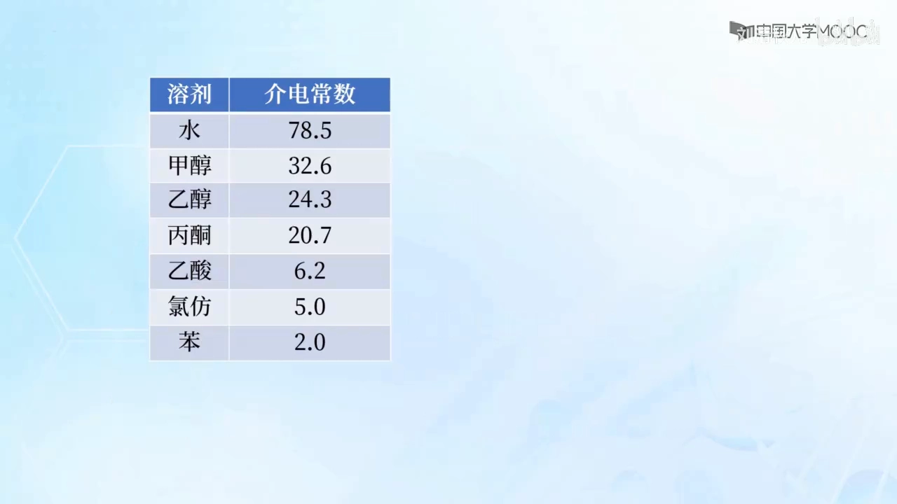

水的高介电常数意味着：把两个电荷从真空搬进水里，它们之间的相互作用会大幅降低。这条结论对理解细胞很关键——**水溶液极大地减小了电荷之间的相互作用** [【跳转到 09:15】](https://www.bilibili.com/video/BV18MgHzXEsR/?t=555)。同一个公式也提示：换一种介电常数更低的介质，同样一对电荷的作用就会更强，因此“在什么环境里”与“带多少电荷”同样重要。

### 4.3 两个细胞里的例子：Mg²⁺–ATP 与盐桥

**ATP 的磷酸基团**上有一串带负电的氧，负电荷之间相互排斥，分子本身并不稳定。它能在细胞里稳定存在，主要靠镁离子与这些氧的负电荷形成正负电荷相互作用 [【跳转到 09:59】](https://www.bilibili.com/video/BV18MgHzXEsR/?t=599)。这也是为什么 ATP 在细胞里通常以 Mg²⁺–ATP 复合物形式出现。

**蛋白质高级结构**中，一个带正电的基团（如 N 端氨基或赖氨酸侧链）与一个带负电的侧链（如天冬氨酸、谷氨酸的羧基）相互吸引，可以维持蛋白质的高级结构 [【跳转到 10:36】](https://www.bilibili.com/video/BV18MgHzXEsR/?t=636)。课程明确指出：相反电荷之间的相互作用就叫**离子键**，有时也叫**盐桥**或**盐键** [【跳转到 10:51】](https://www.bilibili.com/video/BV18MgHzXEsR/?t=651)。

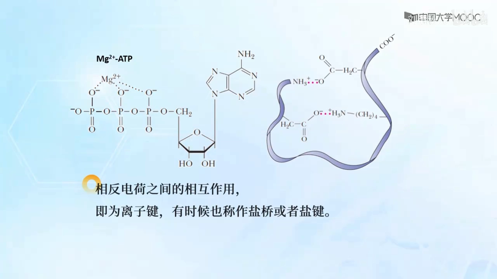

需要注意术语的层次：离子键、盐桥说的是**相互作用的来源**（相反电荷的静电吸引），而范德华力里的极性—极性项其实也是静电作用，只是强度和作用距离不同。判断时看电荷是否“整份”存在：整份正负电荷之间是离子键，偶极之间是范德华力。
## 五、疏水相互作用：本质是水的熵效应

### 5.1 现象：非极性分子在水里会自动聚在一起

把非极性分子放进水里，水会在它周围形成一层“水膜”。再放几个疏水性分子，过一会儿它们就会聚在一起，外面照样有一层水膜 [【跳转到 11:16】](https://www.bilibili.com/video/BV18MgHzXEsR/?t=676)。

课程给出的定义是：**疏水相互作用指在介质水中，非极性分子（疏水分子）或分子基团倾向于聚集的现象，也可以说是水分子驱使非极性分子聚集的作用** [【跳转到 11:41】](https://www.bilibili.com/video/BV18MgHzXEsR/?t=701)。

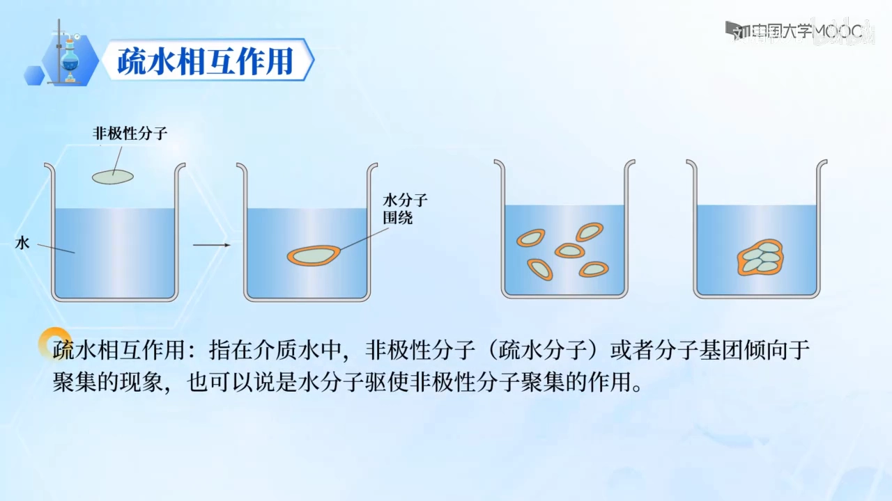

注意这个定义的主语是**水**，不是“疏水分子互相吸引”。两个非极性分子之间只有微弱的范德华力，真正把它们压到一起的是水。这是初学者最容易误解的一点。

### 5.2 本质：减少有序水，让熵少降一点

为什么水要把非极性分子推到一起？课程用四个非极性分子对比了两种状态 [【跳转到 12:24】](https://www.bilibili.com/video/BV18MgHzXEsR/?t=744)：

- 状态一：四个分子分散，每个分子周围都排着一圈整齐有序的水分子；
- 状态二：四个分子聚成一团，只有外表面排着有序水分子。

水分子之间本来靠氢键自由移动，疏水分子插进来会妨碍这种移动，迫使水在界面处排成有序的“笼子”。分子聚在一起后，总界面面积变小，被束缚的有序水分子数量减少——**熵减更少**，系统更稳定 [【跳转到 13:10】](https://www.bilibili.com/video/BV18MgHzXEsR/?t=790)。所以课程强调：疏水相互作用事实上是**熵的效应** [【跳转到 13:58】](https://www.bilibili.com/video/BV18MgHzXEsR/?t=838)。

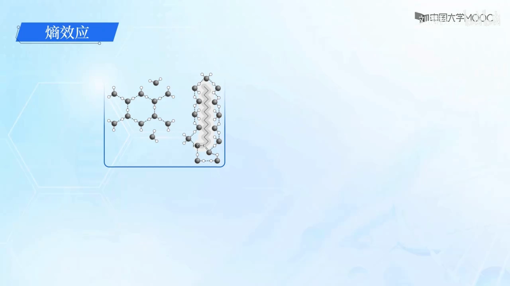

### 5.3 两个后果：球蛋白折叠与生物膜形成

**球蛋白折叠**：一条肽链上既有非极性基团也有极性基团。在水环境中，水会把非极性基团推向蛋白质内部，于是内部非极性基团多、亲水基团分布在靠近水的区域 [【跳转到 14:47】](https://www.bilibili.com/video/BV18MgHzXEsR/?t=887)。课程用亮氨酸和异亮氨酸举例：两个疏水侧链各自带着水膜时不稳定，水溶液推动蛋白质折叠、让两个疏水基团聚在一起，水膜总表面积随之减小 [【跳转到 13:33】](https://www.bilibili.com/video/BV18MgHzXEsR/?t=813)。

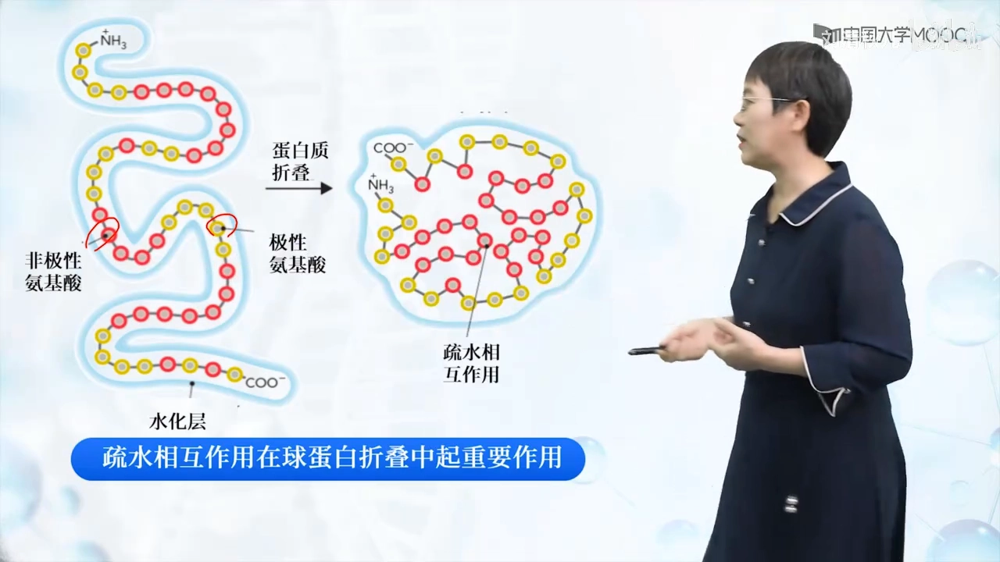

**生物膜形成**：磷脂分子有亲水性头部和疏水性尾部。在水环境中，它们自发排成磷脂双分子层——亲水头部朝向两侧的水，疏水尾部聚在中间 [【跳转到 15:18】](https://www.bilibili.com/video/BV18MgHzXEsR/?t=918)。细胞器的膜也是同一原理：亲水头部朝外、朝内，中间是疏水区域 [【跳转到 15:51】](https://www.bilibili.com/video/BV18MgHzXEsR/?t=951)。

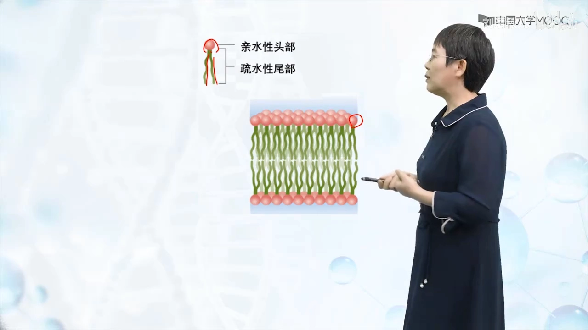

这两件事的共同点是：**没有谁“设计”结构，是水把非极性部分挤到一起，剩下的极性部分只能朝向水**。折叠与自组装的驱动力是同一种。

## 六、四类相互作用对比：一张表看清强弱与距离

课程最后把四类相互作用与共价键并列比较 [【跳转到 15:56】](https://www.bilibili.com/video/BV18MgHzXEsR/?t=956)：

| 相互作用 | 键能（kJ/mol） | 作用距离（nm） |
| --- | --- | --- |
| 范德华相互作用 | 0.4–4.0 | 0.3–0.6 |
| 氢键 | 12–30 | 0.3 |
| 电荷间相互作用 | 20 | 0.25 |
| 疏水相互作用 | < 40 | — |
| 共价键（对照：C–C / C=O） | 348 / 712 | — |

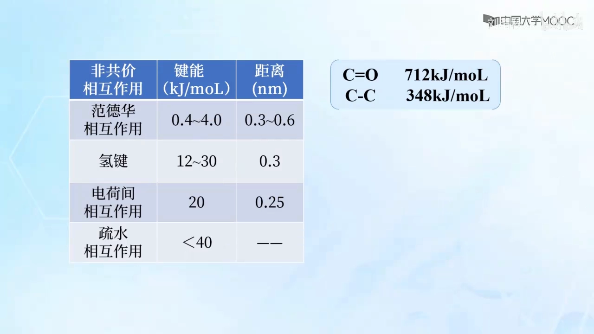

读这张表要注意三点：

1. **非共价相互作用比共价键弱一到三个数量级**。范德华力最弱，只有 0.4–4.0 kJ/mol；氢键与离子键在 12–30 kJ/mol 量级；疏水相互作用在表中小于 40 kJ/mol，是这几类里最大的 [【跳转到 16:16】](https://www.bilibili.com/video/BV18MgHzXEsR/?t=976)。
2. **弱不等于不重要**。课程强调：如果蛋白质之间、蛋白质与 DNA 之间这类相互作用数量很大，总作用是相当可观的 [【跳转到 16:27】](https://www.bilibili.com/video/BV18MgHzXEsR/?t=987)。一个蛋白–蛋白界面可以有几十个氢键加上上百个范德华接触。
3. **疏水相互作用在表里是“自由能效应”，不是两两之间的键能**。它没有固定的作用距离，也没有方向性，数值依赖界面面积和温度；把它和氢键的键能直接比大小，只能当作量级参考。

课程给出的应用清单是：抗原与抗体的结合、酶与底物的结合，以及生物大分子结构的维持，都和非共价相互作用紧密相关 [【跳转到 16:43】](https://www.bilibili.com/video/BV18MgHzXEsR/?t=1003)。共同特征是——**需要特异性识别，又需要能解离**。抗体要能抓住抗原，也要能在需要时释放；酶要结合底物，也要放出产物。弱作用正好提供了这种“可逆的强度”。

## 七、水环境如何塑造折叠与结合

把前面几节串起来，水在四个层面同时改变了这些作用力的“有效强度”：

| 水的作用 | 机制 | 后果 |
| --- | --- | --- |
| 高介电常数（78.5） | 按库仑定律削弱电荷间作用 | 溶液中的离子键／盐桥被大幅削弱，盐桥的贡献取决于局部环境 |
| 形成氢键网络 | 水分子自身既当供体又当受体 | 分子间的氢键必须与水的竞争才成立，只有几何匹配、能形成更多更强氢键的配对才稳定 |
| 界面处被迫有序 | 非极性表面附近水分子排列受限、熵降低 | 非极性基团聚集以减少界面，即疏水相互作用 |
| 提供疏水相 | 膜内部与蛋白核心缺少体相水，介电环境与水不同 | 埋入内部的极性／带电基团之间作用增强，成为结构稳定的关键 |

由此可以回答本节的第二个学习目标：

- **折叠**：疏水相互作用把非极性侧链压进内部，形成疏水核心；主链之间再用氢键固定规则结构；表面的带电残基之间形成盐桥。三类力分工不同——疏水作用提供“往哪折”的驱动力，氢键提供“折成什么形状”的几何约束，离子键提供局部的加固。
- **结合**：抗原–抗体、酶–底物的界面同时用到四类力。疏水界面把两个分子“拉近并挤出水分”，氢键和盐桥提供方向性与特异性，范德华力在形状互补的表面上大量累积。这也是为什么结合亲和力对形状和电荷分布如此敏感。

课程留的作业正好指向同一件事：请从非共价相互作用的角度思考，为什么生命体只能存在于一个比较有限的环境中 [【跳转到 17:04】](https://www.bilibili.com/video/BV18MgHzXEsR/?t=1024)。提示是：这些力的键能都在几十 kJ/mol 以内，温度稍高就会被热运动冲散，pH 或离子强度改变会改变带电基团的电荷状态，而疏水效应本身依赖水的液态存在。

## 小结

- 生物系统用四类非共价相互作用完成识别、折叠与组装：范德华力、氢键、电荷间相互作用（离子键／盐桥）、疏水相互作用。
- 范德华力有三种来源（极性—极性、极性—非极性、非极性—非极性），强度最弱（0.4–4.0 kJ/mol），只在 0.4–0.6 nm 的距离窗口内吸引，对形状互补极敏感。
- 氢键由两个电负性较强的原子分享一个氢形成，键长约 0.2 nm；具有**饱和性**（一个氢只配一个受体）和**方向性**（共线最强），因此能编码特异性——G–C 配对与蛋白主链氢键都靠它。
- 电荷间相互作用服从库仑定律，强度被介质的**介电常数**削弱；水的介电常数高达 78.5，极大削弱溶液中的电荷作用。相反电荷的相互作用即离子键／盐桥，Mg²⁺ 稳定 ATP、盐桥稳定蛋白结构都是例子。
- 疏水相互作用的本质是**熵效应**：非极性表面迫使水有序化，分子聚集可减少有序水、让熵减最小。它驱动球蛋白形成疏水核心，也驱动磷脂自发形成双分子层。
- 单个非共价作用比共价键弱一到三个数量级，但数量大时总作用可观——这正是“可逆而特异”的结合所需要的强度区间。
- 水不只是背景溶剂：它用介电常数削弱电荷作用，用氢键网络参与竞争，用熵效应驱动疏水聚集，从而同时决定了折叠的驱动力与结合的选择性。

## 关键术语速查

| 术语 | 一句话解释 |
| --- | --- |
| 非共价相互作用 | 不共享电子对、键能在几十 kJ/mol 以内的分子间作用，可逆且可累积 |
| 范德华力 | 由固有偶极、诱导偶极、瞬间偶极产生的弱吸引，0.4–4.0 kJ/mol，最佳距离 0.4–0.6 nm |
| 范德华半径 | 一种原子允许另一种原子接近程度的度量，用于判断两个原子是排斥还是吸引 |
| 氢键 | 电负性原子（N、O）上的氢被另一个电负性原子吸引，键长约 0.2 nm，有饱和性与方向性 |
| 氢键供体／受体 | 提供氢的一方（D–H）／接受氢的一方（A） |
| 离子键（盐桥／盐键） | 相反电荷之间的静电吸引，服从库仑定律，强度受介电常数影响 |
| 介电常数 | 度量溶剂削弱带电质点间相互作用能力的指标，水约 78.5，苯约 2.0 |
| 疏水相互作用 | 水中非极性基团倾向聚集的现象，本质是减少有序水带来的熵效应 |
| 疏水核心 | 球蛋白内部由非极性侧链聚集形成的区域，是折叠的主要驱动力所在 |
| 磷脂双分子层 | 磷脂在水中自发形成的双层结构，亲水头部朝水、疏水尾部朝内 |
