# 生物大分子的分工：四类分子在细胞中的位置与功能

> 视频来源：[Biomolecules (Updated 2023)](https://www.youtube.com/watch?v=1Dx7LDwINLU)（YouTube · Amoeba Sisters）｜时长约 8 分钟
> 导读：这支动画把糖类、脂质、蛋白质、核酸放回细胞里讲「各自干什么」，只用到单体、疏水、膜、酶这几个最小概念，不推导化学结构。本文按视频顺序整理，并在末尾把四类分子合并成一张细胞分工示意图。字幕为自动生成，术语已按上下文订正。

## 本讲要解决的核心问题（SCQA）

**背景**：食物提供的大分子，和构成细胞的分子是同一批；细胞要供能、要维持边界、要执行反应、要传递信息，都得靠它们。

**冲突**：四类分子的名字都听过，但一落到细胞里就容易混——糖和脂质都能储能，脂质和蛋白质都能当激素，蛋白质又由基因编码、和核酸互相牵连。

**疑问**：能不能用一张细胞示意图，把四类大分子的位置和职责一次摆清楚？

**回答（中心思想）**：可以。四类大分子的分工由「单体 + 化学性质」决定：糖类是快速能源与细胞壁材料，脂质因疏水而成为膜的骨架并承担长期储能与绝缘，蛋白质是膜上通道、受体和酶等执行者，核酸保存并传递指导这一切的遗传信息。四者位置不同、职责互补，并通过「基因编码蛋白质」连成一条链。

## 一、先立一把尺子：四类大分子与「单体」

视频开头直接把清单摆出来：糖类、脂质、蛋白质、核酸，统称 biomolecules，也叫 macromolecules（大分子），它们参与细胞内的化学反应 [【跳转到 00:10】](https://www.youtube.com/watch?v=1Dx7LDwINLU&t=10)。不同食物里这四类分子的含量不同，比如花生酱同时富含蛋白质和脂质 [【跳转到 00:23】](https://www.youtube.com/watch?v=1Dx7LDwINLU&t=23)；但视频明确说明自己不是营养学内容，讲的是这些分子对细胞结构与功能的意义 [【跳转到 00:28】](https://www.youtube.com/watch?v=1Dx7LDwINLU&t=28)。

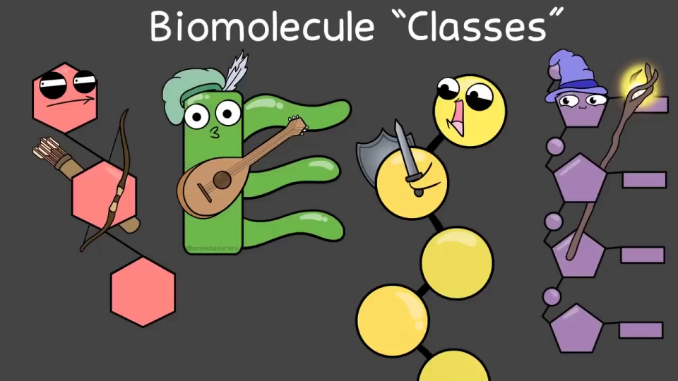

在进入四类之前，视频先定义了一个贯穿全篇的词：**单体（monomer）**，也就是「积木」——如果把某个大物质拆开，构成它的那些小部件就是单体 [【跳转到 00:48】](https://www.youtube.com/watch?v=1Dx7LDwINLU&t=48)。


四类分子对应的单体并不整齐，这正是后面容易混淆的根源：

| 类别 | 单体 | 视频中的说明 |
| --- | --- | --- |
| 糖类 | 单糖（monosaccharide） | 例如果糖、葡萄糖 [【跳转到 01:15】](https://www.youtube.com/watch?v=1Dx7LDwINLU&t=75) |
| 蛋白质 | 氨基酸（amino acid） | 通常由许多氨基酸连接而成 [【跳转到 04:29】](https://www.youtube.com/watch?v=1Dx7LDwINLU&t=269) |
| 核酸 | 核苷酸（nucleotide） | 名字和 nucleic acid 谐音，好记 [【跳转到 05:38】](https://www.youtube.com/watch?v=1Dx7LDwINLU&t=338) |
| 脂质 | 没有真正的单体 | 多数脂质由甘油和脂肪酸构成 [【跳转到 03:03】](https://www.youtube.com/watch?v=1Dx7LDwINLU&t=183) |

记住这张表，后面每一类只要回答两个问题：它的单体怎么拼成大分子？拼出来的东西在细胞里干什么？

## 二、糖类：细胞的「快钱」与「外墙」

**从单体到聚合物**。糖类的单体是单糖，最常被提到的例子是葡萄糖 [【跳转到 01:15】](https://www.youtube.com/watch?v=1Dx7LDwINLU&t=75)。两个单糖连起来就是二糖（disaccharide），例如两个葡萄糖拼成麦芽糖 [【跳转到 01:33】](https://www.youtube.com/watch?v=1Dx7LDwINLU&t=93)。很多糖的名字都以 -ose 结尾——glucose、maltose、lactose、sucrose、fructose——这个后缀可以当作识别糖类的线索 [【跳转到 01:38】](https://www.youtube.com/watch?v=1Dx7LDwINLU&t=98)。把许多单糖连在一起，就得到多糖（polysaccharide），也就是「大号糖类」[【跳转到 01:54】](https://www.youtube.com/watch?v=1Dx7LDwINLU&t=114)。

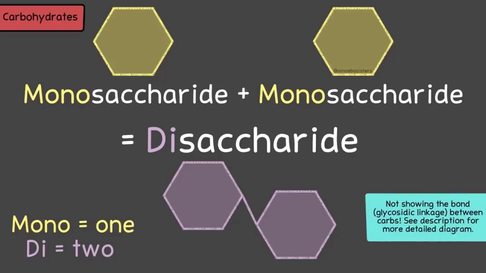

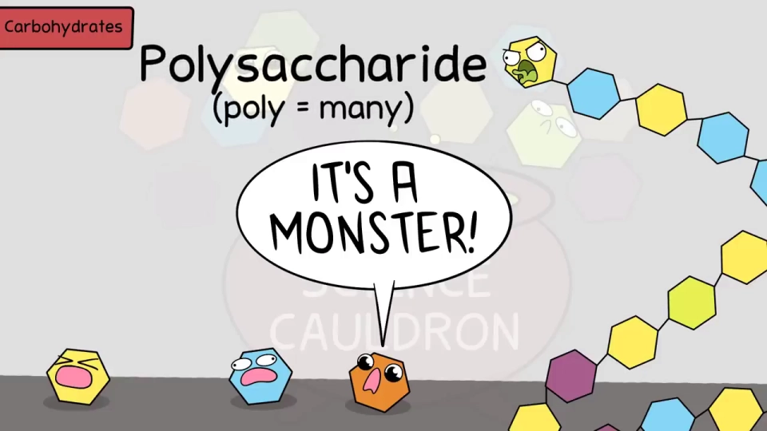

**在细胞里干什么**。视频给了糖类两条互不重叠的职责：

1. **结构材料**：植物细胞壁的主要成分是纤维素（cellulose），真菌细胞壁用几丁质（chitin）；几丁质同时也是昆虫外骨骼的材料 [【跳转到 02:04】](https://www.youtube.com/watch?v=1Dx7LDwINLU&t=124)。
2. **快速能源**：葡萄糖在细胞呼吸中被用来制造 ATP，而 ATP 是细胞的「能量货币」，所以糖类是细胞能迅速取用的能源 [【跳转到 02:24】](https://www.youtube.com/watch?v=1Dx7LDwINLU&t=144)。用不完的能量还能以多糖形式储存——植物存淀粉，动物存糖原 [【跳转到 02:35】](https://www.youtube.com/watch?v=1Dx7LDwINLU&t=155)。

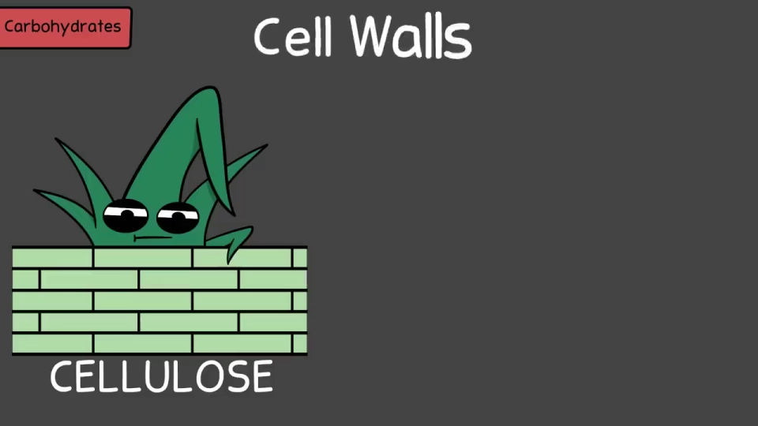

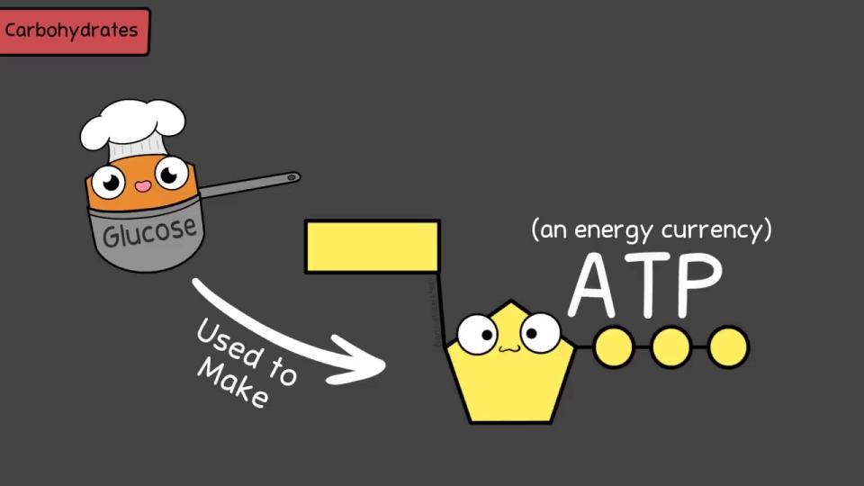

这里有个值得记住的对照：**同样是糖类，纤维素负责「撑住」，葡萄糖负责「供能」，淀粉和糖原负责「存起来」**。分子都是糖，分工却由聚合方式和所在位置决定。

## 三、脂质：疏水带来的四种工作

脂质包括脂肪和油，是一个成员非常多样的类群：甘油三酯、磷脂、类固醇都算，视频只举了其中几类作例子 [【跳转到 02:55】](https://www.youtube.com/watch?v=1Dx7LDwINLU&t=175)。多数脂质由甘油和脂肪酸构成，但它们没有真正的单体 [【跳转到 03:03】](https://www.youtube.com/watch?v=1Dx7LDwINLU&t=183)。

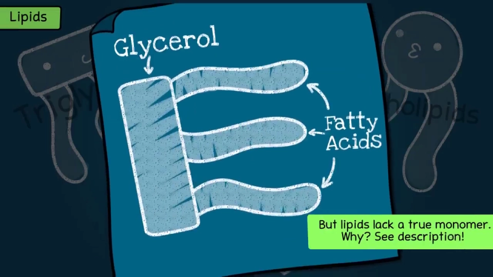

脂质最共同的化学特点是**疏水**：它们（或其中很大一部分）不喜欢水，一般不会溶于水；而其他几类生物大分子通常是溶于水的 [【跳转到 03:10】](https://www.youtube.com/watch?v=1Dx7LDwINLU&t=190)。这个性质直接解释了它的第一项工作。

1. **构成细胞膜**。所有细胞——植物细胞、动物细胞都一样——都有膜；膜的骨架是磷脂双分子层，所以「细胞膜的结构由脂质撑起来」[【跳转到 03:25】](https://www.youtube.com/watch?v=1Dx7LDwINLU&t=205)、[【跳转到 03:35】](https://www.youtube.com/watch?v=1Dx7LDwINLU&t=215)。
2. **长期储能**。糖类是快速能源，等糖类用完了，脂质才作为长期能量储备被动用 [【跳转到 03:41】](https://www.youtube.com/watch?v=1Dx7LDwINLU&t=221)。
3. **绝缘**。绝缘有两种：帮助细胞传导电信号的髓鞘（myelin sheath，分布在许多神经元上），以及保温用的脂肪层（blubber），例如成年竖琴海豹靠它保存热量 [【跳转到 03:55】](https://www.youtube.com/watch?v=1Dx7LDwINLU&t=235)、[【跳转到 04:12】](https://www.youtube.com/watch?v=1Dx7LDwINLU&t=252)。
4. **信号分子**。许多脂质本身是激素，即参与各种过程的化学信使 [【跳转到 04:12】](https://www.youtube.com/watch?v=1Dx7LDwINLU&t=252)。

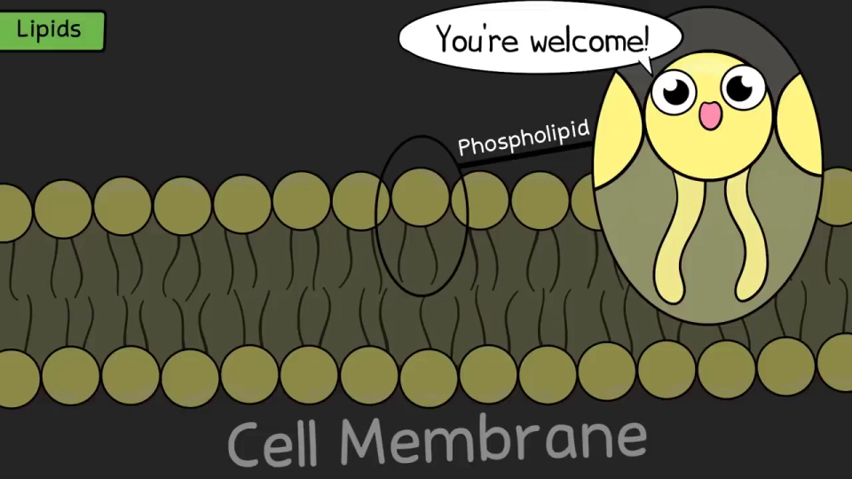

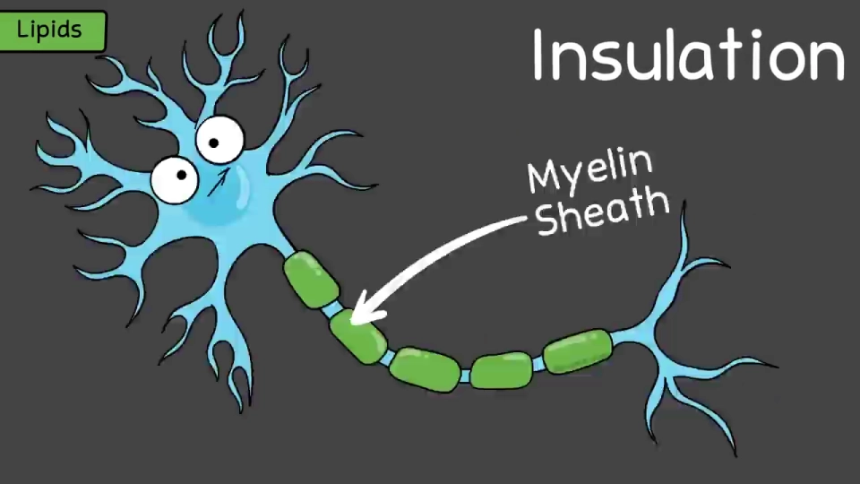

## 四、蛋白质：细胞里的执行者

蛋白质的单体是氨基酸，通常由许多氨基酸连接而成，氨基酸也有很多种 [【跳转到 04:29】](https://www.youtube.com/watch?v=1Dx7LDwINLU&t=269)。视频按「在哪里、做什么」列出了蛋白质的职责，这些职责几乎覆盖了细胞的所有执行环节：

- **结构**：肌肉组织很大程度由蛋白质构成，头发、胶原蛋白也是蛋白质 [【跳转到 04:39】](https://www.youtube.com/watch?v=1Dx7LDwINLU&t=279)。
- **膜上通道**：蛋白质可以嵌在细胞膜里形成通道，让特定物质通过——这是细胞膜结构的一部分 [【跳转到 04:44】](https://www.youtube.com/watch?v=1Dx7LDwINLU&t=284)。
- **受体**：蛋白质可以作为受体，接收信号分子，是细胞信号传导的关键，让细胞之间协调行动 [【跳转到 04:54】](https://www.youtube.com/watch?v=1Dx7LDwINLU&t=294)。
- **酶**：大多数酶是蛋白质；酶在各种代谢过程中合成或分解物质 [【跳转到 05:03】](https://www.youtube.com/watch?v=1Dx7LDwINLU&t=303)。
- **抗体**：由免疫细胞制造，参与保护身体 [【跳转到 05:10】](https://www.youtube.com/watch?v=1Dx7LDwINLU&t=310)。
- **部分激素**：例如胰岛素就是蛋白质类激素 [【跳转到 05:17】](https://www.youtube.com/watch?v=1Dx7LDwINLU&t=317)。

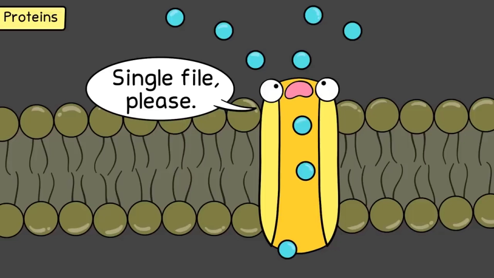

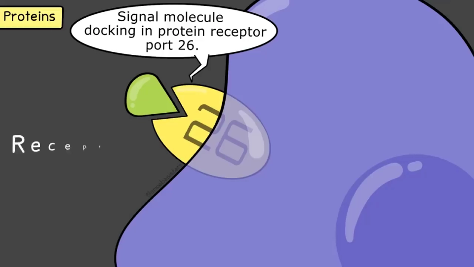

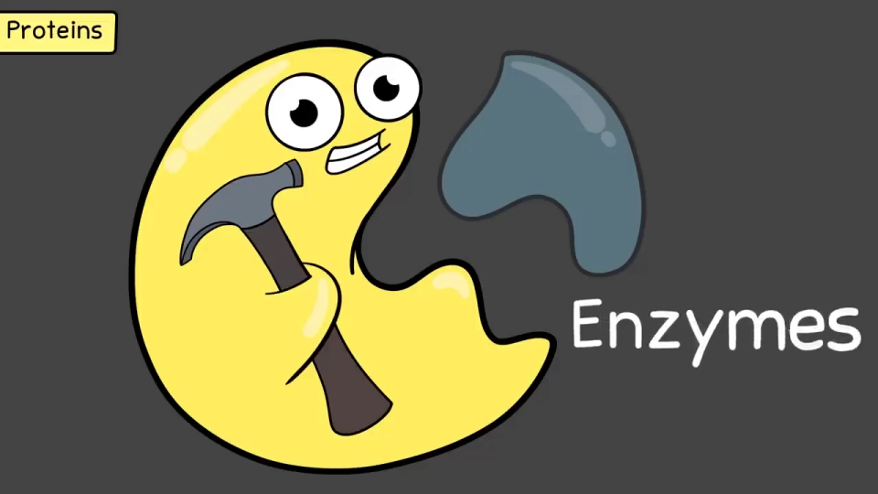

视频在这里埋下了通往核酸的钩子：基因由 DNA 构成，而许多基因编码的正是蛋白质 [【跳转到 05:24】](https://www.youtube.com/watch?v=1Dx7LDwINLU&t=324)。也就是说，蛋白质「做什么」由核酸「写什么」决定。

## 五、核酸：写说明书的那一类

核酸包括 DNA 和 RNA，视频说明更深入的遗传学内容留到后续 [【跳转到 05:30】](https://www.youtube.com/watch?v=1Dx7LDwINLU&t=330)。核酸的单体是核苷酸 [【跳转到 05:38】](https://www.youtube.com/watch?v=1Dx7LDwINLU&t=338)。

一个容易忽略的观察是：核酸不只在实验室里，也在食物里。只要吃的是来自生物的东西，就可能还带着 DNA——咬一口草莓，其实是在嚼构成草莓的那些细胞，而这些草莓细胞的细胞核里就有 DNA [【跳转到 06:06】](https://www.youtube.com/watch?v=1Dx7LDwINLU&t=366)。视频由此给出一个更强的说法：任何类型的生命——植物、动物、真菌或细菌——都必须含有 DNA 这类核酸来指导细胞的活动 [【跳转到 06:14】](https://www.youtube.com/watch?v=1Dx7LDwINLU&t=374)。

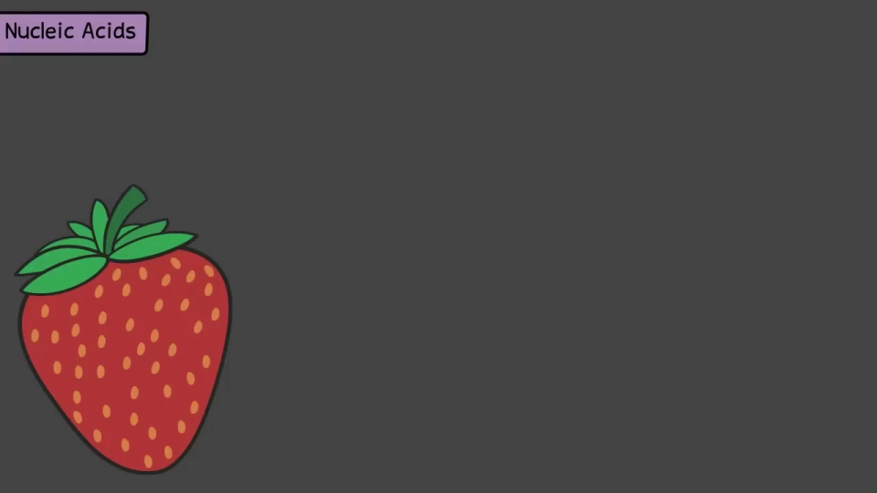

核酸对细胞的意义可以概括为：大多数细胞以 DNA 和 RNA 的形式保存全部遗传信息，这些信息用于编码性状，而性状涉及结构与各种功能 [【跳转到 06:24】](https://www.youtube.com/watch?v=1Dx7LDwINLU&t=384)。

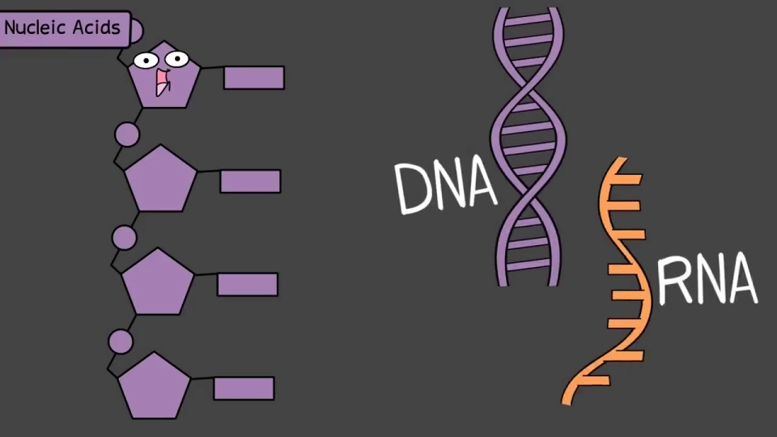

## 六、把四类分子放回一张细胞示意图

把前面五节的职责叠到同一个细胞上，就得到本节要的那张图。图中每一处标注都对应视频里明确讲过的功能：

```text
                  细胞外
        ┌───────────────────────────────┐
        │  细胞壁（植物：纤维素；真菌：几丁质）  ← 糖类
        │  ┌─────────────────────────┐  │
        │  │ 细胞膜：磷脂双分子层        │  ← 脂质
        │  │  ├ 通道蛋白：放特定物质通过  │  ← 蛋白质
        │  │  └ 受体蛋白：接收信号分子    │  ← 蛋白质
        │  │                          │  │
        │  │ 细胞核：DNA / RNA          │  ← 核酸
        │  │   └ 基因 → 指导蛋白质合成   │
        │  │                          │  │
        │  │ 细胞质：                   │  │
        │  │  ├ 酶：合成 / 分解物质      │  ← 蛋白质
        │  │  ├ 葡萄糖 →（细胞呼吸）→ ATP│  ← 糖类
        │  │  └ 淀粉 / 糖原、脂肪        │  ← 糖类 / 脂质
        │  └─────────────────────────┘  │
        └───────────────────────────────┘
```

| 位置 | 主要由谁构成 | 职责 | 视频时间 |
| --- | --- | --- | --- |
| 细胞壁 | 糖类（纤维素、几丁质） | 支撑与保护 | [【跳转到 02:04】](https://www.youtube.com/watch?v=1Dx7LDwINLU&t=124) |
| 细胞膜骨架 | 脂质（磷脂双分子层） | 划定细胞边界 | [【跳转到 03:35】](https://www.youtube.com/watch?v=1Dx7LDwINLU&t=215) |
| 膜上通道与受体 | 蛋白质 | 物质进出、接收信号 | [【跳转到 04:44】](https://www.youtube.com/watch?v=1Dx7LDwINLU&t=284) |
| 细胞核 | 核酸（DNA、RNA） | 保存遗传信息、指导细胞活动 | [【跳转到 06:14】](https://www.youtube.com/watch?v=1Dx7LDwINLU&t=374) |
| 细胞质中的酶 | 蛋白质 | 合成与分解物质 | [【跳转到 05:03】](https://www.youtube.com/watch?v=1Dx7LDwINLU&t=303) |
| 能量与储备 | 糖类（快速）、脂质（长期） | 供能与储能 | [【跳转到 02:24】](https://www.youtube.com/watch?v=1Dx7LDwINLU&t=144)、[【跳转到 03:41】](https://www.youtube.com/watch?v=1Dx7LDwINLU&t=221) |

从这张图能读出三条结论：

1. **位置决定角色**。同一类分子放在不同位置就换工作：糖类在细胞壁是结构材料，在细胞质是燃料和储备；脂质在膜上是骨架，在细胞内是长期储能。
2. **膜是脂质和蛋白质的合作产物**。脂质提供不溶于水的双层骨架，蛋白质嵌在其中做通道和受体——缺任何一方，膜都不具备「选择性交换信息与物质」的能力。
3. **核酸在上游，蛋白质在下游**。核酸不直接干活，它编码的蛋白质才是执行者；这也解释了为什么视频讲完蛋白质会自然转到基因 [【跳转到 05:24】](https://www.youtube.com/watch?v=1Dx7LDwINLU&t=324)。

## 七、元素组成：CHO、CHON、CHONP

视频最后给了一个记忆口诀，按糖类、脂质、蛋白质、核酸的顺序：**CHO、CHO、CHON、CHONP**（读作 "chomp" 加一个 n）[【跳转到 06:43】](https://www.youtube.com/watch?v=1Dx7LDwINLU&t=403)。其中 C 是碳、H 是氢、O 是氧、N 是氮、P 是磷 [【跳转到 07:02】](https://www.youtube.com/watch?v=1Dx7LDwINLU&t=422)。

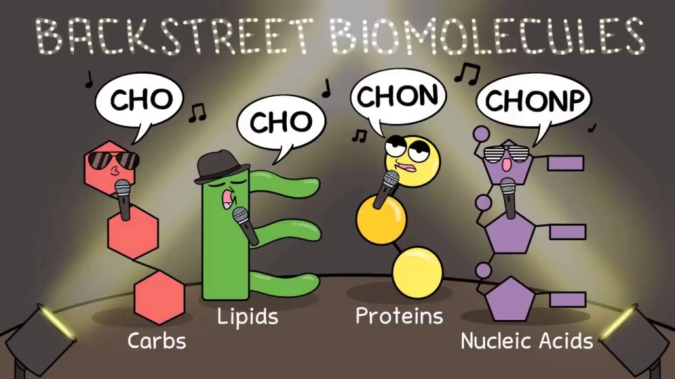

视频特意补了两句限制，避免把口诀当成定义：这并不意味着这些分子里没有别的元素；真正重要的不是元素清单，而是这些元素的**排列方式**，因为排列方式极大影响功能 [【跳转到 07:02】](https://www.youtube.com/watch?v=1Dx7LDwINLU&t=422)、[【跳转到 07:12】](https://www.youtube.com/watch?v=1Dx7LDwINLU&t=432)。这也正好呼应了全篇的主线：单体相同、连接方式不同，功能就不同。

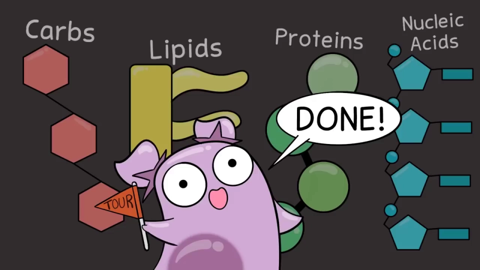

## 小结

- 四类生物大分子是糖类、脂质、蛋白质、核酸；前三类有明确的单体（单糖、氨基酸、核苷酸），脂质没有真正的单体。
- 糖类负责「快速能源 + 结构材料」：葡萄糖经细胞呼吸制造 ATP，纤维素和几丁质构成细胞壁，淀粉和糖原负责储存。
- 脂质因疏水而成为细胞膜的磷脂双分子层，同时承担长期储能、绝缘（髓鞘、脂肪层）和激素信号。
- 蛋白质是执行者：结构材料、膜通道、受体、酶、抗体、部分激素；多数酶是蛋白质。
- 核酸（DNA、RNA）保存遗传信息、指导细胞活动，并通过基因编码蛋白质与蛋白质连成上下游。
- 把四类分子放回细胞：膜是脂质骨架加蛋白质通道，细胞核是核酸，细胞质里的酶是蛋白质，能量来自糖类、储备来自糖类和脂质。
- 元素口诀 CHO、CHO、CHON、CHONP 只是记忆工具；决定功能的是元素与单体的排列方式。

## 关键术语速查

| 术语 | 一句话解释 |
| --- | --- |
| 生物大分子（biomolecule / macromolecule） | 生命需要的大分子，本节指糖类、脂质、蛋白质、核酸四类 |
| 单体（monomer） | 构成大分子的「积木」，如单糖、氨基酸、核苷酸 |
| 单糖 / 二糖 / 多糖 | 一个糖单位 / 两个单糖相连 / 许多单糖相连 |
| 疏水（hydrophobic） | 不与水混溶，脂质因此能自发形成膜的双层结构 |
| 磷脂双分子层 | 细胞膜的骨架，由磷脂排列成两层 |
| 酶（enzyme） | 催化代谢中合成或分解反应的蛋白质 |
| 受体（receptor） | 接收信号分子、触发细胞响应的蛋白质 |
| 核苷酸（nucleotide） | 核酸的单体，DNA 与 RNA 都由它聚合而成 |
| ATP | 细胞的能量货币，由细胞呼吸利用葡萄糖制造 |