# 跨层级推断的边界：体外实验、动物模型与人群证据

> 视频来源：[Why In Vitro, In Vivo, and Human Studies Don't Always Match](https://www.youtube.com/watch?v=VZbWEYKx7nQ)（YouTube · TOXLEARN4EU，Maastricht University 药理学与毒理学系）｜时长约 45 分钟
> 导读：上一讲把生命组织层级按分子、细胞、组织、器官、个体、种群排好了序。这一讲追问一个更实际的问题：**在一层得到的结论，凭什么能搬到另一层？** 讲者用两个真实研究说明「体外有效、体内无效」和「人群试验与细胞机制相反」是怎样发生的，并给出把结论从培养皿推向人群时必须检查的几个环节。八层级的定义与细胞学说历史见同小节《细胞是生命活动的基本单位：细胞学说与生命系统的层次》，本文不重复。

## 本讲要解决的核心问题（SCQA）

**背景**：细胞实验便宜、快、容易操纵，还能避开大量伦理问题；动物实验能给出整体反应；人群研究则直接对应我们真正关心的健康结局。三者看起来是一条自然递进的证据链。

**冲突**：这条链经常断。讲者开场就给出一个刺眼的事实：我们很擅长在培养皿和小鼠身上「治愈」疾病，却常常治不好人。更麻烦的是，断点不是偶然的——它来自每一层各自丢掉了不同的东西。

**疑问**：细胞实验到底能回答什么、不能回答什么？为什么体外有效的药物在体内可能完全没动静？反过来，人群层面看到的相关或干预结果，为什么不能直接翻译成某一种细胞机制？跨层推断需要补哪些证据？

**回答（中心思想）**：讲者用一句话把三层证据的分工说清楚——**体外告诉你「什么是可能的」，动物体内告诉你「什么是合理的」，而人体内测量才告诉你「实际发生了什么」** [【跳转到 00:58】](https://www.youtube.com/watch?v=VZbWEYKx7nQ&t=58)。三层各有各的优势和代价，跨层不是「放大」或「缩小」，而是要逐项检查剂量、时间、遗传背景、样本代表性和机制证据是否被保留下来。

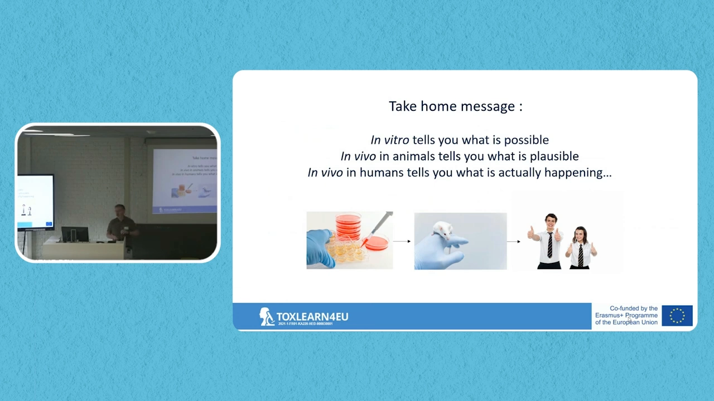

[【跳转到 00:58】](https://www.youtube.com/watch?v=VZbWEYKx7nQ&t=58)

---

## 一、先把「层级」翻译成「证据层级」

讲者先统一了定义：**in vitro（体外）** 是「在玻璃器皿里」，在受控环境中、活体之外进行操作，**细胞系也算体外**；**in vivo（体内）** 则是用完整的活生物体做实验，而不是部分或死亡的生物体 [【跳转到 01:48】](https://www.youtube.com/watch?v=VZbWEYKx7nQ&t=108)。他还提醒有一种组合叫 **ex vivo**：先给动物用药，再把细胞取出来在培养皿里测——它同时带着体内暴露和体外读数，不能简单归到某一层。

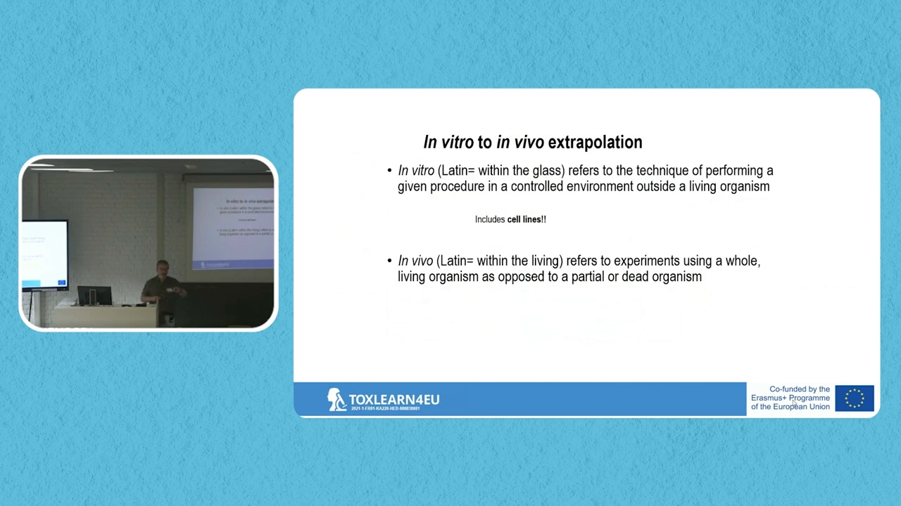

[【跳转到 01:48】](https://www.youtube.com/watch?v=VZbWEYKx7nQ&t=108)

这个定义看似只是术语，实际上决定了结论的适用范围。一个「细胞系在 10 µM 药物下表达谱改变」的结论，天然属于**细胞层**；它没有经过吸收、分布、代谢、排泄，也没有免疫、血管、基质和整体代偿。把它直接写成「该药物在患者体内有效」，中间至少缺了四五个环节。

---

## 二、细胞实验成立 ≠ 个体成立：一个「体外强相互作用、体内完全消失」的例子

### 2.1 体外：槲皮素让血管对收缩剂更不敏感

讲者给的第一项研究，起点是一个很常见的组合。**槲皮素（quercetin）** 是可以在药店买到的化合物，被认为能舒张血管；**坦索罗辛（tamsulosin）** 是常用的降压药，靠放松血管起效。两者都可能被老年人同时使用，于是监管方担心：会不会叠加成严重的**直立性低血压**——起身太快时脑供血不足、晕倒？

研究者在体外分离了胎盘血管，先加 **苯肾上腺素（phenylephrine）**（一种类似肾上腺素的收缩剂）让血管收缩；再加坦索罗辛，需要更高浓度的苯肾上腺素才能达到同样的收缩。接着把槲皮素也加进去，槲皮素在体内会代谢成**槲皮素葡萄糖醛酸苷**，后者通常随尿排出，但在这个体外模型里仍有明显活性：绿色曲线大幅右移，需要高得多的苯肾上腺素才能收缩血管 [【跳转到 05:33】](https://www.youtube.com/watch?v=VZbWEYKx7nQ&t=333)。

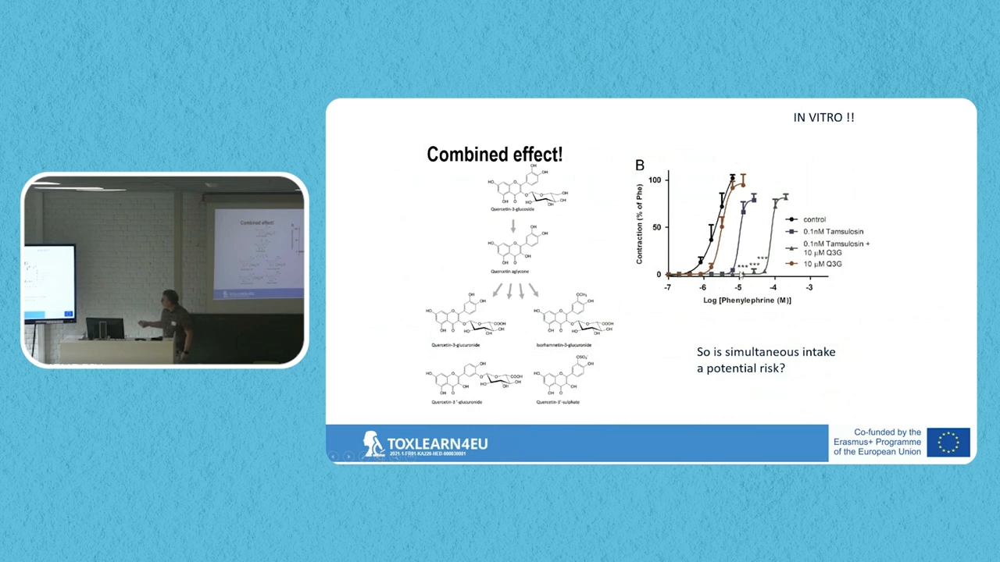

[【跳转到 05:33】](https://www.youtube.com/watch?v=VZbWEYKx7nQ&t=333)

如果只看这一层，结论很强：**在这个分离血管的模型里，两种化合物合用会显著增强舒张**。效应不是一点点，讲者说「really in orders of magnitude」——量级上的差别。

### 2.2 体内：同样的组合在大鼠身上没有差别

研究者随后把问题搬到整体动物：用正常 WKY（Wistar-Kyoto）大鼠和自发性高血压大鼠（SHR），测平均动脉压和心率。结果坦索罗辛本身有效——血压下降、心率反射性上升，尤其在 SHR 上明显；但**加不加槲皮素，两组之间完全没有差别** [【跳转到 06:23】](https://www.youtube.com/watch?v=VZbWEYKx7nQ&t=383)。

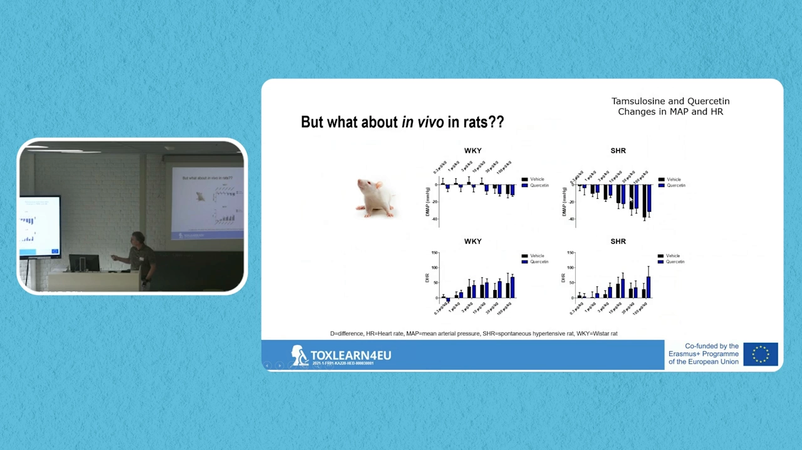

[【跳转到 06:23】](https://www.youtube.com/watch?v=VZbWEYKx7nQ&t=383)

这就是「细胞/离体实验成立 ≠ 个体成立」的干净案例。体外那条曲线没有错，它只是回答了一个更窄的问题：**在离体血管、给定浓度、给定时间里，这两种分子会让血管更放松**。它没有回答：口服之后，槲皮素和它的代谢物能不能以足够浓度到达血管？坦索罗辛和槲皮素在体内的浓度曲线是否重叠？机体有没有用别的方式把血压拉回来？

### 2.3 缺的那一环：毒代动力学被跳过了

讲者把原因归到一个词：**毒代动力学（toxicokinetics）**。体外实验里，你把化学物直接加到细胞或血管上，看到的主要是**毒效动力学（toxicodynamics）**——分子到了靶点之后发生了什么；而「吃进去多少、吸收多少、分布到哪些器官、在什么时间达到多高浓度、怎么被代谢和排出」这一整段，在体外被**几乎完全跳过** [【跳转到 07:38】](https://www.youtube.com/watch?v=VZbWEYKx7nQ&t=458)。

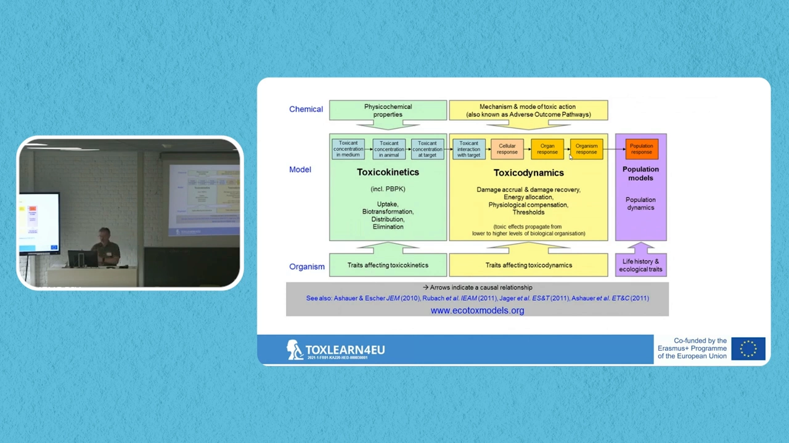

[【跳转到 07:38】](https://www.youtube.com/watch?v=VZbWEYKx7nQ&t=458)

这张图值得记住：从「培养基里的浓度」到「靶器官的浓度」，再到「细胞反应」「器官反应」「个体反应」「种群反应」，每一级都有自己的转化规则。体外实验只直接控制了最左边的一小段。**剂量不是同一个量**：培养皿里的 10 µM，不等于血液里的 10 µM，更不等于靶细胞内的 10 µM。

为了补这一段，讲者介绍了 **PBPK（生理药代动力学建模）**：把暴露、吸收、分布到各器官、时间过程都放进模型，先在小鼠/大鼠上算，再和人体比较，用来判断某个动物模型是否可能预测人 [【跳转到 08:28】](https://www.youtube.com/watch?v=VZbWEYKx7nQ&t=508)。PBPK 不能替代实验，但它能把「剂量」从一个标签变成一条随时间变化的曲线，提醒你体外浓度和体内暴露不是一回事。

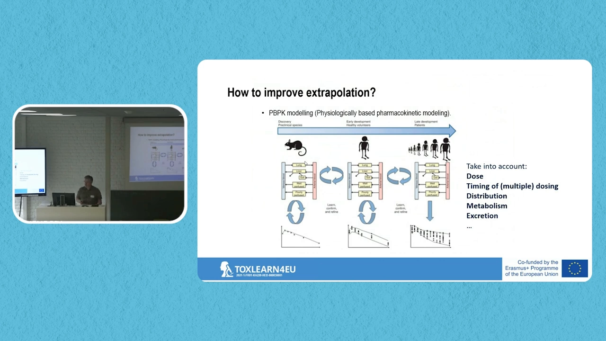

[【跳转到 08:28】](https://www.youtube.com/watch?v=VZbWEYKx7nQ&t=508)

### 2.4 体外模型可以更接近体内，但仍然不是体内

讲者并没有否定体外实验。相反，他花了不少时间讲怎样把体外模型做得更接近真实组织：单培养可以加入昼夜节律；**共培养**可以把上皮细胞和炎症细胞放在一起，模拟炎症；**球状体（spheroid）** 比扁平的单层更接近真实细胞形态，还可以做成混合细胞类型；直接取动物或人的组织块做**组织培养**也行 [【跳转到 10:58】](https://www.youtube.com/watch?v=VZbWEYKx7nQ&t=658)。

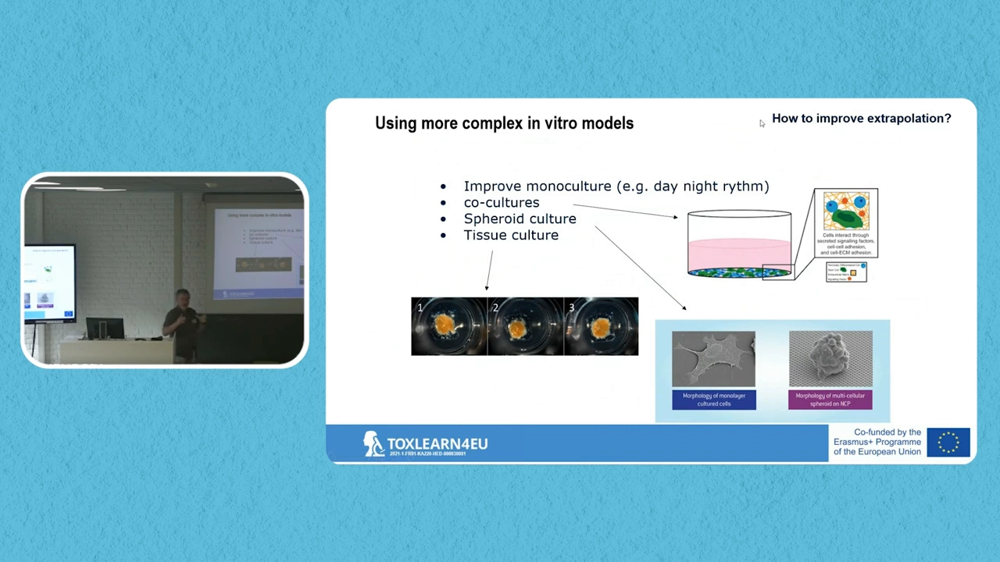

[【跳转到 10:58】](https://www.youtube.com/watch?v=VZbWEYKx7nQ&t=658)

更进一步是**器官芯片（organ-on-a-chip）**：肺芯片可以有气流、血流和两侧真空，甚至模拟呼吸时的牵张；肝-肺微流控芯片可以把肝脏代谢产生的代谢物输送到肺，观察组合效应 [【跳转到 12:31】](https://www.youtube.com/watch?v=VZbWEYKx7nQ&t=751)。这些模型确实在缩小体外与体内的差距，但讲者明确说它们「still under development」——仍在发展中。**模型越复杂，能回答的问题越多，但它仍然是模型，不是个体。**

把这一节压缩成两列：**细胞实验能回答**——在给定细胞类型、给定浓度和时间下，某个分子是否改变了某条通路或某种细胞表型；加共培养后，两种细胞之间的相互作用是否足以产生某个效应。**细胞实验不能回答**——口服或注射后靶器官到底暴露多少、机体有没有整体代偿、免疫/血管/基质微环境如何改变反应、人群里的遗传与环境异质性会把效应拉向哪里、最终临床结局是什么。后面这几项，必须由整体动物、人体标志物或人群研究来补。

---

## 三、动物模型成立 ≠ 人成立：物种、疾病模型与「人造」生理

### 3.1 选哪种动物，本身就是一个科学问题

讲者提醒，我们通常用小鼠或大鼠，只是因为它们容易获得，不代表它们是最合适的模型。他举了受体基因的例子：研究 **PTH1 受体**时，人的该基因与猪更接近；研究 **PTH2 受体**时，大鼠可能更合适；研究 **ABC 转运体 B1** 时，豚鼠与人的亲缘关系更近，可能比大鼠或小鼠更合适 [【跳转到 14:42】](https://www.youtube.com/watch?v=VZbWEYKx7nQ&t=882)。同一个通路里的两个受体，最佳模式动物可能不同——「用小鼠」不是默认正确的选择。

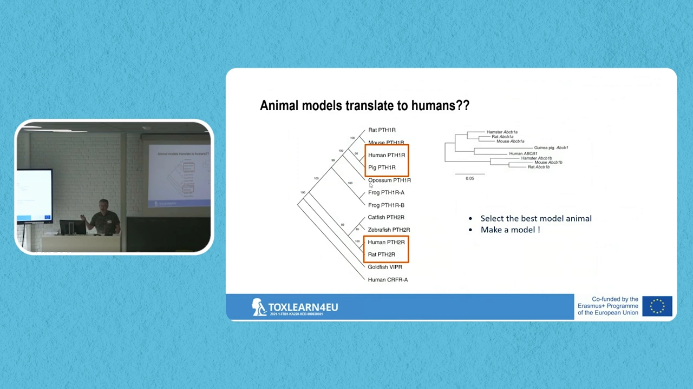

[【跳转到 14:42】](https://www.youtube.com/watch?v=VZbWEYKx7nQ&t=882)

### 3.2 疾病模型可能「太强」，强到掩盖了你想看的效应

动脉粥样硬化的例子更微妙。小鼠本身不容易发展出动脉粥样硬化，即使喂高脂饮食也不够；研究者于是用 **ApoE 敲除**或 **LDL 受体敲除**小鼠，这些动物即使不吃高脂饮食也会自发形成动脉粥样硬化 [【跳转到 15:32】](https://www.youtube.com/watch?v=VZbWEYKx7nQ&t=932)。问题来了：如果动物自己就已经在快速形成斑块，你还怎么看出某种化学物是否**加速**了它？讲者说，他们后来确实没看到多少效应，怀疑是因为模型「too strict, too strong」——太极端，天花板效应把差异压掉了。他们甚至反思：也许鸡才是更好的模型，因为鸡在髙脂饮食下会像人一样发展出动脉粥样硬化；但鸡更难养，所以大家还是退回到敲除小鼠 [【跳转到 16:47】](https://www.youtube.com/watch?v=VZbWEYKx7nQ&t=1007)。

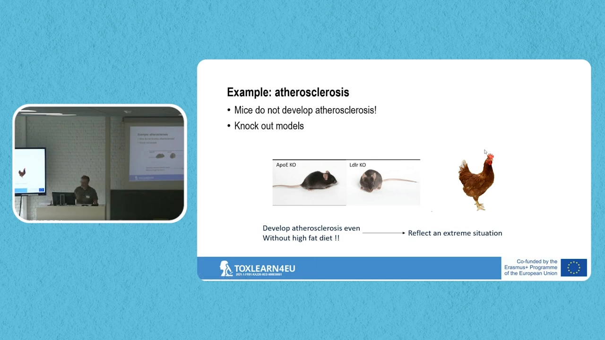

[【跳转到 16:47】](https://www.youtube.com/watch?v=VZbWEYKx7nQ&t=1007)

这里有两个独立的坑：**物种选择**和**模型强度**。一个模型能在动物身上「做出来病」，不等于它适合回答「某种暴露会不会让病更重」。模型太弱，看不出效应；模型太强，效应被天花板吃掉。

### 3.3 通路看起来相似，细节可能完全不同

讲者展示了一张小鼠与人心血管疾病通路的对照表：免疫系统、趋化因子信号、G 蛋白偶联受体、血小板激活与聚集等大量通路确实重叠；但具体到分子和细胞，差异可能很关键 [【跳转到 19:17】](https://www.youtube.com/watch?v=VZbWEYKx7nQ&t=1157)。他举了几个免疫学的例子：人外周血白细胞中 50–70% 是中性粒细胞，小鼠只有 10–25%，小鼠多数是淋巴细胞；**CD33** 在人单核细胞上表达，在小鼠粒细胞上表达；**CD4** 在小鼠巨噬细胞上缺失、在人身上存在；IL-13 对 B 细胞的作用也不完全一样 [【跳转到 19:42】](https://www.youtube.com/watch?v=VZbWEYKx7nQ&t=1182)。他还讲了自己博士期间的教训：健康大鼠外周血里没有中性粒细胞，只有诱导炎症后才出现，他花了几个月去分离一种「不存在的细胞」[【跳转到 21:22】](https://www.youtube.com/watch?v=VZbWEYKx7nQ&t=1282)。

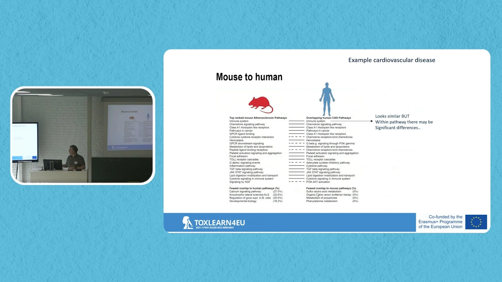

[【跳转到 19:17】](https://www.youtube.com/watch?v=VZbWEYKx7nQ&t=1157)

这解释了一个常见误判：**「通路同名」不等于「机制同构」**。你在小鼠身上敲掉一个基因、看到一条通路变化，不能因为人也有这条通路，就认定人的同一细胞类型会给出同样反应。

### 3.4 人源化小鼠：把人的基因放进去，也可能引入新的伪影

如果小鼠不够像人，一个办法是**人源化**：敲掉小鼠基因，换上人的基因。讲者举了 p53 人源化小鼠的例子 [【跳转到 23:02】](https://www.youtube.com/watch?v=VZbWEYKx7nQ&t=1382)。但人源化不是万能钥匙，接下来的 β-胡萝卜素故事就是反例。

---

## 四、人群相关 ≠ 细胞机制：β-胡萝卜素的两次「反向」

### 4.1 从人群观察到细胞假说

故事从人群观察开始：吸烟者的 **β-胡萝卜素水平较低**，氧化应激较高，氧化性 DNA 损伤更多。既然维生素 A 是抗氧化剂，一个很自然的细胞层假说就是：给吸烟者补充 β-胡萝卜素，应该能减少氧化损伤，从而降低肺癌风险 [【跳转到 23:52】](https://www.youtube.com/watch?v=VZbWEYKx7nQ&t=1432)。

这个推理链每一步看起来都合理：人群相关（吸烟者低 β-胡萝卜素）→ 细胞机制（抗氧化）→ 干预（口服补充）→ 预期（降低肺癌）。但它是把**人群层面的相关**、**细胞层面的机制**和**个体层面的干预**直接串了起来，中间没有验证。

### 4.2 人群试验给出了相反的结果

两项大型干预研究——**ATBC** 和 **CARET**——在欧美吸烟者中测试口服 β-胡萝卜素。结果不是降低，而是**死亡率更高、肺癌发生率更高**；两项试验在中期分析发现反向效应后立即停止 [【跳转到 25:07】](https://www.youtube.com/watch?v=VZbWEYKx7nQ&t=1507)。

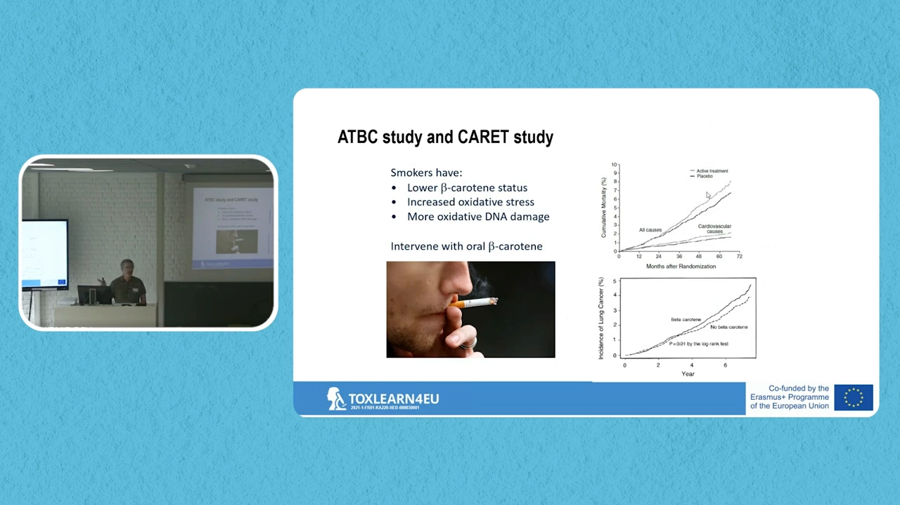

[【跳转到 25:07】](https://www.youtube.com/watch?v=VZbWEYKx7nQ&t=1507)

这就是「人群相关 ≠ 细胞机制」的第一层含义：**人群里「吸烟者 β-胡萝卜素低」这个相关，不能告诉你 β-胡萝卜素是保护因素、危险因素，还是仅仅是一个伴随现象。** 细胞层的抗氧化故事听起来再顺，也不能替代人群层面的干预验证；而人群试验的结果，也不能直接告诉你「是哪一个细胞、哪一条通路」造成了危害。

### 4.3 回到细胞：机制要在「组合」里找

为了解释这个反直觉结果，研究者想用小鼠模型，但普通小鼠有一个代谢差异：小鼠把 β-胡萝卜素几乎 100% 转化成视黄醇，人只转化约 70%，所以 β-胡萝卜素在小鼠体内很难积累，在人身上可以 [【跳转到 25:32】](https://www.youtube.com/watch?v=VZbWEYKx7nQ&t=1532)。他们于是用了 **BCMO1 敲除**小鼠，希望让 β-胡萝卜素积累起来，模拟人。结果确实看到血清和肺里的 β-胡萝卜素升高 [【跳转到 26:22】](https://www.youtube.com/watch?v=VZbWEYKx7nQ&t=1582)。

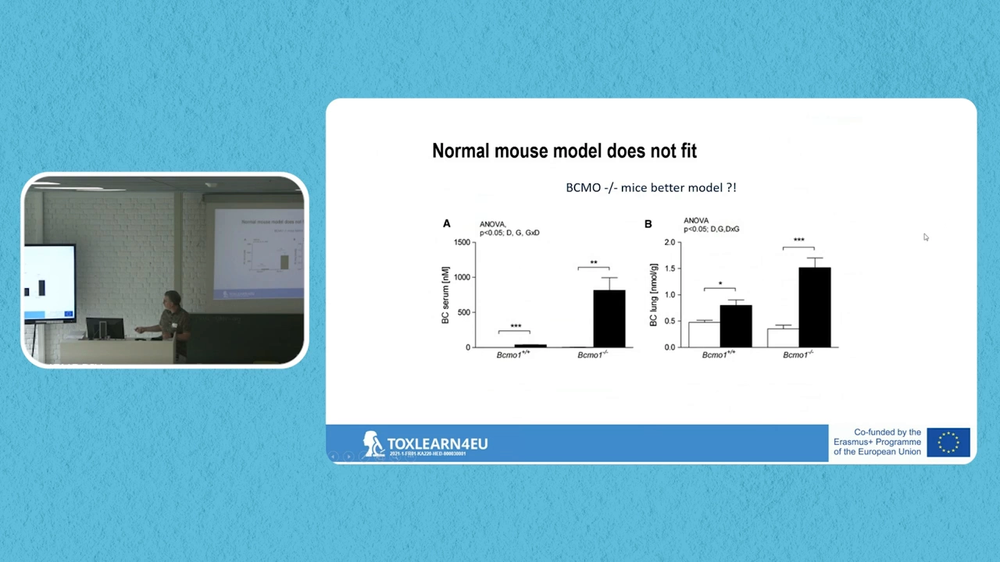

[【跳转到 26:22】](https://www.youtube.com/watch?v=VZbWEYKx7nQ&t=1582)

但这个「更好」的模型制造了新的问题：敲掉 BCMO1 后，小鼠无法把 β-胡萝卜素转化成维生素 A，出现了**维生素 A 缺乏**；他们看到的肺炎症等表型，其实是维生素 A 缺乏造成的，不是 β-胡萝卜素积累造成的 [【跳转到 26:47】](https://www.youtube.com/watch?v=VZbWEYKx7nQ&t=1607)。讲者说，幸好他们预先设了很多对照，才发现这一点。**人源化改造改变了动物的整体生理，模型可能因此偏离你要研究的问题。**

### 4.4 再回到体外：用共培养补上「哪种细胞、什么组合」

最后，研究者回到体外，但这次不是单一细胞系，而是**人肺上皮细胞与人类中性粒细胞的共培养**。吸烟激活中性粒细胞，产生自由基；β-胡萝卜素代谢物抑制**髓过氧化物酶（MPO）**，使过氧化氢更多，进而通过 Fenton 反应产生更多羟自由基，造成氧化性 DNA 损伤 [【跳转到 29:30】](https://www.youtube.com/watch?v=VZbWEYKx7nQ&t=1770)。用 FPG comet assay，他们在「炎症细胞 + 上皮细胞」的组合模型里看到了 DNA 损伤增加 [【跳转到 29:55】](https://www.youtube.com/watch?v=VZbWEYKx7nQ&t=1795)。

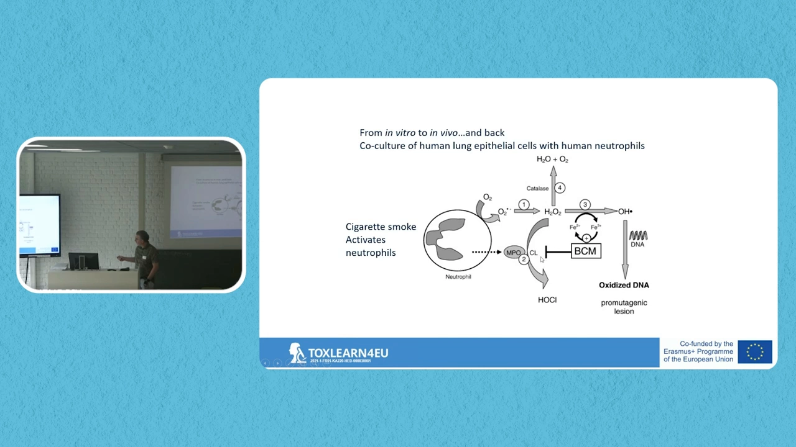

[【跳转到 29:30】](https://www.youtube.com/watch?v=VZbWEYKx7nQ&t=1770)

这条机制只有在**两种细胞同时在场**时才成立。单看上上皮细胞或单看中性粒细胞，都可能得不到这个结果。它说明：**「细胞实验」不是一个层级，而是很多个不同复杂度的层级**；用哪种细胞、有没有共培养、有没有炎症背景，决定了你能看到什么机制。

讲者把这段总结成一句很重要的话：通常我们想从体外走向体内去理解，但在这个案例里，他们是**从体内回到体外**，才找到了可能的底层机制 [【跳转到 30:45】](https://www.youtube.com/watch?v=VZbWEYKx7nQ&t=1845)。层级之间不是单向的「往上推」，也可以「往下找」。

---

## 五、人群层面为什么不能直接还原成细胞机制

### 5.1 人群不是「放大版的个体」，更不是「放大版的细胞」

讲者指出，人体研究有一个根本困难：小鼠在遗传上几乎相同，而**人是遗传多样的**，环境也难以控制 [【跳转到 30:45】](https://www.youtube.com/watch?v=VZbWEYKx7nQ&t=1845)。很多性状是**多基因**的：肤色不是「黑或白」，而是连续分布；体重、体型等性状涉及成百上千个基因变异 [【跳转到 32:50】](https://www.youtube.com/watch?v=VZbWEYKx7nQ&t=1970)。即使基因完全相同的一行豆子，在环境差异下重量也呈正态分布 [【跳转到 33:40】](https://www.youtube.com/watch?v=VZbWEYKx7nQ&t=2020)。

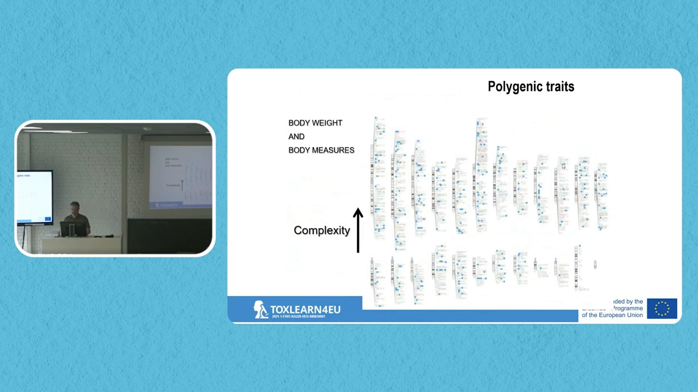

[【跳转到 32:50】](https://www.youtube.com/watch?v=VZbWEYKx7nQ&t=1970)

因此，总变异可以拆成**遗传变异 + 环境变异 + 两者的交互** [【跳转到 34:30】](https://www.youtube.com/watch?v=VZbWEYKx7nQ&t=2070)。动物实验里遗传变异被压到接近零，你看到的主要是环境变异；人群里两者都很大，而且互相纠缠。一个在人群层面观察到的关联，可能是遗传、环境、生活方式或它们的组合，不能直接指定给某一种细胞机制。

### 5.2 同窝效应：个体层面的「样本代表性」也会骗人

讲者还讲了一个很具体的实验设计问题。他们研究父亲暴露**苯并[a]芘**后对子代 **CYP1A1** 表达的影响，发现同一窝的兄弟姐妹彼此更接近，**窝间变异大于窝内变异**（图上的方差分解是窝间 67%、窝内 33%）[【跳转到 36:35】](https://www.youtube.com/watch?v=VZbWEYKx7nQ&t=2195)。

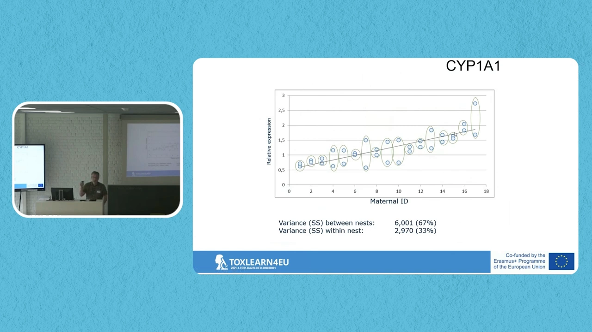

[【跳转到 36:35】](https://www.youtube.com/watch?v=VZbWEYKx7nQ&t=2195)

如果买来的动物里，对照组恰好来自一窝、处理组恰好来自另一窝，你看到的「处理效应」可能只是**窝效应**。讲者说这就是为什么随机化很重要，也是为什么他们通常**每窝只取一只动物**做分析；否则有效样本量会被高估，统计功效下降 [【跳转到 37:25】](https://www.youtube.com/watch?v=VZbWEYKx7nQ&t=2245)。

这个例子虽然发生在动物层，但它说明的道理对人群同样成立：**样本不是彼此独立的「重复」，它们有共同来源、共同环境、共同遗传背景**。把一群有共同背景的个体当成独立样本，会把相关性误当成因果，也会把群体层面的差异误当成个体层面的机制。

### 5.3 人体研究只能用生物标志物「隔着看」

在人体里，通常只能拿到容易获取的组织，比如血液；拿不到肝、肺的组织块。于是研究依赖**生物标志物**：它们是生物系统里事件的指标，代表系统因为暴露而发生的变化 [【跳转到 39:05】](https://www.youtube.com/watch?v=VZbWEYKx7nQ&t=2345)。

讲者给出一条从暴露到疾病的链条：**外暴露 → 内剂量 → 生物有效剂量 → 早期生物学效应 → 结构/功能改变 → 疾病**，中间还有**易感性因素**在每一段起作用 [【跳转到 39:55】](https://www.youtube.com/watch?v=VZbWEYKx7nQ&t=2395)。你在尿液或血浆里测到的化合物，只是「内剂量」附近的一个读数；它不等于靶器官里的有效剂量，更不等于疾病本身。

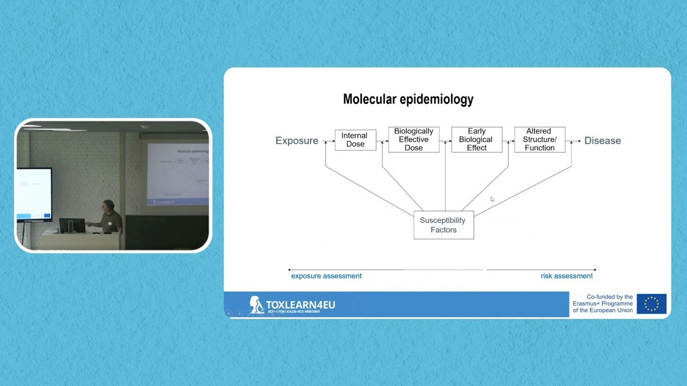

[【跳转到 39:55】](https://www.youtube.com/watch?v=VZbWEYKx7nQ&t=2395)

而且生物标志物本身要满足一串条件：与暴露相关；最好与**靶器官**相关；稳定性和动力学已知，才知道什么时候测；要考虑时间/季节变化和细胞寿命（比如红细胞活 120 天）；还要考虑年龄、性别、遗传背景等宿主因素 [【跳转到 41:10】](https://www.youtube.com/watch?v=VZbWEYKx7nQ&t=2470)。

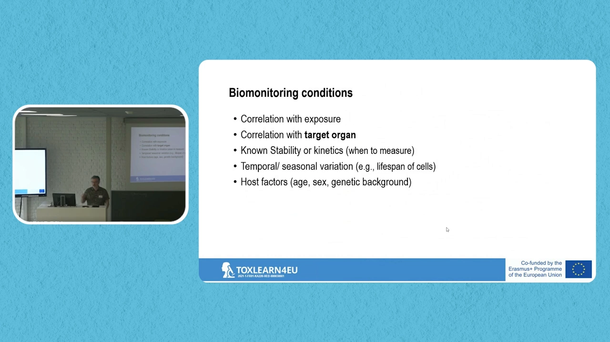

[【跳转到 41:10】](https://www.youtube.com/watch?v=VZbWEYKx7nQ&t=2470)

这解释了为什么「人群里某个标志物升高」不能直接写成「某个细胞机制被激活」：标志物可能来自另一个器官、另一个时间点，或者只是暴露的伴随物。**人群相关要落到细胞机制，必须补上「哪个器官、哪种细胞、什么时间、什么剂量」的证据。**

> **术语补充**：这类「把群体层面的关系直接套到个体或更下层单位」的错误，在统计上常被归入**生态学谬误（ecological fallacy）** 的方向。本讲没有使用这个术语，但 β-胡萝卜素的例子展示了同一种层级错位：人群相关（吸烟者 β-胡萝卜素低）被当成细胞机制（抗氧化保护），再被当成个体干预（补充有益），每一步都跨了层。反过来，把细胞机制直接当成人群结局，也会犯同类的错。

---

## 六、跨层级推断的检查清单

把讲者的例子压缩成一张可操作的清单。每次看到「体外发现」或「人群关联」，逐项问一遍：

| 检查项 | 要问的问题 | 本讲的例子 |
| --- | --- | --- |
| **1. 结论停在哪一层** | 这个结论的主语是细胞、离体组织、动物个体，还是人群？ | 槲皮素+坦索罗辛在离体血管有效；在大鼠整体无效 |
| **2. 剂量** | 加药浓度 = 暴露剂量 = 内剂量 = 生物有效剂量吗？ | 培养皿里的浓度跳过了吸收、分布、代谢、排泄；PBPK 用来补时间过程 |
| **3. 时间尺度** | 观察窗口覆盖了药物/标志物的动力学吗？ | 昼夜节律、可替宁戒烟一周后消失、红细胞 120 天寿命、DNA 损伤的冬夏差异 |
| **4. 遗传背景** | 模型是近交系、敲除、人源化，还是遗传多样的人群？ | 小鼠几乎同基因，人多基因、连续分布；BCMO1 敲除引入维生素 A 缺乏 |
| **5. 样本代表性** | 样本是否独立？有没有同窝、同批次、同一来源的聚集？ | 同窝 CYP1A1 表达更接近；每窝取一只、随机分配 |
| **6. 机制证据** | 有没有共培养、器官芯片、遗传扰动、动物模型、人体标志物互相印证？ | 单层细胞看不到的机制，在「上皮+中性粒细胞」共培养里出现 |

这张表的核心不是「体外不可信」，而是：**每一层都能给出真实但范围有限的结论；跨层时要把丢掉的环节补回来，而不是把结论直接放大。**

---

## 七、哪些结论只能停在细胞层，哪些必须上个体/种群

讲者的三层框架可以直接改写成一张「结论—最低证据」对照表：

| 你想说的结论 | 最低需要的证据 | 不能只靠什么 |
| --- | --- | --- |
| 「化合物 X 在细胞类型 Y 中激活了通路 Z」 | 细胞实验（剂量、时间、对照、重复） | 不能直接说「对患者有效」 |
| 「化合物 X 能降低物种 A 的血压」 | 该物种的体内实验（个体层） | 不能直接说「对人有效」；物种、模型强度、通路差异都要查 |
| 「暴露 X 与疾病 D 在人群中相关」 | 人群观察（种群层），并控制混杂 | 不能直接说「X 通过细胞机制 M 导致 D」 |
| 「X 通过细胞机制 M 导致 D」 | 细胞机制 + 动物因果 + 人群一致性（多层互证） | 不能只靠一层，尤其不能只靠相关性 |
| 「X 在人群中能降低 D 的风险」 | 人群干预（最好随机对照）或强因果设计 | 不能只靠细胞或动物替代 |

反过来也成立：**人群试验说「有害」，不等于细胞层没有机制**。β-胡萝卜素的人群试验给出了 harm，细胞共培养后来给出了一个可能的机制（MPO 抑制 → 氧化损伤）；两者并不矛盾，而是分别回答「人群结局是什么」和「可能通过什么细胞过程发生」。把两者拼起来，才是完整的证据链。

---

## 小结

- 三层证据的分工：**体外 = 可能，动物体内 = 合理，人体内 = 实际发生** [00:58]。
- **细胞/离体实验成立 ≠ 个体成立**：槲皮素+坦索罗辛在离体血管里是量级上的强相互作用，在大鼠整体血压上完全消失 [05:33][06:23]；原因是体外跳过了毒代动力学，剂量、分布、代谢、排泄都没有被保留 [07:38]。
- **动物模型成立 ≠ 人成立**：物种选择、疾病模型强度、通路细节差异、人源化改造的副作用，都会让「动物有效」无法直接搬到人 [14:42][15:32][19:17][26:47]。
- **人群相关 ≠ 细胞机制**：吸烟者 β-胡萝卜素低是一个人群相关，抗氧化是一个细胞假说，两者直接串起来导致了相反的人群试验结果 [23:52][25:07]；真正的机制要在「上皮+中性粒细胞」共培养里找 [29:30]。
- **跨层推断的检查清单**：结论层级、剂量、时间尺度、遗传背景、样本代表性、机制证据，六项缺一不可。
- 最后记住讲者的结论：体外模型在进步，动物模型要选对物种或改造成更接近人，而人群层面最大的特点是**变异** [44:05]。跨层推断不是把结论「放大」，而是把每一层丢掉的信息逐项补回来。

## 关键术语速查

| 术语 | 一句话解释 |
| --- | --- |
| in vitro（体外） | 在活体之外的可控环境中操作，包括细胞系、离体组织 |
| in vivo（体内） | 用完整活生物体做实验 |
| ex vivo | 先体内暴露，再取出细胞/组织在体外测 |
| 毒代动力学 | 吸收、分布、代谢、排泄；决定靶器官实际暴露多少 |
| 毒效动力学 | 化学物到达靶点后引起的细胞和器官反应 |
| PBPK | 生理药代动力学建模，用生理参数推算不同物种/剂量下的时间过程 |
| 生物标志物 | 可测量的、代表生物系统因暴露而变化的指标 |
| 内剂量 / 生物有效剂量 | 进入体内的量 / 真正在靶点造成损伤的量 |
| 多基因性状 | 由多个基因共同决定的连续性状，如身高、体重、肤色 |
| 同窝效应 | 同一窝个体共享遗传与早期环境，彼此比窝间个体更相似 |
| 生态学谬误 | 把群体层面的关系直接套到个体或更下层单位的推理错误 |