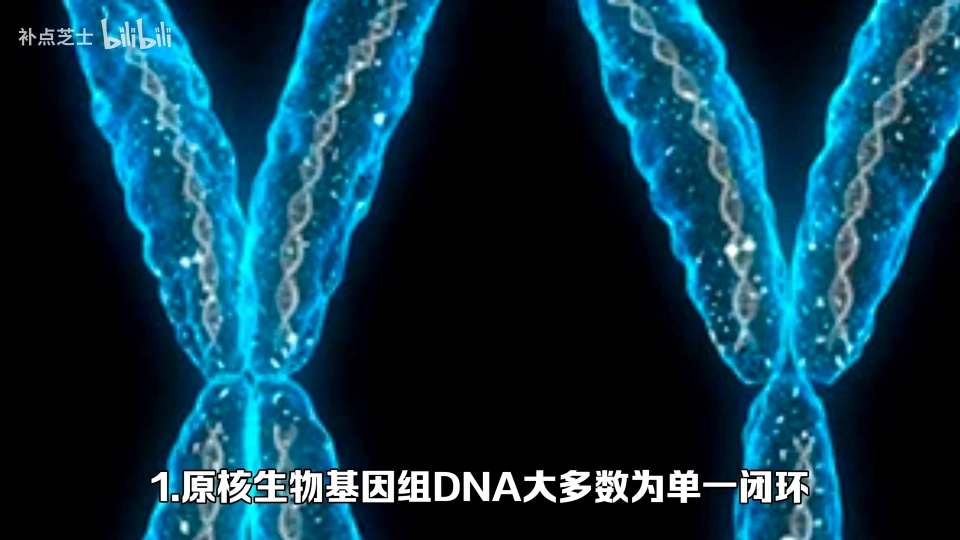
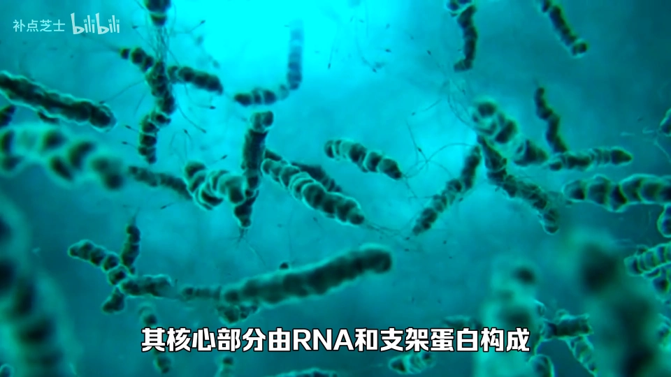
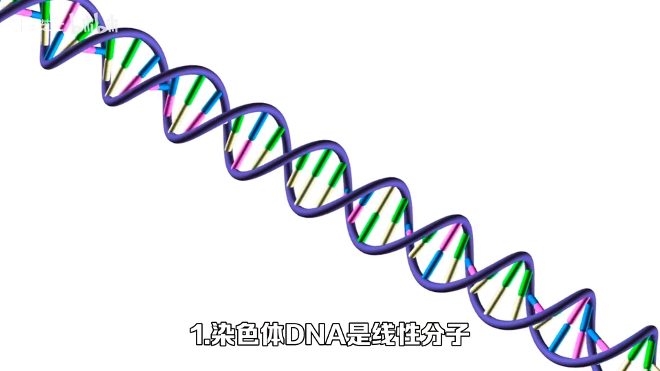
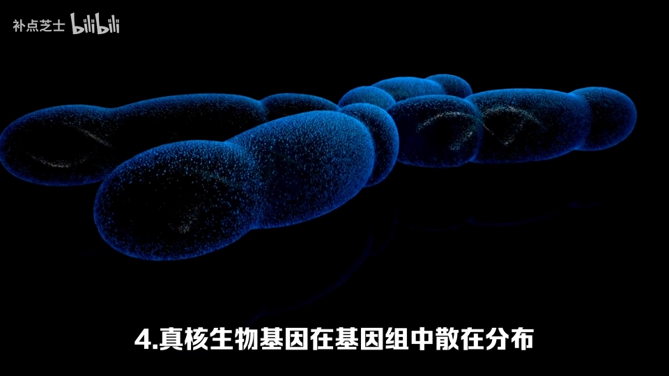

# 原核与真核的基因组组织：环状与线性染色体、复制起点与基因排布

> 视频来源：[《原核生物和真核生物的基因组有哪些基本特征？》](https://www.bilibili.com/video/BV1So4y187FX/)（B 站 · 生物化学/分子生物学考点串讲）｜时长约 2 分 45 秒
> 导读：这支短视频只做一件事——把「原核基因组」和「真核基因组」的基本特征逐条列出来对照。它正好补上细胞结构对照里最容易漏掉的那一半：**区室之外，基因组本身是怎么组织的**。

## 本讲要解决的核心问题（SCQA）

**背景**：上一篇《细胞的结构与功能》已经把区室讲清楚了——原核没有核膜、只有拟核，真核有细胞核和成套细胞器。但「有没有核膜」只是第一层差别。

**冲突**：如果只记住「原核 DNA 是一团散乱的、真核是 DNA+蛋白质」，就会漏掉真正决定后续所有分析方式的东西：**DNA 是环状还是线性、有几条、有几个复制起点、基因是成簇还是散在**。这些差别直接决定了复制怎么进行、表达怎么调控、测序数据怎么读。

**疑问**：原核和真核的基因组在组织方式上到底差在哪几项？这些差别会带来什么后果？

**回答（中心思想）**：原核基因组通常是**一个环**——单一闭环双链 DNA、单一复制起点、编码序列占 85–90%、相关基因常组成操纵子；真核基因组是**多条线**——线性染色体、多个复制起点、有着丝粒和端粒、编码序列不到 10%（人不到 2%）、基因散在分布并夹着大量重复序列和转座子。一句话：**原核把信息压紧在一个环上，真核把信息摊开在一套线上。**

---

## 一、先看原核：一个环，压得很紧

视频先交代了原核生物的范围：细菌、支原体、衣原体、立克次体、螺旋体、放线菌，它们都有完整的代谢系统，能调节代谢以适应营养和环境变化，所以基因组里的基因数目**多于病毒、少于真核生物**。[【跳转到 00:04】](https://www.bilibili.com/video/BV1So4y187FX/?t=4)

原核基因组的基本特征有五条，前三条都属于「结构」：

1. **DNA 大多数是单一闭环双链分子**。原核的 DNA 虽然结合有少量蛋白质，但**并未形成典型的染色体结构**，只是习惯上也称为「染色体」。[【跳转到 00:25】](https://www.bilibili.com/video/BV1So4y187FX/?t=25)

2. **这条「染色体」在细胞里聚成一个致密区域，叫拟核（类核）**。拟核没有核膜，核心部分由 RNA 和支架蛋白构成，外周才是基因组 DNA。[【跳转到 00:37】](https://www.bilibili.com/video/BV1So4y187FX/?t=37)

3. **只有一个复制起点**，而真核基因组 DNA 有多个复制起点。[【跳转到 00:45】](https://www.bilibili.com/video/BV1So4y187FX/?t=45)

后两条属于「内容」：

4. **序列以编码序列为主，占 85%–90%**，非编码序列主要是一些调控元件。基因数目上，细菌有 1700–7500 个，较小的支原体也有近 500 个。[【跳转到 00:53】](https://www.bilibili.com/video/BV1So4y187FX/?t=53)
5. **许多基因形成操纵子结构**——几个功能相关的基因共用一个转录单位，一起被转录出来。[【跳转到 01:11】](https://www.bilibili.com/video/BV1So4y187FX/?t=71)

> 这里要和上一篇接上：拟核「没有核膜」是区室层面的说法，而「单一闭环、单复制起点、编码为主、成操纵子」是**基因组组织层面**的说法。同一件事在两层上各有一套描述，不能互相替代。

---

## 二、再看真核：多条线，摊得很开

真核基因组比原核更大、结构更复杂，视频给了七条特征。前三条同样是「结构」：

1. **染色体 DNA 是线性分子**，含**多个复制起点**，并且有着丝粒 DNA 和端粒这两种功能元件——视频把「多个复制起点、着丝粒、端粒」合称三类功能元件。[【跳转到 01:23】](https://www.bilibili.com/video/BV1So4y187FX/?t=83)

2. **染色体 DNA 形成真正的染色体结构，且染色体数目一定**：除了配子是单倍体，体细胞一般是二倍体。[【跳转到 01:32】](https://www.bilibili.com/video/BV1So4y187FX/?t=92)

3. **编码序列占比低**：真核基因组中只有不到 10% 是蛋白质编码序列，人类甚至不到 2%。视频特别强调，编码序列占基因组的比例，是真核、原核、病毒三者之间的**重要区别**，并且在一定程度上是衡量生物进化程度的标尺。[【跳转到 01:40】](https://www.bilibili.com/video/BV1So4y187FX/?t=100)

后四条属于「内容」：

4. **基因在基因组中散在分布**，不像原核那样成操纵子成串排列。[【跳转到 01:52】](https://www.bilibili.com/video/BV1So4y187FX/?t=112)
5. **包含大量重复序列**：按重复单位的连续性可分为串联重复与散在重复；按重复程度可分为高度重复、中度重复和单一序列。[【跳转到 02:04】](https://www.bilibili.com/video/BV1So4y187FX/?t=124)
6. **存在各种基因家族**，成员或成簇分布、或散在分布。[【跳转到 02:20】](https://www.bilibili.com/video/BV1So4y187FX/?t=140)
7. **含大量转座子**：人类基因组序列中约 45% 是转座子序列，不过其中绝大多数因存在缺陷而不能转座。[【跳转到 02:28】](https://www.bilibili.com/video/BV1So4y187FX/?t=148)

---

## 三、一张对照表

把视频里的条目按「问同一件事」的方式并排：

| 对照项 | 原核 | 真核 |
| --- | --- | --- |
| 染色体形状 | 大多数为**单一闭环**双链 DNA | **线性**分子 |
| 染色体数量 | 通常一套（习惯上也称「染色体」，但无典型染色体结构） | 数目一定；体细胞二倍体、配子单倍体 |
| DNA 包装 | 结合少量蛋白质，**未形成典型染色体结构**；聚成拟核，核心由 RNA 与支架蛋白构成 | 形成**真正的染色体结构**；有着丝粒与端粒 |
| 复制起点 | **只有一个** | **多个** |
| 编码序列占比 | **85%–90%**，非编码主要是调控元件 | **不到 10%**，人类不到 2% |
| 基因排布 | 许多基因组成**操纵子**，共转录 | 基因**散在分布**，不组成操纵子 |
| 其他序列 | 重复序列少、短 | 大量重复序列、基因家族、转座子（人约 45%） |

> 表中「DNA 包装」一行的真核细节（组蛋白八聚体、约 147 bp DNA 缠绕 1.6 圈、H1 稳定）不在这支视频里，见项目内既有正文 [4.1.1 基因表达调控的三个层次](../../../4_细胞、个体与变化/4.1_细胞类型、基因表达与表观遗传/4.1.1_基因表达调控与表观遗传/基因表达调控的三个层次——染色质、转录起始与转录后.md) 的「核小体是默认的『锁』」一节。两支材料合起来，这一行才算完整。
>
> 「质粒有无」一行见同小节的 [质粒：染色体之外的环状DNA、独立复制与水平转移](质粒：染色体之外的环状DNA、独立复制与水平转移.md)。

---

## 四、这些差别为什么重要

基因组组织不是背完就完的分类学，它决定了后面三件事的做法。

### 4.1 复制：一个起点 vs 多个起点

原核只有一个复制起点，整条环状 DNA 从一个点出发向两侧推进；真核染色体很长，必须靠**多个起点**分段同时复制，才能在一个细胞周期内完成。这也解释了为什么真核的复制调控要复杂得多——起点要按时间和区域分批「点火」。[【跳转到 00:45】](https://www.bilibili.com/video/BV1So4y187FX/?t=45)

### 4.2 表达调控：操纵子 vs 染色质

原核用**操纵子**把功能相关的基因打包成同一个转录单位，一个开关同时控制一组基因——这是「省事」的调控。真核基因散在分布、各自有独立的调控序列，还压在染色质上，于是调控必须先解决「DNA 能不能被读到」这一层。**操纵子与染色质，是两套完全不同的调控入口。**

### 4.3 测序与数据分析：一份基因组 vs 一个环

做基因组测序时，原核的「单一闭环 + 编码为主」意味着组装目标是一条环、注释目标基本就是找基因；真核的「线性多染色体 + 大量重复 + 转座子」意味着组装会被重复序列打断，注释要先处理内含子和重复。单细胞测序里常说的「一个细胞一份基因组」，在真核里是二倍体两套染色体，在原核里则要额外考虑**质粒这种染色体之外的小环**——这正是下一篇要讲的内容。

---

## 五、边界：这张表不能当成绝对规律

视频给的是「大多数」「一般」层面的规律，落到具体物种会有例外，使用时要注意三条：

1. **「环状」不是绝对的**：视频说的是「大多数为单一闭环双链分子」，部分细菌确实带线性染色体或线性质粒。遇到具体物种要以该物种的基因组报道为准。
2. **质粒不在这张表里**：质粒是独立于染色体、能自主复制的小环状 DNA，并非所有原核都有，也不属于「染色体」这一栏。它的存在让「原核只有一个环」这句话必须修正为「一个主染色体环，外加可选的若干小环」。
3. **古菌介于两者之间**：古菌没有核膜（区室上像原核），但 DNA 常结合类组蛋白并包装成核小体样结构（组织上更像真核）。所以「原核 = 无组蛋白」的说法并不成立，本节的对照只适用于细菌这一类最常被拿来比较的对象。

> 以上三条为按通行教材补充的边界说明，**不在这支视频的字幕内**，引用时请以微生物学/分子生物学教材的具体版本核对。

---

## 小结

- 原核基因组：**一个环**——单一闭环双链 DNA、单复制起点、编码序列占 85–90%、相关基因组成操纵子、聚成无核膜的拟核。
- 真核基因组：**多条线**——线性染色体、多复制起点、有着丝粒与端粒、编码序列不到 10%（人不到 2%）、基因散在、大量重复序列与转座子。
- 两条对照线要分开记：**区室**（有无核膜、有无细胞器分区）和**基因组组织**（环/线、单/多起点、操纵子/散在）是同一批细胞的两套描述。
- 这些差别直接决定复制策略、表达调控入口和测序数据的读法。
- 边界：环状不是绝对；质粒不在此表内；古菌介于两者之间。

## 关键术语速查

| 术语 | 一句话解释 |
| --- | --- |
| 拟核（类核） | 原核细胞中 DNA 聚集成的致密区域，没有核膜包被 |
| 闭环双链 DNA | 首尾相连成环的双链 DNA，原核基因组的主要形式 |
| 复制起点 | DNA 复制开始的位置；原核通常一个，真核有多个 |
| 操纵子 | 原核中几个功能相关基因共用的一个转录单位，可被一起转录 |
| 着丝粒 | 真核染色体上纺锤丝连接的位点，也是姐妹染色单体相连处 |
| 端粒 | 真核线性染色体末端的特殊结构，解决末端复制问题 |
| 转座子 | 可在基因组中移动位置的 DNA 序列，真核基因组中占比很高 |
| 基因家族 | 由同一祖先基因重复、突变而来的一组序列相似的基因 |