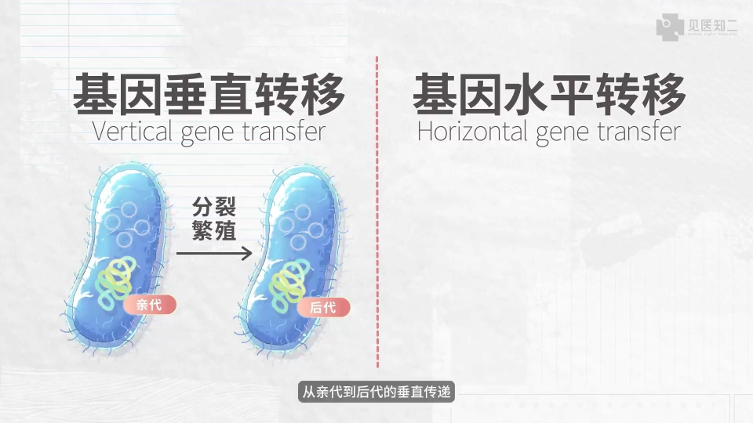
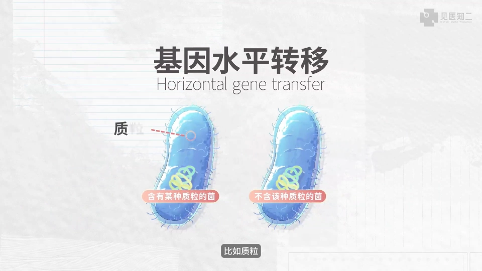
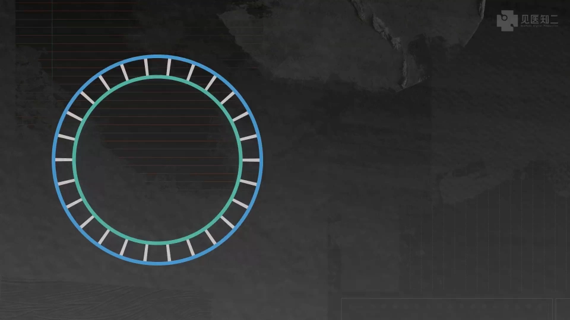
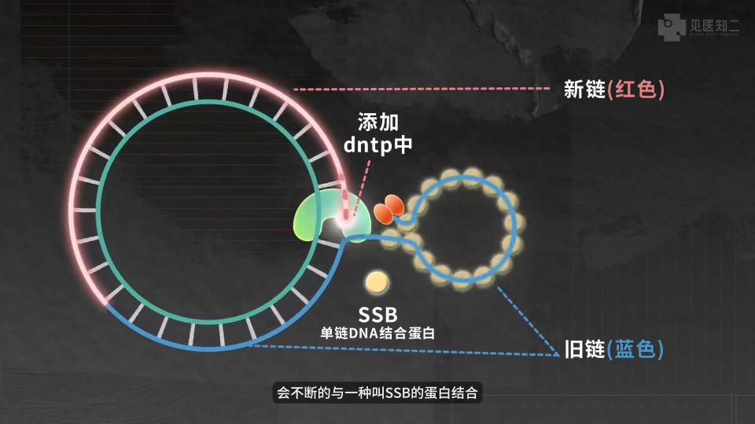
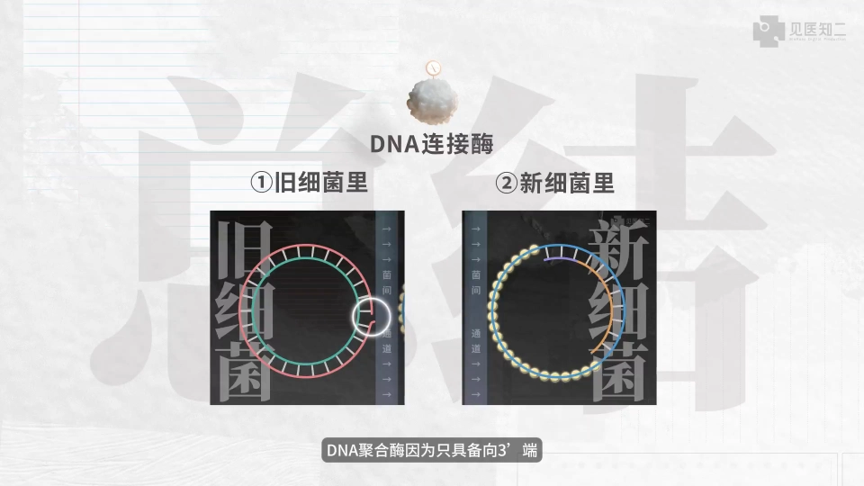

# 质粒：染色体之外的环状DNA、独立复制与水平转移

> 视频来源：[《【高考生物基因工程】质粒的滚环复制动画化（基因水平转移）》](https://www.bilibili.com/video/BV1by411b7xm/)（B 站 · 见医知二）｜时长约 4 分钟
> 导读：上一篇对照表把原核基因组概括成「一个环」。这支动画补上那个环之外的第二种 DNA——**质粒**：它不在染色体上，却能自己复制、自己转移，还常带着抗性基因。看完它，「原核基因组 = 一个环」这句话就知道该怎样修正。

## 本讲要解决的核心问题（SCQA）

**背景**：讲原核基因组时最顺手的说法是「一条环状 DNA」。但细菌里往往还有另一类小环状 DNA，习惯上不算进「染色体」。

**冲突**：如果只按「一个环」理解原核基因组，就会漏掉三件事：为什么细菌能凭空多出一个性状（比如抗药性）、为什么实验室能把一个基因「装」进细菌、为什么同一物种的不同菌株基因组内容能差很多。

**疑问**：质粒到底是什么？它凭什么能独立于染色体存在和复制？它又怎么在细菌之间传播？

**回答（中心思想）**：质粒是**独立于寄主染色体、能自主复制的环状双链 DNA**，一般携带抗性等附加基因；它靠自己的复制起点（ORI）和起始蛋白 RepA 启动**滚环复制**，并在复制过程中穿过细菌间的通道转移到另一个细菌里，实现**基因水平转移**。所以原核的基因组组织应写成：**一个主染色体环 + 若干可选的质粒小环**。

---

## 一、质粒是什么：染色体之外的第二套 DNA

视频开篇先引入「基因水平转移」这个概念，再区分了两种遗传物质传递方式：[【跳转到 00:08】](https://www.bilibili.com/video/BV1by411b7xm/?t=8)

- **垂直转移**：通过繁殖，从亲代传到后代；
- **水平转移**（horizontal gene transfer）：**生物个体之间**遗传物质的移动，不经过繁殖。[【跳转到 00:16】](https://www.bilibili.com/video/BV1by411b7xm/?t=16)

水平转移的典型载体就是质粒。视频给出的定义是：质粒是细菌里的一种**能够独立于寄主染色体 DNA 自主复制的环形双链 DNA**，一般来说携带抗性基因。携带抗性质粒的细菌与不含该质粒的细菌之间发生基因信息传递，后者就获得了同样的抗性。[【跳转到 00:26】](https://www.bilibili.com/video/BV1by411b7xm/?t=26)

这句话里有三个要点，每一个都值得单独记住：

1. **独立于寄主染色体**——它不在这条主环上，所以「原核基因组只有一个环」只在染色体层面成立；
2. **能自主复制**——它有自己的复制起点，不依赖染色体起点「顺带」复制；
3. **环状双链**——和染色体同一种化学本质（双链 DNA），只是拓扑上更小、独立成环。

---

## 二、它凭什么自己复制：ORI 与 RepA

自主复制的关键是质粒上有一个**复制起始位点 ORI**（也叫复制原点）。视频描述的起始过程是：

1. 复制起始蛋白 **RepA** 先与 ORI 结合；
2. RepA 使其中一条单链断开，并与断开单链的 **5′ 一端**结合；
3. 断开处露出 **3′ 端**——这正好满足 DNA 聚合酶「只能往 3′ 端加核苷酸」的前提，于是**不需要另配引物**就能起始；
4. DNA 聚合酶以另一条没断的单链环为模板，从 3′ 端开始延伸。[【跳转到 00:55】](https://www.bilibili.com/video/BV1by411b7xm/?t=55)

这里和上一篇的对照正好接上：**原核染色体「只有一个复制起点」，质粒则是「另一个独立的复制起点」**。一个细菌细胞里因此可以同时存在多个不同的复制起点，各管一段 DNA。

---

## 三、滚环复制：一边复制，一边搬家

质粒的这套复制方式叫**滚环复制**（rolling circle）。视频用动画拆了它的过程：

1. 从 ORI 断开处开始，以未断的单链环为模板延伸新链；随着复制推进，被「滚」出来的旧链不断与 **SSB（单链 DNA 结合蛋白）**结合，保持单链状态。[【跳转到 01:39】](https://www.bilibili.com/video/BV1by411b7xm/?t=99)
2. 滚出来的旧链**穿过细菌间的交流通道，转移到新的细菌里**，直到复制完成。[【跳转到 01:53】](https://www.bilibili.com/video/BV1by411b7xm/?t=113)

3. 此时新旧链仍以当初 ORI 断开的位置为纽带连在同一条链上；转移到新细菌里的旧链两端被 RepA 连接成环，与它相连的新链被释放，缺口由 **DNA 连接酶**补上。[【跳转到 02:11】](https://www.bilibili.com/video/BV1by411b7xm/?t=131)
4. 新细菌里这条旧链上，RNA 聚合酶先合成一段 RNA 引物，宿主 DNA 聚合酶据此补齐第二条链；一圈结束后剔除 RNA 引物，再由 DNA 连接酶封口，形成完整的双链质粒。[【跳转到 02:33】](https://www.bilibili.com/video/BV1by411b7xm/?t=153)

视频最后用一句话收束：细菌之间的基因信息，就是通过滚环扩增的方式实现了水平转移。[【跳转到 02:52】](https://www.bilibili.com/video/BV1by411b7xm/?t=172)

随后它把关键蛋白归纳成一张表，RepA 是**多功能蛋白**：① 结合复制原点；② 断开旧单链；③ 重新结合转移到新细菌里的旧链两端。DNA 聚合酶则以「有 3′ 端/有引物」为前提向后添加 dNTP；[【跳转到 03:16】](https://www.bilibili.com/video/BV1by411b7xm/?t=196) 而它只能往 3′ 端加核苷酸，所以配对会停在环形端点的 5′ 端前留下一个缺口，DNA 连接酶负责在成环前把尾部 3′ 端与头部 5′ 端之间的磷酸二酯键连起来。[【跳转到 03:29】](https://www.bilibili.com/video/BV1by411b7xm/?t=209)

---

## 四、对 1.3.1 的三点意义

### 4.1 修正「原核基因组 = 一个环」

准确的说法是：**一个主染色体环，外加若干可选的质粒小环**。质粒不属于「染色体」那一栏，所以在上一篇的对照表里它没有位置——这也是为什么「质粒有无」要单独作为一行来问。

### 4.2 解释「同一物种不同菌株为什么差很多」

抗性基因这类附加信息不在染色体上，可以随质粒整包转移。于是同一物种的两个菌株，染色体可能几乎一样，质粒内容却完全不同——**基因组大小和基因数目都不是判断「是不是同一种细菌」的充分条件**。

### 4.3 影响测序与实验的读法

- 做细菌基因组测序时，质粒是独立的小环，组装时常作为单独的 contig/复制子出现，需要单独判断它是质粒还是染色体片段；
- 做基因工程时，「把基因装进质粒再转进细菌」之所以可行，前提正是质粒**独立于染色体、自带复制起点**；
- 分析抗性来源时，要区分抗性基因在染色体上还是在质粒上——后者更容易在菌群中扩散。

---

## 五、边界：质粒不是原核的「标配」

视频为了讲清机制，用的是「细菌 + 质粒」这一最典型的情形。实际使用时有四条边界要交代：

1. **不是所有原核都有质粒**：很多细菌天然不含质粒；质粒对宿主常常是「可有可无的附加项」，只是在特定环境（如抗生素压力）下才有明显优势。
2. **质粒不只有一种复制方式**：滚环复制是其中一类（常见于小质粒），较大的质粒常用 θ 复制等其它模式，具体取决于复制子类型。
3. **质粒不只存在于细菌**：古菌也有质粒；真核中酵母的 2μ 质粒等也是同类概念，但真核细胞器（线粒体、叶绿体）的 DNA 不属于质粒。
4. **质粒可以「进出」染色体**：某些质粒能整合进宿主染色体、也能再切出，这时「染色体之外」的界线会变得模糊。

> 以上四条为按微生物学/分子生物学通行教材补充的边界，**不在这支视频的字幕内**，具体物种请以该物种的基因组报道核对。

---

## 小结

- 质粒 = **独立于寄主染色体、能自主复制的环状双链 DNA**，一般携带抗性等附加基因。
- 自主复制的关键是自带 **ORI**：RepA 结合 ORI 并断开一条单链，露出 3′ 端，让 DNA 聚合酶无需另配引物即可起始。
- **滚环复制**一边扩增质粒，一边把旧链经细菌间通道送到另一个细菌，实现**基因水平转移**。
- 因此原核基因组组织应表述为「一个主染色体环 + 若干可选质粒小环」；质粒是「质粒有无」这一对照项的唯一来源。
- 边界：并非所有原核都有质粒；复制方式不止滚环；古菌与真核酵母也有质粒；质粒可整合进染色体。

## 关键术语速查

| 术语 | 一句话解释 |
| --- | --- |
| 质粒 | 独立于寄主染色体、能自主复制的环状双链 DNA，常携带抗性等附加基因 |
| 基因水平转移 | 不经过繁殖、在生物个体之间移动遗传物质的过程 |
| ORI（复制原点） | 质粒上启动复制的位点，RepA 在此结合并使单链断开 |
| RepA | 质粒滚环复制的多功能起始蛋白：结合 ORI、断开单链、连接转移后旧链两端 |
| 滚环复制 | 以未断单链环为模板不断延伸、把旧链「滚」出来的复制方式 |
| SSB | 单链 DNA 结合蛋白，稳定滚环复制中被推出的单链旧链 |
| DNA 连接酶 | 把 3′ 端与 5′ 端之间的磷酸二酯键连起来，负责封口成环 |