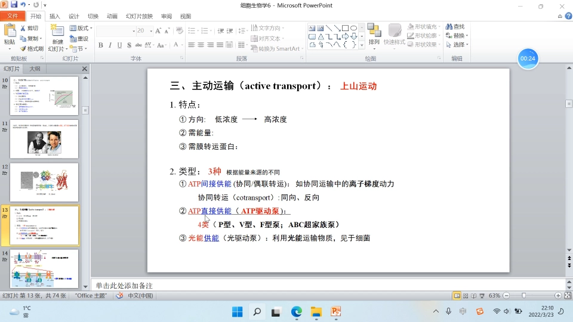
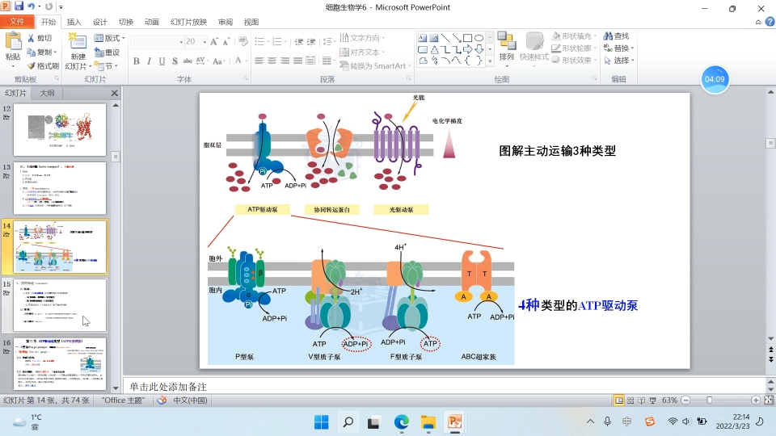
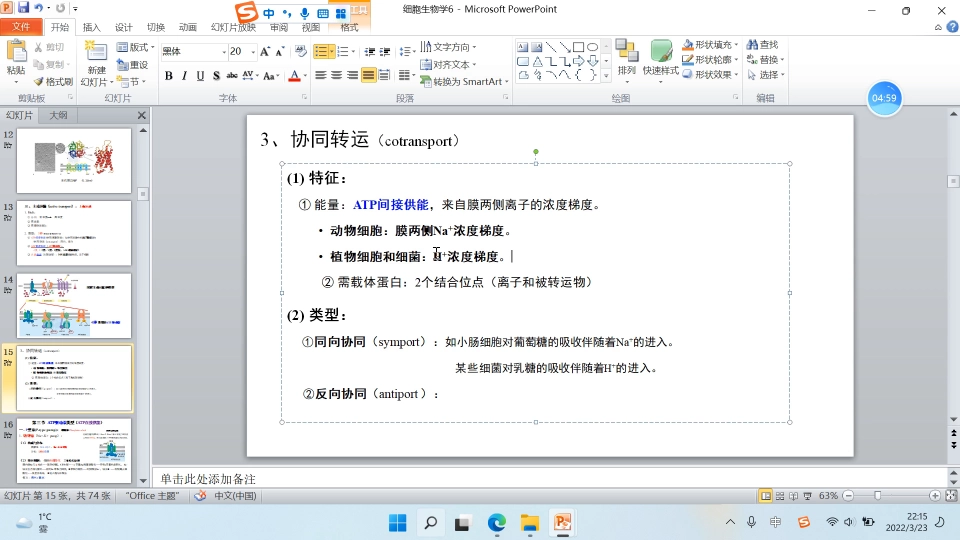
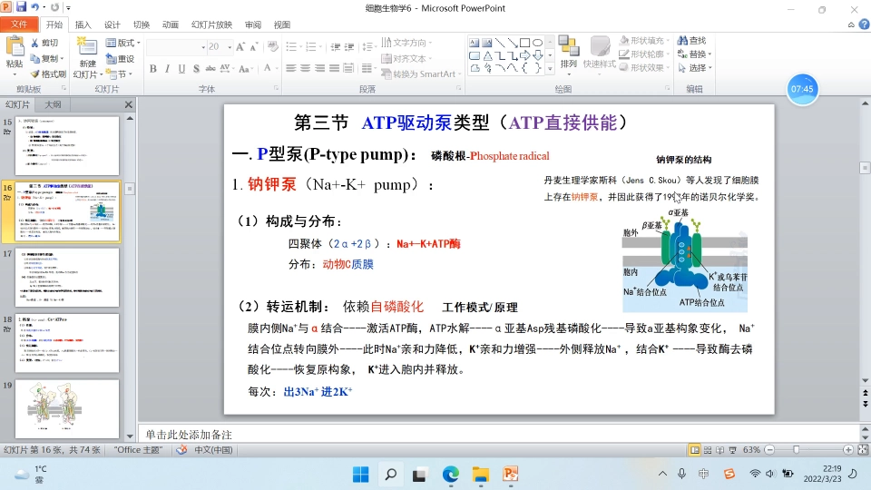
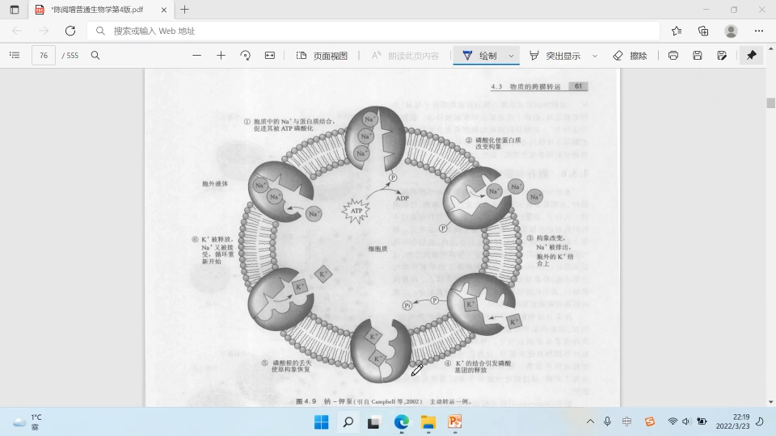
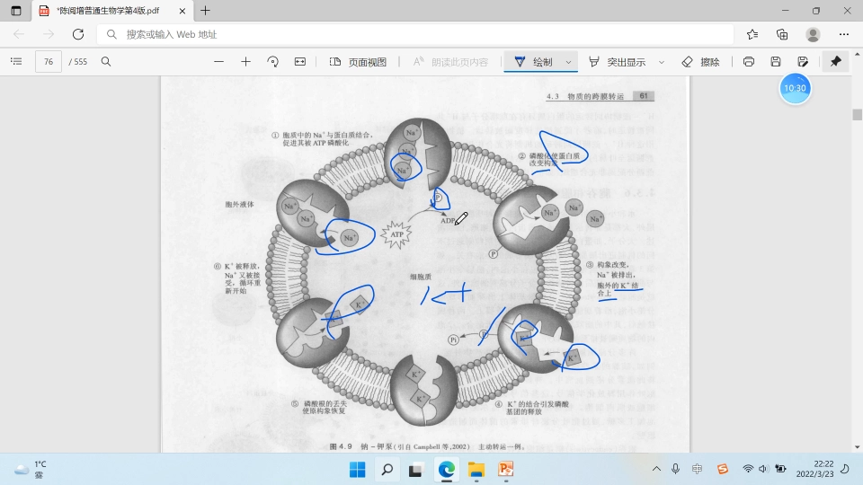
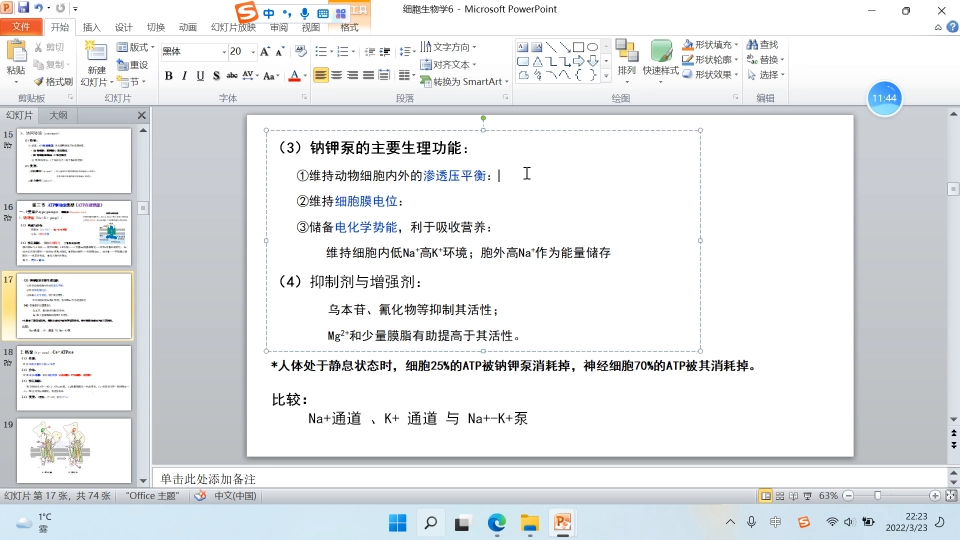
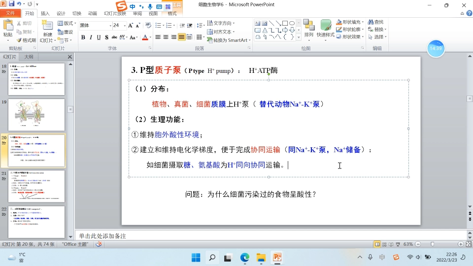
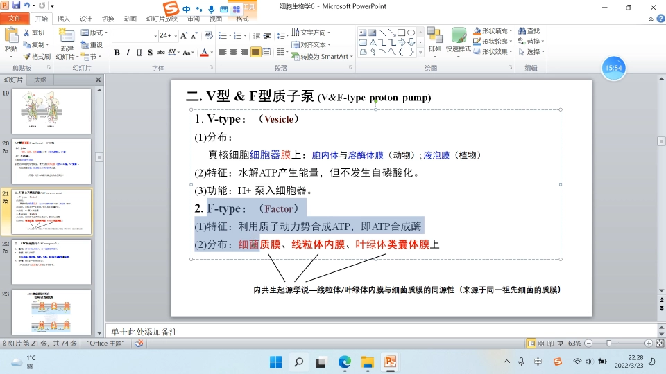

# 主动运输的能量来源：钠钾泵、协同转运与质子泵

> 视频来源：[《（让你头大的钠钾泵，质子泵，协同转运变得好懂）几种重要特殊跨膜运输介绍》](https://www.bilibili.com/video/BV1Mu411B7Dv/)（B 站 · 孤晓幽梦）｜时长约 20 分钟
> 导读：上一篇博客只把主动运输定义为「逆浓度 + 耗能 + 需蛋白」，这一篇专门回答"能量从哪来"。它按能量来源把主动运输分成三类，再把钠钾泵的构象循环一步步拆开，最后说明这台泵怎样同时维持渗透压、膜电位和可再利用的 Na⁺ 梯度。视频末尾关于内共生起源的延伸属于细胞结构话题，见 [1.3.1](../1.3.1_原核与真核细胞、细胞器与分工/细胞的结构与功能：细胞膜、细胞器与细胞核.md)。

## 本讲要解决的核心问题（SCQA）

**背景**：主动运输的定义是"逆浓度梯度、需要转运蛋白、需要能量"。听起来清楚，但"能量"两个字掩盖了不同的机制。

**冲突**：如果所有主动运输都直接烧 ATP，那么小肠上皮细胞逆浓度吸收葡萄糖时，为什么不是葡萄糖自己水解 ATP？为什么植物和细菌没有钠钾泵，却也能维持膜两侧的离子梯度？

**疑问**：主动运输的能量到底有几种来源，这些来源之间是什么关系？

**回答（中心思想）**：主动运输按能量来源分三类——**ATP 直接供能**（各种泵）、**ATP 间接供能**（协同转运，借另一物质已有的电化学梯度）、**光能供能**（光驱动泵）。其中"ATP 间接供能"是关键一环：**先由泵花 ATP 造出一个梯度，再由协同转运蛋白把这个梯度的势能花掉**。钠钾泵就是动物细胞里造这个梯度的那台泵。

---

## 一、主动运输按能量来源分三类

[【跳转到 00:25】](https://www.bilibili.com/video/BV1Mu411B7Dv/?t=25)

主动运输的三个特点：**方向是低浓度到高浓度**、**需能量**、**需膜转运蛋白**。按能量来源分成三种：

1. **ATP 直接供能（ATP 驱动泵）**：泵自己水解 ATP 取能。按形态分四类——**P 型、V 型、F 型、ABC 超家族泵**；
2. **ATP 间接供能（协同转运 / 偶联转运）**：泵自己不烧 ATP，而是借**另一种分子或离子的浓度梯度、电化学梯度**做功；
3. **光能供能（光驱动泵）**：把光能转化为电化学梯度来运输物质，多见于细菌。

[【跳转到 04:10】](https://www.bilibili.com/video/BV1Mu411B7Dv/?t=250)

四类泵的形态差别（视频用"看图认形状"的方式记）：**P 型**像一个倒置的 P 或倒置的榔头；**V 型**像锤子/哑铃，另一边有圆盘状固定结构；**F 型**像一根小棍加两个竖杠；**ABC 超家族**像两片跨膜结构域，下面挂两个 ATP 结合位点。

[【跳转到 02:55】](https://www.bilibili.com/video/BV1Mu411B7Dv/?t=175)

一个容易记混的点：**V 型与 F 型都是质子泵，区别在于一个水解 ATP、另一个合成 ATP**——V 型水解 ATP 把 H⁺ 泵进细胞器，F 型反过来用质子动力势能合成 ATP。

---

## 二、协同转运：把"梯度"当成可流通的能量

### 2.1 机制：两个结合位点，一次构象改变

协同转运蛋白有**两个结合位点**：一个结合离子，一个结合被转运物。两者同时结合后，蛋白构象改变，把它们一起送过膜。

[【跳转到 05:00】](https://www.bilibili.com/video/BV1Mu411B7Dv/?t=300)

能量账是这样算的：被转运物本身要从低浓度到高浓度，需要能量；而同向/反向搭车的离子是**从高浓度往低浓度**走的，它释放的势能正好供给前者。所以协同转运的"能量"不是 ATP，而是**膜两侧现成的离子电化学梯度**。

### 2.2 动物用 Na⁺，植物和细菌用 H⁺

- **动物细胞**：维持渗透压平衡主要靠 Na⁺ 和 K⁺，Na⁺ 在细胞外（细胞间质）较多、K⁺ 在细胞内较多，于是膜两侧天然存在 Na⁺ 浓度梯度；
- **植物细胞和细菌**：主要靠 **H⁺ 浓度梯度**。

[【跳转到 04:35】](https://www.bilibili.com/video/BV1Mu411B7Dv/?t=275)

### 2.3 同向与反向

- **同向协同（symport）**：两个物质朝同一方向走。典型例子是**小肠对葡萄糖的吸收伴随 Na⁺ 进入**；
- **反向协同（antiport）**：一个进、一个出。

另一个例子是**细菌对乳糖的吸收伴随 H⁺ 进入**。视频给了一个生活化的旁证：面包放久了、长了细菌会发酸——细菌吸收乳糖时伴随 H⁺ 进入，环境就变酸了。

[【跳转到 05:25】](https://www.bilibili.com/video/BV1Mu411B7Dv/?t=325)

### 2.4 一个完整的"间接供能"链条

协同转运要成立，前提是**梯度已经存在**。而梯度不会自己出现，它必须先由某个**直接烧 ATP 的泵**建立起来。于是完整的链条是：

$$
\text{ATP} \;\rightarrow\; \text{泵把 Na}^+ \text{ 泵出} \;\rightarrow\; \text{膜外高 Na}^+ \text{ 梯度} \;\rightarrow\; \text{协同转运蛋白借梯度把葡萄糖运进细胞}
$$

这就是为什么小肠上皮吸收葡萄糖被归为主动运输，却**不直接水解 ATP**——它花的是钠钾泵预先存下的"电化学势能存款"。上一篇博客里"小肠上皮细胞逆浓度吸收葡萄糖"的机制，到这里才补上能量来源。

---

## 三、钠钾泵：动物细胞里造梯度的那台泵

### 3.1 结构与发现

钠钾泵属于 **P 型泵**，由 **α₂β₂ 四聚体**组成（两个 α 亚基、两个 β 亚基），本质是 **Na⁺-K⁺-ATP 酶**，分布在**动物细胞的质膜**上。它由丹麦生理学家**斯科（Jens C. Skou）**等人发现，并因此获得 **1997 年诺贝尔化学奖**。

[【跳转到 07:46】](https://www.bilibili.com/video/BV1Mu411B7Dv/?t=466)

### 3.2 构象循环：一次 ATP，三步形变

P 型泵的工作方式是**依赖自磷酸化**：ATP 水解下来的磷酸基团**共价结合到泵自身**（α 亚基的天冬氨酸残基）上，引起构象改变。循环可以拆成五步：

1. 膜内侧的 **Na⁺ 与 α 亚基结合**，激活 ATP 酶；
2. **ATP 水解**，磷酸基团转移到 α 亚基上（自磷酸化）；
3. 磷酸化导致 **α 亚基构象改变**，Na⁺ 结合位点转向膜外；此时对 Na⁺ 的亲和力降低、对 K⁺ 的亲和力升高，**Na⁺ 被释放到细胞外**；
4. 膜外的 **K⁺ 结合上来**，引起**去磷酸化**（磷酸基团脱落）；
5. 去磷酸化使构象恢复，**K⁺ 被释放进细胞内**，泵回到起始状态，可以再结合 Na⁺。

[【跳转到 08:01】](https://www.bilibili.com/video/BV1Mu411B7Dv/?t=481)

一个循环的化学计量是 **3 个 Na⁺ 出、2 个 K⁺ 入**：

[【跳转到 10:31】](https://www.bilibili.com/video/BV1Mu411B7Dv/?t=631)

注意这个 3:2 的不对称：每循环净移出**一个正电荷**，所以钠钾泵是**生电的**（electrogenic）——它本身就往膜电位的"内负外正"上添了一份力。

### 3.3 三大生理功能：一台泵，三种"膜两侧差异"

[【跳转到 11:45】](https://www.bilibili.com/video/BV1Mu411B7Dv/?t=705)

**（1）维持动物细胞内外的渗透压平衡。** 如果细胞外浓度太高，细胞会**失水**；如果细胞外浓度过低，动物细胞会**吸水胀破**。钠钾泵持续把 Na⁺ 赶出、把 K⁺ 收进，维持住两侧的浓度差，也就维持住了渗透压平衡。这是"用一套机制解释一种膜两侧差异"最直接的一例：**膜两侧的溶质浓度差本身是被一台耗能泵主动维持的，不是自然平衡的结果**。

**（2）维持细胞膜电位。** 它转运的是带电离子，因此直接参与维持膜内外电位差；同时这个电位差又能反过来被用来做跨膜运输。

**（3）储备电化学势能，利于吸收营养。** 泵把细胞内 Na⁺ 压低、细胞外 Na⁺ 抬高，等于在膜两侧"存"了一份 Na⁺ 电化学梯度。这份存款随后被协同转运蛋白花掉——这正是第二节那条链条的上半段。

[【跳转到 12:10】](https://www.bilibili.com/video/BV1Mu411B7Dv/?t=730)

代价有多大？视频给了两个数：**人体静息状态下，细胞内约 25% 的 ATP 被钠钾泵消耗；对神经细胞来说，这个比例达到 70%**。这也是"维持膜两侧差异很贵"的量化说明。

顺带一提：**乌本苷、氟化物**等可抑制其活性，**Mg²⁺ 和少量膜脂**有助于提高其活性。

### 3.4 通道与泵不是一回事

视频特别提醒：Na⁺ 通道、K⁺ 通道协助转运靠的是**通道蛋白**，与钠钾泵这种**载体蛋白（泵）**不同。通道只能让离子顺梯度通过，泵才能逆梯度搬运——这也是上一篇博客里"通道 vs 载体"区分的落点。

[【跳转到 12:35】](https://www.bilibili.com/video/BV1Mu411B7Dv/?t=755)

---

## 四、同一套逻辑的其他泵

### 4.1 钙泵：把 Ca²⁺ 关进内质网

钙泵同样是 ATP 直接供能的泵，功能是**维持细胞质基质中的低 Ca²⁺ 浓度**。它分布在所有真核细胞的质膜、部分细胞器膜上，最主要的是**内质网**——内质网膜上有很多钙泵，把 Ca²⁺ 储存起来，从而让细胞质基质保持低钙。它是一个 ATP 泵，**每消耗 1 个 ATP 泵出 2 个 Ca²⁺**，机制与钠钾泵同型：ATP 结合 → 构象改变 → Ca²⁺ 被送出。

[【跳转到 13:25】](https://www.bilibili.com/video/BV1Mu411B7Dv/?t=805)

### 4.2 质子泵：植物与细菌版的"钠钾泵"

在植物和细菌中，维持膜两侧梯度的主角不是钠钾泵，而是**质子泵**（质子即 H⁺）。

**P 型质子泵**分布在植物、真菌、细菌的质膜上，**替代动物细胞的 Na⁺-K⁺ 泵**。它的生理功能有两条：**维持胞外酸性环境**；**建立并维持电化学梯度，便于完成协同转运**——就像钠钾泵给动物细胞外储备 Na⁺，P 型质子泵给植物/细菌的胞外储备 H⁺，细菌摄取糖类、氨基酸靠的就是 H⁺ 同向协同转运。

[【跳转到 14:40】](https://www.bilibili.com/video/BV1Mu411B7Dv/?t=880)

**V 型质子泵**主要在真核细胞的细胞器膜上（胞内体、溶酶体、液泡），水解 ATP 产生能量但**不发生自磷酸化**，功能是把 H⁺ **泵入细胞器**。

**F 型质子泵**方向相反：它利用**质子的动力势能合成 ATP**，也就是常说的 **ATP 合成酶**，分布在线粒体内膜（参与有氧呼吸第三阶段的氧化磷酸化）、细菌质膜、叶绿体类囊体薄膜上。

[【跳转到 15:55】](https://www.bilibili.com/video/BV1Mu411B7Dv/?t=955)

V 型与 F 型在结构上都有"像南瓜一样"可以转的部分，区别在于一个水解 ATP、一个合成 ATP。

### 4.3 ABC 超家族：一大类"搬运小分子"的泵

ABC 超家族有两个跨膜结构域（"两片"）和两个 ATP 结合位点，功能是转运小分子：氨基酸、核苷酸、多糖、多肽、蛋白质代谢废物、毒物等。它**广泛分布于从细菌到人类的各种生物**中。

[【跳转到 19:40】](https://www.bilibili.com/video/BV1Mu411B7Dv/?t=1180)

---

## 五、边界与易错点

1. **"主动运输"不等于"直接烧 ATP"**。协同转运属于主动运输，但它花的是**别人预先建立的梯度**。判断能量来源要问"这一步直接消耗的是什么"，而不是"整个过程最终是否耗 ATP"。
2. **泵造梯度、载体花梯度，是两件事**。钠钾泵和葡萄糖协同转运蛋白是两种蛋白，分属"直接供能"和"间接供能"两类。
3. **同向还是反向，看两个物质的方向**，不看谁在上游。小肠葡萄糖与 Na⁺ 同向进入；反向协同则是一进一出。
4. **动物用 Na⁺，植物和细菌用 H⁺**。这是"同一功能、不同分子实现"的典型例子，不要把它们记成同一套。
5. **V 型与 F 型方向相反**：V 型烧 ATP 泵 H⁺，F 型用 H⁺ 造 ATP。名字相近但功能相反，是最容易混的一对。
6. **视频末尾的内共生起源延伸**（线粒体、叶绿体膜上的 F 型泵与细菌质膜的同源性）属于细胞结构话题，见 [1.3.1 的细胞结构正文](../1.3.1_原核与真核细胞、细胞器与分工/细胞的结构与功能：细胞膜、细胞器与细胞核.md)。

---

## 小结

- 主动运输按能量来源分三类：**ATP 直接供能泵**（P/V/F/ABC）、**ATP 间接供能的协同转运**、**光驱动泵**。
- 协同转运借**另一种离子的电化学梯度**做功，分**同向**与**反向**；动物用 Na⁺ 梯度，植物与细菌用 H⁺ 梯度。
- **钠钾泵**是 P 型泵、Na⁺-K⁺-ATP 酶，靠**自磷酸化—构象改变**循环工作，每循环 **3 Na⁺ 出、2 K⁺ 入**。
- 钠钾泵同时维持**渗透压平衡**、**膜电位**，并**储备 Na⁺ 电化学势能**供协同转运使用——一台泵解释了三种膜两侧差异。
- 小肠上皮细胞逆浓度吸收葡萄糖，花的正是钠钾泵存下的这份势能：**泵造梯度、载体花梯度**。
- 静息时细胞内约 **25%** 的 ATP 被钠钾泵消耗，神经细胞达 **70%**，说明维持膜两侧差异的代价很高。
- 其他泵：**钙泵**（1 ATP 泵出 2 Ca²⁺，维持胞质低钙）、**P 型质子泵**（植物/细菌版的钠钾泵）、**V 型**（泵 H⁺ 入细胞器）、**F 型**（ATP 合成酶）、**ABC 超家族**（转运小分子）。

## 关键术语速查

| 术语 | 一句话解释 |
| --- | --- |
| 协同转运（偶联转运） | 两种物质共用一套载体、朝同向或反向一起过膜，能量来自其中一种的电化学梯度 |
| 同向协同 / 反向协同 | 两种物质朝同一方向 / 相反方向转运 |
| 钠钾泵 | 动物细胞质膜上的 Na⁺-K⁺-ATP 酶，每循环泵出 3 Na⁺、泵入 2 K⁺ |
| 自磷酸化 | ATP 的磷酸基团共价结合到泵自身蛋白上，引起构象改变 |
| 生电性泵 | 每循环净转移电荷、直接贡献膜电位的泵，如 3:2 的钠钾泵 |
| P 型泵 | 靠自磷酸化工作的 ATP 驱动泵，钠钾泵、钙泵、P 型质子泵都属此类 |
| V 型质子泵 | 水解 ATP 但不自磷酸化，把 H⁺ 泵入细胞器 |
| F 型质子泵 | 用质子动力势能合成 ATP，即 ATP 合成酶 |
| ABC 超家族 | 具两个跨膜结构域和两个 ATP 位点、广泛转运小分子的一大类泵 |
| 电化学梯度 | 浓度差与膜电位叠加形成的净驱动力，是协同转运的"能量货币" |