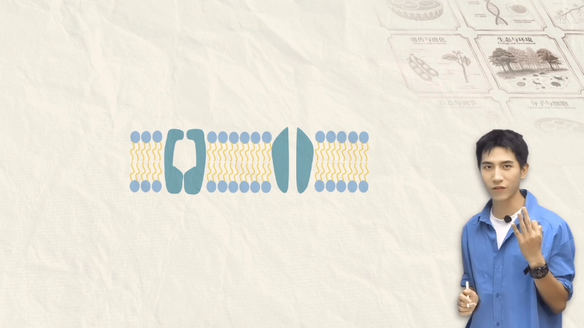
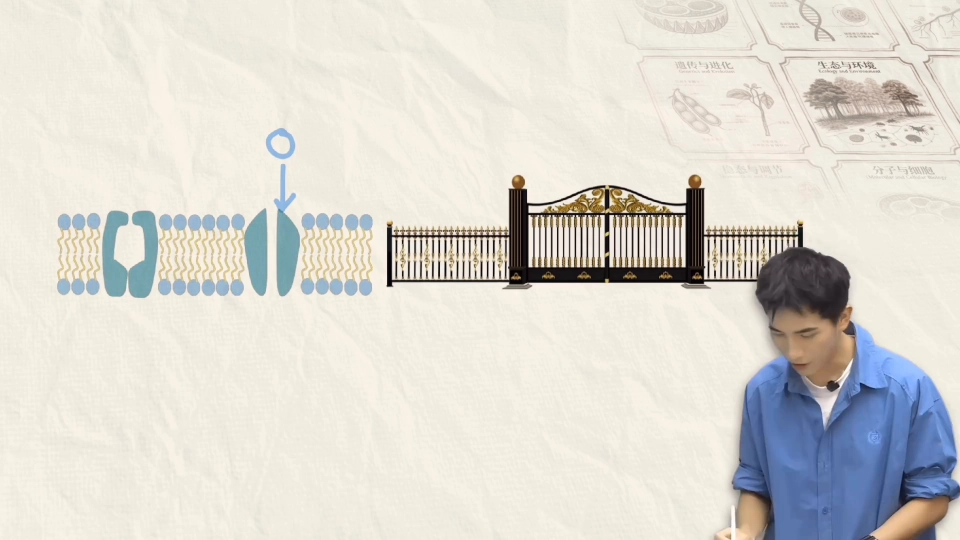
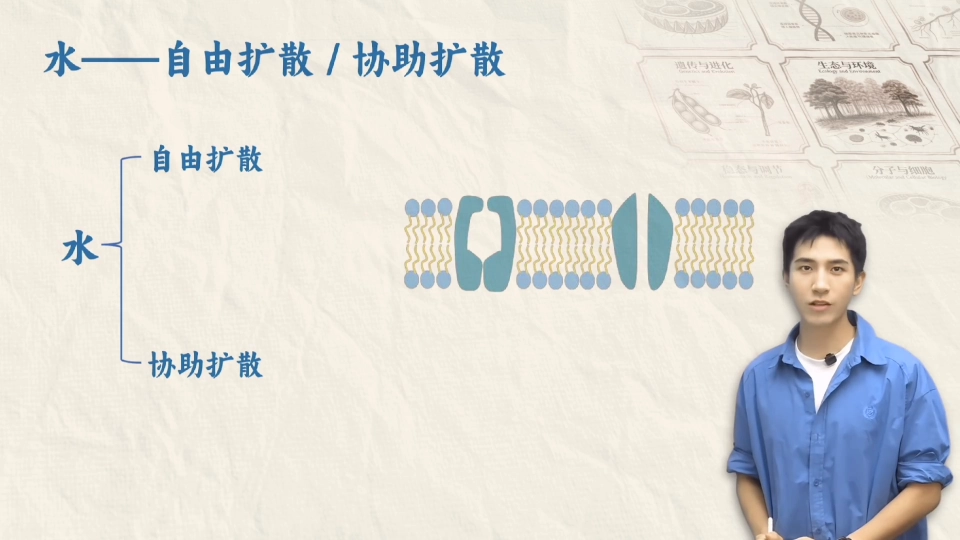
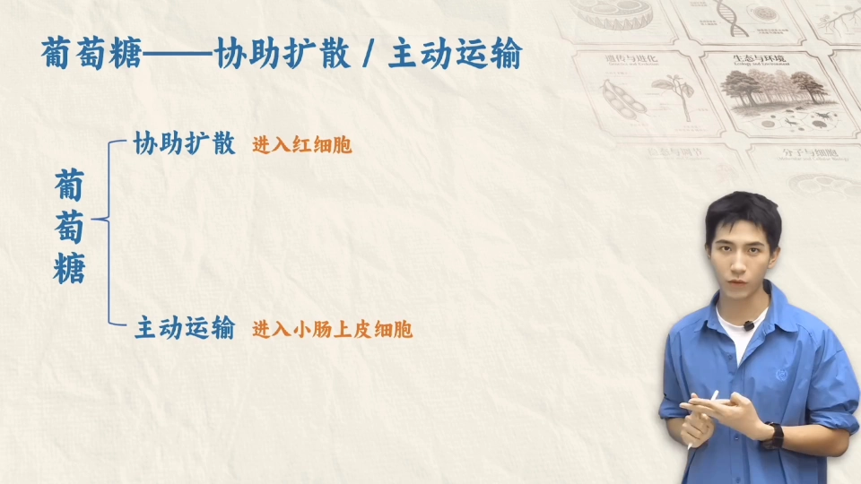
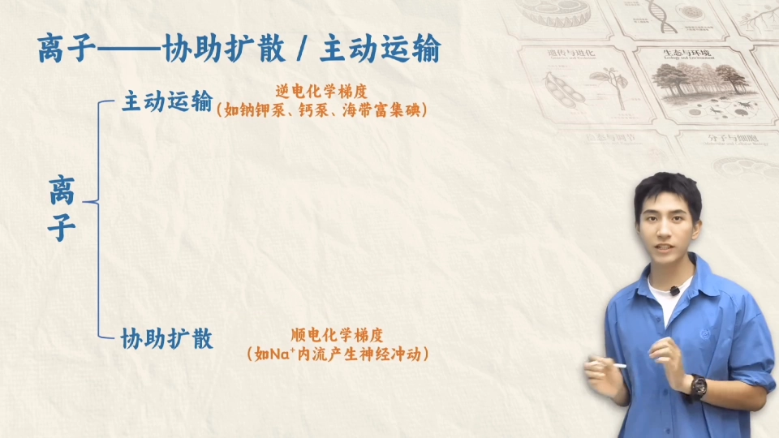
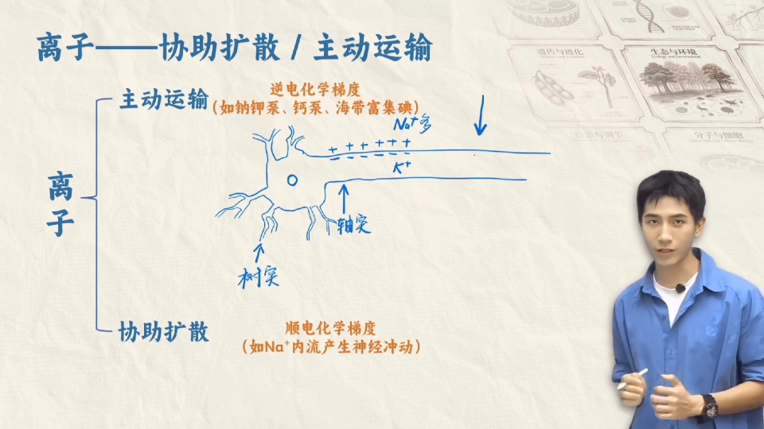
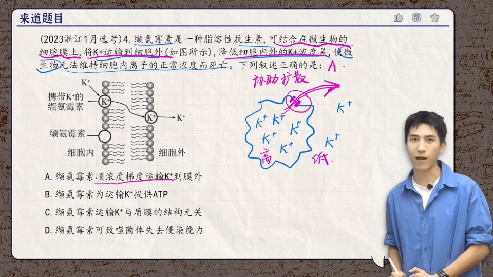
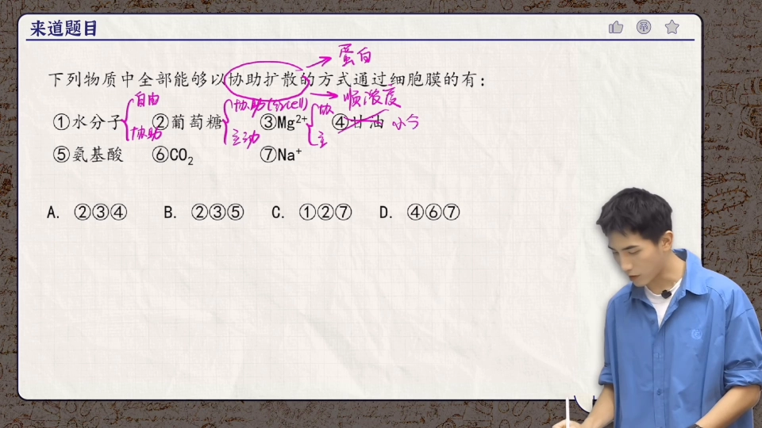

# 跨膜运输的三种方式：自由扩散、协助扩散与主动运输的判别

> 视频来源：[《跨膜运输方式判断不对？一条视频总结所有易错物质｜每周必学》](https://www.bilibili.com/video/BV11Kn1zBEF7/)（B 站 · 云鹏生物）｜时长约 15 分钟
> 导读：这支视频不讲细胞器，只做一件事——把「一种物质过一张膜」的判断标准立起来。它先给出三种方式的判据，再用水、葡萄糖、离子三种「有多种运输方式」的物质反复演练，最后用两道题收口。细胞膜本身的结构（磷脂双分子层、流动镶嵌模型、膜蛋白）已在 [1.3.1 的细胞结构正文](../1.3.1_原核与真核细胞、细胞器与分工/细胞的结构与功能：细胞膜、细胞器与细胞核.md) 讲过，本文只借用它作为判据的前提。

## 本讲要解决的核心问题（SCQA）

**背景**：小分子物质跨膜运输只有三种方式——自由扩散、协助扩散、主动运输。这是细胞生物学里最先要掌握的一套分类。

**冲突**：但有些物质的运输方式**不固定**：水既能自由扩散又能走水通道，葡萄糖进红细胞是协助扩散、进小肠上皮细胞却是主动运输，同一种离子也两种都可能。只记「某物质属于某方式」必然判断错。

**疑问**：那么，判断一种物质此刻走哪种方式，到底该看什么？

**回答（中心思想）**：不看物质名字，只看**三个判据**——是否需要转运蛋白、是否顺浓度梯度、是否消耗能量。三者组合唯一地确定了方式；物质名字只是给出常见的默认答案，遇到具体情境必须回到判据上重新判断。

---

## 一、判据的前提：膜是一道「铁栅栏」，蛋白是栅栏上的门

细胞膜的基本骨架是**磷脂双分子层**，其中镶嵌着蛋白质。这支视频用了一个贯穿全片的类比：

- **磷脂双分子层 = 铁栅栏**：它的作用是屏障，把细胞内外隔开；
- **膜蛋白 = 铁栅栏上的门**：可以打开、可以关闭。

[【跳转到 00:35】](https://www.bilibili.com/video/BV11Kn1zBEF7/?t=35)

这个类比的物理基础是：磷脂双分子层的内部是**疏水的脂肪酸尾部**，所以不带电、非极性的小分子可以溶进去再出来；而带电离子、极性小分子（葡萄糖、氨基酸）在疏水核心里的能量代价太高，只能走蛋白这道"门"。膜结构本身（头部亲水、尾部疏水如何自发排成双层、流动性与选择透过性）见 [1.3.1 的细胞结构正文](../1.3.1_原核与真核细胞、细胞器与分工/细胞的结构与功能：细胞膜、细胞器与细胞核.md)，这里只把它当作判据的起点。

---

## 二、三条判据决定三种方式

### 2.1 自由扩散：从缝里溜进去

一只蚊子要穿过铁栅栏，不需要谁给它开门，它直接从缝里就溜进去了。对应到膜上：**分子足够小、能溶于脂（或不带电），就直接穿过磷脂双分子层**。这就是**自由扩散**。

它的三个特征是：**不需要转运蛋白、不消耗能量、顺浓度梯度**。

### 2.2 协助扩散：需要门，但仍然顺流而下

体积大一些的物质没法从缝里挤过去，必须借助**转运蛋白**：先与转运蛋白上的结合位点结合，蛋白构象改变，把物质放过去。

[【跳转到 01:20】](https://www.bilibili.com/video/BV11Kn1zBEF7/?t=80)

这就是**协助扩散**——"协助"来自转运蛋白。它有一个硬性限制：**必须顺浓度梯度**。

[【跳转到 01:45】](https://www.bilibili.com/video/BV11Kn1zBEF7/?t=105)

为什么？因为它**不消耗能量**。不消耗能量就必须顺应自然规律，像水往低处流一样，只能从高浓度处流向低浓度处。

### 2.3 主动运输：逆流而上要付代价

如果想**逆浓度梯度**、把物质从低浓度处运到高浓度处，就必须付出代价：**消耗能量，并且仍然需要转运蛋白**。这就是**主动运输**。

视频用演唱会打比方：场馆坐满后就不让进了，可这时来了一群人说"我们必须要进去，因为我们是邓紫棋的亲戚"——保安主动放他们进去了。正常规则是"不能从低浓度处进到高浓度处"，打破规则需要有人**主动**付出代价，这正是"主动运输"这个名字的来源。

[【跳转到 02:42】](https://www.bilibili.com/video/BV11Kn1zBEF7/?t=162)

### 2.4 三条判据的判别表

把上面三节合成一张表，就是本节的判别框架：

| 方式 | 需要转运蛋白？ | 顺浓度梯度？ | 消耗能量？ |
| --- | --- | --- | --- |
| 自由扩散 | 否 | 是 | 否 |
| 协助扩散 | 是 | 是 | 否 |
| 主动运输 | 是 | **否（逆浓度）** | **是** |

判断时按顺序问：**先看方向**（顺还是逆），**再看有没有蛋白**，**最后看能量**。方向一旦是"逆"，就只能是主动运输；方向是"顺"时，再看是否需要蛋白来区分自由扩散与协助扩散。

---

## 三、为什么同一种物质会有两种方式

物质的运输方式不是它的固有属性，而是**它此刻所处情境**的属性。视频挑了三种最常考的物质来演示，每一种都恰好卡在判据的边界上。

### 3.1 水：能自己过，但有时必须走通道

水分子很小，可以从磷脂双分子层的缝隙里溜进去，所以**自由扩散**成立。

[【跳转到 02:57】](https://www.bilibili.com/video/BV11Kn1zBEF7/?t=177)

那为什么还需要第二种？因为从缝隙里挤进去有两个限制：**速率不快**，**通量不大**——通量太大膜就被撕裂了。所以当身体**急需大量用水**时，自由扩散不够用，必须靠**协助扩散**：把膜上的**通道蛋白**（水通道蛋白）打开，让水分子快速、大量地进出。

视频举的例子是哭：被队友气哭时，眼泪是"唰"地一下流出来的，这是泪腺细胞膜上的水通道蛋白打开了；如果靠自由扩散，得酝酿十几分钟才能渗出一滴泪水。

[【跳转到 04:15】](https://www.bilibili.com/video/BV11Kn1zBEF7/?t=255)

### 3.2 葡萄糖：进红细胞是协助扩散，进小肠上皮是主动运输

葡萄糖分子比水大得多，钻不过缝隙，必须靠转运蛋白。它的两种方式是**协助扩散和主动运输**，判断标准仍然是方向。

[【跳转到 04:40】](https://www.bilibili.com/video/BV11Kn1zBEF7/?t=280)

**红细胞这一侧为什么是协助扩散？** 哺乳动物成熟的红细胞没有细胞核和细胞器，里面大部分是血红蛋白，专门运氧。运氧工作量大、耗能多，需要大量葡萄糖；而红细胞泡在血液里，**血液中的葡萄糖浓度远高于红细胞内**。于是红细胞膜上的葡萄糖载体蛋白"始终大开"，让葡萄糖顺着浓度差源源不断进来。既需要载体、又顺浓度梯度，所以是**协助扩散**。

[【跳转到 05:55】](https://www.bilibili.com/video/BV11Kn1zBEF7/?t=355)

顺带一个常被追问的点：红细胞没有线粒体，进来的葡萄糖怎么供能？靠**无氧呼吸**分解出的少量能量；红细胞选择这种方式，是因为这样对"运氧"这件本职工作效率更高。

**小肠上皮细胞这一侧为什么是主动运输？** 小肠是消化食物的主要场所，食物被分解成葡萄糖等小颗粒后由小肠上皮细胞吸收。刚消化完时，肠腔里葡萄糖浓度确实高于细胞内；但随着吸收不断进行，**肠腔浓度会降到低于细胞内**，而吸收还得继续——这时就必须**逆浓度梯度**运输。

[【跳转到 07:10】](https://www.bilibili.com/video/BV11Kn1zBEF7/?t=430)

所以小肠上皮细胞必须具备逆浓度梯度转运葡萄糖的能力，这就是主动运输。注意这里的推理结构：**不是"小肠上皮细胞"这个身份决定了主动运输，而是"肠腔浓度被吸收到低于胞内之后仍要继续吸收"这个情境决定了它**。（这套主动运输的能量从哪来，见第二篇博客：它并不直接水解 ATP，而是借 Na⁺ 梯度。）

### 3.3 离子：海带富碘逆电化学梯度，Na⁺ 内流顺电化学梯度

离子体积也相对较大且带电，进不了疏水核心，必须靠转运蛋白。判断方式同样看方向：**顺浓度（更准确说是顺电化学梯度）是协助扩散，逆则是主动运输**。

[【跳转到 08:51】](https://www.bilibili.com/video/BV11Kn1zBEF7/?t=531)

**主动运输的例子：海带富集碘。** 海带体内碘含量极高，而海水中的碘含量远低于海带体内。碘不断把海水中低浓度的碘富集到自己体内，是**逆电化学梯度**的，必然消耗能量，所以是主动运输。

[【跳转到 08:39】](https://www.bilibili.com/video/BV11Kn1zBEF7/?t=519)

**协助扩散的例子：Na⁺ 内流产生神经冲动。** 神经细胞静息时膜内外存在电势差，**内负外正**；膜外 Na⁺ 浓度高，膜内 K⁺ 浓度高。受到刺激时，膜上的钠离子通道打开，Na⁺ 大量涌入，把"内负外正"逆转成"内正外负"。

[【跳转到 10:31】](https://www.bilibili.com/video/BV11Kn1zBEF7/?t=631)

这个过程既需要转运蛋白（通道），又是从 Na⁺ 多的地方流向 Na⁺ 少的地方，顺浓度梯度，所以是**协助扩散**。视频明确说明：为什么两种离子都带正电却形成"内负外正"、以及动作电位的完整电生理，属于后续内容，这里只需接受"膜外 Na⁺ 多、膜内 K⁺ 多"这个事实。（动作电位与突触传递在 [4.4.7 神经通讯](../../../README.md#b01-4-4-7) 展开。）

---

## 四、用两道题检验判据

### 4.1 缬氨霉素运 K⁺：判据比"抗生素"这个标签重要

题目：缬氨霉素是一种脂溶性抗生素，可结合在微生物细胞膜上，把 K⁺ 运输到细胞外，降低细胞内外的 K⁺ 浓度差，使微生物无法维持细胞内离子正常浓度而死亡。

[【跳转到 11:21】](https://www.bilibili.com/video/BV11Kn1zBEF7/?t=681)

推理链：微生物细胞内 K⁺ 多、细胞外少；缬氨霉素相当于在膜上开了个口，大量 K⁺ 顺浓度流出。**需要转运蛋白 + 顺浓度梯度**，所以是协助扩散。正确选项是"缬氨霉素顺浓度梯度运输 K⁺ 到膜外"。

[【跳转到 12:17】](https://www.bilibili.com/video/BV11Kn1zBEF7/?t=737)

这道题的价值在于：它把"抗生素"这个身份标签完全剥离了，只留判据。

### 4.2 哪些物质"全部能"以协助扩散通过

题目：下列物质中全部能以协助扩散方式通过细胞膜的有——①水分子 ②葡萄糖 ③Mg²⁺ ④甘油 ⑤氨基酸 ⑥CO₂ ⑦Na⁺。

[【跳转到 12:42】](https://www.bilibili.com/video/BV11Kn1zBEF7/?t=762)

逐个套判据：

- **①水**：大量需要时走水通道蛋白，属协助扩散；
- **②葡萄糖**：进红细胞时是协助扩散；
- **③Mg²⁺**：离子，理论上两种方式都可能；
- **④甘油**：小分子，直接自由扩散；
- **⑤氨基酸**：作为营养物质一般逆浓度运输，按主动运输处理；
- **⑥CO₂**：小分子气体，自由扩散；
- **⑦Na⁺**：两种方式都可能，协助扩散即 Na⁺ 内流。

正确答案是"①②⑦"这一组。

[【跳转到 13:32】](https://www.bilibili.com/video/BV11Kn1zBEF7/?t=812)

---

## 五、边界与易错点

1. **"顺浓度"要升级为"顺电化学梯度"**。对带电离子，驱动力不只是浓度差，还有膜电位。所以离子那一条判据的准确表述是"顺电化学梯度"，这也是为什么"膜外 Na⁺ 多 + 膜内为负"两个因素会叠加推动 Na⁺ 内流。
2. **物质名字只给默认答案，情境才给最终答案**。视频反复强调"要根据题意辨别"：水、葡萄糖、离子都是"一物多方式"。
3. **主动运输不等于"用 ATP"**。这支视频只把主动运输定义为"逆浓度梯度 + 耗能 + 需转运蛋白"，没有细分能量来源；小肠上皮吸收葡萄糖就是借 Na⁺ 梯度而不是直接水解 ATP，详见第二篇。
4. **通道与载体的差别**：本节把两者都笼统称为"转运蛋白"。通道是"开一个孔让符合条件的离子顺流通过"，载体是"结合—构象改变—释放"，后者能做逆浓度运输。这个区分在第二篇讲泵时会更清楚。

---

## 小结

- 判断跨膜方式只看三条判据：**是否需要转运蛋白、是否顺浓度梯度、是否消耗能量**；三者组合唯一确定自由扩散、协助扩散、主动运输。
- **自由扩散**：小、不带电、能溶脂，从磷脂双分子层的"缝"里过，不耗能不需蛋白。
- **协助扩散**：需要蛋白、顺浓度、不耗能；水通道蛋白让水能"大量快速"通过，这是它存在的理由。
- **主动运输**：需要蛋白、逆浓度、耗能；小肠上皮细胞在肠腔浓度被吸到低于胞内后仍要继续吸收，才需要它。
- 同一种物质可以有多种方式：水（自由扩散/水通道）、葡萄糖（红细胞协助扩散/小肠上皮主动运输）、离子（海带富碘主动/Na⁺ 内流协助）。
- 离子的判据应写成"顺/逆**电化学**梯度"，因为膜电位也参与驱动。

## 关键术语速查

| 术语 | 一句话解释 |
| --- | --- |
| 自由扩散 | 不需转运蛋白、不耗能、顺浓度梯度直接穿过磷脂双分子层的运输 |
| 协助扩散 | 需转运蛋白、不耗能、顺浓度梯度的运输 |
| 主动运输 | 需转运蛋白、消耗能量、逆浓度（电化学）梯度的运输 |
| 转运蛋白 | 膜上帮助物质过膜的蛋白总称，本节含通道蛋白与载体蛋白 |
| 通道蛋白 | 在膜上形成孔道、让特定离子或水顺梯度快速通过的蛋白 |
| 水通道蛋白 | 让水分子大量、快速跨膜通过的通道蛋白 |
| 电化学梯度 | 浓度差与膜电位叠加后的净驱动力，带电离子用它判断"顺"还是"逆" |
| 静息电位 | 神经细胞未受刺激时膜内外"内负外正"的电势差 |
| 缬氨霉素 | 可结合在膜上、把 K⁺ 顺浓度运出细胞的脂溶性抗生素 |