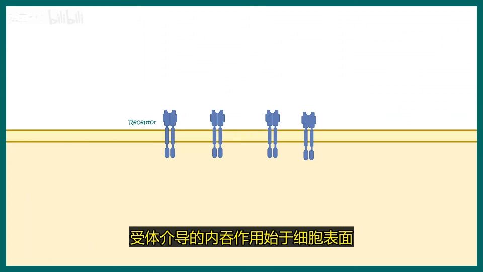
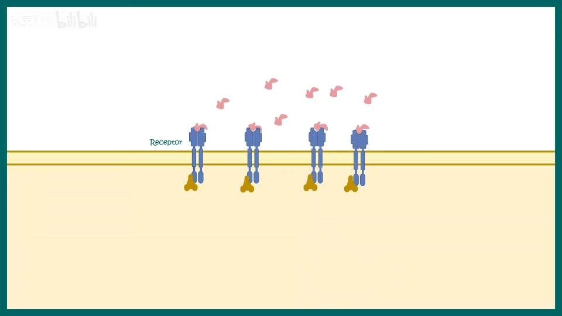
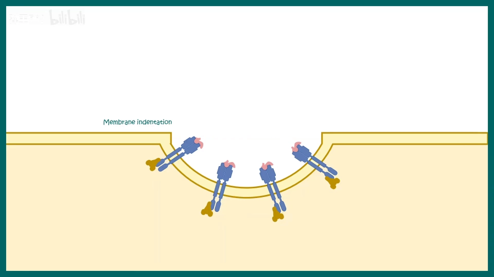
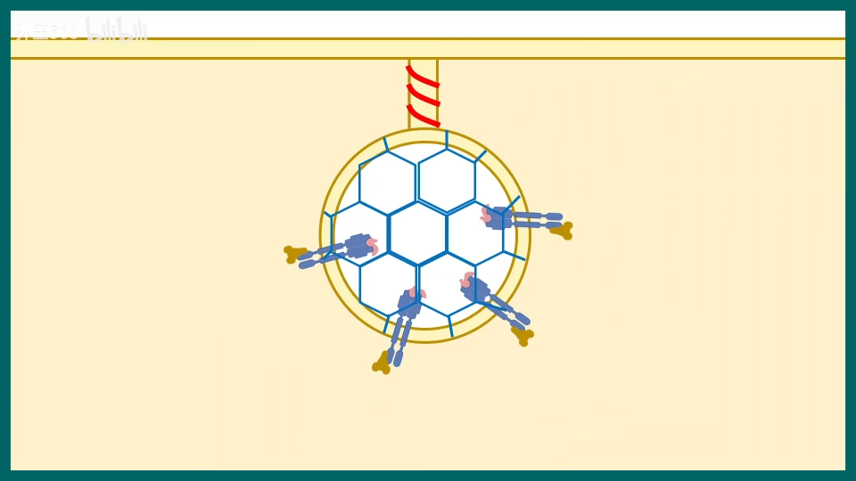
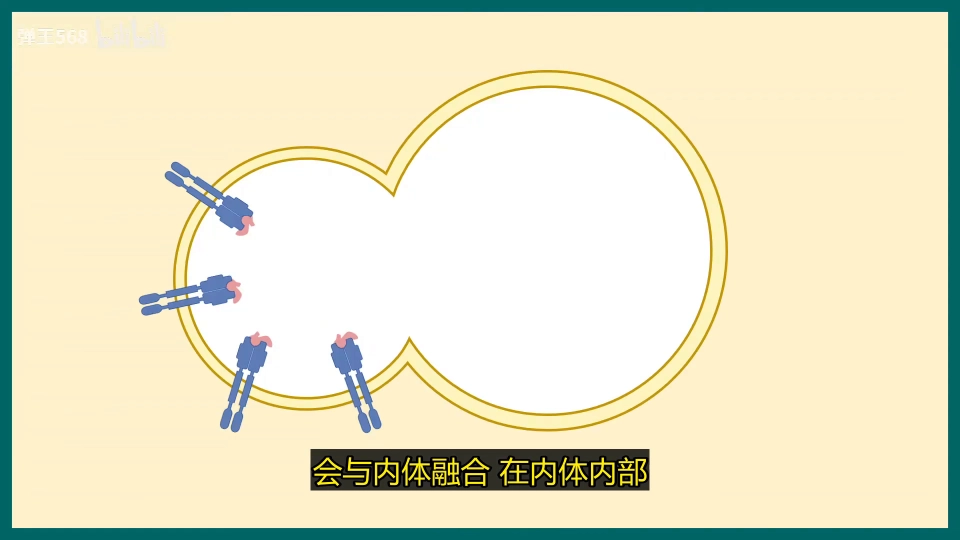
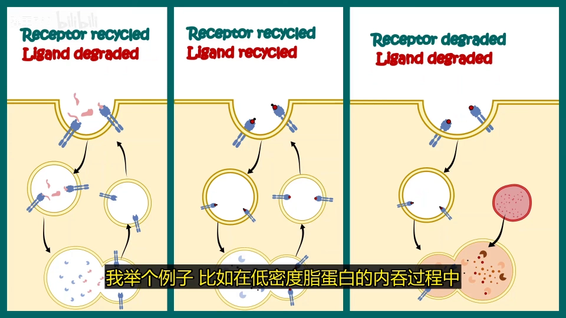

# 受体介导的内吞：网格蛋白包被、内体酸化与受体的三种去向

> 视频来源：[《受体介导的内吞怎么发生的？全过程精细动画拆解》](https://www.bilibili.com/video/BV1rqiiB8EHM/)（B 站 · 细胞生物学动画）｜时长 8:07，有效内容约 3 分 40 秒（其后为频道推广）
> 导读：这条动画把受体介导的内吞拆成"膜外结合 → 膜内包被 → 掐断 → 内体分拣"四段，最后用 LDL、转铁蛋白和 EGF 受体三个例子说明：同一条内吞路线，受体和配体可以走向完全不同的结局。

## 本讲要解决的核心问题（SCQA）

**背景**：细胞要从外界摄取胆固醇、铁等物质，但细胞外液里这些分子的浓度往往很低，靠"顺手喝一口"的胞饮根本不够。

**冲突**：如果细胞把整片细胞外液一起吞进来，效率极低；而如果随便吞，又可能把不需要的东西一起带进来。细胞需要一个"点名装车"的机制。

**疑问**：细胞怎样高效、特异地摄取某一种大分子？货物进入细胞后，受体是被一起消耗掉，还是能反复使用？

**回答（中心思想）**：细胞靠**受体介导的内吞**解决这个问题——质膜上的受体先特异结合配体，再招募**衔接蛋白**和**网格蛋白**在膜内侧装配成包被，由**发动蛋白**把囊泡从膜上掐断；囊泡与**内体**融合后，内体的低 pH 让配体与受体解离，随后受体和配体各自走向回收或降解。**受体回收还是降解，决定了细胞能否反复摄取同一种物质**。

---

## 一、内吞的三种类型

内吞作用指细胞把外界物质摄入内部。视频把它分成三类，本讲只讲其中的**受体介导的内吞**：

1. **受体介导的内吞**：由质膜上的特异性受体"点名"装载；
2. **吞噬作用**：吞入较大的颗粒；
3. **胞饮作用**：非特异性地摄入细胞外液及其中溶解物。

[【跳转到 00:07】](https://www.bilibili.com/video/BV1rqiiB8EHM/?t=7)

视频随后把镜头收窄到第一类，本讲余下部分都只讨论受体介导的内吞。

[【跳转到 00:16】](https://www.bilibili.com/video/BV1rqiiB8EHM/?t=16)

三者的关键区别在于**有没有受体做选择**。受体介导的内吞因此具有浓缩效应：细胞能摄入大量特定分子，而不必同时吞进大量细胞外液。

---

## 二、从结合到掐断：四步机械过程

[【跳转到 00:30】](https://www.bilibili.com/video/BV1rqiiB8EHM/?t=30)

### 2.1 受体结合配体，招募衔接蛋白

过程始于细胞表面。配体与质膜上的受体结合后，会在膜的**细胞质一侧**招募**衔接蛋白**（adaptin）。衔接蛋白是整个过程中承上启下的角色：它一头抓住受体，一头招募网格蛋白。

视频还提到一类 **BAR 家族蛋白**能诱导膜发生弯曲——这段在动画里没有画出来，但它是膜开始内陷的物理原因之一。

[【跳转到 00:35】](https://www.bilibili.com/video/BV1rqiiB8EHM/?t=35)

### 2.2 网格蛋白装配成包被

[【跳转到 00:55】](https://www.bilibili.com/video/BV1rqiiB8EHM/?t=55)

在衔接蛋白的协助下，**网格蛋白**在膜内侧组装起来，形成一层网格状包被，膜被拉成"包被小窝"并不断向内凹陷。此时膜内陷形成的结构叫**网格蛋白包被囊泡**。

网格蛋白的"网格"不是比喻：它由三腿状（triskelion）的单体自组装成多角形笼状结构，把膜塑形成球面。同节的《膜泡运输的分选信号与区室身份》给出了它的结构细节：三条腿各含一条重链和一条轻链，与 COPII 的 Sec13/31 复合物一样能自组装成网格。

[【跳转到 01:15】](https://www.bilibili.com/video/BV1rqiiB8EHM/?t=75)

### 2.3 发动蛋白把囊泡掐断

[【跳转到 01:35】](https://www.bilibili.com/video/BV1rqiiB8EHM/?t=95)

囊泡挂在膜上时，一种叫**发动蛋白（dynamin）**的蛋白会在囊泡颈部组装成环并收缩，把囊泡从质膜上"掐"下来。囊泡就这样被内化到细胞内部。

### 2.4 与内体融合

内化后的囊泡与**内体**融合。内体内部 pH 较低，配体因此在酸性环境中从受体上解离下来——这是整条路线的**分拣开关**。

[【跳转到 01:52】](https://www.bilibili.com/video/BV1rqiiB8EHM/?t=112)

---

## 三、内体：靠 pH 完成分拣的枢纽

内体不是"一个泡"，而是内吞路线上的分拣站。它的身份标志是**腔内低 pH**：质子泵把氢离子泵入腔内，酸性环境改变受体与配体的亲和力，使二者解离，从而让"货物"和"运货的工具"分开处理。

这一点与分泌方向上的分选逻辑完全一致：在《膜泡运输的分选信号与区室身份》里，KDEL 受体也是靠低 pH 结合、高 pH 释放来决定货物是被回收还是被送走。**pH 是区室身份的一部分，也是分拣信号的一部分。**

---

## 四、受体与配体的三种去向

配体解离之后，受体和配体的命运可以分开。视频给出三种组合：

[【跳转到 02:11】](https://www.bilibili.com/video/BV1rqiiB8EHM/?t=131)

| 去向 | 代表例子 | 结果 |
| --- | --- | --- |
| 受体回收，配体降解 | 低密度脂蛋白（LDL） | 受体循环回细胞表面继续用，LDL 颗粒被送往降解 |
| 受体与配体都回收 | 转铁蛋白（运铁） | 两者一起回到细胞表面，都被循环利用 |
| 受体与配体都降解 | 表皮生长因子受体（EGFR） | 受体被消耗，信号随之终止 |

[【跳转到 02:31】](https://www.bilibili.com/video/BV1rqiiB8EHM/?t=151)

三个例子说明同一件事：**内吞不只是"进货"，也是"关信号"的手段**。EGFR 被内吞后连同配体一起降解，正是 EGF 信号传导被下调的机制之一——如果受体只回收不降解，信号就会持续。

[【跳转到 03:11】](https://www.bilibili.com/video/BV1rqiiB8EHM/?t=191)

> 待核对：视频在讲 LDL 时说 LDL 颗粒"在内体中被消化掉"。更常见的表述是内体把配体分拣后送往**溶酶体**，由溶酶体的水解酶完成降解；内体主要负责解离与分拣。此处以视频原意为准记录，具体区室归属以教材为准。

---

## 五、边界与常见误解

1. **内吞不等于"细胞喝水"**。受体介导的内吞有选择性，与胞饮、吞噬是并列的三种类型，不能混用。
2. **网格蛋白不是唯一的内吞方式**。本讲只覆盖网格蛋白依赖的受体介导内吞；细胞还有其他不依赖网格蛋白的内吞途径，视频未涉及。
3. **受体回收率决定细胞"复用"能力**。LDL 受体能循环使用，所以一次合成可以反复运货；受体若被降解，细胞必须重新合成。
4. **内体不是终点**。内体是分拣站，货物最终去溶酶体降解、去细胞膜回收，或进入其他区室。
5. **发动蛋白掐断需要能量**。它是一个 GTP 酶，靠水解 GTP 驱动构象改变完成掐断；这不是"被动断开"。

---

## 小结

- 内吞分受体介导的内吞、吞噬与胞饮三类，本讲只讲第一类。
- 受体介导的内吞四步：受体结合配体 → 衔接蛋白招募网格蛋白 → 网格蛋白装配成包被 → 发动蛋白掐断 → 与内体融合。
- 内体的**低 pH** 让配体与受体解离，是分拣的关键开关。
- 受体与配体有**三种去向**：受体回收/配体降解（LDL）、两者都回收（转铁蛋白）、两者都降解（EGFR）。
- 内吞同时承担"进货"和"关信号"两种功能。

## 关键术语

| 术语 | 含义 |
| --- | --- |
| 受体介导的内吞 | 由质膜特异性受体选择性地摄入配体的内吞方式 |
| 衔接蛋白（adaptin） | 连接受体与网格蛋白、决定哪些货物被包装的接头蛋白 |
| 网格蛋白（clathrin） | 在膜内侧自组装成网格笼、把膜塑形成囊泡的包被蛋白 |
| 发动蛋白（dynamin） | 在囊泡颈部组装成环并收缩、完成掐断的 GTP 酶 |
| 内体（endosome） | 内吞路线上的分拣区室，腔内 pH 偏低 |
| BAR 家族蛋白 | 能诱导膜弯曲的蛋白家族 |