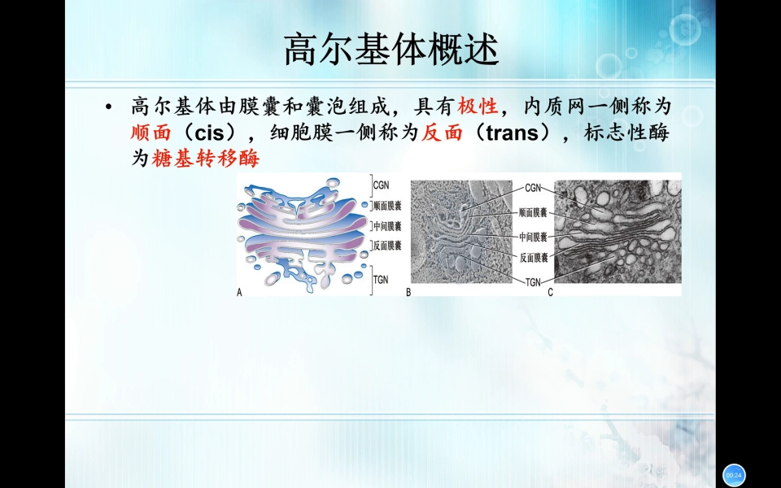
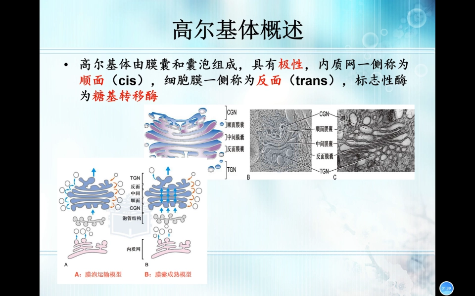
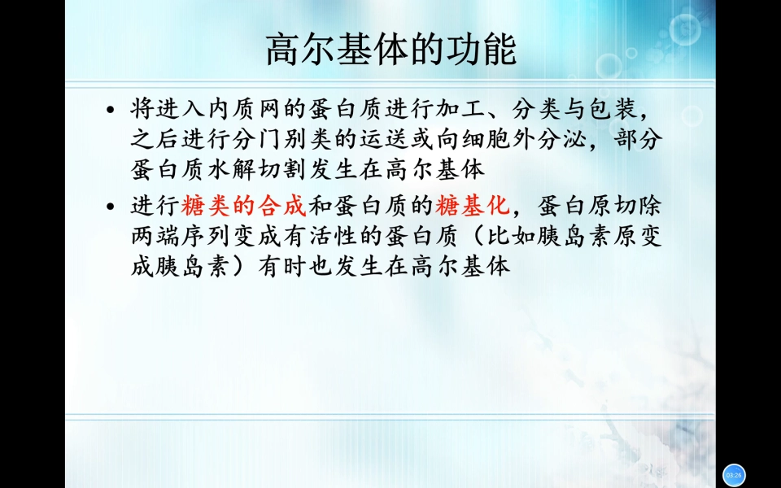
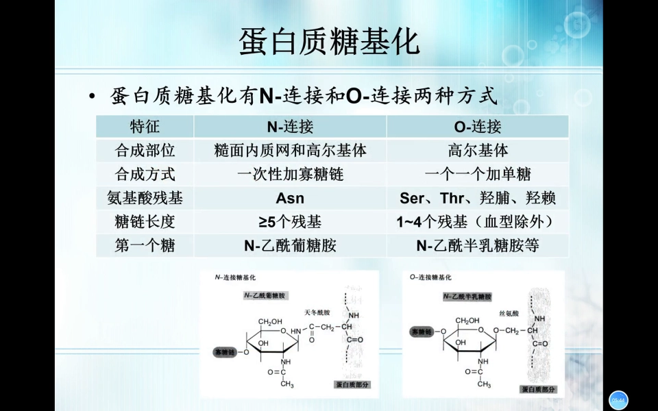
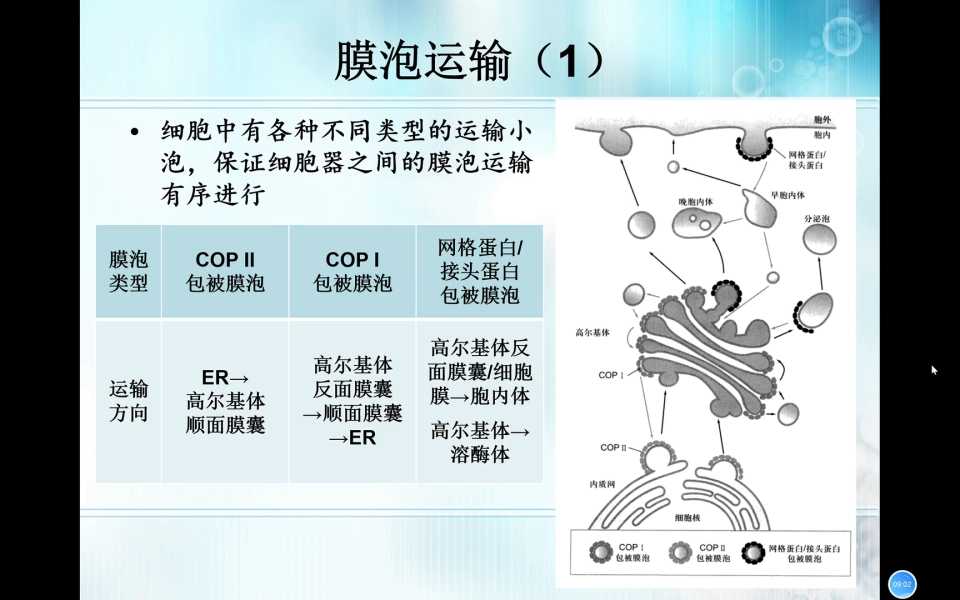
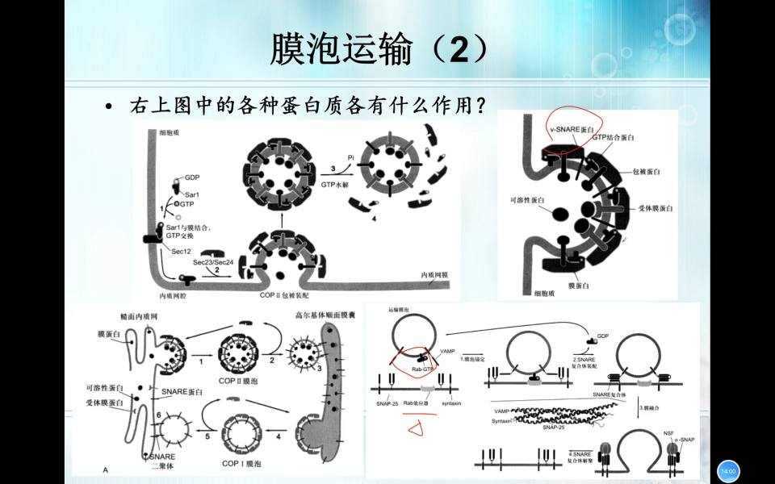

# 高尔基体与膜泡运输：糖基化、三类包被囊泡与停靠融合

> 视频来源：[《生物竞赛难点119-细胞生物学-高尔基体与膜泡运输》](https://www.bilibili.com/video/BV1TVZdYREmq/)（B 站 · 生物竞赛细胞生物学）｜时长 14:51
> 导读：这堂课从高尔基体的极性讲起，先解决"高尔基体怎么成熟、在里面做什么加工"，再转向膜泡运输：三类包被囊泡各走哪个方向、COPII 囊泡怎样装配和脱包被、最后靠 Rab 与 SNARE 停靠并融合。

## 本讲要解决的核心问题（SCQA）

**背景**：内质网上附着核糖体合成的蛋白，要先进入内质网腔，再送往高尔基体，最后分到溶酶体、细胞膜或细胞外。这条路线上的每一步都由囊泡完成。

**冲突**：囊泡如果只是"随机出芽、随机融合"，细胞内的膜成分很快会被搅成一锅粥——内质网的蛋白跑到溶酶体，溶酶体的酶跑到细胞膜。真实细胞里没有发生这种混乱，说明囊泡本身带着"方向"和"目的地"的信息。

**疑问**：高尔基体在蛋白出厂前做了什么加工？囊泡靠什么区分方向？一个囊泡从出芽到与靶膜融合，中间要经过哪些步骤？

**回答（中心思想）**：囊泡的方向由**包被蛋白的类型**决定——COPII 只走"内质网→高尔基体"的顺向，COPI 只走"高尔基体→内质网"的逆向，网格蛋白/接头蛋白包被囊泡负责高尔基体与细胞膜、内体、溶酶体之间的双向运输；囊泡到达后再由 **Rab 蛋白**铆钉到正确的靶膜、由 **v-SNARE 与 t-SNARE 配对**完成融合。高尔基体则是这条流水线上的加工与分选中枢：水解切割、N-/O- 糖基化都在这里发生。

---

## 一、高尔基体的极性：顺面、反面与标志酶

高尔基体和内质网一样是单层膜细胞器，也常被算作细胞内膜系统的一部分。但两者有一处关键差别：**内质网的膜是连续的，高尔基体的膜不连续**——它由一叠扁平的**膜囊**加上周围许多小囊泡组成。

[【跳转到 00:25】](https://www.bilibili.com/video/BV1TVZdYREmq/?t=25)

这种不连续带来了**极性**：

- **顺面（cis）**：靠近内质网的一侧，接收来自内质网的囊泡；
- **反面（trans）**：靠近细胞膜的一侧，是货物被分选、打包发出的地方；
- 从顺面到反面叫**顺向运输**，从反面回到顺面叫**反向运输**。

每个区室都有自己的"身份证"。高尔基体的标志性酶是**糖基转移酶**：破碎细胞提取膜成分时，测到这个酶就能判断哪些膜来自高尔基体。视频还提到，高尔基体不同区域的膜囊各有自己的标志酶或标志性化学反应。

[【跳转到 00:50】](https://www.bilibili.com/video/BV1TVZdYREmq/?t=50)

### 1.1 高尔基体怎么"成熟"：两套模型

高尔基体的膜囊不是天生就有五六层，它们是从内质网来的膜逐步堆出来的。视频介绍了两套模型：

[【跳转到 01:15】](https://www.bilibili.com/video/BV1TVZdYREmq/?t=75)

- **膜泡运输模型**：各层膜囊位置固定，第一层由内质网出芽形成；第一层产生囊泡把膜送给第二层，第二层再送给第三层……反向运输则从第五层逐层往回送。
- **膜囊成熟模型**：内质网不断形成新膜囊，新膜囊永远是最靠顺面的第一层，原来的第一层被"推"向反面变成第二层，老膜囊最终成为反面膜囊；需要反向运输的物质仍靠囊泡送回。

两套模型描述的是同一批观察事实的不同解释，视频没有断言哪一套绝对正确。读文献时看到"高尔基体成熟"的争论，指的就是这件事。

[【跳转到 02:30】](https://www.bilibili.com/video/BV1TVZdYREmq/?t=150)

---

## 二、高尔基体在蛋白出厂前做什么

高尔基体最主要的功能是**对进入膜系统的蛋白进行加工、分类、包装，再分门别类地运走或分泌出去**。

[【跳转到 03:02】](https://www.bilibili.com/video/BV1TVZdYREmq/?t=182)

### 2.1 水解切割：胰岛素原变成胰岛素

最典型的例子是胰岛素。它刚合成时是一条完整的肽链，叫**胰岛素原**；到达高尔基体后，肽链中间的一段被切掉，剩下的部分形成由**两条肽链**组成的成熟胰岛素，随后被分泌出细胞。

这说明"合成了肽链"不等于"得到了有活性的蛋白"——**切割本身就是激活步骤**。视频还提到，蛋白原被切掉两端序列变成活性蛋白，有时也发生在高尔基体。

[【跳转到 03:52】](https://www.bilibili.com/video/BV1TVZdYREmq/?t=232)

### 2.2 糖基化：给蛋白挂上糖链

糖基化是在氨基酸残基上接上寡糖。它的功能可以从两个角度看：

- **功能上**：糖链是信息交流的载体——细胞膜上的受体绝大多数是糖蛋白；
- **结构上**：糖链影响蛋白的水溶性、带电性质，从而**促进折叠、增强稳定性**。

视频特别指出：糖链本身是一种"信息信号"，因此**可以作为蛋白分选的标志**，介导蛋白的分选与包装。这一点在后文的溶酶体酶分选中会再次出现。

[【跳转到 04:17】](https://www.bilibili.com/video/BV1TVZdYREmq/?t=257)

糖基化分两种方式，差别不只是"接在哪个氨基酸上"：

[【跳转到 05:45】](https://www.bilibili.com/video/BV1TVZdYREmq/?t=345)

| 特征 | N-连接 | O-连接 |
| --- | --- | --- |
| 合成部位 | 糙面内质网和高尔基体 | 高尔基体 |
| 合成方式 | 一次性加上整条寡糖链 | 一个一个加单糖 |
| 氨基酸残基 | 天冬酰胺（Asn） | 丝氨酸、苏氨酸、羟脯氨酸、羟赖氨酸 |
| 糖链长度 | 较长（≥5 个残基） | 较短（1–4 个残基，血型糖蛋白例外） |
| 第一个糖 | N-乙酰葡糖胺 | N-乙酰半乳糖胺等 |

为什么叫 N-连接和 O-连接？看连接键：N-连接的键涉及**氮原子**（酰胺基团），所以接在天冬酰胺上；O-连接的键涉及**氧原子**，所以需要侧链能提供**羟基**的氨基酸。

两者还有一个常被忽略的差别：**N-连接在糙面内质网就开始了**，到高尔基体继续修剪和加工；**O-连接只在高尔基体发生**。这正好解释了为什么"内质网和高尔基体都能糖基化，但高尔基体的糖基化更主要"。

[【跳转到 07:00】](https://www.bilibili.com/video/BV1TVZdYREmq/?t=420)

此外高尔基体还能合成糖类，并把内质网合成的脂质运往细胞膜、溶酶体等目的地。

[【跳转到 05:07】](https://www.bilibili.com/video/BV1TVZdYREmq/?t=307)

---

## 三、三类包被囊泡决定方向

膜泡运输是高尔基体最主要的功能之一。视频用了一个很贴切的比喻：囊泡像航班，**不同类型的囊泡只能飞某一个方向**，不会乱来。

[【跳转到 09:03】](https://www.bilibili.com/video/BV1TVZdYREmq/?t=543)

区分囊泡类型的标准，是**囊泡外面包被着哪一类蛋白**：

| 包被类型 | 运输方向 | 承担的功能 |
| --- | --- | --- |
| **COPII** | 内质网 → 高尔基体顺面膜囊（顺向） | 把新合成的货物送出内质网 |
| **COPI** | 高尔基体反面膜囊 → 顺面膜囊 → 内质网（逆向） | 回收逃逸的内质网驻留蛋白、折叠错误的蛋白 |
| **网格蛋白/接头蛋白** | 高尔基体反面 ↔ 细胞膜、细胞膜 → 胞内体、高尔基体 → 溶酶体 | 分泌泡与内吞泡的形成，双向 |

[【跳转到 09:28】](https://www.bilibili.com/video/BV1TVZdYREmq/?t=568)

注意 COPI 的逆向运输不是"倒车浪费油"，它承担两件事：**把不该离开内质网的驻留蛋白抓回来**，以及**回收折叠错误的蛋白**。没有这条回收线，内质网里的分子伴侣和折叠酶会被不断冲走。

[【跳转到 09:53】](https://www.bilibili.com/video/BV1TVZdYREmq/?t=593)

网格蛋白包被囊泡则贯穿两个方向：既从高尔基体反面运往胞内体、溶酶体，也从细胞膜把内吞物运进胞内体。**同一个包被类型可以跑两个方向**，方向由起点和货物决定，而不是包被单独决定——这是理解"方向性"时最容易混淆的地方。

[【跳转到 10:18】](https://www.bilibili.com/video/BV1TVZdYREmq/?t=618)

---

## 四、一个 COPII 囊泡的一生

视频以 COPII 为例，把囊泡的一生拆成四步：装配 → 出芽运输 → 脱包被 → 停靠融合。

[【跳转到 11:06】](https://www.bilibili.com/video/BV1TVZdYREmq/?t=666)

### 4.1 装配：从 Sar1 开始

装配的起点是一种叫 **Sar1** 的小分子 GTP 结合蛋白。它在鸟苷酸交换因子 **Sec12** 的帮助下把 GDP 换成 GTP，构象改变后插入内质网膜；随后 Sar1 起**招募**作用，把 **Sec23/Sec24** 召到膜上，形成包被。

Sec23/Sec24 有两个本领：

1. **自组装**：越聚越多，把膜拉成芽体，这是包被的骨架；
2. **结合受体**：与内质网膜上的受体结合，而受体又能结合腔内需要运输的分子——货物就是这样被"挑"进囊泡的。

[【跳转到 11:31】](https://www.bilibili.com/video/BV1TVZdYREmq/?t=691)

此时囊泡膜上已经带上了 **v-SNARE**。视频在这里特意留了个伏笔："暂时好像没什么用"——它要等到停靠阶段才登场。

[【跳转到 11:56】](https://www.bilibili.com/video/BV1TVZdYREmq/?t=716)

### 4.2 运输与脱包被

囊泡形成后向内质网→高尔基体方向移动。视频用一句话交代了运输段：**方向由细胞骨架控制**（马达蛋白的细节属于细胞骨架一节，这里不展开）。

运输一段时间后，Sar1、Sec23/Sec24 会从囊泡上解下来，即**脱包被**。脱下来的包被蛋白回到细胞质基质，再到内质网膜上参加下一轮装配——包被是**可循环使用的零件**，不是一次性消耗品。

[【跳转到 12:21】](https://www.bilibili.com/video/BV1TVZdYREmq/?t=741)

脱包被还有一个副作用：包被挡住的 v-SNARE 因此暴露出来，为下一步融合做好准备。

[【跳转到 12:46】](https://www.bilibili.com/video/BV1TVZdYREmq/?t=766)

### 4.3 停靠：Rab 当引导员

囊泡接近靶膜时，靶膜附近有一种叫 **Rab** 的蛋白。它结合在膜泡上，再与靶膜上的 **Rab 效应器**结合，把囊泡"铆"在正确的位置上。视频的比喻是机场引导员：**Rab 决定停在哪块膜上**。

[【跳转到 13:11】](https://www.bilibili.com/video/BV1TVZdYREmq/?t=791)

### 4.4 融合：SNARE 配对

铆钉只是"停住"，还需要"贴紧"。这时前面埋下的 v-SNARE 发挥作用：囊泡膜上的 **v-SNARE** 与靶膜上的蛋白共同形成 **SNARE 复合体**，把两层膜拉到足够近，完成膜融合。融合完成后 SNARE 复合体解聚，囊泡膜成为靶膜的一部分。

[【跳转到 14:01】](https://www.bilibili.com/video/BV1TVZdYREmq/?t=841)

至此，一个囊泡完成了它的使命：**包被决定它从哪里出发、往哪个方向走；Rab 和 SNARE 决定它停在哪里、和谁融合**。

---

## 五、边界与常见误解

1. **"囊泡运输 = 分泌"不成立**。囊泡同时承担分泌、内吞、胞内区室之间的物质交换；本节只展开了分泌方向的前半段，内吞路线见同节的《受体介导的内吞：网格蛋白包被、内体酸化与受体的三种去向》。
2. **包被类型不等于方向**。COPII 与 COPI 的方向是固定的，但网格蛋白包被囊泡可以跑双向；判断方向要看起点和货物，不能只看包被。
3. **高尔基体成熟机制仍有争议**。膜泡运输模型与膜囊成熟模型并存，视频没有给出裁决，不宜把其中一套当成定论。
4. **糖基化不只是"修饰"**。它同时影响折叠、稳定性、识别，并且糖链本身可以作为分选信号。
5. **共翻译转运的细节不在本讲**。蛋白如何凭 N 端信号肽、SRP 和转位子进入内质网腔，见 [《翻译如何发生：从密码子到多肽链的分子流水线》](../../../2_遗传信息流与中心法则/2.2_从基因到产物/2.2.5_翻译：核糖体、mRNA%20与多肽合成/翻译如何发生：从密码子到多肽链的分子流水线.md) 第五节。

---

## 小结

- 高尔基体是**极性**细胞器：顺面接货、反面发货，标志酶是糖基转移酶；成熟机制有膜泡运输模型与膜囊成熟模型两套解释。
- 高尔基体的加工包括**水解切割**（胰岛素原→胰岛素）与**糖基化**（N-连接从内质网开始、O-连接只在高尔基体），糖链还能当分选信号。
- 囊泡按**包被蛋白**分三类：COPII 顺向、COPI 逆向回收、网格蛋白/接头蛋白双向。
- 一个 COPII 囊泡的一生：Sar1–Sec12 启动装配 → Sec23/Sec24 自组装并招募货物 → 脱包被 → Rab 铆钉 → SNARE 配对融合。
- 方向性与目的地由**包被 + Rab + SNARE** 三层信息共同保证。

## 关键术语

| 术语 | 含义 |
| --- | --- |
| 顺面 / 反面（cis / trans） | 高尔基体靠近内质网 / 靠近细胞膜的一侧 |
| 糖基转移酶 | 高尔基体的标志酶 |
| COPII | 内质网→高尔基体顺向运输的包被蛋白 |
| COPI | 高尔基体→内质网逆向运输、负责回收的包被蛋白 |
| Sar1 | COPII 装配的开关蛋白，GTP 结合型插入内质网膜 |
| Sec12 | Sar1 的鸟苷酸交换因子 |
| v-SNARE / t-SNARE | 囊泡膜 / 靶膜上的 SNARE，配对后驱动膜融合 |
| Rab | 决定囊泡与哪块靶膜铆钉的小分子 GTP 结合蛋白 |
| N-连接 / O-连接糖基化 | 接在天冬酰胺 / 丝氨酸、苏氨酸等羟基氨基酸上的糖链 |