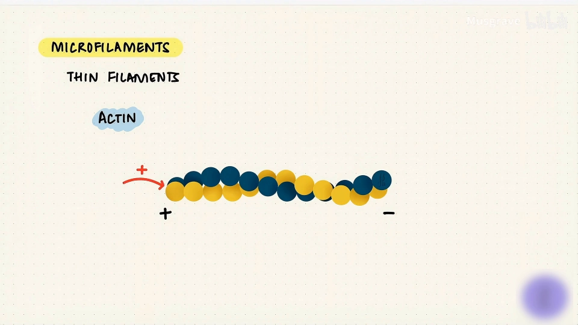
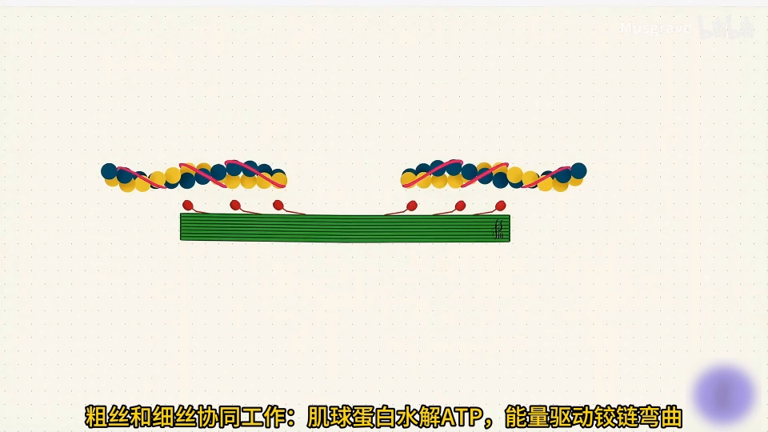
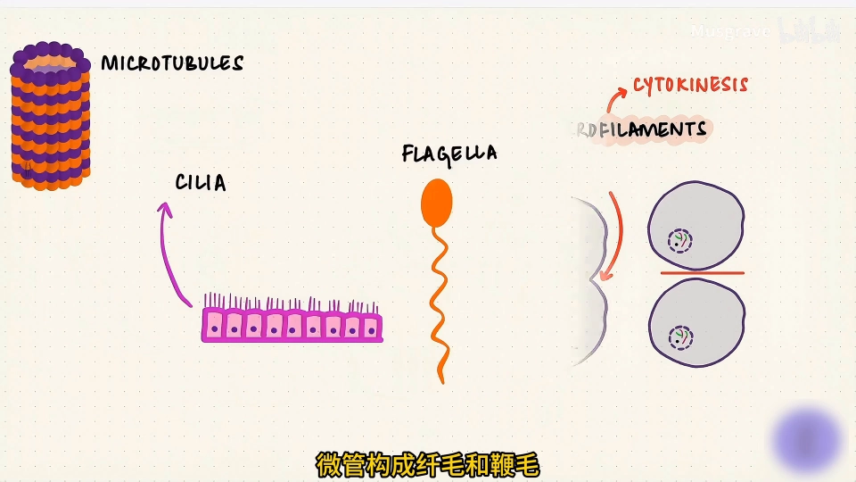
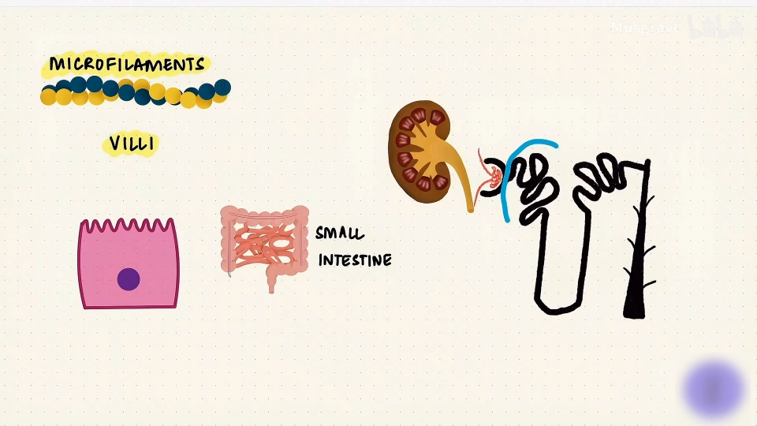
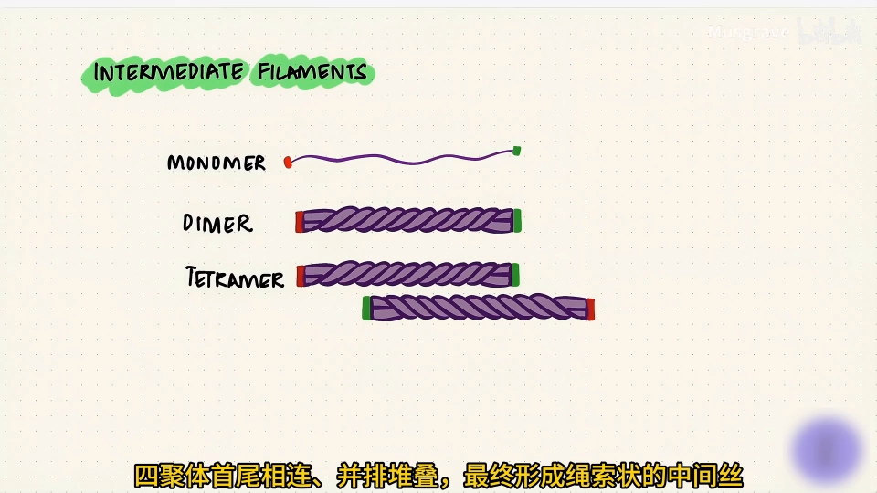

# 微丝与中间丝：微绒毛、伪足、收缩环与无极性支撑

> 视频来源：[《细胞的结构与功能：细胞骨架（2）》](https://www.bilibili.com/video/BV1uzjt6MEiX/)（B 站 · Musgrave）｜时长 6:09
> 导读：这是细胞骨架两集动画讲解的第二集，通过与微管对比讲微丝和中间丝。前半段是微丝：极性、ATP 依赖的踏车、肌球蛋白，以及微绒毛、伪足、收缩环、皮层四个“形态学用途”；后半段是中间丝：装配层级、无极性，以及五种组织特异的中间丝蛋白。第一集讲微管与轴突运输，见本小节《微管：中空管、动态不稳定性与轴突运输》。

## 本讲要解决的核心问题（SCQA）

**背景**：上一集已经知道，微管是细胞里最粗的骨架纤维，构成纺锤丝、纤毛和鞭毛，并作为驱动蛋白与动力蛋白的轨道。

**冲突**：但细胞还要做微管做不到的事：上皮细胞要把吸收面积扩大几十倍，白细胞要挤出伪足爬向炎症部位，分裂末期的细胞要把自己从中间掐断。这些动作都不是“轨道运输”，而是形状的局部改变与收缩。

**疑问**：这些形变由哪种骨架纤维完成？它和微管在结构与动态性上有什么本质区别？为什么另有一类纤维专门负责“抗拉”？

**回答（中心思想）**：形变由**微丝**完成——肌动蛋白双股螺旋、有极性、结合 ATP，与肌球蛋白配合产生收缩，并通过在细胞皮层、微绒毛、伪足、收缩环中的不同排布，实现撑、收、伸、掐四种动作。而**中间丝**是另一套逻辑：二聚体反向平行组成四聚体，因此**没有极性**、没有动态不稳定性，只提供抗剪切的支撑，并按细胞类型更换蛋白种类。

---

## 一、先与微管对一次账

视频先快速回顾微管，作为对比的基准：

- 由 α 和 β 微管蛋白组成异二聚体；
- 具有正极端和负极端的极性；
- 表现出**动态不稳定性**，通过聚合与解聚来组装和拆卸，正极端比负极端更活跃；
- 这一过程涉及 **GTP**；
- 构成纤毛和鞭毛，借助驱动蛋白和动力蛋白运输细胞器，并在细胞分裂中形成纺锤丝。

[【跳转到 00:38】](https://www.bilibili.com/video/BV1uzjt6MEiX/?t=38)

带着这份清单看微丝，就能看出两处关键差异：**单体换成了肌动蛋白、核苷酸换成了 ATP**；而“有没有极性”这一条，到中间丝时会彻底反过来。

---

## 二、微丝：三种纤维里最细的那一类

### 2.1 组成与极性

微丝在三组中直径最小，约 7 nm，也称**细丝**，由**肌动蛋白**构成——所以微丝又叫肌动蛋白丝。肌动蛋白这个名字听起来耳熟，因为我们在肌肉收缩中学过它和肌球蛋白。

微丝的单体亚基是**球状肌动蛋白**（G-actin）。与微管结合 GTP 不同，肌动蛋白结合 **ATP**。单体聚合形成螺旋状细丝，电镜下呈双股螺旋，外观与微管一样。

[【跳转到 01:59】](https://www.bilibili.com/video/BV1uzjt6MEiX/?t=119)

微丝同样**有极性**，有正极端和负极端：结合 ATP 时新亚基主要添加到**正极端**，ATP 水解为 ADP 后亚基从**负极端**脱落。因此微丝可以伸长或缩短；若添加与脱落速率相同，则长度不变。这种聚合与解聚使纤丝得以动态重塑。

### 2.2 肌球蛋白：微丝上的马达

肌动蛋白丝与**肌球蛋白**关联。肌球蛋白是分子马达蛋白，骨骼肌中主要是 **II 型肌球蛋白**。它的分子由头部和尾部构成，中间以铰链连接；ATP 水解时铰链弯曲。两个分子反向平行缠绕堆叠，最终形成**粗丝**；反向平行排列使粗丝中央形成**裸区**（仅含尾部），而肌球蛋白头部从裸区两侧向外伸出。

[【跳转到 02:53】](https://www.bilibili.com/video/BV1uzjt6MEiX/?t=173)

粗丝和细丝协同工作：肌球蛋白水解 ATP 释放能量，驱动铰链弯曲，拉动肌动蛋白细丝向内滑行，这就是肌肉中肌节缩短、肌肉收缩的原理。因此微丝对肌肉收缩至关重要。（滑动丝的完整动力学不在本节展开，这里只需记住：**微丝是轨道，肌球蛋白是马达，ATP 是能量来源**。）

### 2.3 四个“形态学用途”

微丝的价值在于同一根纤维换一种排布就能换一种功能。视频给了四个例子，正好覆盖“撑、收、伸、掐”：

**（1）伪足：伸出去爬**

除了肌肉收缩，巨噬细胞等也借助肌动蛋白和肌球蛋白丝迁移至炎症部位；这些纤丝参与**伪足**形成和细胞运动。伪足是细胞前缘伸出的片状或指状突起，由这些纤丝参与形成，是细胞运动的结构基础。

[【跳转到 03:16】](https://www.bilibili.com/video/BV1uzjt6MEiX/?t=196)

**（2）收缩环：把细胞掐断**

微管在细胞分裂中形成纺锤丝、帮助分离染色体；但有丝分裂的最后一步——**胞质分裂**由微丝完成。它们收缩形成**分裂沟**，将细胞一分为二。因此微丝是胞质分裂所必需的。

[【跳转到 03:47】](https://www.bilibili.com/video/BV1uzjt6MEiX/?t=227)

这张图把两集的内容接在一起：**微管负责“分家产”（染色体），微丝负责“分家”（胞质）**。同一张图左侧是纤毛与鞭毛，也是微管的产物——两类纤维在同一细胞里各管一段。

**（3）微绒毛：把面积放大**

微管构成纤毛和鞭毛，而**微绒毛含有微丝**。微绒毛是某些部位上皮细胞顶面的指状凸起，作用是增大表面积，因此在吸收旺盛的区域特别有用，如小肠和肾小管。

[【跳转到 04:08】](https://www.bilibili.com/video/BV1uzjt6MEiX/?t=248)

注意区分：**纤毛（微管，会摆动）**与**微绒毛（微丝，不摆动，只增大面积）**外形相似但机制完全不同。这是本节最容易出错的一处对照。

**（4）细胞皮层：撑住整张膜**

微丝更多分布于**细胞皮层**，为细胞提供强度和支撑，并参与细胞间的紧密连接。皮层是紧贴质膜下方的一层微丝网络；它给细胞膜提供强度与支撑，也是细胞迁移、分裂时改变形状的“可变形外壳”。

### 2.4 一句话记住两组丝的对应

记住：**细丝即微丝，由肌动蛋白构成；粗丝即肌球蛋白丝。**

[【跳转到 04:21】](https://www.bilibili.com/video/BV1uzjt6MEiX/?t=261)

---

## 三、中间丝：没有极性，所以只负责抗拉

### 3.1 名字来自直径

中间丝得名于直径：它介于细丝（微丝）和粗丝（肌球蛋白丝）之间，约 **8 至 10 nm**。同样由单体组成，但装配方式与另外两类不同：

1. 单体形成**二聚体**；
2. 二聚体**反向平行**排列形成**四聚体**；
3. 四聚体首尾相连、并排堆叠，最终形成**绳索状**的中间丝。

[【跳转到 04:50】](https://www.bilibili.com/video/BV1uzjt6MEiX/?t=290)

第 2 步的“反向平行”是关键：四聚体里两个二聚体方向相反，纤维两端就完全对称。于是与另外两组不同，**中间丝没有极性，也不具动态不稳定性**。

这解释了一个常见困惑——为什么中间丝“不能当轨道”？因为马达蛋白需要方向，而中间丝两端一样，没有“正端”可走。**没有极性，就没有定向运输，也没有踏车式重塑。**

### 3.2 分布：辐射贯穿细胞质

中间丝辐射贯穿细胞质，形成支架，对结构支撑至关重要。它们不集中在某一处，而是从核周向外铺满整个细胞质，这也符合它“抗拉网”的角色。

### 3.3 不同细胞换不同的中间丝蛋白

中间丝最特别的一点是**组织特异性**：不同细胞有不同类型的中间丝。

| 细胞类型 | 中间丝蛋白 | 视频中的定位 |
| --- | --- | --- |
| 肌肉细胞 | 结蛋白（desmin） | 肌肉中的中间丝 |
| 成纤维细胞 | 波形蛋白（vimentin） | 成纤维细胞中的中间丝 |
| 神经元 | 神经丝（neurofilament） | 支撑轴突结构 |
| 细胞核 | 核纤层蛋白（lamin） | 衬于核膜内侧，维持核形态并支撑核膜 |
| 上皮细胞 | 角蛋白（keratin） | 赋予皮肤、毛发、指甲强度，锚定于桥粒与半桥粒 |

[【跳转到 05:08】](https://www.bilibili.com/video/BV1uzjt6MEiX/?t=308)

其中角蛋白最容易记：角蛋白丝赋予皮肤、毛发和指甲强度，并锚定于**桥粒**和**半桥粒**，分别介导细胞间黏附和细胞与基质间的黏附。

[【跳转到 05:50】](https://www.bilibili.com/video/BV1uzjt6MEiX/?t=350)

“不同细胞换不同蛋白”这一点本身就是中间丝的判据：它不像微管、微丝那样在几乎所有细胞里用同一套单体，而是随细胞类型换零件。因此读组织切片或做细胞鉴定时，中间丝蛋白的种类常常比“有没有中间丝”更有信息量。

（桥粒、半桥粒的结构与连接类型属于 [1.3.5 细胞连接、黏附与细胞外基质](../../../README.md#b01-1-3-5) 的范围，本节只到“中间丝锚定在连接处”为止。）

---

## 四、三者的分工可以压成三句话

- **微管**：最粗、有极性、GTP 依赖的动态不稳定性；当梁（纺锤体、纤毛）也当轨道（驱动蛋白、动力蛋白）。
- **微丝**：最细、有极性、ATP 依赖的踏车；与肌球蛋白配合，负责撑（皮层）、伸（伪足）、收（收缩环）、扩（微绒毛）。
- **中间丝**：中等直径、**无极性**、最稳定；按细胞类型换蛋白，负责抗剪切与机械支撑。

---

## 小结

- 微丝直径最小（约 7 nm），单体是结合 ATP 的球状肌动蛋白，聚合为双股螺旋，有正负端；正端加、负端减，速率相等时长度不变。
- 肌球蛋白是微丝上的马达：II 型肌球蛋白形成粗丝，头部水解 ATP 使铰链弯曲，拉动细丝滑行，这是肌肉收缩的基础。
- 微丝的四个形态学用途：伪足（迁移）、收缩环（胞质分裂）、微绒毛（放大吸收面积）、细胞皮层（膜下支撑与张力）。
- 纤毛用微管、微绒毛用微丝，外形相似但机制不同，不要混。
- 中间丝由二聚体反向平行组成四聚体，因此无极性、无动态不稳定性；辐射贯穿细胞质，提供抗拉支撑。
- 中间丝蛋白具组织特异性：结蛋白、波形蛋白、神经丝、核纤层蛋白、角蛋白；角蛋白锚定于桥粒与半桥粒。

## 关键术语速查

| 术语 | 一句话解释 |
| --- | --- |
| 微丝 | 由肌动蛋白组成的双股螺旋纤维，直径约 7 nm，有极性 |
| G-actin | 球状肌动蛋白单体，结合 ATP，是微丝的组装单位 |
| 肌球蛋白 | 微丝上的马达蛋白，头部水解 ATP 使铰链弯曲产生拉力 |
| 伪足 | 细胞迁移时前缘伸出的突起，由局部微丝聚合推动 |
| 收缩环 | 胞质分裂时由微丝与肌球蛋白组成的环，收缩形成分裂沟 |
| 微绒毛 | 上皮细胞顶面的指状凸起，内含微丝束，用于增大表面积 |
| 细胞皮层 | 质膜下方的微丝网络，提供膜的张力和支撑 |
| 中间丝 | 直径 8–10 nm、无极性、最稳定的骨架纤维，提供抗拉支撑 |
| 桥粒／半桥粒 | 角蛋白丝锚定的细胞连接结构，分别介导细胞间与细胞—基质黏附 |