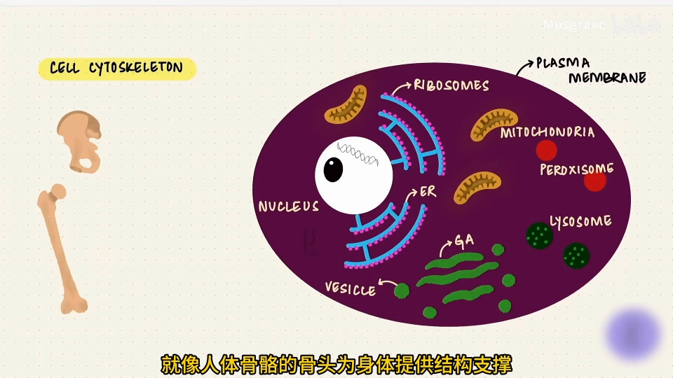
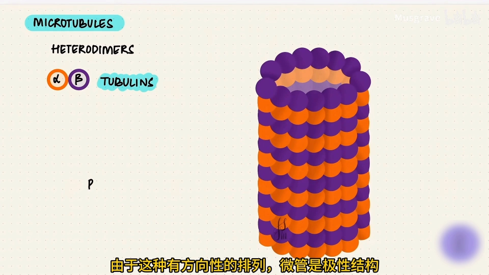
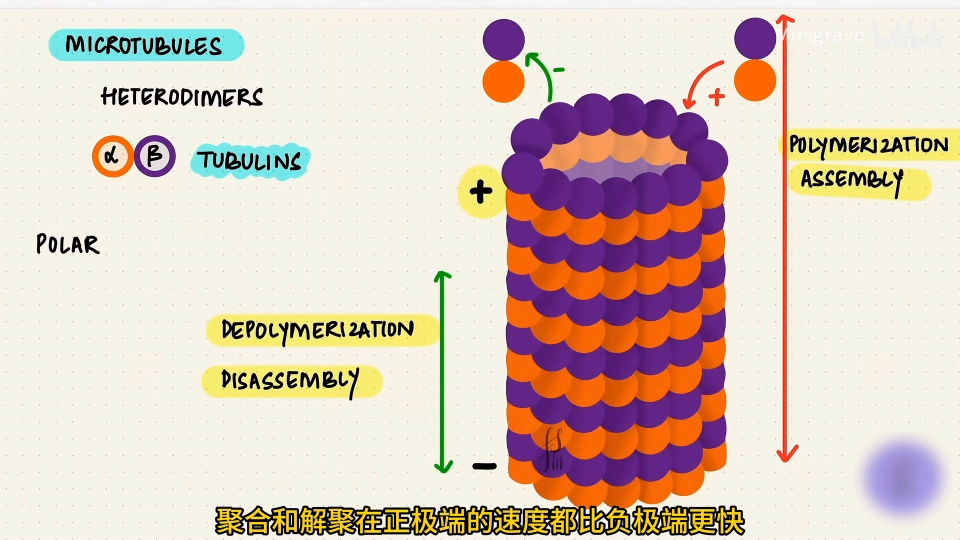
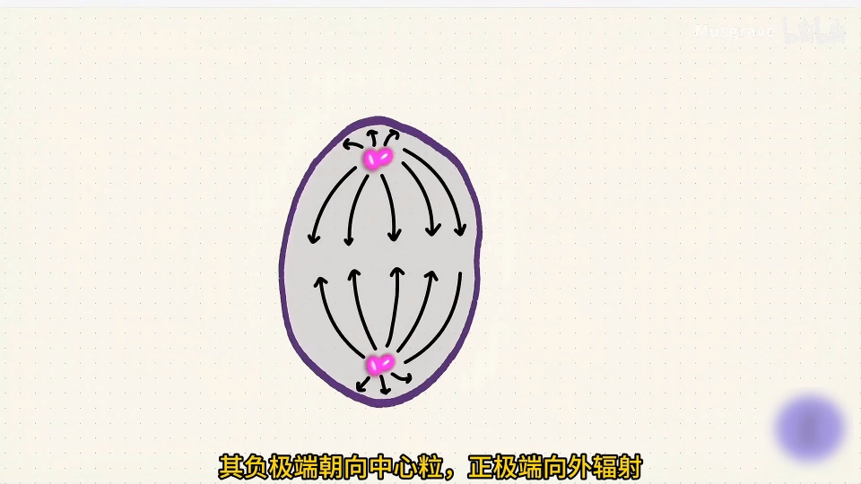
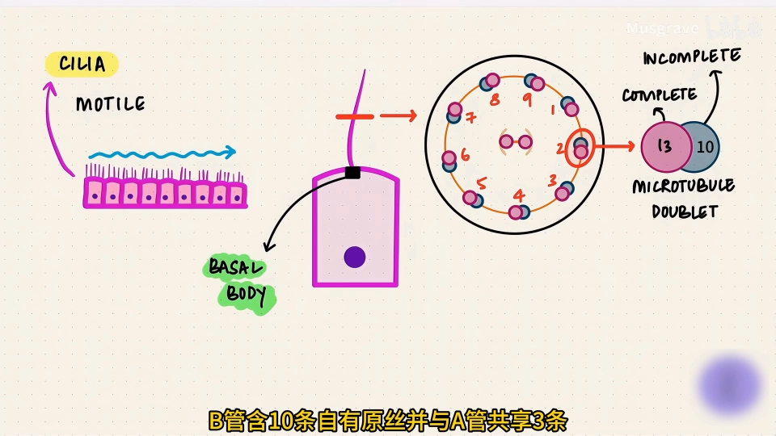
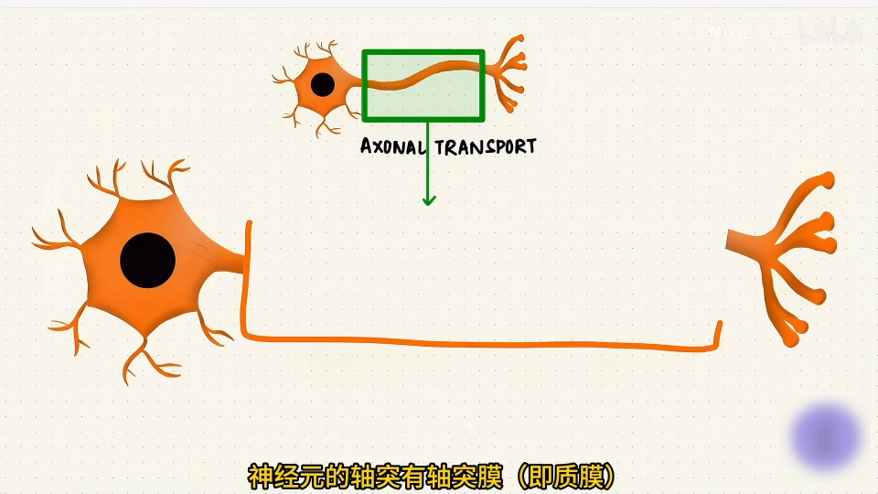
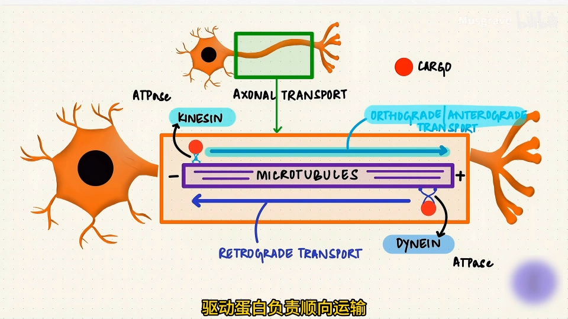

# 微管：中空管、动态不稳定性与轴突运输

> 视频来源：[《细胞的结构与功能：细胞骨架（1）》](https://www.bilibili.com/video/BV1Vpjc6NE4h/)（B 站 · Musgrave）｜时长 9:24
> 导读：这是细胞骨架两集动画讲解的第一集，专讲微管：从 αβ 二聚体围成的中空管，到动态不稳定性、中心体成核、纺锤体与纤毛，最后用神经元的轴突运输把“轨道 + 马达 + 方向”讲完整。第二集讲微丝与中间丝，见本小节另一篇《微丝与中间丝：微绒毛、伪足、收缩环与无极性支撑》。

## 本讲要解决的核心问题（SCQA）

**背景**：画一个细胞时，我们会画上细胞膜、细胞核、内质网、核糖体、高尔基体、囊泡、溶酶体、过氧化物酶体和线粒体。这些结构都浮在细胞质里。

**冲突**：细胞没有骨头，为什么不会塌？囊泡和细胞器又靠什么在细胞质里移动、并且到达固定位置？如果只靠扩散，一个直径上百微米的神经元，其轴突末端的货物根本无法及时补充。

**疑问**：是什么维持细胞的形态？又是什么帮助囊泡和细胞器在细胞质中运输？

**回答（中心思想）**：答案是**细胞骨架**，其中**微管**承担“轨道”和“牵引”两种角色。微管是由 αβ 微管蛋白异二聚体围成的中空管，有极性、会表现动态不稳定性；它从中心体成核，向外辐射，因此负端朝细胞中心、正端朝细胞边缘。这个统一的方向约定，让**驱动蛋白向正端走、胞质动力蛋白向负端走**成为细胞内运输的通用规则——轴突运输就是最清楚的例子。

---

## 一、微管是三种骨架里最粗的

细胞骨架分三个重要类群：**微管、中间丝和微丝**。微管直径最大（约 25 nm），微丝直径最小。

[【跳转到 00:40】](https://www.bilibili.com/video/BV1Vpjc6NE4h/?t=40)

### 1.1 结构：二聚体堆成原丝，13 根原丝围成管

微管是**异二聚体**聚合物：由两种不同的亚基组成，称为 α 微管蛋白和 β 微管蛋白。这些二聚体依次堆叠形成**原丝**，原丝再围成中空的圆柱，一圈由 13 条原丝构成管壁。

[【跳转到 01:44】](https://www.bilibili.com/video/BV1Vpjc6NE4h/?t=104)

“中空”不是装饰：管壁由 13 根原丝围成，既提供抗压的刚度，又在外表面留出马达蛋白的结合面。这就是微管能同时当“梁”和“轨道”的结构基础。

### 1.2 极性：正端加、负端减

由于二聚体是有方向地排列的，微管是**极性结构**：一端为**正极**，另一端为**负极**。向微管添加二聚体可以使之变长，这是**聚合**（组装）；移除二聚体可以使之变短，这是**解聚**（去组装）。聚合和解聚在**正极端的速度都比负极端更快**。

[【跳转到 02:09】](https://www.bilibili.com/video/BV1Vpjc6NE4h/?t=129)

### 1.3 动态不稳定性：取决于 GTP 水解速率

微管在“组装变长”和“解聚变短”之间交替，这种行为叫**动态不稳定性**。它的分子开关是 **GTP 水解**：

- 结合 GTP 的二聚体与管壁结合紧密，微管倾向继续加长；
- GTP 水解为 GDP 后，二聚体亲和力降低，管端容易散开、转为解聚；
- 因此如果**组装速率快于水解速率**，结构就会变长；反之则容易崩解。

[【跳转到 02:34】](https://www.bilibili.com/video/BV1Vpjc6NE4h/?t=154)

这一点和微丝不同：微丝的单体结合的是 ATP。记住“微管用 GTP、微丝用 ATP”，后面判断药物与实验条件时就不会混。

### 1.4 从哪长出来：微管组织中心

微管在**微管组织中心**（MTOC）形成，更常见的名称是**中心体**。中心体由两个**中心粒**组成，它们是彼此垂直排列的圆柱状结构，周围被中心粒旁物质包围，其中含 **γ 微管蛋白环复合体**，负责微管成核。

一提到中心粒，首先想到的是细胞分裂——有丝分裂、减数分裂和纺锤体。这正说明中心体既是微管的“产地”，也是分裂时纺锤体的组织者。

---

## 二、微管撑起的两种结构：纺锤体与纤毛

### 2.1 纺锤体：三种微管分工

纺锤丝就是微管。其**负极端朝向中心粒，正极端向外辐射**。纺锤丝有三种：

- **星体微管**：向细胞皮层方向辐射；
- **动粒微管**：连接到姐妹染色单体的动粒上；
- **极微管**：不连接染色体，而是在中部相互重叠。

[【跳转到 03:09】](https://www.bilibili.com/video/BV1Vpjc6NE4h/?t=189)

这些微管协同作用，帮助染色体排列在赤道板上，然后使其分裂并移向两极。这里能看出微管区别于微丝的角色：它不靠自身收缩，而是靠**组装与解聚**以及马达蛋白的滑动来产生和传递力。

### 2.2 中心粒：九组三联体

把中心粒横切、从顶部看，它有九组微管，完整结构像车轮一样带有辐射状辐条。每组是一个**三联体**，即 A、B、C 三根微管：A 管完整，含 13 条原丝；B 管和 C 管各含十条自有原丝，并与相邻微管共享三条。所以一个中心粒有**九组三连体**。

[【跳转到 03:49】](https://www.bilibili.com/video/BV1Vpjc6NE4h/?t=229)

### 2.3 纤毛：9+2 排列与轴丝动力蛋白

与中心粒结构类似的是**纤毛**。纤毛可以是可动的或不可动的：不可动纤毛为 **9+0** 排列，无中央微管对和动力蛋白臂。这里讨论可动纤毛，即呼吸道上皮、输卵管等处的毛发状结构，它们推动管腔内的液体和物质沿管道流动。

纤毛从细胞膜上的**基体**长出，基体位于细胞膜下方，结构与中心粒相似，是纤毛微管的起始点。纤毛横截面同样是九组外周微管，但这里是**二连体**（A 管完整含 13 条原丝，B 管含十条自有原丝并与 A 管共享三条），不是中心粒中的三连体；此外中央还有两根完整的微管，所以是 **9+2** 排列。

[【跳转到 05:31】](https://www.bilibili.com/video/BV1Vpjc6NE4h/?t=331)

中央微管与外周微管通过辐射状辐条连接，外周微管之间有两种连接：**连接蛋白**（相邻外周微管组之间）和**轴丝动力蛋白臂**（每组外周微管上都有）。轴丝动力蛋白是一种分子马达蛋白，具有 ATP 酶活性，水解 ATP 释放能量，使外周微管相互滑动，从而让纤毛弯曲。

纤毛的摆动正是由轴丝动力蛋白驱动的。如果轴丝动力蛋白臂有缺陷，纤毛运动就会出问题，例如**原发性纤毛运动障碍**，最常见为轴丝动力蛋白臂缺陷，也可由辐射状辐条或中央微管等结构缺陷引起。

[【跳转到 06:21】](https://www.bilibili.com/video/BV1Vpjc6NE4h/?t=381)

与纤毛结构非常相似的是**鞭毛**，同样含微管；但人类唯一的鞭毛细胞是精子。所以微管既参与细胞分裂，也构成纤毛和鞭毛这类运动结构。

---

## 三、轴突运输：轨道 + 马达 + 方向

### 3.1 为什么用神经元做例子

轴丝动力蛋白帮助纤毛运动；而在细胞质里，还有**胞质动力蛋白**和**驱动蛋白**，它们也是分子马达蛋白，帮助结构沿微管运输。理解这一点最好的例子是神经元的**轴突运输**。

[【跳转到 07:24】](https://www.bilibili.com/video/BV1Vpjc6NE4h/?t=444)

神经元的轴突有轴突膜（即质膜），细胞质称为**轴浆**。沿轴突的物质运输要么从**胞体到突触末梢**，要么反过来；运输的可以是蛋白质、囊泡、细胞器等，统称为**货物**。正因为货物必须双向、定向地走完整条轴突，这条“铁路”才成为观察马达蛋白最好的窗口。

### 3.2 方向由微管极性决定

货物可以双向移动，但都是沿微管进行的。关键在于轴突里微管的统一朝向：**正极端朝向突触末梢，负极端朝向胞体**。

于是两种方向就有了名字：

| 方向 | 名称 | 马达 | 沿微管 |
| --- | --- | --- | --- |
| 胞体 → 突触末梢 | 顺向运输（anterograde） | 驱动蛋白（kinesin） | 负极 → 正极 |
| 突触末梢 → 胞体 | 逆向运输（retrograde） | 胞质动力蛋白（dynein） | 正极 → 负极 |

[【跳转到 08:39】](https://www.bilibili.com/video/BV1Vpjc6NE4h/?t=519)

马达的工作方式可以概括成一句话：**一端结合微管，另一端结合货物**，水解 ATP 释放能量，带着货物沿轨道走。驱动蛋白负责顺向运输，胞质动力蛋白负责逆向运输。

### 3.3 这个案例能推广到哪些地方

把轴突运输的规则抽象出来，就是本节最该带走的一条判据：

> **马达本身没有“目的地”，方向由它脚下的轨道极性决定。**

同一条规则可以解释其他场景：

- 细胞质中微管负端多在中心体附近、正端朝细胞边缘，所以驱动蛋白把货物送往细胞外周，动力蛋白把货物拉回细胞中央；
- 纤毛里换成轴丝动力蛋白，让相邻外周微管相互滑动，输出的是弯曲而不是平移；
- 换成微丝轨道，马达就换成**肌球蛋白**——这是第二集的主题。

### 3.4 与囊泡运输的分工

本节只回答“囊泡靠什么被拉着走”。囊泡自身的包被、Rab 停靠与 SNARE 融合属于另一套机制，见 [1.3.3 内膜系统与囊泡运输](../1.3.3_内膜系统与囊泡运输：分泌途径、内吞与溶酶体/高尔基体与膜泡运输：糖基化、三类包被囊泡与停靠融合.md)：**马达决定“往哪个方向、走多远”，SNARE 决定“停在哪张膜上”**，两者缺一不可。

---

## 小结

- 微管是三种骨架纤维中最粗的（约 25 nm），由 αβ 微管蛋白异二聚体堆成原丝、13 根原丝围成中空管。
- 微管有极性：正端聚合快、负端解聚快；在组装与解聚之间交替，表现为**动态不稳定性**，开关是 GTP 水解。
- 微管从**微管组织中心（中心体）**成核，中心粒含九组三联体，含 γ 微管蛋白环复合体。
- 纺锤丝就是微管，分星体微管、动粒微管、极微管三种；纤毛是 9+2 排列，靠轴丝动力蛋白使外周微管滑动而弯曲。
- 轴突运输是“轨道 + 马达 + 方向”的完整案例：微管正端朝末梢，驱动蛋白向正端走（顺向），胞质动力蛋白向负端走（逆向），两者都是 ATP 酶。
- 方向由轨道极性决定；换成微丝轨道，马达就是肌球蛋白。

## 关键术语速查

| 术语 | 一句话解释 |
| --- | --- |
| 异二聚体 | α 与 β 微管蛋白组成的配对，微管组装的基本单位 |
| 原丝 | 二聚体首尾相接成的细链，13 根围成微管管壁 |
| 动态不稳定性 | 微管在聚合变长和解聚变短之间交替，取决于 GTP 水解速率 |
| MTOC | 微管组织中心，最常见的是中心体，负责微管成核 |
| γ 微管蛋白环复合体 | 中心体旁物质中负责微管成核的复合体 |
| 9+2 排列 | 可动纤毛和鞭毛的轴丝结构：九组二连体加中央两根单微管 |
| 轴丝动力蛋白 | 纤毛中的马达蛋白，使外周微管相互滑动而弯曲 |
| 顺向运输 | 胞体到突触末梢，由驱动蛋白介导，沿微管负端到正端 |
| 逆向运输 | 突触末梢到胞体，由胞质动力蛋白介导，沿微管正端到负端 |