# 细胞骨架的三种纤维：微管、微丝与中间纤维

> 视频来源：[《细胞生物学——细胞骨架（微管、微丝、中间纤维基本概念及功能）》](https://www.bilibili.com/video/BV1ij411L7ys/)（B 站 · 孤巷北港）｜时长 8:46
> 导读：一支按“微管 → 微丝 → 中间纤维”顺序推进的细胞生物学微课，最后用一张表把三者并排比较。本文按它的顺序重建三种纤维各自的单体、极性、组装方式和功能，并把结尾那张对照表整理成正文表格；字幕中的“V4／威斯”指微丝，“一二具体”指 αβ 异二聚体，均已订正。

## 本讲要解决的核心问题（SCQA）

**背景**：细胞里除了各种有膜细胞器，还有一套贯穿细胞质的蛋白纤维网架——细胞骨架。它由微管、微丝和中间纤维三类纤维组成，都由蛋白质亚基装配而成，并且能随生理条件不断组装、去组装。

**冲突**：三类纤维都是“蛋白聚成的丝”，名字也像，但它们从单体到直径、从有没有方向到会不会剧烈重塑都不一样。如果只记住三个名字，遇到“为什么纺锤丝能牵引染色体、而角蛋白只负责抗拉”这类问题时就没有判据。

**疑问**：三种纤维各由什么单体构成？哪几种有极性、能快速重塑？它们各自承担什么功能？

**回答（中心思想）**：三种纤维的分工由**单体性质**和**是否具有极性**决定。微管由 αβ 微管蛋白异二聚体围成 13 根原丝的中空管，有极性、能表现动态不稳定性，因此适合做“轨道”和“牵引绳”；微丝由结合 ATP 的肌动蛋白组成双股螺旋，有极性、能踏车式重塑，因此负责收缩与形变；中间纤维由中间纤维蛋白从二聚体、四聚体层层编成 10 nm 绳索，**两端对称、没有极性**，因此最稳定，专门提供抗剪切力的支撑。

---

## 一、细胞骨架是什么：三类蛋白纤维的网架

细胞骨架（cytoskeleton）指真核细胞中的蛋白纤维网架系统，由**微管**（microtubule, MT）、**微丝**（microfilament, MF）和**中间纤维**（intermediate filament, IF）组成。三者分别由相应的蛋白质亚基装配成纤维状结构，并随生理条件改变不断发生组装和去组装的动态变化。

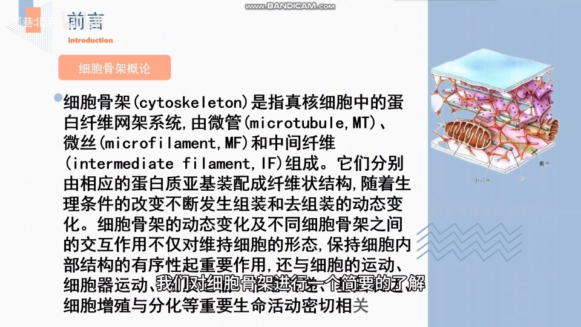

[【跳转到 00:22】](https://www.bilibili.com/video/BV1ij411L7ys/?t=22)

这套网架的作用不止“撑住细胞”：

- 维持细胞形态、保持细胞内部结构的有序性；
- 参与细胞运动、细胞器运动和物质运输；
- 参与信息传递、基因表达、细胞增殖与分化。

[【跳转到 00:47】](https://www.bilibili.com/video/BV1ij411L7ys/?t=47)

视频还提醒一个边界：细胞骨架的概念本身在扩展。真核细胞的**核内**另有一套骨架系统叫**核骨架**，由非组蛋白构成精密的立体纤维网架，与染色体复制、转录和 RNA 加工相关。它不属于本节讨论的细胞质三类纤维，但说明“骨架”是一类结构角色，而不是三个固定名词。

[【跳转到 00:59】](https://www.bilibili.com/video/BV1ij411L7ys/?t=59)

---

## 二、微管：αβ 二聚体堆成 13 根原丝的中空管

### 2.1 组成：从异二聚体到原丝再到管壁

微管的基本成分是**微管蛋白**，一类球形酸性蛋白，分 α 和 β 两种。细胞中的 α 与 β 微管蛋白常以**异二聚体**形式存在：这种 αβ 二聚体是游离态微管蛋白的主要存在形式，也是微管组装的基本结构单位。

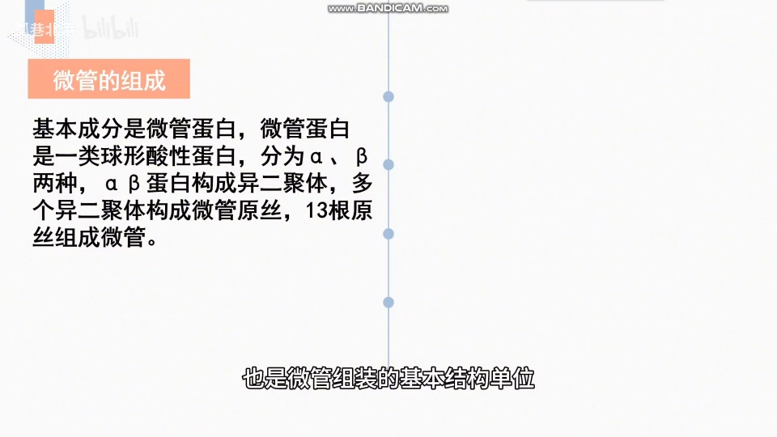

[【跳转到 01:28】](https://www.bilibili.com/video/BV1ij411L7ys/?t=88)

装配是层层递进的：多个异二聚体首尾相接构成**原丝**，13 根原丝围成一圈，形成中空管壁。

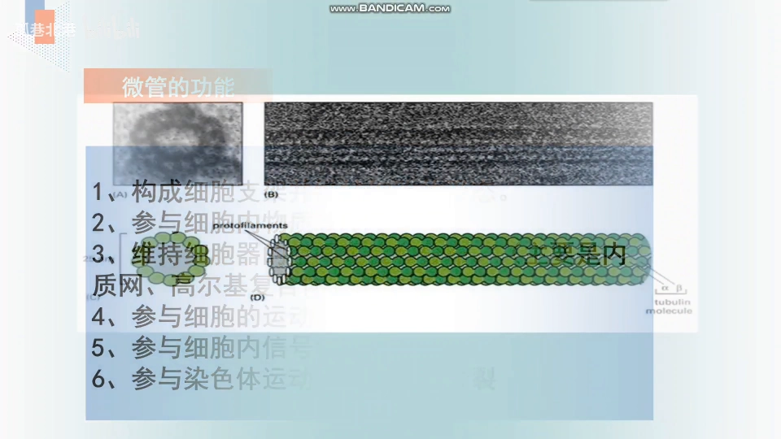

[【跳转到 03:26】](https://www.bilibili.com/video/BV1ij411L7ys/?t=206)

微管的几个性质可以直接用于判读：

- **有极性**：正端生长快，负端生长慢、相对稳定；
- **存在形式多样**：单管、二连管、三连管。单管是细胞质中微管的主要形式，二连管见于纤毛与鞭毛，三连管见于中心粒。

[【跳转到 01:53】](https://www.bilibili.com/video/BV1ij411L7ys/?t=113)

### 2.2 组装三阶段：成核、聚合、稳定

微管的组装分三个时期，判据是两端聚合与解聚速度的对比：

| 时期 | 发生了什么 | 长度变化 |
| --- | --- | --- |
| 成核期 | 微管蛋白聚合成短的寡聚体片状微管 | 核心形成 |
| 聚合期 | 正端聚合速度大于负端解聚速度 | 伸长 |
| 稳定期 | 聚合速度等于解聚速度 | 不变 |

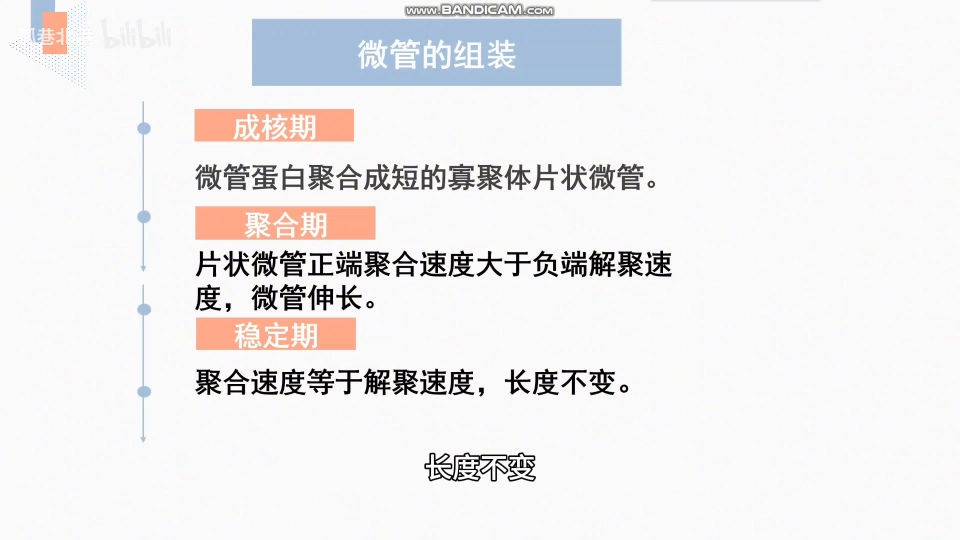

[【跳转到 02:21】](https://www.bilibili.com/video/BV1ij411L7ys/?t=141)

组装发生在**微管组织中心**：微管的组装起源于中心体，微管生长则起源于中心体的无定型蛋白基质。这解释了为什么细胞质中的微管常呈放射状——负端锚在中心体一侧，正端朝外。

药物是检验“微管是否参与某个过程”的常用工具，视频给了三例：

- **秋水仙素、长春新碱**：阻断微管组装；
- **紫杉醇**：促进（稳定）微管组装。

[【跳转到 02:46】](https://www.bilibili.com/video/BV1ij411L7ys/?t=166)

### 2.3 功能：支架、轨道、纺锤体

微管的功能被归纳为六类：构成细胞支架并维持细胞形态；参与细胞内物质运输；维持细胞器的空间定位与分布（主要是内质网、高尔基复合体、纺锤体）；参与细胞运动；参与细胞内信号传递；参与染色体运动、调节细胞分裂。

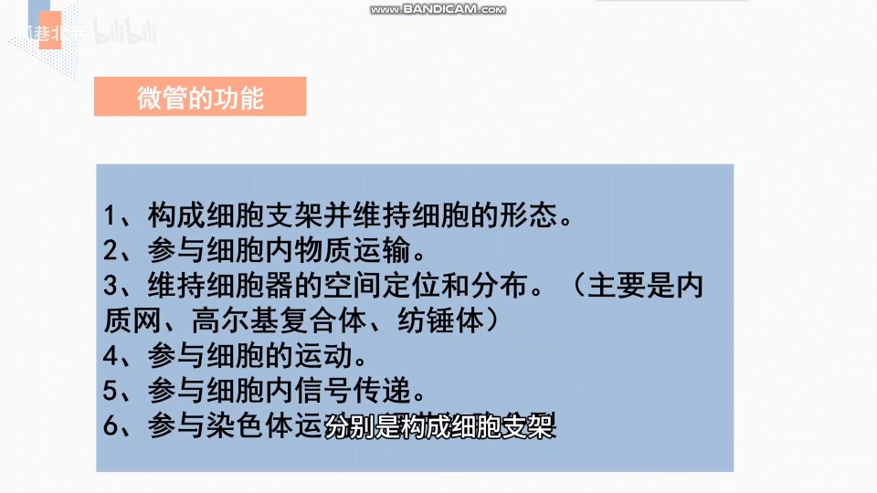

[【跳转到 03:04】](https://www.bilibili.com/video/BV1ij411L7ys/?t=184)

注意“维持细胞器定位”这一条容易被忽略：内质网、高尔基体在细胞里的位置不是随机的，微管及其马达蛋白把它们拴在特定区域。物质运输与马达蛋白的具体机制由本节的另一篇《微管：中空管、动态不稳定性与轴突运输》展开。

---

## 三、微丝：结合 ATP 的肌动蛋白双股螺旋

### 3.1 组成与极性

微丝又称**肌动蛋白丝**（actin filament），由肌动蛋白亚单位组成。每条微丝由两条平行的肌动蛋白单链以右手螺旋方式相互盘绕而成，电镜下呈双股螺旋。

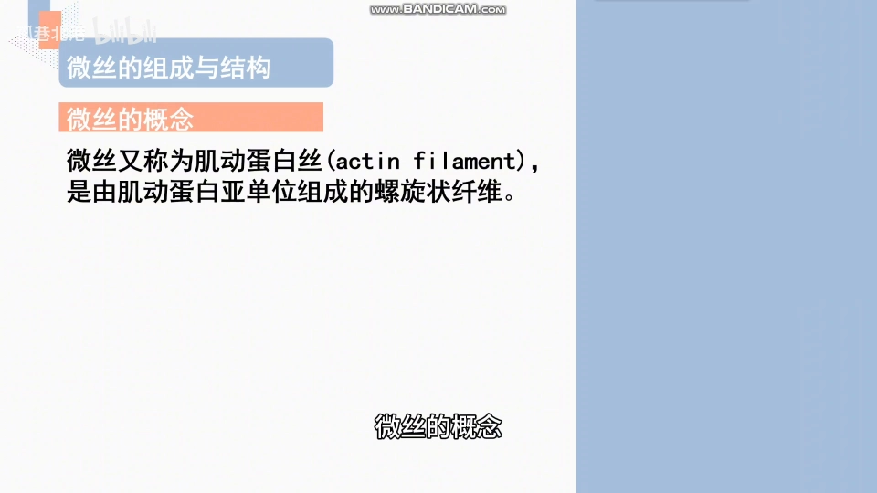

[【跳转到 03:41】](https://www.bilibili.com/video/BV1ij411L7ys/?t=221)

微丝同样**有极性**：一端相对迟钝（负端），另一端是生长较快的正端。与微管用 GTP 不同，肌动蛋白结合的是 **ATP**——这个差别在后面“踏车”和“马达”两处都会用到。

### 3.2 组装：成核、延伸、踏车

微丝的组装与调控分体外和体内两部分。体外有三个过程：

1. **成核反应**：成核蛋白 Arp2、Arp3 构成微丝起始复合物，介导微丝开始组装；肌动蛋白与起始复合物结合，形成可供组装的寡聚体。
2. **延伸反应**：肌动蛋白具有 ATP 酶活性，G-actin–ATP 与末端结合并水解 ATP，从而接到微丝上使其延长。
3. **稳定期**：随着单体被消耗，溶液中 G-actin 浓度下降，延伸速度减缓；当单体浓度降到临界浓度，组装速度与解离速度相等，长度不变。

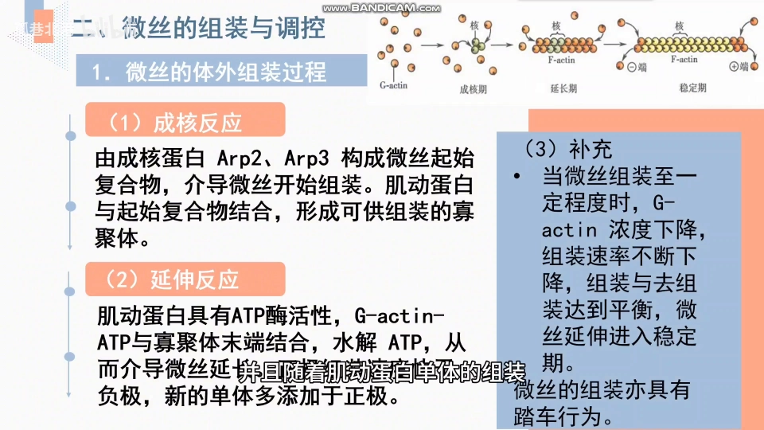

[【跳转到 05:06】](https://www.bilibili.com/video/BV1ij411L7ys/?t=306)

稳定期的“长度不变”其实是**两端同时进行**的结果：正端不断加单体、负端不断掉单体，纤维像跑步机履带一样原地循环——这就是**踏车行为**（treadmilling）。它让微丝在保持长度的同时持续更新单体，是微丝能快速重塑的结构基础。

体外组装还需要条件：一定的球状肌动蛋白浓度、一定的离子浓度，以及 ATP 的存在。

[【跳转到 05:39】](https://www.bilibili.com/video/BV1ij411L7ys/?t=339)

### 3.3 体内组装发生在细胞皮层

体内组装与微管一样需要成核作用，但位置很特别：一般发生在**质膜区的细胞皮层**，由微丝加结核蛋白完成。

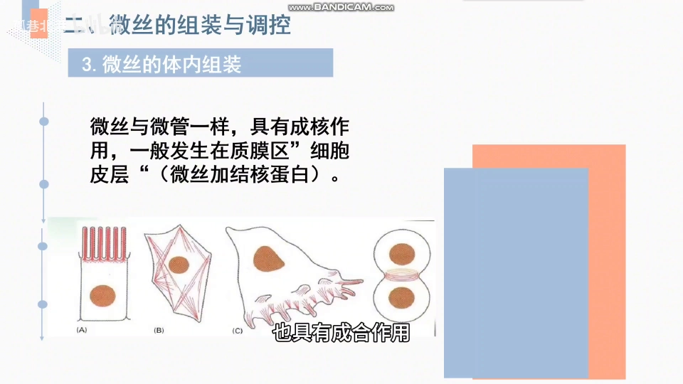

[【跳转到 05:33】](https://www.bilibili.com/video/BV1ij411L7ys/?t=333)

这张图其实预告了微丝的四种“形态学用途”：上皮细胞顶面的**微绒毛**、细胞膜下的**皮层**网络、迁移前沿的**伪足**，以及分裂末期的**收缩环**。它们都是同一根微丝在不同排布下的结果，具体案例见《微丝与中间丝：微绒毛、伪足、收缩环与无极性支撑》。

### 3.4 功能：收缩与形变

微丝的功能包括：构成细胞支架并维持细胞形态；参与细胞运动；作为运输轨道参与细胞内物质运输；参与细胞（质）分裂；参与细胞内信号传递；参与受精作用；参与肌肉收缩。

[【跳转到 05:56】](https://www.bilibili.com/video/BV1ij411L7ys/?t=356)

---

## 四、中间纤维：10 nm 的绳索，没有极性

### 4.1 特点与分布：最稳定的那一类

中间纤维是丝状蛋白多聚体，直径 10 nm 左右，**介于微丝与微管之间**——名字就是这么来的。它是最稳定的细胞骨架成分。

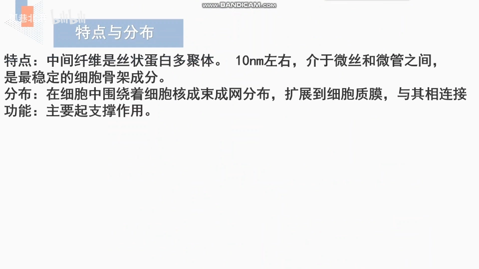

[【跳转到 06:19】](https://www.bilibili.com/video/BV1ij411L7ys/?t=379)

分布上，它在细胞中围绕细胞核成束成网，向外扩展到细胞质膜并与其相连，主要起支撑作用。

构成中间纤维的基本单位是**中间纤维蛋白**，其结构特点是：α 螺旋的中间区高度保守，非螺旋区（N 端和 C 端）高度可变。

[【跳转到 06:42】](https://www.bilibili.com/video/BV1ij411L7ys/?t=402)

### 4.2 装配：从二聚体到四聚体再到 8 根原丝

中间纤维的装配层级比微管、微丝多一层，而且关键一步是“反向”：

1. 两个平行排列的中间纤维蛋白分子形成螺旋状**二聚体**；
2. 两个二聚体**反向平行**排列成一个**四聚体**；
3. 多个四聚体组装成**原丝**；
4. 八个原丝组装成一根中间纤维。

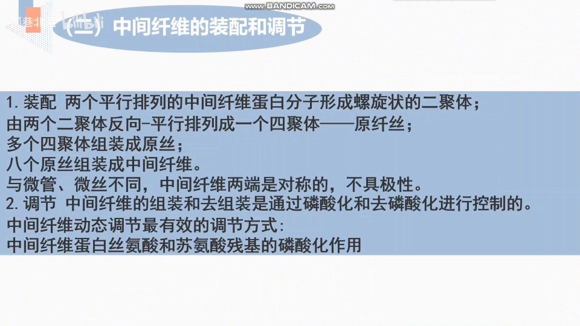

[【跳转到 06:59】](https://www.bilibili.com/video/BV1ij411L7ys/?t=419)

第 2 步的“反向平行”是本节最重要的结构判据：一个四聚体里两个二聚体方向相反，纤维两端自然对称，于是**中间纤维不具极性**，两端没有正负之分。没有极性，就没有“正端加、负端减”的方向性踏车，也就没有微管那种动态不稳定性——这正是它稳定的原因。

### 4.3 调节：靠磷酸化而不是靠踏车

中间纤维的组装和去组装通过翻译后修饰控制：磷酸化与去磷酸化、乙酰化与去乙酰化等。其中最有效的调节方式是**中间纤维蛋白丝氨酸和苏氨酸残基的磷酸化**。

[【跳转到 07:24】](https://www.bilibili.com/video/BV1ij411L7ys/?t=444)

对照一下三类纤维的“可调性”来源：微管靠 GTP 水解与动态不稳定性，微丝靠 ATP 水解与踏车，中间纤维靠磷酸化开关。三者都能重塑，但速度与代价不同。

### 4.4 功能：抗剪切、连桥粒、稳核膜

中间纤维的功能可以列成六条：

1. 在细胞内形成一个完整的网状系统：外与质膜和细胞外基质有直接联系，内与核膜、核基质联系，形成贯穿细胞的网络；
2. 为细胞提供机械强度支持，**比微管和微丝更耐受剪切力**；
3. 参与细胞连接，如构成桥粒和半桥粒；
4. 参与细胞内信息传递及物质运输，形成跨膜的信息通道；
5. 维持细胞核膜稳定——核内膜下的核纤层蛋白就是中间纤维的一种；
6. 参与细胞分化，中间纤维蛋白的表达具有组织特异性。

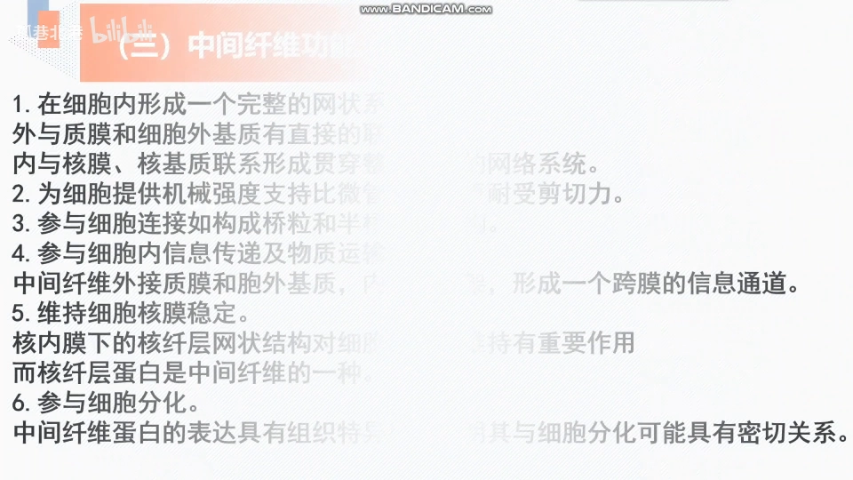

[【跳转到 07:59】](https://www.bilibili.com/video/BV1ij411L7ys/?t=479)

第 6 条是中间纤维在实验里特别有用的性质：不同细胞表达不同中间纤维蛋白，因此它常被当作**细胞类型标志**。具体的组织分布（角蛋白、波形蛋白、结蛋白、神经丝、核纤层蛋白）见《微丝与中间丝》一篇。

---

## 五、三者并排：一张表看清分工

视频结尾把三者放进同一张表，判据是组成成分、主要功能、存在形式、有无极性、特异药物。

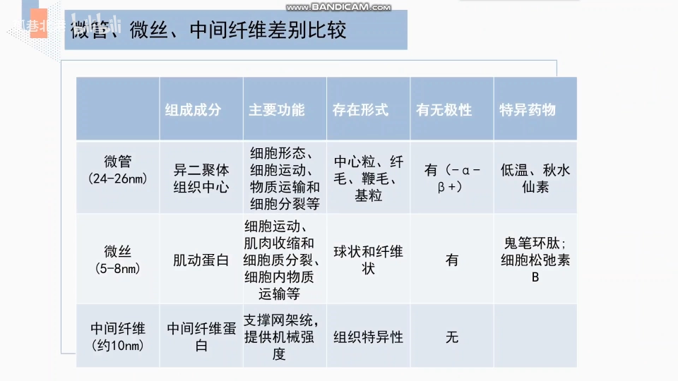

[【跳转到 08:15】](https://www.bilibili.com/video/BV1ij411L7ys/?t=495)

| 比较项 | 微管 | 微丝 | 中间纤维 |
| --- | --- | --- | --- |
| 直径 | 24–26 nm | 5–8 nm | 约 10 nm |
| 单体 | αβ 微管蛋白异二聚体 | 肌动蛋白（结合 ATP） | 中间纤维蛋白 |
| 极性 | 有（负端 α、正端 β） | 有 | **无**，两端对称 |
| 组装单位 | 二聚体 → 原丝 → 13 根原丝围成管 | 单体 → 双股螺旋，踏车 | 二聚体 → 四聚体 → 原丝 → 8 根原丝 |
| 动态性 | 动态不稳定性（GTP 依赖） | 踏车（ATP 依赖） | 稳定，靠磷酸化调节 |
| 主要功能 | 形态、运动、物质运输、细胞分裂 | 运动、肌肉收缩、胞质分裂、物质运输 | 支撑网架、提供机械强度 |
| 存在形式 | 中心粒、纤毛、鞭毛、基粒 | 球状与纤维状 | 组织特异性 |
| 特异药物 | 低温、秋水仙素 | 鬼笔环肽、细胞松弛素 B | — |

需要提醒的是，不同教材和视频给出的直径略有出入（微管 24–26 nm 或 25 nm，微丝 5–8 nm 或 7 nm，中间纤维 10 nm 或 8–10 nm），量级一致即可，不必把某一位小数当判据。

---

## 小结

- 细胞骨架是三类蛋白纤维的网架：微管、微丝、中间纤维；它们都靠亚基组装与去组装实现动态变化。
- **微管**：αβ 异二聚体 → 原丝 → 13 根原丝围成中空管；有极性；组装分成核、聚合、稳定三期；起源于中心体；功能覆盖支架、运输、细胞器定位、运动、信号与染色体运动。
- **微丝**：肌动蛋白双股螺旋，结合 ATP；有极性；Arp2/3 成核后延伸，稳定期表现为踏车；体内组装集中在细胞皮层；功能是收缩与形变。
- **中间纤维**：二聚体反向平行组成四聚体，因此**无极性**；8 根原丝编成 10 nm 绳索；最稳定、最耐剪切；靠磷酸化调节；核纤层蛋白也是其中一员。
- 判读三类纤维时先看三件事：单体是什么、有没有极性、动态性来自哪里。

## 关键术语速查

| 术语 | 一句话解释 |
| --- | --- |
| 细胞骨架 | 真核细胞中由微管、微丝、中间纤维组成的蛋白纤维网架 |
| 异二聚体 | 由 α 和 β 两种微管蛋白组成的稳定配对，是微管组装的基本单位 |
| 原丝 | 由二聚体或四聚体首尾相连成的细链，13 根原丝围成微管管壁 |
| 微管组织中心（MTOC） | 微管成核的起始区域，最常见的是中心体 |
| 动态不稳定性 | 微管在组装变长与解聚变短之间交替的行为，取决于 GTP 水解速率 |
| 踏车行为 | 微丝正端加单体、负端掉单体，长度不变但纤维整体流动 |
| 细胞皮层 | 质膜下方的微丝网络区域，体内微丝组装主要发生在这里 |
| 中间纤维 | 直径约 10 nm、无极性、最稳定的骨架纤维，提供抗剪切支撑 |
| 核纤层蛋白 | 衬于核膜内侧的中间纤维，维持核形态并支撑核膜 |