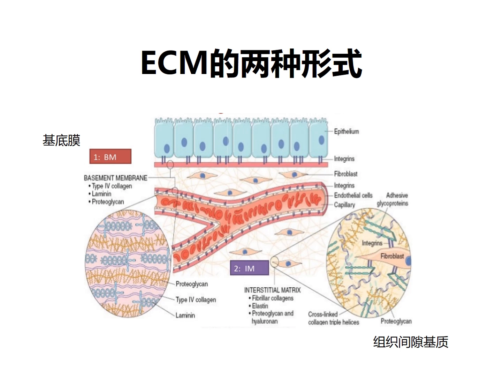
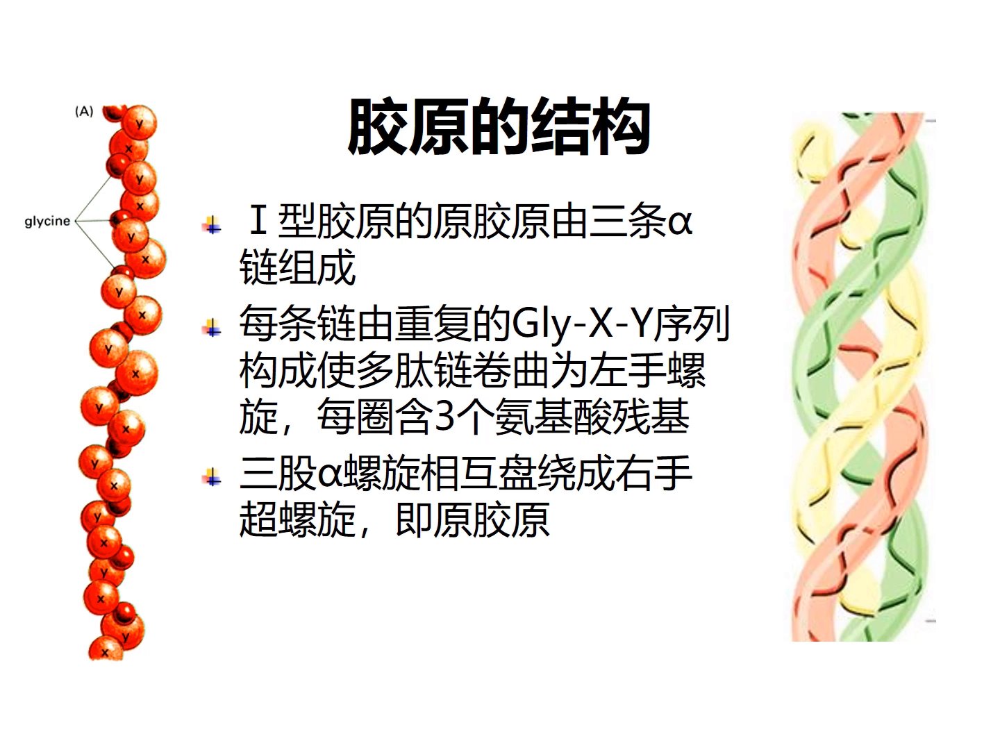
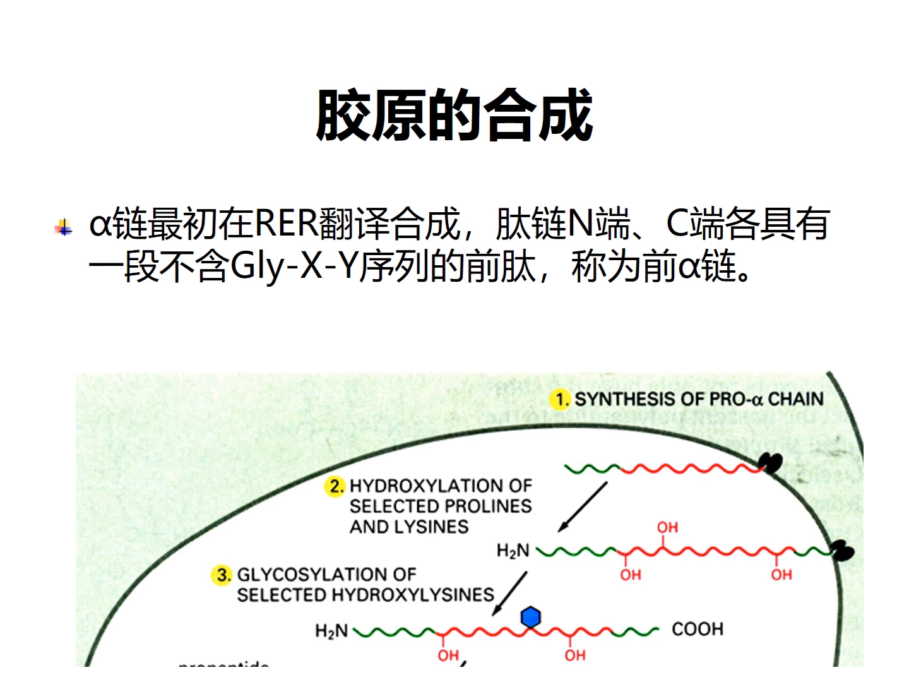
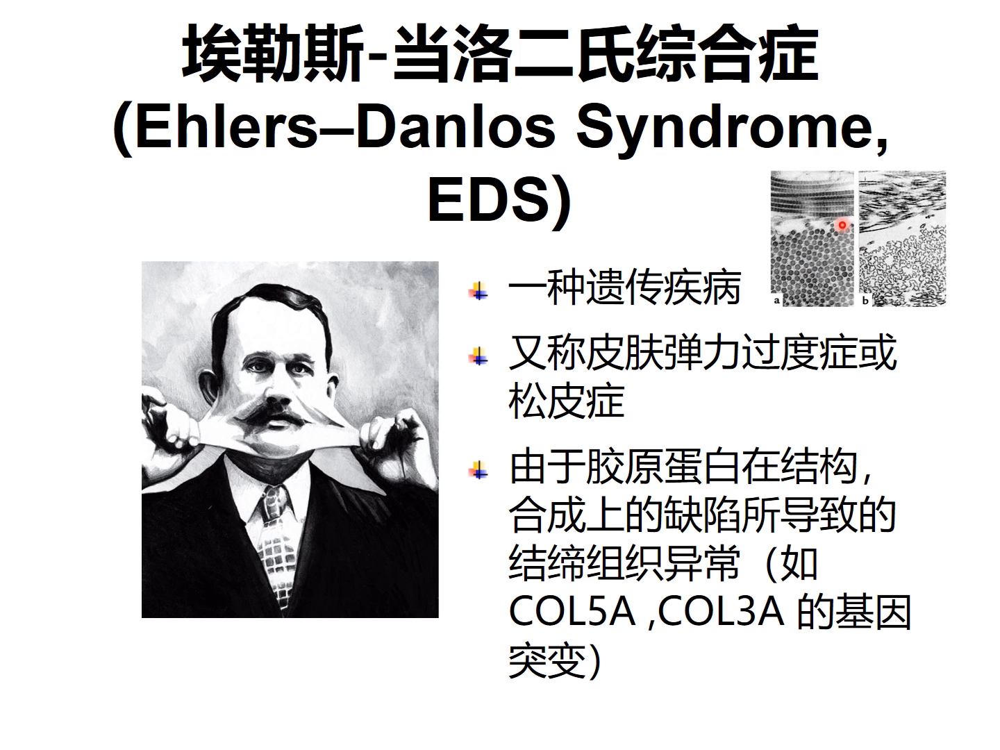
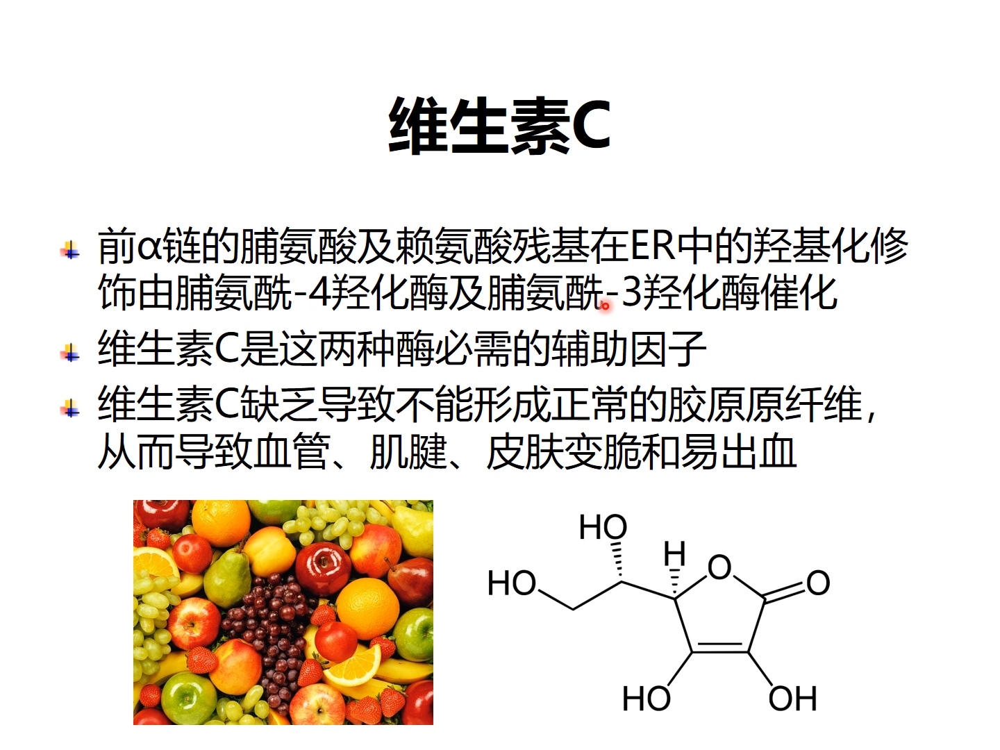
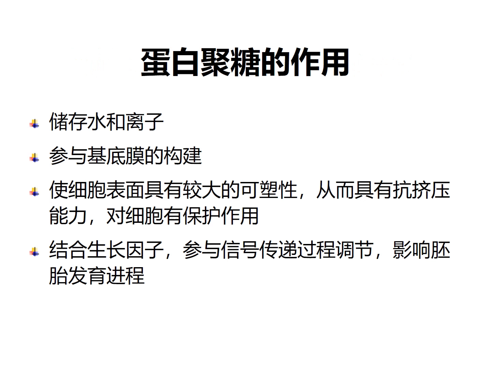
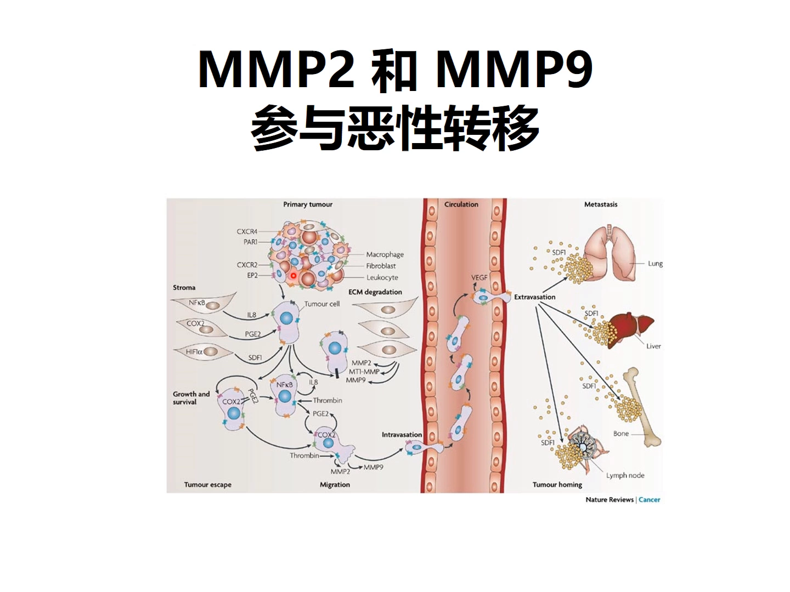
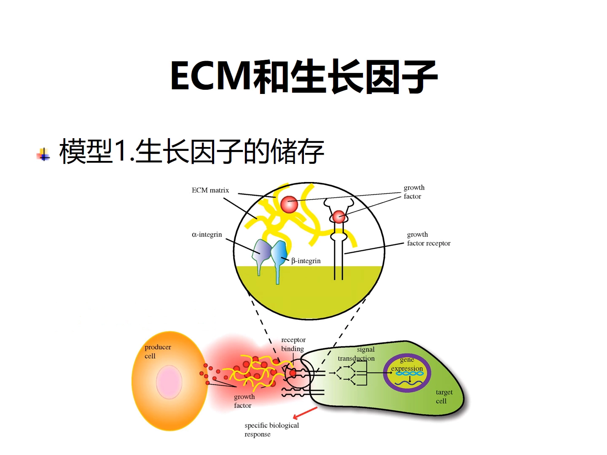
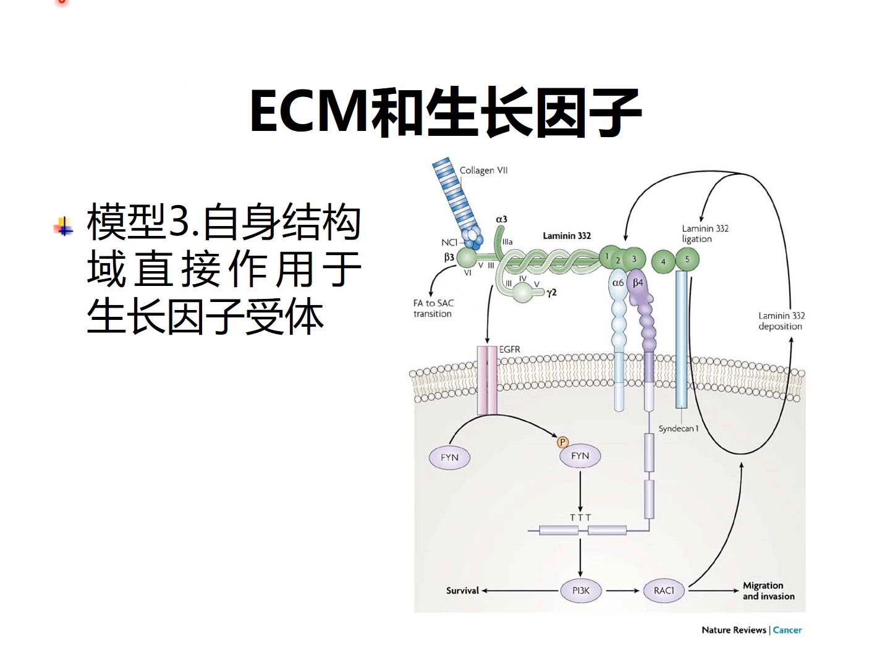
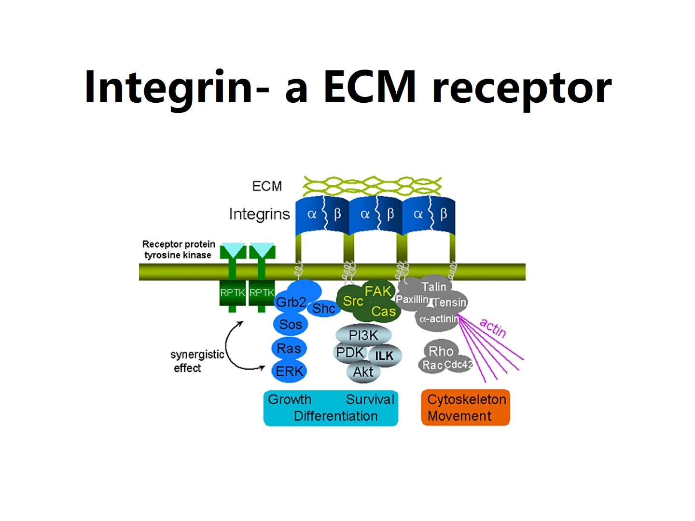

# 细胞外基质：成分、生长因子呈递与整合素信号

> 视频来源：[《复旦大学细胞生物学 3. 细胞外基质》](https://www.bilibili.com/video/BV1er4y1L7mV/)（B 站 · 学免疫不糊涂的冰淇林）｜时长约 39 分钟
> 导读：这一篇专门讲"细胞脚下那块地面"。先给 ECM 分两种形式（基底膜、组织间隙基质）和三类成分，再回答一个关键问题：**一块没有细胞的基质，凭什么能影响细胞的行为？** 答案有三条——它储存并呈递生长因子、它通过整合素把力学传进细胞、它本身被酶改造（MMP）。细胞连接本身见[《细胞连接的四类分工》](细胞连接的四类分工：紧密连接、黏附连接、桥粒与间隙连接.md)与[《细胞连接的三类划分与锚定连接四型》](细胞连接的三类划分与锚定连接四型：结构模式、实验证据与通透性调节.md)。

## 本讲要解决的核心问题（SCQA）

**背景**：切开一块皮肤做剖面，会看到很大一片区域里几乎没有细胞，只有成纤维细胞稀稀拉拉散在其中。这片区域就是细胞外基质（extracellular matrix，ECM）。

**冲突**：既然 ECM 里没有细胞，它就是被动的"填充物"和"支架"吗？可是同一个细胞放在软的胶上和硬的塑料上，长出的形状、迁移的速度、甚至是否存活都不一样；肿瘤细胞要转移，还得先"啃开"基质。这说明基质不是背景板。

**疑问**：ECM 由什么组成？它怎样把"外面的情况"变成细胞内的信号，从而影响组织形态与细胞行为？

**回答（中心思想）**：ECM 是动物细胞分泌到细胞外的大分子网络，**不属于任何细胞，却是组织的一部分**。它由**结构蛋白、多糖、酶**三类成分构成；它对细胞的作用有三条路径——**储存与呈递生长因子**（化学信号）、**通过整合素传递力学并激活胞内通路**（力学信号）、**被 MMP 降解改造**（允许细胞迁移）。三者不可分割。

---

## 一、ECM 是什么：两种形式

ECM 是动物细胞分泌到细胞外、分布在细胞表面的**大分子合集**，主要是一些蛋白质，构成细胞外的网络架构。它不仅起结构上连接组织、支撑组织的作用，更重要的是**调节生理活动**——细胞的迁移、黏附、分化等都要依靠 ECM 里的物质。

[【跳转到 00:42】](https://www.bilibili.com/video/BV1er4y1L7mV/?t=42)

准确地说，在生物学中 **ECM 不属于任何细胞**，它是动物组织的一部分。

[【跳转到 01:32】](https://www.bilibili.com/video/BV1er4y1L7mV/?t=92)

ECM 有两种形式：

- **基底膜**（basement membrane，BM）：紧邻皮肤细胞或血管壁，是比较薄的一层，由四型胶原、层粘连蛋白、蛋白聚糖构成；
- **组织间隙基质**（interstitial matrix）：组织间隙里的组分，更加立体、三维，厚度也更厚，由纤维状胶原、弹性蛋白、蛋白聚糖和透明质酸构成。

[【跳转到 02:21】](https://www.bilibili.com/video/BV1er4y1L7mV/?t=141)

两者的组分相对相似，但形式有区别——这个区别决定了基底膜能当"过滤器和极性标尺"，而组织间隙基质主要承担抗压与填充。

---

## 二、三类成分：结构蛋白、多糖、酶

按化学特点，ECM 的成分分三类：**结构蛋白**（无酶活性，起支撑作用）、**酶**（如 MMP，有催化活性）、**多糖**（糖胺聚糖、蛋白聚糖）。

[【跳转到 03:46】](https://www.bilibili.com/video/BV1er4y1L7mV/?t=226)

### 2.1 胶原：三股螺旋与"前肽"的意义

胶原是人体里含量最多的蛋白质，存在于结缔组织，对结构支撑和张力起非常重要的作用，在韧带和肌腱里是主要成分。

[【跳转到 05:36】](https://www.bilibili.com/video/BV1er4y1L7mV/?t=336)

它的结构与一般球形蛋白不同：**三条 α 链**相互结合，形成类似编绳子的绳形结构，彼此之间有共价键。以 I 型胶原为例，每条 α 链由重复的 **Gly-X-Y** 序列构成，使肽链卷曲为**左手螺旋**，每圈含 3 个氨基酸残基；三股 α 螺旋再相互盘绕成**右手超螺旋**，即**原胶原**。

[【跳转到 06:41】](https://www.bilibili.com/video/BV1er4y1L7mV/?t=401)

胶原的交联有两种：**分子内**（原胶原三股 α 链之间，主要靠氢键）和**分子间**（不同原胶原之间），都用于维护结构稳定性。

[【跳转到 07:39】](https://www.bilibili.com/video/BV1er4y1L7mV/?t=459)

按序列、功能、组织分布，胶原有多种类型：I 型分布最广，占胶原的 90%；III 型主要在皮肤和血管。

[【跳转到 08:24】](https://www.bilibili.com/video/BV1er4y1L7mV/?t=504)

**合成过程**是关键：α 链最初在粗面内质网翻译合成，肽链 N 端、C 端各有一段不含 Gly-X-Y 序列的**前肽**，称为前 α 链；随后经过**羟化**与**糖基化**；C 端前肽借二硫键交联把三股肽链结合在一起，形成原胶原；原胶原在分泌囊泡中被分泌到细胞外，在细胞外被切割掉前肽，再进一步组装成胶原纤维。

[【跳转到 10:06】](https://www.bilibili.com/video/BV1er4y1L7mV/?t=606)

**为什么必须有前肽？** 因为胶原的交联反应特性非常强。如果没有前肽，直接合成正式的肽链，它在细胞内就会交联、网络化——而 ECM 组分不该在细胞内成网。前肽的存在保证了胶原只在细胞外聚合。

[【跳转到 11:16】](https://www.bilibili.com/video/BV1er4y1L7mV/?t=676)

正因为胶原如此重要，它的缺陷会导致遗传疾病。典型的是**埃勒斯-当洛斯综合征**（Ehlers-Danlos syndrome，EDS），又称皮肤弹力过度症或松皮症，由胶原蛋白基因（如 COL3A1、COL5A）突变导致：突变前的胶原排列有序、结构稳定且有弹力；突变后结构杂乱无章、弹力下降。

[【跳转到 12:41】](https://www.bilibili.com/video/BV1er4y1L7mV/?t=761)

还有一个"餐桌上的例子"：胶原合成中的羟化修饰由**脯氨酰-4-羟化酶**和**脯氨酰-3-羟化酶**催化，而**维生素 C 是这两种酶必需的辅助因子**。维生素 C 缺乏就不能形成正常的胶原原纤维，导致血管、肌腱、皮肤变脆、易出血。

[【跳转到 13:59】](https://www.bilibili.com/video/BV1er4y1L7mV/?t=839)

### 2.2 弹性蛋白：负责回弹

弹性蛋白富含甘氨酸和脯氨酸，**没有糖基化修饰**（与胶原很大的不同），是疏水的短肽，可以形成无规则的卷曲或交联网络。它有两种状态：松弛状态与张开（张力较大）状态，靠分子间交联键维持网络。

[【跳转到 15:11】](https://www.bilibili.com/video/BV1er4y1L7mV/?t=911)

它的合成与胶原既有相同点（都在细胞内合成、分泌到细胞外、都以酶原形式存在），也有不同点：胶原靠"原胶原 + 前肽"防止过早聚合，而弹性蛋白本身太短、不能再切，于是改用**分子伴侣**保护——在细胞内分子伴侣与**原弹性蛋白**（tropoelastin）结合，阻止交联；到细胞外分子伴侣被移除，有活性的弹性蛋白才能交联成纤维。

[【跳转到 17:05】](https://www.bilibili.com/video/BV1er4y1L7mV/?t=1025)

一句话分工：**胶原负责抗拉，弹性蛋白负责回弹**。

### 2.3 黏附性糖蛋白：纤连蛋白与层粘连蛋白

**纤连蛋白**（fibronectin）是较大的糖蛋白，以二聚体形式存在，分为可溶性与不可溶性。它的主要作用是**桥接**：把细胞表面（细胞膜）与细胞外基质联系起来。结构上它有很多结合域——结合胶原的部分、结合细胞的部分、二硫键区域等。

[【跳转到 18:25】](https://www.bilibili.com/video/BV1er4y1L7mV/?t=1105)

血浆纤连蛋白由两条肽链经二硫键交联成二聚体；细胞里的纤连蛋白则是多聚体。它的纤维网络是在**细胞外侧、由整合素介导**组装成的。

[【跳转到 19:49】](https://www.bilibili.com/video/BV1er4y1L7mV/?t=1189)

**层粘连蛋白**（laminin）与纤连蛋白一样是大型糖蛋白，与胶原一起构成**基膜**，在胚胎发育、细胞迁移中发挥重要影响。它由一条重链、两条轻链通过二硫键交联，形状像一个**十字架**，上面有很多结合其他 ECM 蛋白的位点，也有结合细胞的位点。

[【跳转到 20:38】](https://www.bilibili.com/video/BV1er4y1L7mV/?t=1238)

### 2.4 多糖：储水抗压，还是生长因子的"库"

糖类主要包括**糖胺聚糖**：由糖醛酸和氨基己糖形成二糖，再形成高分子复合物，没有支链，比如**透明质酸**；此外还有硫酸软骨素、硫酸角质素等。

[【跳转到 21:52】](https://www.bilibili.com/video/BV1er4y1L7mV/?t=1312)

**蛋白聚糖**（proteoglycan）是被重度糖基化的蛋白：在**核心蛋白**上通过糖基连接一些糖胺聚糖。按连接的糖胺聚糖不同可分为几种类型。

[【跳转到 23:35】](https://www.bilibili.com/video/BV1er4y1L7mV/?t=1415)

蛋白聚糖的作用有四条，其中后两条直接关系到"ECM 影响信号"：

1. **储存水和离子**——糖环上有很多羟基，亲水；
2. **参与基膜构建**；
3. **使细胞表面具有较大可塑性、抗挤压**，对细胞有保护作用；
4. **结合生长因子，参与信号传递调节，影响胚胎发育进程**。

[【跳转到 24:07】](https://www.bilibili.com/video/BV1er4y1L7mV/?t=1447)

聚集蛋白聚糖（aggrecan）是典型的"瓶刷"结构：刷柄是透明质酸，上面的分支是核心蛋白，核心蛋白上再挂更小的糖胺聚糖分支。

[【跳转到 24:52】](https://www.bilibili.com/video/BV1er4y1L7mV/?t=1492)

### 2.5 酶：MMP 与 TIMP

ECM 的第三部分是酶，主要是**基质金属蛋白酶**（MMP）。它需要**锌离子、钙离子**才能作用，主要功能是**降解 ECM 的蛋白**（比如胶原），参与损伤修复、血管新生和肿瘤细胞迁移。

[【跳转到 25:41】](https://www.bilibili.com/video/BV1er4y1L7mV/?t=1541)

MMP 家族成员很多，差异在于底物特异性和细胞内的定位（跨膜型 vs 基质型）。结构域上，催化活性区与前肽段都比较保守；有些 MMP 还有纤连蛋白样结构域，以及一个像螺旋桨的 **hemopexin 样结构域**。

[【跳转到 27:17】](https://www.bilibili.com/video/BV1er4y1L7mV/?t=1637)

MMP 在生理和病理中都有作用：**MMP2 和 MMP9** 主要在肿瘤转移中，**MMP1** 主要在风湿性关节炎、骨关节炎中。在体内它们有天然抑制剂 **TIMPs**。

[【跳转到 28:15】](https://www.bilibili.com/video/BV1er4y1L7mV/?t=1695)

MMP 与肿瘤转移的关系值得单说：原发部位的肿瘤细胞本来是和周围细胞、基质连在一起的，要离开就必须先用 MMP 降解细胞外基质，才能脱离出来、通过循环系统扩散到其他部位。

[【跳转到 28:58】](https://www.bilibili.com/video/BV1er4y1L7mV/?t=1738)

但 MMP 的作用有**两面性**：它既可以促进癌症，也可以抑制癌症。所以很多药企针对 MMP 开发的抗癌药物效果不好；这也要求药物必须具备特异性——同源酶的结构太相似，抑制一条通路时很容易连带抑制其他通路。

[【跳转到 33:53】](https://www.bilibili.com/video/BV1er4y1L7mV/?t=2033)

---

## 三、ECM 影响信号的第一条路径：生长因子的储存与呈递

ECM 与生长因子之间有三个模型：

**模型一：生长因子的储存。** ECM 作为临时的缓冲区或通道，在与受体结合之前，生长因子被储存在外周的 ECM 里，起类似**缓释**的作用。

[【跳转到 30:04】](https://www.bilibili.com/video/BV1er4y1L7mV/?t=1804)

**模型二：作为辅因子。** 生长因子与受体结合时，ECM 可以作为**辅因子**（cofactor），比如 **HSPG** 可以作为 **FGF** 与受体结合的辅因子。

[【跳转到 30:49】](https://www.bilibili.com/video/BV1er4y1L7mV/?t=1849)

**模型三：直接作用于生长因子受体。** 某些情况下，ECM 的自身结构域可以直接作用于生长因子受体，激发下游信号转导。这种情况比较少，但确实存在。

[【跳转到 31:08】](https://www.bilibili.com/video/BV1er4y1L7mV/?t=1868)

具体例子：胶原蛋白和纤连蛋白都能与 **HGF** 结合，与 **VEGF** 也能结合。

[【跳转到 31:24】](https://www.bilibili.com/video/BV1er4y1L7mV/?t=1884)

这三个模型的共同含义是：**同一种生长因子，在溶液中与结合在基质上，对细胞的效果可以完全不同**。所以"ECM 影响信号"不是比喻，而是分子层面的呈递机制——基质决定了生长因子在哪里、以什么构象、以多快的速度交给受体。

---

## 四、ECM 影响信号的第二条路径：整合素把力学传进细胞

ECM 能与**整合素**结合。整合素是细胞跨膜的受体，充当细胞与 ECM 相互作用的**桥梁**；不仅在结构上，在信号传递、信号转导方面也起重要作用。

[【跳转到 31:44】](https://www.bilibili.com/video/BV1er4y1L7mV/?t=1904)

整合素的配体主要有**层粘连蛋白、玻连蛋白、胶原蛋白、纤连蛋白**等。它下游通过跨膜连接了一系列信号途径：**Ras-MAPK** 途径、**PI3K-AKT** 途径等。

[【跳转到 32:25】](https://www.bilibili.com/video/BV1er4y1L7mV/?t=1945)

所以整合素与 ECM 的相互作用在各个方面发挥作用，尤其是**细胞感知外力、并据此决定运动方式**的时候。

[【跳转到 32:45】](https://www.bilibili.com/video/BV1er4y1L7mV/?t=1965)

这一条与[《细胞连接的四类分工》](细胞连接的四类分工：紧密连接、黏附连接、桥粒与间隙连接.md)的黏着斑部分接得上：整合素在胞内连到 talin/kindlin、纽蛋白与应力纤维，在胞外抓住胶原与纤连蛋白——**同一根分子链，既承受力，也产生信号**。这也是为什么"ECM 的力学信号与化学信号不可分割"：力学输入与化学通路共用同一批接头蛋白。

---

## 五、ECM 与疾病、以及它的"人造版"

ECM 不仅在正常细胞里起作用，在癌症里也扮演重要角色。它与癌细胞的关系至少有三层：它是癌细胞的**迁移轨道**（migration track）；它是**单克隆抗体、化疗的屏障**；它还能与细胞进行信息传递、信号转导。所以 ECM 与癌症的交互是多样的。

[【跳转到 33:03】](https://www.bilibili.com/video/BV1er4y1L7mV/?t=1983)

正因为如此，ECM 成了组织工程的模板。思路是：针对 ECM 与细胞结合的结合位点、它的**基序**（motif），设计人造蛋白作为 ECM 的补充来支持细胞黏附；再通过化学合成把这些区块结合起来，形成多功能分子，最后纤维化。

[【跳转到 35:18】](https://www.bilibili.com/video/BV1er4y1L7mV/?t=2118)

为什么要人造？因为要在体外重构组织。比如人造血管在普通培养皿里长不出来，必须在培养皿里加上模拟体内环境的东西（ECM 或其类似物），血管才能在体外培育出来、再移植到体内。

[【跳转到 36:27】](https://www.bilibili.com/video/BV1er4y1L7mV/?t=2187)

经典案例是脊柱损伤治疗：用**神经导管**（nerve guidance channel）——一种**水凝胶**——引导受损神经生长。设计这类水凝胶要考虑它与细胞的黏附性、生物可降解性、机械强度等，材料可以是 Matrigel，也可以是动物胶原。

[【跳转到 37:22】](https://www.bilibili.com/video/BV1er4y1L7mV/?t=2242)

---

## 六、边界与易错点

1. **"ECM 只是支架"是错的，但"ECM 决定一切"也是错的**。ECM 提供储存、呈递、力学与降解许可，但细胞自身的受体组成（表达哪些整合素、哪些生长因子受体）决定了它怎么解读这些信号。同一块基质，不同细胞读出不同结果。
2. **力学信号与化学信号不能拆开讲**。整合素既连骨架又激活 FAK/PI3K，生长因子又被基质储存与呈递——把"硬度影响细胞"和"生长因子影响细胞"当成两套独立机制，会漏掉它们共用接头蛋白这一层。
3. **MMP 不是"坏酶"**。它在损伤修复、血管新生里是必需的，在肿瘤转移里才成为帮凶；正因为它两面性，广谱抑制剂的临床效果不好。同理，"基质越硬越好"也不成立——胶原缺陷（EDS）和维生素 C 缺乏都说明基质的功能取决于结构是否正常，而不是数量。
4. **ECM 成分的"名字"不等于"功能"**。胶原、弹性蛋白、纤连蛋白、层粘连蛋白、蛋白聚糖、透明质酸、MMP 各自的分工不同：抗拉、回弹、桥接、基膜骨架、抗压与生长因子库、降解。混为一谈会读不懂基质相关表型。
5. **本节不展开信号级联的细节**。Ras-MAPK、PI3K-AKT 的激酶级联属于细胞信号转导（[3.4 细胞信号转导与反馈调控](../../../README.md#b01-3-4)），本节只到"整合素连上这些通路"这一层。

---

## 小结

- ECM 是细胞分泌到胞外的大分子网络，**不属于任何细胞但是组织的一部分**；分**基底膜**与**组织间隙基质**两种形式。
- 三类成分：**结构蛋白**（胶原抗拉、弹性蛋白回弹、纤连蛋白桥接、层粘连蛋白构成基膜）、**多糖**（糖胺聚糖、蛋白聚糖：储水抗压 + 生长因子库）、**酶**（MMP 降解 ECM，TIMP 抑制它）。
- 胶原的关键设计是**前肽**：防止在细胞内提前交联；羟化需要**维生素 C**，缺它则胶原原纤维不能正常形成。
- ECM 影响信号的三条路径：**储存／呈递生长因子**（三个模型）、**整合素传递力学并激活 Ras-MAPK／PI3K-AKT**、**MMP 降解改造基质**（为迁移开路）。
- 疾病与应用的连接点：胶原突变（EDS）、MMP 与肿瘤转移、ECM 作为化疗屏障与迁移轨道、以 ECM 基序为模板的水凝胶与神经导管。

## 关键术语速查

| 术语 | 一句话解释 |
| --- | --- |
| 细胞外基质（ECM） | 细胞分泌到胞外的大分子网络，不属于任何细胞，是组织的一部分 |
| 基底膜 | 紧邻上皮或血管内皮的薄层 ECM，含四型胶原、层粘连蛋白、蛋白聚糖 |
| 组织间隙基质 | 组织间隙中更厚、更三维的 ECM，含纤维状胶原、弹性蛋白、蛋白聚糖与透明质酸 |
| 原胶原 | 三股 α 链盘绕成的右手超螺旋，是胶原的基本结构单位 |
| 前肽 | 胶原 α 链两端不含 Gly-X-Y 的片段，防止胶原在细胞内提前交联 |
| 埃勒斯-当洛斯综合征 | 胶原基因突变导致的结缔组织病，表现为皮肤过度伸展、松皮 |
| 弹性蛋白 | 富含甘氨酸与脯氨酸、无糖基化的疏水短肽，负责组织的回弹 |
| 纤连蛋白 | 二聚体糖蛋白，桥接细胞与 ECM，其 RGD 基序被整合素识别 |
| 层粘连蛋白 | 十字架形大糖蛋白，与四型胶原共同构成基膜 |
| 糖胺聚糖／蛋白聚糖 | 带负电的长糖链／核心蛋白挂糖链的分子，储水抗压并作为生长因子库 |
| 基质金属蛋白酶（MMP） | 锌、钙依赖的 ECM 降解酶，参与修复、血管新生与肿瘤转移 |
| TIMP | MMP 的天然抑制剂 |
| 整合素 | αβ 异二聚体跨膜受体，连接 ECM 与胞内骨架并激活 FAK／Ras-MAPK／PI3K-AKT |