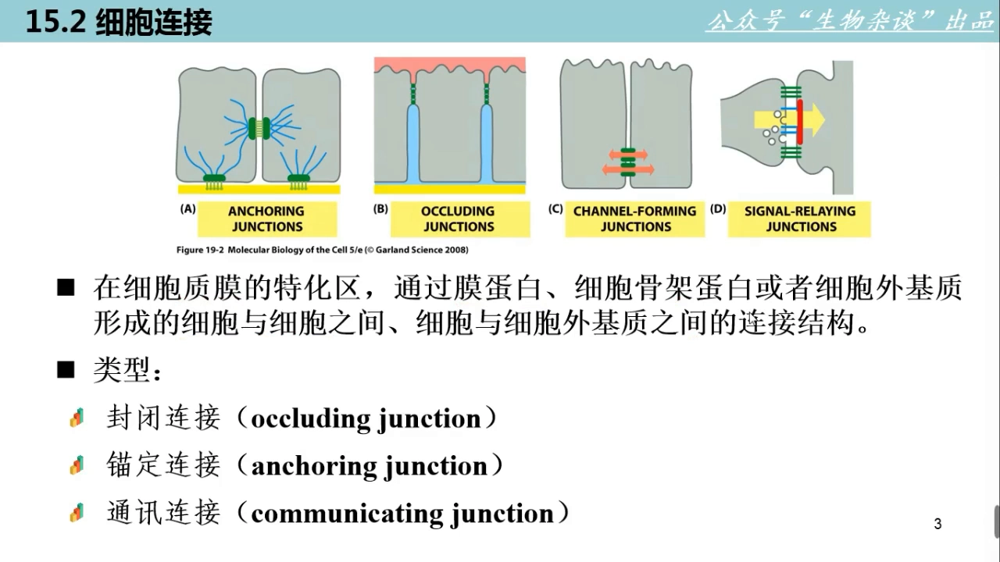
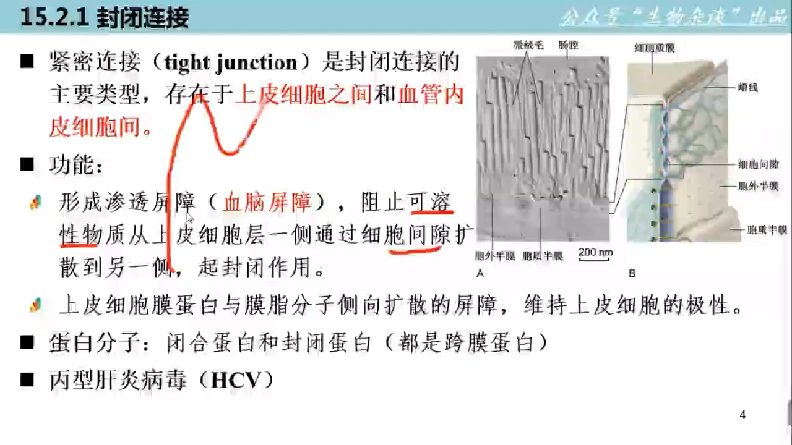
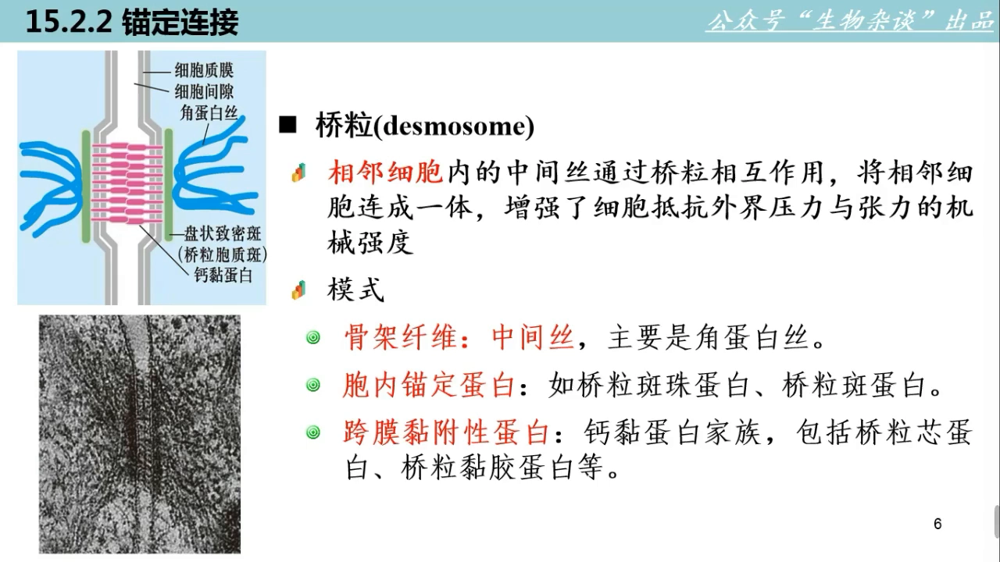
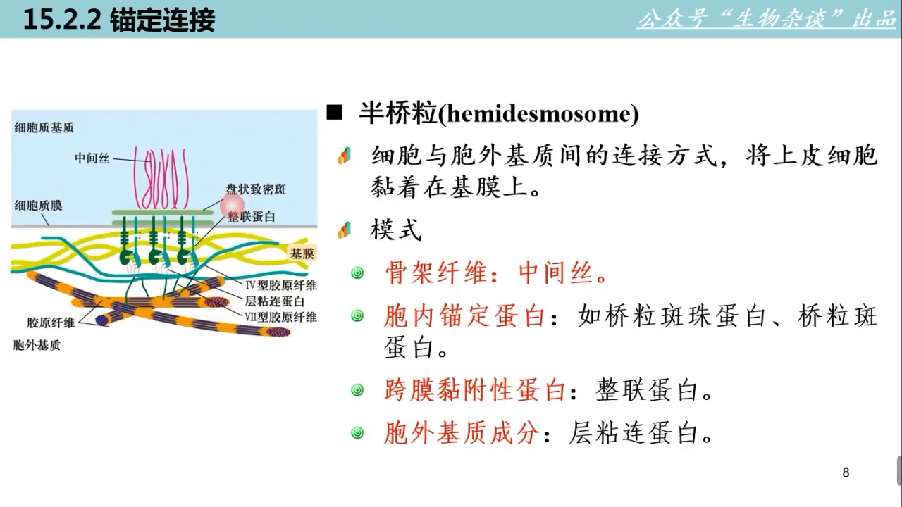
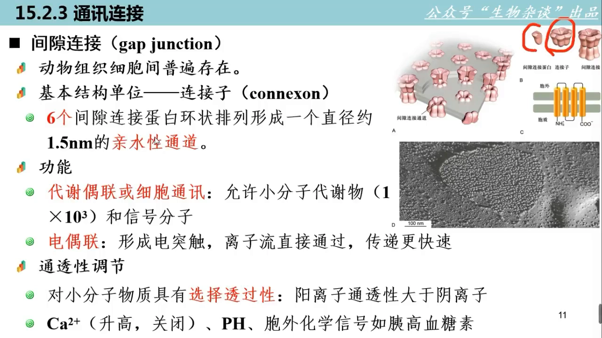
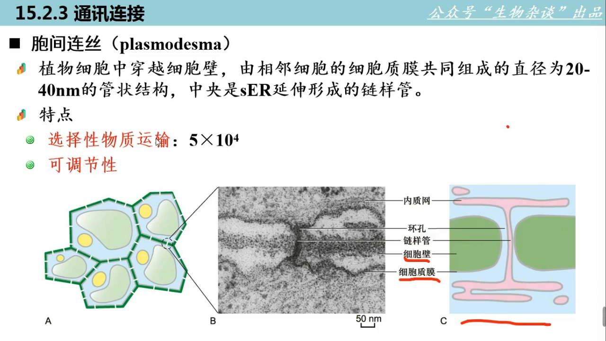

# 细胞连接的三类划分与锚定连接四型：结构模式、实验证据与通透性调节

> 视频来源：[《7.1 细胞连接的类型（生物竞赛）-翟中和版》](https://www.bilibili.com/video/BV1EV4y1K72g/)（B 站 · 生物杂谈）｜时长约 28 分钟
> 导读：这一篇讲的是**分类框架**：为什么"细胞连接"要按功能分成封闭、锚定、通讯三类；锚定连接为什么按"胞内接哪种骨架"再分成四型；以及间隙连接的通透性靠什么调节。它比[《细胞连接的四类分工》](细胞连接的四类分工：紧密连接、黏附连接、桥粒与间隙连接.md)更系统、更偏教科书结构，但缺少三维结构细节与细胞外基质部分，两篇互补。

## 本讲要解决的核心问题（SCQA）

**背景**：细胞在多细胞生物体里并不是孤立存在的，它和其他细胞、和细胞外基质之间进行着复杂的相互作用。这些沟通交流赋予了细胞"社会性"，决定着细胞的行为和命运——走向哪条分化路径、发挥什么功能、如何维持机体稳态。

**冲突**：可是细胞连接的种类名目繁多（紧密连接、黏着带、桥粒、半桥粒、黏着斑、间隙连接……），如果逐个背名字，很容易记混：为什么桥粒和半桥粒算一家，黏着带和黏着斑算另一家？

**疑问**：这些连接该怎么分类？分类的依据是什么？

**回答（中心思想）**：**按功能分三类**——封闭连接、锚定连接、通讯连接；其中锚定连接再**按胞内骨架分两族**——接中间纤维的（桥粒、半桥粒）与接微丝的（黏着带、黏着斑）。四型锚定连接共用同一个"三部件模式"，变的只是三个部件各自换成什么。

---

## 一、细胞连接的定义与三类划分

所谓**细胞连接**，指的是在细胞质膜的一些特化区域，由**跨膜蛋白、细胞骨架蛋白以及细胞外基质中的蛋白质**形成的一些特殊构造；这些构造把细胞和细胞之间、细胞和细胞外基质之间连接成一个整体结构。

[【跳转到 01:13】](https://www.bilibili.com/video/BV1EV4y1K72g/?t=73)

根据形成细胞连接的蛋白质种类和连接特点的不同，可以分成三类：

1. **封闭连接**（occluding junction）——把相邻细胞之间的缝"缝"起来；
2. **锚定连接**（anchoring junction）——把细胞彼此、或把细胞与基质锚在骨架上；
3. **通讯连接**（communicating junction）——在细胞之间开通道。

[【跳转到 02:03】](https://www.bilibili.com/video/BV1EV4y1K72g/?t=123)

视频用三个比喻把三类讲清楚：

- **锚定连接**：蓝色的丝线是细胞骨架，和骨架直接相连的深绿色部分是胞内**衔接蛋白**，跨在两个细胞膜上的丝状物是**跨膜黏附蛋白**。
- **封闭连接**：像用针线把紧邻着的三个口袋相邻的部位缝合起来，让口袋里的物质不会随意横向渗透。
- **通讯连接**：像在两个相邻细胞膜上开一个通道，物质通过通道直接交流；最经典的是植物的**胞间连丝**和动物细胞的**电突触**（间隙连接）。另一类通讯方式是**化学突触**——突触前膜以胞吐释放神经递质，递质扩散到突触后膜与受体作用。

[【跳转到 02:53】](https://www.bilibili.com/video/BV1EV4y1K72g/?t=173)

---

## 二、封闭连接：紧密连接的两个功能与两类蛋白

紧密连接是封闭连接的主要类型，存在于两个部位：**上皮细胞之间**和**血管内皮细胞间**。最经典的案例是小肠绒毛上皮细胞——电镜下能看到相邻细胞膜上如针线缝合样式的嵴，有竖着走向的，也有横着穿插的，用相关蛋白组装成网状结构，把本来隔有一段距离的两层膜紧紧缝合，而且这块区域**完全无死角**。

[【跳转到 04:20】](https://www.bilibili.com/video/BV1EV4y1K72g/?t=260)

### 2.1 功能一：渗透屏障

最经典的是**血脑屏障**：大脑毛细血管内皮细胞处的紧密连接，可以阻止离子或水分子通过血管内皮后进入脑组织，防止病原体等物质趁机通过，保证大脑内环境的稳定——因为大脑是控制中心。

小肠绒毛上皮细胞处的紧密连接同样形成渗透屏障：阻止可溶性物质从上皮细胞一侧通过细胞间隙扩散到另一侧，比如肠腔中的氨基酸、葡萄糖，或者其他有害的、不能被细胞吸收的物质，起到封锁作用。

[【跳转到 06:25】](https://www.bilibili.com/video/BV1EV4y1K72g/?t=385)

### 2.2 功能二：维持极性

在小肠靠近肠腔的一侧（游离面），有同时运输钠离子和葡萄糖的**同向协同转运蛋白**，通过主动运输把葡萄糖从肠腔运进细胞；在细胞的另外一侧，有 **GLUT**（葡萄糖载体蛋白），把内部的葡萄糖顺浓度梯度运到另一侧，再进入血管。

不管什么情况，**腔面永远有 Na⁺-葡萄糖同向转运蛋白，对侧才会有 GLUT**，这种形式不会变——这就是小肠绒毛上皮细胞的**功能极性**。而 GLUT 之所以到不了腔面，原因很简单：两侧细胞膜都被紧密连接封住了，GLUT 不可能通过细胞膜扩散过去。

[【跳转到 07:52】](https://www.bilibili.com/video/BV1EV4y1K72g/?t=472)

### 2.3 蛋白基础与一个"被病毒利用"的后果

执行紧密连接的蛋白目前已知有两类：**闭合蛋白**与**封闭蛋白**（本节采用翟中和教材的译名，即 occludin 与 claudin），都是四次跨膜的膜蛋白。至于它们各有多少种，种类太多，属于兴趣了解范畴。

[【跳转到 09:32】](https://www.bilibili.com/video/BV1EV4y1K72g/?t=572)

值得注意的一点：生物体不是孤立存在于地球上的，它和其他生物体之间也在相互作用。在我们进化出封闭连接的同时，一些病毒也进化出了对策——**丙型肝炎病毒（HCV）** 就把闭合蛋白和封闭蛋白当作自己的受体，借助这两种蛋白侵染细胞。这也是 HCV 致病的一种机制。

[【跳转到 09:57】](https://www.bilibili.com/video/BV1EV4y1K72g/?t=597)

---

## 三、锚定连接：一个三部件模式，四种变体

### 3.1 为什么需要锚定连接

锚定连接有两大类型：一种是细胞内的骨架与衔接蛋白相连，衔接蛋白再连跨膜黏附蛋白，与对面细胞以相同模式构建的装置对接；另一种是跨膜黏附蛋白直接连到**细胞外基质**上。

不管哪一种，它的作用都是一个：**增强组织中细胞承受机械力的能力**。细胞处在立体环境中，要承受其他细胞或基质给的压力，而细胞膜本身刚性太弱、太脆、很容易破裂。为了增强承受能力、让生物体能变得更立体更高大，锚定连接就出现了。

[【跳转到 11:42】](https://www.bilibili.com/video/BV1EV4y1K72g/?t=702)

### 3.2 三部件模式：记住这一个就够了

四种锚定连接的**模式完全一样**，不管成分怎么变，永远由三部分组成：

1. **胞内骨架纤维**；
2. **胞内铆定蛋白**（衔接蛋白）；
3. **跨膜黏附蛋白**。

[【跳转到 13:27】](https://www.bilibili.com/video/BV1EV4y1K72g/?t=807)

四种类型按"胞内骨架是哪一种"分成两族：

| 族 | 连接 | 胞内骨架 | 胞内铆定蛋白 | 跨膜黏附蛋白 | 对面是 |
| --- | --- | --- | --- | --- | --- |
| 中间纤维族 | 桥粒 | 中间丝（角蛋白丝） | 桥粒斑蛋白等 | 钙黏着蛋白（桥粒芯蛋白、桥粒胶黏蛋白） | 另一个细胞 |
| 中间纤维族 | 半桥粒 | 中间丝 | 桥粒斑蛋白等 | 整合素 | 细胞外基质（层粘连蛋白） |
| 微丝族 | 黏着带 | 微丝 | 连环蛋白、纽蛋白、α 辅肌动蛋白等 | 钙黏着蛋白 | 另一个细胞 |
| 微丝族 | 黏着斑 | 微丝 | kindlin、纽蛋白等 | 整合素 | 细胞外基质（胶原、纤连蛋白） |

### 3.3 桥粒：盘状致密斑与天疱疮

桥粒的骨架纤维是中间丝；胞内铆定蛋白叫**桥粒斑蛋白**；跨膜黏附蛋白是钙黏着蛋白家族，最经典的是**桥粒芯蛋白**和**桥粒胶黏蛋白**。

[【跳转到 14:17】](https://www.bilibili.com/video/BV1EV4y1K72g/?t=857)

在电镜下：最黑的部位是胞内铆定蛋白，两端中间呈丝线状的是跨膜黏附蛋白，里面放射状的是角蛋白丝。因为胞内铆定蛋白数量多、排列整齐，看起来像一个斑状结构，叫**盘状致密斑**。

[【跳转到 15:07】](https://www.bilibili.com/video/BV1EV4y1K72g/?t=907)

桥粒出问题会导致疾病，最经典的是**天疱疮**：患者自身的抗体攻击桥粒上的跨膜黏附蛋白（钙黏着蛋白），两个细胞之间的桥梁结构被破坏、锚定连接丢失，相邻细胞之间产生体液渗漏，皮肤组织液过多，形成水泡样结构。

[【跳转到 15:23】](https://www.bilibili.com/video/BV1EV4y1K72g/?t=923)

### 3.4 半桥粒：只修了一半的桥

桥粒像一根桥，两端搭在河堤上；**半桥粒只修了一半**，只有一半放在河堤上。它同样有中间丝、有盘状致密斑，但跨膜黏附蛋白换成了**整合素**——而且整合素不与另一个细胞的跨膜蛋白结合，而是和细胞外的**层粘连蛋白**结合。所以半桥粒介导的是**细胞与细胞外基质**之间的连接，把上皮细胞黏附在基膜上。

[【跳转到 16:03】](https://www.bilibili.com/video/BV1EV4y1K72g/?t=963)

### 3.5 黏着带与黏着斑：微丝族的两个成员

**黏着带**介导相邻细胞之间的连接：胞内铆定蛋白换成**连环蛋白、纽蛋白、α 辅肌动蛋白**等（统称微丝结合蛋白），跨膜黏附蛋白是钙黏着蛋白。**黏着斑**介导细胞与基质之间的连接，主要存在于肌腱或肌肉中：骨架变成微丝，铆定蛋白仍是微丝结合蛋白（kindlin、纽蛋白），跨膜蛋白和半桥粒一样是**整合素**，胞外配体由层粘连蛋白换成了**胶原蛋白和纤连蛋白**。

[【跳转到 17:43】](https://www.bilibili.com/video/BV1EV4y1K72g/?t=1063)

所以一个容易记混的点被澄清了：**黏着带和桥粒的跨膜蛋白都是钙黏着蛋白家族；半桥粒和黏着斑的跨膜蛋白都是整合素**。区分四型只看两件事——胞内接微丝还是中间纤维、对面是细胞还是基质。

---

## 四、通讯连接：间隙连接的证据与调节

### 4.1 结构：连接子与 1.5 nm 的亲水通道

间隙连接（也叫缝隙连接）之所以得名，是因为两个细胞之间存在一定的间隙，不是膜直接挨着膜。它也像桥粒一样由两半组成：位于一个细胞上的那一半叫**连接子**（connexon），是基本结构单位；连接子又由**间隙连接蛋白**（connexin）组装——**六个**间隙连接蛋白绕成一圈，中间形成一个约 **1.5 nm** 的**亲水性通道**，可以选择性通过小分子物质。对面细胞膜上有方向相反的同款结构，两个细胞靠近时就对接成完整的间隙连接。

[【跳转到 20:02】](https://www.bilibili.com/video/BV1EV4y1K72g/?t=1202)

### 4.2 功能一：代谢偶联——胸苷激酶实验

经典实验：体外培养时，有些细胞缺乏**胸苷激酶**，这种突变细胞不能利用胸苷合成 DNA。科学家把缺酶的突变细胞和正常细胞构建在一起，让它们之间搭起间隙连接通道；用放射性同位素标记胸苷，加到正常细胞里。观察一段时间后发现，突变细胞也能合成 DNA。

最终检测发现：并不是突变细胞自己合成了胸苷，而是正常细胞在胸苷激酶作用下生成了**三磷酸胸苷（TTP）**，TTP 顺着间隙连接进入突变细胞，从而合成 DNA。

[【跳转到 21:42】](https://www.bilibili.com/video/BV1EV4y1K72g/?t=1302)

这个实验清晰证明：间隙连接是**小分子代谢物和信号分子**在相邻细胞之间交流的通道。检测发现能通过的小分子一般分子质量小于 1000 Da。

[【跳转到 22:57】](https://www.bilibili.com/video/BV1EV4y1K72g/?t=1377)

### 4.3 功能二：电偶联

神经细胞产生神经冲动依赖钠、钾等离子。这些带电荷的物质可以直接通过间隙连接从一个细胞流入相邻细胞，非常快速地让相邻细胞也产生冲动——这叫**电偶联**，也叫**电突触**，本质上就是神经冲动（或心肌兴奋）的快速传递。

[【跳转到 23:47】](https://www.bilibili.com/video/BV1EV4y1K72g/?t=1427)

### 4.4 选择性与通透性调节

间隙连接是**选择通透性**结构，除了 1000 Da 的分子质量上限，实验还总结出一条规律：**阳离子的通透性大于阴离子**。

[【跳转到 24:12】](https://www.bilibili.com/video/BV1EV4y1K72g/?t=1452)

通透性还可以被调节，而且调节信号来自不同层次：

- **胞内 Ca²⁺ 升高**时，间隙连接被关闭，防止钙离子过度升高；
- **pH 下降**时，通透性下降；
- **胞外信号**：胰高血糖素启动 G 蛋白偶联受体介导的 **cAMP-PKA** 通路，活化的 PKA 使间隙连接蛋白**磷酸化**，通透性增加。

[【跳转到 24:37】](https://www.bilibili.com/video/BV1EV4y1K72g/?t=1477)

这条调节链的意义在于：间隙连接不是一根固定开着的管子，它把**胞内状态**（钙、pH）和**胞外激素信号**都翻译成"开多大"。

---

## 五、植物的对应结构：胞间连丝

植物细胞有细胞壁，不能像动物细胞那样靠膜蛋白直接对接，于是有了**胞间连丝**：两个相邻细胞的细胞膜在细胞壁处连接成一个整体，形成孔洞结构；孔洞内部还有两个细胞的内质网延伸连接形成的管状结构，叫**连丝管**；细胞膜与内质网膜之间的通道叫**环孔**，它就是两个细胞交换物质和信息的通道。

[【跳转到 26:22】](https://www.bilibili.com/video/BV1EV4y1K72g/?t=1582)

通道两侧相对狭窄，可以调节孔径大小，进行选择性运输。实验发现，分子质量 5×10⁴ Da（5 万）以下的物质都可以运输，甚至 50 kDa 的大分子蛋白质也能通过。

[【跳转到 27:12】](https://www.bilibili.com/video/BV1EV4y1K72g/?t=1632)

它和间隙连接一样具有**可调节性**：一些植物病毒能在相邻细胞中合成蛋白，比如 **P30**，这种蛋白可以调节胞间连丝的孔径，让病毒从一个细胞直接经胞间连丝穿透到下一个细胞，实现相邻细胞的感染。

[【跳转到 27:37】](https://www.bilibili.com/video/BV1EV4y1K72g/?t=1657)

---

## 六、边界与易错点

1. **"封闭"是相对的**。紧密连接封的是细胞旁路，不是所有物质交换；它也不能阻止物质穿过细胞本身（那要靠转运体的选择性）。血脑屏障与小肠上皮用的是同一套结构逻辑，但"封什么、放什么"由具体部位的蛋白组成决定。
2. **锚定连接的四型不是四个独立发明**。它们共用"骨架—铆定蛋白—跨膜黏附蛋白"三部件模式，记住模式比记名字稳。真正决定性质的是**骨架类型**：接微丝可收缩可调节，接中间纤维抗拉但稳定。
3. **同一类蛋白可以出现在不同连接里**。钙黏着蛋白既在黏着带（经典型）也在桥粒（非经典型）；整合素既在半桥粒也在黏着斑。所以"看到钙黏着蛋白就说是黏着带"是错的。
4. **间隙连接的通透性有上限也有偏好**。上限约 1000 Da（胞间连丝约 5×10⁴ Da），且在离子上偏好阳离子；这两条都不是"随便什么都能过"。
5. **本讲不涉及细胞外基质本身**。ECM 的成分、生长因子呈递与整合素信号见[《细胞外基质：成分、生长因子呈递与整合素信号》](细胞外基质：成分、生长因子呈递与整合素信号.md)。

---

## 小结

- 细胞连接按功能分三类：**封闭**（紧密连接）、**锚定**（桥粒、半桥粒、黏着带、黏着斑）、**通讯**（间隙连接、胞间连丝、化学突触）。
- 紧密连接两个功能：**渗透屏障**（血脑屏障、小肠上皮）与**维持极性**（腔面 Na⁺-葡萄糖同向转运蛋白、对侧 GLUT）；蛋白基础是闭合蛋白与封闭蛋白，HCV 反过来把它们当受体。
- 锚定连接共用**三部件模式**：胞内骨架 + 胞内铆定蛋白 + 跨膜黏附蛋白；按骨架分两族、共四型。
- **桥粒—半桥粒**接中间纤维（桥粒斑蛋白、钙黏着蛋白／整合素）；**黏着带—黏着斑**接微丝（连环蛋白、kindlin、纽蛋白）。
- 间隙连接由**六个连接蛋白围成连接子**，孔径约 1.5 nm；证据是胸苷激酶代谢偶联实验与荧光染料／离子传递；通透性受 Ca²⁺、pH 与 cAMP-PKA 磷酸化调节。

## 关键术语速查

| 术语 | 一句话解释 |
| --- | --- |
| 封闭连接 | 把相邻细胞间隙缝合起来的连接类型，主要类型是紧密连接 |
| 锚定连接 | 通过跨膜黏附蛋白把骨架与另一细胞或基质相连，用于承受机械力 |
| 通讯连接 | 在细胞之间开通道传递小分子或离子的连接类型 |
| 闭合蛋白／封闭蛋白 | 紧密连接的两种四次跨膜蛋白（occludin／claudin），本节采用教材译名 |
| 胞内铆定蛋白 | 把跨膜黏附蛋白接到骨架上的衔接蛋白，如桥粒斑蛋白、连环蛋白、kindlin |
| 盘状致密斑 | 桥粒胞内铆定蛋白密集排列形成的电子致密斑块 |
| 桥粒芯蛋白／桥粒胶黏蛋白 | 桥粒的两种非经典钙黏着蛋白，是跨膜黏附蛋白 |
| 天疱疮 | 自身抗体攻击桥粒钙黏着蛋白、锚定连接丢失导致皮肤水泡的疾病 |
| 连接子 | 六个间隙连接蛋白围成的半通道，是间隙连接的基本结构单位 |
| 代谢偶联 | 小分子代谢物经间隙连接在细胞间共享（如 TTP 拯救胸苷激酶缺陷细胞） |
| 电偶联 | 离子经间隙连接直接流动，使相邻细胞电活动快速同步 |
| 胞间连丝 | 植物细胞穿越细胞壁的通道，中央有内质网延伸形成的连丝管 |