# 细胞连接的四类分工：紧密连接、黏附连接、桥粒与间隙连接

> 视频来源：[《细胞之城 | 细胞之间是怎么连接的？细胞连接与细胞外基质可视化讲解！》](https://www.bilibili.com/video/BV1XDWb6PEfU/)（B 站 · 羽升生物可视化教学）｜时长约 20 分钟
> 导读：这一篇沿上皮细胞的侧面自上而下走一遍——紧密连接、黏着带、桥粒、间隙连接，再转到细胞底部看整合素怎样抓住细胞外基质，最后用一个白细胞穿出血管的故事把六种连接串起来。视频是三维可视化讲解，同一画面里会标注"公认结构／经典模型／仍有争议"，本篇按画面标注区分可信度。细胞外基质的成分与信号作用在[《细胞外基质：成分、生长因子呈递与整合素信号》](细胞外基质：成分、生长因子呈递与整合素信号.md)展开；骨架本身见 [1.3.4 细胞骨架、细胞形态与胞内运输](../../../README.md#b01-1-3-4)。

## 本讲要解决的核心问题（SCQA）

**背景**：小肠内壁只有一层细胞，它们天天被食物摩擦、被肠道收缩拉扯，却既不会散开，也不会漏。

**冲突**：一层细胞要同时满足三个互相冲突的要求——**不能散开**（要抗拉、抗剪）、**不能漏**（要封闭）、**还要协同**（一整片上皮要能同时收缩、同时响应）。一根绳子只能解决第一个问题；把细胞粘死又会让组织失去改变形状的能力。

**疑问**：细胞之间到底靠哪些结构分工完成这三件事？它们各自连着什么、在哪里、起什么作用？

**回答（中心思想）**：细胞连接按功能分三类——**封闭连接**（封住细胞间隙）、**锚定连接**（把细胞彼此拴牢、或拴在地面上）、**通讯连接**（在细胞之间开通道传小分子）。锚定连接再按"接到哪种骨架上"分成两族：**接微丝**的能收缩、能调节（黏着带、黏着斑），**接中间纤维**的负责抗拉（桥粒、半桥粒）。一条分界线贯穿全篇：**细胞与细胞之间，主角是钙黏着蛋白；细胞与基质之间，主角是整合素**。

---

## 一、为什么需要连接：力学、屏障与通讯

组织里的细胞有两种摆法。**上皮**（皮肤、消化道内壁）一个挨一个排得整整齐齐，靠细胞骨架里的微丝和中间纤维把相邻细胞串成一张网；**结缔组织**（肌腱、骨）正好相反，细胞稀稀拉拉散在大量细胞外基质里，受力的是基质里的胶原纤维。

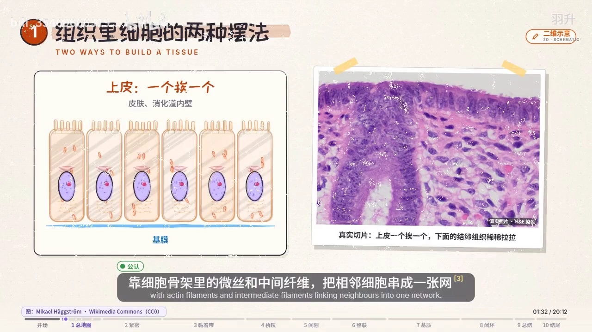

[【跳转到 01:32】](https://www.bilibili.com/video/BV1XDWb6PEfU/?t=92)

所以"细胞连接"这个问题在上皮里最尖锐：相邻细胞之间要办三件事——**把缝封住**（封闭连接）、**把彼此拴牢**（锚定连接）、**互相传递小分子**（通讯连接）。

[【跳转到 02:07】](https://www.bilibili.com/video/BV1XDWb6PEfU/?t=127)

### 1.1 六种连接与一张对照表

沿着上皮细胞的侧面从顶到底依次是**紧密连接、黏着带、桥粒**（这三个在电镜下总是成套出现，合称**连接复合体**），还有散在的**间隙连接**；细胞底部还有两种不连别的细胞、而是连基质的连接——**半桥粒**和**黏着斑**。

[【跳转到 02:32】](https://www.bilibili.com/video/BV1XDWb6PEfU/?t=152)

课上专门纠正过一条分界线：**细胞和细胞之间，主角是钙黏着蛋白；细胞和基质之间，主角是整合素**。还要看每种连接在细胞里面接到哪种骨架上——**接微丝的能收缩、能调整，接中间纤维的主要负责抗拉力**。

[【跳转到 02:32】](https://www.bilibili.com/video/BV1XDWb6PEfU/?t=152)

| 连接 | 连的是谁 | 跨膜蛋白 | 胞内骨架 | 主要功能 | 典型位置 |
| --- | --- | --- | --- | --- | --- |
| 紧密连接 | 细胞—细胞 | 密封蛋白（claudin）、闭合蛋白（occludin）、JAM | 微丝（经 ZO-1） | 封细胞旁路；立栅栏维持极性 | 上皮顶端、血管内皮 |
| 黏着带（黏附连接） | 细胞—细胞 | 经典钙黏着蛋白（E-钙黏着蛋白） | 微丝（经 α/β 连环蛋白） | 传递张力、调控形状与增殖 | 紧密连接下方绕细胞一圈 |
| 桥粒 | 细胞—细胞 | 非经典钙黏着蛋白（桥粒芯蛋白、桥粒胶黏蛋白） | 中间纤维（角蛋白丝） | 抗拉，把细胞连成一张网 | 皮肤、心肌等受强张力处 |
| 间隙连接 | 细胞—细胞 | 连接蛋白（connexin）组成的连接子 | 不接骨架 | 传递离子与小分子；电偶联 | 心肌、多数动物组织 |
| 半桥粒 | 细胞—基质 | 整合素 α6β4（+17 型胶原） | 中间纤维 | 把上皮铆在基膜上 | 上皮基底面 |
| 黏着斑 | 细胞—基质 | 整合素 | 微丝（应力纤维） | 抓地、机械转导、迁移 | 成纤维细胞、迁移细胞前端 |

一句话记法：**细胞之间看钙黏着蛋白，细胞和地面之间看整合素；它们都能松能紧，组织才既结实、又能改变形状。**

[【跳转到 18:47】](https://www.bilibili.com/video/BV1XDWb6PEfU/?t=1127)

---

## 二、紧密连接：封旁路，立栅栏

### 2.1 结构：一圈"封闭锁"

在电镜下，相邻两层细胞膜在这里一点一点地贴住，贴住的地方细胞间隙消失。用**冷冻断裂**把膜从中间劈开，能看到一张网：一条条蛋白颗粒串成的锁，交错着绕细胞顶部一圈，叫**封闭锁**。

[【跳转到 03:05】](https://www.bilibili.com/video/BV1XDWb6PEfU/?t=185)

怎么证明它真的封住了？往一侧加进电子致密的**示踪物**，它沿着细胞间隙往里渗，渗到紧密连接这里就停住了。

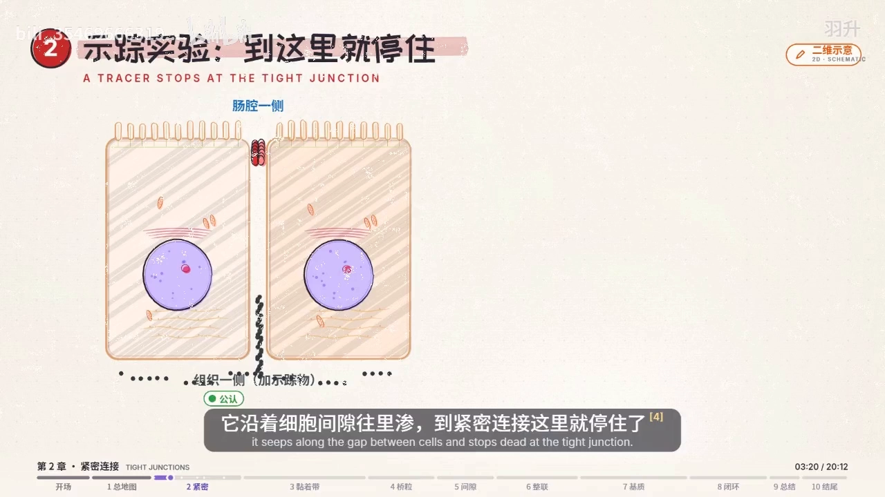

[【跳转到 03:20】](https://www.bilibili.com/video/BV1XDWb6PEfU/?t=200)

封闭锁由穿膜蛋白构成，主要有三类：**密封蛋白**（claudin，也叫克劳丁家族，有 20 多个成员）、**闭合蛋白**（occludin），还有**连接黏附分子 JAM**。克劳丁是四次穿膜的小蛋白，胞外的两个环伸进缝里，和对面细胞的克劳丁一对一地咬合；同一层膜里，一个挨一个排成长长的一串。

[【跳转到 03:36】](https://www.bilibili.com/video/BV1XDWb6PEfU/?t=216)

胞内一侧不靠它自己抓骨架：**ZO-1** 这样的衔接蛋白不穿膜，像一个转接头，一端抓住穿膜蛋白，一端抓住微丝。

[【跳转到 03:46】](https://www.bilibili.com/video/BV1XDWb6PEfU/?t=226)

### 2.2 功能一：封住细胞旁路，但"不是铁板一块"

第一项功能是封住细胞之间的缝，叫**细胞旁路**：肠腔里的东西不能从缝里溜进身体。注意它封的是旁路，**不是吸收**——葡萄糖、氨基酸照样能穿过细胞本身进来，只不过必须走细胞膜上的转运体，这条路是受控制的。

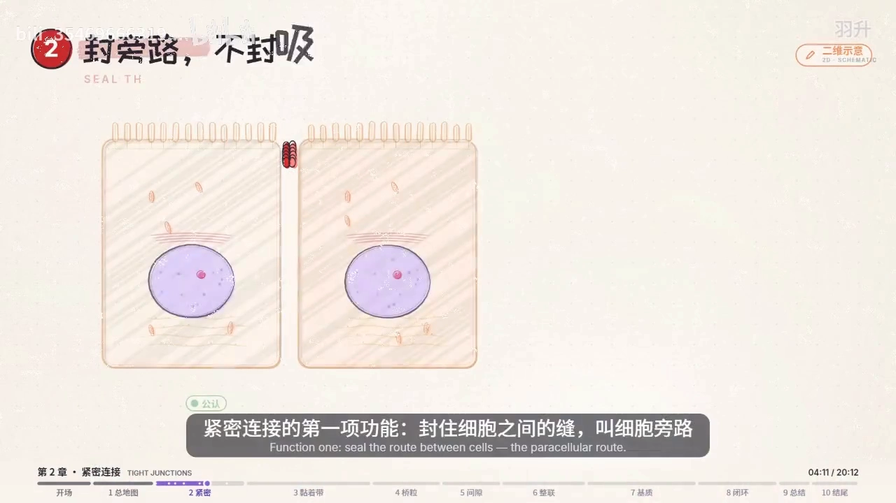

[【跳转到 04:11】](https://www.bilibili.com/video/BV1XDWb6PEfU/?t=251)

关键限定：封闭锁**不是铁板一块**。不同的克劳丁在缝里留下的小孔不一样，有的只放某些离子和水通过，所以各段上皮的"漏洞"可以不同。

[【跳转到 04:36】](https://www.bilibili.com/video/BV1XDWb6PEfU/?t=276)

### 2.3 功能二：栅栏，把膜分成两个区

膜是流动的，膜蛋白本来可以到处游。紧密连接绕细胞一圈，把细胞膜分成**顶面**和**底侧面**两个区，这就是**栅栏**功能。

小肠上皮是最好的例子：顶面是靠钠离子梯度把葡萄糖拉进来的 **SGLT1**，底面是让葡萄糖顺梯度出去的 **GLUT2**。要是没有这道栅栏，两种转运体混在一起，葡萄糖就做不到"顶进底出"。

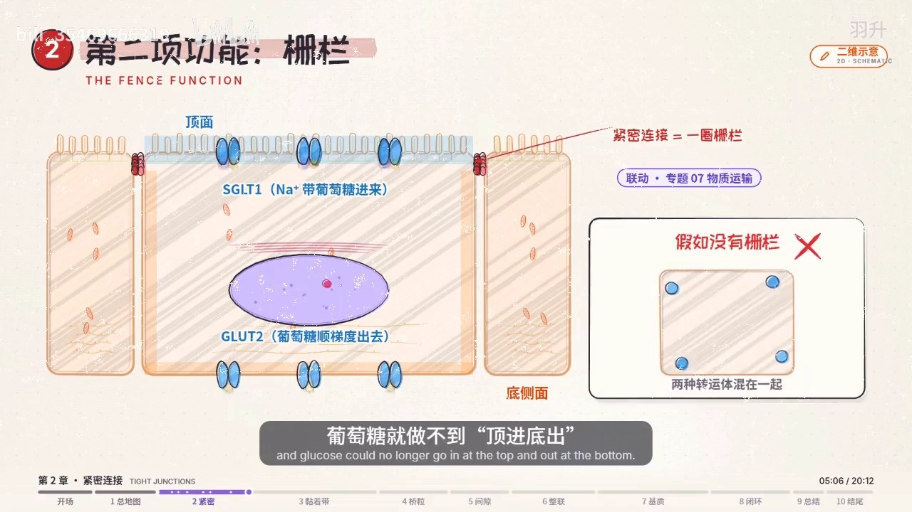

[【跳转到 05:06】](https://www.bilibili.com/video/BV1XDWb6PEfU/?t=306)

（SGLT1 与 GLUT2 的转运机制见 [1.3.2 生物膜结构与跨膜运输](../1.3.2_生物膜结构与跨膜运输/主动运输的能量来源：钠钾泵、协同转运与质子泵.md)。）

---

## 三、黏着带（黏附连接）：连微丝，传张力

### 3.1 E-钙黏着蛋白：没有钙就不工作

黏着带是一条绕细胞一圈的带子，两层膜之间隔着 20 nm 左右。跨过这道缝的是 **E-钙黏着蛋白**，它是经典的钙黏着蛋白：一次穿膜，胞外有五个串起来的结构域。

[【跳转到 05:06】](https://www.bilibili.com/video/BV1XDWb6PEfU/?t=306)

它的名字里带着钙，因为没有钙它就不工作：钙离子卡在每两个结构域之间的关节上。细胞外的钙大约一到两毫摩尔，钙一结合，整串立刻变硬、伸直；伸直之后最前端的结构域伸向对面，和对面细胞的钙黏着蛋白互相交换一小段链、扣在一起，像两把锁互相锁住。

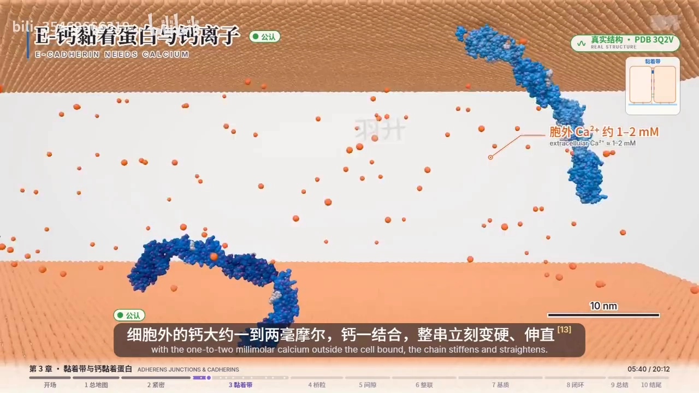

[【跳转到 05:40】](https://www.bilibili.com/video/BV1XDWb6PEfU/?t=340)

一对的结合力很弱，但真实细胞里成百上千对挤在一起，黏合力就累积起来了。

[【跳转到 05:55】](https://www.bilibili.com/video/BV1XDWb6PEfU/?t=355)

钙的作用有一个经典实验：用**螯合剂**把培养液里的钙拿掉，上皮细胞一个个散开变圆；把钙加回去，它们又重新连成一片。

[【跳转到 06:15】](https://www.bilibili.com/video/BV1XDWb6PEfU/?t=375)

### 3.2 连环蛋白：从钙黏着蛋白到微丝的转接头

钙黏着蛋白自己抓不住骨架，中间要靠一串转接蛋白：**P120 连环蛋白**稳住它的尾巴，**β 连环蛋白**接上 **α 连环蛋白**，再连到微丝；受力时还会招来**纽蛋白**（vinculin），抓得更牢。

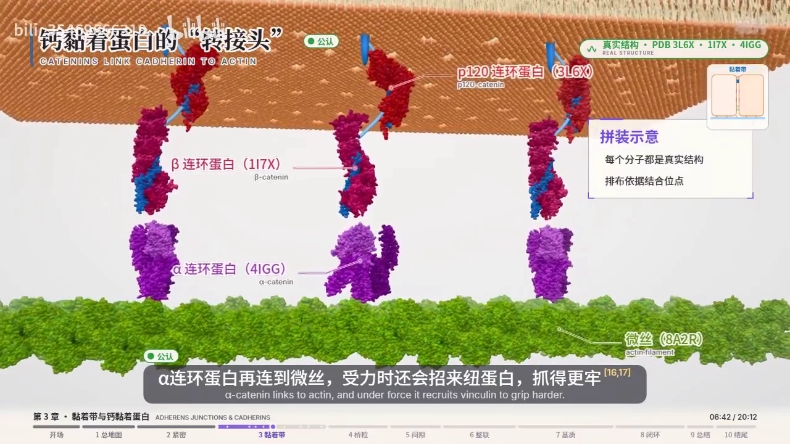

[【跳转到 06:42】](https://www.bilibili.com/video/BV1XDWb6PEfU/?t=402)

老师打了个比方：这就像 Type-C 转 USB 的转换头，两头的接口不一样，中间得有人转一下。更妙的是，这条链子**被拉紧时反而结合得更牢**——越拉越紧，这种结合叫**逆锁键**（catch bond）。

[【跳转到 06:47】](https://www.bilibili.com/video/BV1XDWb6PEfU/?t=407)

### 3.3 组装四步，以及"黏住"之后能干什么

两个细胞搭上的过程分四步：伸出**片状伪足**互相试探 → 钙黏着蛋白配上对、稳定下来 → 招来 **ARP2/3** 长出更多微丝 → 招来**肌球蛋白**把微丝收紧，连接就加固了。

[【跳转到 07:26】](https://www.bilibili.com/video/BV1XDWb6PEfU/?t=446)

黏着带里面衬着一圈微丝和肌球蛋白，所以它**能主动收缩**：一圈细胞同时收紧顶部，整片上皮就会向内弯，卷成沟、卷成管——胚胎里**神经管**就是这样卷起来的。

[【跳转到 07:31】](https://www.bilibili.com/video/BV1XDWb6PEfU/?t=451)

钙黏着蛋白不止一种：上皮用 **E 型**，神经用 **N 型**，胎盘用 **P 型**。它们是**同型结合**——E 只认 E，N 只认 N。把两种细胞打散了混在一起，它们会自己分开、各找各的同类聚成两团；胚胎早期神经组织和表皮就是这样分开的。

[【跳转到 07:42】](https://www.bilibili.com/video/BV1XDWb6PEfU/?t=462)

就算是同一种钙黏着蛋白，**表达量**也有讲究：表达多的细胞黏得紧，缩到团块中间；表达少的留在外层。

[【跳转到 07:54】](https://www.bilibili.com/video/BV1XDWb6PEfU/?t=474)

---

## 四、桥粒与半桥粒：连中间纤维，负责抗拉

### 4.1 桥粒：一个个铆钉，不是一条带子

再往下是**桥粒**。它不成带，而是一个一个的点，像铆钉，或者衣服上的暗扣。跨膜的也是钙黏着蛋白，但是非经典的两种：**桥粒芯蛋白**和**桥粒胶黏蛋白**。

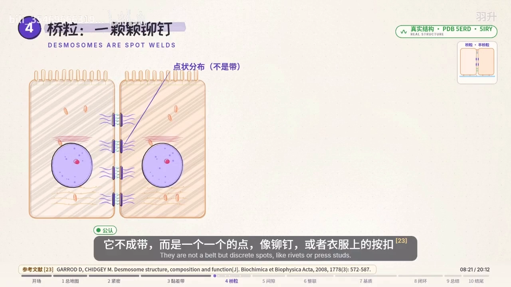

[【跳转到 08:21】](https://www.bilibili.com/video/BV1XDWb6PEfU/?t=501)

胞内一侧，它们挤成一块致密斑；斑上挂住的**不是微丝，是中间纤维**——上皮里是角蛋白丝。一个个桥粒把相邻细胞的角蛋白网连成一整张网，拉力就分散到整片组织上。

[【跳转到 08:34】](https://www.bilibili.com/video/BV1XDWb6PEfU/?t=514)

在电镜下桥粒很好认：两侧各一块电子密度很高的斑，中间的缝里还有一条细线，整体致密规整。

[【跳转到 08:49】](https://www.bilibili.com/video/BV1XDWb6PEfU/?t=529)

### 4.2 黏着带 vs 桥粒：三点对比

课上专门做了三点对比：

1. **动态性**：黏着带很灵活，钙一降就松开；桥粒非常稳定，成熟后几乎不随钙变化。
2. **功能**：黏着带除了黏，还参与调控细胞形状、增殖和存活；桥粒基本只做一件事——铆牢。
3. **电镜结构**：黏着带松散、电子密度低；桥粒是致密斑块。

[【跳转到 09:00】](https://www.bilibili.com/video/BV1XDWb6PEfU/?t=540)

这三点合起来说明一件事：**"连微丝"意味着可调节，"连中间纤维"意味着抗拉但不灵活**。骨架的选择决定了连接的物理性质。

### 4.3 半桥粒：把细胞铆在地面上

细胞底部还有"半个"桥粒，叫**半桥粒**。因为它对面不是另一个细胞，而是细胞外基质，所以跨膜的换成了**整合素 α6β4**，再加上 **17 型胶原**，向外抓住基膜里的**层粘连蛋白**，向内同样挂住中间纤维。

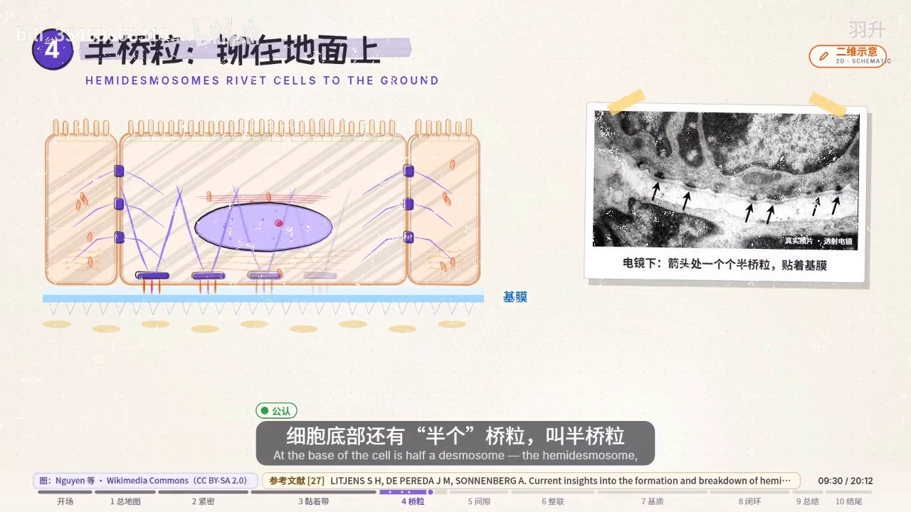

[【跳转到 09:30】](https://www.bilibili.com/video/BV1XDWb6PEfU/?t=570)

于是：**桥粒把细胞和细胞铆在一起，半桥粒把细胞铆在地面上**；一层上皮就这样被中间纤维从侧面和底面同时拉住。

[【跳转到 09:41】](https://www.bilibili.com/video/BV1XDWb6PEfU/?t=581)

---

## 五、间隙连接：小分子通道与电偶联

前面的连接都是为了黏合、封闭，**间隙连接不同，它的目的是交流物质**。

### 5.1 三层组装：连接蛋白 → 连接子 → 通道

它分三层来搭：单个的蛋白叫**连接蛋白**（connexin），四次穿膜；六个连接蛋白围成一圈叫**连接子**（connexon），相当于半个通道；两个细胞的连接子头对头接上，才是一个完整的间隙连接通道。

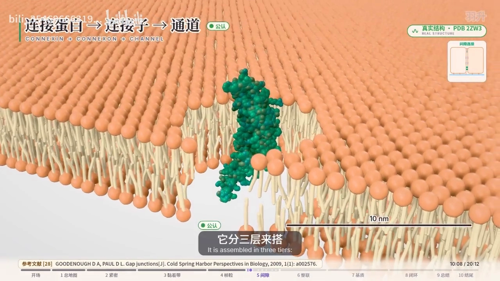

[【跳转到 10:08】](https://www.bilibili.com/video/BV1XDWb6PEfU/?t=608)

注意这是**超分子的组装**，不是蛋白质的三级结构——连接子由六个独立蛋白拼成，两个连接子再拼成通道。

[【跳转到 10:19】](https://www.bilibili.com/video/BV1XDWb6PEfU/?t=619)

### 5.2 孔径决定谁能过

这是连接蛋白 26 组成的通道的真实结构：12 个亚基，中间一条孔道，最窄处大约 1.4 nm。这么窄，只有离子和小分子过得去，比如环腺苷酸、葡萄糖；蛋白质和核酸都过不去。

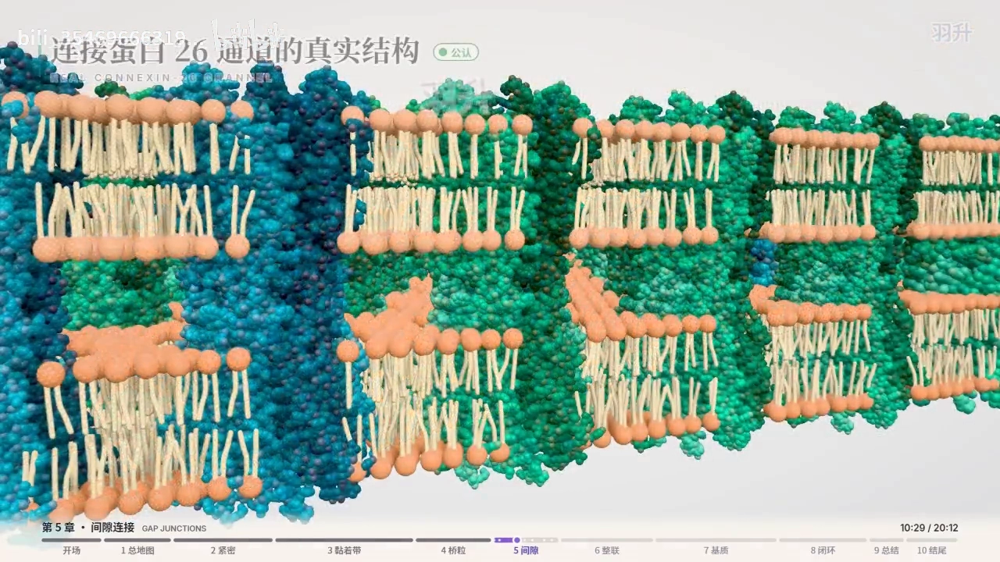

[【跳转到 10:29】](https://www.bilibili.com/video/BV1XDWb6PEfU/?t=629)

成百上千个通道挤在一起，形成一块**连接斑**，电镜下排成整齐的六边形阵列。

[【跳转到 10:49】](https://www.bilibili.com/video/BV1XDWb6PEfU/?t=649)

### 5.3 证据、电偶联与关闭

60 年代有个实验：往一个细胞里注射**荧光染料**，染料很快出现在相邻的细胞里，但不会漏到细胞外面——这直接证明通道开在细胞之间，而不是膜上漏了。

[【跳转到 10:54】](https://www.bilibili.com/video/BV1XDWb6PEfU/?t=654)

离子也能这样走，电流于是从一个细胞直接传到下一个，叫**电偶联**。**心肌细胞能整齐地一起收缩，靠的就是它**。

[【跳转到 11:05】](https://www.bilibili.com/video/BV1XDWb6PEfU/?t=665)

通道也会关：胞内**钙离子浓度很高**或者**变酸**时，连接子会拧紧，把受损的细胞和邻居隔开。

[【跳转到 11:15】](https://www.bilibili.com/video/BV1XDWb6PEfU/?t=675)

---

## 六、整合素：把外面的力学传进细胞

### 6.1 α + β 异二聚体，两种构象

到细胞底部。细胞抓地面靠的是**整合素**（integrin）：它由一条 α 链和一条 β 链组成，是**异二聚体**；人体有 18 种 α、8 种 β，组合出 24 种整合素。

[【跳转到 11:30】](https://www.bilibili.com/video/BV1XDWb6PEfU/?t=690)

静息时它**弯着腰**，头折下来贴近细胞膜，抓不住东西；被激活后它**直起身**，头部打开，才能牢牢结合基质。这是 αVβ3 胞外部分的真实结构，正是弯腰的样子。

[【跳转到 11:43】](https://www.bilibili.com/video/BV1XDWb6PEfU/?t=703)

### 6.2 由内向外：开关在细胞里面

开关在细胞里面：**talin** 和 **kindlin** 结合到 β 链的尾巴上，把两条腿撬开，整个分子就伸展开了。信号从里往外传，叫**由内向外的信号**（inside-out signaling）。

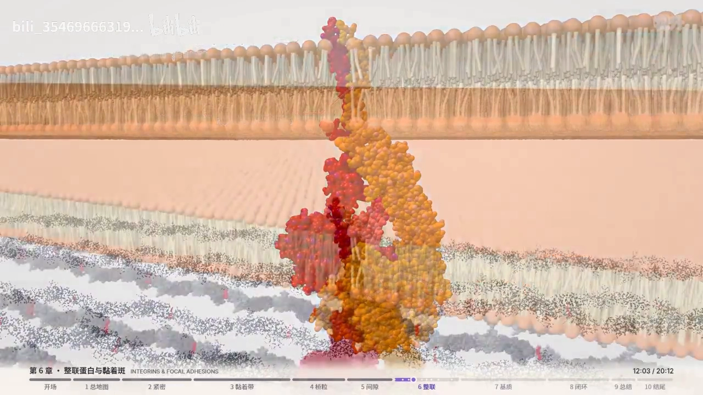

[【跳转到 12:03】](https://www.bilibili.com/video/BV1XDWb6PEfU/?t=723)

### 6.3 它认什么：RGD 三肽

很多整合素认三个氨基酸：**精氨酸-甘氨酸-天冬氨酸**，简称 **RGD**。在纤连蛋白的真实结构上，RGD 就在一个伸出来的小环顶端。

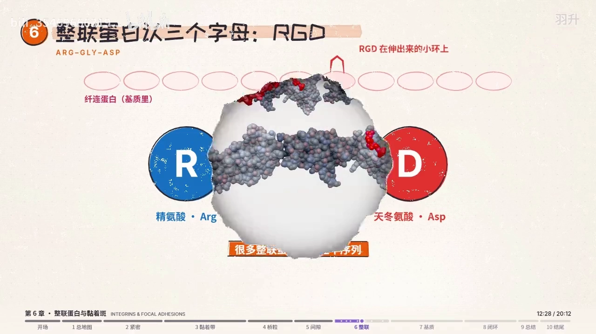

[【跳转到 12:28】](https://www.bilibili.com/video/BV1XDWb6PEfU/?t=748)

怎么证明就是这三个氨基酸？把含 RGD 的短肽加进培养液，它抢先占住整合素，已经贴壁的细胞就松开浮起来；换成打乱顺序的短肽就没有这个效果。

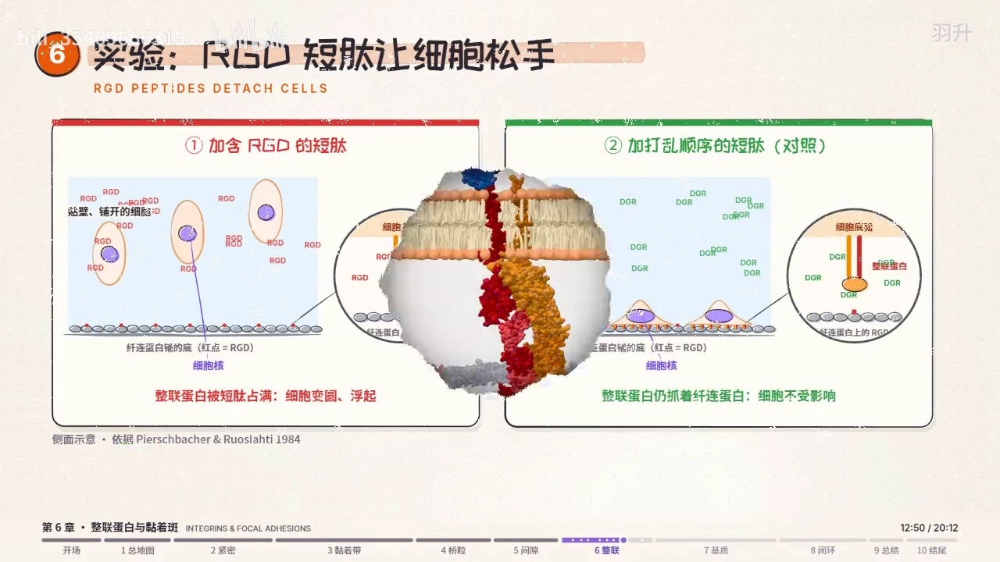

[【跳转到 12:50】](https://www.bilibili.com/video/BV1XDWb6PEfU/?t=770)

### 6.4 黏着斑与由外向内：抓住地面才能活

大量激活的整合素聚到一处就成了**黏着斑**：外面抓住胶原、纤连蛋白，里面经过 kindlin、纽蛋白连上成熟的微丝，叫**应力纤维**。

[【跳转到 12:55】](https://www.bilibili.com/video/BV1XDWb6PEfU/?t=775)

信号也能反过来传：结合了基质，**黏着斑激酶（FAK）**就被激活，告诉细胞"我抓住地面了，可以存活、可以分裂"。这叫**由外向内的信号**。

[【跳转到 13:05】](https://www.bilibili.com/video/BV1XDWb6PEfU/?t=785)

所以大多数上皮细胞离不开地面，叫**贴壁依赖**；真被从基质上拿下来，它们会启动凋亡，这叫**失巢凋亡**（anoikis）。

[【跳转到 13:15】](https://www.bilibili.com/video/BV1XDWb6PEfU/?t=795)

---

## 七、细胞外基质：三类成分与基膜

整合素抓的这块地面，就是**细胞外基质**。它主要分三类成分：**糖胺聚糖和蛋白聚糖**（糖多蛋白少，长糖链带负电、吸水成凝胶，专门抗压）、**纤维状蛋白**（胶原负责抗拉，弹性蛋白负责回弹）、**黏附性糖蛋白**（纤连蛋白、层粘连蛋白，负责把东西连起来）。

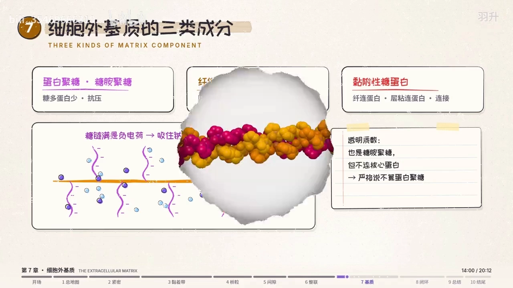

[【跳转到 14:00】](https://www.bilibili.com/video/BV1XDWb6PEfU/?t=840)

胶原的结构决定了它为什么能抗拉：一条胶原链的氨基酸几乎都是"甘氨酸-X-Y"的重复，三条链拧成一根三股螺旋；每隔两个就得是甘氨酸，因为只有它够小，能塞进螺旋中心。

[【跳转到 14:05】](https://www.bilibili.com/video/BV1XDWb6PEfU/?t=845)

胶原分子错开 1/4 平行排成原纤维，留下规律的空隙，所以电镜和原子力显微镜下胶原原纤维上有一道道明暗相间的条纹，周期大约 67 nm；最后相邻分子之间再共价交联，原纤维才能抗住拉力。

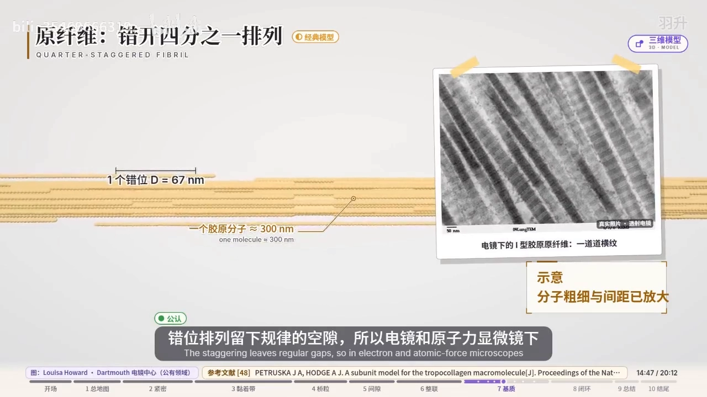

[【跳转到 14:47】](https://www.bilibili.com/video/BV1XDWb6PEfU/?t=887)

上皮、肌肉、血管内皮的下面有一层特化的薄膜，叫**基膜**（也叫基底层），**它不是成纤维细胞做的**，而是上皮自己分泌的。

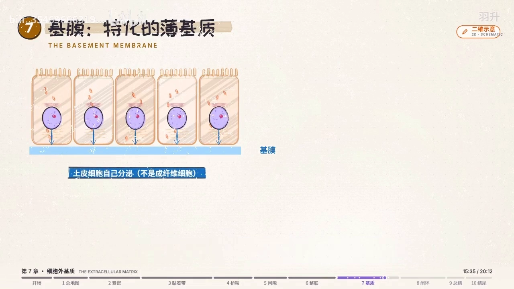

[【跳转到 15:35】](https://www.bilibili.com/video/BV1XDWb6PEfU/?t=935)

基膜有四件套：层粘连蛋白和四型胶原各自织成一张网，巢蛋白和串珠蛋白聚糖把两张网钉在一起。它的功能有四条：**黏合**（把上皮固定在下面的结缔组织上）、**过滤**（如肾小球，小分子透过去、大蛋白和细胞挡在外面）、**屏障**（细胞想穿过基膜必须先分泌酶把它降解掉）、**极性**（贴着基膜的一面是底，对面就是顶）。

[【跳转到 15:51】](https://www.bilibili.com/video/BV1XDWb6PEfU/?t=951)

细胞和基质是**双向**的：细胞分泌、改造基质，基质又通过整合素告诉细胞该长成什么样。这一层机制（生长因子呈递、力学信号、疾病中的基质）在[《细胞外基质：成分、生长因子呈递与整合素信号》](细胞外基质：成分、生长因子呈递与整合素信号.md)展开。

---

## 八、把六种连接串起来：白细胞穿出血管

组织里来了细菌，血管里的白细胞要赶过去。平时白细胞并不是随血流乱飘，而是贴着血管壁慢慢滚动，像在巡逻——抓住它的是**选择素**：内皮细胞表面的 **P-选择素**认出白细胞表面带糖链的 **PSGL-1**。这种结合又弱又快，一边结合一边断开，所以白细胞既不会被冲走，又停不下来，只能滚；而且血流越冲，结合反而更久，这也是一种**逆锁键**。

[【跳转到 16:25】](https://www.bilibili.com/video/BV1XDWb6PEfU/?t=985)

细菌和周围细胞放出**趋化因子**，黏在内皮表面。白细胞滚过去，表面的 G 蛋白偶联受体一接到信号，就从里往外激活整合素 **LFA-1**——正是刚才讲的"由内向外伸展开"——牢牢抓住内皮上的 **ICAM-1**，结合由弱变强，白细胞一下子停住了。

[【跳转到 17:07】](https://www.bilibili.com/video/BV1XDWb6PEfU/?t=1027)

停下来之后它铺展开，伸出片状伪足，ARP2/3 做出分支的微丝往前推，丝切蛋白（cofilin）在后面回收旧的微丝；它在内皮上爬，找到两个内皮细胞的接缝。

[【跳转到 17:17】](https://www.bilibili.com/video/BV1XDWb6PEfU/?t=1037)

**内皮细胞之间的钙黏着蛋白暂时松开**，白细胞挤了过去；下面还有一层基膜，它得先降解出一条路才能进到组织里。微管上的马达蛋白不断把新的整合素运到前端，中间纤维撑住它，使它不在挤压中被压碎。

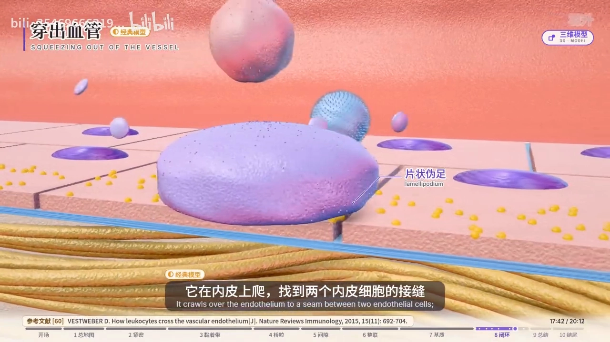

[【跳转到 17:42】](https://www.bilibili.com/video/BV1XDWb6PEfU/?t=1062)

从选择素的弱结合，到整合素的强结合，再到钙黏着蛋白的松开，再加上三种骨架的分工——这一节课和前面两节骨架课就闭成了一个环。

[【跳转到 18:01】](https://www.bilibili.com/video/BV1XDWb6PEfU/?t=1081)

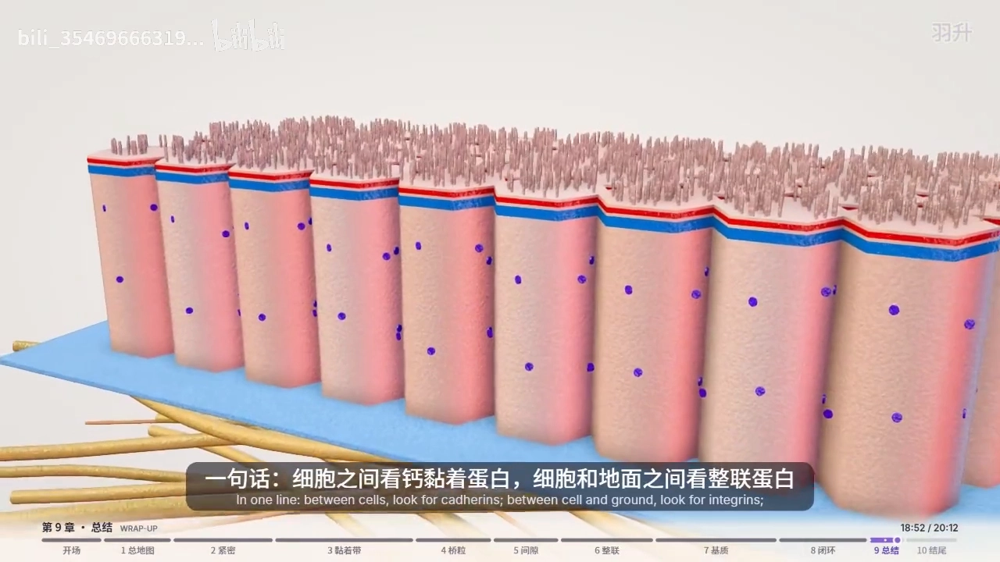

[【跳转到 18:52】](https://www.bilibili.com/video/BV1XDWb6PEfU/?t=1132)

---

## 九、边界与易错点

1. **连接不是"越紧越好"**。紧密连接的封闭锁留有不同的小孔，各段上皮的"漏洞"可以不同——渗漏有时是功能而不是缺陷。把它想成绝对密封的墙，会误解上皮的旁路运输。
2. **连接是可拆的**。白细胞跨内皮时，内皮细胞之间的钙黏着蛋白要**暂时松开**；肿瘤细胞离开原发灶，也要先降解细胞外基质。所以连接是动态结构，"组织结实"与"组织能改变形状"靠的是同一批连接能松能紧。
3. **力学信号与化学信号不可分割**。整合素同时是**力学接头**（连到微丝、应力纤维）和**信号平台**（FAK 等），抓地与存活、增殖的信号是同一件事的两面；不能把"ECM 提供支撑"和"ECM 传递信号"当成两套独立机制。
4. **名词别混**：黏着带（adherens junction，细胞—细胞、接微丝）／黏着斑（focal adhesion，细胞—基质、接微丝）／桥粒（细胞—细胞、接中间纤维）／半桥粒（细胞—基质、接中间纤维）。区分它们只看两件事：**对面是细胞还是基质、胞内接微丝还是中间纤维**。
5. **间隙连接不接骨架**。它是唯一不承担力学、只负责通讯的连接；这也是它能在心肌里做电偶联、而不必与收缩装置直接相连的原因。

---

## 小结

- 细胞连接按功能分三类：**封闭**（紧密连接）、**锚定**（黏着带、桥粒、半桥粒、黏着斑）、**通讯**（间隙连接）。
- 锚定连接的物理性质由**胞内骨架**决定：接微丝的能收缩、可调节（黏着带、黏着斑）；接中间纤维的抗拉、稳定（桥粒、半桥粒）。
- 跨膜蛋白的分界线：**细胞—细胞用钙黏着蛋白，细胞—基质用整合素**。
- 紧密连接两个功能：**封旁路**（示踪物停在缝里）与**立栅栏**（顶面 SGLT1、底面 GLUT2 不能混）。
- 间隙连接三层组装（连接蛋白→连接子→通道），孔径约 1.4 nm，只放离子和小分子；承担**代谢偶联**与**电偶联**。
- 整合素是**双向开关**：由内向外（talin/kindlin 撬开）与由外向内（FAK 激活）；失巢凋亡说明"抓住地面"本身就是存活信号。

## 关键术语速查

| 术语 | 一句话解释 |
| --- | --- |
| 封闭连接 | 封住相邻细胞间隙的连接类型，典型代表是紧密连接 |
| 锚定连接 | 通过跨膜黏附蛋白把细胞彼此、或把细胞与基质连到骨架上，用于承受机械力 |
| 通讯连接 | 在细胞之间开通道传小分子或离子的连接，典型代表是间隙连接 |
| 封闭锁 | 紧密连接处由 claudin 等穿膜蛋白串成的网状嵴，绕细胞顶部一圈 |
| 细胞旁路 | 物质从细胞之间的缝隙穿过的路径；紧密连接封的就是这条路 |
| 栅栏功能 | 紧密连接把细胞膜分成顶面与底侧面，阻止膜蛋白混跑 |
| 钙黏着蛋白 | 依赖钙的跨膜黏附蛋白，介导同型细胞间黏附；经典型在黏着带，非经典型在桥粒 |
| 逆锁键 | 受力越大、结合反而越牢的非共价结合（catch bond） |
| 桥粒 | 点状锚定连接，跨膜蛋白为非经典钙黏着蛋白，胞内接中间纤维 |
| 半桥粒 | 桥粒的"一半"，跨膜蛋白为整合素，把上皮铆在基膜上 |
| 连接子 | 六个连接蛋白围成的半通道；两个连接子对接成间隙连接通道 |
| 电偶联 | 离子经间隙连接直接流到相邻细胞，使电信号快速同步 |
| 整合素 | αβ 异二聚体跨膜受体，识别 RGD 等基序，连接细胞外基质与胞内骨架 |
| 黏着斑 | 整合素聚集 + kindlin/纽蛋白 + 应力纤维形成的细胞—基质黏附位点 |
| 失巢凋亡 | 细胞失去基质黏附后启动的凋亡（anoikis） |
| 基膜 | 上皮等细胞自己分泌的特化薄基质，由层粘连蛋白、四型胶原、巢蛋白、串珠蛋白聚糖构成 |