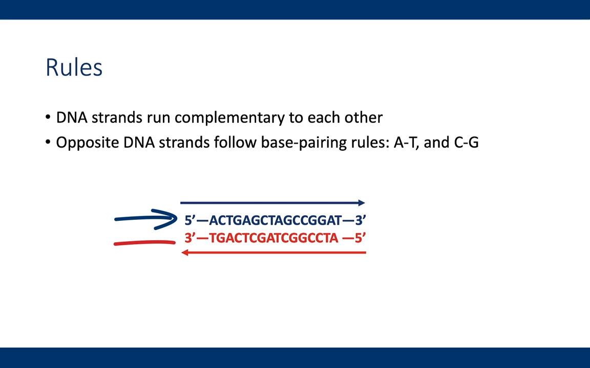
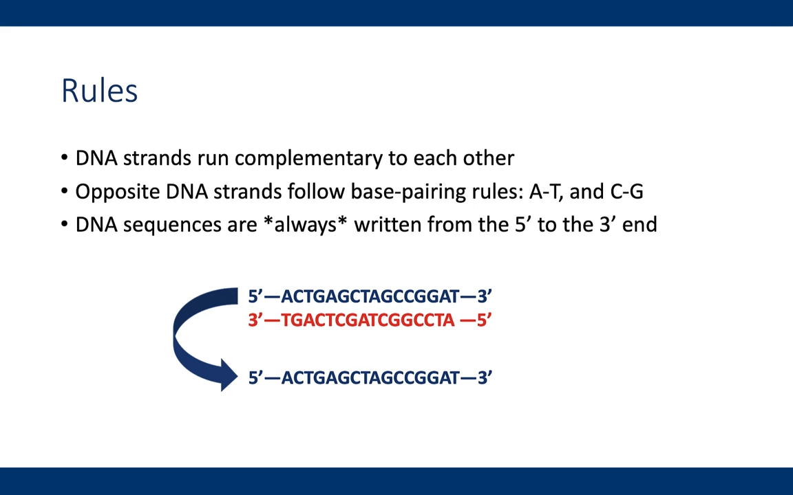
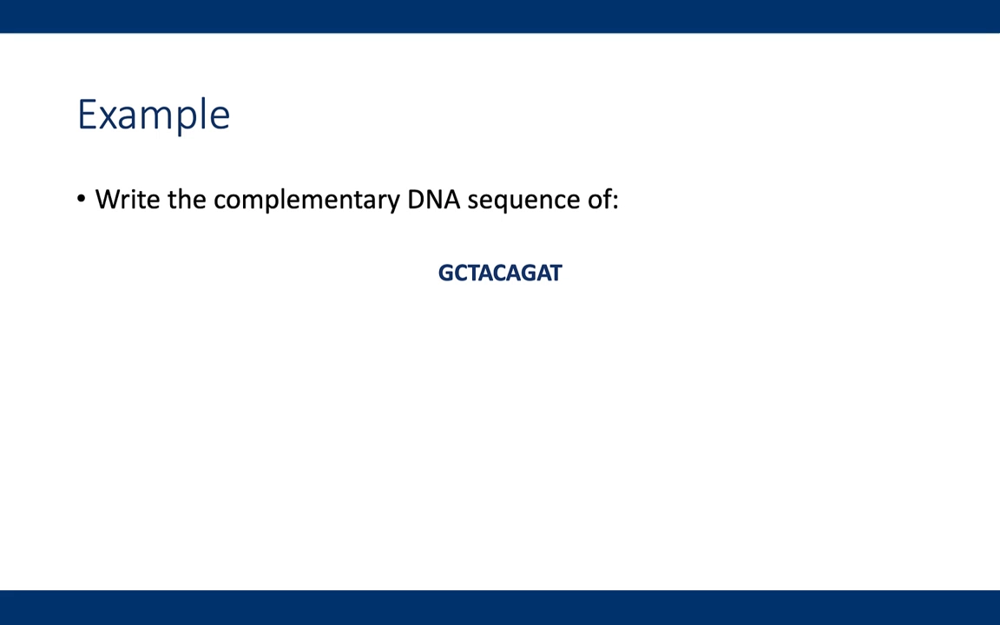
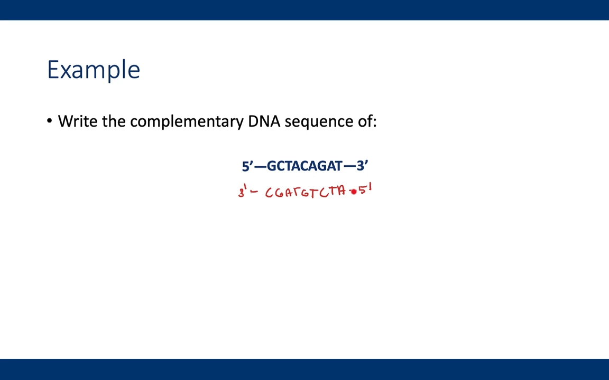

# 双链序列的读写：反向平行、碱基互补与 5′→3′ 书写约定

> 视频来源：[Writing complementary DNA sequences](https://www.youtube.com/watch?v=vN3HnmdMpc8)（YouTube · Asha Brunings · 约 2 分 44 秒）。本文按该视频的逐窗口字幕与幻灯片整理，内容均可在原视频中核查。
> 导读：一支只讲一件事的短课——拿到一条 DNA 链，怎么写出与它配对的那条链。它把"反向平行"落成了可操作的三条规则，并用两段具体序列演示了最容易出错的一步：按位配对写出来的互补链方向是反的，必须翻过来。

## 本讲要解决的核心问题（SCQA）

**背景**：DNA 是双螺旋，两条链上的碱基按 A–T、C–G 配对，这一点初学者大多记得。

**冲突**：真到动笔写序列时，多数人会在同一个地方翻车——把一条链的碱基逐个配成互补碱基，写出来的字符串看上去"没配错"，方向却是反的。因为两条链并不是同向并排，而是**反向平行**的。

**疑问**：给定一条链的序列，怎么写出另一条链？为什么写完还要"翻个面"？

**回答（中心思想）**：双链的两条链**方向相反**（一条 5′→3′，另一条 3′→5′），碱基按 A–T、C–G 逐位互补；而序列按惯例一律写成 5′→3′，所以按位配对得到的互补链必须**首尾翻转**才能作为答案。三件事合起来，就是一段双链序列的读写规则。

---

## 一、方向：一条链的两端不一样

### 1.1 5′ 端与 3′ 端指的是糖环上的碳

一条 DNA 链有方向，方向的标记是 **5′ 端**和 **3′ 端**。这两个名字指的是核苷酸里**五碳糖上的碳原子编号**：5′ 端那一头是 5′ 碳，3′ 端那一头是 3′ 碳。

讲者在视频里没有展开糖环的化学结构，只强调了这个对应关系——记住"5′ / 3′ 说的是糖的碳"，后面所有关于方向的写法才有依据。糖环与磷酸、碱基的连接方式，以及磷酸二酯键怎么把核苷酸串成链，见本小节另一篇[《核苷酸、碱基配对与 DNA 双螺旋：变性、增色效应与解链温度》](核苷酸、碱基配对与DNA双螺旋：变性、增色效应与解链温度.md)。

[【跳转到 00:13】](https://www.youtube.com/watch?v=vN3HnmdMpc8&t=13)

### 1.2 序列默认写成 5′→3′

写序列时有一个**书写约定**：核苷酸序列一律从 5′ 端写到 3′ 端，因为这个方向也正是它在细胞里被合成的方向。

这条约定带来一个方便之处：只要看到一串字母，不用特别标注，默认它就是 5′→3′。视频里给出的例子是

$$
5'\text{—ACTGAGCTAGCCGGAT—}3'
$$

[【跳转到 01:11】](https://www.youtube.com/watch?v=vN3HnmdMpc8&t=71)

"按合成方向写"这一点值得单独记一笔：书写约定不是排版偏好，它跟着**合成方向**走。这一点在复制与转录里会反复出现（见 2.1.2 与 2.2 节），本文只需要记住结论。

[【跳转到 01:20】](https://www.youtube.com/watch?v=vN3HnmdMpc8&t=80)

---

## 二、反向平行：两条链的箭头方向相反

### 2.1 同一段双链，两条链的走向相反

把两条链画在一起时，**一条链从 5′ 走向 3′，另一条就必须从 3′ 走向 5′**——这就是"反向平行"（anti-parallel）。视频用两个方向相反的箭头表示这件事，并把上面那段序列的双链形式写成：

$$
\begin{aligned}
5'\text{—ACTGAGCTAGCCGGAT—}3' \\
3'\text{—TGACTCGATCGGCCTA—}5'
\end{aligned}
$$

注意两条链末尾的标记：上面那条左端是 5′、右端是 3′；下面那条左端是 3′、右端是 5′。**同一个"左"，对两条链来说是不同的端**。

[【跳转到 00:00】](https://www.youtube.com/watch?v=vN3HnmdMpc8&t=0)

### 2.2 反向平行不是画法习惯，是配对本身的要求

视频把"两条链方向相反"作为**第一条规则**提出：双螺旋的两条链彼此互补，而"互补"在这里的含义就是**方向相反**，方向由各自的 5′ 端和 3′ 端确定。

换句话说，如果两条链同向并排，碱基之间的对应关系就摆不成 A–T、C–G 的固定搭配。反向平行是配对能成立的前提，而不是画图时的排版偏好。

[【跳转到 00:21】](https://www.youtube.com/watch?v=vN3HnmdMpc8&t=21)

---

## 三、互补：读一条链就能写出另一条

### 3.1 配对规则只有两条

两条链之间的碱基按**碱基配对规则**结合：

- 一条链上是 **A**，另一条链对应位置一定是 **T**；反过来，一条链上是 T，对面就是 A；
- **C** 与 **G** 互相配对。

规则只有这两条，所以只要知道一条链的序列，就能推出对面那条链的序列。

[【跳转到 00:42】](https://www.youtube.com/watch?v=vN3HnmdMpc8&t=42)

### 3.2 逐位核对上面那段 16 bp 双链

把第二节的双链按位置拆开，可以逐位检验配对规则：

| 位置 | 1 | 2 | 3 | 4 | 5 | 6 | 7 | 8 | 9 | 10 | 11 | 12 | 13 | 14 | 15 | 16 |
| --- | --- | --- | --- | --- | --- | --- | --- | --- | --- | --- | --- | --- | --- | --- | --- | --- |
| 上链（5′→3′） | A | C | T | G | A | G | C | T | A | G | C | C | G | G | A | T |
| 下链（3′→5′） | T | G | A | C | T | C | G | A | T | C | G | G | C | C | T | A |

每一列都是 A–T 或 C–G，没有例外。这就是"互补"的全部内容：**一条链的每个位置，唯一地决定了另一条链同位置上的碱基**。

---

## 四、最容易错的一步：互补链要翻面

### 4.1 按位配对写出来的是 3′→5′

视频点出了学生的典型做法：从左到右把上链的碱基逐个配成互补碱基，写成一串。这样写出来的字符串，碱基确实一个都没配错，但它记录的是**下链从 3′ 到 5′ 的读法**，方向与书写约定相反，因此不能直接当答案。

以上面那段 16 bp 为例，按位配对得到的是

$$
3'\text{—TGACTCGATCGGCCTA—}5'
$$

而它作为一条独立序列，按约定应该写成 5′→3′，也就是把这串字母**首尾翻转**：

$$
5'\text{—ATCCGGCTAGCTCAGT—}3'
$$

这两行说的是同一条链，只是读的方向不同。

[【跳转到 01:28】](https://www.youtube.com/watch?v=vN3HnmdMpc8&t=88)

视频里描述了这个错误的典型过程：学生按位配对时习惯**从左往右**写，而左边恰好是原链的 5′ 端，于是新链的 3′ 端被放在了左边，一路写下去得到的就是 3′→5′ 的字符串。错不在配对，错在起点选错了端。

[【跳转到 02:05】](https://www.youtube.com/watch?v=vN3HnmdMpc8&t=125)

### 4.2 正确的操作顺序

视频给出的操作步骤是：**先从 5′ 端写起，再按 5′→3′ 的顺序把核苷酸依次写下去**。也就是先确定新链的 5′ 端在哪一头（它对着原链的 3′ 端），然后沿这个方向逐位取互补碱基。

[【跳转到 02:23】](https://www.youtube.com/watch?v=vN3HnmdMpc8&t=143)

---

## 五、跟着做一遍：9 个碱基的练习

视频最后给了一道练习题，要求写出下面这条链的互补序列：

$$
5'\text{—GCTACAGAT—}3'
$$

**第一步，按位配对**（从左到右，对着原链的 5′→3′ 逐位取互补）：

| 原链（5′→3′） | G | C | T | A | C | A | G | A | T |
| --- | --- | --- | --- | --- | --- | --- | --- | --- | --- |
| 互补碱基 | C | G | A | T | G | T | C | T | A |

**第二步，标方向**。这样写出来的串，左端对着原链的 5′ 端，所以它自己是 3′ 端：

$$
3'\text{—CGATGTCTA—}5'
$$

**第三步，翻面**。按书写约定改写成 5′→3′，把字母顺序倒过来：

$$
5'\text{—ATCTGTAGC—}3'
$$

这就是答案。三步里前两步几乎不会错，出错的基本都在第三步——**忘了翻**。

[【跳转到 01:53】](https://www.youtube.com/watch?v=vN3HnmdMpc8&t=113)

---

## 六、这套规则管到哪里为止

本文只处理**静态序列的读写**：给定一条链，写出另一条链，并把它按正确方向写出来。以下内容不在本文范围：

- **复制时酶怎么工作**——DNA 聚合酶沿模板移动、新链只能往 3′ 端加、前导链与后随链的差别，属于 B02 的复制酶学；
- **转录与翻译怎么读出这段序列**——哪条链当模板、RNA 怎么合成、三个碱基怎么对应一个氨基酸，属于 2.2 节；
- **双螺旋的理化性质**——变性、增色效应、解链温度 Tm，见本小节另一篇[《核苷酸、碱基配对与 DNA 双螺旋：变性、增色效应与解链温度》](核苷酸、碱基配对与DNA双螺旋：变性、增色效应与解链温度.md)。

需要记住的边界是：**会写互补链，不等于会解释复制**。书写规则说明的是双链序列之间的静态对应关系；复制和转录是沿着这条序列发生的动态过程，方向性在其中以"新链往哪一头延长"的形式再次出现。

---

## 小结

- 5′ 端与 3′ 端指的是五碳糖上的 5′ 碳与 3′ 碳；序列按惯例一律写成 5′→3′。
- 双螺旋的两条链**反向平行**：一条 5′→3′，另一条 3′→5′，方向由各自的端决定。
- 碱基按 A–T、C–G 逐位互补，因此一条链的序列唯一决定另一条链的序列。
- 按位配对直接写出的互补链方向是 3′→5′，必须**首尾翻转**才符合书写约定。
- 正确操作：先定位新链的 5′ 端，再沿 5′→3′ 逐位取互补碱基。
- 本文只讲静态序列的读写；复制酶机制在 B02，转录与翻译的读出在 2.2 节。

## 关键术语速查

| 术语 | 一句话解释 |
| --- | --- |
| 5′ 端 / 3′ 端 | 五碳糖上 5′ 碳、3′ 碳所在的那一端，用来标记链的方向 |
| 反向平行 | 双链的两条链走向相反：一条 5′→3′，另一条 3′→5′ |
| 碱基互补 | 一条链的 A 对应另一条链的 T，C 对应 G |
| 互补链 | 与原链逐位配对、方向相反的那条链 |
| 书写约定 | 核苷酸序列一律从 5′ 端写到 3′ 端 |
| 翻面 | 把按位配对得到的 3′→5′ 字符串首尾颠倒，改写成 5′→3′ |