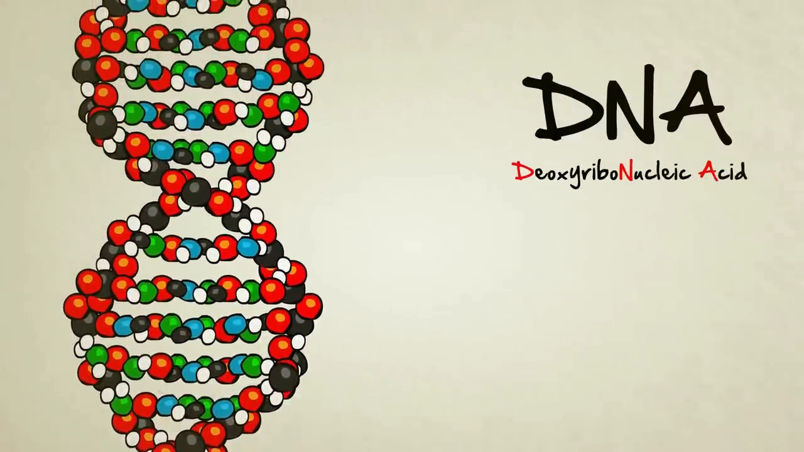
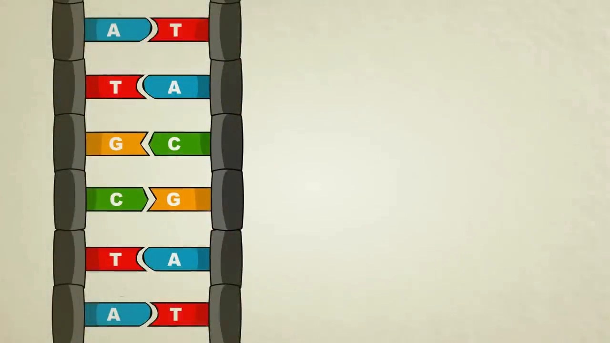
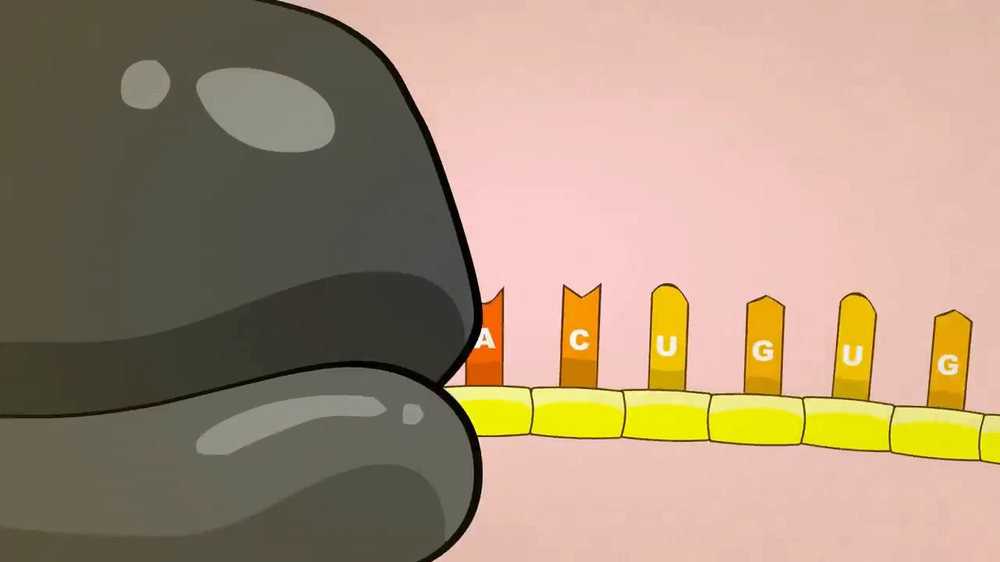

# 遗传信息与碱基顺序：序列存储与转录翻译读出的边界

> 视频来源：[What is DNA and How Does it Work?](https://www.youtube.com/watch?v=zwibgNGe4aY)（YouTube · Stated Clearly / Jon Perry · 约 5 分 24 秒）。本文按该视频的逐窗口字幕与动画帧整理，内容均可在原视频中核查。
> 导读：这支动画从"DNA 是生命的蓝图"这个常见说法出发，回答一个更基本的问题——一个分子凭什么能当蓝图。它把 DNA 画成一架梯子，梯级是四种化学基团，读一条链就像读书；然后交代这份"书稿"怎么被抄成 RNA、又怎么被核糖体三个字母一组地读成蛋白质。本文只取其中与"信息存在哪一层"有关的部分，转录与翻译的机制不在此展开。

## 本讲要解决的核心问题（SCQA）

**背景**：DNA 常被叫作"蓝图"或"配方"，它决定生物体长成什么样。

**冲突**：蓝图是个比喻。DNA 本身只是一堆原子连成的分子，它既不是图纸也不是指令书。那么，"信息"到底以什么形式存在这个分子里？

**疑问**：DNA 上究竟哪一部分携带信息？这份信息又怎样被细胞读走？

**回答（中心思想）**：DNA 是一架**梯子**，梯级由四种化学基团（A、T、G、C）组成；只看其中一条链，**这四个字母的排列顺序就是遗传信息**，可以像读书一样从一端读到另一端。信息的**存储**在 DNA 的字母顺序里，信息的**读出**则要经过两步：先抄成较短的 RNA 拷贝，再由核糖体三个字母一组地翻译成蛋白质——存储与读出是两层，不能混为一谈。

---

## 一、梯子的梯级：四种化学基团

### 1.1 DNA 的形状是一架螺旋的梯子

DNA 的原子连成的形状，是一架**长长的、螺旋状的梯子**（双螺旋）。这个形状是后面所有讨论的舞台：两条"梯柱"在外侧，梯级在中间。

[【跳转到 00:20】](https://www.youtube.com/watch?v=zwibgNGe4aY&t=20)

### 1.2 梯级只有四种，两两配对

视频给出的简化模型里，**梯级由四种不同的化学基团构成**，分别用四种颜色和四个字母标记：A、T、G、C。

这些梯级不是随便拼的，每一级都是两个基团配成一对。动画里可以看到成对的梯级是 A–T、T–A、G–C、C–G 这样的组合——**A 总是和 T 配，G 总是和 C 配**，而且两个基团的形状是互补的、正好嵌合。

[【跳转到 01:33】](https://www.youtube.com/watch?v=zwibgNGe4aY&t=93)

---

## 二、读一条链：顺序就是信息

### 2.1 只看半架梯子，就能读出一串字母

视频的关键一步是：**只看分子的其中一半**（也就是一条链），就能读出一串化学序列，视频把它直接称为**遗传密码**（genetic code）。读法是**从一端读到另一端**，"有点像读书"。

拿上面那张动画帧当例子：只看左列的梯级，从上往下读是

$$
\text{A}\ \text{T}\ \text{G}\ \text{C}\ \text{T}\ \text{A}
$$

只看右列，从上往下读则是

$$
\text{T}\ \text{A}\ \text{C}\ \text{G}\ \text{A}\ \text{T}
$$

两列逐位互补：A 对 T、T 对 A、G 对 C、C 对 G、T 对 A、A 对 T。**知道一列，另一列就被唯一确定**——这正是"互补"在信息层面的意义：两条链携带的是同一份信息的两种写法。

注意这张动画没有标出 5′ 端和 3′ 端，所以这里只说"从上往下"，不指定哪一头是 5′。两条链方向相反（反向平行）、序列按 5′→3′ 书写，以及给定一条链怎么写出另一条，见本小节另一篇[《双链序列的读写：反向平行、碱基互补与 5′→3′ 书写约定》](双链序列的读写：反向平行、碱基互补与5′→3′书写约定.md)。

[【跳转到 01:38】](https://www.youtube.com/watch?v=zwibgNGe4aY&t=98)

### 2.2 为什么"顺序"才是信息

同一架梯子上，梯柱（两条链的骨架）在每一级都长得一样，梯级的**种类**也只有四种；唯一变化的是**四种梯级出现的先后次序**。

这就回答了"信息存在哪一层"：不是存在某个单独的化学基团里，而是存在**排列顺序**里。同一批字母换个次序，读出来的就是一串不同的序列。视频用"读书"来类比这件事——书的信息不在纸张、也不在字母表里，而在字母的排列中。

### 2.3 这条链非常长

一条 DNA 单链**极其长**，视频的说法是"几百万个字母长"（millions of letters long）。它一生大部分时间像一根面条一样盘绕起来，住在细胞核里。

长度这一点直接决定了后面读出的方式：这么长的字符串不可能整条搬出细胞核，细胞必须**取其中一段**来用。

[【跳转到 02:29】](https://www.youtube.com/watch?v=zwibgNGe4aY&t=149)

"几百万个字母"这个数量级来自视频原话，不是精确统计；不同物种、不同染色体的长度差别很大，本文不展开。

[【跳转到 02:35】](https://www.youtube.com/watch?v=zwibgNGe4aY&t=155)

---

## 三、存储与读出：两层，不要混

### 3.1 存储层：DNA 留在核里

DNA 在细胞核里，而真正干活的氨基酸在核外的细胞质里。所以信息必须"出得去"，但又不能把整本书搬出去。

[【跳转到 02:45】](https://www.youtube.com/watch?v=zwibgNGe4aY&t=165)

### 3.2 读出第一步：抄一份短的拷贝

细胞核里的特殊化学物质会**复制 DNA 密码的一部分**，做出**部分拷贝**。这些拷贝叫 **RNA**：它们长得和 DNA 很像，但更短，而且少了一侧的"梯柱"——也就是单链。

因为更短更小，RNA 才能穿过核上的小孔，进入细胞质。这就是"存储"与"读出"之间的第一个接口：**DNA 存全书，RNA 带单页**。

[【跳转到 02:55】](https://www.youtube.com/watch?v=zwibgNGe4aY&t=175)

### 3.3 读出第二步：三个字母一组翻译成氨基酸

RNA 进入细胞质后，会进到另一种颗粒——**核糖体**的"嘴"里。核糖体是造蛋白质的机器，它**一次读三个字母**，按遗传密码把周围的氨基酸取来、连成一条链；链越长越会弯曲、折叠、自我贴合，最后折成一个形状精确的蛋白质。

视频举了两个具体的对照：**CAA** 让核糖体去取谷氨酰胺，**AGU** 让它去取丝氨酸。

[【跳转到 03:25】](https://www.youtube.com/watch?v=zwibgNGe4aY&t=205)

这两个例子值得记住，因为它们把"三个字母"这个单位落到了实处：读的是字母，产出的是氨基酸，中间没有别的解释层。

[【跳转到 03:51】](https://www.youtube.com/watch?v=zwibgNGe4aY&t=231)

### 3.4 把"顺序即信息"推一步

按视频给出的规则可以直接推下去：既然核糖体是**三个字母一组**地读，而且每一组对应一个确定的氨基酸，那么把某一组里的一个字母换掉，核糖体读到的就是另一个氨基酸——蛋白质链上的一个位置随之改变。

这就是"顺序改变 = 信息改变"的具体含义：**信息的单位是字母的次序，而不是字母本身**。这一步是从视频的规则推出来的，视频本身没有演示突变案例；突变的类型与后果不在本文范围。

[【跳转到 03:43】](https://www.youtube.com/watch?v=zwibgNGe4aY&t=223)

---

## 四、这套说法管到哪里为止

本文只回答两件事：**信息存在 DNA 的字母顺序里**，以及**存储与读出分成两层**（DNA → RNA 拷贝 → 核糖体三字母读取）。以下内容不在本文范围：

- DNA 双螺旋的化学细节（核苷酸、磷酸二酯键、氢键数目、Chargaff 规则、变性、增色效应、Tm）——见本小节[《核苷酸、碱基配对与 DNA 双螺旋：变性、增色效应与解链温度》](核苷酸、碱基配对与DNA双螺旋：变性、增色效应与解链温度.md)；
- 序列的方向标记与互补链书写——见本小节[《双链序列的读写：反向平行、碱基互补与 5′→3′ 书写约定》](双链序列的读写：反向平行、碱基互补与5′→3′书写约定.md)；
- **复制**：DNA 怎么被完整复制一份传给子代细胞，见 2.1.2；
- **转录与翻译的机制**：RNA 聚合酶怎么识别启动子、模板链与编码链怎么区分、核糖体如何起始延伸终止、密码子表的简并性，见 2.2 节。

视频最后把整条链收束成一句话：DNA 是生物体的分子蓝图；它的工作方式是 DNA 造 RNA、RNA 造蛋白质、蛋白质再去构成生命。

[【跳转到 04:16】](https://www.youtube.com/watch?v=zwibgNGe4aY&t=256)

需要守住的边界是：**"信息存在顺序里"不等于"顺序决定一切"**。视频的说法是，DNA 的一个主要功能是告诉氨基酸怎么排队、折成什么形状；而"正确的蛋白质在正确的时间、正确的地点被造出来"，才轮到细胞、器官乃至整个生物体。信息如何被选择性地读出，是基因表达调控的问题，不在本文。

---

## 小结

- DNA 的形状是一架螺旋的梯子，梯级由四种化学基团 A、T、G、C 两两配对构成（A–T、G–C）。
- 只看一条链，就能从一端读到另一端，读出一串字母；这串字母的**排列顺序**就是遗传信息。
- 梯柱和字母种类都不变，唯一变化的是次序——所以信息存在**顺序**这一层，而不在单个基团里。
- 一条 DNA 单链有数百万个字母长，因此细胞读出时只取其中一段。
- 存储与读出分两层：DNA 留在核内，先抄成较短的 RNA 拷贝，再由核糖体**三个字母一组**翻译成氨基酸链。
- 按"三字母一组、每组对应一个氨基酸"的规则，改变一个字母就会改变一个氨基酸——这就是"顺序改变即信息改变"。
- 复制机制见 2.1.2，转录与翻译机制见 2.2 节；本文只交代存储与读出的接口。

## 关键术语速查

| 术语 | 一句话解释 |
| --- | --- |
| 梯级 | DNA 双螺旋中间成对出现的碱基，由四种化学基团构成 |
| 遗传密码 | 一条链上 A/T/G/C 的排列顺序，也就是被读出的那串字母 |
| 碱基互补 | A 与 T 配对、G 与 C 配对，知道一条链就确定另一条 |
| RNA 拷贝 | 从 DNA 的一段抄出来的单链拷贝，比 DNA 短，能出细胞核 |
| 核糖体 | 造蛋白质的机器，一次读 RNA 上的三个字母 |
| 三联体读取 | 每三个字母对应一个氨基酸，是"顺序即信息"的读取单位 |
| 存储 / 读出 | DNA 保存全书、RNA 带单页、核糖体翻译，是两层不同的过程 |