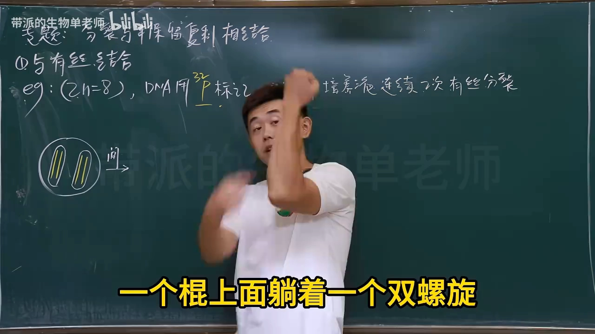
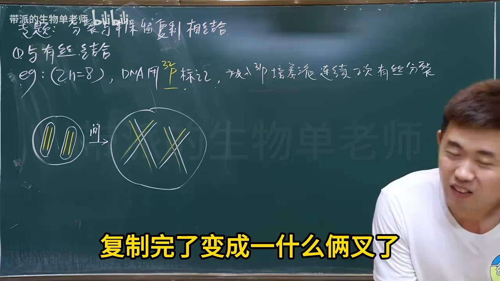
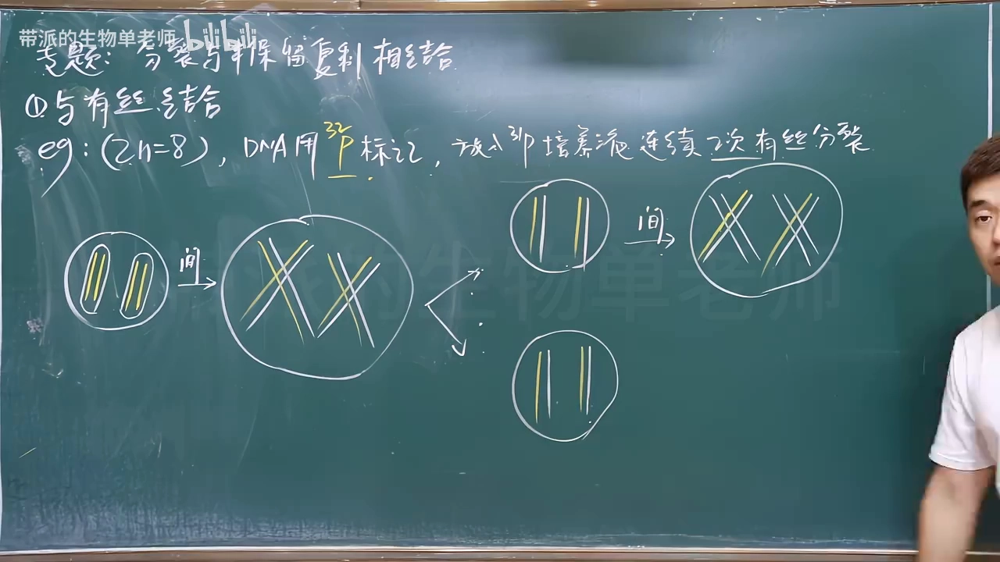
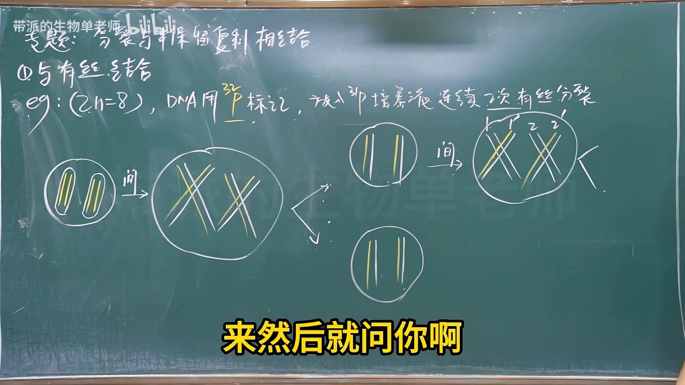
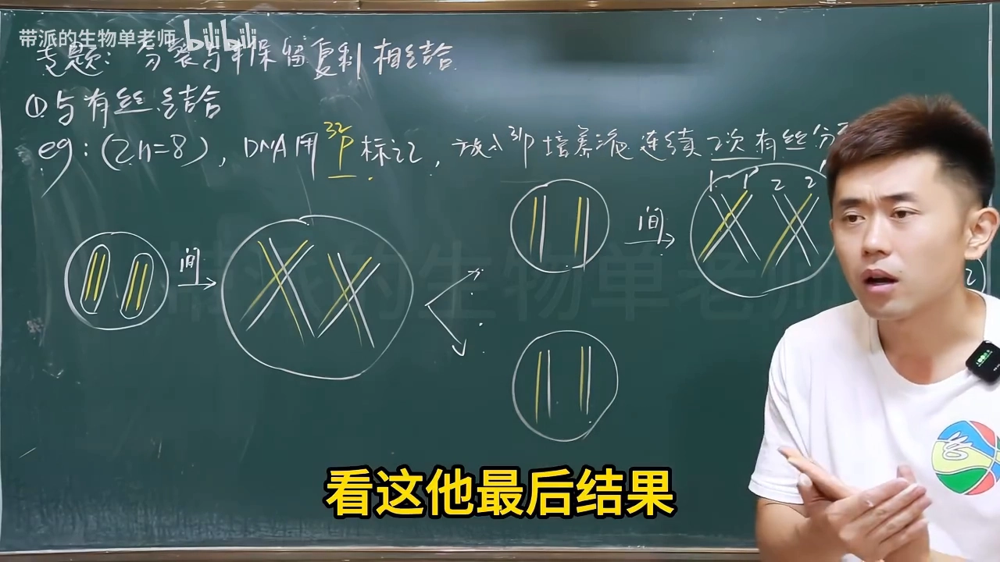
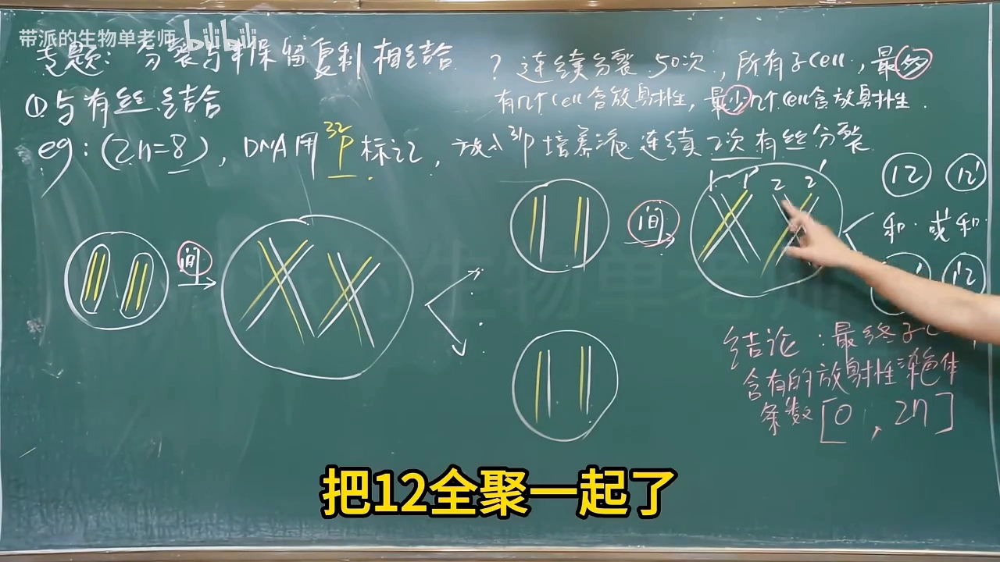
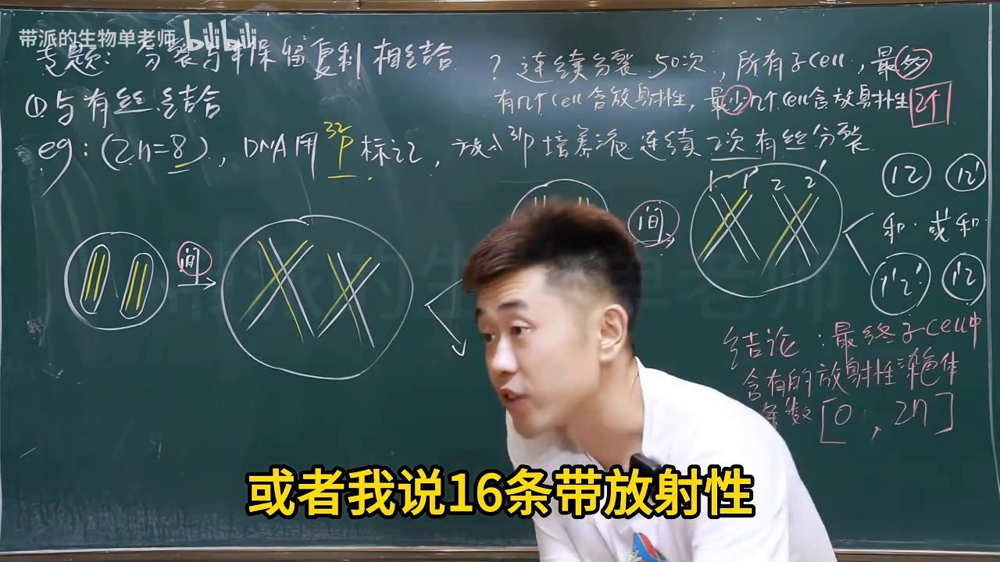
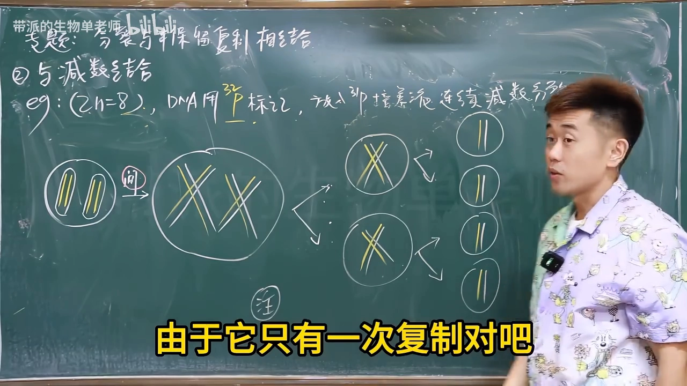

# DNA 半保留复制与细胞分裂：亲代链在子代细胞中的分配

> 视频来源：[专题课：DNA半保留复制与细胞分裂综合问题](https://www.bilibili.com/video/BV1Ge411d7TA/)（Bilibili · 约 17 分钟）。本文按该视频的逐窗口字幕与黑板板书整理，内容均可在原视频中核查。
> 导读：上一支课讲清了半保留复制"是什么"，这一支课把镜头拉远到**一次细胞分裂**：一个细胞带着标记好的 DNA，先复制、再分裂，亲代链被分到哪几个子细胞里？为什么第一次分裂的结果是确定的，从第二次开始就变成一个范围？最后用减数分裂作对照，说明"随机性"到底来自哪一步。

## 本讲要解决的核心问题（SCQA）

**背景**：DNA 以半保留方式复制——复制一次，一个 DNA 变成两个，每个都保留原来的一条链。但细胞不是把 DNA 复制完就结束了，它还要**分裂**，把 DNA 分给两个子细胞。

**冲突**：如果只看"复制"，每条子代 DNA 都保留一条旧链，似乎每一代都该一模一样。可一旦把复制和分裂放在一起、连续追踪两代，就会发现第二次分裂之后，某个子细胞里带标记的染色体条数**不再是一个确定值，而是一个范围**。这个随机性是从哪一步冒出来的？

**疑问**：一次分裂里，哪些链是旧的、哪些是新合成的？亲代的两条链最终落到几个子细胞里？复制（DNA→DNA）、转录（DNA→RNA）和"把遗传信息传给下一代细胞"这三件事，边界在哪里？

**回答（中心思想）**：半保留复制保证**序列**被完整拷贝，细胞分裂保证**拷贝**被分到子细胞——遗传连续性 = 复制 + 分配。第一次分裂时，每条染色体的两条姐妹单体上旧链的分布完全相同，所以怎么分结果都一样；从第二次分裂起，两条单体上的标记情况已经不同，而姐妹单体去哪个子细胞是随机的，于是子代细胞带标记的染色体条数变成 `0~2N` 的一个范围。

---

## 一、先把图画对：一条染色单体 = 一个双螺旋

分析这类问题的第一个动作不是算数，而是**画图**，而且必须把 DNA 画成**双链**——因为半保留复制的关键信息就写在"哪条链是旧的、哪条链是新合成的"上。讲者用彩色粉笔标同位素、白色粉笔标普通链，图像一眼就能看出来。

[【跳转到 00:15】](https://www.bilibili.com/video/BV1Ge411d7TA/?t=15)

[【跳转到 00:25】](https://www.bilibili.com/video/BV1Ge411d7TA/?t=25)

### 1.1 复制前：一根"棍"上躺着一个双螺旋

分裂之前先有**间期**，间期里完成复制。复制前的染色体是一根"棍"，棍上躺着一个双螺旋 DNA；复制之后，一根棍变成"叉"——两条姐妹染色单体，每条单体里各有一个双螺旋。

[【跳转到 02:14】](https://www.bilibili.com/video/BV1Ge411d7TA/?t=134)

### 1.2 复制后：棍变叉，每个 DNA 都留一条旧链

半保留复制在这里的具体含义是：**一个双螺旋解开，两条旧链各自当模板，各配一条新链**。所以复制完成后，叉上的两个 DNA 分子，每一个都是"一旧 + 一新"。

[【跳转到 00:30】](https://www.bilibili.com/video/BV1Ge411d7TA/?t=30)

讲者在这里给了一条很实用的规则：**一个 DNA 有几条带标记的单链，最终最多就能形成几个带标记的 DNA 分子**。这条规则后面算"最多几个子细胞带标记"时会直接用上。

[【跳转到 13:11】](https://www.bilibili.com/video/BV1Ge411d7TA/?t=791)

---

## 二、追踪第一次分裂：一个细胞变成两个

### 2.1 复制完，两条姐妹单体上的标记分布完全相同

第一次复制之后，叉上的两条姐妹单体各自都是"一旧 + 一新"。旧链来自原来那一个 DNA，新链是刚从原料里掺进去的——所以**两条单体上的放射性情况一模一样**。

[【跳转到 04:53】](https://www.bilibili.com/video/BV1Ge411d7TA/?t=293)

### 2.2 分裂把两个 DNA 分别送给两个子细胞

有丝分裂时，着丝粒断开，两条姐妹单体分别进入两个子细胞。因为两条单体上的标记分布相同，**谁去上边、谁去下边都无所谓**：两个子细胞各拿到一个 DNA，每个 DNA 都是"一旧 + 一新"，标记情况完全对称。

[【跳转到 04:25】](https://www.bilibili.com/video/BV1Ge411d7TA/?t=265)

这就是讲者说的"一次分裂根本没有难度"：**第一次分裂的结果是确定的**，不管你分多少次、看哪个子细胞，结论都一样。

[【跳转到 04:45】](https://www.bilibili.com/video/BV1Ge411d7TA/?t=285)

### 2.3 换成"一个 DNA"来数：两代之后旧链在哪

把上面的过程压缩到一个 DNA 上看，链条最清楚：

| 时点 | DNA 分子数 | 链的构成 |
| --- | --- | --- |
| 亲代 | 1 | 两条都是亲代旧链 |
| 复制 1 次后 | 2 | 每个 DNA = 1 条亲代旧链 + 1 条新链 |
| 第一次分裂后 | 2 个细胞各 1 个 | 每个细胞里的 DNA 都含 1 条亲代旧链 |
| 复制 2 次后 | 4 | 只有 2 个 DNA 还含亲代旧链，另 2 个的两条链都是新的 |
| 第二次分裂后 | 4 个细胞各 1 个 | 2 个细胞含亲代旧链，2 个细胞完全不含 |

关键在最后两行：亲代的两条旧链**不会**继续"对半分"给四个 DNA，而是各自留在一个 DNA 里。所以到第二代，4 个 DNA 分子中只有 2 个还带着最初的旧链——这也正是"一个 DNA 有几条带标记单链，最多就形成几个带标记 DNA"那条规则的直接结果。

[【跳转到 13:11】](https://www.bilibili.com/video/BV1Ge411d7TA/?t=791)

---

## 三、追踪第二次分裂：为什么结果变成范围

### 3.1 第二次间期复制后，两条单体的标记情况不一样了

第一次分裂得到的子细胞，其 DNA 是"一旧 + 一新"。进入第二次间期再复制一次时，**旧链和新链各自当模板**：以旧链为模板复制出的 DNA 还带标记，以新链为模板复制出的 DNA 两条链都是新的、完全不带标记。

于是第二次分裂中期，同一个着丝粒连着的两条姐妹单体，**一条带标记、一条不带标记**——不再是第一次分裂时那种对称状态。

[【跳转到 05:25】](https://www.bilibili.com/video/BV1Ge411d7TA/?t=325)

[【跳转到 09:37】](https://www.bilibili.com/video/BV1Ge411d7TA/?t=577)

### 3.2 姐妹单体去哪个子细胞是随机的

第二次分裂时，着丝粒断开，两条姐妹单体一个去上、一个去下。但**谁去上边、谁去下边，这个过程是随机的**，没法事先确定。讲者给两条单体编号：带标记的记作 1、2，不带标记的记作 1′、2′。

[【跳转到 05:37】](https://www.bilibili.com/video/BV1Ge411d7TA/?t=337)

[【跳转到 05:52】](https://www.bilibili.com/video/BV1Ge411d7TA/?t=352)

两种极端分法就能看出问题：

- **最极端的一种**：1 和 2 全跑到同一个细胞里，另一个细胞拿到 1′ 和 2′。结果是一个细胞**每条染色体都带标记**，另一个细胞**一条都不带**。
- **另一种**：1 配 2′、1′ 配 2。两个细胞都带标记，但都只带一部分。

[【跳转到 06:03】](https://www.bilibili.com/video/BV1Ge411d7TA/?t=363)

[【跳转到 06:28】](https://www.bilibili.com/video/BV1Ge411d7TA/?t=388)

### 3.3 结论：一个细胞带标记的染色体条数是 0~2N

把上面两种极端放到 2N = 8 的细胞里：一个子细胞带标记的染色体条数，最少可以是 **0 条**（全被对方拿走），最多可以是 **8 条**（全被自己拿走）。所以答案不是某个具体数字，而是**介于 0 到 2N 之间的闭区间**——0 和 8 都能取到。

[【跳转到 07:13】](https://www.bilibili.com/video/BV1Ge411d7TA/?t=433)

[【跳转到 07:38】](https://www.bilibili.com/video/BV1Ge411d7TA/?t=458)

### 3.4 换个问法：多少个**细胞**带标记

如果问的不是"一个细胞里有几条"，而是"所有子细胞里，带标记的细胞最少几个、最多几个"，答案同样来自"复制 + 随机分配"这两步：

- **最少 2 个**。做法是每次都极端地把带标记的单体全堆到一个细胞里，另一个细胞就彻底没有标记。这个没标记的细胞以后也不可能有——它自己没有标记链，培养基原料里也没有，再复制多少次都还是不带标记。所以无论连续分裂多少次，带标记的细胞**最少一定是 2 个**。
- **最多 4N 个**。原来有 2N 条染色体、4N 条单链，每条带标记的单链最多进一个 DNA、进一个细胞，所以最多只能"点亮" 4N 个细胞。但还要看总细胞数：2N = 8 的细胞连续分裂三次一共只有 8 个细胞，这时候写 16 就没意义，最多只能写 8。

[【跳转到 11:02】](https://www.bilibili.com/video/BV1Ge411d7TA/?t=662)

[【跳转到 12:15】](https://www.bilibili.com/video/BV1Ge411d7TA/?t=735)

[【跳转到 13:31】](https://www.bilibili.com/video/BV1Ge411d7TA/?t=811)

---

## 四、对照：减数分裂为什么没有这个随机性

同样的标记思路套到减数分裂上，结论却是一个**固定值**，原因只有一句话：**减数分裂全程染色体只复制一次**。

- 减数第一次分裂前有间期，完成复制；减数第一次分裂分离的是**同源染色体**，每条染色体仍是"一旧 + 一新"的叉。
- 减一与减二之间**通常没有间期**，或者间期很短，而且**即使有间期，染色体也不复制**（可以有中心体复制）。
- 所以减数第二次分裂只是着丝粒断开、姐妹染色单体分离，两条单体的标记情况仍然相同，怎么分结果都一样。

[【跳转到 15:38】](https://www.bilibili.com/video/BV1Ge411d7TA/?t=938)

[【跳转到 16:03】](https://www.bilibili.com/video/BV1Ge411d7TA/?t=963)

[【跳转到 16:30】](https://www.bilibili.com/video/BV1Ge411d7TA/?t=990)

这也给了一个反向检查的方法：如果题目分析的其实是减数分裂，选项却给了一个**范围**，那这个选项一定错；反过来，连续两次以上的有丝分裂，选项给**固定值**也一定错。

[【跳转到 16:55】](https://www.bilibili.com/video/BV1Ge411d7TA/?t=1015)

[【跳转到 17:05】](https://www.bilibili.com/video/BV1Ge411d7TA/?t=1025)

---

## 五、把三件事分开：复制、转录、遗传传递

这一节是整个小节的落点。三件事经常被混在一起说，其实它们的**输入、输出和目的**都不同：

| 过程 | 方向 | 产物 | 目的 |
| --- | --- | --- | --- |
| 复制 | DNA → DNA | 两个 DNA，各含一条旧链 | 在分裂前把序列**拷贝**一份 |
| 转录 | DNA → RNA | mRNA 等 RNA | 把某个基因的序列**读出**来用 |
| 遗传传递 | 复制 + 分裂分配 | 两个子细胞，各拿到一套 DNA | 把拷贝**分给**下一代细胞 |

三者的关系可以这样记：

- **复制只解决"有没有第二份"**。半保留复制保证两份序列一致，但它本身不把 DNA 送到子细胞去——复制完，两个 DNA 还在同一个细胞里。
- **转录不是传递**。转录的产物是 RNA，RNA 不进入子细胞成为下一代基因组；它只是把 DNA 上的信息拿去表达。（转录与翻译的分子细节见本小节另一篇：[DNA 复制、转录与翻译：一张中心法则图看懂遗传信息流](DNA复制、转录与翻译：一张中心法则图看懂遗传信息流.md)。）
- **遗传连续性 = 复制 + 分配**。亲代把序列完整拷贝一份（复制），再通过染色体分离把两份拷贝分别交给两个子细胞（分配）。缺任何一半都不行：只复制不分配，DNA 留在原地；只分配不复制，每个子细胞只能拿到半套。

也正因为"分配"这一步在第二次分裂起变得随机，**序列的连续性**和**标记链的分配**要分开看：序列仍然一代代完整传下去（每个 DNA 都是"一旧一新"或"全新"，碱基序列不变），但某条具体的旧链会落到哪个子细胞，从第二代开始就只是一个概率问题了。

[【跳转到 05:37】](https://www.bilibili.com/video/BV1Ge411d7TA/?t=337)

[【跳转到 09:02】](https://www.bilibili.com/video/BV1Ge411d7TA/?t=542)

---

## 小结

- 分析这类问题的第一步是**画双链**：一条染色单体 = 一个双螺旋 DNA；复制前是"棍"，复制后是"叉"。
- 半保留复制：一个 DNA 解开，两条旧链各当模板，复制出的每个 DNA 都是"一旧 + 一新"。
- **第一次分裂**：两条姐妹单体标记分布相同，谁去哪边都一样，结果是确定的。
- **第二次分裂**：两条单体一条带标记、一条不带，而姐妹单体去哪个子细胞是随机的，结果变成范围——一个细胞带标记的染色体条数为 `[0, 2N]`。
- 连续有丝分裂中，带标记的细胞**最少 2 个**（另一个彻底无标记，且以后也不会再有），**最多 4N 个**（受总细胞数限制）。
- **减数分裂**全程只复制一次，减一与减二之间染色体不复制，所以没有这个随机性，结果是固定值。
- 复制（DNA→DNA）、转录（DNA→RNA）与遗传传递（复制 + 分配到子细胞）是三件不同的事；遗传连续性靠的是**复制保序列 + 分配保归属**。

## 关键术语速查

| 术语 | 一句话解释 |
| --- | --- |
| 半保留复制 | 复制后每个子代 DNA 保留亲代的一条链，另一条是新合成的 |
| 姐妹染色单体 | 复制后由同一着丝粒连接的两条单体，各含一个双螺旋 DNA |
| 间期 | 分裂之前的一段时期，DNA 在这一时期完成复制 |
| 着丝粒 | 连接两条姐妹染色单体的结构，分裂时断开、单体分别进入子细胞 |
| 同源染色体 | 一对形态、大小相同、一条来自父方一条来自母方的染色体，减数第一次分裂时分离 |
| 放射性染色体条数 | 一个细胞中带同位素标记的染色体数目，第二代起为 `[0, 2N]` 的范围 |
| 遗传连续性 | 亲代把 DNA 序列完整复制并分配给子细胞，使信息一代代保持 |