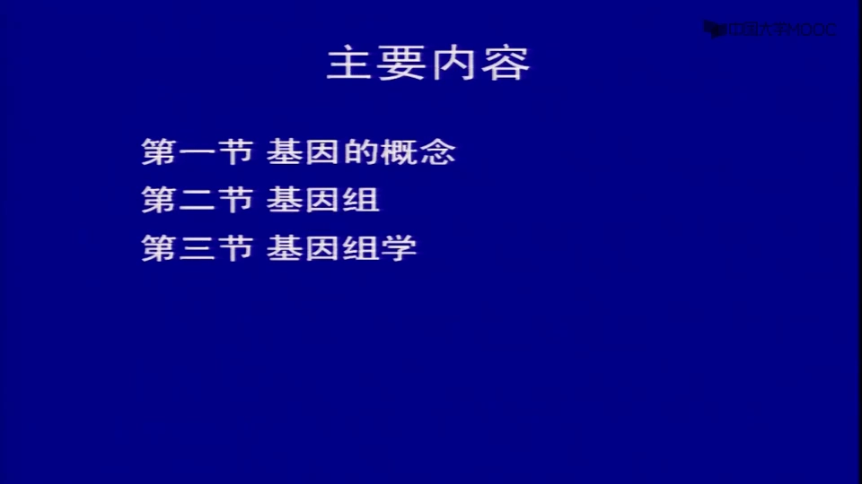
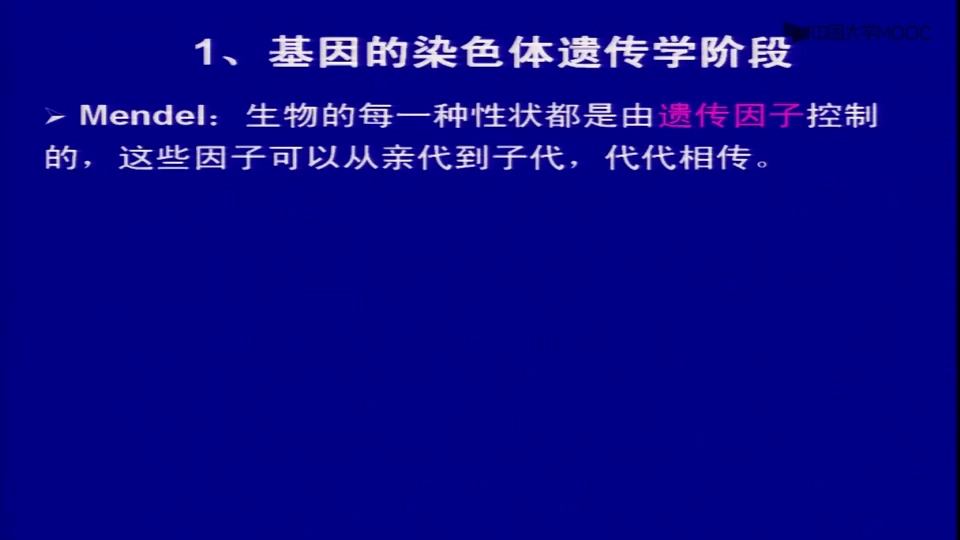
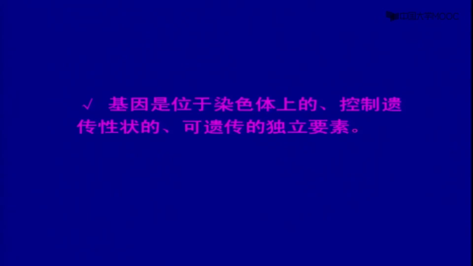
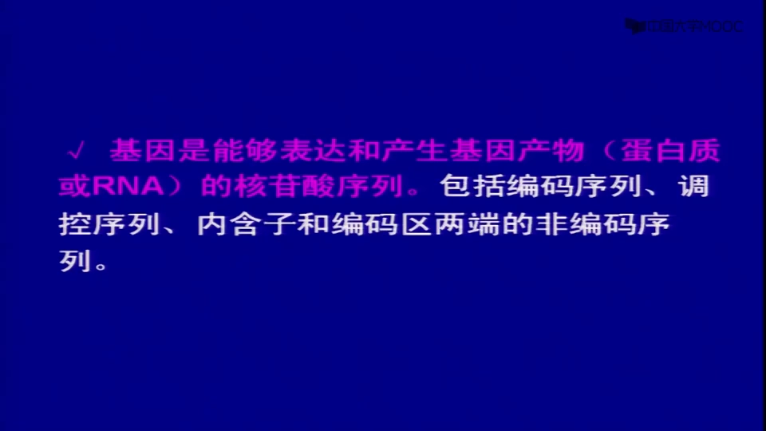
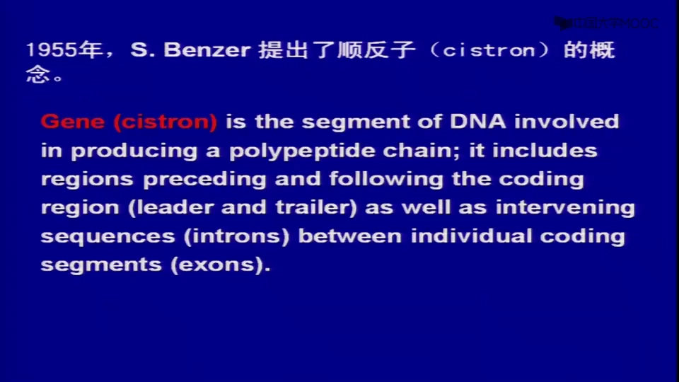
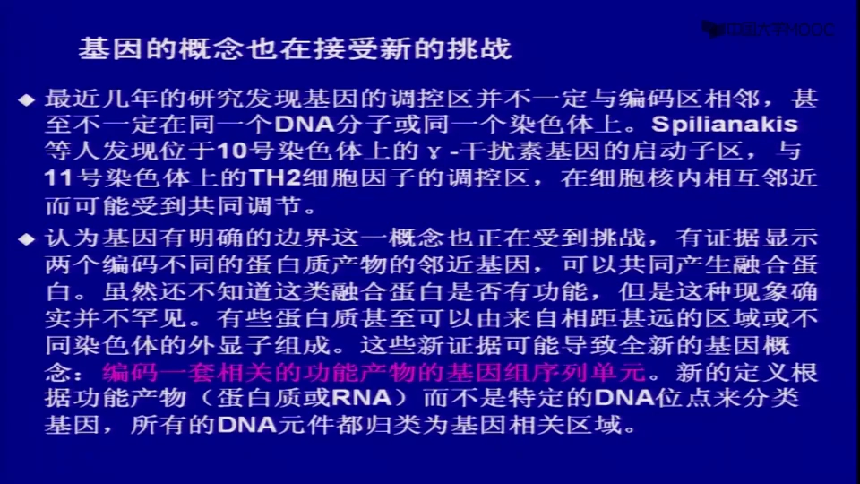
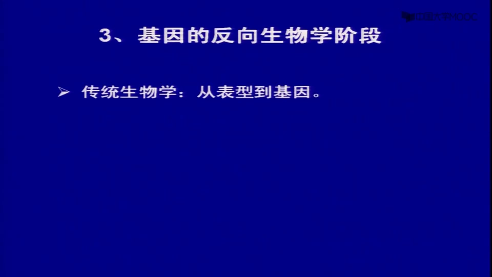

# 基因的概念：遗传因子、顺反子与基因产物

> 视频来源：[《分子生物学》3.1.1 基因的概念（1）](https://www.bilibili.com/video/BV1h741157zC/?p=19)（B 站 · 南京大学《分子生物学》课程 · 约 15 分 23 秒）。本文按该讲的逐窗口字幕与幻灯片整理，关键结论均带原片时间戳。
> 导读：这一讲回答一个看似简单、其实被改写过很多次的问题——**基因到底是什么**。它从孟德尔的"遗传因子"讲到摩尔根的染色体定位，再到"一个基因一个酶"被修正为"一个基因一条多肽链"，最后落到今天教材里的完整定义：一段能表达出蛋白质或 RNA 的核苷酸序列，而且**编码序列只是它的一部分**。本文先补一段三个尺度的框架，再沿这条定义演变线走一遍。

## 本讲要解决的核心问题（SCQA）

**背景**：基因是生物学里最常用的词之一。"基因决定性状""一个基因一个蛋白""找到致病基因"，这些说法都预设了"基因是什么"已经有共识。

**冲突**：这个共识是逐步修出来的。孟德尔只知道有"遗传因子"，不知道它是什么；摩尔根把它定位到染色体上，但染色体里既有 DNA 也有蛋白质；"一个基因一个酶"曾经是金标准，后来被证明既漏掉了不编码蛋白的基因，也漏掉了"一个基因可以产生多种产物"。

**疑问**：今天说"基因"时，指的到底是染色体上的一段、一段能翻译的序列，还是包含调控区与内含子的整个表达单元？它和"基因组""染色体"是什么关系？

**回答（中心思想）**：基因的定义经历了**染色体遗传学阶段 → 分子生物学阶段 → 反向生物学阶段**三次改写。今天教材的定义是：**基因是能够表达和产生基因产物（蛋白质或 RNA）的核苷酸序列，包括编码序列、调控序列、内含子和编码区两端的非编码序列**。它比"一段能翻译成蛋白的 DNA"宽——产物可以只是 RNA，序列里也包含大量不翻译的部分；而"基因的边界在哪里"至今仍在被新证据挑战。

---

## 一、先把三个尺度分开：基因、基因组、染色体

> 这一节是本节框架，不在视频字幕内；每一层都指向项目内已有正文，便于把三个词放回同一张地图。

同一个 DNA 分子，在三个不同尺度上有三个名字：

| 尺度 | 名称 | 指什么 | 本项目的展开位置 |
| --- | --- | --- | --- |
| 一个表达单元 | **基因** | 一段能表达出产物（蛋白或 RNA）的序列，连同它的调控区、内含子和两端非编码区 | 本文（定义）＋[基因的结构与计数](基因的结构与计数：外显子、内含子、基因大小与基因数目.md)（内部结构） |
| 一套完整信息 | **基因组** | 一个细胞或一个物种的全套遗传信息；对人来说通常指 22 条常染色体 + 性染色体这一套，而不是 46 条 | [原核与真核的基因组组织](../../../1_生命的物质与组织层级/1.3_细胞结构、生物膜与物质运输/1.3.1_原核与真核细胞、细胞器与分工/原核与真核的基因组组织：环状与线性染色体、复制起点与基因排布.md) |
| 一个物理实体 | **染色体** | DNA 与组蛋白等包装成的线状（或环状）结构，是基因在细胞里的载体 | 包装细节见 [基因表达调控的三个层次](../../../4_细胞、个体与变化/4.1_细胞类型、基因表达与表观遗传/4.1.1_基因表达调控与表观遗传/基因表达调控的三个层次——染色质、转录起始与转录后.md) 的核小体一节 |

三者的关系可以压成一句话：**基因组是"全部"，染色体是"装它的实体"，基因是"里面一段有功能的序列"**。所以三个数量不能互相替代——基因组大小按碱基对算，染色体数按条算，基因数按表达单元算，它们之间没有固定换算比例（这一点在[第二篇](基因的结构与计数：外显子、内含子、基因大小与基因数目.md)的 N 值矛盾一节会展开）。

原核与真核在这三个尺度上的组织差异（环状/线性、单/多复制起点、操纵子/散在分布、编码占比）已在 [1.3.1](../../../1_生命的物质与组织层级/1.3_细胞结构、生物膜与物质运输/1.3.1_原核与真核细胞、细胞器与分工/原核与真核的基因组组织：环状与线性染色体、复制起点与基因排布.md) 讲过，本文不再重复，只在需要时引用。

---

## 二、基因的定义被改写过三次

视频把人们对基因的认识分成三个阶段：染色体遗传学阶段、分子生物学阶段、反向生物学阶段。[【跳转到 01:21】](https://www.bilibili.com/video/BV1h741157zC/?p=19&t=81)

### 2.1 染色体遗传学阶段：基因是染色体上的遗传因子

起点是孟德尔。他把生物体的性状和"遗传因子"挂上了钩：性状由遗传因子控制，遗传因子可以代代相传，从亲代传到子代。[【跳转到 01:43】](https://www.bilibili.com/video/BV1h741157zC/?p=19&t=103)

但他并不知道遗传因子到底是什么，也不是最早使用"基因"这个词的人——最早使用 gene 的是丹麦的一位遗传学家（视频没有点名，只提到自己也没查到资料）。[【跳转到 01:56】](https://www.bilibili.com/video/BV1h741157zC/?p=19&t=116)

把基因"物质化"的是摩尔根。他通过果蝇研究提出基因学说，把孟德尔的遗传因子与基因画上等号，并且**把基因定位到了染色体上**。[【跳转到 02:20】](https://www.bilibili.com/video/BV1h741157zC/?p=19&t=140) 于是有了这一阶段的定义：

> 基因是位于染色体上的、控制遗传性状的、可遗传的独立要素。[【跳转到 03:08】](https://www.bilibili.com/video/BV1h741157zC/?p=19&t=188)

注意这个定义的边界：它只说"在染色体上"，没说基因的化学本质。染色体里既有 DNA 也有蛋白质，"到底是哪一个"是下一阶段要解决的问题。

### 2.2 分子生物学阶段：从"一个基因一个酶"到"一个基因一条多肽链"

随着 DNA 的组成与双螺旋结构被阐明，人们确认 DNA 是基因的主要载体，基因研究进入分子生物学阶段。[【跳转到 03:17】](https://www.bilibili.com/video/BV1h741157zC/?p=19&t=197)

同一时期，比德尔和塔特姆研究基因的功能，发现了基因与酶之间的关系，提出**"一个基因一个酶"**的假说：一个基因片段负责编码一个酶，或者别的蛋白质。[【跳转到 04:23】](https://www.bilibili.com/video/BV1h741157zC/?p=19&t=263)

这个说法很快被修正为**"一个基因一条多肽链"**，因为并不是所有基因产物都是酶。[【跳转到 04:55】](https://www.bilibili.com/video/BV1h741157zC/?p=19&t=295)

> 这一步修正值得记住：它把"基因 → 功能"改成了"基因 → 一条多肽链 →（可能还要组装、修饰）→ 功能"。**基因直接对应的是多肽链，不是性状，也不一定是酶。** 一个蛋白由多条不同多肽链组成时，对应的是多个基因，而不是一个基因。

### 2.3 产物可以是 RNA：定义从"蛋白质"扩到"基因产物"

后来人们发现，有一些基因并不编码蛋白质产物，它编码 RNA，RNA 就是它的终产物。所以定义再一次改写：不能说"基因是表达和产生蛋白质的"，而要说"基因是表达和产生**基因产物**的"——产物要么是蛋白质，要么是 RNA。[【跳转到 05:25】](https://www.bilibili.com/video/BV1h741157zC/?p=19&t=325)

这一步是"一基因一蛋白"这个流行说法第一次被正式推翻：**非编码 RNA 基因的产物就是 RNA 本身**，它不经过翻译，但仍然是一个基因。非编码 RNA 的类型与功能见 [2.2.3](../../2.2_从基因到产物/2.2.3_非编码%20RNA%20的类型与调控功能/转录后调控的两类小RNA——miRNA与lncRNA.md)。

### 2.4 目前的完整定义：编码序列只是其中一部分

在"基因产物"的基础上，教材又补了一句：对有些基因、尤其是真核生物基因来讲，基因还要**包括内含子序列，以及编码区两端的非编码序列**。所以基因的组成不仅是编码序列，而是与表达相关的所有序列。[【跳转到 06:10】](https://www.bilibili.com/video/BV1h741157zC/?p=19&t=370)

> 基因是能够表达和产生基因产物（蛋白质或 RNA）的核苷酸序列，包括编码序列、调控序列、内含子和编码区两端的非编码序列。

这句话有三个可以直接拿来判读的要点：

1. **基因 ≠ 编码区**。启动子、增强子、UTR、内含子都在基因的范围里；只取 CDS（编码序列）去谈"这个基因有多长"会系统性低估。
2. **基因 ≠ 一定翻译**。产物可以是 RNA；"这个基因编码什么蛋白"这个问题对非编码 RNA 基因没有答案。
3. **基因的产物是分子，不是性状**。从产物到性状还隔着折叠、修饰、定位、相互作用和环境。

---

## 三、顺反子：基因的另一个名字

教材里还会出现"顺反子（cistron）"这个词。视频引用了一本分子生物学教材里的原始表述：Benzer 在 1955 年提出顺反子概念时，写的就是 **Gene (cistron)**，即两个词对等。[【跳转到 07:19】](https://www.bilibili.com/video/BV1h741157zC/?p=19&t=439)

那段英文定义正好把前面几节串起来：基因是参与产生一条多肽链的 DNA 片段，**包括编码区之前和之后的区域（前导序列与尾随序列），以及各个编码片段（外显子）之间的间隔序列（内含子）**。[【跳转到 08:34】](https://www.bilibili.com/video/BV1h741157zC/?p=19&t=514)

所以"顺反子"不是另一个层级的概念，而是基因的功能性叫法：**一个顺反子 = 一个能产生一条多肽链的单元**。它强调的是"功能上能不能互补"，而不是"物理上占多长"。这也解释了为什么后来会遇到麻烦——物理边界和功能边界并不总是一致。

---

## 四、边界正在松动：调控区可以不相邻，外显子可以来自另一条染色体

视频最后一部分讲的是"基因的概念也在接受新的挑战"，并明确说明这些提法**还没有写进教科书，只出现在较新的文献里**。[【跳转到 09:29】](https://www.bilibili.com/video/BV1h741157zC/?p=19&t=569)

挑战有三条：

1. **调控区不一定与编码区相邻**。幻灯片引用的工作（Spilianakis 等）发现，10 号染色体上 γ-干扰素基因的启动子区，与 11 号染色体上一个 Th2 细胞因子基因的调控区，在细胞核内相互邻近，可能受到共同调节。[【跳转到 10:04】](https://www.bilibili.com/video/BV1h741157zC/?p=19&t=604)
2. **基因的明确边界不一定成立**。两个编码不同产物的邻近基因，有可能通过融合表达产生融合蛋白；虽然还不知道这类融合蛋白是否有功能，但现象并不罕见。[【跳转到 10:47】](https://www.bilibili.com/video/BV1h741157zC/?p=19&t=647)
3. **一个蛋白可以由相距很远、甚至不同染色体上的外显子组成**。[【跳转到 10:47】](https://www.bilibili.com/video/BV1h741157zC/?p=19&t=647)

由此引出的新提法是：**按功能产物而不是按 DNA 位置来定义基因**——只要这些基因组序列单元共同编码一套相关的功能产物，就可以归为一个单元，不管它们是否在同一条染色体上。[【跳转到 12:02】](https://www.bilibili.com/video/BV1h741157zC/?p=19&t=722)

> 读这段时要注意证据等级：这是"文献中的新提法"，不是已写进教材的共识。做注释或写论文时，仍应以所用数据库的基因模型（gene / transcript / exon 的坐标定义）为准；本节只要求知道"基因边界是定义出来的，不是天然刻在 DNA 上的"。

---

## 五、从表型到基因，再从基因到表型

定义的演变背后是研究方式的反转。传统生物学是**从表型到基因**：先发现某个表型（比如某株植物特别抗冻），再去分离控制它的基因，然后研究结构、产物和调控。[【跳转到 12:34】](https://www.bilibili.com/video/BV1h741157zC/?p=19&t=754)

有了大规模测序和生物信息学之后，方向反过来了：往往先拿到一个基因，却不知道它有什么功能；于是通过同源蛋白寻找、序列比对推测功能，再在分子、细胞、动物水平上验证。这就是**反向生物学：从基因到表型**。[【跳转到 13:56】](https://www.bilibili.com/video/BV1h741157zC/?p=19&t=836)

这条反转对读数据很关键：**"基因 → 表型"不是一条必然通路，而是一个需要实验填上的假设**。序列相似只给出功能提示，不给出功能结论。

---

## 六、这一讲没有回答的部分

- **一个基因是否只对应一种产物**：本讲只讲到"产物可以是蛋白质或 RNA"。一个基因通过不同的转录与加工方式产生多种 mRNA、进而产生多种蛋白的情况，见[第二篇](基因的结构与计数：外显子、内含子、基因大小与基因数目.md)的"一个基因，多种 mRNA"一节，机制细节见 [转录如何发生](../../2.2_从基因到产物/2.2.1_转录：DNA%20模板与%20RNA%20合成/转录如何发生：从启动子到成熟mRNA的分子流水线.md) 的可变剪接部分。
- **一个基因影响多个表型（多效性）**：属于基因型—表型关系，本讲未涉及，本节也不展开。
- **基因组的定义与基因计数**：见[第二篇](基因的结构与计数：外显子、内含子、基因大小与基因数目.md)及 [1.3.1](../../../1_生命的物质与组织层级/1.3_细胞结构、生物膜与物质运输/1.3.1_原核与真核细胞、细胞器与分工/原核与真核的基因组组织：环状与线性染色体、复制起点与基因排布.md)。

---

## 小结

- 基因的定义被改写过三次：**染色体上的遗传因子 → 编码一条多肽链的 DNA 片段 → 能表达出蛋白质或 RNA 的核苷酸序列（含调控区、内含子、UTR）**。
- "一个基因一个酶"先被修正为"一个基因一条多肽链"，再被"产物可以是 RNA"拓宽；**"一基因一蛋白"是过时的简化**。
- 顺反子（cistron）与基因对等，指一个能产生一条多肽链的功能单元。
- 基因的物理边界正在被挑战：调控区可以远距离、跨染色体起作用，外显子可以来自不同位置；新提法尚未写进教材。
- 三个尺度要分清：**基因是一段有功能的序列，基因组是一套完整信息，染色体是包装后的实体**。

## 关键术语速查

| 术语 | 一句话解释 |
| --- | --- |
| 遗传因子 | 孟德尔提出的、控制性状并可代代相传的抽象单位，后来与基因画上等号 |
| 基因 | 能表达和产生基因产物（蛋白质或 RNA）的核苷酸序列，含编码序列、调控序列、内含子与两端非编码序列 |
| 顺反子（cistron） | 与基因对等的功能性单位：能产生一条多肽链的 DNA 片段 |
| 基因产物 | 基因表达的直接结果，可以是多肽链/蛋白质，也可以是 RNA |
| 反向生物学 | 先拿到基因序列、再寻找其功能的研究方式，与"从表型到基因"相对 |
| 融合基因 | 两个邻近基因通过融合表达产生一个融合蛋白的现象 |
| 基因组 | 一个细胞或物种的全套遗传信息（详见 1.3.1 与第二篇） |