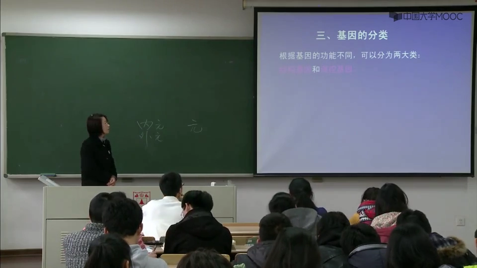
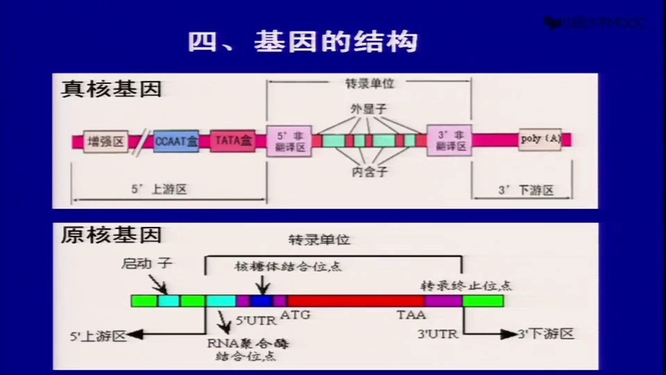
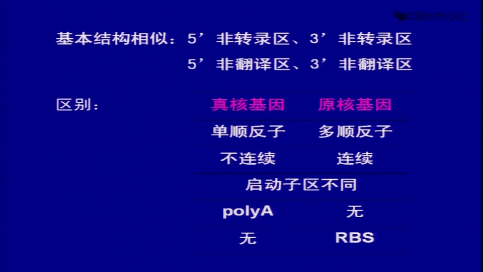
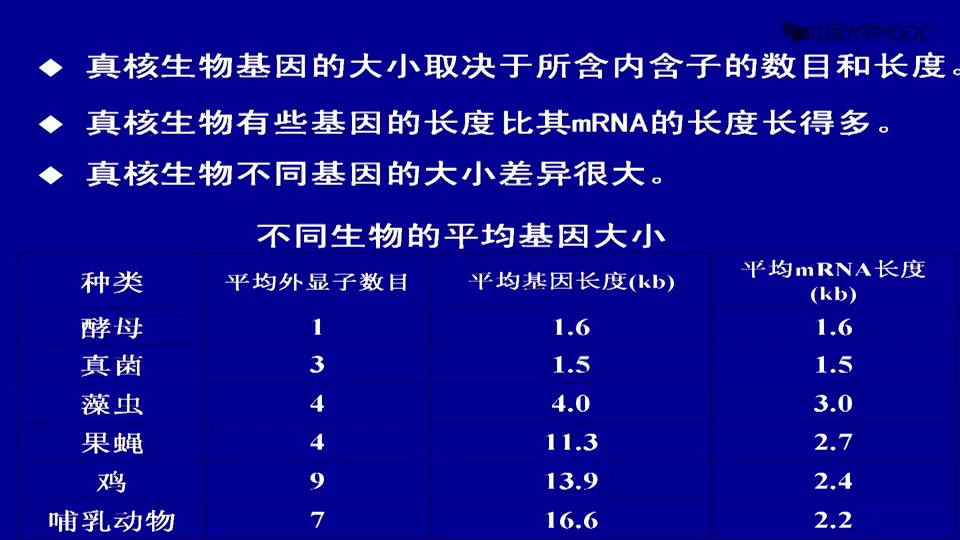
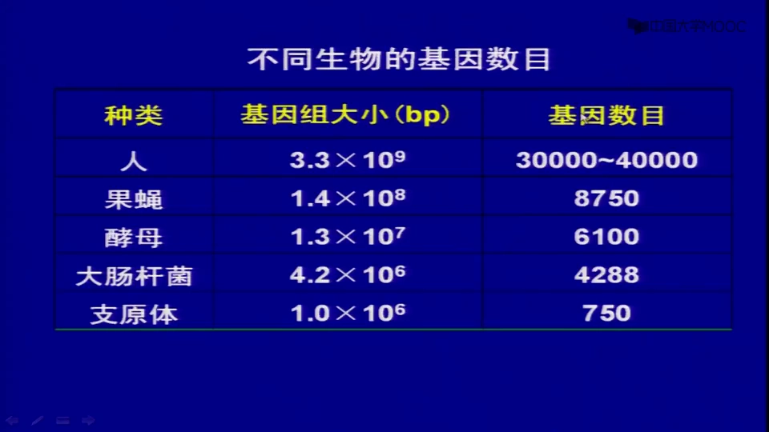
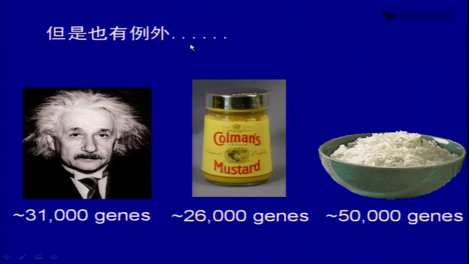
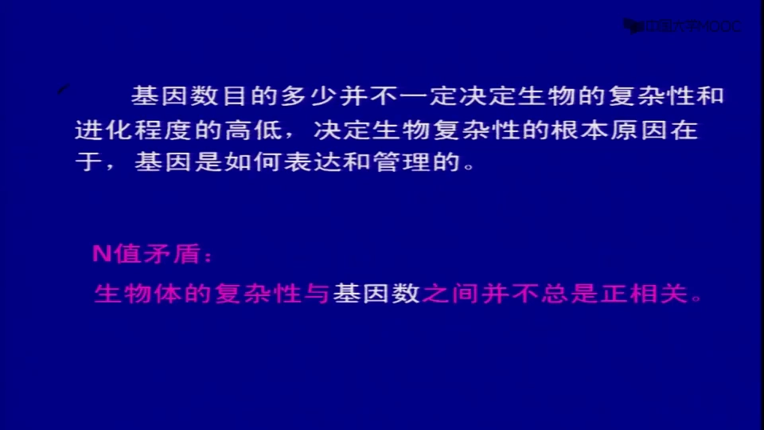
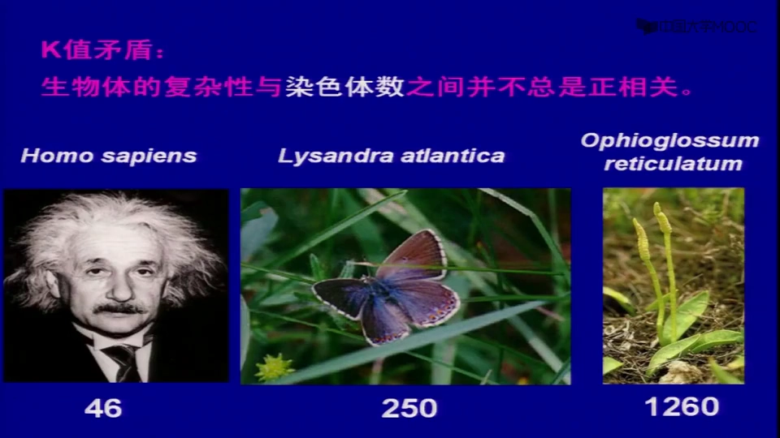

# 基因的结构与计数：外显子、内含子、基因大小与基因数目

> 视频来源：[《分子生物学》3.1.5 基因的概念（5）](https://www.bilibili.com/video/BV1h741157zC/?p=23)（B 站 · 南京大学《分子生物学》课程 · 约 10 分 14 秒）。本文按该讲的逐窗口字幕与幻灯片整理，关键结论均带原片时间戳。
> 导读：上一篇解决"基因是什么"，这一篇解决"基因长什么样、有多少个"。它用一张对照图讲清原核的连续基因与真核的断裂基因，用一张表说明基因大小主要由内含子决定，最后用 N 值矛盾与 K 值矛盾回答一个常被误答的问题：**基因组越大、基因越多，生物就越复杂吗？**

## 本讲要解决的核心问题（SCQA）

**背景**：上一篇给出的基因定义是"能表达出产物的核苷酸序列，包含编码序列、调控序列、内含子和两端非编码序列"。这句话里的每个成分都需要落到具体位置上。

**冲突**：如果按"编码一条 400 个氨基酸的蛋白"来估算，一个基因大约 1200 bp。但真核基因动辄几万 bp，人的基因数却只有两万多个——**基因的长度和基因的数目都不能用"蛋白有多大"直接换算**。

**疑问**：一个基因内部由哪些区段组成？原核与真核的基因结构差在哪？为什么基因数不能代表生物复杂度？

**回答（中心思想）**：基因的结构可以拆成**调控区 + 转录单位（UTR + 编码区）+ 下游区**三块；原核基因编码区连续、常组成多顺反子，真核基因编码区被内含子隔开、通常为单顺反子。基因的大小在真核中主要由**内含子的数目和长度**决定，而不是外显子。基因数目有四种估算方法，各有系统性偏差；人的基因数最终落在 2.5 万–3 万，并且**基因数并不与生物复杂度成正比**——这就是 N 值矛盾（染色体数则是 K 值矛盾）。

---

## 一、结构基因与调控基因：先分清基因管什么

按功能，基因可以先分成两大类：**能够编码产物的称为结构基因**，**不能直接表达产物、但能参与调控结构基因表达的称为调控基因**。[【跳转到 00:34】](https://www.bilibili.com/video/BV1h741157zC/?p=23&t=34)

结构基因还可以再分为**蛋白质基因**和 **RNA 基因**两类。[【跳转到 00:59】](https://www.bilibili.com/video/BV1h741157zC/?p=23&t=59)

> 这个分类正好接住上一篇的结论：RNA 基因的产物就是 RNA，所以它属于结构基因（有产物），但不需要翻译。而"调控基因"这个说法要小心——它描述的是功能角色，不是说它有一段独立的"调控 DNA"；真核的调控元件通常就写在被调控基因的周围（见下节结构图）。

---

## 二、原核连续基因与真核断裂基因：一张结构图

视频用一张图并排画出两类基因的典型结构。[【跳转到 01:26】](https://www.bilibili.com/video/BV1h741157zC/?p=23&t=86)

### 2.1 原核基因：编码区连续，两端是 UTR

看图中下面那条：中间红色的是**编码区**，原核的编码区是**连续的**，也就是"连续基因"。编码区两端各有一段非编码区，叫 **UTR（untranslated region，非翻译区）**，包括 5′ 非翻译区和 3′ 非翻译区。[【跳转到 01:42】](https://www.bilibili.com/video/BV1h741157zC/?p=23&t=102)

图上还标出了原核基因特有的两个位点：

- **启动子**与 RNA 聚合酶结合位点，位于转录区上游；
- **核糖体结合位点（RBS）**，位于转录区上游、翻译起始密码子 ATG 之前——这是真核生物没有的。[【跳转到 03:28】](https://www.bilibili.com/video/BV1h741157zC/?p=23&t=208)

### 2.2 真核基因：编码区被内含子隔开

看图中上面那条：真核基因的编码区当中夹着一些非编码区（蓝色），把红色的编码区间隔开来，所以它是**不连续的**；它同样有 5′ 和 3′ 非翻译区。[【跳转到 02:13】](https://www.bilibili.com/video/BV1h741157zC/?p=23&t=133)

这些把编码区隔开的片段就是**内含子**，被隔开的编码片段就是**外显子**——上一篇引用的顺反子定义里已经出现过这一对词。图上还标出了真核基因特有的调控与加工元件：

- 上游的**增强子**、**CCAAT 盒**、**TATA 盒**（属于 5′ 上游区/启动子区域）；
- 转录单位内部的 5′ 非翻译区、外显子/内含子、3′ 非翻译区；
- 转录之后在 3′ 端加上的 **poly(A) 尾巴**，这也是原核生物没有的。[【跳转到 02:38】](https://www.bilibili.com/video/BV1h741157zC/?p=23&t=158)

> 这张图就是"基因 ≠ 编码区"的直接证据：一个真核基因的坐标从增强子/启动子一直延伸到 poly(A) 位点之后，中间还夹着不翻译的内含子。只取 CDS 去比较"基因长度"，量到的只是图中红色那几小段。

### 2.3 五条差异，一张表

视频把两类基因的异同压成一张表：**基本结构相似**（都有 5′/3′ 非翻译区），**区别有五行**。[【跳转到 03:03】](https://www.bilibili.com/video/BV1h741157zC/?p=23&t=183)

| 对照项 | 真核基因 | 原核基因 |
| --- | --- | --- |
| 转录单位 | 单顺反子（一个基因一个产物） | 多顺反子（几个基因串联、一起转录） |
| 编码区 | 不连续（外显子被内含子隔开） | 连续 |
| 启动子区 | 不同（含 TATA 盒、增强子等） | 不同（含 RBS 等） |
| polyA 尾巴 | 转录后加工加上 | 无 |
| 核糖体结合位点 | 无 | 有（RBS） |

"多顺反子"这一行就是上一篇"一个基因一条多肽链"在原核里的镜像：原核把几个功能相关的基因串成一个转录单位，一次转录出携带多条多肽链信息的 mRNA；真核则通常一个基因一个转录单位。原核操纵子的排布细节见 [1.3.1](../../../1_生命的物质与组织层级/1.3_细胞结构、生物膜与物质运输/1.3.1_原核与真核细胞、细胞器与分工/原核与真核的基因组组织：环状与线性染色体、复制起点与基因排布.md)，本节只做结构对照。

### 2.4 一个基因，多种 mRNA

真核基因的"不连续"还带来一个副产品：**同一个基因可以通过不同的剪接方式产生多种 mRNA**。视频在讲基因数估算时点到了这一点——按 mRNA 种类去推算基因数会**高估**，原因之一就是"一个基因有可能通过转录和转录后加工过程当中的不同方式产生多种 mRNA"。[【跳转到 08:13】](https://www.bilibili.com/video/BV1h741157zC/?p=23&t=493)

这句话对上一篇的"一基因一多肽链"是一个重要补充：**一个基因 → 多种 mRNA → 多种蛋白**在真核里是常态，而不是例外。剪接体如何识别外显子边界、可变剪接如何在不同细胞里选择不同组合，见 [转录如何发生](../../2.2_从基因到产物/2.2.1_转录：DNA%20模板与%20RNA%20合成/转录如何发生：从启动子到成熟mRNA的分子流水线.md) 的"内含子与外显子"和"可变剪接"两节；本讲只确认这件事存在，并说明它会污染基因数估算。

---

## 三、基因有多大：1200 bp 只是粗估

视频给了一个"从蛋白倒推基因"的算法：蛋白质平均分子量约 40 kD，氨基酸平均分子量按 100 计，则一条多肽链平均约 400 个氨基酸残基；每个氨基酸对应 3 个碱基，于是**一个基因大约 1200 bp**。[【跳转到 04:01】](https://www.bilibili.com/video/BV1h741157zC/?p=23&t=241)

这个估算对真核基因**非常不准确**，原因有三条：

1. 真核基因除编码区外还有大量非编码区，也就是内含子区；
2. 内含子的数目和长度随基因组复杂性增加而增加；
3. 不同基因之间的大小差异极大。[【跳转到 04:39】](https://www.bilibili.com/video/BV1h741157zC/?p=23&t=279)

视频用一张"不同生物的平均基因大小"表说明这一点：[【跳转到 05:20】](https://www.bilibili.com/video/BV1h741157zC/?p=23&t=320)

| 种类 | 平均外显子数目 | 平均基因长度（kb） | 平均 mRNA 长度（kb） |
| --- | --- | --- | --- |
| 酵母 | 1 | 1.6 | 1.6 |
| 真菌 | 3 | 1.5 | 1.5 |
| 藻虫（幻灯片原文如此） | 4 | 4.0 | 3.0 |
| 果蝇 | 4 | 11.3 | 2.7 |
| 鸡 | 9 | 13.9 | 2.4 |
| 哺乳动物 | 7 | 16.6 | 2.2 |

从表里读出的结论是：**外显子数目增加得并不快，平均基因长度却增加了十倍以上，而 mRNA 长度增加得并不多**。所以真核基因——尤其是高等真核生物——的大小更多地取决于**内含子**，而不是外显子。[【跳转到 05:45】](https://www.bilibili.com/video/BV1h741157zC/?p=23&t=345)

> 实用推论：拿基因长度去校正表达量（如 RPKM/FPKM/TPM 里的基因长度）时，用的是**成熟转录本或外显子并集的长度**，不是基因组上从启动子到 poly(A) 的跨度。用后者会把长内含子的基因系统性压低。

---

## 四、基因组里有多少基因：四种估算都不准

视频列了四种估算基因数的方法，并逐一指出偏差来源：[【跳转到 06:21】](https://www.bilibili.com/video/BV1h741157zC/?p=23&t=381)

| 方法 | 做法 | 偏差 |
| --- | --- | --- |
| 基因组大小 ÷ 平均基因大小 | 用上一节的平均长度去除 | 误差非常大，因为基因大小差异极大 |
| 已分离鉴定的基因数 | 鉴定到一个算一个 | 不是所有基因都能被鉴定出来，系统性低估 |
| 数开放阅读框（ORF） | 找符合编码序列结构特征的片段 | 受假 ORF、非编码序列干扰 |
| 数表达的 mRNA 种类 | 看有多少种 mRNA | 低丰度 mRNA 会被漏掉；且一个基因可产生多种 mRNA，导致高估 |

按基因组大小估，人类应有 10⁶ 数量级；按 mRNA 种类估，有 10⁵ 数量级；而测序完成后，**人的基因数只有 2.5 万–3 万左右**——"基因数有一个大缩水"。[【跳转到 08:34】](https://www.bilibili.com/video/BV1h741157zC/?p=23&t=514)

这张表最能说明"三个数量不能互换"：

| 种类 | 基因组大小（bp） | 基因数目 |
| --- | --- | --- |
| 人 | 3.3 × 10⁹ | 30000–40000 |
| 果蝇 | 1.4 × 10⁸ | 8750 |
| 酵母 | 1.3 × 10⁷ | 6100 |
| 大肠杆菌 | 4.2 × 10⁶ | 4288 |
| 支原体 | 1.0 × 10⁶ | 750 |

> 表中的人数仍是视频当时的旧值 3 万–4 万，视频在同一讲里已更新为 2.5 万–3 万。[【跳转到 09:01】](https://www.bilibili.com/video/BV1h741157zC/?p=23&t=541) 引用时以更新值为准，并注意不同数据库（Ensembl/GENCODE/NCBI）的基因数定义与版本不同，数字会有出入。

---

## 五、基因数不等于复杂度：N 值矛盾与 K 值矛盾

从表里还能读出一件反直觉的事：**基因组越大，基因数一般越多，但不成比例**；而且有例外——视频用三张图对比：爱因斯坦（人，约 3.1 万个基因）、一罐芥末代表拟南芥（约 2.6 万个基因）、一碗米饭代表水稻（约 5 万个基因），**水稻的基因数比人还多**。[【跳转到 10:00】](https://www.bilibili.com/video/BV1h741157zC/?p=23&t=600)

于是有了两个"矛盾"：

- **N 值矛盾**：生物体的复杂性与**基因数**之间并不总是正相关。基因数目的多少不一定决定生物的复杂性和进化程度，决定复杂性的根本原因在于**基因是如何表达和管理的**。[【跳转到 10:51】](https://www.bilibili.com/video/BV1h741157zC/?p=23&t=651)
- **K 值矛盾**：生物体的复杂性与**染色体数**之间也并不总是正相关。人只有 46 条（23 对）染色体，而蝴蝶 *Lysandra atlantica* 有 250 条，一种低等植物 *Ophioglossum reticulatum* 有 1260 条。[【跳转到 11:50】](https://www.bilibili.com/video/BV1h741157zC/?p=23&t=710)

> 这两个矛盾不是"数字没意义"，而是提醒：**复杂度写在调控里，不写在计数里**。同一个基因数，可以通过不同的剪接、不同的调控元件、不同的表达时序组合出差别极大的表型。这也解释了为什么单细胞研究关心的是"哪些基因在什么细胞里表达"，而不只是"有多少基因"。

---

## 六、这一讲没有回答的部分

- **基因组的定义与范围**（核基因组、细胞器基因组、质粒）不在本讲；原核与真核基因组组织的对照见 [1.3.1](../../../1_生命的物质与组织层级/1.3_细胞结构、生物膜与物质运输/1.3.1_原核与真核细胞、细胞器与分工/原核与真核的基因组组织：环状与线性染色体、复制起点与基因排布.md)。
- **染色体如何包装**（核小体、组蛋白）见 [基因表达调控的三个层次](../../../4_细胞、个体与变化/4.1_细胞类型、基因表达与表观遗传/4.1.1_基因表达调控与表观遗传/基因表达调控的三个层次——染色质、转录起始与转录后.md)。
- **假基因**：本讲没有展开。它属于"基因数怎么数"的边界情形（序列高度同源但已失活），引用基因数时应以数据库的注释类型为准。
- **一个基因影响多个表型（多效性）**：属于基因型—表型关系，本节不展开。
- **基因组组装与测序技术**：不在本节范围。

---

## 小结

- 基因按功能分**结构基因**（有产物，再分蛋白质基因与 RNA 基因）和**调控基因**（不直接产生物，参与调控）。
- 结构可拆成**调控区 + 转录单位（UTR + 编码区）+ 下游区**；原核编码区连续、多顺反子、有 RBS，真核编码区被内含子隔开、单顺反子、有 polyA。
- 真核基因的大小主要由**内含子**决定：外显子数增加不多，基因长度可增加十倍以上，mRNA 长度却变化不大。
- 基因数有四种估法，各有偏差；人的基因数约 **2.5 万–3 万**，远低于按基因组大小或 mRNA 种类的推算。
- **N 值矛盾**（复杂度 vs 基因数）与 **K 值矛盾**（复杂度 vs 染色体数）说明：复杂度取决于基因如何表达和管理，不取决于计数。
- 一个基因可以通过不同剪接产生多种 mRNA——这是"一基因一蛋白"失效的第二个原因。

## 关键术语速查

| 术语 | 一句话解释 |
| --- | --- |
| 结构基因 | 能编码功能产物的基因，分为蛋白质基因与 RNA 基因 |
| 调控基因 | 不直接表达产物，但参与调控结构基因表达的基因 |
| UTR | 非翻译区，mRNA 两端不翻译成蛋白的片段，参与稳定性与翻译调控 |
| 内含子 / 外显子 | 基因内部被剪接移除的片段 / 保留在成熟 mRNA 中的片段 |
| 多顺反子 / 单顺反子 | 一个转录单位携带多个基因的信息 / 只携带一个基因的信息 |
| RBS | 核糖体结合位点，原核 mRNA 上招募核糖体的序列 |
| poly(A) 尾巴 | 真核 mRNA 3′ 端加上的腺苷酸串，保护并帮助出核与翻译 |
| N 值矛盾 | 生物复杂度与基因数不成正比的现象 |
| K 值矛盾 | 生物复杂度与染色体数不成正比的现象 |