# 转录的模板与酶：模板链、编码链与转录-复制差异

> 视频来源：[11.1 RNA的合成（一）](https://www.bilibili.com/video/BV1gS4y1K7JU/)（Bilibili · 医学生化一点通，约 48 分钟；课程简介为"转录与复制的比较、转录的模板、启动子和 RNA 聚合酶"）
> 导读（100 字以内）：这支生化课把转录拆成"和复制比什么、用哪条链、靠哪个酶、酶认哪段 DNA"四问。本文只取其中的模板链／编码链、方向关系、转录与复制差异和启动子识别，起始—延伸—终止与 RNA 加工见同目录另一篇。

## 本讲要解决的核心问题（SCQA）

**背景**：中心法则的第二环是转录——以 DNA 为模板合成 RNA。DNA 是双链，两条链方向相反、序列互补；RNA 聚合酶要把核苷酸一个个接上去，接的顺序必须和 DNA 上的信息对得上。

**冲突**：可"以 DNA 为模板"这句话太粗了。双链里到底读哪一条？另一条链既然没被读，为什么反而叫"编码链"？转录和复制都是在 DNA 上做聚合反应、都按 5′→3′ 延长新链，凭什么说它们是两件事？

**疑问**：一条 DNA 上，哪条是模板链、哪条是编码链，怎么判断？RNA、模板链、编码链三者的方向怎么对齐？转录与复制的关键差异到底有几条？RNA 聚合酶又是靠什么认出"从这里开始"的？

**回答（中心思想）**：转录是**选择性的、单链局部的**抄写。一次转录只覆盖一个基因（结构基因加两侧调控序列与终止位点，合称转录单位），只把其中**一条链**当模板，沿 **3′→5′** 读、按 **5′→3′** 写 RNA；被读的那条叫**模板链**，没被读的那条叫**编码链**，它的序列与 RNA 相同，只是 T 换成 U。正因为只读一条链、只抄一段、产物是单链 RNA 并会离开模板，转录在模板范围、原料、引物、酶、产物、碱基配对上与复制逐项不同；而"读哪条链"这件事，最终由 RNA 聚合酶（原核靠 σ 因子）对**启动子**的识别来决定。

---

## 一、先划清边界：转录只抄一个基因，不抄整个基因组

### 1.1 这些结论是怎么来的：几代工作拼出的转录图景

转录的分子细节不是一次成型的，视频开头用一分钟点了四个节点：

- **1959 年**：一位科学家因阐明 RNA 生物合成的机制获得诺贝尔生理学或医学奖——从这时起，人们大体了解了 DNA 可以指导 RNA 的合成；
- **1962 年**：两位科学家通过工作分离获得了**原核的 RNA 聚合酶**，从此可以从化学本质的角度去探讨转录；
- 随后一位科学家首次利用海胆证明真核细胞里存在**三种 RNA 聚合酶**，并带领学生鉴定了一系列转录因子，为真核基因表达调控研究积累了大量实证；
- 再后来，DNA 聚合酶 I 发现者的二儿子因**阐述真核转录的分子机制**获得 2006 年诺贝尔化学奖（科恩伯格）。

[【跳转到 00:38】](https://www.bilibili.com/video/BV1gS4y1K7JU/?t=38)

这条线索对读后面几节有个提示：**原核的酶学结论来得早、也更干净**，所以 -10/-35 与 σ 因子这套讲法都以原核为模板；真核那套（三种聚合酶、更多启动子元件）是后来才补齐的。

### 1.2 复制是基因组的集体行动，转录是单个基因的个体行动

转录和复制的第一步都是"以 DNA 为模板"，但两者的**覆盖范围**根本不同。

复制是整个细胞内的遗传信息全部参与，制造出两份完全相同的子代 DNA——所以复制是一个**集体行为**，是基因组的统一行动。转录不是：我们不会说 46 条染色体上的基因在同一时刻同时去转录。

[【跳转到 03:53】](https://www.bilibili.com/video/BV1gS4y1K7JU/?t=233)

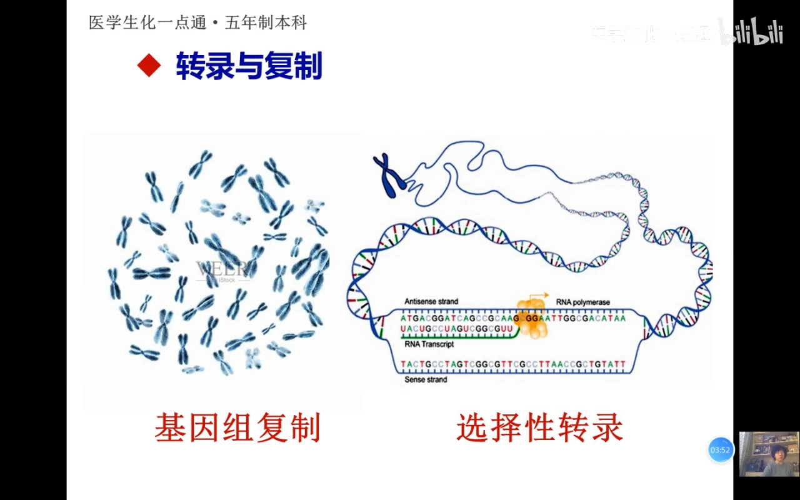

右边那张图把差别画得很直白：染色体上有很多基因，但此刻可能只需要其中某一个基因去表达出它的蛋白质。于是要在长长的染色体上找到这个蛋白对应的基因区域，RNA 聚合酶只在这个区域范围内活动，得到的就是针对这个基因的 RNA。所以转录是**个体行为**，严格讲是**选择性转录**。

注意右边图上的英文标注：被读的那条标着 `Antisense strand`（反义链），没被读的那条标着 `Sense strand`（有义链），中间那条红色的才是 RNA 转录本。这正是本文第二节要展开的模板链／编码链之分。

### 1.3 结构基因与转录单位：一次转录的起止范围

要给"抄一段"划出边界，得先有两个概念：**结构基因**和**转录单位**。

假设一段裸露的 DNA 被拆开、以其中一条链作模板去转录，那么转录出的这条单链 RNA 从长度上和模板应该一致：模板有 500 个核苷酸，产物就应该有 500 个。相对于这条 RNA，你用到的模板链所在的 DNA 就叫**结构基因**——注意结构基因指的是这段 DNA 的**双链**，而真正的模板只用了其中一条。

但一次转录只有结构基因远远不够。RNA 聚合酶不可能一上来就从第一个碱基开始合成，所以在结构基因的两侧，分别有**上游的调控序列**和**下游的终止位点**：调控序列让一些蛋白质来识别，里边有"转录起始"的命令，RNA 聚合酶要先结合调控序列，再向下游前进；快到结尾时，前方 DNA 上又有终止位点，里边有"终止"命令，到了结构基因最后一个核苷酸碱基就停下来。

[【跳转到 10:55】](https://www.bilibili.com/video/BV1gS4y1K7JU/?t=655)

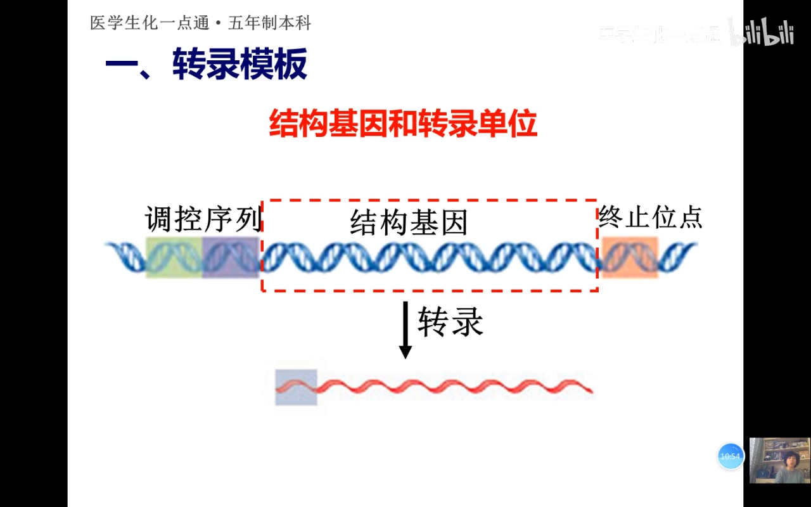

结构基因加上两侧的调控序列和终止位点，共同构成一次转录所必需的 DNA 区域，这就叫**转录单位**。结构基因是转录单位里的中心部分，上游要有调控序列，下游要有终止位点。

### 1.4 转录需要什么：单链模板、RNA 聚合酶、NTP

把"投入转录要用到的东西"列一遍，后面几节就有落点了：

- **模板**：DNA 单链（模板链）。DNA 依然要处于单链状态才能被读，只是这次只需要其中一条；
- **酶**：RNA 聚合酶（RNA-pol），整个过程中用量最大的酶；此外还需要解旋酶和其他蛋白质去识别转录起始地点等；
- **原料**：四种三磷酸核糖核苷酸 NTP（ATP、UTP、GTP、CTP）。

[【跳转到 08:37】](https://www.bilibili.com/video/BV1gS4y1K7JU/?t=517)

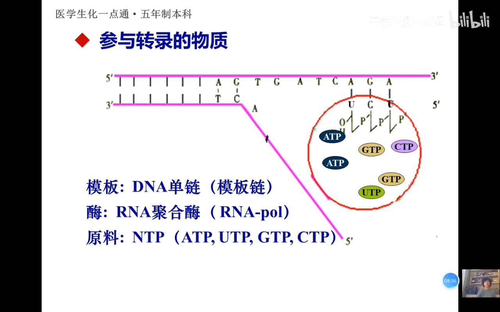

这张图顺带把方向关系画出来了：上链 5′→3′、下链 3′→5′，RNA 那条红线从游离的 5′ 端往聚合位点方向生长，而模板被读的方向正好相反。下一节就把这件事说透。

---

## 二、两条链怎么分工：模板链与编码链

### 2.1 被读的那条叫模板链，另一条叫编码链

一次转录中，两条 DNA 链里只有一条被利用。被利用、具体去指导 RNA 合成的这条链叫**模板链**；对面那条不参与这次直接指导的链，叫**编码链**。

[【跳转到 12:41】](https://www.bilibili.com/video/BV1gS4y1K7JU/?t=761)

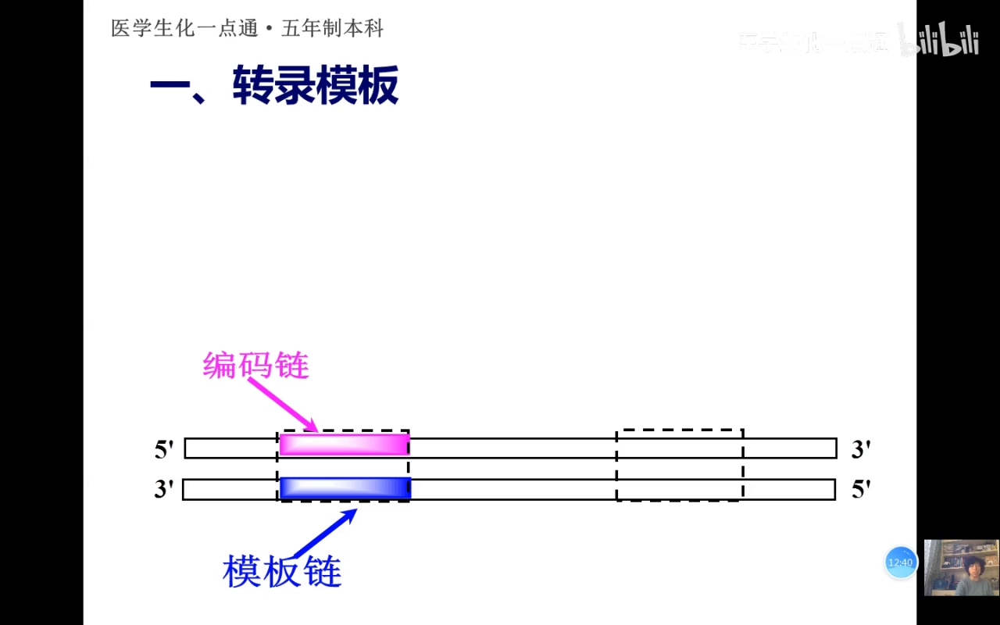

### 2.2 编码链的用处：看到编码链，就等于看到 RNA

"编码链"这个名字不是随便起的。模板链和编码链本身互补，而 RNA 又是按模板链互补配对合成的——两次互补等于一次"回到原样"，所以**RNA 的序列和编码链的序列只是 U 和 T 不同，其他完全一致**。

[【跳转到 13:06】](https://www.bilibili.com/video/BV1gS4y1K7JU/?t=786)

这句话的实用价值在于：你拿到一段编码链序列，只要把其中的 T 换成 U，就知道这次转录产物 RNA 的序列了。反过来说，教材和数据库里给出的基因序列、启动子序列，通常写的都是编码链方向——这一点在第三节会变成一个具体的判断陷阱。

### 2.3 不对称性与机会均等：同一条链不永远是编码链

既然一个基因的两条链你一条用了、另一条没用，这两条链就"没有被平等看待"。这种模板的利用方式，以前的教材叫**不对称性**：两条链中只选了一条，另一条没用。

但这里有个容易想歪的地方：这次没被用的那条链，难道永远是编码链吗？旧教材没给明确答案，第九版教材补了一句：**对双链 DNA 来讲，两条链其实都有机会作为模板链**。

[【跳转到 13:31】](https://www.bilibili.com/video/BV1gS4y1K7JU/?t=811)

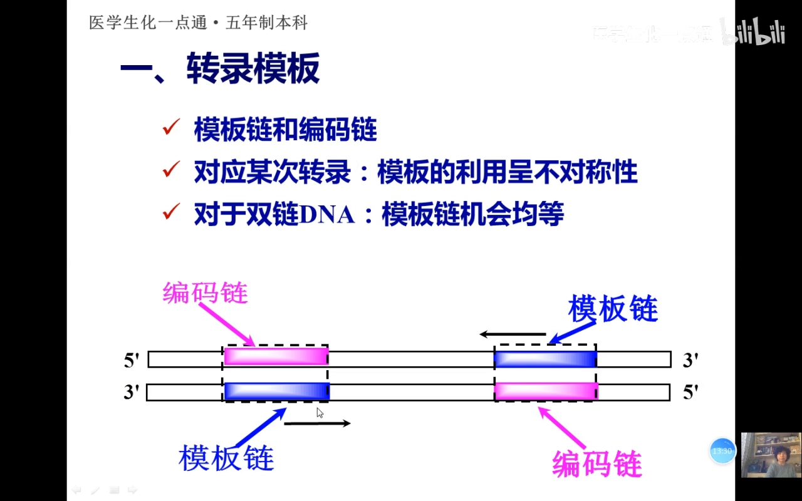

这张图把两种情形并排放：左边这个转录单位用下方蓝链做模板，右边那个转录单位反过来用上方蓝链做模板——于是同一条物理链，在左边是模板链、在右边就成了编码链。幻灯片上的三行小结正好是本节的三层结论：

1. 模板链和编码链；
2. 对应某次转录：模板的利用呈**不对称性**；
3. 对于双链 DNA：模板链**机会均等**。

推广一步：同一条染色体上相邻的不同基因，转录时未必要"看齐"、都选同一条单链做模板链，完全可以选另一条。所以"模板链"和"编码链"是**相对某一次转录**而言的角色，不是某条 DNA 链的固定身份。

---

## 三、方向关系：5′→3′ 写 RNA，3′→5′ 读模板

### 3.1 三条方向一次对齐

把 RNA、模板链、编码链三条线的方向放在一起，规则只有一句：**RNA 按 5′→3′ 合成，所以模板链必须按 3′→5′ 被读；编码链与 RNA 同向同序列（T 换 U），因此也是 5′→3′。**

[【跳转到 32:39】](https://www.bilibili.com/video/BV1gS4y1K7JU/?t=1959)

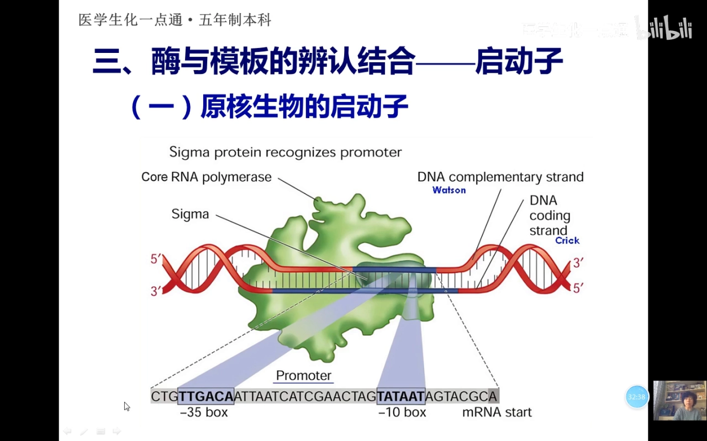

视频在这里给了一个现场演示：幻灯片上 -10 区、-35 区的序列，是从 5′ 到 3′ 排列的（图上左边是 5′ 端、右边是 3′ 端），可这条链并不是模板链。因为 RNA 的合成是从 5′ 到 3′ 方向，模板链被利用时必须是 3′ 到 5′ 这个方向——所以真正参与转录的模板链是**下面那一条**。

由此得到一条硬规则：**启动子上给出的序列，是编码链上的序列**。教材写 `TATAAT`、`TTGACA`，写的都是编码链方向；要还原模板链，得先取互补再倒过来（或者等价地：取反向互补）。

### 3.2 一个可操作的判断流程

遇到"给一段 DNA、问哪条是模板链／RNA 是什么序列"的题，可以按这个顺序走：

1. **先找方向标注**：序列标了 5′→3′ 的那条，通常是编码链（教材惯例）；没标就要看上下文（哪边是启动子、哪边是终止位点）。
2. **定模板链**：与"编码链方向"互补且反向的那条，就是模板链；RNA 聚合酶沿它 3′→5′ 前进。
3. **写 RNA**：以模板链为模板做互补，A 配 U、T 配 A、G 配 C、C 配 G，产物方向 5′→3′。
4. **自查**：把产物里的 U 全换成 T，应当与编码链序列逐位相同。对不上，说明第 2 步的链选错了。

[【跳转到 28:29】](https://www.bilibili.com/video/BV1gS4y1K7JU/?t=1709)

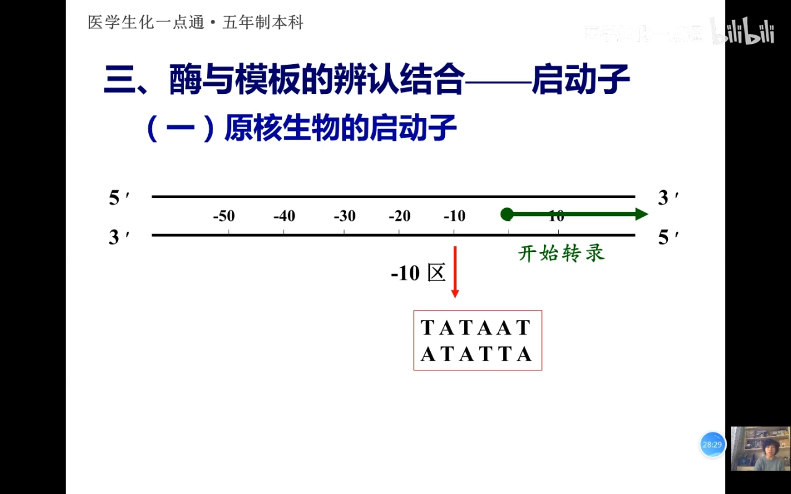

这张图正好是第 4 步自查的实物版：红框里上面一行 `TATAAT` 是编码链，下面一行 `ATATTA` 是与它互补的模板链序列，绿色箭头从 +1 位向右延伸——转录就朝这个方向走。

---

## 四、酶：RNA 聚合酶不需要引物，也不需要另配解旋酶

### 4.1 原核：核心酶加 σ 因子才是全酶

原核生物的 RNA 聚合酶由两个 α 亚基、一个 β 亚基、一个 β′ 亚基和一个 ω 亚基组成，这个组合叫**核心酶**。核心酶已经具备催化 3′,5′-磷酸二酯键、合成 RNA 的全部酶活性——但它**不能从正确的位点开始转录**，因为它认不出 DNA 模板上的起始位点。

[【跳转到 16:45】](https://www.bilibili.com/video/BV1gS4y1K7JU/?t=1005)

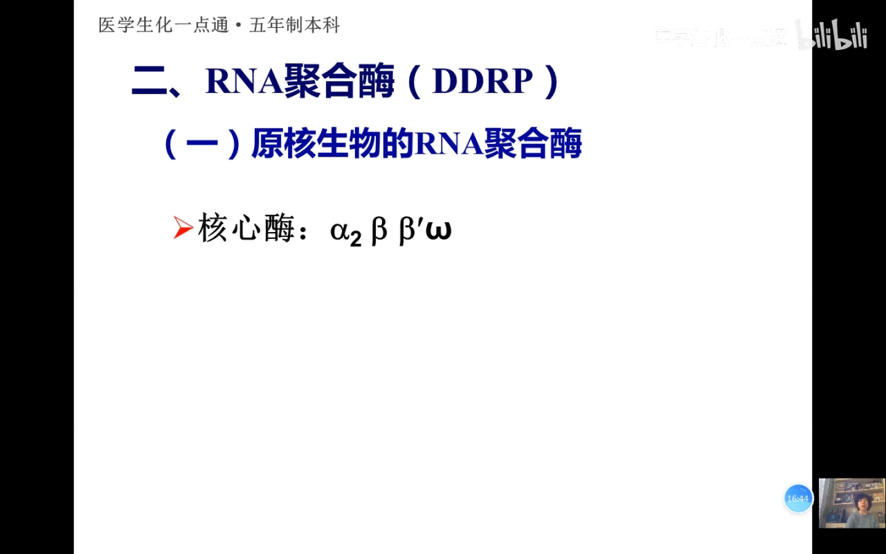

只有再加一个 **σ 因子**（sigma 亚基），形成**全酶**，它才能准确地在正确的转录起始点开始转录。所以 σ 的功能就是**识别转录起始点**——相当于整个活动的先锋官，先找到起点，其他亚基才可能各司其职。

[【跳转到 19:36】](https://www.bilibili.com/video/BV1gS4y1K7JU/?t=1176)

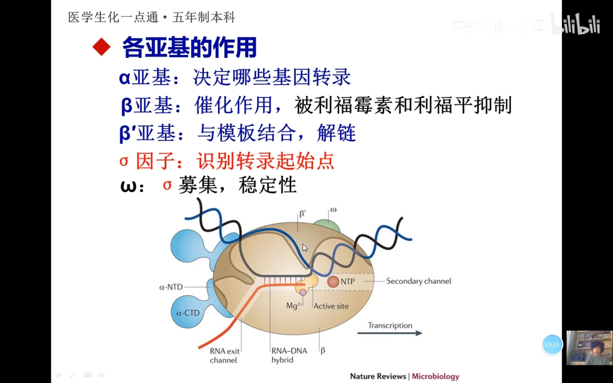

各亚基的分工可以一次记住：

| 亚基 | 作用 |
| --- | --- |
| α | 决定哪些基因在这次转录中被转录 |
| β | 真正的催化活性中心，催化 3′,5′-磷酸二酯键；被利福霉素、利福平抑制 |
| β′ | 与模板结合，并承担解链功能，把模板双链解开 |
| σ | 识别转录起始点（重点识别 -35 区，也参与 -10 区识别） |
| ω | 募集 σ 因子到位，维持全酶稳定 |

图里还能看到两个对"转录与复制差异"很关键的细节：RNA 从 **RNA exit channel** 单独伸出去（产物不与模板长期配对），活性中心里是 **RNA-DNA hybrid**（只有一小段杂合双链），以及活性中心必须结合 **Mg²⁺**。另外，转录延长时 σ 已经"退休"，只剩核心酶在工作——全酶只在起始阶段有用。

### 4.2 真核：三种聚合酶分工，产物各不相同

真核生物有三种 RNA 聚合酶，分工按产物划分：

- **Pol I**：位于核仁，转录 28S、18S、5.8S rRNA 的基因，产物是一条混合连在一起的 **45S rRNA 前体**；
- **Pol II**：转录 mRNA 的前体（hnRNA）；较新的研究也把它与 miRNA、lncRNA 前体的转录联系起来。它是细胞里最活跃的一种，因为 mRNA 半衰期短，需要不断补充模板；
- **Pol III**：负责 5S rRNA、tRNA、snRNA 等，产物种类最多。

[【跳转到 23:58】](https://www.bilibili.com/video/BV1gS4y1K7JU/?t=1438)

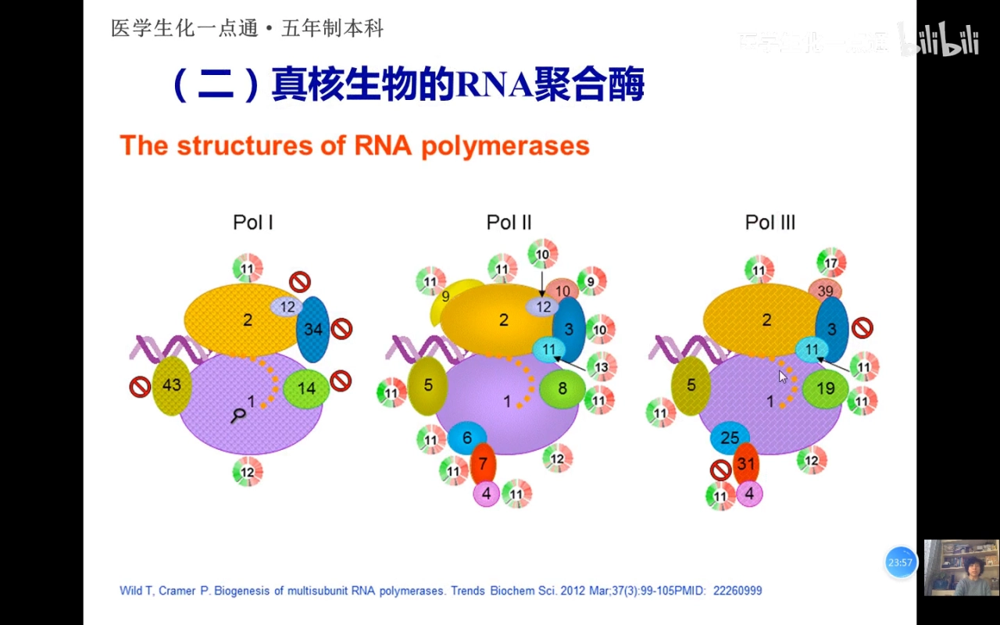

三种酶最根本的空间结构和活性中心位置是差不多的（都有黄色椭圆形亚基和紫色亚基），差别主要在周边那些小亚基上——所以"Pol II 最复杂"说的是它外围的调控接口多，而不是催化核心另起一套。

一个必须记住的前提：真核刚转录出来的都是**前体**，不是成熟 RNA，需要加工才能变成我们熟悉的各种 RNA。加工那一步不在本文范围。

---

## 五、启动子：酶认的是"位置"，不是"基因"

### 5.1 启动子是什么，怎么把它找出来

一次转录活动里，RNA 聚合酶必须先结合结构基因上游的调控序列，不能从结构基因直接开始。调控序列中**能够和 RNA 聚合酶结合、被 RNA 聚合酶识别的这段 DNA**，就叫**启动子**（promoter）——它是 DNA 上的一段特殊序列，是转录时 RNA 聚合酶最初结合的那个区域。

那么这段序列到底是 ATGC 还是 CTGA？要靠实验找。视频给了一个很巧的设计：

1. 把 RNA 聚合酶加进去，**设置转录条件但不让它真正开始转录**；
2. 用核酸酶把 DNA 的磷酸二酯键切断——除了被 RNA 聚合酶蛋白盖住的那一段，别处的键都能断；
3. 去掉被切碎的核苷酸，把完整的复合物提取出来；
4. 再把 RNA 聚合酶消化掉，就拿到了这段被保护的 DNA，测序即可读出碱基排列。

[【跳转到 26:49】](https://www.bilibili.com/video/BV1gS4y1K7JU/?t=1609)

这个方法叫 **DNA 酶保护法**。它的逻辑值得记：不是"预测"启动子，而是用"蛋白质结合挡住了核酸酶"这一物理事实把它圈出来。

为了在 DNA 链上指认启动子的位置，需要一个坐标约定：从**真正开始转录的第一个 DNA 碱基**标为 **1**（结构基因的第一位），往下游是 1、2、3、4、5；调控序列在上游，用**负值**表示，比如 -10、-20。

### 5.2 原核启动子：-10 区与 -35 区

用上面的方法加大量实验，找到了原核生物基因在这一区两个相对保守的位置，也正是聚合酶要识别的地方：

- **-10 区**：-10 碱基附近经常出现 `TATAAT`，是绝大多数基因都有的六个核苷酸序列，又叫 **Pribnow 盒**；
- **-35 区**：-35 区域有 `TTGACA`，也是绝大多数基因共有的序列。

[【跳转到 28:29】](https://www.bilibili.com/video/BV1gS4y1K7JU/?t=1709)

两个序列之间往往相隔 **17±1 bp**，这就是最经典的原核启动子。识别分工上：-35 区是 σ 因子首要的、最重要的辨认位点（σ 靠一个螺旋-转角-螺旋模体去识别），-10 区是 RNA 聚合酶**稳定结合**模板的位点；但整个全酶其实都参与这两个区域的识别，只是结合的紧密程度不同。

σ 不是只用一个部位去认启动子。它本身是个很大的蛋白，可分成四个相对独立的结构域：第四个结构域重点识别 -35 区，第三个结构域识别靠近 -10 区的延伸区，-10 区由第二个结构域的一部分识别，第一个结构域的一部分则识别 -10 区与真正起始位点之间的序列；两个 α 亚基的 C 端结构域还额外参与识别 -35 区上游的碱基。所以「σ 只认 -35」是个简化说法，实际是多个部位一起把启动子「卡」准。

σ 因子还有多样性：识别 -10/-35 的通常是 70 kDa 的 σ（σ70）；此外还有 σ32、σ54 等。σ54 构成的 RNA 聚合酶识别的启动子就不再是 -10/-35，而是 -12 的 TGC 和 -24 的 GG——同样能起始转录，核心酶不变。这说明"启动子"是一类**被某种 σ 认出来的序列模式**，不是一条固定序列。

### 5.3 真核启动子：三个盒，加一个断裂基因

真核基因的第一个特点是**断裂基因**：结构基因由外显子、内含子间隔排列构成，而内含子在成熟 RNA 里是不存在的。真核启动子同样在调控序列里，即第一个外显子的上游，但形式比原核多：

- **TATA 盒**：距第一个外显子约 25 个碱基，`TATA` 重复，又叫 Hogness 盒，构成**核心启动子**（基本启动子）；
- **CAAT 盒**：再往上约 -70 处，`CAAT` 重复；
- **GC 盒**：-110 左右，`GCGC` 重复。

[【跳转到 39:41】](https://www.bilibili.com/video/BV1gS4y1K7JU/?t=2381)

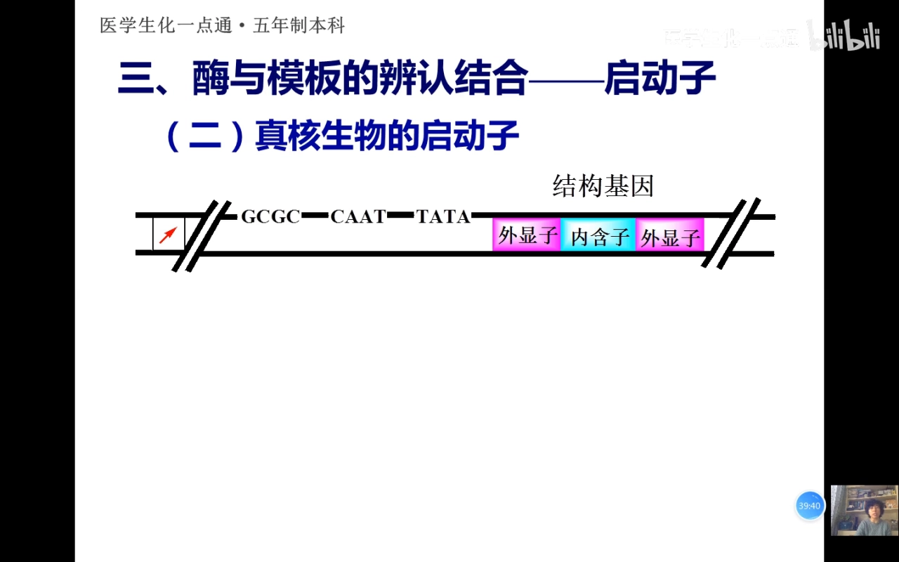

[【跳转到 41:51】](https://www.bilibili.com/video/BV1gS4y1K7JU/?t=2511)

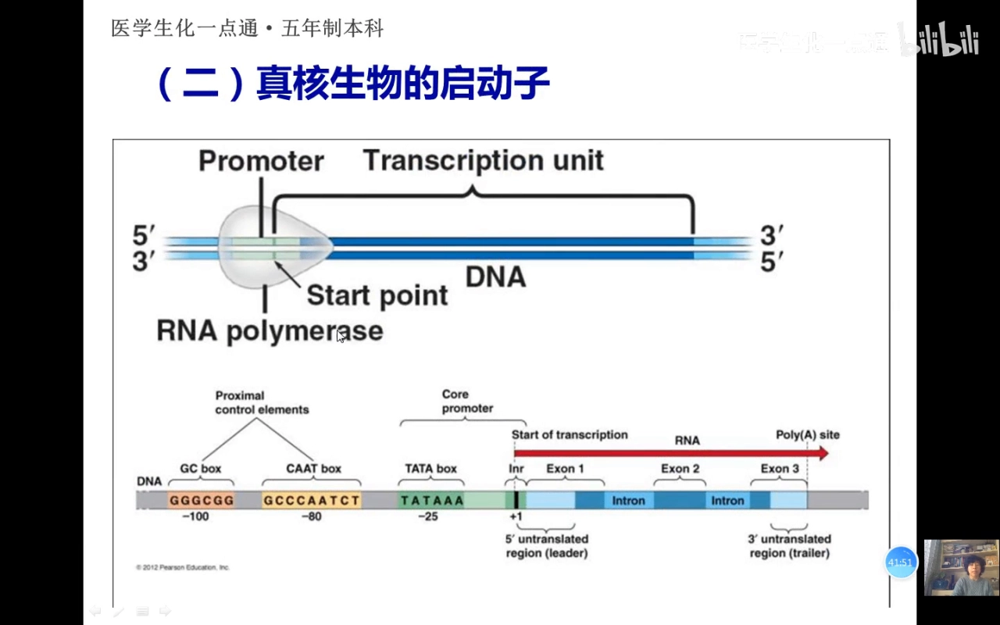

第二张图把坐标一次摆清：GC 盒约 -100、CAAT 盒约 -80、TATA 盒约 -25、起始位点在 +1，右边是外显子／内含子交替和 Poly(A) 位点。教材把 CAAT 盒和 GC 盒称为**启动子的上游元件**——严格说它们不是核心启动子的一部分，但同样是真核 RNA 聚合酶必须认识的。

还有一类特例值得知道：**管家基因**（每个细胞都必不可少的基因）可能不用 TATA 盒，而用 GC 盒，此时起始位点本身对它们更为重要。这也是真核转录比原核复杂的来源之一：启动子的选择范围更大，RNA 聚合酶的种类又多。

Pol I 和 Pol III 的启动子又各是一套（视频明确说不要求掌握，这里只留个印象）：Pol I 认的是转录起始位点上的核心序列，加上约 100 bp 外的 **UCE** 元件，UBF 这类蛋白形成二聚体识别两处之后 Pol I 才能加入；Pol III 最复杂，转录 5S rRNA 时认 **A 盒**与 **C 盒**，转录 tRNA 前体时认 **A 盒**与 **B 盒**（中间还需要一个中间元件），转录 U6 snRNA 一类基因时则换成 TATA 盒加 **PSE**、**DSE**。同一支聚合酶面对不同产物要认不同元件，这正是「启动子是一类序列模式、不是一条固定序列」的又一个例子。

---

## 六、转录与复制到底差在哪

### 6.1 先看共性：两件事共用同一套化学

在列差异之前，先承认它们确实像：两者都以 DNA 为根本模板；都是**核苷酸的聚合反应**，都在聚合酶催化下形成 3′,5′-磷酸二酯键；新链都按 **5′→3′** 方向延长；都靠**碱基互补配对**把原料对上模板。差异是在这套共同化学之上叠加出来的。

### 6.2 再看差异：一张表六行

把前面几节的结论收进一张表，就是这支课开头那张对照表：

[【跳转到 05:33】](https://www.bilibili.com/video/BV1gS4y1K7JU/?t=333)

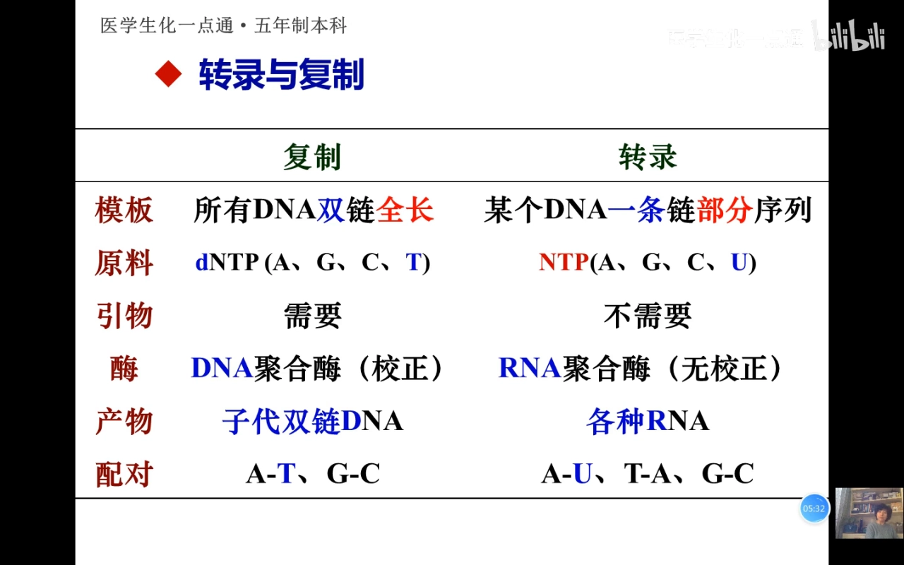

| 项目 | 复制 | 转录 |
| --- | --- | --- |
| 模板 | 所有 DNA，**双链**、**全长** | 某个 DNA 的**一条链**、**部分序列** |
| 原料 | dNTP（A、G、C、T） | NTP（A、G、C、U） |
| 引物 | 需要 | 不需要 |
| 酶 | DNA 聚合酶（有校正） | RNA 聚合酶（无校正） |
| 产物 | 子代双链 DNA | 各种 RNA |
| 碱基配对 | A-T、G-C | A-U、T-A、G-C |

六条差异可以归成三组来理解：

1. **范围不同**：复制是基因组级别的集体行动，双链全长都当模板；转录是基因级别的选择性行动，只取一条链的一段。
2. **化学不同**：原料由脱氧变成核糖（T 换 U）；配对规则里多出 A-U 这一条。
3. **酶学不同**：复制不能从头合成，必须有引物，且 DNA 聚合酶带 3′→5′ 核酸外切酶活性、能校对，这是复制高保真的来源；RNA 聚合酶不需要引物就能起步，本身也不能矫正错误。

[【跳转到 05:58】](https://www.bilibili.com/video/BV1gS4y1K7JU/?t=358)

[【跳转到 06:23】](https://www.bilibili.com/video/BV1gS4y1K7JU/?t=383)

还有两条差异在表里没写、但同样重要：

- **解旋方式**：复制需要解旋酶先把双链打开；RNA 聚合酶的 β′ 亚基自己就能把模板双链解开，所以转录不需要另配解旋酶。
- **产物的去向**：复制的产物是子代双链 DNA，双链留在原地；转录的产物是单链 RNA，从 RNA exit channel 伸出去、与模板只有一小段杂合，随后离开模板。

---

## 七、这篇与同目录另一篇怎么分工

本小节的学习目标有四项，两篇博客各管一段：

- **启动子识别**：本文第五节给出启动子的定义、DNA 酶保护法的实验逻辑、原核 -10/-35 与 σ 因子的分工、真核 TATA/CAAT/GC 三个盒；同目录《转录如何发生：从启动子到成熟 mRNA 的分子流水线》第三节则给出真核预起始复合体的组装顺序（TFIID/TBP → TFIIA → TFIIB → Pol II → TFIIE，再由 TFIIH 磷酸化 CTD 并解链）与中介体、CTD 磷酸化的调控层。
- **模板链、编码链与方向关系**：本文第二、三节。
- **起始、延伸与终止三阶段**：那篇博客的第三节按预起始、起始、暂停、延伸、终止五步展开，并给出鱼雷模型；本文不重复。
- **转录与复制的关键差异**：本文第六节。

两篇合起来，四项学习目标都有落点；本文刻意不重讲五阶段与 RNA 加工，避免与 2.2.2 及同目录另一篇重复。

---

## 小结

- 转录是**选择性**的：复制抄整个基因组（双链全长），转录只抄一个**转录单位**（结构基因加上游调控序列、下游终止位点），且只用**一条链**。
- 一次转录中，被读的链叫**模板链**，没被读的叫**编码链**；编码链序列与 RNA 相同，只差 T 与 U。
- 模板链／编码链是**相对某次转录的角色**：同一次转录内两条链利用不对称，但对双链 DNA 而言两条链机会均等，相邻基因也可以换链。
- 方向关系一句话：**RNA 按 5′→3′ 写，模板链按 3′→5′ 读，编码链与 RNA 同向同序列**；教材给出的启动子序列是编码链方向。
- 原核 RNA 聚合酶的核心酶是 α₂ββ′ω，加 σ 因子成全酶；σ 负责识别起始点，β′ 兼做解链，因此转录**不需要引物、不需要另配解旋酶**。
- 启动子是"被 RNA 聚合酶识别并结合"的那段 DNA，可用 DNA 酶保护法实验定位；原核靠 -10 区（Pribnow 盒）与 -35 区，真核靠 TATA／CAAT／GC 盒。
- 转录与复制的差异可归为三组：范围（基因 vs 基因组）、化学（NTP 与 A-U 配对）、酶学（无需引物、无校对）。

## 关键术语速查

| 术语 | 一句话解释 |
| --- | --- |
| 转录单位 | 结构基因加上游调控序列与下游终止位点，构成一次转录所需的 DNA 区域。 |
| 结构基因 | 与某条 RNA 产物相对应的那段 DNA 双链范围。 |
| 模板链 | 某次转录中真正被读、用来指导 RNA 合成的那条 DNA 链，被读方向为 3′→5′。 |
| 编码链 | 同一次转录中未被读的那条链，序列与 RNA 相同，只是 T 换成 U。 |
| 不对称转录 | 一次转录只利用两条链中的一条，两条链地位不对等。 |
| 启动子 | 调控序列中能被 RNA 聚合酶识别并结合的那段 DNA，是转录起始的位置标志。 |
| Pribnow 盒 | 原核启动子的 -10 区，共有序列 TATAAT。 |
| -35 区 | 原核启动子中 σ 因子重点识别的区域，共有序列 TTGACA。 |
| σ 因子 | 原核 RNA 聚合酶的起始专用亚基，负责识别转录起始点；与核心酶合称全酶。 |
| 核心酶 | 原核 RNA 聚合酶的 α₂ββ′ω 组合，有催化活性但不能正确起始。 |
| TATA 盒 | 真核核心启动子的标志序列，约在 -25 处，又称 Hogness 盒。 |
| 上游元件 | 真核启动子中 CAAT 盒与 GC 盒一类辅助元件，位于核心启动子上游。 |
| DNA 酶保护法 | 用核酸酶切断裸露 DNA、靠聚合酶结合保护启动子片段，再测序定位启动子的实验方法。 |
| NTP | 三磷酸核糖核苷酸（ATP、UTP、GTP、CTP），转录的原料。 |