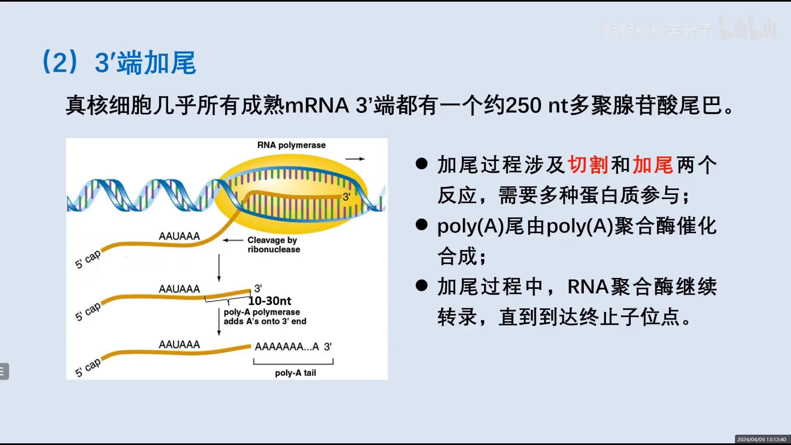
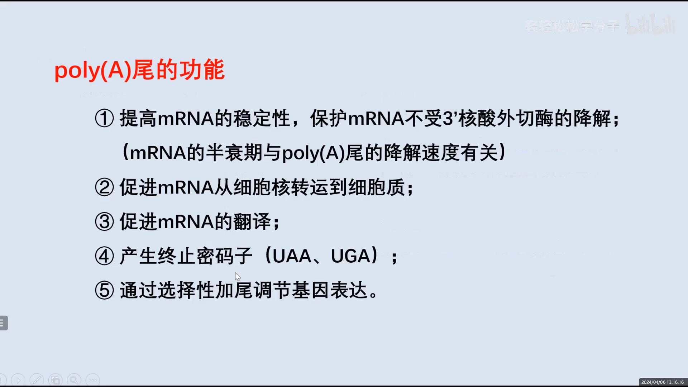
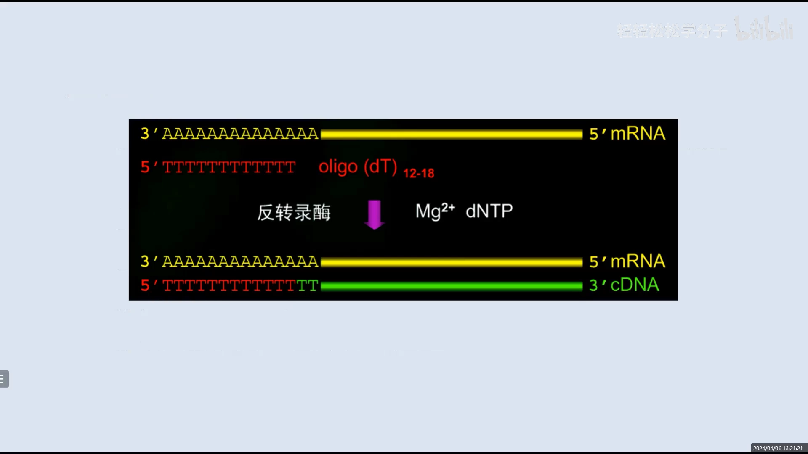

# 3′ 端切割与 poly(A) 加尾：mRNA 的尾巴怎么长出来

> 视频来源：[【分子生物学】第3章 转录｜第4节 RNA的转录后加工｜真核生物mRNA前体的转录后加工（3′端加尾）](https://www.bilibili.com/video/BV1miUhYtEgw/)（Bilibili · 轻轻松松学分子，约 13 分钟）
> 导读（100 字以内）：加尾不是"在 3′ 端直接接一串 A"，而是先认信号、再切一刀、最后才加尾。这支课把 AAUAAA、切割位点、poly(A) 聚合酶和五个功能串成一条线，末尾还接到实验室里天天用的 oligo(dT) 引物。

## 本讲要解决的核心问题（SCQA）

**背景**：上一节讲了 5′ 端的加帽。真核 mRNA 的 5′ 端被一顶帽子封住，5′→3′ 方向的核酸外切酶咬不动它。

**冲突**：可 RNA 还有另一端。3′ 端依然裸露，而细胞里同时存在从 3′ 往 5′ 啃的核酸外切酶。更麻烦的是，转录机器此刻还在往下游跑，RNA 的 3′ 端并不是一个"最终的"末端——它随时会被继续延长。

**疑问**：细胞怎么给 3′ 端也做一个封口？这个封口是在转录终止之后才加的吗？加了之后又有什么用？

**回答（中心思想）**：3′ 端加工是**"先切割、再加尾"**两步，而且两步都发生在转录**还没终止**的时候。mRNA 前体里有一段保守信号 AAUAAA，相关酶识别它之后，在它下游 10~30 nt 处切一刀，再由 poly(A) 聚合酶在切口处加上约 250 nt 的多聚腺苷酸尾巴。这条尾巴既是防 3′→5′ 外切酶的护甲、又参与出核和翻译，还会影响 mRNA 的半衰期；它甚至能"顺手"提供终止密码子里的那个 A，并成为逆转录时 oligo(dT) 引物的落脚点。

---

## 一、加尾的对象和时机：一条正在被转录的 RNA

[【跳转到 00:25】](https://www.bilibili.com/video/BV1miUhYtEgw/?t=25)

真核细胞几乎所有成熟 mRNA 的 3′ 端，都有一个约 **250 nt** 的多聚腺苷酸尾巴，也就是 **poly(A) 尾巴**。

[【跳转到 00:50】](https://www.bilibili.com/video/BV1miUhYtEgw/?t=50)

这里要留意单位：**bp** 用于双链的碱基对，**nt** 用于单链的核苷酸数。poly(A) 尾是单链，所以长度用 nt 表示。

[【跳转到 01:00】](https://www.bilibili.com/video/BV1miUhYtEgw/?t=60)



看这张图：黄色的链是 mRNA，右侧的 RNA 聚合酶还在沿 DNA 前进。注意两件事同时成立——**5′ 端的帽子早就加好了**，而 **3′ 端还在往外长**。加尾就发生在这个"转录尚未完成"的窗口里。

---

## 二、加尾其实是两步：先切一刀，再接尾巴

### 2.1 信号：AAUAAA

[【跳转到 01:25】](https://www.bilibili.com/video/BV1miUhYtEgw/?t=85)

mRNA 前体当中有一段保守序列 **AAUAAA**，它是一段**加尾信号**。

相关的酶会识别这个信号，识别之后并不是立刻在信号处加 A，而是**在信号的下游先切一刀**。切割位点距离加尾信号下游大约 **10~30 nt**。

[【跳转到 03:15】](https://www.bilibili.com/video/BV1miUhYtEgw/?t=195)


这张图把整个过程画成三层，从上往下读：

1. **最上面**：RNA 聚合酶正在转录，RNA 上已经出现 AAUAAA，5′ 端带着帽子；
2. **中间**：核酸酶（ribonuclease）在 AAUAAA 下游切开 RNA，切口与信号之间标注了 10~30 nt；
3. **最下面**：poly(A) 聚合酶在切口处加上一串 A，形成 poly(A) tail。

[【跳转到 02:00】](https://www.bilibili.com/video/BV1miUhYtEgw/?t=120)

所以"加尾"这个词其实省略了一个前提：**先切割，切完再加尾**。而且这个过程需要多种蛋白质参与，poly(A) 尾巴本身是由 **poly(A) 聚合酶**催化合成的——这是一种专门合成 poly(A) 的酶。

### 2.2 一个反直觉的地方：切割和加尾时，转录还没停

在加尾的过程当中，**RNA 聚合酶其实还在继续转录**。

这就产生了一段"没有用"的转录本：mRNA 前体在转录终止之前就已经被切开了，poly(A) 尾巴也加上了；聚合酶继续往下游转录出来的那一段，最终不进入成熟 mRNA。聚合酶会一直转录到终止位点，转录才真正终止。

[【跳转到 02:25】](https://www.bilibili.com/video/BV1miUhYtEgw/?t=145)

[【跳转到 02:50】](https://www.bilibili.com/video/BV1miUhYtEgw/?t=170)

把这条时间线画出来会更清楚：

```
转录开始 ──► 5′ 端伸出 ──► 加帽
              │
              ├─► 出现 AAUAAA ──► 下游 10~30 nt 处切割 ──► 加 poly(A) 尾
              │                                              │
              └──────────► 聚合酶继续转录 ──► 到达终止位点 ──► 转录终止
                                                     ↑
                                        这段转录本最终被丢弃
```

---

## 三、poly(A) 尾巴的五个功能

[【跳转到 03:15】](https://www.bilibili.com/video/BV1miUhYtEgw/?t=195)



### 3.1 提高稳定性：一条会被"消耗"的护甲

第一个功能是提高 mRNA 的稳定性，保护 mRNA 不受 **3′ 核酸外切酶**的降解。

[【跳转到 03:40】](https://www.bilibili.com/video/BV1miUhYtEgw/?t=220)

这里可以和帽子对照着记：

| 位置 | 保护结构 | 挡住谁 |
| --- | --- | --- |
| 5′ 端 | 帽子结构 | 5′→3′ 核酸外切酶 |
| 3′ 端 | poly(A) 尾巴 | 3′→5′ 核酸外切酶 |

5′ 核酸外切酶从 5′ 往 3′ 水解核酸，3′ 核酸外切酶从 3′ 往 5′ 水解核酸。poly(A) 尾位于 mRNA 的 3′ 端，正好挡住后者的去路。

更关键的是，这条尾巴是**消耗品**：它早晚会被 3′ 核酸外切酶一点点水解掉；一旦尾巴没了，保护作用随之消失，mRNA 就开始被降解。因此 **mRNA 的半衰期与 poly(A) 尾的降解速度直接相关**——尾巴掉得越慢，mRNA 活得越久。

[【跳转到 04:15】](https://www.bilibili.com/video/BV1miUhYtEgw/?t=255)

视频在这里给了一个类比：poly(A) 尾有点像染色体的**端粒**。端粒随着 DNA 每复制一次就缩短一截，所以细胞增殖的代数有限；poly(A) 尾也是一段会被逐渐磨短的"计时器"。

### 3.2 出核与翻译：和帽子同款的两个功能

[【跳转到 04:40】](https://www.bilibili.com/video/BV1miUhYtEgw/?t=280)

第二、第三个功能与帽子结构高度相似：

- **促进 mRNA 从细胞核转运到细胞质**；
- **促进 mRNA 的翻译**。

这也解释了为什么成熟 mRNA 的两端都要有"标记"：一端负责被翻译机器认出来，一端负责被转运系统认出来，两头齐备才算一条合格的成熟 mRNA。

### 3.3 产生终止密码子：尾巴上的 A 也能派上用场

[【跳转到 04:50】](https://www.bilibili.com/video/BV1miUhYtEgw/?t=290)

第四个功能比较巧妙：poly(A) 尾**可以产生终止密码子**。

幻灯片在这里列的是 **UAA** 和 **UGA**——它们的**最后一位都是 A**。（三个终止密码子中的另一个 UAG 末位是 G，所以这条"借 A"的说法只对 UAA、UGA 成立。）所以终止密码子里的这个 A，**有可能就是加尾时加上来的那个 A**，它刚好与前面的碱基凑成一个终止密码子。

### 3.4 选择性加尾：换一个位置加尾，就换一个蛋白

[【跳转到 05:15】](https://www.bilibili.com/video/BV1miUhYtEgw/?t=315)

第五个功能是**通过选择性加尾调节基因表达**。

逻辑链条是这样的：加尾的位置是可以变化的。如果尾巴加在别的位点上，终止密码子的位置也就跟着变了；终止密码子位置不同，翻译出来的多肽链长短就不同，最终得到的蛋白质自然也不一样。这就是选择性加尾调控基因表达的方式。

---

## 四、这条尾巴在实验室里的用处：oligo(dT) 引物

[【跳转到 10:20】](https://www.bilibili.com/video/BV1miUhYtEgw/?t=620)



基因工程里有一种很有用的工具酶——**逆转录酶**，它以 RNA 为模板合成 DNA。逆转录反应需要一个引物，常用的引物叫 **oligo(dT)**，长度一般 12~18 个核苷酸，就是很多个 T 连成的短 DNA 链。

[【跳转到 06:45】](https://www.bilibili.com/video/BV1miUhYtEgw/?t=405)

它为什么能当引物？因为 **T 与 A 互补配对**。mRNA 3′ 端是一长串 A，oligo(dT) 正好退火上去，相当于把引物"锚定"在 poly(A) 尾上。退火之后，逆转录酶沿着引物、按 5′→3′ 方向、以 mRNA 为模板合成 DNA，产物就是与 mRNA 碱基互补的 **cDNA**。

[【跳转到 07:20】](https://www.bilibili.com/video/BV1miUhYtEgw/?t=440)

这段内容其实说明了 poly(A) 尾的一个"副作用价值"：它把**所有带尾巴的 mRNA** 变成了可以被同一种引物统一抓取的分子。这也是为什么 poly(A) 尾不只属于分子生物学课本，它还是转录组实验的基础设施之一。

---

## 小结

- 成熟 mRNA 的 3′ 端有约 **250 nt** 的 poly(A) 尾；单链长度用 **nt**，双链才用 bp。
- 加尾是**两步**：识别 **AAUAAA** 信号 → 在下游 **10~30 nt** 处切割 → 由 **poly(A) 聚合酶**加 A。
- 切割与加尾都发生在**转录终止之前**；聚合酶继续转录出的那一段最终被丢弃。
- 五个功能：**提高稳定性（挡 3′→5′ 外切酶，决定半衰期）、促进出核、促进翻译、产生终止密码子、选择性加尾调节表达**。
- poly(A) 尾像端粒一样是消耗品，被磨短到失效后 mRNA 开始降解。
- 在实验室里，poly(A) 尾是 **oligo(dT) 引物**的退火位点，是逆转录合成 cDNA 的起点。

## 关键术语速查

| 术语 | 一句话解释 |
| --- | --- |
| poly(A) 尾 | 加在 mRNA 3′ 端、约 250 nt 的多聚腺苷酸尾巴。 |
| AAUAAA | mRNA 前体中的加尾信号，相关酶识别它之后在下游切割。 |
| poly(A) 聚合酶 | 专门在 RNA 3′ 端加上一串腺苷酸的酶。 |
| 3′ 核酸外切酶 | 从 3′ 往 5′ 方向逐个水解核苷酸的酶，poly(A) 尾专门挡它。 |
| 半衰期 | mRNA 从生成到被降解一半所需的时间，与 poly(A) 尾降解速度相关。 |
| 选择性加尾 | 在不同位点加尾，改变终止密码子位置，从而产生不同长度的蛋白。 |
| oligo(dT) | 由 12~18 个 T 组成的短 DNA，靠与 poly(A) 配对充当逆转录引物。 |
| cDNA | 以 mRNA 为模板、由逆转录酶合成的互补 DNA。 |