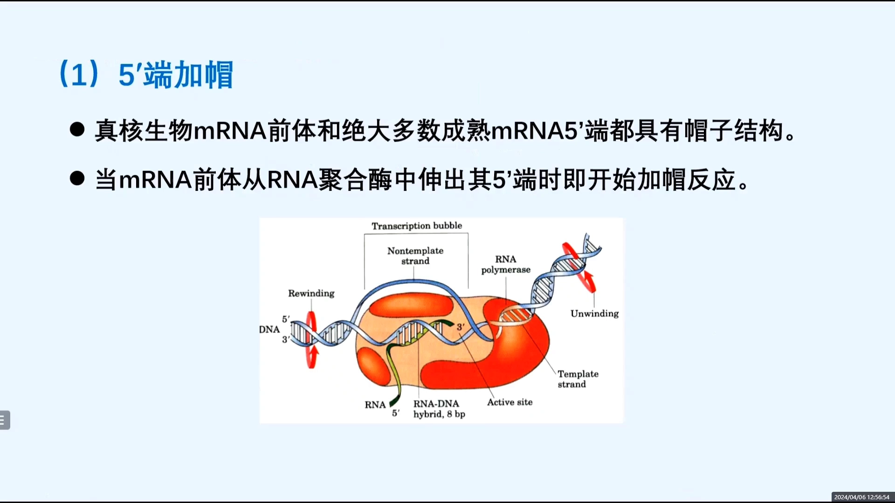
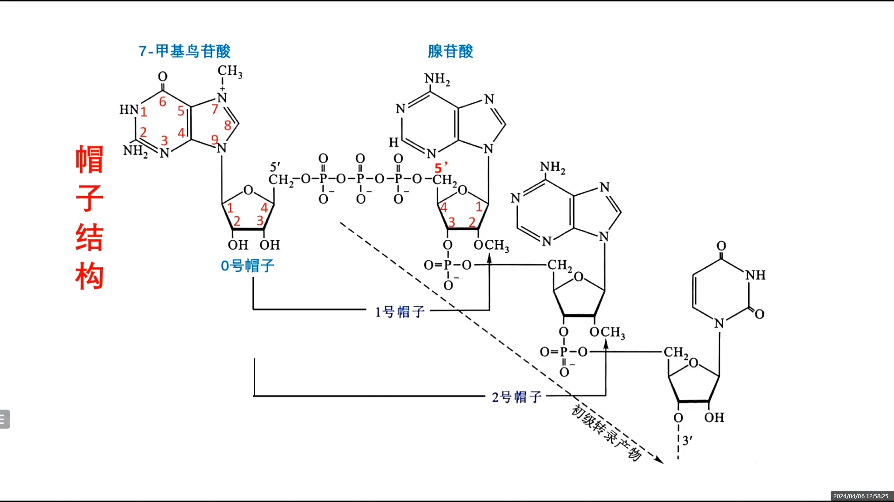
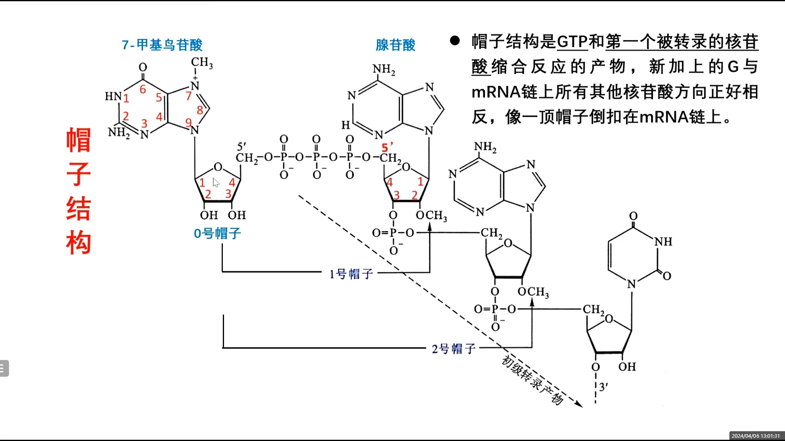
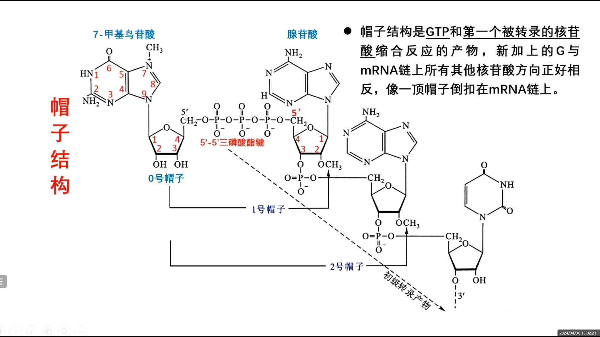
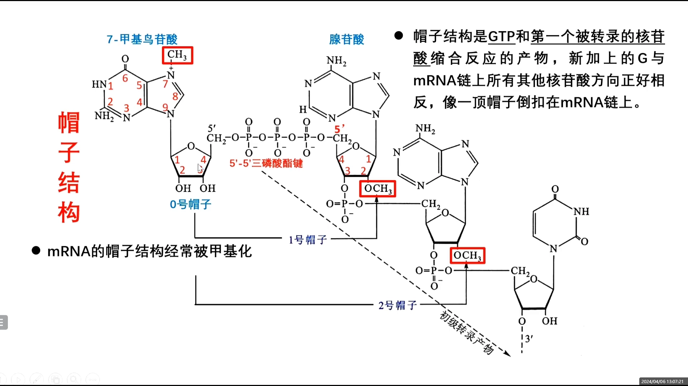
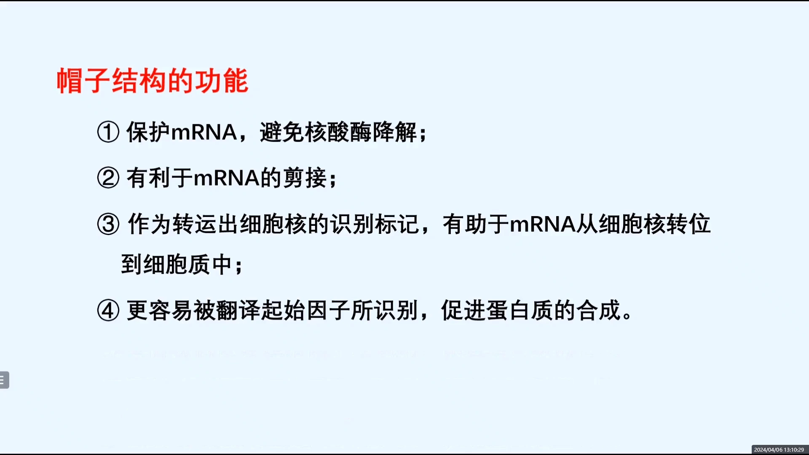

# 5′ 端加帽：给 mRNA 戴上一顶防降解的帽子

> 视频来源：[【分子生物学】第3章 转录｜第4节 RNA的转录后加工｜真核生物mRNA前体的转录后加工（5′端加帽）](https://www.bilibili.com/video/BV13q421P7Mk/)（Bilibili · 轻轻松松学分子，约 13 分钟）
> 导读（100 字以内）：这支课把「帽子」拆到化学键的层面：加在什么时候、由什么和什么缩合而成、为什么核酸酶咬不动它、0/1/2 号帽子差在哪、以及这顶帽子后来在剪接、出核、翻译里各起什么作用。

## 本讲要解决的核心问题（SCQA）

**背景**：前一小节已经讲过，真核生物的 RNA 聚合酶 II 沿着 DNA 模板合成 RNA。但刚合成出来的那条链还不叫成熟 mRNA，它叫 **mRNA 前体（pre-mRNA）**，是一份半成品。

**冲突**：细胞质里到处是核酸酶，一条两端"裸露"的 RNA 放进去很快就会被啃掉；而且核糖体也不能随便抓着一条 RNA 就开始翻译。也就是说，pre-mRNA 从被造出来的那一刻起，就处在"随时会被降解、还不能用"的状态。

**疑问**：细胞是在什么时候、用什么方式给这条新 RNA 加上保护？这顶"帽子"到底是个什么化学结构，为什么能挡住核酸酶？

**回答（中心思想）**：加帽不是转录结束后的收尾工作，而是**转录刚开始、RNA 的 5′ 端刚从聚合酶里伸出来时就立刻发生的**。帽子是 GTP 与第一个被转录的核苷酸缩合、并脱去两个磷酸后的产物，两个核苷酸之间靠一个**5′,5′-三磷酸酯键**倒着连起来——正因为这个键不是核酸酶惯常切割的 3′,5′-磷酸二酯键，帽子才成了"防咬"的护甲。这顶帽子按甲基化程度分 0 号、1 号、2 号三种，随后在剪接、出核和翻译起始三个环节继续发挥作用。

---

## 一、加帽的时机：转录还没完，帽子已经戴好

[【跳转到 00:00】](https://www.bilibili.com/video/BV13q421P7Mk/?t=0)

真核生物 mRNA 前体和绝大多数成熟 mRNA 的 5′ 端都具有帽子结构。这里有个容易被忽略的细节：**mRNA 前体本身就已经带着帽子了**，不是等转录完成才补上去的。

[【跳转到 00:30】](https://www.bilibili.com/video/BV13q421P7Mk/?t=30)

看这张转录泡的图：RNA 聚合酶把双链 DNA 解开，以其中一条链为模板合成 RNA。新合成的 RNA 与模板之间的杂交区非常短，只有大约 **8 bp**；离生长端越远的 RNA，越是处于"游离"的单链状态。

于是就有了加帽的时间窗口：**mRNA 前体远离生长端的那一部分一形成，加帽反应就开始了**，5′ 端立刻被加上帽子结构。

为什么这么急？视频把答案留到后面讲功能时才揭晓——帽子最直接的作用就是保护 mRNA。一条 RNA 的 5′ 端是核酸外切酶最先够得着的地方，先把它盖住，这条转录本才活得下去。

---

## 二、帽子长什么样：一次缩合，一个"倒着连"的键

### 2.1 帽子是 GTP 和第一个核苷酸缩合的产物

帽子结构是 **GTP 与 mRNA 前体当中第一个被转录的核苷酸发生缩合反应**的产物。缩合之后，新加上的这个 G 已经脱去了两个分子的磷酸基团。

[【跳转到 02:21】](https://www.bilibili.com/video/BV13q421P7Mk/?t=141)

这张图是整节课的核心。左边是**鸟苷酸**（具体说是 7-甲基鸟苷酸），右边是 mRNA 前体的**第一个核苷酸**（图中画的是腺苷酸），中间用三个磷酸基团把两者连起来。用常见的简写方式，这一段可以记成：

$$
\text{m}^7\text{G}(5')\text{ppp}(5')\text{N}
$$

其中 $\text{m}^7\text{G}$ 表示 7 号位氮原子上带甲基的鸟苷酸，$\text{ppp}$ 是三个磷酸，两个 $(5')$ 表示两端都是通过各自的 5′ 碳连出去的，$\text{N}$ 代表 mRNA 的第一个核苷酸。

[【跳转到 03:16】](https://www.bilibili.com/video/BV13q421P7Mk/?t=196)

### 2.2 关键在"5′,5′-三磷酸酯键"

连接这两个核苷酸的化学键，**不是** RNA 链内部那种 3′,5′-磷酸二酯键，而是 **5′,5′-三磷酸酯键**。

[【跳转到 02:46】](https://www.bilibili.com/video/BV13q421P7Mk/?t=166)

对着图数一遍就清楚了：鸟苷酸这边 1、2、3、4、5 号碳，mRNA 第一个核苷酸那边也是 1、2、3、4、5 号碳，**两个 5′ 碳原子之间有三个磷酸基团**；而链内部普通的 3′,5′-磷酸二酯键，两个碳之间只有一个磷酸。

这个差别看起来只是"多两个磷酸"，后果却很大：

- 正常的核酸酶水解核酸，破坏的是核苷酸与核苷酸之间的 **3′,5′-磷酸二酯键**；
- 帽子这里用的是 5′,5′-三磷酸酯键，**正常的核酸酶没有办法水解它**。

所以帽子天然就是一块"酶咬不动"的封口。视频在这里打了个很生活化的比方：夏天紫外线强，戴帽子能防晒、保护头部皮肤；5′ 端戴上这顶"帽子"，保护的就是 mRNA 本身。

### 2.3 为什么叫"帽子"：它是倒扣上去的

新加上的这个鸟苷酸，**方向跟 mRNA 链上其他核苷酸刚好相反**。

[【跳转到 07:51】](https://www.bilibili.com/video/BV13q421P7Mk/?t=471)

判断方向的办法很朴素：看核糖环上 1、2、3、4 号碳的走向。鸟苷酸这边是逆时针，mRNA 第一个核苷酸（腺苷酸）这边是顺时针——两者刚好相反。把鸟苷酸旋转 180°，它正好能和腺苷酸重合。

所以这个 G 是"倒着"接上去的，像一顶帽子倒扣在 mRNA 链上，"帽子结构"这个名字就是这么来的。

---

## 三、三种型号：0 号、1 号、2 号帽子

[【跳转到 08:16】](https://www.bilibili.com/video/BV13q421P7Mk/?t=496)

帽子结构经常被甲基化。最基础的一步发生在**鸟苷酸的 7 号位氮原子**上，加一个甲基，成为 7-甲基鸟苷酸。在此之上，mRNA 前体的第一个、第二个核苷酸也可能被甲基化，于是就有了三种型号：

| 型号 | 甲基化情况 | 大致分布 |
| --- | --- | --- |
| 0 号帽子 | 只有鸟苷酸被甲基化 | 酵母 |
| 1 号帽子 | 鸟苷酸 + 第一位核苷酸被甲基化 | 大多数真核生物 |
| 2 号帽子 | 鸟苷酸 + 第一位 + 第二位核苷酸被甲基化 | 脊椎动物 |

[【跳转到 09:31】](https://www.bilibili.com/video/BV13q421P7Mk/?t=571)

这张图把三种型号画在同一张结构式上，用括号标出了各自的边界：只到 7-甲基鸟苷酸为止是 0 号；把第一位核苷酸也圈进来是 1 号；再往右把第二位核苷酸圈进来就是 2 号。视频的口径是"这一块了解一下就可以"，真正要记住的是：**帽子不止一种，甲基化程度随物种不同**。

---

## 四、帽子戴上之后能干什么：四个功能

[【跳转到 10:59】](https://www.bilibili.com/video/BV13q421P7Mk/?t=659)

幻灯片把功能列成四条，正好对应一条 mRNA 从"刚造出来"到"被翻译"的四个关卡：

1. **保护 mRNA，避免核酸酶降解**。这是最直接的一条，机制就是前面那个 5′,5′-三磷酸酯键——核酸酶切不动。
2. **有利于 mRNA 的剪接**。剪接也是转录后加工里很重要的一步，帽子加上去之后有助于后续的剪接过程。
[【跳转到 11:24】](https://www.bilibili.com/video/BV13q421P7Mk/?t=684)

3. **作为转运出细胞核的识别标记**，有助于 mRNA 从细胞核转位到细胞质。视频的推理很干脆：能出核的 mRNA 一定是成熟的，而成熟的 mRNA 一定带帽子，所以帽子本身就是一个"我已成熟、可以放行"的标签。
4. **更容易被翻译起始因子识别，促进蛋白质合成**。翻译机器要先认出 5′ 端，才谈得上开始翻译。

[【跳转到 12:14】](https://www.bilibili.com/video/BV13q421P7Mk/?t=734)

视频最后把这四条收成一句话：帽子一方面起保护作用，另一方面为后续的剪接、转位和翻译**奠定基础**。换句话说，加帽不是孤立的一步加工，它是后面所有步骤的"入场券"。

---

## 小结

- 加帽发生在**转录尚未完成**时：RNA 的 5′ 端一从聚合酶里伸出来，帽子就加上去了。
- 帽子 = **GTP 与第一个被转录的核苷酸缩合**、脱去两个磷酸后的产物，两者之间是 **5′,5′-三磷酸酯键**（三个磷酸、两个 5′ 碳）。
- 这个键不是核酸酶惯常切割的 3′,5′-磷酸二酯键，因此帽子**挡住了核酸外切酶**。
- 新加的鸟苷酸方向与链上其他核苷酸**相反**，像帽子倒扣，故得名。
- 按甲基化程度分 **0 号（酵母）、1 号（多数真核生物）、2 号（脊椎动物）** 帽子。
- 四个功能：保护、利于剪接、作为出核标记、便于翻译起始因子识别。

## 关键术语速查

| 术语 | 一句话解释 |
| --- | --- |
| mRNA 前体（pre-mRNA） | 刚从 RNA 聚合酶上合成出来、还没经过加工的 RNA，是成熟 mRNA 的半成品。 |
| 帽子结构 | 加在 mRNA 5′ 端的 7-甲基鸟苷酸，通过 5′,5′-三磷酸酯键与第一个核苷酸相连。 |
| 5′,5′-三磷酸酯键 | 两个核苷酸的 5′ 碳之间夹三个磷酸形成的键，核酸酶不能水解，是帽子的"防咬"关键。 |
| 7-甲基鸟苷酸（m⁷G） | 7 号位氮原子上带一个甲基的鸟苷酸，是帽子结构的主体。 |
| 0/1/2 号帽子 | 按鸟苷酸之外第一、第二位核苷酸是否甲基化划分的三种帽子型号。 |
| 转录泡 | 转录时 DNA 双链局部解开形成的"泡"，RNA 在此与模板配对（约 8 bp）。 |
| 核酸外切酶 | 从 RNA 一端开始逐个水解核苷酸的酶，分 5′→3′ 和 3′→5′ 两类。 |