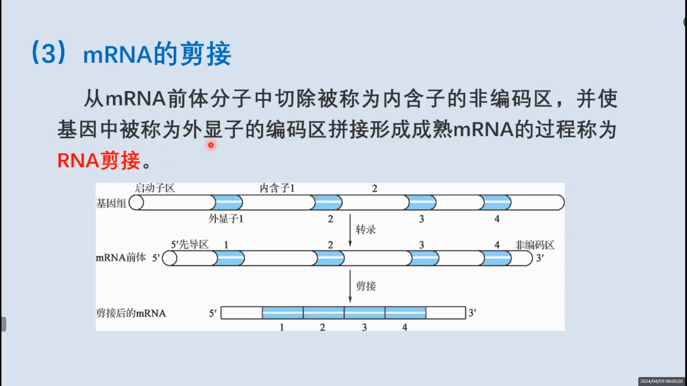
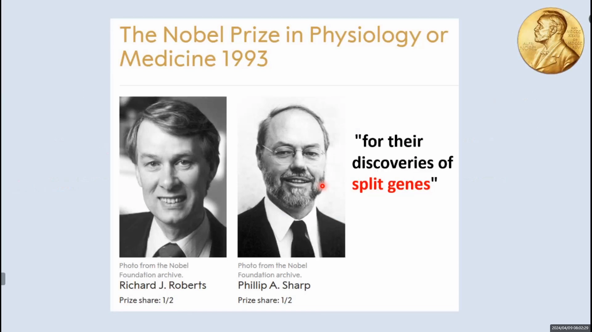
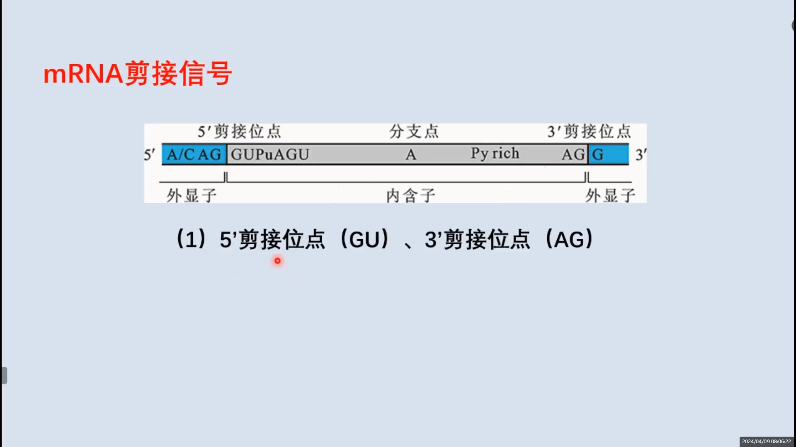
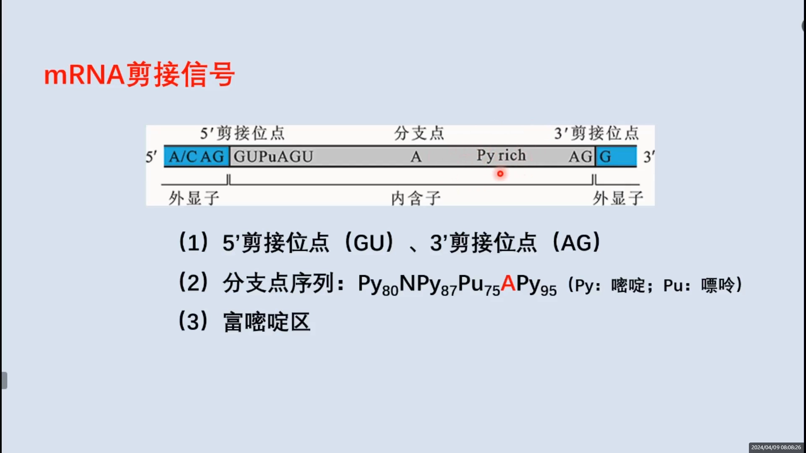
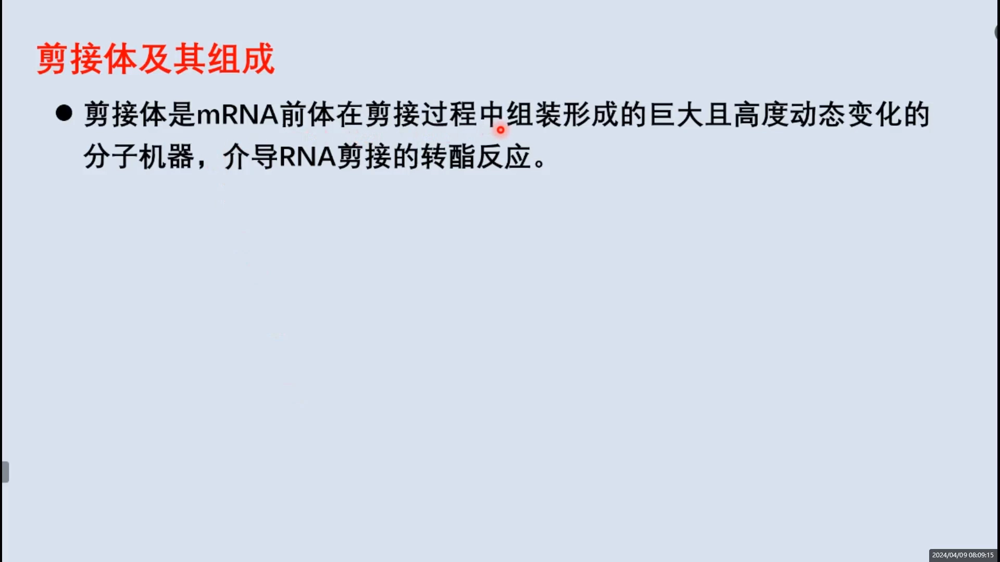
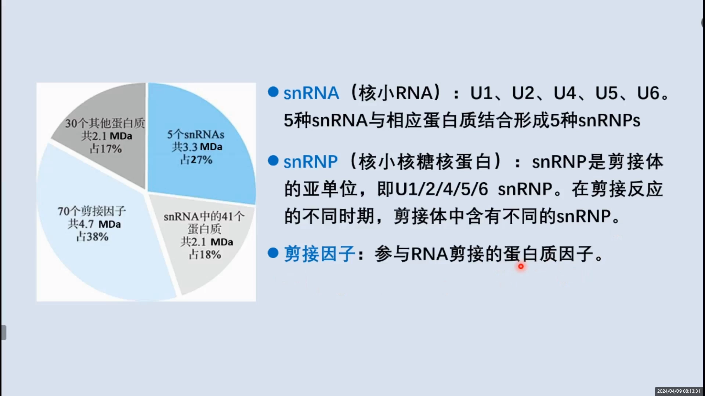
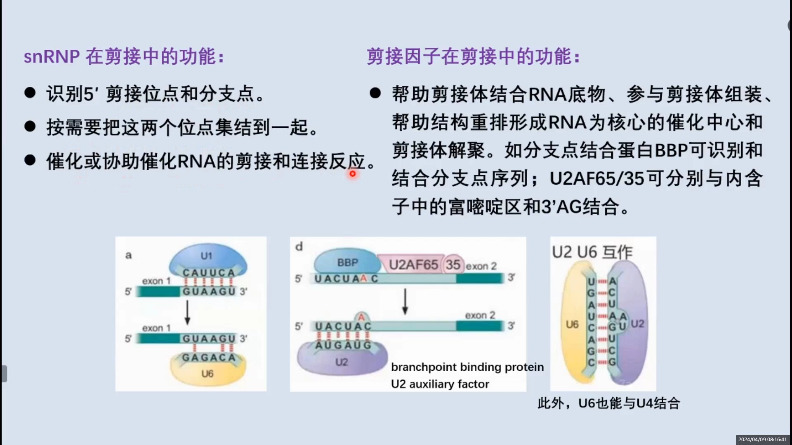
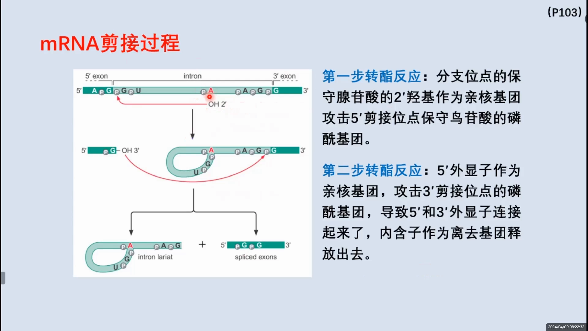
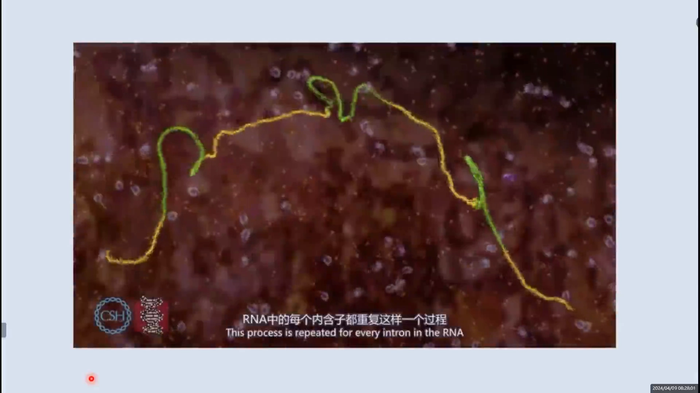

# mRNA 剪接：内含子如何被剪接体剪掉

> 视频来源：[【分子生物学】第3章 转录｜第4节 RNA的转录后加工｜真核生物mRNA前体的转录后加工（mRNA的剪接①）](https://www.bilibili.com/video/BV12x4y1Y7ZU/)（Bilibili · 轻轻松松学分子，约 30 分钟）
> 导读（100 字以内）：这支课从"断裂基因"讲到剪接体的零件清单，再到两步转酯反应的化学细节。本文按「为什么要剪 → 剪接信号长什么样 → 谁来剪 → 怎么剪」重排，末尾附上施一公实验室那两段动画在讲什么。

## 本讲要解决的核心问题（SCQA）

**背景**：前面两节讲了 mRNA 两端的加工——5′ 端加帽、3′ 端切割加尾。两端都封好了，一条 mRNA 前体是不是就可以出核去翻译了？

**冲突**：还不行。真核基因是"断裂"的：编码蛋白质的序列被一段段不编码的序列隔开，混在同一个转录本里。如果就这样拿去翻译，读码框会被这些插入片段打乱，翻译出来的是一条废蛋白。

**疑问**：细胞怎么知道哪一段该留、哪一段该扔？剪的位点靠什么定位？剪和接这两件事，是哪个机器、用什么化学反应完成的？

**回答（中心思想）**：剪接的本质是**用序列信号定位、用 RNA-RNA 配对识别、用两步转酯反应完成**。内含子两端有高度保守的 GU 和 AG，中间有分支点 A 和富嘧啶区，这四个信号把"剪哪里"编码在了序列里；剪接体（snRNP + 剪接因子，近 150 种蛋白质）负责识别这些信号并把两个位点拉到一起；真正的化学步骤只有两步转酯反应——分支点 A 的 2′-OH 打第一枪，游离外显子的 3′-OH 打第二枪，内含子以套索形式被释放，两个外显子被连起来。

---

## 一、真核基因是断裂的：外显子被内含子隔开

### 1.1 剪接的定义：一"剪"一"接"

[【跳转到 00:05】](https://www.bilibili.com/video/BV12x4y1Y7ZU/?t=5)

RNA 剪接的定义可以拆成两个动作：从 mRNA 前体分子中**切除**被称为**内含子**的非编码区，并使基因中被称为**外显子**的编码区**拼接**起来，形成成熟 mRNA。

所以"剪接"这个词本身就包含了"剪"和"接"：剪掉内含子，接上外显子。

[【跳转到 01:20】](https://www.bilibili.com/video/BV12x4y1Y7ZU/?t=80)

这张图是整节课的地图，从上往下读三层：

- **基因组**：蓝色的是外显子 1、2、3、4，它们之间被内含子 1、2、3 隔开，交替排列；
- **mRNA 前体**：转录之后，内含子被原样抄进了 RNA，5′ 端有 5′ 先导区，3′ 端有非编码区；
- **剪接后的 mRNA**：内含子消失，外显子 1-2-3-4 连成一条连续的编码序列。

### 1.2 断裂基因与 1993 年诺贝尔奖

由于内含子把外显子隔开，这样的基因看起来像是"断裂"的，因此称为**断裂基因**（split gene）。正式一点的表述是：在真核基因中，编码某一蛋白质不同区域的各个外显子并不是连续排列在一起的，而通常会被长度不等的内含子隔开，形成镶嵌排列的断裂方式。

[【跳转到 03:25】](https://www.bilibili.com/video/BV12x4y1Y7ZU/?t=205)

这个发现拿下了 **1993 年诺贝尔生理学或医学奖**，获奖者是 **Richard J. Roberts** 和 **Phillip A. Sharp**，获奖理由是"发现了断裂基因"。

### 1.3 为什么剪接必须"精准"

mRNA 前体要经过转录后加工形成成熟的 mRNA，才会进入细胞质作为翻译的模板。剪接在时空上必须非常精准：**剪掉哪里、剪多长、什么时候剪、按什么顺序把外显子拼起来**，每一步都很关键。

视频没有展开具体后果，但把结论说得很明确：这个过程某一步出了问题，基因的表达和遗传信息的传递都会出现错误。可以想象，剪多一个碱基或少剪一个碱基，拼出来的序列就已经不是原来那条编码信息了。

---

## 二、剪在哪里由序列决定：四类剪接信号

剪接信号不在别处，就在 mRNA 前体自己的序列里。它由四部分组成。

[【跳转到 07:25】](https://www.bilibili.com/video/BV12x4y1Y7ZU/?t=445)

### 2.1 5′ 剪接位点（GU）与 3′ 剪接位点（AG）

内含子两侧的序列就是剪接信号：内含子的 5′ 端有 **5′ 剪接位点**，3′ 端有 **3′ 剪接位点**。

其中 **GU 是高度保守的**——5′ 剪接位点序列最边上的 G 和 U 固定不变；3′ 剪接位点当中 **AG 是高度保守的**。所以这类内含子被称为 **GU-AG 型内含子**。

### 2.2 分支点序列：一个必须存在的 A

内含子靠近中间的这段区域叫**分支点序列**（branch point），其中有一个 **A 是高度保守、固定不变的**。

[【跳转到 09:25】](https://www.bilibili.com/video/BV12x4y1Y7ZU/?t=565)

幻灯片把分支点的保守性写得很具体：$\text{Py}_{80}\text{N}\text{Py}_{87}\text{Pu}_{75}\mathbf{A}\text{Py}_{95}$。读法是：

- **Py** = 嘧啶（C 或 U），**Pu** = 嘌呤（A 或 G），**N** = 四种碱基都可能；
- 下标数字表示该位置上某种碱基出现的频率（百分比）；
- 唯独中间那个 **A 是 100% 保守的**。

这个 A 后面会出场两次：第一次是作为亲核基团发起攻击，第二次是形成套索结构的那个"结"。

### 2.3 富嘧啶区

内含子靠近 3′ 端还有一段**富含嘧啶**的序列，称为**富嘧啶区**（polypyrimidine tract，图中写作 Py rich）。它不参与化学反应，但是剪接因子和 snRNP 组装时的落脚点。

[【跳转到 05:40】](https://www.bilibili.com/video/BV12x4y1Y7ZU/?t=340)

四个信号合起来，就把"从哪里剪、剪到哪"编码在了序列里——这是后面所有识别步骤的基础。

---

## 三、谁来剪：剪接体是一台近 150 种蛋白质的分子机器

### 3.1 定义：巨大且高度动态变化

[【跳转到 06:15】](https://www.bilibili.com/video/BV12x4y1Y7ZU/?t=375)

**剪接体**（spliceosome）是 mRNA 前体在剪接过程中组装形成的**巨大且高度动态变化的分子机器**，介导 RNA 剪接的转酯反应。

这句话里每个定语都值得停一下：

- **巨大**——它的分子量以 MDa 计；
- **分子机器**——意味着它由很多"零部件"组成，构造复杂；
- **高度动态变化**——它的组成在剪接的不同阶段不断改变，不是一台装好就不动的机器。

[【跳转到 06:40】](https://www.bilibili.com/video/BV12x4y1Y7ZU/?t=400)

正因为"复杂 + 动态"叠在一起，剪接体的结构解析成了世界级难题。视频在这里专门提到我国结构生物学家**施一公**院士：他主要研究细胞凋亡的分子机制、阿尔茨海默症发病机理，以及包括 RNA 剪接体在内的细胞内大分子复合物的结构与功能。

### 3.2 组成：5 种 snRNA + 近 150 种蛋白质

[【跳转到 13:31】](https://www.bilibili.com/video/BV12x4y1Y7ZU/?t=811)

[【跳转到 07:24】](https://www.bilibili.com/video/BV12x4y1Y7ZU/?t=444)

剪接体只含两类成分：**RNA** 和**蛋白质**。

RNA 部分是 **snRNA**（small nuclear RNA，核小 RNA），共五种：**U1、U2、U4、U5、U6**。为什么用 U 命名？因为 snRNA 中富含**尿嘧啶**（U）。

每种 snRNA 与相应蛋白质结合，形成 **snRNP**（核小核糖核蛋白），也就是剪接体的**亚单位**：

| 成分 | 数量 | 说明 |
| --- | --- | --- |
| snRNA | 5 种（U1/U2/U4/U5/U6） | 剪接体中的 RNA 组分 |
| snRNP 中的蛋白质 | 41 种 | 与 snRNA 结合形成 5 种 snRNP |
| 剪接因子 | 70 种 | 参与 RNA 剪接的蛋白质因子 |
| 其他蛋白质 | 30 种 | 教材归为"其他蛋白质" |

加起来接近 **150 种蛋白质**。饼图里还标了各部分的分子量占比：5 个 snRNA 共 3.3 MDa（27%），snRNA 上的 41 个蛋白质共 2.1 MDa（18%），70 个剪接因子共 4.7 MDa（38%），30 个其他蛋白质共 2.1 MDa（17%）。

[【跳转到 09:24】](https://www.bilibili.com/video/BV12x4y1Y7ZU/?t=564)

注意"动态"体现在哪：**在剪接反应的不同时期，剪接体中含有不同的 snRNP**。所以不能说"剪接体就是 U1+U2+U4+U5+U6 的固定组合"，只能说它们在不同阶段轮流上场。

### 3.3 snRNP 和剪接因子各干什么

[【跳转到 17:46】](https://www.bilibili.com/video/BV12x4y1Y7ZU/?t=1066)

[【跳转到 09:51】](https://www.bilibili.com/video/BV12x4y1Y7ZU/?t=591)

**snRNP 的三个功能**：

1. **识别 5′ 剪接位点和分支点**——这两个信号都在内含子上；
2. **按需要把这两个位点集结到一起**；
3. **催化或协助催化 RNA 的剪接和连接反应**。

图中的 a 面板画得很直观：U1 先靠碱基互补配对结合到 5′ 剪接位点（CAUUCA 与 GU AAGU 配对），随后 U6 也能结合到同一区域（GAGACA 与 GU AAGU 配对）——不同的 snRNP 都能识别 5′ 剪接位点，只是上场时间不同。

[【跳转到 11:16】](https://www.bilibili.com/video/BV12x4y1Y7ZU/?t=676)

**剪接因子的功能**：

1. 帮助剪接体**结合 RNA 底物**（底物就是 mRNA 前体）；
2. 参与剪接体**组装**，帮助**结构重排**——重排既会改变剪接体组分，也会形成以 RNA 为核心的**催化中心**；
3. 负责剪接体的**解聚**——剪完之后各亚单位分开。

图里给了两个具体例子：

- **BBP**（branch point binding protein，分支点结合蛋白）：识别并结合分支点序列。注意 U2 并不是自己去抓分支点的，而是通过 BBP 等因子才结合上去（面板 d）；
- **U2AF65/35**：分别与内含子中的**富嘧啶区**和 **3′ 端的 AG** 结合。

### 3.4 剪接过程里其实有三层相互作用

[【跳转到 12:41】](https://www.bilibili.com/video/BV12x4y1Y7ZU/?t=761)

视频在这里做了一个很好的归纳——剪接不是"一个酶切一刀"，而是三层相互作用叠在一起：

1. **蛋白-蛋白**：剪接因子与不同 snRNP 之间；
2. **RNA-RNA**：snRNP 里的 snRNA 与 mRNA 前体内含子上的剪接信号碱基互补配对；
3. **snRNP-snRNP**：不同 snRNP 里的 snRNA 之间也能互补配对（图中 U2 与 U6 的互作），从而让不同亚单位互相靠拢。

理解了这一层，"剪接体为什么这么复杂"就不再是死记硬背——它必须同时完成"认位点""拉近距离""催化反应""拆机器"四件事。

---

## 四、怎么剪：两步转酯反应

剪接体介导的是**转酯反应**（transesterification），一共两步。

[【跳转到 23:41】](https://www.bilibili.com/video/BV12x4y1Y7ZU/?t=1421)

### 4.1 第一步：分支点 A 的 2′-OH 打第一枪

[【跳转到 23:16】](https://www.bilibili.com/video/BV12x4y1Y7ZU/?t=1396)

**第一步转酯反应**：分支位点的保守腺苷酸的 **2′-OH** 作为亲核基团，攻击 5′ 剪接位点保守鸟苷酸的**磷酸基团**。

结果：

- 外显子 1 与内含子的 5′ 端**断开**，外显子 1 的 3′ 端留下一个 **-OH**；
- 被切下来的内含子 5′ 端（那个 G）与分支点 A 连在一起，形成一个环状结构——**套索（lariat）**。

注意这一步的两个细节：被攻击的是 5′ 剪接位点上那个保守的 G；发起攻击的不是水分子，而是内含子自己内部那个分支点 A 的 2′-OH。

### 4.2 第二步：外显子的 3′-OH 打第二枪

[【跳转到 24:31】](https://www.bilibili.com/video/BV12x4y1Y7ZU/?t=1471)

**第二步转酯反应**：5′ 外显子的 **3′-OH** 作为亲核基团，攻击 3′ 剪接位点的磷酸基团。

结果：

- 5′ 外显子与 3′ 外显子**连接**起来；
- 内含子作为离去基团被**释放**出去，仍然保持套索形状。

[【跳转到 24:56】](https://www.bilibili.com/video/BV12x4y1Y7ZU/?t=1496)

视频用四个字概括这两步：**互相攻击**。第一次是内含子里的 A 攻击 5′ 剪接位点，把外显子 1 解放出来；第二次是外显子 1 攻击 3′ 剪接位点，把外显子 2 接上、把内含子踢走。

### 4.3 动画里看到的宏观过程

[【跳转到 29:13】](https://www.bilibili.com/video/BV12x4y1Y7ZU/?t=1753)

视频播放了两段动画。第一段（来自施一公实验室）展示两步转酯反应；第二段从宏观角度展示剪接体如何工作，可以按下面的顺序看：

1. DNA 转录成 RNA 后，RNA 需要被"编辑"，去掉绿色的非编码区（内含子）；
2. 剪接因子先在内含子与外显子的边界处组装，像路标一样引导 snRNP 形成剪接体；
3. 剪接体把内含子两侧的外显子拉到非常近的位置，准备切割；
4. 内含子的一端被切开并折回自身、形成环；剪接体再切一刀释放这个环，同时把两个外显子连接起来；
5. 剪接体解体，被编辑的 RNA 与内含子被释放；RNA 上每一个内含子都要重复一次这个过程。

最后那一帧就是结果：黄色的是拼接好的外显子（成熟 mRNA），绿色的是以套索形式被剪掉的内含子。

---

## 五、剪接之后还有一步：选择性剪接

[【跳转到 05:55】](https://www.bilibili.com/video/BV12x4y1Y7ZU/?t=355)

视频在开头列提纲时，把"选择性剪接"作为第四个话题。它的含义是：**剪接方式不同，最终形成的 mRNA 就不同**。

mRNA 是翻译的模板，剪接方式不同 → 成熟 mRNA 序列不同 → 表达出来的蛋白质也不同。这就把"加工"和"基因表达调控"连了起来：同一个基因，可以通过不同的剪接方式产出不同的产物。

（本讲只讲到这一步的概念；具体的剪接模式类型与调控，属于后续内容。）

---

## 小结

- 真核基因是**断裂基因**：外显子被内含子隔开，剪接就是把内含子剪掉、把外显子接上。断裂基因的发现获 **1993 年诺贝尔生理学或医学奖**（Roberts、Sharp）。
- 剪接必须精准：剪错一个碱基，读码框就整体错位。
- 剪接信号有四类：**5′ 剪接位点 GU、3′ 剪接位点 AG、分支点 A、富嘧啶区**。
- 执行者是**剪接体**：5 种 snRNA（U1/U2/U4/U5/U6）形成 5 种 snRNP，加上 70 种剪接因子和 30 种其他蛋白质，共近 150 种蛋白质，且组成随阶段动态变化。
- 化学反应只有**两步转酯反应**：分支点 A 的 2′-OH 攻击 5′ 剪接位点 → 形成套索；外显子的 3′-OH 攻击 3′ 剪接位点 → 外显子连接、内含子释放。
- 剪接方式不同会产生不同的成熟 mRNA，这就是**选择性剪接**调控基因表达的入口。

## 关键术语速查

| 术语 | 一句话解释 |
| --- | --- |
| 内含子 / 外显子 | 转录本中被剪掉的非编码段 / 被保留并拼接起来的编码段。 |
| 断裂基因 | 外显子被内含子隔开、呈镶嵌排列的真核基因。 |
| 5′ / 3′ 剪接位点 | 内含子两端的保守序列，分别以 GU 和 AG 为核心。 |
| 分支点序列 | 内含子中部一段序列，其中那个 A 100% 保守，是第一步转酯反应的亲核基团。 |
| 富嘧啶区 | 内含子靠近 3′ 端的一段富含嘧啶的序列，是剪接因子的结合位点。 |
| snRNA | 核小 RNA，剪接体中的 RNA 组分，有 U1、U2、U4、U5、U6 五种。 |
| snRNP | snRNA 与蛋白质结合形成的复合物，是剪接体的亚单位。 |
| 剪接体 | 由 snRNP 与剪接因子组装成的分子机器，介导两步转酯反应。 |
| 转酯反应 | 一个羟基攻击磷酸基团、同时断开另一个磷酸二酯键的反应，剪接的核心化学步骤。 |
| 套索（lariat） | 被剪下的内含子 5′ 端与分支点 A 相连形成的环状结构。 |
| 选择性剪接 | 同一前体以不同方式剪接，产生不同成熟 mRNA 与不同蛋白质。 |