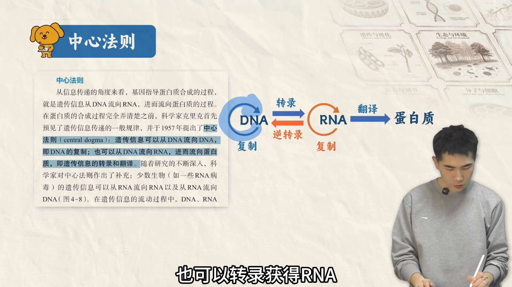
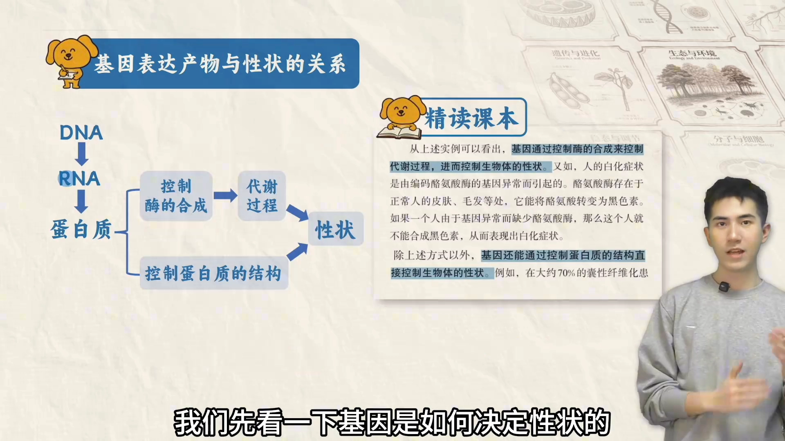
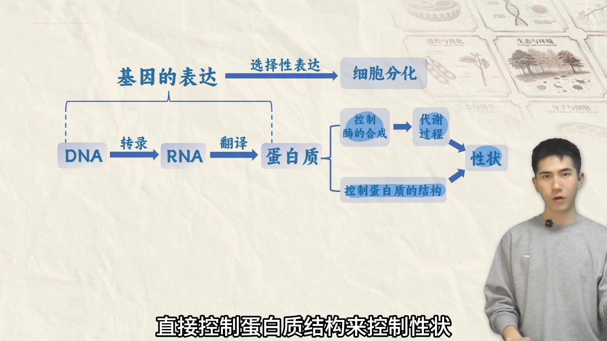
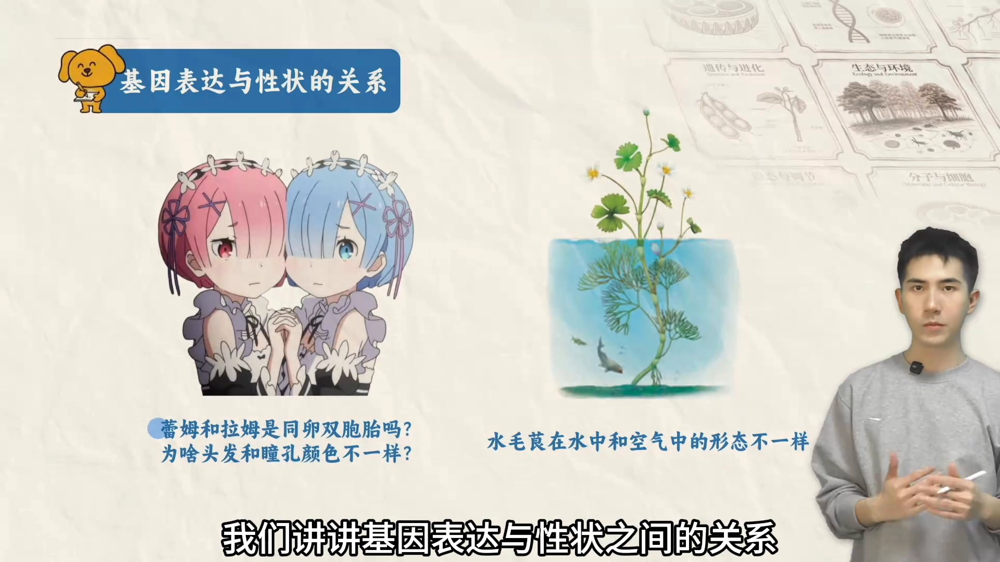
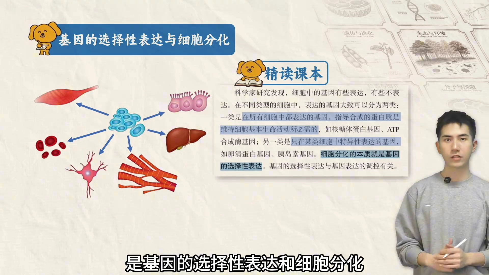
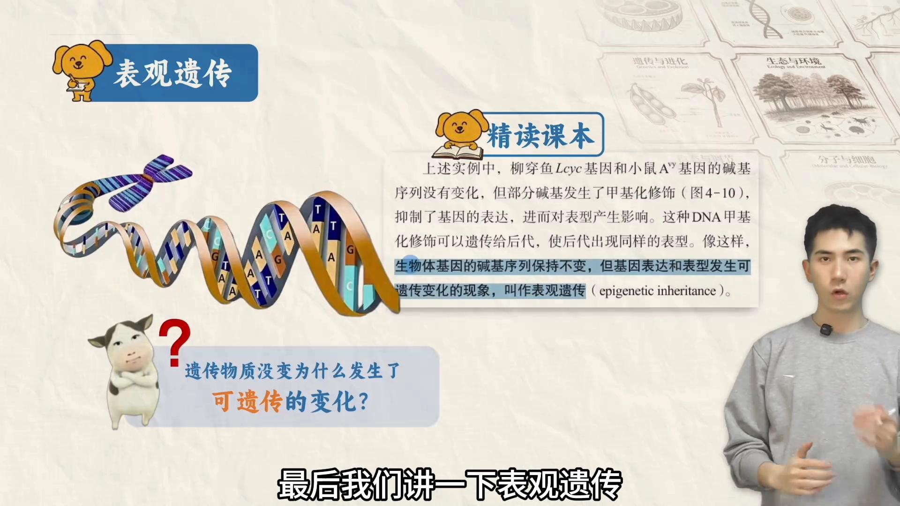
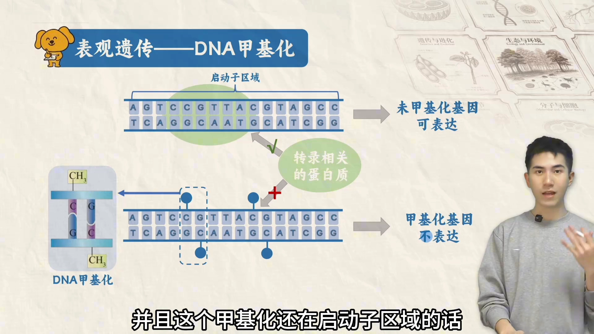

# 信息传递不等于表型决定：中心法则的边界、选择性表达与环境

> 视频来源：[【基因表达】转录/翻译/表观遗传，看这篇就够了！](https://www.bilibili.com/video/BV1z8AJzLExP/)（Bilibili · 云鹏生物 · 17:55）。本文按该视频的逐窗口字幕与幻灯片整理，关键结论均可在原片对应时间点核对。
> 导读：本文只取该视频中与「信息流的边界」相关的部分——中心法则规定的是什么（00:20–00:46）、基因产物如何通向性状（09:10–10:28）、为什么同一套基因组会读出不同表型（10:28–11:14）、表观遗传如何让序列不变而表达可变（11:14–16:33）。复制、转录、翻译的分子细节见 [2.1.2 的中心法则博客](../../2.1_DNA%20与遗传信息/2.1.2_DNA%20复制概览：半保留复制与遗传连续性/DNA复制、转录与翻译：一张中心法则图看懂遗传信息流.md) 与本脉络 2.2 各节。

## 本讲要解决的核心问题

**背景**：中心法则说遗传信息从 DNA 流向 RNA、再流向蛋白质。这句话常被压缩成一句口号：「DNA 决定蛋白质，蛋白质决定性状。」

**冲突**：现实里到处是反例。同卵双胞胎的基因几乎相同，头发和瞳孔颜色却可以不同；同一株水毛茛在水里和空气中的叶形完全不同，而上下两部分的基因肯定一样。[【跳转到 09:10】](https://www.bilibili.com/video/BV1z8AJzLExP/?t=550) 另一方面，「逆转录被发现，中心法则被推翻」这类说法也一直在流传。

**疑问**：中心法则究竟承诺了什么、又没有承诺什么？从「信息怎么流」到「性状长什么样」，中间还隔着哪些层？

**回答（中心思想）**：中心法则规定的是**序列信息能以哪些方向被拷贝和读取**，它是一张可达性图，不是性状的因果链。表型是基因产物、表达的选择、环境与表观状态共同的结果；把中心法则读成「一个基因决定一个性状」，是把「信息可达」误当成了「结局唯一」。

## 一、中心法则规定的是流向，不是结局

视频开篇的说法很朴素：基因在表达时也要「守规则」，这个规则就是中心法则——基因可以自我复制，也可以转录出 RNA，RNA 再翻译出蛋白质。[【跳转到 00:25】](https://www.bilibili.com/video/BV1z8AJzLExP/?t=25) 紧接着是关键的一句：对极少数生物（RNA 病毒）来说，还可以进行 RNA 的自我复制，甚至存在逆转录过程，而**「以上所有过程加起来才是中心法则的主要内容」**。[【跳转到 00:30】](https://www.bilibili.com/video/BV1z8AJzLExP/?t=30)

这张图上其实有**五条箭头**，而不是三条：复制、转录、翻译、逆转录、RNA 复制。[【跳转到 00:46】](https://www.bilibili.com/video/BV1z8AJzLExP/?t=46) 这就顺带回答了第一个常见误读：**逆转录和 RNA 复制不是「推翻」中心法则，而是被补进同一张图。** 视频用的词是「补充」——被修正的只是「信息只能单向从 DNA 流向 RNA」这一版通俗表述；而「信息按模板被拷贝」这个核心，恰恰因为多了两条箭头而更完整。真正被推翻的从来不是中心法则，而是对它的简化版记忆。

还有一处更细的边界：中心法则陈述的对象是**序列信息**——碱基顺序、密码子与氨基酸的对应。它不陈述某个基因在某个细胞里表达多少、被修饰成什么状态、最终长出什么性状。后面几节讲的，全是它「不管」的那部分。

## 二、从蛋白质到性状：中间还有两层

基因转录出 RNA、RNA 翻译出蛋白质，而蛋白质控制性状有两条路径。[【跳转到 09:28】](https://www.bilibili.com/video/BV1z8AJzLExP/?t=568)

- **间接路径：控制酶的合成 → 控制代谢 → 控制性状。** 大多数酶是蛋白质。酪氨酸酶催化「酪氨酸 → 黑色素」：含量正常，该黑的地方就黑；缺少它，黑色素无法正常合成，就出现白化症状。
- **直接路径：控制蛋白质的结构。** 头发、指甲盖、皮肤表面都是角蛋白，所以角蛋白结构直接决定这些性状——自来卷还是黑长直，与它密切相关。[【跳转到 09:53】](https://www.bilibili.com/video/BV1z8AJzLExP/?t=593)

把这两条路径接到中心法则下游，就是视频最后那张总结图：[【跳转到 17:19】](https://www.bilibili.com/video/BV1z8AJzLExP/?t=1039)

读法很关键：**「DNA 决定蛋白质」是编码关系，「蛋白质决定性状」还要经过代谢或结构**。两句不是同一句话，中间每一层都可以插入调控；路径越长，能被改写的环节越多。这正是「信息传递」与「表型决定」不能划等号的结构性原因。

## 三、同一套基因组，读出的表型可以不同

视频用两个现象开场，都没有落在「基因不同」上：

- 一对动画角色被当作同卵双胞胎打比方：长得几乎一样，只有头发和瞳孔颜色不同。视频猜这与表观遗传有关，并明确说这是「可能」——原作从未这样设定，只是借来说明「基因几乎相同、表型却不同」。[【跳转到 09:10】](https://www.bilibili.com/video/BV1z8AJzLExP/?t=550)
- 水毛茛在水里和空气中的形态不一样，而「你总不能说它上半部分和下半截的基因不一样」——基因一样，所以这是**环境影响了基因的表达**。

第二个机制是**基因的选择性表达**：大多数细胞都带着全套基因组，但绝不会一股脑表达；不同细胞特异性地表达基因，结果就是细胞分化——反过来说，**细胞分化的本质就是基因的选择性表达**。[【跳转到 10:28】](https://www.bilibili.com/video/BV1z8AJzLExP/?t=628) 视频把它分成两类：几乎所有细胞都表达的（核糖体蛋白基因、ATP 合成酶基因），以及只在特定细胞表达的（血红蛋白基因主要在红细胞）。[【跳转到 10:53】](https://www.bilibili.com/video/BV1z8AJzLExP/?t=653)

推论很直接：**同一个基因型，在不同细胞里被读出的产物集合不同，表型自然不同。** 这不是中心法则失效，而是中心法则的「读取」本身有开关——而开关不在序列里。

## 四、表观遗传：序列一个字没改，表达却变了

课本定义：**生物体基因的碱基序列保持不变，但基因表达和表型发生了可遗传变化**，叫表观遗传。[【跳转到 11:14】](https://www.bilibili.com/video/BV1z8AJzLExP/?t=674)

视频把它讲成「代码没改、行为变了」：遗传信息像一串控制生长发育的代码，表观遗传意味着代码本身没变，基因表达却变了，而且还能传下去。也正因为「遗传物质没变、变化却可遗传」，它才显得反直觉。[【跳转到 11:14】](https://www.bilibili.com/video/BV1z8AJzLExP/?t=674)

入门只需三种机制：**DNA 甲基化**与**组蛋白修饰**在转录前水平，**RNA 干扰**在转录后水平。[【跳转到 11:54】](https://www.bilibili.com/video/BV1z8AJzLExP/?t=714) 以甲基化为例：给 DNA 加甲基（常加在胞嘧啶上），若落在启动子区域，转录相关蛋白就结合不上启动子，RNA 聚合酶到不了位，基因无法正常表达。[【跳转到 12:36】](https://www.bilibili.com/video/BV1z8AJzLExP/?t=756) 组蛋白修饰则通过改变 DNA 缠绕在核小体上的松紧来促进或抑制表达；RNA 干扰是小 RNA 片段与靶 mRNA 互补配对，使 mRNA 无法结合核糖体、翻译被终止，更极端时直接被切割成片段。[【跳转到 13:18】](https://www.bilibili.com/video/BV1z8AJzLExP/?t=798) [【跳转到 14:28】](https://www.bilibili.com/video/BV1z8AJzLExP/?t=868)

对「信息流边界」而言，这是最硬的一条证据：**DNA 序列一个字没改，信息传递的模板没变，表型却变了，而且还传给了后代。** 如果中心法则真是「序列决定表型」的单线因果，这类现象根本无处安放。

## 五、把「决定」换成「约束」

视频结尾把三层因素并排放在一起：[【跳转到 17:19】](https://www.bilibili.com/video/BV1z8AJzLExP/?t=1039) 性状受基因控制，但也受环境影响——「你的基因是长到 2 米，但童年营养不够、吃得少，最终可能只长到 1 米 7」；而即使基因相同、环境也一模一样，表达仍可能不同，因为还存在表观遗传。

把前面几节合成一张表，就能看清中心法则的管辖范围到哪里为止：

| 层次 | 中心法则管不管 | 视频中的例子 |
| --- | --- | --- |
| 序列信息以哪些方向被拷贝、读取 | 管 | 复制、转录、翻译、逆转录、RNA 复制 |
| 某个基因在某个细胞里表达多少 | 不管（选择性表达） | 血红蛋白只在红细胞表达 |
| 环境如何改写表达 | 不管 | 水毛茛的水陆异形、营养与身高 |
| 序列不变的可遗传表达状态 | 不管（表观遗传） | 甲基化、组蛋白修饰、RNA 干扰 |
| 性状最终取什么值 | 不管 | 白化、发质、身高 |

三个常见误读由此可以逐条回应：

- **「逆转录被发现，中心法则被推翻了」**：不是推翻，是补充。五条箭头同在一张图上，核心（信息按模板拷贝）反而更完整。[【跳转到 00:30】](https://www.bilibili.com/video/BV1z8AJzLExP/?t=30)
- **「一个基因决定一个性状」**：两条路径本身就包含酶、代谢、蛋白质结构多个环节；把中心法则读成性状的因果链，是把「信息可达」当成「结局唯一」。需要说明，这支视频没有讨论多基因性状与一因多效，这里只作逻辑澄清。
- **「基因决定论」**：同卵双胞胎的表型差异与水毛茛的水陆异形两个反例已经足够；再叠上表观遗传，序列与表型之间至少还有表达选择、环境、表观状态三层。

更准确的措辞是：**中心法则约束了「哪些信息可以被读到、以什么方向被拷贝」，而不是规定「读到之后一定长成什么样」。** 基因型给出的是可能性空间，表型是这套信息在具体细胞、具体环境、具体表观状态下被读取的结果。

## 六、本节边界

本节只做「信息传递 vs 表型决定」的辨析，不展开：逆转录病毒的整合与潜伏、RNA 依赖的 RNA 聚合酶结构（见病毒学与酶学专题）；甲基化的建立与维持、组蛋白修饰酶、X 染色体失活等细节（见本脉络 [4.1.1](../../../4_细胞、个体与变化/4.1_细胞类型、基因表达与表观遗传/4.1.1_基因表达调控与表观遗传/基因表达调控的三个层次——染色质、转录起始与转录后.md)）；复制、转录、翻译的酶学细节（见 2.1.2 与 2.2 各节）。视频中关于高考考点的段落与本节无关，已略去。

## 小结

- 中心法则是一张**流向图**：复制、转录、翻译、逆转录、RNA 复制五条箭头共同构成它；后两条是补充，不是推翻。
- 它陈述的对象是**序列信息**，不陈述表达量、修饰状态与性状取值。
- 基因产物通向性状有两条路径（酶→代谢→性状；直接决定蛋白质结构），路径上每一层都可被调控。
- **选择性表达**让同一套基因组在不同细胞里读出不同产物；**表观遗传**让序列不变而表达与表型可遗传地改变。
- 表型 = 基因型提供的可能性 + 表达选择 + 环境 + 表观状态；把中心法则读成「一个基因一个性状」，是把约束误读成决定。

## 关键术语速查

| 术语 | 一句话解释 |
| --- | --- |
| 中心法则 | 遗传信息可被拷贝与读取的方向图：复制、转录、翻译，外加逆转录与 RNA 复制 |
| 逆转录 / RNA 复制 | 以 RNA 为模板合成 DNA / 以 RNA 为模板合成 RNA，见 RNA 病毒 |
| 选择性表达 | 全套基因组都在，但不同细胞只表达其中一部分基因 |
| 表观遗传 | 碱基序列不变，但基因表达与表型发生可遗传变化 |
| DNA 甲基化 | 在胞嘧啶上加甲基；落在启动子区时常使转录无法起始 |
| RNA 干扰 | 小 RNA 结合靶 mRNA，阻止其结合核糖体或直接将其切割 |