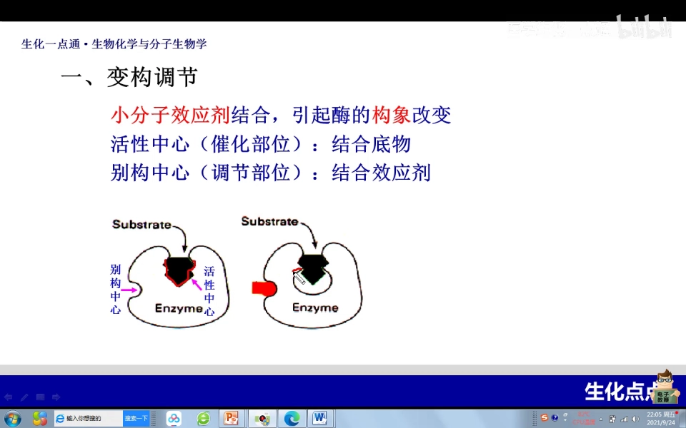
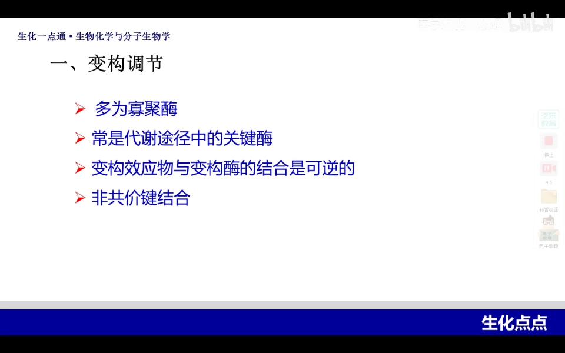
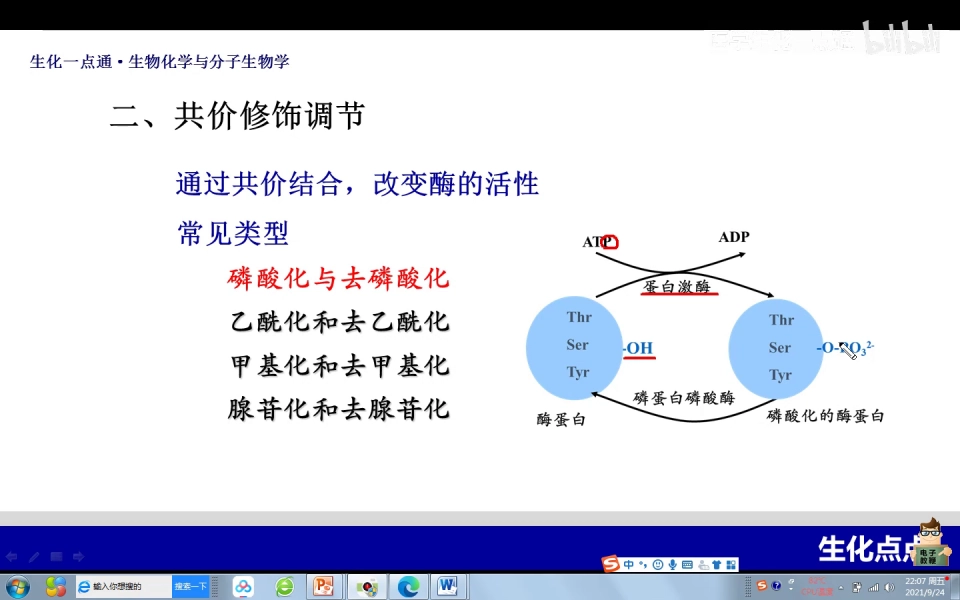
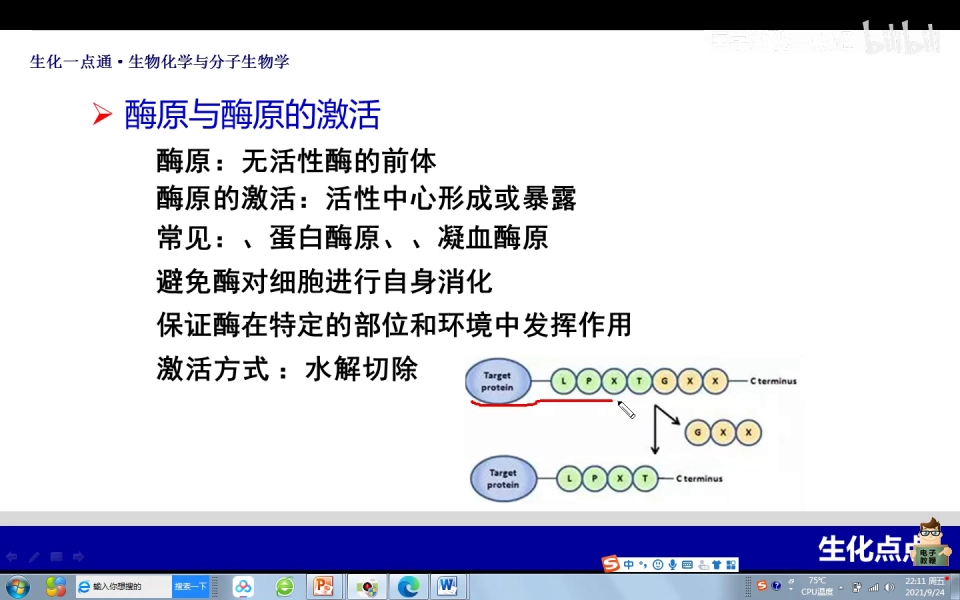

# 酶活性的调节：别构、共价修饰与酶原激活

> 视频来源：[9 酶的调节](https://www.bilibili.com/video/BV1M8411i77f/)（Bilibili · 医学生化一点通 · 约 9 分钟）。本文按该视频的逐窗口字幕与画面整理，内容均可在原视频中核查。
> 导读：这一篇讲"酶不是一直开着的"。先区分含量调节（慢）与活性调节（快），再把两种快速调节——别构调节与共价修饰调节——讲清是什么、为什么有效，最后补上酶原激活。只讲定性机制，不推导动力学方程。

## 本讲要解决的核心问题（SCQA）

**背景**：前两篇已经说明酶如何识别底物、如何降低活化能。但细胞里成千上万种酶如果同时满负荷运转，代谢就乱了。

**冲突**：酶是蛋白质，蛋白质可以"多合成一些"或"少降解一些"，可这种量的变化需要时间；而代谢状态的变化往往发生在秒到分钟的量级。

**疑问**：细胞用什么办法在短时间内开关已有的酶？开关作用发生在酶的哪个部位？为什么有些酶要先做成"没有活性的前体"？

**回答（中心思想）**：酶的调节分两个层次——**含量调节**（诱导/阻遏、合成与降解，慢）和**活性调节**（快）。活性调节主要有两种：**别构调节**，小分子效应物结合在活性中心之外的别构中心，靠改变构象来开或关；**共价修饰调节**，通过共价加上或去掉一个化学基团（最常见是磷酸基团）来切换活性型与非活性型。此外，消化酶、凝血酶这类"危险"的酶以**酶原**形式合成，靠水解切除一段肽链让活性中心形成或暴露，从而实现定点、定时激活。

---

## 一、两个层次：含量调节慢，活性调节快

酶可以从**含量**和**活性**两个角度去调节 [【跳转到 00:00】](https://www.bilibili.com/video/BV1M8411i77f/?t=0)。

含量调节是对酶这个蛋白质"量"的控制，分合成和降解两种策略 [【跳转到 00:25】](https://www.bilibili.com/video/BV1M8411i77f/?t=25)：

- **合成**从基因水平出发：促进酶蛋白基因表达叫**诱导**，抑制表达叫**阻遏**（具体机制留到基因表达调控部分）；
- **降解**：酶蛋白降解成氨基酸，包括溶酶体途径与蛋白酶体途径（详见 3.2.2）。

含量调节属于**缓慢调节**；而酶活性的调节属于**快速调节**，包括**变构调节**（又称别构调节）和**化学修饰调节**（又称共价修饰调节）[【跳转到 01:15】](https://www.bilibili.com/video/BV1M8411i77f/?t=75)。

---

## 二、别构调节：在活性中心之外装一个"开关"

别构调节指小分子物质作为**效应物**结合到酶上，引起酶的空间构象改变，从而改变活性 [【跳转到 01:30】](https://www.bilibili.com/video/BV1M8411i77f/?t=90)。

这类酶除了有能和底物结合的活性中心，必定还有一个能和效应物结合的位置，叫**别构中心**。所以接受别构调节的酶（别构酶）必定同时包含**活性中心**和**别构中心**，分别承担催化和调节两个作用 [【跳转到 01:58】](https://www.bilibili.com/video/BV1M8411i77f/?t=118)。

机制可以这样理解：效应物结合到别构中心后，酶的空间结构发生改变，尤其是原来活性中心的空间结构被改变；底物再进入时，就无法和活性中心完美结合，酶活性受到抑制 [【跳转到 02:05】](https://www.bilibili.com/video/BV1M8411i77f/?t=125)。

反过来也有**激活剂**：小分子结合后使酶形成正确的构象，提高酶活性 [【跳转到 02:30】](https://www.bilibili.com/video/BV1M8411i77f/?t=150)。注意效应物与酶的结合是**非共价、可逆**的，不是牢固的共价键 [【跳转到 03:00】](https://www.bilibili.com/video/BV1M8411i77f/?t=180)。

别构调节的特点可以归成四条 [【跳转到 03:41】](https://www.bilibili.com/video/BV1M8411i77f/?t=221)：

1. **多为寡聚酶**：别构酶大多数由亚基构成，本质是四级结构的蛋白质——这正好解释了为什么"一个部位结合、另一个部位变构"能实现，构象变化可以在亚基间传递。
2. **常是代谢途径的关键酶**：只有关键酶受调才有意义。
3. **结合可逆**：效应物与酶的结合是可逆的。
4. **非共价结合**：靠非共价键而非牢固共价键。

从动力学上看，这类酶接受调节后表现为一条 **S 型曲线**，与一般酶的双曲线不同，因此别构酶不再符合米氏方程的描述 [【跳转到 04:09】](https://www.bilibili.com/video/BV1M8411i77f/?t=249)。本文只记录这一现象，不展开方程与曲线推导。

---

## 三、共价修饰调节：给酶共价地"贴"一个基团

共价修饰调节体现在"共价"上：酶与一些小分子化学基团之间形成**共价键**，从而改变活性 [【跳转到 04:34】](https://www.bilibili.com/video/BV1M8411i77f/?t=274)。最常见的是**磷酸基团**。

酶蛋白的氨基酸残基里有带羟基的丝氨酸、苏氨酸、酪氨酸，磷酸基团常加在羟基的氧上。这个反应不能自发进行，需要**蛋白激酶**催化，把 ATP 分子的末端磷酸基团转移上去，这个过程叫**磷酸化修饰** [【跳转到 04:49】](https://www.bilibili.com/video/BV1M8411i77f/?t=289)。

随着磷酸基团加入，酶的活性发生改变——**是激活还是失活，取决于具体的酶**。相反的过程由**磷蛋白磷酸酶**催化，把磷酸基团水解掉、回到羟基状态，酶的活性又回到原来的状态 [【跳转到 05:14】](https://www.bilibili.com/video/BV1M8411i77f/?t=314)。

要点在于：**磷酸化和去磷酸化是两个单向不可逆的酶促反应**，分别由激酶和磷酸酶催化，而不是同一个反应的正逆方向 [【跳转到 05:39】](https://www.bilibili.com/video/BV1M8411i77f/?t=339)。除磷酸化外，还有乙酰化与去乙酰化、甲基化与去甲基化、腺苷化与去腺苷化等类型 [【跳转到 06:01】](https://www.bilibili.com/video/BV1M8411i77f/?t=361)。

共价修饰调节的特点 [【跳转到 06:12】](https://www.bilibili.com/video/BV1M8411i77f/?t=372)：

- 受这类调节的酶在体内以**活性型与非活性型**（或高活性型与低活性型）两种形式存在，两种形式之间的切换就是小分子基团的添加与去除；
- 添加和去除都必须由**另外的酶**催化，且都是单向不可逆反应；
- 由于形成了共价键，酶分子的组成发生了改变，这种改变"力量比较强大"；
- 它的原动力来自信号分子（如激素）的调控，一旦受激素控制，往往是一个**逐级放大的级联反应** [【跳转到 07:27】](https://www.bilibili.com/video/BV1M8411i77f/?t=447)。

---

## 四、酶原激活：先造"保险栓"，再定点开锁

酶原就是**没有活性的酶的前体物质**；酶原的激活过程，就是**活性中心形成或暴露**的过程 [【跳转到 08:00】](https://www.bilibili.com/video/BV1M8411i77f/?t=480)。

细胞内常见的例子是消化道的**蛋白酶原**和血液系统的**凝血酶原**。以酶原形式存在，其实是对机体自身细胞的一种保护：避免酶对细胞自身进行消化，同时保证酶只在特定的部位和环境中发挥作用 [【跳转到 08:24】](https://www.bilibili.com/video/BV1M8411i77f/?t=504)。

激活的本质，是在原来没有活性的肽链基础上进行**水解切除**：从这条没有活性的肽链中水解去除几个氨基酸残基，剩余的肽链再折叠成正确的空间结构，形成真正有活性的酶 [【跳转到 09:05】](https://www.bilibili.com/video/BV1M8411i77f/?t=545)。

这种方式属于**翻译后修饰水平**的水解切除——酶已经合成完毕，只是通过切掉一段才被"打开" [【跳转到 09:08】](https://www.bilibili.com/video/BV1M8411i77f/?t=548)。

---

## 五、把三种调节放在一起看

| 调节方式 | 结合方式 | 作用部位 | 结果 | 速度 |
| --- | --- | --- | --- | --- |
| 别构调节 | 非共价、可逆 | 别构中心（活性中心之外） | 构象改变，活性升高或降低 | 快 |
| 共价修饰 | 共价 | 特定残基的侧链（如羟基） | 在活性型与非活性型之间切换 | 快，可级联放大 |
| 酶原激活 | 水解切除肽链 | 肽链本身 | 活性中心形成或暴露 | 一次性、不可逆 |
| 含量调节 | 基因表达与降解 | 酶的"数量" | 酶量增多或减少 | 慢 |

一个共同的逻辑贯穿三者：**酶的活性取决于它的构象，而构象可以被"别处"发生的事情改变**——效应物结合在别构中心、磷酸基团加在远离活性中心的残基上、或一段肽链被切掉，最终都改变了活性中心的形状与化学环境。这正是结构与功能关系在调控层面的体现。

---

## 小结

- 酶的调节分**含量调节**（诱导/阻遏、合成与降解，慢）与**活性调节**（快）。
- **别构调节**：效应物结合在活性中心之外的别构中心，非共价、可逆，通过改变构象升高或降低活性；别构酶多为寡聚酶，常是代谢途径的关键酶。
- **共价修饰调节**：以磷酸化/去磷酸化最常见，由蛋白激酶与磷蛋白磷酸酶分别催化两个单向不可逆反应；酶在活性型与非活性型之间切换，可级联放大。
- **酶原激活**：无活性前体经水解切除一段肽链，使活性中心形成或暴露，属于翻译后修饰；它保护细胞不被自身消化，并保证酶在特定部位发挥作用。
- 三者共同说明：活性中心的构象与化学环境，是酶活性被调控的着力点。

## 关键术语速查

| 术语 | 一句话解释 |
| --- | --- |
| 含量调节 | 通过改变酶合成或降解的量来调节，速度慢 |
| 别构调节 | 效应物结合别构中心、改变构象来调节活性 |
| 别构中心 | 活性中心之外结合效应物的部位 |
| 效应物 | 结合别构中心、改变酶活性（抑制或激活）的小分子 |
| 共价修饰调节 | 通过共价加上或去掉化学基团切换酶活性 |
| 磷酸化 | 蛋白激酶把 ATP 末端磷酸基团加到 Ser/Thr/Tyr 羟基上 |
| 级联反应 | 信号逐级放大的一系列酶促反应 |
| 酶原 | 没有活性的酶的前体 |
| 酶原激活 | 水解切除一段肽链，使活性中心形成或暴露 |