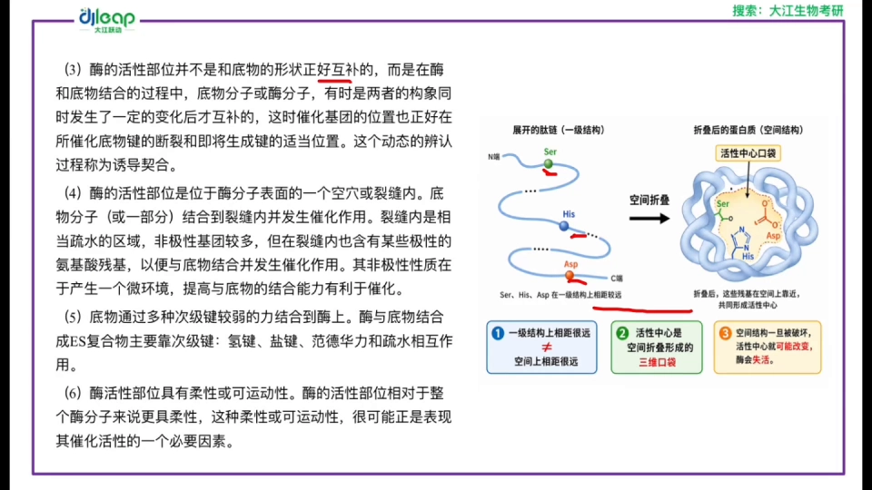
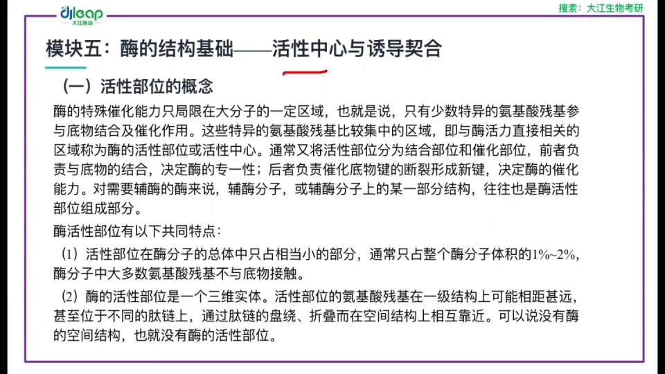
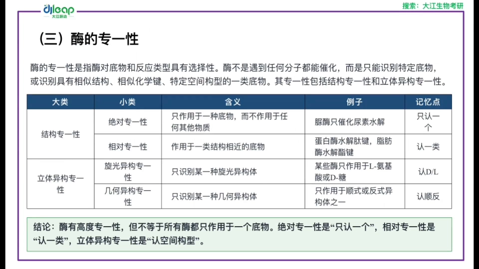
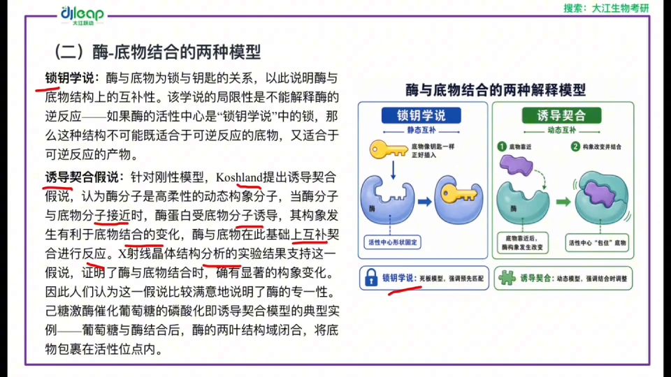
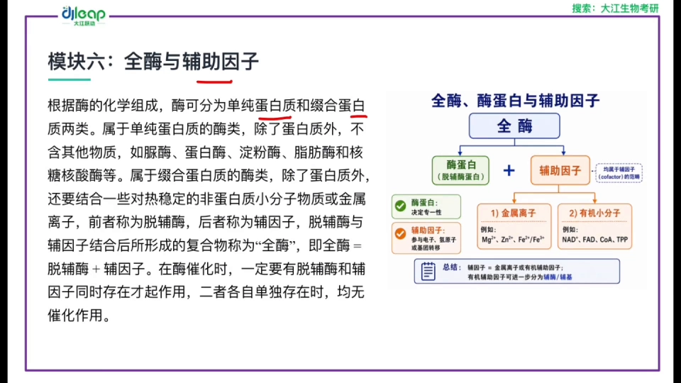
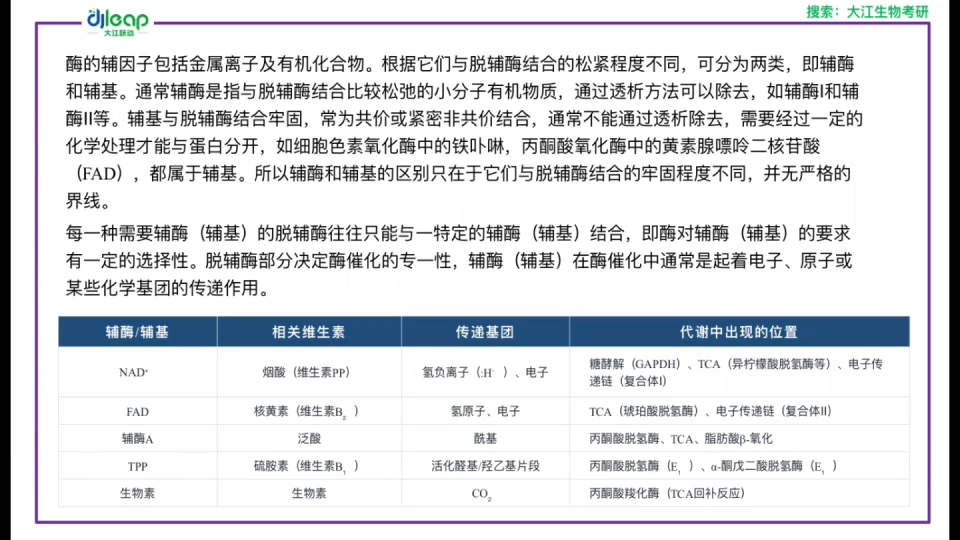

# 酶的活性中心：结合部位、催化部位与诱导契合

> 视频来源：[7.酶为什么能认准底物？一节讲清活性中心、辅酶和诱导契合](https://www.bilibili.com/video/BV1BdE46sEgV/)（Bilibili · 大江生物考研 · 约 25 分钟）。本文按该视频的逐窗口字幕与画面整理，内容均可在原视频中核查。
> 导读：一支把"酶为什么能认准底物"讲透的课：先补氨基酸侧链与空间折叠，再落到活性中心的六条共同特点、锁钥与诱导契合两种模型，最后讲全酶、辅酶/辅基与维生素来源。蛋白折叠本身见 3.1.1，本文只讲折叠出来的口袋如何结合底物。

## 本讲要解决的核心问题（SCQA）

**背景**：前面讲代谢时，酶一直是被当作"工具"使用的——这条反应由哪个酶催化、哪个酶是关键酶、哪个酶受调控。

**冲突**：可是工具本身是什么？为什么一种酶只认某一类底物，为什么它能在常温常压、接近中性的条件下完成体外需要高温强酸强碱才能发生的反应？

**疑问**：酶的哪一部分负责"认底物"？这种识别是刚性的形状配对，还是结合过程中双方都在调整？有些酶还必须带一个非蛋白质的"帮手"，那又是什么？

**回答（中心思想）**：酶的特殊催化能力只集中在分子上一小块区域——**活性中心**。它由空间折叠把一级结构上相距很远的少数残基拼到一起，分成负责结合的**结合部位**（决定专一性）和负责断键成键的**催化部位**（决定催化能力）。识别不是刚性锁钥，而是**诱导契合**：底物与酶相互诱导、构象调整后才互补。需要辅酶的酶则是"酶蛋白 + 辅因子"的**全酶**，辅因子按结合松紧分为辅酶与辅基，许多来自维生素。

---

## 一、先补三件事：侧链、折叠与变性

绝大多数酶的本质是蛋白质，所以理解活性中心要先回到蛋白质的四条基本事实 [【跳转到 00:46】](https://www.bilibili.com/video/BV1BdE46sEgV/?t=46)。

- **氨基酸靠肽键连成链**：一个氨基酸由氨基、羧基、氢和一个 R 基组成；两个氨基酸通过一个氨基和一个羧基脱水缩合形成肽键，肽链有方向性，通常从氮端写到碳端 [【跳转到 04:03】](https://www.bilibili.com/video/BV1BdE46sEgV/?t=243)。
- **侧链决定局部性质**：氨基、羧基、氢是固定的，氨基酸之间不同的是 R 基；侧链可表现为疏水、亲水、酸性、碱性和含特殊反应基团。后面讲活性中心时所谓的"催化基团""结合基团"，本质就是这些残基的侧链 [【跳转到 05:03】](https://www.bilibili.com/video/BV1BdE46sEgV/?t=303)。
- **功能依赖空间结构**：一级结构是序列，二级结构是 α 螺旋与 β 折叠，三级结构是整条链的空间构象，四级结构是多个亚基的组装。视频用一句比喻概括：同一块钢板，做成钥匙还是做成菜刀，由形状决定 [【跳转到 05:28】](https://www.bilibili.com/video/BV1BdE46sEgV/?t=328)。
- **空间结构靠非共价作用维持**：氢键、离子键、疏水相互作用、范德华力，以及某些蛋白中的二硫键。高温、强酸强碱、重金属盐会破坏空间结构，使活性中心变形，底物结合不上或催化基团位置不对，酶就失活 [【跳转到 06:23】](https://www.bilibili.com/video/BV1BdE46sEgV/?t=383)。

这里有一条对后面至关重要的推论：**活性中心往往不是一级结构上连续的一段**。它常常是折叠以后，把序列上相距很远的几个残基在空间上拼到一起，形成一个能结合底物、能催化反应的区域 [【跳转到 06:36】](https://www.bilibili.com/video/BV1BdE46sEgV/?t=396)。

---

## 二、活性中心：一个占体积 1%–2% 的三维口袋

酶的特殊催化能力只局限在大分子的一定区域，只有少数特异的氨基酸残基参与底物结合与催化。这些残基比较集中、与酶活力直接相关的区域，就称为**活性部位**或**活性中心** [【跳转到 14:53】](https://www.bilibili.com/video/BV1BdE46sEgV/?t=893)。

它通常再分成两部分：

| 部位 | 职责 | 决定什么 |
| --- | --- | --- |
| 结合部位 | 与底物结合 | 酶的**专一性** |
| 催化部位 | 催化底物键的断裂、新键的形成 | 酶的**催化能力** |

如果某种酶需要辅酶，那么辅酶分子或它的一部分结构，也可能是活性部位的组成部分 [【跳转到 15:09】](https://www.bilibili.com/video/BV1BdE46sEgV/?t=909)。

视频把活性中心的共同特点归纳为六条，可以按"多大、在哪、怎么结合"来记 [【跳转到 15:28】](https://www.bilibili.com/video/BV1BdE46sEgV/?t=928)：

1. **只占很小一部分**：通常只占整个酶分子体积的 1%–2%，大多数残基不与底物接触。
2. **是三维实体**：参与催化的残基在一级结构上可能相距甚远，也可能位于不同肽链，靠盘绕折叠在空间上靠近。所以"没有酶的空间结构，也就没有酶的活性部位"。
3. **形状不预先完全互补**：酶与底物结合时，底物、酶、或两者的构象会同时发生变化才互补，这个动态识别过程叫**诱导契合**（下一节展开）。
4. **位于表面的空穴或裂缝**：底物结合到裂缝内发生催化；裂缝内相当疏水、非极性基团较多，但也有极性残基参与结合与催化，这个微环境有利于提高结合能力。
5. **靠多种弱相互作用结合**：氢键、盐键、范德华力、疏水相互作用。也就是说，酶不是靠一个强共价键把底物"锁死"，而是靠许多弱相互作用共同完成识别与定位。
6. **具有柔性**：活性中心相对整个酶分子更柔，这种柔性可能正是催化活性的必要条件。

所以更准确的图景不是"一块刻好形状的模具"，而是**一个有空间结构、有微环境、有柔性的动态催化系统** [【跳转到 17:28】](https://www.bilibili.com/video/BV1BdE46sEgV/?t=1048)。

---

## 三、专一性从哪来：认一个、认一类、认构型

酶的**专一性**（特异性）指酶对底物和反应类型的选择性：酶不是遇到什么分子都能催化，它只识别特定底物，或识别具有相似结构、相似化学键、特定空间构型的一类底物 [【跳转到 11:19】](https://www.bilibili.com/video/BV1BdE46sEgV/?t=679)。

专一性可以分成两大类、四小类：

- **绝对专一性**：只作用于一种底物，如脲酶只催化尿素水解——"只认一个"。
- **相对专一性**：作用于一类结构相近的底物，如蛋白酶水解肽键、脂肪酶水解酯键——"认一类化学键"。
- **旋光异构专一性**：只识别某一种旋光异构体，如只作用于 L 氨基酸或 D 糖。
- **几何异构专一性**：只识别某一种几何异构体，如只作用于顺式或反式之一。

关键结论是：**高度专一性不等于所有酶只作用于一个底物**。视频的比喻是"恋爱脑"——认一个就只认一个，认一类就只认一类 [【跳转到 12:24】](https://www.bilibili.com/video/BV1BdE46sEgV/?t=744)。

---

## 四、锁钥与诱导契合：静态互补 vs 动态互补

酶与底物的结合，历史上有过两个模型 [【跳转到 17:48】](https://www.bilibili.com/video/BV1BdE46sEgV/?t=1068)。

**锁钥学说**认为酶和底物就像锁和钥匙，二者在结构上相互互补。它很直观地解释了专一性——钥匙要对上锁，底物要对上酶；但局限也在这里：它把酶看成一把固定不变的锁。很多酶能催化可逆反应，如果活性中心完全固定成某个底物的形状，就很难同时适应正反应和逆反应的底物与产物。

**诱导契合假说**（Koshland 提出）认为酶分子是高柔性的动态构象分子：当酶与底物接近时，酶蛋白受底物诱导，构象发生有利于底物结合的变化，二者在此基础上互补契合、进行反应。底物不是插进一个固定的锁孔，而是和酶一起调整姿势，最终形成适合催化的状态 [【跳转到 18:36】](https://www.bilibili.com/video/BV1BdE46sEgV/?t=1116)。

支持诱导契合的不只是推理，还有结构证据：X 射线晶体结构分析显示，酶与底物结合时确实可以发生显著的构象变化。典型例子是**己糖激酶**——葡萄糖与酶结合后，酶的两个结构域会闭合，把底物包裹在活性位点内 [【跳转到 19:10】](https://www.bilibili.com/video/BV1BdE46sEgV/?t=1150)。视频的比喻是：不是锁一直张着等钥匙，而是钥匙进来以后，锁还会合上，形成更适合反应的环境。

---

## 五、全酶与辅因子：为什么有些酶需要"帮手"

按化学组成，酶可分为两类 [【跳转到 19:25】](https://www.bilibili.com/video/BV1BdE46sEgV/?t=1165)：

- **单纯蛋白质酶**：除蛋白质外不含其他物质，如脲酶、蛋白酶、淀粉酶、脂肪酶、核糖核酸酶。
- **结合蛋白质酶**：除蛋白质外还结合对热稳定的非蛋白质小分子或金属离子。蛋白部分称**脱辅酶**（酶蛋白），非蛋白部分称**辅因子**；两者结合成的复合物称**全酶**，即 全酶 = 脱辅酶 + 辅因子。

两者分工明确：**酶蛋白决定底物专一性**，**辅因子参与电子、原子或化学基团转移**。催化时必须二者同时存在，单独存在都没有催化作用 [【跳转到 20:09】](https://www.bilibili.com/video/BV1BdE46sEgV/?t=1209)。

辅因子按与酶蛋白结合的松紧程度再分两类 [【跳转到 20:34】](https://www.bilibili.com/video/BV1BdE46sEgV/?t=1234)：

- **辅酶**：结合较松弛的小分子有机物，可用透析除去，如辅酶 I、辅酶 II；
- **辅基**：结合牢固，常为共价或紧密非共价结合，不能透析除去，需化学处理才能与蛋白分开，如细胞色素氧化酶中的铁卟啉、丙酮酸氧化酶中的 FAD。

所以辅酶与辅基的核心区别**不是"是不是有机物"，而是结合得松还是紧**，两者之间并无严格界线。

常见的有机辅因子大多能在维生素里找到来源 [【跳转到 21:21】](https://www.bilibili.com/video/BV1BdE46sEgV/?t=1281)：

| 辅酶/辅基 | 相关维生素 | 传递基团 |
| --- | --- | --- |
| NAD⁺ | 烟酸（维生素 PP） | 氢负离子、电子 |
| FAD | 核黄素（维生素 B₂） | 氢原子、电子 |
| 辅酶 A | 泛酸 | 酰基 |
| TPP | 硫胺素（维生素 B₁） | 活化羧基/羟乙基片段 |
| 生物素 | 生物素 | CO₂ |

需要注意：需要辅酶的脱辅酶往往只与特定辅酶结合，即酶对辅酶也有选择性；决定专一性的仍是脱辅酶部分。

---

## 六、边界：酶只改变速率，不改变平衡

这一节最容易犯的错，是把酶的作用扩大化。视频给出的核心结论是：**酶改变的是反应速率，不改变平衡点**——酶只缩短达到平衡所需要的时间，不改变平衡常数 [【跳转到 11:06】](https://www.bilibili.com/video/BV1BdE46sEgV/?t=666)。

另外两个常见误区也值得记住：

- 不能说"所有蛋白质都是酶"。只有具有催化作用的蛋白质才叫酶；血红蛋白运输氧、普通抗体结合抗原，它们不是酶 [【跳转到 08:37】](https://www.bilibili.com/video/BV1BdE46sEgV/?t=517)。
- 酶不一定是蛋白质。少数 RNA 也有催化活性，称为**核酶**，能通过特定空间结构形成催化中心，催化磷酸二酯键的断裂、连接或转移；核糖体大亚基 RNA 中参与肽键形成的中心也属于此类。核酶的意义在于：修正了"酶都是蛋白质"的说法，说明 RNA 既能携带遗传信息也能承担催化功能，并为 RNA 世界假说提供了依据 [【跳转到 08:43】](https://www.bilibili.com/video/BV1BdE46sEgV/?t=523)。

---

## 小结

- 酶的特殊催化能力只集中在**活性中心**：它由折叠把序列上相距很远的少数残基拼成，只占酶分子体积的 1%–2%，位于表面裂缝中，靠氢键、盐键、范德华力、疏水作用等弱相互作用结合底物，并具有柔性。
- 活性中心分**结合部位**（决定专一性）与**催化部位**（决定催化能力）；需要辅酶时，辅酶或其一部分也算活性部位的组成。
- 专一性有层次：绝对专一性"认一个"、相对专一性"认一类"、立体异构专一性"认构型"；高度专一不等于只认一种底物。
- **锁钥学说**是静态互补，解释不了可逆反应；**诱导契合**是动态互补，己糖激酶结构域闭合包裹底物是经典证据。
- **全酶 = 酶蛋白 + 辅因子**：酶蛋白定专一性，辅因子参与电子/原子/基团转移；辅因子按结合松紧分辅酶与辅基，许多来自维生素。
- 酶只加快达到平衡的速度，不改变平衡常数；酶不一定是蛋白质，少数 RNA（核酶）也有催化活性。

## 关键术语速查

| 术语 | 一句话解释 |
| --- | --- |
| 活性中心 | 酶分子上与活力直接相关的小区域，由折叠把远距离残基拼成 |
| 结合部位 | 活性中心中负责结合底物的部分，决定专一性 |
| 催化部位 | 活性中心中负责断键成键的部分，决定催化能力 |
| 绝对专一性 | 只作用于一种底物，如脲酶只水解尿素 |
| 相对专一性 | 作用于一类结构相近的底物，如蛋白酶水解肽键 |
| 锁钥学说 | 酶与底物像锁与钥匙那样静态互补 |
| 诱导契合 | 底物诱导酶构象改变，双方动态互补后契合 |
| 脱辅酶 | 结合酶中的蛋白质部分，决定专一性 |
| 辅因子 | 结合酶中的非蛋白部分，参与电子、原子或基团转移 |
| 辅酶 | 与酶蛋白结合松弛、可透析除去的小分子有机物 |
| 辅基 | 与酶蛋白结合牢固、不能透析除去的小分子或金属离子 |
| 核酶 | 具有催化活性的 RNA，说明酶不一定是蛋白质 |