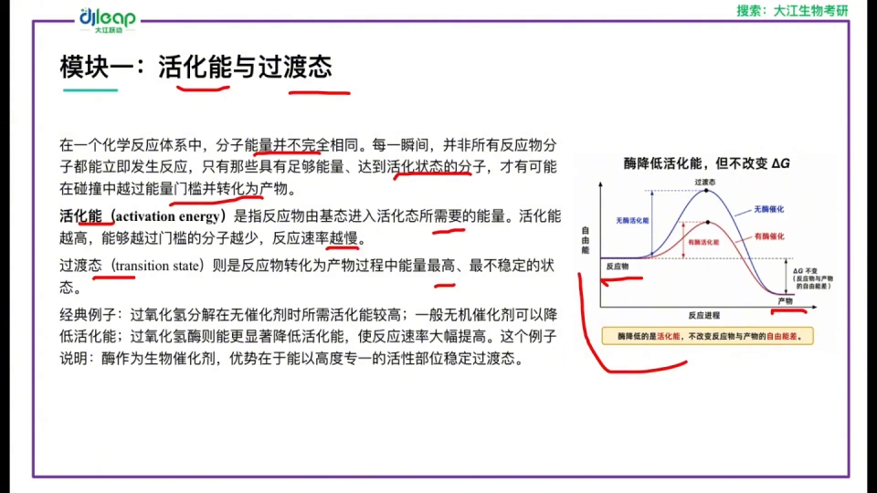
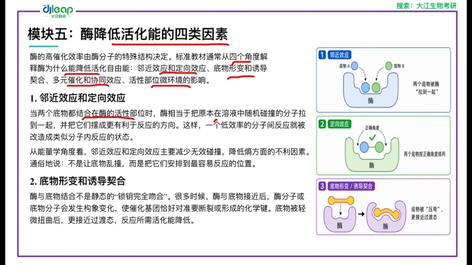
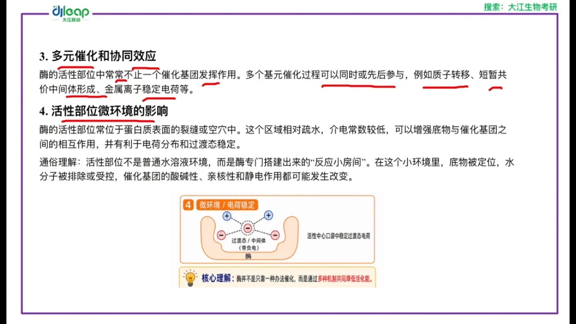
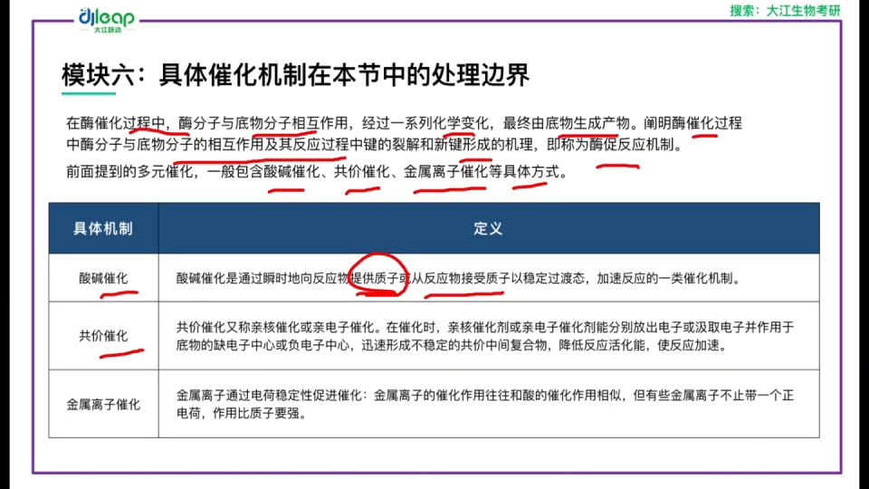
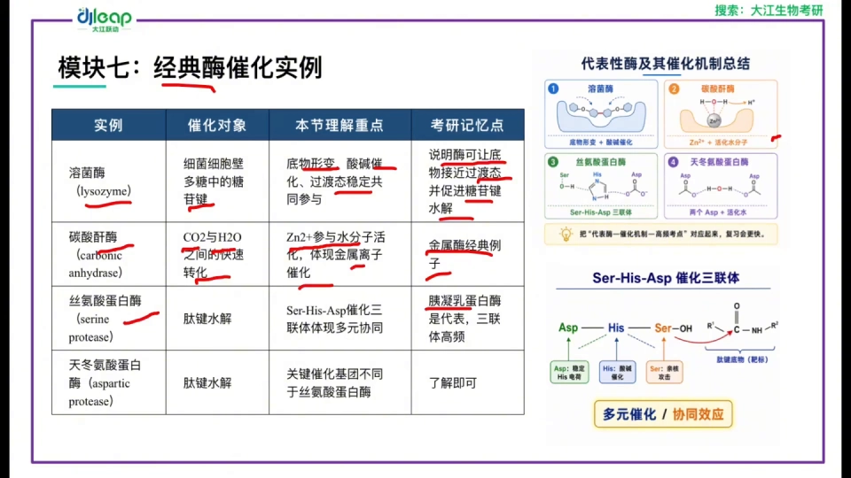

# 酶降低活化能的机制：过渡态稳定与催化基团协同

> 视频来源：[8.酶为什么能让反应变快？一节讲清活化能、过渡态和催化机制](https://www.bilibili.com/video/BV1E8j36gEwx/)（Bilibili · 大江生物考研 · 约 11 分钟）。本文按该视频的逐窗口字幕与画面整理，内容均可在原视频中核查。
> 导读：承接《酶的活性中心》，这一篇只回答一个问题——酶凭什么让反应变快。答案是"稳定过渡态、降低活化能"，而不是"提供能量"；四类因素（邻近定向、底物形变、多元催化、微环境）与酸碱/共价/金属离子三类具体机制，最后落到溶菌酶、碳酸酐酶、丝氨酸蛋白酶三个例子。本文不涉及米氏方程与抑制类型的动力学推导。

## 本讲要解决的核心问题（SCQA）

**背景**：上一节已经说明酶长什么样、为什么能认准底物。

**冲突**：但"认得住底物"和"让反应变快"是两件事。很多反应在生理条件下热力学上完全可行，只是慢到无法支撑生命活动；酶能把速率提高很多数量级，可它并没有给反应"加能量"。

**疑问**：反应为什么慢？酶到底改动了能量图景上的哪个量？具体靠哪几种化学手段做到？

**回答（中心思想）**：反应慢是因为反应物必须先翻过一座能量山——山顶是**过渡态**，从山脚到山顶的高度是**活化能**。酶做的事不是搬走终点，也不是把山削平，而是**提供一条更容易通过的路线**：在活性部位里把底物拉近、摆正、适度扭曲，并用酸碱、共价、金属离子、疏水微环境等手段**稳定过渡态**，从而降低活化能。它改变速率，不改变 ΔG、平衡常数和反应方向。

---

## 一、反应为什么慢：活化能与过渡态

在一个化学反应体系中，分子能量并不完全相同；每一瞬间并非所有反应物分子都能立即反应，只有那些具有足够能量、达到活化状态的分子，才有可能在碰撞中越过能量门槛并转化为产物 [【跳转到 01:31】](https://www.bilibili.com/video/BV1E8j36gEwx/?t=91)。

- **活化能**（activation energy，Ea）：反应物由基态进入活化态所需要的能量。活化能越高，能越过门槛的分子越少，反应速率越慢。
- **过渡态**（transition state）：反应物转化为产物过程中能量最高、最不稳定的状态。

视频用一座山来比喻：反应物在山脚，产物在另一边，山顶就是过渡态；从山脚爬到山顶要跨过的高度，就是活化能 [【跳转到 02:21】](https://www.bilibili.com/video/BV1E8j36gEwx/?t=141)。

经典例子是过氧化氢分解：没有催化剂时所需活化能较高、速度较慢；一般无机催化剂可以降低活化能；**过氧化氢酶**则能更显著地降低活化能，使速率大幅提高。这个例子说明酶作为生物催化剂的优势，在于**能以高度专一的活性部位稳定过渡态** [【跳转到 02:46】](https://www.bilibili.com/video/BV1E8j36gEwx/?t=166)。

---

## 二、酶催化的本质：降低门槛，而不是提供能量

酶与底物结合形成**酶—底物复合物（ES）**。底物进入活性部位后，酶通过多种相互作用把它拉到更接近过渡态的状态，并稳定这个本来非常不稳定的状态。过渡态越容易形成，需要跨越的活化能就越低；活化能越低，同样温度下能越过门槛的分子越多，反应速率自然越快 [【跳转到 03:11】](https://www.bilibili.com/video/BV1E8j36gEwx/?t=191)。

所以一句话概括：**酶降低活化能的本质不是"提供能量"，而是"降低门槛"**。它依赖活性部位完成四件事——把底物拉近、摆正方向、使底物发生适度形变、稳定过渡态并营造有利的微环境 [【跳转到 03:36】](https://www.bilibili.com/video/BV1E8j36gEwx/?t=216)。

---

## 三、最容易混淆的三件事：能不能发生、快不快、停在哪

学酶催化时最常混在一起的是三个问题 [【跳转到 04:13】](https://www.bilibili.com/video/BV1E8j36gEwx/?t=253)：

| 问题 | 由什么决定 | 酶能否改变 |
| --- | --- | --- |
| 反应有没有自发趋势 | ΔG（热力学） | 不能。酶不能把热力学上不利的反应变成有利反应 |
| 反应发生得快不快 | 活化能 Ea | 能。酶降低 Ea，让更多分子跨过门槛 |
| 反应最后停在哪里 | 平衡常数 | 不能。酶同时加快正、逆反应，只缩短达到平衡的时间 |

因此，"酶降低 ΔG""酶改变平衡""酶改变反应方向"这三种说法都是错的。正确说法是：**酶降低活化能、加快反应速率、缩短达到平衡的时间，但不改变 ΔG 和平衡常数** [【跳转到 05:08】](https://www.bilibili.com/video/BV1E8j36gEwx/?t=308)。视频的比喻是：酶像一条高速通道，能让你更快到达目的地，但不会把目的地换掉，也不会把本来不能去的方向强行改成能去 [【跳转到 04:01】](https://www.bilibili.com/video/BV1E8j36gEwx/?t=241)。

---

## 四、降低活化能的四类因素

教材通常从四个角度解释酶为什么能降低活化能 [【跳转到 05:16】](https://www.bilibili.com/video/BV1E8j36gEwx/?t=316)：邻近效应和定向效应、底物形变和诱导契合、多元催化和协同效应、活性部位微环境的影响。前三类直接对应"把底物摆好"，第四类对应"给反应换一个环境"。

### 4.1 邻近效应与定向效应：把分子间反应变成"分子内反应"

当两个底物结合在同一个活性部位时，酶相当于把原本在溶液中随机碰撞的分子拉到一起，并把它们摆成更有利于反应的方向 [【跳转到 05:35】](https://www.bilibili.com/video/BV1E8j36gEwx/?t=335)。

没有酶时，底物在溶液里乱撞，绝大多数碰撞是无效的；酶把底物安排到最合适的位置，相当于把低效率的分子间反应改造成类似**分子内反应**的状态，从而减少无效碰撞带来的熵损失 [【跳转到 06:10】](https://www.bilibili.com/video/BV1E8j36gEwx/?t=370)。

### 4.2 底物形变与诱导契合：把底物"压"向过渡态

酶与底物的结合不是静态的锁钥式完全吻合。很多时候结合之后，酶或底物的构象会发生变化，使催化基团恰好对准要断裂或形成的化学键；底物被轻微扭曲后更接近过渡态，反应所需能量随之降低 [【跳转到 06:25】](https://www.bilibili.com/video/BV1E8j36gEwx/?t=385)。

这与上一节的诱导契合模型是同一件事的两面：诱导契合解释"怎么认得上"，底物形变解释"认得之后怎么让它更容易反应"。

### 4.3 多元催化与协同效应：不是一个基团单打独斗

活性部位里常常不止一个催化基团发挥作用，多个基团在催化过程中可以同时或先后参与，例如质子转移、短暂共价中间体的形成、金属离子稳定电荷等 [【跳转到 06:56】](https://www.bilibili.com/video/BV1E8j36gEwx/?t=416)。

### 4.4 活性部位微环境：一个专门的"反应小房间"

活性部位常位于蛋白质表面的裂缝或空穴中，这个区域相对疏水、介电常数较低，可以增强底物与催化基团之间的相互作用，并有利于电荷分布和过渡态稳定 [【跳转到 07:26】](https://www.bilibili.com/video/BV1E8j36gEwx/?t=446)。

通俗理解是：活性部位不是普通的水溶液环境，而是酶专门搭建出来的"反应小房间"。在这个小环境里，底物被定位，水分子被排除或受控，催化基团的酸碱性、亲核性和静电作用都可能发生改变。

---

## 五、三类具体催化机制：酸碱、共价、金属离子

上面讲的是"降低活化能的四个角度"，落到化学层面，就是几种具体的催化机制。视频明确说明：这些机制形式不同，但都服务于同一个目标——**稳定过渡态、降低活化能** [【跳转到 08:03】](https://www.bilibili.com/video/BV1E8j36gEwx/?t=483)。

| 机制 | 做什么 | 一句话记法 |
| --- | --- | --- |
| 酸碱催化 | 瞬时向反应物提供质子或从反应物接受质子，以稳定过渡态 | 参与的是**质子转移** |
| 共价催化 | 亲核/亲电子催化剂放出或汲取电子，作用于底物的缺电子中心或负电子中心，迅速形成不稳定的共价中间复合物 | 形成**短暂的共价中间体** |
| 金属离子催化 | 通过电荷稳定性促进催化；作用与酸催化相似，但有些金属离子带不止一个正电荷，作用比质子更强 | **稳定电荷**或**活化水分子** |

此外还有静电催化与过渡态稳定等说法，本质仍是"用口袋里的电荷环境把过渡态那一点不稳定电荷稳住"。

---

## 六、三个经典酶例：把机制落到具体分子上

视频用四个酶把上述机制对应起来 [【跳转到 09:31】](https://www.bilibili.com/video/BV1E8j36gEwx/?t=571)。

**溶菌酶**催化细菌细胞壁多糖中的糖苷键水解。它的机制里同时涉及底物形变、酸碱催化和过渡态稳定：酶让底物接近过渡态，并促进糖苷键水解 [【跳转到 09:36】](https://www.bilibili.com/video/BV1E8j36gEwx/?t=576)。

**碳酸酐酶**催化二氧化碳与水之间的快速转化，是**金属酶**的经典例子：活性部位的锌离子参与活化水分子，使水分子更容易断键，体现的正是金属离子催化 [【跳转到 09:56】](https://www.bilibili.com/video/BV1E8j36gEwx/?t=596)。

**丝氨酸蛋白酶**（如胰凝乳蛋白酶）催化肽键水解，典型特征是 **Ser–His–Asp 催化三联体**。三个残基不是各干各的，而是协同完成催化：天冬氨酸稳定组氨酸的电荷，组氨酸承担酸碱催化，丝氨酸做亲核攻击，三者共同作用完成肽键水解 [【跳转到 10:21】](https://www.bilibili.com/video/BV1E8j36gEwx/?t=621)。这是"多元催化与协同效应"最标准的例子。

**天冬氨酸蛋白酶**同样催化肽键水解，但关键催化基团不同于丝氨酸蛋白酶——两个 Asp 参与、活化水分子 [【跳转到 10:46】](https://www.bilibili.com/video/BV1E8j36gEwx/?t=646)。

---

## 小结

- 反应慢的根源是**活化能**：反应物必须先达到能量最高、最不稳定的**过渡态**。
- 酶的本质作用是**稳定过渡态、降低活化能**，不是"提供能量"；它提供一条更容易通过的路线。
- 酶改变速率，不改变 **ΔG、平衡常数、反应方向**；它同时加快正逆反应，只缩短达到平衡的时间。
- 降低活化能有四类因素：邻近与定向效应、底物形变与诱导契合、多元催化与协同效应、活性部位微环境。
- 具体机制可归为酸碱催化（质子转移）、共价催化（短暂共价中间体）、金属离子催化（稳定电荷、活化水分子），它们共同服务于过渡态稳定。
- 经典例子：溶菌酶（底物形变 + 酸碱催化 + 过渡态稳定）、碳酸酐酶（Zn²⁺ 活化水）、丝氨酸蛋白酶（Ser–His–Asp 三联体协同）、天冬氨酸蛋白酶（两个 Asp 活化水）。

## 关键术语速查

| 术语 | 一句话解释 |
| --- | --- |
| 活化能 | 反应物由基态进入活化态所需的能量，决定反应速率 |
| 过渡态 | 反应过程中能量最高、最不稳定的状态，位于能量山顶 |
| 酶—底物复合物 | 酶与底物结合形成的中间复合物，记为 ES |
| 邻近效应 | 把原本随机碰撞的底物拉到同一处，提高有效碰撞 |
| 定向效应 | 把底物摆成有利于反应的角度 |
| 底物形变 | 结合后底物被轻微扭曲，更接近过渡态 |
| 酸碱催化 | 通过提供或接受质子稳定过渡态 |
| 共价催化 | 形成短暂的共价中间体，分步降低活化能 |
| 金属离子催化 | 金属离子稳定电荷或活化水分子 |
| 催化三联体 | 丝氨酸蛋白酶中 Ser、His、Asp 协同催化的三个关键残基 |