# 自噬—溶酶体降解：从吞噬泡到自噬溶酶体的五个阶段

> 视频来源：[【生科集录】细胞自噬丨超级回收工厂](https://www.bilibili.com/video/BV1X8ae6aEMB/)（Bilibili · 28:12 · UP 主「博士夏洛克」）。本文按该视频的逐窗口字幕与画面整理，时间戳可跳回原片核对。视频后三分之一讲「自噬与细胞死亡」，与本节主题相邻但不同，本文只保留其中与「降解路线的边界」直接相关的部分。
> 导读：溶酶体是细胞的垃圾处理厂加回收站，可它只消化送进来的东西。这一篇讲的是「送货路线」：细胞怎么用一层双层膜把自身的一部分胞质、细胞器甚至病原体圈起来，做成自噬体，再运到溶酶体里拆掉——以及这条路线怎么被发现、怎么被测量、什么时候会堵。

## 本讲要解决的核心问题（SCQA）

**背景**：细胞要维持稳态，除了不断合成，还要不断回收。溶酶体里装着一整套酸性水解酶，能把大分子溶解成小分子供细胞重新利用。

**冲突**：溶酶体只能消化「送到它面前」的东西。可细胞要清除的货物里，有比内吞小泡大得多的东西——整个细胞器、蛋白聚集体、入侵的病原体。它们怎么进得去？更麻烦的是，自噬在正常细胞里本来就很少发生，研究者连「看」都看不到。

**疑问**：自噬体这层双层膜是怎么形成的？细胞怎么决定该不该启动自噬、又怎么挑出要拆的货物？降解完之后，东西去哪了？

**回答（中心思想）**：细胞用**巨自噬**解决「大货物」问题——在胞质里生成隔离膜（吞噬泡），延伸包裹货物，闭合为**双层膜的自噬体**，再沿细胞骨架运到核周与溶酶体融合，形成**自噬溶酶体**，由水解酶把货物分解成氨基酸、核苷酸、脂肪酸、糖和 ATP 回收。整条路线可以拆成**起始、成核、延伸与闭合、融合、降解与回收**五个阶段；起始的总开关是 **mTORC1**，成核的招募信号是 **PI3P**，延伸依赖 **ATG9A 囊泡与两个泛素样结合系统**，而货物既可以非选择性随机捕获，也可以由**选择性自噬**精准指定。

---

## 一、溶酶体：先有「处理厂」，才有「送货路线」

### 1.1 一个对照酶带来的意外

20 世纪 40 年代末，比利时科学家克里斯汀·德迪夫（Christian de Duve）在研究胰岛素对肝脏碳水化合物代谢的作用。为了定位葡萄糖-6-磷酸酶，他用**差速离心**把大鼠肝脏匀浆中的不同亚细胞组分分开——差速离心就是逐级增加离心力，把不同大小和密度的组分或细胞器分离开。

[【跳转到 00:55】](https://www.bilibili.com/video/BV1X8ae6aEMB/?t=55)

就在这个过程中，一个**对照酶**引起了他的注意：**酸性磷酸酶**。奇怪的地方在于——新鲜制备的细胞匀浆里，这个酶的活性低得可怜；但把样品在冰箱里放几天，活性就大幅升高。

德迪夫意识到一件很关键的事：这个酶很可能**被膜关着**。膜完整，酶就接触不到底物，测出来的活性就低；放几天膜破损了，酶被释放出来，活性自然就上去了。

[【跳转到 01:19】](https://www.bilibili.com/video/BV1X8ae6aEMB/?t=79)

这个推理值得停一下：**「测不到活性」不等于「没有酶」**。把「活性低」解释成「被关在膜里」，才把一个反常的测量结果变成了一个细胞器的线索。后续实验证实了这个推测：德迪夫团队把这种富含酸性磷酸酶和其他多种水解酶的颗粒与线粒体、微粒体分开，并发现其中至少含有五种酸性水解酶。

### 1.2 命名：按「溶解」功能叫它溶酶体

1955 年，德迪夫正式提出：这些颗粒代表一种此前未知的细胞器，并按它的「溶解」功能命名为**溶酶体**。现在我们知道，溶酶体是细胞内的一种膜性细胞器，由一层单位膜包裹成囊泡状小体，内部呈酸性，含多种酸性水解酶，能把大分子溶解成小分子供细胞回收利用——可以把它理解成细胞的**垃圾处理厂加回收站**。

[【跳转到 02:17】](https://www.bilibili.com/video/BV1X8ae6aEMB/?t=137)

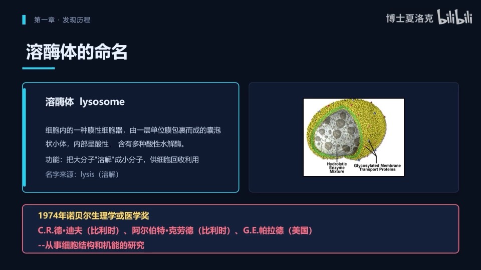

但在 1955 年命名时，溶酶体还是一个**纯粹基于生化证据推断出来的假想颗粒**——当时还没有直接观察它形态的技术。直到电镜技术跟进，溶酶体才被真正看见。这一发现使德迪夫与阿尔伯特·克劳德、乔治·帕拉德共同获得 1974 年诺贝尔生理学或医学奖。

[【跳转到 02:42】](https://www.bilibili.com/video/BV1X8ae6aEMB/?t=162)

### 1.3 从「吃别人」到「吃自己」

溶酶体的发现为理解细胞如何降解自身物质奠定了基础。德迪夫很快意识到：溶酶体不只是外源物质被送入降解的终点，也可能参与细胞对**自身组分**的消化。1963 年在伦敦举行的 Ciba 基金会溶酶体研讨会上，他首次提出**自噬（autophagy）**这个术语，用来描述细胞把自身细胞质成分包裹进膜囊泡、再送入溶酶体降解的过程。

[【跳转到 02:59】](https://www.bilibili.com/video/BV1X8ae6aEMB/?t=179)

这个词来自希腊语：**auto** 意为「自我」，**phagin** 意为「吞噬」，合起来就是「吃掉自己」。它和「异噬」（及后来所称的内吞作用）形成鲜明对照：

[【跳转到 03:38】](https://www.bilibili.com/video/BV1X8ae6aEMB/?t=218)

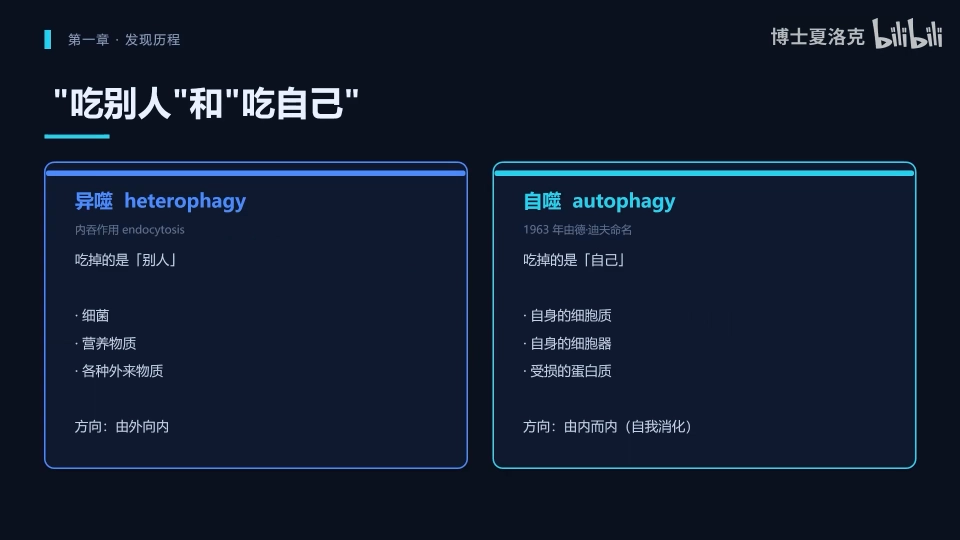

这张对照表其实已经点出了本节的关键分工：**内吞解决「外面进来的东西」，自噬解决「自己内部的东西」**。溶酶体是两者共同的终点，但送货路线完全不同。内吞那一半（网格蛋白包被、内体酸化、受体的三种去向）见 [受体介导的内吞：网格蛋白包被、内体酸化与受体的三种去向](../../../1_生命的物质与组织层级/1.3_细胞结构、生物膜与物质运输/1.3.3_内膜系统与囊泡运输：分泌途径、内吞与溶酶体/受体介导的内吞：网格蛋白包被、内体酸化与受体的三种去向.md)；本篇只讲自噬这一半。

顺带划清一个容易混的边界：**自噬不等于细胞凋亡**。细胞凋亡是细胞主动有序的「安乐死」，是把自己拆掉；而自噬通常不是毁灭，而是一种**生存策略**——营养匮乏时，细胞通过自噬降解自身非必需成分来提供能量和原料；日常状态下，自噬则充当细胞的清道夫，清除受损的蛋白质和细胞器。

[【跳转到 04:03】](https://www.bilibili.com/video/BV1X8ae6aEMB/?t=243)

---

## 二、三种自噬：巨自噬、微自噬、分子伴侣介导的自噬

20 世纪 60 年代，研究人员在电镜下观察到细胞能形成膜结构包裹自身内部的物质并送入溶酶体降解。但这种后来被命名为**自噬体**的囊泡如何形成、如何调控，在此后近 30 年间几乎无人知晓。

[【跳转到 04:28】](https://www.bilibili.com/video/BV1X8ae6aEMB/?t=268)

按送货方式，自噬主要分三种：

[【跳转到 06:58】](https://www.bilibili.com/video/BV1X8ae6aEMB/?t=418)

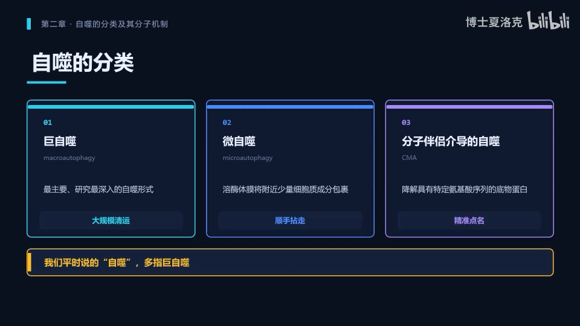

- **巨自噬（macroautophagy）**：细胞在胞质中形成**双层膜**的吞噬泡，吞噬泡延伸、包裹待降解的细胞质成分和受损细胞器，闭合后形成自噬体，自噬体再与溶酶体融合、降解内容物。这是**最主要、研究最深入**的形式，通常所说的自噬都是巨自噬。它既可以非选择性地吞噬一部分胞质，也可以选择性地清除线粒体、内质网、病原体等特定目标。
- **微自噬（microautophagy）**：溶酶体（或酵母液泡）膜直接内陷变形，把附近少量细胞质成分包裹并吞入腔内降解，**不形成**典型的双层膜自噬体。
- **分子伴侣介导的自噬（CMA）**：识别特定氨基酸序列（如 KFERQ 样基序），底物先被分子伴侣 **Hsc70** 识别，再与溶酶体膜上的 **LAMP2A** 受体结合，去折叠后经 LAMP2A 转运进溶酶体腔降解。**不形成囊泡**，高度选择性，主要存在于哺乳动物细胞。

[【跳转到 07:55】](https://www.bilibili.com/video/BV1X8ae6aEMB/?t=475)

三者的分工可以一句话概括：**巨自噬负责大规模清运，微自噬处理少量胞质，CMA 精准点名特定可溶性蛋白**。它们共同构成细胞利用溶酶体进行自我更新和物质回收的降解网络。

[【跳转到 08:25】](https://www.bilibili.com/video/BV1X8ae6aEMB/?t=505)

---

## 三、酵母遗传筛选：把「看不见的过程」变成「可筛的表型」

研究自噬之所以困难重重，有两个原因：**自噬在正常细胞里本来就很少发生**，得先想办法诱发它才有得看；而且形态学观察只能告诉你「发生了什么」，告诉不了你「是谁在操控」。

[【跳转到 04:53】](https://www.bilibili.com/video/BV1X8ae6aEMB/?t=293)

转机出现在 20 世纪 90 年代：大隅良典做了一个关键性的决定——**用面包酵母来研究自噬**。这个选择在当时并不顺理成章：自噬是膜的动态过程，要在细胞里看膜，酵母看起来远不如哺乳动物细胞好使。但酵母有三个优点：单细胞真核生物（一个细胞就是一个个体，好养好观察）、生长极快（几小时一代，实验周期短）、**容易做遗传操作**（可以对酵母搞大规模随机突变，再一个一个筛）。

[【跳转到 05:18】](https://www.bilibili.com/video/BV1X8ae6aEMB/?t=318)

大隅良典发现：蛋白降解酶缺失的酵母突变体，在饥饿条件下液泡内会聚集大量未被降解的自噬结构。这既证明自噬存在于酵母中，更重要的是建立了**酵母作为研究自噬的遗传模型**。

接下来是这一步真正的巧思——一次**逆向推理**：

[【跳转到 06:33】](https://www.bilibili.com/video/BV1X8ae6aEMB/?t=393)

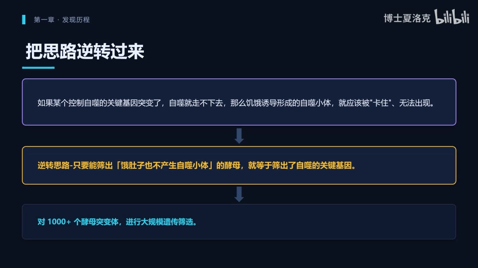

1991 年，他的一名研究生发现了第一个自噬缺陷突变体，命名为 **APG1-1**——这就是后来为人熟知的 **ATG1**。接下来十多年里，他们克隆鉴定了筛到的大部分突变体，并深入研究这些基因的功能。

[【跳转到 06:33】](https://www.bilibili.com/video/BV1X8ae6aEMB/?t=393)

这段历史对读文献也有用：**当一个过程在细胞里「看不见」时，把它变成一个可筛的表型，往往比硬看更有效**。「饿肚子也不产生自噬小体」就是这样一个表型。

---

## 四、巨自噬的五个阶段

以下以巨自噬为例。自噬过程通常经历五个关键阶段：**起始、成核、延伸与闭合、融合、降解与回收**。

[【跳转到 08:56】](https://www.bilibili.com/video/BV1X8ae6aEMB/?t=536)

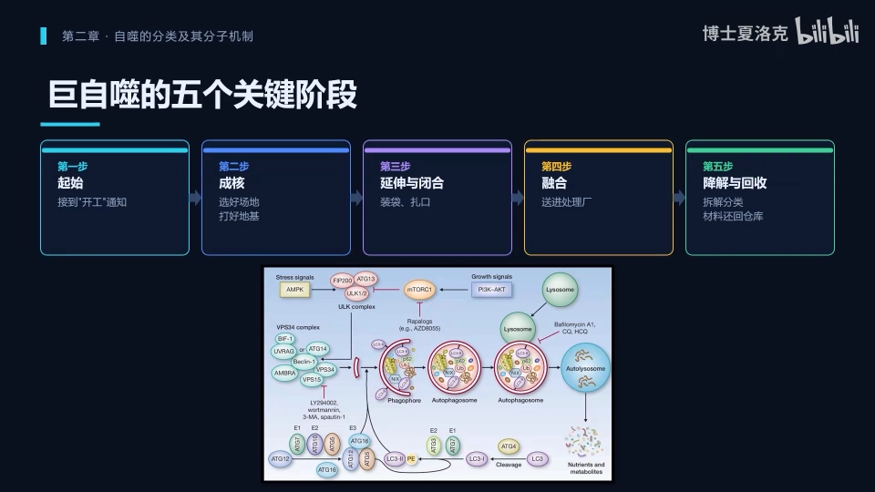

### 4.1 起始：mTORC1 是总开关

第一个问题：细胞怎么知道该不该启动自噬？

- **营养充足时**：**mTORC1** 激酶复合物处于活化状态，它高度磷酸化 **ATG13**；磷酸化后的 ATG13 无法与 **ULK1**、**FIP200** 正常相互作用，自噬被抑制。
- **遭遇应激时**（饥饿、缺氧、氧化应激、病原体入侵，或用雷帕霉素这类 mTOR 抑制剂）：mTORC1 活性被抑制，ATG13 去磷酸化，与 ULK1/2 结合形成起始复合物，自噬启动。

[【跳转到 09:13】](https://www.bilibili.com/video/BV1X8ae6aEMB/?t=553)

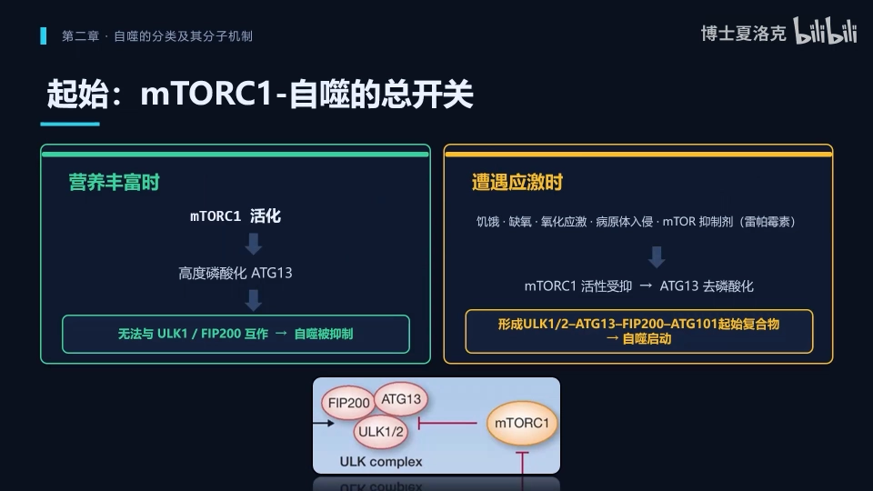

这里的分工值得记清楚：**ATG13 是把 ULK1 锚定到前自噬体结构（PAS）的关键蛋白**，并桥接 ULK1 与 FIP200；**FIP200 则作为支架**招募下游 ATG 蛋白。随后多种 ATG 蛋白按层级聚集到 PAS，启动自噬体形成。

[【跳转到 10:03】](https://www.bilibili.com/video/BV1X8ae6aEMB/?t=603)

### 4.2 成核：PI3P 是一张「开工信号弹」

ULK1（ATG1）复合物启动成核后，**III 类 PI3K 复合物 1** 被招募到 PAS。这个复合物由 **VPS34、VPS15、Beclin1、ATG14L** 组成；ATG14L 可与 ATG13 相互作用，把复合物锚定到 PAS。

[【跳转到 10:19】](https://www.bilibili.com/video/BV1X8ae6aEMB/?t=619)

真正起作用的是一个脂质：VPS34 催化磷脂酰肌醇（PI）磷酸化，生成 **PI3P**。PI3P 是一个**招募信号**——它一旦在膜上生成，就会把 **WIPI（ATG18）** 这类膜结合蛋白招过来。讲者的比喻是「工地上的开工信号弹」：PI3P 一放出去，带着工具的工人（WIPI/ATG18）就知道该往哪儿集合了。

[【跳转到 10:44】](https://www.bilibili.com/video/BV1X8ae6aEMB/?t=644)

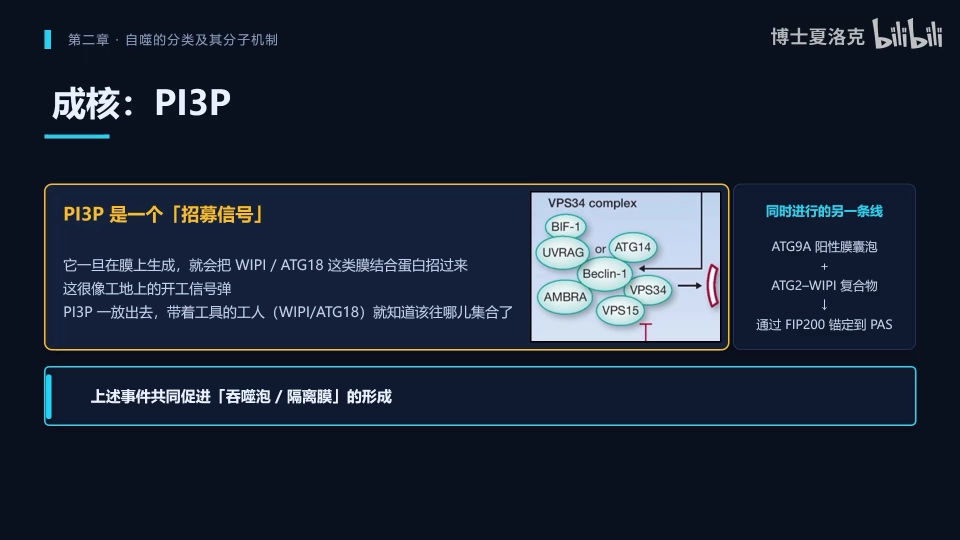

与此同时还有另一条线：**ATG9A 阳性膜囊泡**与 **ATG2-WIPI 复合物**通过 FIP200 被锚定到 PAS。两条线共同促进吞噬泡（隔离膜）的形成。

### 4.3 延伸与闭合：ATG9A 送货，两个泛素样系统「装袋扎口」

隔离膜形成后，需要不断**延伸并包裹**胞质成分，最后闭合为双层膜的自噬体。这个阶段涉及两套装置。

**第一套是 ATG9A 运输系统。** ATG9A 是核心机器中唯一的多次跨膜蛋白，可在高尔基体、反面高尔基网络、内体与 PAS 之间循环——可以把它理解成**膜的搬运工**。ULK1（ATG1）可磷酸化 ATG9A，促进 LC3（ATG8）与 WIPI2（ATG18）的招募，支持自噬体形成位点、推动吞噬泡扩张。

[【跳转到 11:20】](https://www.bilibili.com/video/BV1X8ae6aEMB/?t=680)

**第二套是两个泛素样结合系统。** 这是本节最值得花力气理解的地方，因为它和上一篇的泛素系统是同一套逻辑的变体：

- **ATG12 结合系统**：ATG12 被 E1 样酶 **ATG7** 活化 → 转移到 E2 样酶 **ATG10** → 共价结合 **ATG5**，形成 ATG12-ATG5；再与 **ATG16L** 组装成约 800 kDa 的 ATG12-ATG5-ATG16L 复合物。这个复合物扮演的是 **E3 样复合物**的角色，它的任务是**促进 LC3 脂化**。
- **LC3 结合系统**：前体 proLC3 被 **ATG4B** 切割为 LC3-I；LC3-I 经 **ATG7**（对应 E1）、**ATG3**（对应 E2）转移，与**磷脂酰乙醇胺（PE）**结合形成 **LC3-II**，锚定在自噬体膜上。

[【跳转到 11:53】](https://www.bilibili.com/video/BV1X8ae6aEMB/?t=713)

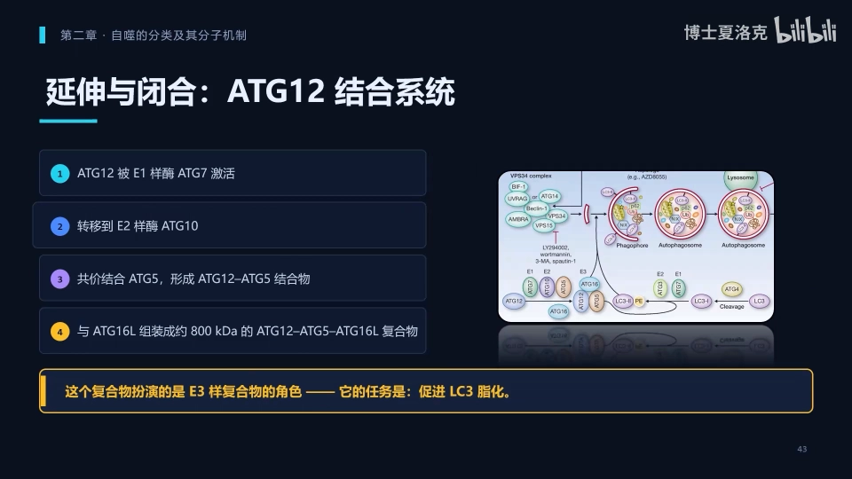

把两套系统并排看，逻辑就清楚了：**ATG12 系统是「E3」，LC3 系统是「底物」**。泛素是被接到赖氨酸上，而 LC3 是被接到**膜脂（PE）**上——这就是自噬体膜被「标记」和「成型」的方式。随着延伸完成，隔离膜闭合，形成成熟自噬体。

[【跳转到 12:18】](https://www.bilibili.com/video/BV1X8ae6aEMB/?t=738)

### 4.4 融合：把货从城市这头送到那头

成熟自噬体可以随机分布在胞质中，而**溶酶体主要位于核周区域**。所以自噬体需要**沿细胞骨架被运输到核周**，与溶酶体对接并融合，形成**自噬溶酶体**。这一步依赖自噬体的成熟状态以及膜融合相关机制，是自噬降解得以进行的关键一步。

[【跳转到 12:48】](https://www.bilibili.com/video/BV1X8ae6aEMB/?t=768)

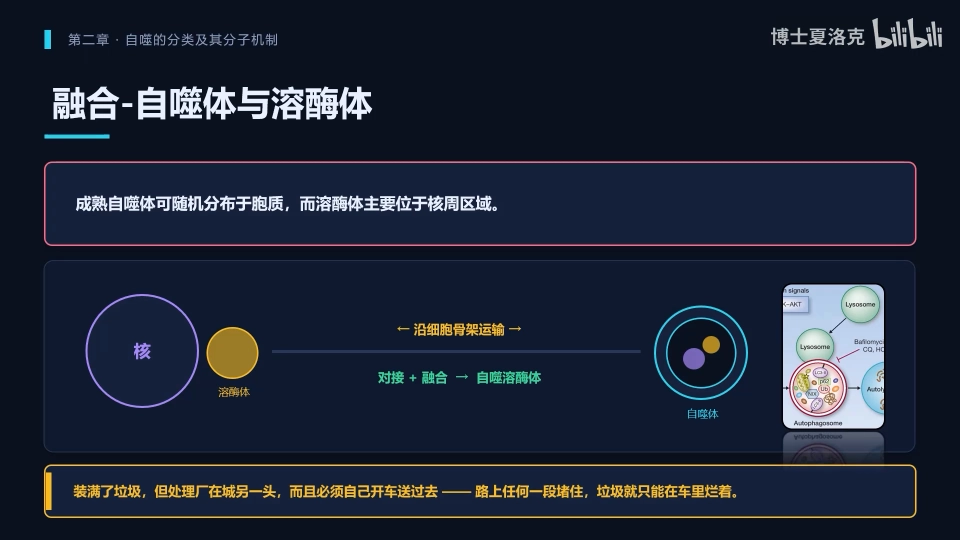

讲者在这里给了一个很好用的比喻：**装满了一车垃圾，但垃圾处理厂在城市的另一头，必须自己开车送过去；路上任何一段堵住，垃圾就只能在车里烂着。** 这正是「自噬体堆积、无法降解」——自噬研究中最常见的一种病理状态。

[【跳转到 13:13】](https://www.bilibili.com/video/BV1X8ae6aEMB/?t=793)

这个比喻还埋着下一节的伏笔：如果只看「自噬体变多」，你分不清是**垃圾产得多**，还是**路堵了**。

### 4.5 降解与回收：拆解分类，材料还回仓库

自噬体与溶酶体融合后，溶酶体水解酶降解自噬体内膜以及包裹的胞质来源大分子——蛋白质、蛋白聚集体、受损细胞器、病原体等，把它们分解为**氨基酸、肽、核苷酸、脂肪酸、糖和 ATP**，再回收至胞质供细胞重新利用。

[【跳转到 13:22】](https://www.bilibili.com/video/BV1X8ae6aEMB/?t=802)

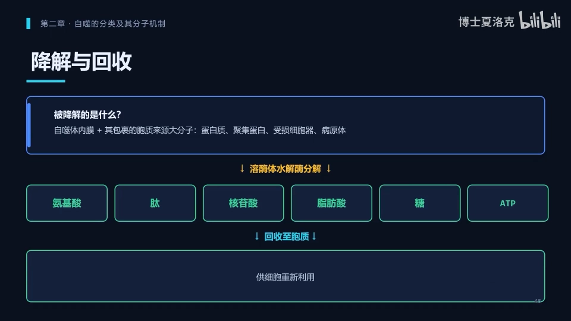

所以自噬同时干两件事：**在饥饿和应激条件下维持细胞代谢与生存**（提供能量与原料），**承担蛋白质和细胞器的质量控制**（清掉坏掉的部件）。

[【跳转到 13:47】](https://www.bilibili.com/video/BV1X8ae6aEMB/?t=827)

---

## 五、选择性自噬：货物怎么被挑出来

前面说巨自噬「既可以非选择性，也可以选择性」。选择性自噬近年来受到广泛关注：细胞能通过**特定受体**精准识别并清除某些目标，例如**受损线粒体、内质网、入侵病原体、铁蛋白、脂滴**。

[【跳转到 08:25】](https://www.bilibili.com/video/BV1X8ae6aEMB/?t=505)

这里有一个值得注意的连接点：视频里反复出现的 **p62（SQSTM1）** 就是这类**货物受体**之一——它能识别并带着货物进入自噬（例如在讨论自噬介导凋亡时，p62 识别并降解 Fap-1）。同时，p62 自己也会被自噬降解，所以它的蛋白量变化可以被当作自噬通量的读数（见下一节）。

[【跳转到 20:03】](https://www.bilibili.com/video/BV1X8ae6aEMB/?t=1203)

于是两条降解路线的分工可以这样摆：

| | 泛素—蛋白酶体 | 自噬—溶酶体 |
| --- | --- | --- |
| 处理对象 | 单个蛋白（短寿命调控蛋白、错误折叠蛋白） | 长寿命蛋白、蛋白聚集体、整个细胞器、病原体 |
| 识别方式 | 泛素链（K48/K11）+ 蛋白酶体受体 | 非选择性随机捕获，或选择性受体（如 p62）指定货物 |
| 执行机器 | 26S 蛋白酶体（20S 核心 + 19S 帽） | 自噬体 + 溶酶体水解酶 |
| 是否形成囊泡 | 否，底物被直接拉进降解腔 | 是，双层膜自噬体 |
| 回收产物 | 短肽、氨基酸 | 氨基酸、肽、核苷酸、脂肪酸、糖、ATP |

这张表里「泛素」和「自噬」并不是互斥的两条线：泛素标签可以被自噬的货物受体读取，把「被泛素标记的货物」交给自噬处理——两条路线在货物层面是**可以对接**的。泛素—蛋白酶体那一半的机制见本节的另一篇 [泛素—蛋白酶体系统：E1–E2–E3 三级酶联与 26S 蛋白酶体如何决定蛋白寿命](泛素—蛋白酶体系统：E1–E2–E3%20三级酶联与%2026S%20蛋白酶体如何决定蛋白寿命.md)。

---

## 六、怎么知道自噬真的在「流」

### 6.1 LC3：自噬体的标志分子

大隅良典实验室的**吉森保**发现了自噬的标志分子 **LC3**——它是酵母 ATG8 在哺乳动物中的同源物，并建立了检测自噬水平的方法：**观察 LC3-I 转变为 LC3-II**。

[【跳转到 14:17】](https://www.bilibili.com/video/BV1X8ae6aEMB/?t=857)

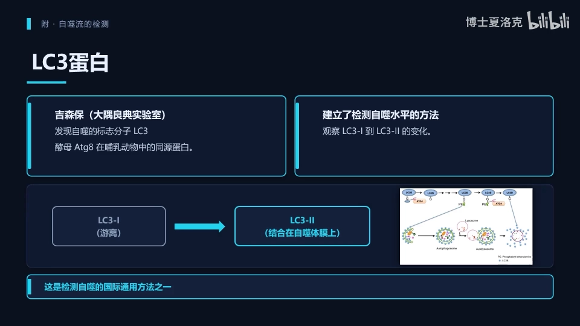

LC3 即微管相关蛋白 1 轻链 3（MAP1-LC3）。它被具有蛋白酶活性的 **ATG4** 在 C 端剪切，生成胞质型 **LC3-I**；自噬体形成时，LC3-I 经 ATG7、ATG3（分别对应泛素激活酶 E1 和泛素结合酶 E2）参与的类泛素化反应，与 PE 偶联，生成脂化形式的 **LC3-II**，附着在自噬体膜上。

[【跳转到 14:42】](https://www.bilibili.com/video/BV1X8ae6aEMB/?t=882)

降解过程中，位于自噬体**外膜**的 LC3-II 被半胱氨酸蛋白酶 **ATG4B** 切割，产生 LC3-I 循环利用；位于**内膜**的 LC3-II 则与包裹的内容物一起被溶酶体降解——所以自噬溶酶体里 LC3 含量很低。

### 6.2 一个陷阱：LC3-II 升高，可能是「产得多」，也可能是「堵住了」

最常用的方法是 Western Blot 检测 LC3-II/LC3-I 比值或 LC3-II 相对内参的变化。但**这个比值只反映「自噬体的数量」，不反映「自噬是不是真的在流通」**。

[【跳转到 15:37】](https://www.bilibili.com/video/BV1X8ae6aEMB/?t=937)

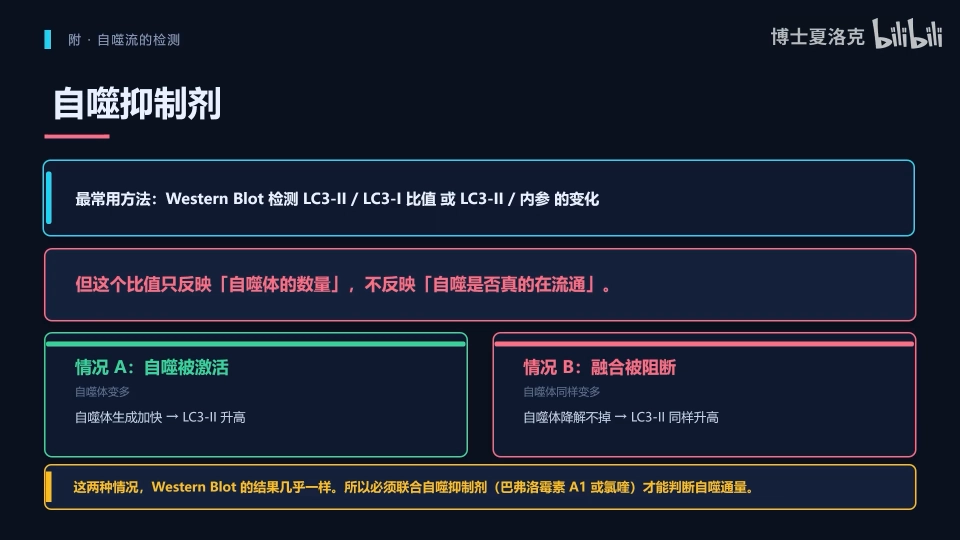

- **情况 A：自噬被激活**——自噬体生成加快，LC3-II 升高；
- **情况 B：融合被阻断**——自噬体降解不掉，LC3-II 同样升高。

两种情况 Western Blot 结果几乎一样，所以必须**联合自噬抑制剂**（如巴弗洛霉素 A1 或氯喹）来判断**自噬通量**：

- 若实验组 LC3-II 显著高于对照，且**加抑制剂后 LC3-II 进一步明显增加** → 自噬流被**激活**；
- 若实验组 LC3-II 本身就高，但**加抑制剂后没有进一步显著增加** → 自噬流被**阻断**。

[【跳转到 16:02】](https://www.bilibili.com/video/BV1X8ae6aEMB/?t=962)

### 6.3 还需要别的读数

除了 Western Blot，还要结合其他手段：

1. **转染 mRFP-GFP-LC3 后共聚焦拍照**：自噬体同时显示红色和绿色荧光，自噬溶酶体只显示红色荧光——因为 GFP 更不稳定，在自噬溶酶体的酸性环境中更容易被降解；
2. **Western Blot 检测 p62（SQSTM1）的降解**：p62 蛋白含量降低，通常提示自噬通量增强。

[【跳转到 16:10】](https://www.bilibili.com/video/BV1X8ae6aEMB/?t=970)

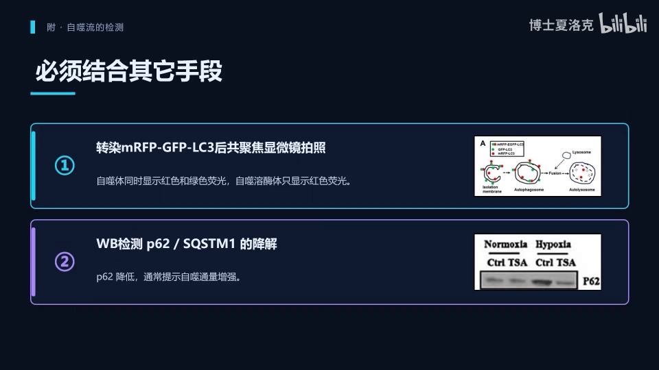

这套「通量」思维值得迁移到别处：**一个中间产物变多，既可能是上游加速，也可能是下游堵塞**。只测中间产物，永远分不清这两种情况。

---

## 七、边界：自噬不是「越多越好」

视频后三分之一讲自噬与细胞死亡，与本节主题相邻但不同，这里只取与「降解路线的边界」直接相关的部分。

### 7.1 自噬相关细胞死亡分两类

- **ADCD（自噬依赖性细胞死亡）**：关键词是「**依赖**」——高度依赖自噬机制，且独立于其他程序性死亡。意思是：把别的死路全堵死，它照样能靠自噬死掉。在这种死亡里，自噬是「凶手」，亲自动手。
- **AMCD（自噬介导的细胞死亡）**：关键词是「**介导**」——本质上依赖的是别的死亡模式（凋亡、坏死性凋亡、铁死亡），自噬只起触发或调控作用。在这种死亡里，自噬是「帮凶」，动手的是别人。

[【跳转到 16:43】](https://www.bilibili.com/video/BV1X8ae6aEMB/?t=1003)

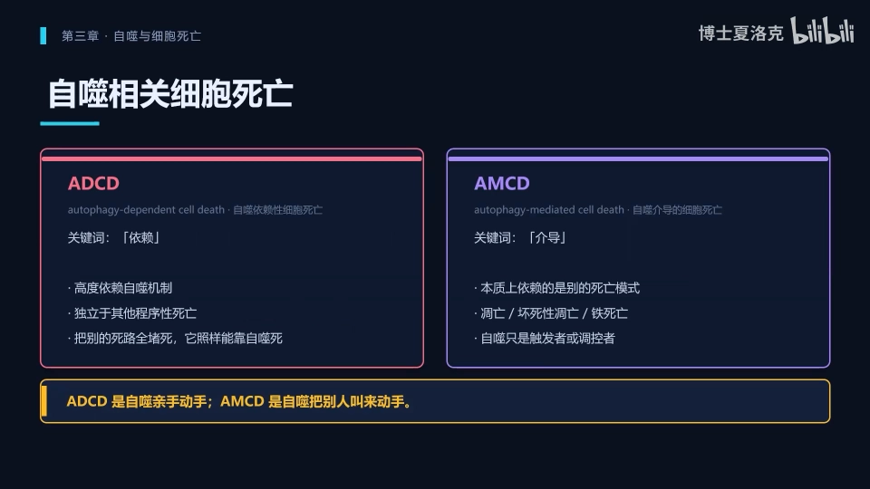

### 7.2 为什么「抑制自噬」不能当万能药

视频给了一个很实用的判断框架：把自噬分成**单向**与**双向**。

- **单向自噬**：自噬主要促进生存，或主要促进死亡，方向单一；
- **双向自噬**：同一细胞中自噬参与不同甚至相反的过程，两个方向同时存在。

[【跳转到 23:48】](https://www.bilibili.com/video/BV1X8ae6aEMB/?t=1428)

「双向」这个词是理解自噬临床困境的关键：**你用药物抑制自噬时，很可能同时抑制掉了对你有利的那一部分**。而且角色还会随阶段变化——最经典的例子是肝癌：早期自噬抑制肝损伤和肿瘤形成，是保护性的；晚期自噬促进肿瘤增殖，变成了帮凶。

[【跳转到 25:03】](https://www.bilibili.com/video/BV1X8ae6aEMB/?t=1503)

所以视频的结论是：我们需要的不是「总开关」，而是「**分路开关**」——只关掉致病的那条自噬，保留保护性的通路。

[【跳转到 24:13】](https://www.bilibili.com/video/BV1X8ae6aEMB/?t=1453)

### 7.3 三条边界

- **自噬 ≠ 凋亡**：凋亡是主动拆掉自己；自噬首先是生存策略，只有在过度或失调时才推动死亡。
- **自噬体多 ≠ 自噬强**：必须区分「生成加快」与「降解堵塞」，这就是自噬通量检测的意义。
- **自噬不是「垃圾处理」而是调控**：它决定蛋白与细胞器的周转速率，也因此成为药物靶点；而「抑制自噬」在不同疾病、不同阶段可能指向相反的方向。

---

## 小结

- **溶酶体**是细胞的垃圾处理厂加回收站：一层单位膜、内部酸性、含多种酸性水解酶。它由德迪夫从「酸性磷酸酶活性反常」这一测量现象推断出来，1955 年命名，1974 年获诺奖。
- **自噬 = 吃掉自己**，与「异噬/内吞」（吃掉别人）方向相反，也不等于凋亡。
- 自噬分**巨自噬、微自噬、分子伴侣介导的自噬（CMA）**；通常所说的自噬指巨自噬。
- 巨自噬分**五个阶段**：起始（mTORC1 是总开关，抑制它才放行 ATG13-ULK1-FIP200）→ 成核（VPS34 生成 PI3P，招募 WIPI/ATG18）→ 延伸与闭合（ATG9A 供膜 + ATG12 系统当「E3」促进 LC3 脂化）→ 融合（沿细胞骨架运到核周与溶酶体融合）→ 降解与回收（分解为氨基酸、核苷酸、脂肪酸、糖、ATP）。
- **选择性自噬**通过受体精准指定货物（受损线粒体、内质网、病原体、铁蛋白、脂滴）；p62 是其中一类货物受体，其自身也被自噬降解。
- **测自噬要测通量**：LC3-II 升高可能是生成加快，也可能是降解堵塞；必须加巴弗洛霉素 A1 或氯喹，并配合 mRFP-GFP-LC3 与 p62 读数。
- **边界**：自噬相关死亡分 ADCD（依赖）与 AMCD（介导）；自噬有单向与双向之分，所以「抑制自噬」不是万能策略。

## 关键术语速查

| 术语 | 一句话解释 |
| --- | --- |
| 溶酶体 | 一层单位膜包裹的酸性囊泡，含多种酸性水解酶，负责降解与回收 |
| 差速离心 | 逐级增加离心力，按大小和密度分离细胞组分 |
| 自噬（autophagy） | 细胞把自身胞质成分包裹进膜囊泡送入溶酶体降解的过程 |
| 异噬 / 内吞 | 细胞摄取外源物质（细菌、营养、外来物），方向由外向内 |
| 巨自噬 | 形成双层膜自噬体的自噬，最主要的形式 |
| 微自噬 | 溶酶体膜直接内陷吞入少量胞质，不形成典型自噬体 |
| CMA | 分子伴侣介导的自噬：Hsc70 识别 KFERQ 样基序，经 LAMP2A 转运入腔 |
| 自噬体 | 包裹货物的双层膜囊泡，与溶酶体融合后被降解 |
| 自噬溶酶体 | 自噬体与溶酶体融合后的降解场所 |
| PAS | 前自噬体结构，招募 ATG 蛋白、形成隔离膜的成核位点 |
| mTORC1 | 自噬的总开关：活化时磷酸化 ATG13，抑制自噬 |
| ATG13 / ULK1 / FIP200 | 起始复合物的三个核心成员；ATG13 锚定 ULK1，FIP200 作支架 |
| PI3P | VPS34 生成的脂质招募信号，把 WIPI/ATG18 招到成核位点 |
| ATG9A | 核心机器中唯一的多次跨膜蛋白，在膜区室间循环，为自噬体供膜 |
| LC3-I / LC3-II | 胞质型 / 脂化型 LC3；LC3-II 锚定在自噬体膜上，是自噬标志 |
| p62（SQSTM1） | 自噬的货物受体之一，自身也被自噬降解，可作通量读数 |
| 自噬通量 | 自噬从生成到降解的完整流速，需加抑制剂才能判断 |
| 巴弗洛霉素 A1 / 氯喹 | 阻断溶酶体酸化的抑制剂，用于判断自噬通量 |
| ADCD / AMCD | 自噬依赖性 / 自噬介导的细胞死亡 |