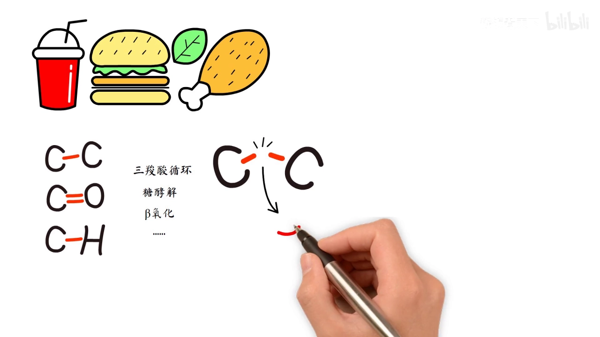
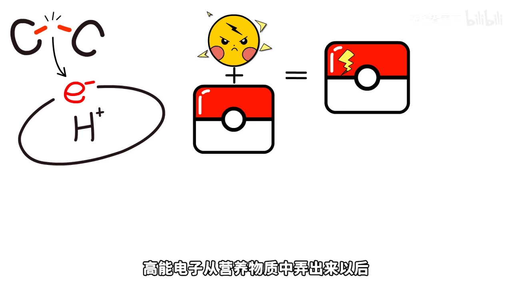
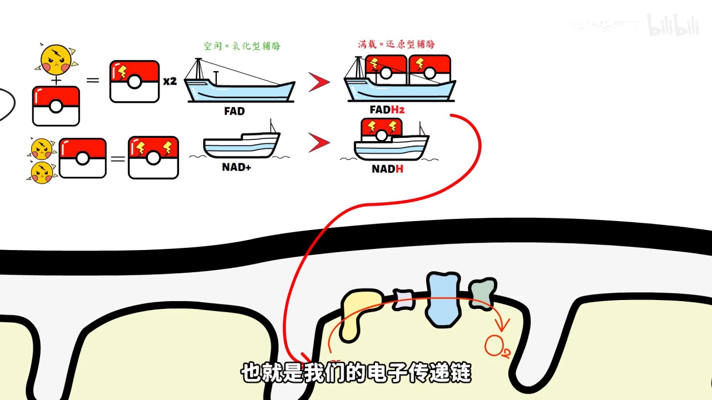
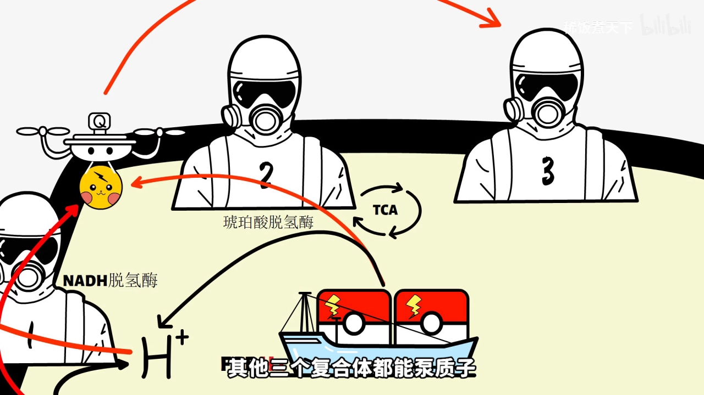
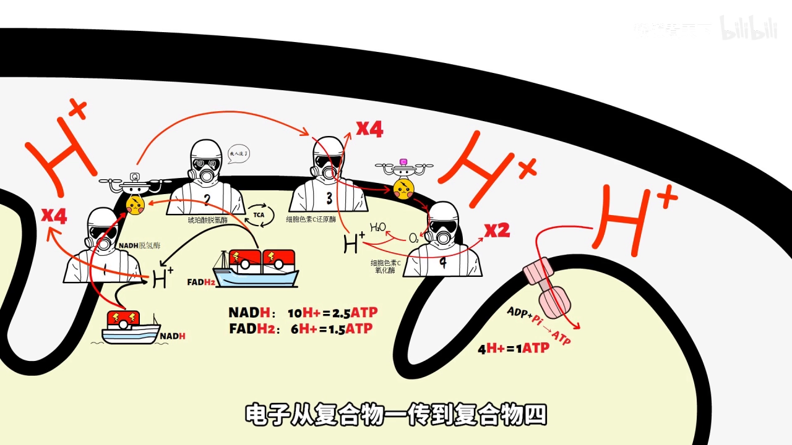
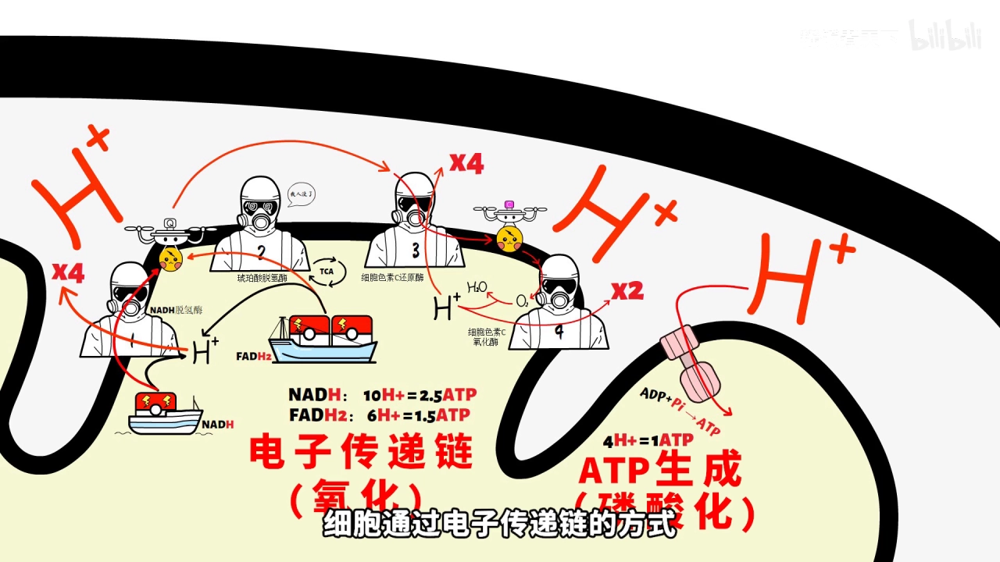

# 氧化还原与电子传递：高能电子如何变成质子梯度

> 视频来源：[【绘画生物化学】电子传递链 氧化磷酸化 细胞呼吸](https://www.bilibili.com/video/BV1kM4y127KD/)（Bilibili · 稀饭煮天下 · 约 8 分钟）。本文按该视频的逐窗口字幕与画面整理，内容均可在原视频中核查。
> 导读：承接《ATP 靠磷酸基转移传递能量》，这一篇回答"能量最初从哪来、又怎么被装进 ATP"。答案是一条三段式链条：营养物里的化学键被拆开 → 高能电子被载体接走 → 电子沿能级下降时把质子泵过膜，质子梯度再去驱动 ATP 合酶。本文只讲这条逻辑链与氧化还原的记账方式，复合体 I–IV 的编号、辅酶 Q 与细胞色素 C 的细节留给 3.3.3。

## 本讲要解决的核心问题（SCQA）

**背景**：上一篇已经说明，ATP 靠磷酸基团转移把能量交给吸能反应。但 ATP 自己也要被造出来。

**冲突**：食物里的能量藏在糖、脂肪的共价键里，而 ATP 的合成需要一份"现成可付"的自由能。这两者之间隔着好几步，中间还有一段看起来很奇怪的过程——细胞不直接"烧"葡萄糖，而是把电子一个个传下去，最后交给氧气。

**疑问**：电子为什么能当能量载体？"氧化"和"还原"在这里到底指什么？电子传递又是怎样变成 ATP 的？

**回答（中心思想）**：细胞把营养物质共价键里的**高能电子**取出来，交给 NAD⁺/FAD 这类**电子载体**暂时保管；电子沿电子传递链从高能级降到低能级，每降一步释放的自由能被用来**把质子逆浓度梯度泵过膜**；由此形成的**质子梯度**是一种中间能量形式，它再驱动 ATP 合酶把 ADP 磷酸化成 ATP。整条链的核心不是"电子很热"，而是**电子能级下降的自由能被换成了另一种可储存的形式（质子梯度），再换成 ATP**。

---

## 一、能量的源头：共价键里的高能电子

视频开篇先定位：电子传递链在线粒体内膜上 [【跳转到 00:16】](https://www.bilibili.com/video/BV1kM4y127KD/?t=16)。但被传递的电子不是凭空来的。

这些电子**主要以化学键的形式储存在营养物质中**。食物被吸收进入细胞后，经过糖酵解、三羧酸循环、β 氧化等代谢过程，细胞一步一步把营养物质中的化学键打断，把其中的**高能电子**释放出来 [【跳转到 00:43】](https://www.bilibili.com/video/BV1kM4y127KD/?t=43)。

这句话把"食物含能量"翻译成了可操作的说法：**食物之所以是燃料，是因为它的分子里有容易被取走的电子**。碳氢键、碳碳键里的电子处在较高的能级，把它们取出来交给低能级的受体，就能获得自由能。这也解释了为什么呼吸需要氧气——氧气是这条链末端的**最终电子受体**，没有它，电子无处可去，链条就堵住了。

---

## 二、氧化还原的记账方式：失电子是氧化，得电子是还原

### 2.1 电子为什么总要和质子一起走

释放出来的高能电子单独传递很不稳定，容易和其他物质发生反应。所以细胞内传递电子时，往往要**捎带一个氢核**（氢离子，也就是质子）；两者一块传递可以把电子的电荷平衡掉，也使结构更稳定 [【跳转到 00:53】](https://www.bilibili.com/video/BV1kM4y127KD/?t=53)。

视频的比喻很贴切：**电子是个"高危品"，递的时候不能直接递，需要拿个箱子给它装起来** [【跳转到 01:15】](https://www.bilibili.com/video/BV1kM4y127KD/?t=75)。这个"箱子"就是质子。

这个细节有实际后果：后面数质子时，**电子载体顺带搬运的质子**和**电子传递过程中被泵过膜的质子**是两笔不同的账，不能混在一起算。

### 2.2 两类电子载体：NAD⁺/NADH 与 FAD/FADH₂

高能电子不能乱丢，需要先交给细胞里的**电子受体**——可以理解成专门搭载电子的"小船" [【跳转到 01:25】](https://www.bilibili.com/video/BV1kM4y127KD/?t=85)。电子传递链涉及的电子受体主要是 **FAD**（黄素腺嘌呤二核苷酸）和 **NAD⁺**（烟酰胺腺嘌呤二核苷酸）[【跳转到 01:01】](https://www.bilibili.com/video/BV1kM4y127KD/?t=61)。

| 载体 | 空载（氧化型） | 满载（还原型） | 一次可载 |
| --- | --- | --- | --- |
| FAD | FAD | FADH₂ | 2 个电子 + 2 个质子 |
| NAD⁺ | NAD⁺ | NADH | 2 个电子 + 1 个质子 |

视频用一句话把氧化还原的定义钉住：**失掉电子是氧化，加上电子是还原**；所以小船空闲的时候是**氧化型辅酶**，运上电子之后就被**还原**成了**还原型辅酶** [【跳转到 01:20】](https://www.bilibili.com/video/BV1kM4y127KD/?t=80)。

这个命名方式初看别扭，但只要抓住"名字跟着电子走"就不会错：

- **NAD⁺ 是氧化型**——它还没有电子，处在可以接受电子的状态；
- **NADH 是还原型**——它已经拿到电子，本身被还原了，因此它是一个**还原剂**，可以把电子再交出去。

所以"NADH 被氧化成 NAD⁺"和"NAD⁺ 被还原成 NADH"描述的是同一个电子转移的两个方向。判断某个分子在这一步是氧化还是还原，只需要问：**它的电子是变多还是变少**。

> NAD⁺ 与 NADP⁺ 的结构差别、以及 NADH 与 NADPH 的分工，见 [NADH 与 NADPH：两种还原当量的分工](NADH%20与%20NADPH：两种还原当量的分工.md)。

---

## 三、电子传递链：把"能级下降"变成"质子过膜"

### 3.1 链条的基本逻辑

载体把电子送到线粒体内膜上的"工厂"，也就是电子传递链 [【跳转到 02:25】](https://www.bilibili.com/video/BV1kM4y127KD/?t=145)。工厂里有四个复合体，可以理解成四名高级技术工人 [【跳转到 01:50】](https://www.bilibili.com/video/BV1kM4y127KD/?t=110)。

在载体上时，电子和质子是打包一起走的；到了复合体这里就不再需要打包了，因为这些"技工"处理电子很专业，**能把电子和质子分开单独传递** [【跳转到 02:40】](https://www.bilibili.com/video/BV1kM4y127KD/?t=160)。

分开之后，关键的一步发生了：复合体把电子从载体上卸下来时，**电子从高能级跃迁到低能级，会释放出能量**；这份能量被用来**启动质子泵**，把线粒体基质里的质子逆浓度梯度泵到膜间隙 [【跳转到 03:05】](https://www.bilibili.com/video/BV1kM4y127KD/?t=185)。

这是全篇的机制核心，值得单独强调：

$$
\text{电子能级下降} \;\longrightarrow\; \text{释放自由能} \;\longrightarrow\; \text{质子被逆梯度泵过膜} \;\longrightarrow\; \text{质子梯度（势能）}
$$

**电子传递本身不生产 ATP。** 它生产的是**质子梯度**——一种把能量暂存起来的中间形式。这一点是理解氧化磷酸化的关键，也是"能量载体"这个概念的第二层含义：不仅 NADH 是载体，**质子梯度也是载体**。

### 3.2 复合体分工（只记逻辑，不记编号）

视频为了讲清电子的路线，把四个复合体都过了一遍。本节只保留与"能量如何转移"有关的部分，编号与细节留给 3.3.3：

- **一号工人（NADH 脱氢酶）**：卸下 NADH 的电子，泵出 4 个质子；电子交给**泛醌（辅酶 Q）**。
- **二号工人（琥珀酸脱氢酶）**：卸下 FADH₂ 的电子，也交给泛醌；**只有它不泵质子**，因为"产生的能量不够" [【跳转到 03:16】](https://www.bilibili.com/video/BV1kM4y127KD/?t=196)。
- **三号工人（细胞色素 C 还原酶）**：利用电子跃迁释放的能量泵出 4 个质子，电子交给**细胞色素 C**。
- **四号工人（细胞色素 C 氧化酶）**：泵出 2 个质子，最后**把电子交给氧**，氧再结合基质里的质子生成水 [【跳转到 06:05】](https://www.bilibili.com/video/BV1kM4y127KD/?t=365)。

为什么需要泛醌和细胞色素 C 这两个"跑腿的"？因为四个复合体都是铆在膜上不能动的大分子，彼此之间需要能在膜上移动的小分子来送货 [【跳转到 02:15】](https://www.bilibili.com/video/BV1kM4y127KD/?t=135)。**这条链是一个空间上串联的接力，不是四个独立反应的拼盘**。

"只有复合体二不泵质子"这一点，直接决定了后面 NADH 与 FADH₂ 的产量不同：电子从不同入口进来，经过的泵质子站点数量不同，攒下的质子梯度大小就不同。

---

## 四、质子梯度：被"存起来"的那份自由能

### 4.1 梯度怎么形成、又怎么被用掉

质子被不断泵到膜间隙，而**质子不能随意透过线粒体膜**，所以长此以往，线粒体基质和膜间隙之间就形成了很大的**质子浓度差** [【跳转到 06:33】](https://www.bilibili.com/video/BV1kM4y127KD/?t=393)。

但质子仍有回流的通道，就是 **ATP 合酶**。当质子顺着浓度梯度从 ATP 合酶回流的时候，就会驱动 ATP 合酶把磷酸基团加到 ADP 上，形成 ATP [【跳转到 04:11】](https://www.bilibili.com/video/BV1kM4y127KD/?t=251)。

视频用水轮发电机作类比：水从高处流向低处，流经水轮时驱动水轮运转产生电力；类似的，**质子从高浓度流向低浓度，流经 ATP 合酶时驱动它运转产生 ATP** [【跳转到 04:20】](https://www.bilibili.com/video/BV1kM4y127KD/?t=260)。

这个类比值得拆开看，因为它精确对应了能量形式的两次转换：

| 水电站 | 线粒体 |
| --- | --- |
| 水泵把水抽到高处（耗能） | 电子传递的自由能把质子泵到膜间隙（耗能） |
| 高处的水储存重力势能 | 膜两侧的质子浓度差储存势能 |
| 水下落驱动水轮 | 质子回流驱动 ATP 合酶 |
| 水轮带动发电机产生电 | ATP 合酶把 ADP 磷酸化成 ATP |

**质子梯度是"电池"，ATP 是"充电后的电池"**。这也是为什么"电子传递"和"ATP 合成"虽然由完全不同的分子完成，却能耦合在一起——它们之间隔着一个共同的中间物：质子梯度。

### 4.2 产量：为什么 NADH 比 FADH₂ 多

视频给了一组定量关系 [【跳转到 04:20】](https://www.bilibili.com/video/BV1kM4y127KD/?t=260)：

- 每产生 1 个 ATP 大约需要 **4 个质子**回流；
- NADH 这条链共泵出 **10 个质子**，所以产生 **2.5 个 ATP**；
- FADH₂ 这条链共泵出 **6 个质子**，所以产生 **1.5 个 ATP**。

这组数字正好印证了上一节的逻辑：产量差异不来自"NADH 里能量更多"，而来自**电子入口不同、经过的泵质子站点不同**。FADH₂ 从复合体二进入，绕过了复合体一这个泵站，少泵了 4 个质子，于是少了 1 个 ATP。**能量的多少取决于"经过了几级台阶"，而不是"燃料的种类"**。

---

## 五、三个概念的分界：电子传递链、氧化磷酸化、细胞呼吸

视频最后专门辨析了这几个常被混用的词 [【跳转到 04:57】](https://www.bilibili.com/video/BV1kM4y127KD/?t=297)：

| 概念 | 范围 |
| --- | --- |
| **电子传递链** | 电子从复合体一传到复合体四的过程，只做"氧化" |
| **氧化磷酸化** | 电子传递链 + ATP 生成，即"氧化"+"磷酸化" |
| **细胞呼吸** | 氧化磷酸化 + 前面营养物质的分解代谢，整条链 |

这个划分之所以重要，是因为它把"氧化"和"磷酸化"两件事明确分开：**氧化发生在电子传递链上，磷酸化发生在 ATP 合酶上，两者靠质子梯度耦合**。如果只看到"葡萄糖被氧化"就以为 ATP 已经生成，那中间漏掉了整个质子梯度环节。

视频的总结是：细胞通过电子传递链的方式，把高能电子这个"危险品"里蕴藏的能量以**稳定可控**的方式逐级释放出来并加以利用 [【跳转到 08:07】](https://www.bilibili.com/video/BV1kM4y127KD/?t=487)。

---

## 六、边界：这条链讲清了什么、没讲什么

- **本篇讲的是逻辑链，不是复合体结构。** 复合体 I–IV 的蛋白组成、各辅基的电子传递顺序、质子泵的化学机制、Q 循环等，属于 3.3.3 的范围。
- **"电子从高能级跃迁到低能级"是简化表述。** 严格的说法是电子从氧化还原电位较负的载体传给电位较正的载体，自由能变化由两者的电位差决定。视频用"能级"作直觉类比，方向是对的。
- **2.5 / 1.5 这两个数是通行估算值，不是恒定常数。** 实际 P/O 比取决于质子漏、ATP 合酶的质子/ATP 比、以及载体的穿梭方式，不同教材与测定条件给出的数值略有差异。
- **质子梯度不是唯一的中间能量形式。** 细菌用质膜、叶绿体用类囊体膜建立质子梯度；此外还有钠离子梯度、膜电位等形式。本篇只讲线粒体这一例。
- **NADH 的电子并不都直接进复合体一。** 胞质中的 NADH 需经穿梭系统把还原当量送入线粒体，不同穿梭方式得到的 ATP 数不同。这属于 3.3.2/3.3.3 的细节。

---

## 小结

- **能量的源头是共价键里的高能电子**：糖酵解、三羧酸循环、β 氧化把营养物质的化学键逐步打断，释放出高能电子。
- **氧化 = 失电子，还原 = 得电子**；载体空载时叫氧化型（NAD⁺、FAD），满载时叫还原型（NADH、FADH₂）。
- **电子与质子成对搬运**：电子单独传递不稳定，质子相当于给它"套了个箱子"。
- **电子传递链把能级下降换成质子梯度**：电子从高能级降到低能级，释放的自由能被用来把质子逆梯度泵过膜。
- **质子梯度是中间能量形式**：质子经 ATP 合酶回流，驱动 ADP 磷酸化成 ATP，类似水轮发电机。
- **产量差异来自路径**：NADH 泵 10 个质子得 2.5 个 ATP，FADH₂ 泵 6 个得 1.5 个，差别在于是否经过复合体一。
- **概念分界**：电子传递链 = 氧化；氧化磷酸化 = 氧化 + 磷酸化；细胞呼吸 = 再加上营养物分解。

## 关键术语速查

| 术语 | 一句话解释 |
| --- | --- |
| 氧化 | 失去电子（在生物体系中常与脱氢同时发生） |
| 还原 | 得到电子 |
| 电子载体 | 能可逆地接受和交出电子的分子，如 NAD⁺、FAD |
| 氧化型 / 还原型辅酶 | 未载电子 / 已载电子的形式，如 NAD⁺ / NADH |
| 递氢体 | 同时搬运电子与质子的载体 |
| 电子传递链 | 电子沿一系列载体从高能级传到低能级的链条 |
| 质子梯度 | 膜两侧质子浓度差，储存势能的中间形式 |
| 质子泵 | 利用电子传递释放的自由能把质子逆梯度泵过膜的蛋白 |
| ATP 合酶 | 让质子顺梯度回流、同时把 ADP 磷酸化成 ATP 的酶 |
| 氧化磷酸化 | 电子传递（氧化）与 ATP 合成（磷酸化）的耦合过程 |
| 最终电子受体 | 链条末端接受电子的物质，有氧呼吸中是氧气 |