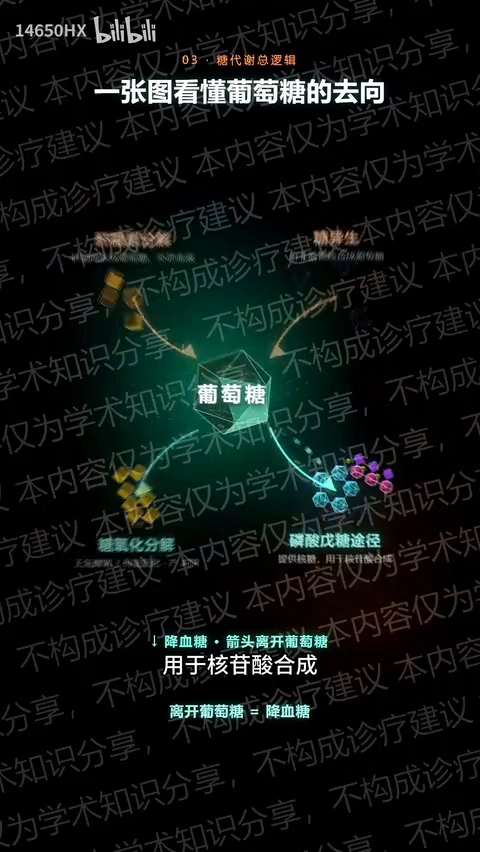
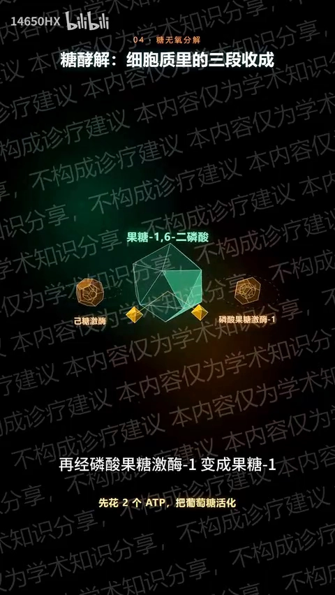
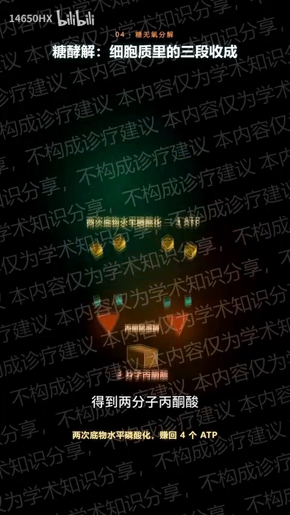
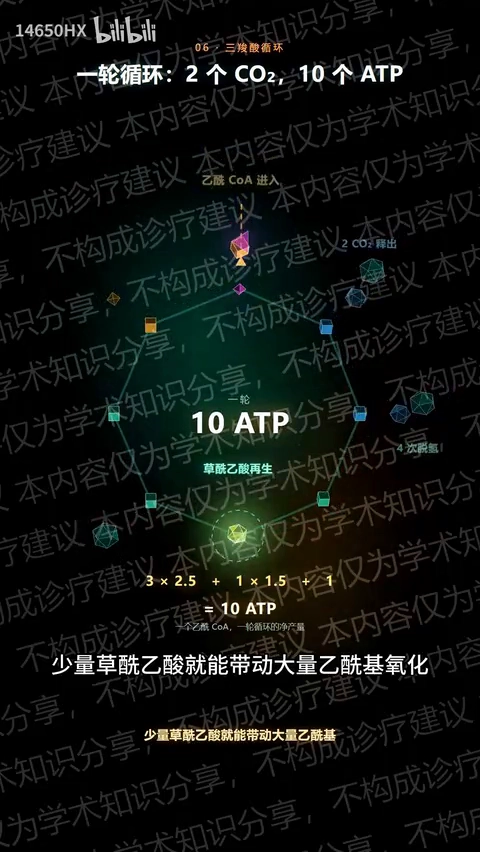

# 糖代谢主线：糖酵解、丙酮酸氧化与三羧酸循环的能量账

> 视频来源：[【视频课66】生物化学：糖酵解与三羧酸循环](https://www.bilibili.com/video/BV1Lnsp6sEWS/)（Bilibili · 14650HX · 约 13 分钟）。本文按该视频的逐窗口字幕与画面整理，内容均可在原视频中核查。
> 范围说明：该视频 00:00–05:04 讲糖类化学（环状结构、糖苷键、还原性）与消化吸收，属于本脉络其他小节的范围，本文不展开，只从 05:04 的"糖代谢总逻辑"起整理主线。
> 导读：这一篇不逐个背酶名，只回答一个问题——葡萄糖的碳和能量，一站一站去了哪里。先看糖酵解的三段式收支，再看无氧时为什么要造乳酸，然后过丙酮酸氧化这个分界点，最后把三羧酸循环和 30/32 的总账合起来。

## 本讲要解决的核心问题（SCQA）

**背景**：细胞要活着，就得把葡萄糖里的能量一点点取出来。取能量的过程不是一步完成的，而是一条分成好几站的流水线。

**冲突**：一条十几步的通路，如果只按酶名去记，记完就忘；可如果只记"葡萄糖变成二氧化碳和水"，又解释不了为什么缺氧时细胞还能活、为什么糖吃多了会变成脂肪。

**疑问**：葡萄糖的六个碳，在哪几步离开分子？能量又是以什么形式、在哪几步被收集起来的？为什么最后算出来是 30 个 ATP，有时候又是 32 个？

**回答（中心思想）**：葡萄糖的分解可以按"碳流"和"能量载体"两条线读。**碳流**是 6C → 2×3C → 2×3C（丙酮酸）→ 2×2C（乙酰基）→ 4 个 CO₂；**能量载体**是 ATP（底物水平磷酸化直接得到）与 NADH/FADH₂（把电子交给呼吸链，之后才折成大量 ATP）。糖酵解在胞质里完成，净得 2 ATP + 2 NADH；丙酮酸氧化把碳送进线粒体，同时第一次放出 CO₂；三羧酸循环每轮吃掉一个乙酰基、放出 2 个 CO₂、留下 3 NADH + 1 FADH₂ + 1 GTP，并把草酰乙酸再生出来。整条路线彻底氧化一分子葡萄糖约得 30–32 ATP，其中绝大部分来自 NADH/FADH₂ 后续的氧化磷酸化。

---

## 一、先给葡萄糖的去向画一张图

读代谢图有个规矩：**看箭头方向**。箭头指向葡萄糖的是升血糖的途径（肝糖原分解、糖异生）；箭头离开葡萄糖的是降血糖的去向，主要有两条 [【跳转到 05:04】](https://www.bilibili.com/video/BV1Lnsp6sEWS/?t=304)：

- **糖氧化分解**：无氧酵解或者有氧氧化，目的是**产能**；
- **磷酸戊糖途径**：目的是提供核糖用于核苷酸合成（本文不展开）。

本篇只走第一条路。把这张图记住，后面每一页讲的酶和产物，都能放回到图上的某个位置。

---

## 二、糖酵解：胞质里的三段式收支

糖酵解最重要的定位是：**全程不需要氧，也不需要线粒体** [【跳转到 05:04】](https://www.bilibili.com/video/BV1Lnsp6sEWS/?t=304)。整个过程可以分成三段来看。

**第一段：投入与活化。** 葡萄糖经己糖激酶变成葡萄糖-6-磷酸，再经磷酸果糖激酶-1 变成果糖-1,6-二磷酸，**这一步先花掉两个 ATP** [【跳转到 05:04】](https://www.bilibili.com/video/BV1Lnsp6sEWS/?t=304)。视频把这一段叫"投入与活化"：先花钱，是为了把葡萄糖变成更容易被拆开的活化形式。

**第二段：裂解与脱氢。** 六碳糖裂成**两分子三碳糖**，其中三磷酸甘油醛脱氢，生成**两分子胞质 NADH**——这是全程唯一的一次脱氢 [【跳转到 05:29】](https://www.bilibili.com/video/BV1Lnsp6sEWS/?t=329)。碳流在这里从 6C 变成 2×3C，这是整条通路唯一的"断链"点。

**第三段：收获。** 两次**底物水平磷酸化**共生成四个 ATP，最后由丙酮酸激酶催化得到**两分子丙酮酸** [【跳转到 05:29】](https://www.bilibili.com/video/BV1Lnsp6sEWS/?t=329)。

所以净得的是：**2 个 ATP、2 个 NADH、2 个丙酮酸** [【跳转到 05:54】](https://www.bilibili.com/video/BV1Lnsp6sEWS/?t=354)。

这里有一个必须说清的单位问题：**一个葡萄糖裂解成两个三碳糖，所以后半段的反应都发生两次**，产出才是 4 而不是 2；扣掉前面投入的 2 个，净得 2 个 [【跳转到 06:44】](https://www.bilibili.com/video/BV1Lnsp6sEWS/?t=404)。这个"分子数翻倍、账也要翻倍"的结构，后面算三羧酸循环和糖原时用的是同一个方法。

糖酵解有十步反应，但只有三步是不可逆的，对应三个关键酶：己糖激酶、磷酸果糖激酶-1、丙酮酸激酶。**三个不可逆位点意味着糖酵解只能往下走**，这也是它被调控的地方 [【跳转到 05:54】](https://www.bilibili.com/video/BV1Lnsp6sEWS/?t=354)。其中**磷酸果糖激酶-1 是限速酶，也是整条通路最重要的调控点**：胰岛素激活它，胰高血糖素抑制它 [【跳转到 06:19】](https://www.bilibili.com/video/BV1Lnsp6sEWS/?t=379)。

同一个位置上还有一个容易混淆的酶：**葡萄糖激酶**。它只出现在肝和胰岛，Km 很大，餐后血糖升高才被激活，实际上充当**血糖感受器**，而且不受产物反馈抑制——这一点和己糖激酶正好相反 [【跳转到 06:19】](https://www.bilibili.com/video/BV1Lnsp6sEWS/?t=379)。

---

## 三、无氧时为什么要把丙酮酸变成乳酸

糖酵解只产生 2 个 ATP，看起来很少，但它是**不需要氧**的那一份。这里埋着一个伏笔：两个 NADH 是在**胞质**里生成的，而胞质里的 NADH 自己进不了线粒体，必须经过穿梭系统；走哪一条穿梭，直接决定最终是 30 还是 32 个 ATP [【跳转到 07:09】](https://www.bilibili.com/video/BV1Lnsp6sEWS/?t=429)。

没有氧化磷酸化时，胞质里的 NADH 无法经呼吸链重新氧化，问题就来了：细胞里 NAD⁺ 的数量有限，如果全被占成 NADH，三磷酸甘油醛脱氢那一步就没有 NAD⁺ 可用，糖酵解会停下来。于是细胞把氢交给丙酮酸：**丙酮酸 + NADH + H⁺ → 乳酸 + NAD⁺**，由乳酸脱氢酶催化 [【跳转到 07:59】](https://www.bilibili.com/video/BV1Lnsp6sEWS/?t=479)。

关键不是"产生了乳酸"，而是**NAD⁺ 被还回来了**，三磷酸甘油醛脱氢那一步才能继续，糖酵解才不会停 [【跳转到 08:24】](https://www.bilibili.com/video/BV1Lnsp6sEWS/?t=504)。视频给了三条生理意义：剧烈运动、缺氧或高海拔时快速供能；红细胞没有线粒体，只能靠糖酵解；增殖旺盛的细胞（如肿瘤细胞）糖酵解活跃，产乳酸多，造成局部酸性微环境。

---

## 四、丙酮酸氧化：有氧与无氧的分界线

丙酮酸进入线粒体基质后，由**丙酮酸脱氢酶复合体**催化，生成**乙酰-CoA、二氧化碳和 NADH** [【跳转到 08:49】](https://www.bilibili.com/video/BV1Lnsp6sEWS/?t=529)。

这一步是**糖有氧氧化和无氧分解的分界线**：产物乙酰-CoA 只能进三羧酸循环，而循环只在线粒体里进行 [【跳转到 08:49】](https://www.bilibili.com/video/BV1Lnsp6sEWS/?t=529)。从碳流看，这是**碳第一次以 CO₂ 的形式离开**——前面糖酵解只拆分子、不丢碳，到这里才第一次真正"掉碳"。

这个酶复合体很特别，它需要**五个辅因子**：TPP、硫辛酸、辅酶 A、FAD 和 NAD⁺，分别对应维生素 B1、硫辛酸、泛酸、维生素 B2 和维生素 PP [【跳转到 09:14】](https://www.bilibili.com/video/BV1Lnsp6sEWS/?t=554)。临床联系就在这里：维生素 B1 缺乏，复合体第一步就受阻，糖代谢卡在丙酮酸这一步，神经组织最先供能不足，这就是脚气病；长期酗酒会干扰 B1 的吸收，同样会诱发 [【跳转到 09:39】](https://www.bilibili.com/video/BV1Lnsp6sEWS/?t=579)。

> 待核对：视频把五个辅因子统称为"全部来自 B 族维生素"，但**硫辛酸本身并不是维生素**。本文按"辅因子—维生素来源"的对应关系记录，不沿用"全部是维生素"的说法。

---

## 五、三羧酸循环：进 2C、出 2CO₂、留下载体

三羧酸循环又叫柠檬酸循环或 Krebs 循环，在**线粒体基质**进行，是三大营养素的共同通路 [【跳转到 09:39】](https://www.bilibili.com/video/BV1Lnsp6sEWS/?t=579)。

一个乙酰-CoA 进入一轮循环，**乙酰基被彻底氧化，生成两分子二氧化碳**；过程中发生**四次脱氢**，产生**三个 NADH 和一个 FADH₂**；还有一次底物水平磷酸化生成 GTP，它和 ATP 等价 [【跳转到 09:39】](https://www.bilibili.com/video/BV1Lnsp6sEWS/?t=579)。

算总账：3×2.5 + 1×1.5 + 1 = **十个 ATP** [【跳转到 10:04】](https://www.bilibili.com/video/BV1Lnsp6sEWS/?t=604)。注意这十个不是循环当场生成的，而是把 NADH/FADH₂ 交给呼吸链之后的折算（详见 3.3.3）。

循环有两个特点必须理解 [【跳转到 10:04】](https://www.bilibili.com/video/BV1Lnsp6sEWS/?t=604)：

- **草酰乙酸在循环末端再生，中间物总量不变，循环只消耗乙酰基**；
- 正因为中间物能循环使用，**少量草酰乙酸就能带动大量乙酰基氧化**。

八步反应的具体走法（哪一步脱羧、哪一步脱氢、草酰乙酸怎么回来）见同目录另一篇《三羧酸循环的碳账》，本文只保留这条主线。

---

## 六、把总账合起来：30 还是 32

现在把四段相加 [【跳转到 11:19】](https://www.bilibili.com/video/BV1Lnsp6sEWS/?t=679)：

| 阶段 | 直接产出 | 折算 ATP |
| --- | --- | --- |
| 糖酵解（底物水平磷酸化） | 净 2 ATP | 2 |
| 糖酵解（胞质 2 NADH，经穿梭） | 2 NADH | 5（苹果酸穿梭）或 3（甘油磷酸穿梭） |
| 丙酮酸氧化脱羧（×2） | 2 NADH | 5 |
| 三羧酸循环（×2 轮） | 6 NADH + 2 FADH₂ + 2 GTP | 20 |
| **合计** | | **32 或 30** |

差别只在穿梭那一步：走苹果酸穿梭每个 NADH 给 2.5，走甘油磷酸穿梭每个给 1.5 [【跳转到 11:44】](https://www.bilibili.com/video/BV1Lnsp6sEWS/?t=704)。

这张表本身就是这一节要建立的直觉：**底物水平磷酸化直接给的只有 4 个 ATP（糖酵解 2 + 循环 2），其余 26–28 个都来自 NADH/FADH₂ 携带的电子**。也就是说，分解代谢真正的"大头"不在通路本身，而在把电子交给呼吸链之后的氧化磷酸化。

---

## 七、调控：不缺能量就不烧燃料

循环里有三个不可逆位点，对应柠檬酸合酶、异柠檬酸脱氢酶和 α-酮戊二酸脱氢酶复合体 [【跳转到 10:29】](https://www.bilibili.com/video/BV1Lnsp6sEWS/?t=629)。调控的逻辑很朴素：

- **能量状态反馈**：ATP 充足时循环被抑制，细胞不缺能量就不烧燃料 [【跳转到 10:29】](https://www.bilibili.com/video/BV1Lnsp6sEWS/?t=629)；
- **糖酵解一侧**：磷酸果糖激酶-1 受胰岛素/胰高血糖素调控，是整条通路最重要的调控点 [【跳转到 06:19】](https://www.bilibili.com/video/BV1Lnsp6sEWS/?t=379)。

更有意思的是循环的**两用性**：能量充足时，柠檬酸不再往下烧，而是积累起来转运到胞质，裂解后释放乙酰-CoA 作为脂肪酸合成的原料 [【跳转到 10:54】](https://www.bilibili.com/video/BV1Lnsp6sEWS/?t=654)。这就是糖和脂的接口——糖吃多了会变成脂肪，机制就在这一步。所以三羧酸循环既管分解，也管供给合成原料。

---

## 小结

- 葡萄糖的碳流：6C → 2×3C（糖酵解）→ 2×3C（丙酮酸）→ 2×2C（乙酰基）→ 4 个 CO₂。
- **糖酵解**分三段：投资 2 ATP → 裂解成两分子三碳糖并脱氢 → 收获 4 ATP；净得 2 ATP + 2 NADH + 2 丙酮酸，全程不需要氧和线粒体。
- **无氧时**把丙酮酸还原成乳酸，真正目的是把 NAD⁺ 还回来，让糖酵解继续。
- **丙酮酸氧化**是分界线：碳第一次以 CO₂ 离开，产物乙酰-CoA 只能进线粒体的三羧酸循环。
- **三羧酸循环**每轮：进 2C、出 2CO₂、留下 3 NADH + 1 FADH₂ + 1 GTP，草酰乙酸再生，折算约 10 ATP。
- **总账**：一分子葡萄糖彻底氧化约 30–32 ATP，其中底物水平磷酸化只给 4 个，其余来自 NADH/FADH₂ 的氧化磷酸化。

## 关键术语速查

| 术语 | 一句话解释 |
| --- | --- |
| 底物水平磷酸化 | 代谢物上的高能磷酸直接转给 ADP/GDP 生成 ATP/GTP，不需要呼吸链 |
| 氧化磷酸化 | NADH/FADH₂ 经呼吸链传递电子、驱动 ATP 合成 |
| 穿梭系统 | 把胞质 NADH 的还原当量送进线粒体的方式，决定折算 2.5 还是 1.5 |
| 乙酰-CoA | 二碳乙酰基的载体，糖、脂、氨基酸分解的共同入口 |
| 草酰乙酸 | 四碳受体，接收乙酰基后经一轮循环再生 |
| 两用代谢 | 同一通路既参与分解供能，又提供合成原料 |