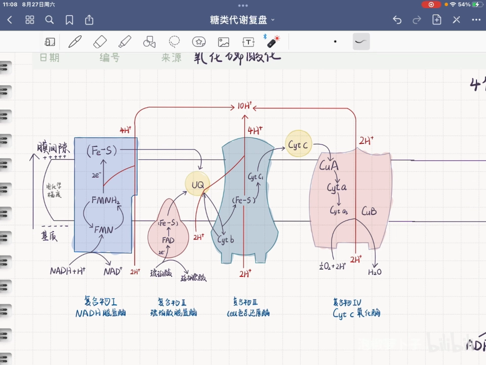
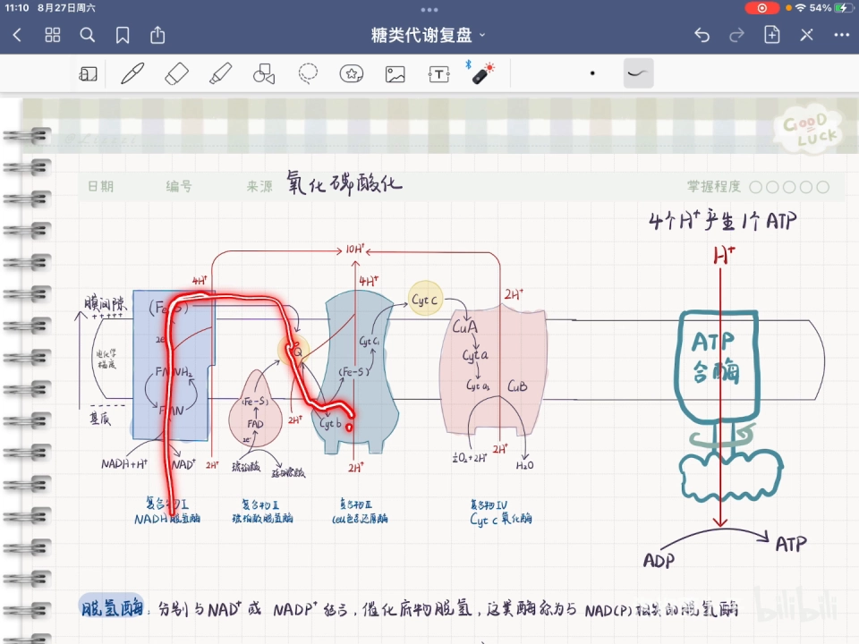
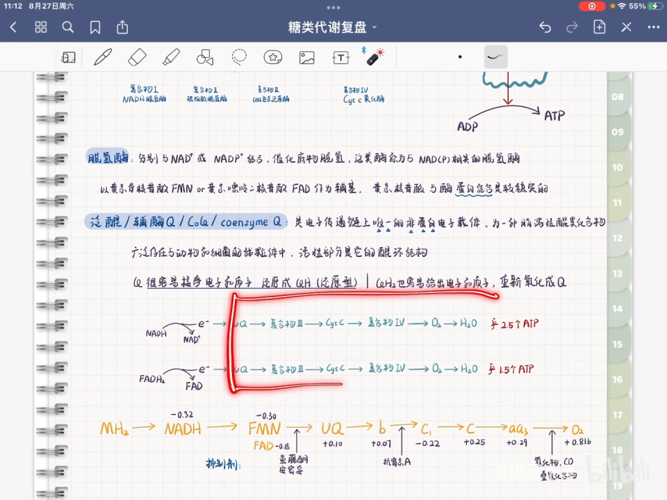
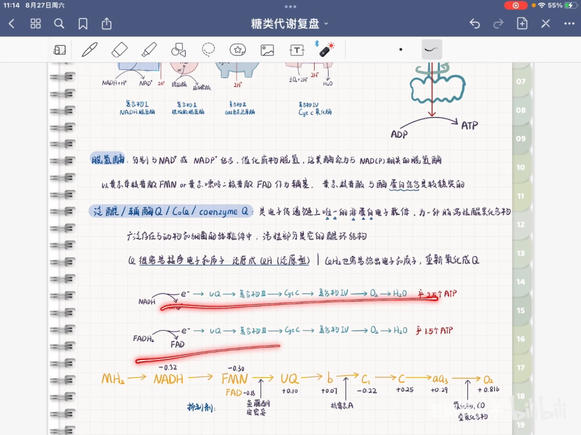
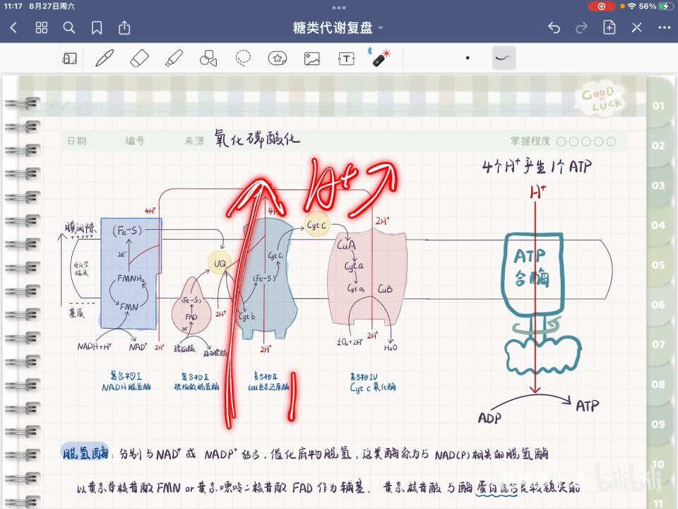
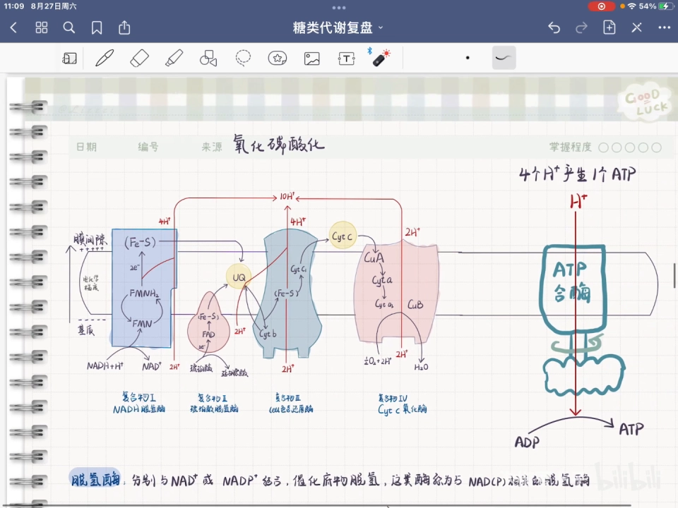
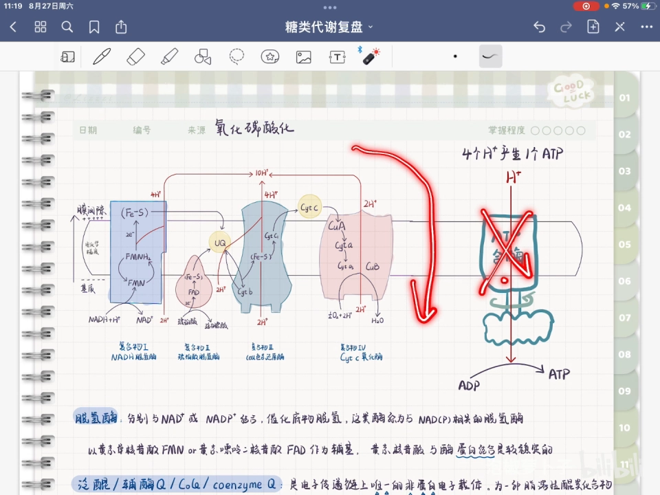

# 电子传递链的四个复合体：电子入口、质子泵与化学渗透偶联

> 视频来源：[自用复盘：氧化磷酸化和抑制剂](https://www.bilibili.com/video/BV1Cd4y1A7vd/)（Bilibili · 泡椒萝卜子 · 约 13 分钟）。本文按该视频的逐窗口字幕与手绘板书整理，内容均可在原视频中核查。
> 导读：上一篇《氧化还原与电子传递》只讲了"电子能级下降→泵质子→质子梯度→ATP"这条一般逻辑。这一篇把它落到分子上：四个复合体各自接什么电子、泵几个质子，为什么复合体 II 是个例外，质子梯度凭什么能当作"氧化"和"磷酸化"之间的共同中间物，以及解偶联剂怎样把这个中间物拆掉。ATP 合酶本身的转子与结合变构，见同节的《ATP 合酶：质子回流如何驱动转子与结合变构》。

## 本讲要解决的核心问题（SCQA）

**背景**：糖酵解和三羧酸循环已经把能量装进了 NADH 与 FADH₂；上一篇也说明了电子沿链下降会把质子泵过线粒体内膜。

**冲突**：但"泵质子"这句话太粗。四个复合体并不是同一种机器：有的泵、有的不泵；电子从不同入口进来，经过的泵站数量不同。更麻烦的是，电子传递和 ATP 合成由两套完全不同的蛋白完成，它们之间到底靠什么接头？

**疑问**：四个复合体各自接受和交出什么？每个泵出几个质子？质子梯度怎样建立、又怎样被证明就是那个"接头"？为什么 NADH 和 FADH₂ 的产量差一个 ATP？

**回答（中心思想）**：电子传递链是**四个膜内复合体加两个移动载体**组成的串联接力。复合体 I、III、IV 在传电子的同时把质子从基质泵到膜间隙，复合体 II 只把 FADH₂ 的电子送进泛醌池、不泵质子。泵出的质子形成跨内膜的**电化学梯度**，这个梯度既是电子传递的"存款"，也是 ATP 合酶的"取款"——**氧化与磷酸化正是通过质子梯度偶联的**。破坏梯度（解偶联剂）或堵住 ATP 合酶（寡霉素），就能把这条偶联拆开，这也正是化学渗透假说最直接的检验。

---

## 一、链条的成员：四个复合体与两个移动载体

视频先把成员点清：复合物一、二、三、四，加上**泛醌（辅酶 Q）**和**细胞色素 C** [【跳转到 01:37】](https://www.bilibili.com/video/BV1Cd4y1A7vd/?t=97)。前四个是嵌在内膜上的大蛋白，后两个是不属于任何复合体的移动载体 [【跳转到 01:37】](https://www.bilibili.com/video/BV1Cd4y1A7vd/?t=97)。

### 1.1 复合体 I：NADH 的入口，泵 4 个质子

复合体 I 又叫 **NADH 脱氢酶**，是链上的第一个质子泵，泵出 **4 个 H⁺** [【跳转到 01:49】](https://www.bilibili.com/video/BV1Cd4y1A7vd/?t=109)。它先结合 NADH，把 NADH 的两个高势能电子转到辅基 **FMN** 上，使 NADH 氧化（氧化就是脱氢）[【跳转到 01:49】](https://www.bilibili.com/video/BV1Cd4y1A7vd/?t=109)；FMN 被还原（还原就是加氢）后，电子再经**铁硫簇**传给泛醌 [【跳转到 02:14】](https://www.bilibili.com/video/BV1Cd4y1A7vd/?t=134)。

这条路径可以简写成：

$$
\text{NADH} \rightarrow \text{FMN} \rightarrow \text{Fe-S} \rightarrow \text{Q}
$$

每传一次电子，复合体 I 就利用释放的自由能把 4 个质子从基质推到膜间隙。注意这里的"4"是**每对电子**的化学计量，不是每个电子。

### 1.2 复合体 II：FADH₂ 的入口，唯一不泵质子的复合体

复合体 II 是**琥珀酸脱氢酶**，它本身就是三羧酸循环里把琥珀酸变成延胡索酸的那一步 [【跳转到 03:04】](https://www.bilibili.com/video/BV1Cd4y1A7vd/?t=184)。这一步生成的 FADH₂ 并不离开酶，而是把电子交给酶内的铁硫簇，再传给泛醌 [【跳转到 03:29】](https://www.bilibili.com/video/BV1Cd4y1A7vd/?t=209)。

关键差别在这里：**复合体 II 没有质子泵功能** [【跳转到 03:54】](https://www.bilibili.com/video/BV1Cd4y1A7vd/?t=234)。电子从 FADH₂ 进入泛醌池时，这一段不泵质子、也不生成 ATP；它的意义是"保证 FADH₂ 中具有相对较高转移势能的电子进入电子传递链" [【跳转到 03:54】](https://www.bilibili.com/video/BV1Cd4y1A7vd/?t=234)。

> **为什么偏偏是它不泵？** 视频只给结论，没有展开原因。通行的解释是：从 FADH₂ 到泛醌的氧化还原电位落差较小，释放的自由能不足以驱动一次质子泵。这一点属于教材补充，不是视频原话。

复合体 II 的这个"缺口"，直接决定了后面 FADH₂ 比 NADH 少产一个 ATP——因为从 FADH₂ 进来的电子**绕过了复合体 I 这个泵站**。

### 1.3 复合体 III：泛醌到细胞色素 C，泵 4 个质子

复合体 III 是**细胞色素还原酶**（细胞色素 bc₁ 复合体）。板书标出的内部路径是：从泛醌接收电子，经细胞色素 b、细胞色素 c₁ 和铁硫簇，把电子交给**细胞色素 C**，同时泵出 **4 个 H⁺** [【跳转到 05:14】](https://www.bilibili.com/video/BV1Cd4y1A7vd/?t=314)。

视频没有展开复合体 III 内部的 Q 循环，只把它当作"泛醌之后、细胞色素 C 之前"的第二个泵站。对本文的账本来说，记住"4 个质子"就够了。

### 1.4 复合体 IV：把电子交给氧，泵 2 个质子

复合体 IV 是**细胞色素 C 氧化酶**。它从细胞色素 C 接收电子，按板书标出的路径经 CuA、细胞色素 a、细胞色素 a₃ 与 CuB，最后把电子交给氧分子 [【跳转到 06:52】](https://www.bilibili.com/video/BV1Cd4y1A7vd/?t=412)。

它只泵 **2 个 H⁺**，原因是另外还有 2 个质子被用来和氧结合生成水 [【跳转到 06:52】](https://www.bilibili.com/video/BV1Cd4y1A7vd/?t=412)。所以复合体 IV 这一步要分两笔账：

- **泵过膜**的质子：2 个，进入梯度；
- **消耗掉**的质子：2 个，变成水，不再回到梯度里。

这也是为什么"数质子"时必须区分"被泵走的"和"被化学反应用掉的"。

### 1.5 两个移动载体：一个在膜里游，一个在水里游

四个复合体都是铆在膜上的大分子，彼此不能直接接触，需要两个"跑腿的"在中间送货：

| 载体 | 化学性质 | 位置 | 在链中的角色 |
| --- | --- | --- | --- |
| **泛醌 Q**（辅酶 Q） | 脂溶性，可在膜内游动，与蛋白结合不紧密 | 线粒体内膜 | 接收复合体 I 和复合体 II 的电子，交给复合体 III；也能接收其他黄素酶脱下的电子 |
| **细胞色素 C** | 唯一溶于水的细胞色素 | 膜间隙侧 | 接收复合体 III 的电子，交给复合体 IV |

泛醌的"流动性"是关键：它把两个不同入口（复合体 I 与 II）的电子汇到同一条下游路径 [【跳转到 02:39】](https://www.bilibili.com/video/BV1Cd4y1A7vd/?t=159)。细胞色素 C 则是唯一在水相里移动的细胞色素，所以它只能待在膜间隙一侧，在复合体 III 和 IV 之间摆渡 [【跳转到 06:27】](https://www.bilibili.com/video/BV1Cd4y1A7vd/?t=387)。

---

## 二、质子怎么被泵出去：化学计量与电化学梯度

### 2.1 一张表看清 4 / 0 / 4 / 2

把四个复合体的泵出量按**每对电子**列出来：

| 复合体 | 别名 | 接受的电子载体 | 交给 | 泵出 H⁺ |
| --- | --- | --- | --- | --- |
| I | NADH 脱氢酶 | NADH | 泛醌 Q | 4 |
| II | 琥珀酸脱氢酶 | FADH₂ | 泛醌 Q | 0 |
| III | 细胞色素还原酶（bc₁） | 泛醌 Q | 细胞色素 C | 4 |
| IV | 细胞色素 C 氧化酶 | 细胞色素 C | O₂（生成水） | 2 |

于是两条入口的总账是 [【跳转到 05:14】](https://www.bilibili.com/video/BV1Cd4y1A7vd/?t=314)：

- **NADH 入口**：复合体 I + III + IV = 4 + 4 + 2 = **10 个 H⁺**；
- **FADH₂ 入口**：复合体 II + III + IV = 0 + 4 + 2 = **6 个 H⁺**。

两者的下游完全相同，差别只在"有没有经过复合体 I 那 4 个质子"。这就是 3.3.1 里"产量差异来自路径，不来自燃料种类"的具体版本。

### 2.2 方向：从基质到膜间隙

泵的方向是固定的：质子从**线粒体基质**跨过内膜，被泵到**膜间隙** [【跳转到 09:29】](https://www.bilibili.com/video/BV1Cd4y1A7vd/?t=569)。内膜对质子不通透，泵出去的质子回不来，于是膜间隙的质子浓度越来越高、基质越来越低，形成一个跨内膜的**电化学梯度** [【跳转到 09:29】](https://www.bilibili.com/video/BV1Cd4y1A7vd/?t=569)。

> **术语补充（非视频内容）**："电化学梯度"严格说有两个分量：一是质子浓度差，表现为膜两侧的 **pH 差**；二是电荷差，表现为**膜电位**（基质侧偏负、膜间隙侧偏正）。视频只强调浓度差与"化学电位"，没有拆开膜电位这一项。两个分量合起来才叫"电化学"梯度。

### 2.3 多少个质子换一个 ATP

视频给出的换算是：**4 个 H⁺ 回流产生 1 个 ATP** [【跳转到 05:39】](https://www.bilibili.com/video/BV1Cd4y1A7vd/?t=339)。

有了这个换算，两条入口的产量就直接算出来了：

$$
\text{NADH}:\ \frac{10}{4}=2.5\ \text{ATP},\qquad
\text{FADH}_2:\ \frac{6}{4}=1.5\ \text{ATP}
$$

[【跳转到 06:02】](https://www.bilibili.com/video/BV1Cd4y1A7vd/?t=362)

注意这是"每对电子"的产量，而且 4 是一个**估算值**：真正决定 H⁺/ATP 的是 ATP 合酶 c 环的亚基数目，不同物种不同（见 §六）。

---

## 三、化学渗透假说：质子梯度是氧化与磷酸化之间的共同中间物

视频把整条逻辑收束到一句话：**电子传递释放的能量与 ATP 的合成，是通过一种跨线粒体内膜的质子梯度相偶联的** [【跳转到 09:04】](https://www.bilibili.com/video/BV1Cd4y1A7vd/?t=544)。

拆开看就是两步：

1. **氧化造势**：电子沿复合体 I→III→IV 传递，自由能被用来把 H⁺ 从基质泵到膜间隙，梯度变大；
2. **势造 ATP**：H⁺ 顺梯度经 ATP 合酶回流，释放的势能驱动 ADP + Pi → ATP [【跳转到 09:54】](https://www.bilibili.com/video/BV1Cd4y1A7vd/?t=594)。

所以质子梯度不是副产物，而是**氧化与磷酸化之间唯一的共同中间物**。这也解释了为什么两套完全不同的蛋白能"偶联"：它们不直接接触，只通过同一个梯度对话。

> **术语补充（非视频内容）**：这个模型叫**化学渗透假说**（chemiosmotic hypothesis），由 Peter Mitchell 在 1961 年提出。视频只提假说名称，没有讲提出者，也没有讲支持它的经典实验。最直接的检验思路是：在人工膜上只造出质子梯度、不加入任何电子传递链，看能否驱动 ATP 合成；以及用只搬运质子的载体把梯度短路，看 ATP 合成是否随之停止。下一节的 DNP 实验，就是后一种思路在完整线粒体上的版本。

---

## 四、把偶联拆开：解偶联剂、抑制剂与呼吸控制

如果质子梯度真是那个"接头"，那么**破坏梯度应该只停 ATP、不停电子传递**。视频用三类试剂把这件事验证了一遍。

### 4.1 DNP：让质子短路，ATP 停而电子照走

**2,4-二硝基苯酚（DNP）** 的作用是增加内膜对 H⁺ 的通透性 [【跳转到 10:19】](https://www.bilibili.com/video/BV1Cd4y1A7vd/?t=619)。质子被泵出去后，又顺着 DNP 这个"漏洞"流回来，梯度建立不起来，ATP 合酶失去驱动力。

结果是一个很有诊断价值的组合：

- **电子传递链照常工作**——复合体还在泵质子；
- **ATP 合成停止**——因为没有梯度可回流；
- 电子传递释放的自由能**变成热能**散掉，能量得不到储存 [【跳转到 10:44】](https://www.bilibili.com/video/BV1Cd4y1A7vd/?t=644)。

DNP 对**底物水平磷酸化没有影响** [【跳转到 11:09】](https://www.bilibili.com/video/BV1Cd4y1A7vd/?t=669)。这一点很关键：它说明 DNP 拆掉的是"氧化磷酸化"这条偶联，而不是所有产 ATP 的方式。糖酵解里那两步直接转移磷酸基团的反应，不依赖质子梯度，所以照常进行。

> 视频顺带提到 DNP 曾被当作减肥药。这里只保留机制层面的结论：它让能量以热的形式浪费掉，剂量稍高就会导致体温升高、能量供应不足，**不是可以自行使用的减肥手段**。

### 4.2 寡霉素：堵住 ATP 合酶，电子传递反而变慢

**寡霉素**是氧化磷酸化抑制剂：它不直接抑制电子传递链上的载体，而是堵在 ATP 合酶这里，干扰 ATP 的形成 [【跳转到 11:39】](https://www.bilibili.com/video/BV1Cd4y1A7vd/?t=699)。

堵住之后会出现"反向压力"：质子泵出去却回不来，梯度越积越高，泵质子越来越费劲，电子传递也跟着慢下来 [【跳转到 11:44】](https://www.bilibili.com/video/BV1Cd4y1A7vd/?t=704)。

这时再加入**解偶联剂**，让质子从别的路漏回来，电子传递就恢复正常 [【跳转到 12:09】](https://www.bilibili.com/video/BV1Cd4y1A7vd/?t=729)。这个"加解偶联剂能解除寡霉素抑制"的现象，是**呼吸控制**的经典表现：电子传递的速度受 ATP 合成消耗梯度的速度调节，两者确实被同一个梯度绑在一起。

### 4.3 三类试剂的区别

视频最后把容易混淆的几类试剂分开 [【跳转到 12:34】](https://www.bilibili.com/video/BV1Cd4y1A7vd/?t=754)：

| 类别 | 作用点 | 对电子传递 | 对 ATP 合成 |
| --- | --- | --- | --- |
| **电子传递链抑制剂** | 复合体 I / III / IV 的某个传递步骤 | 阻断 | 因无梯度而停 |
| **解偶联剂**（DNP） | 增加内膜对 H⁺ 的通透性 | 不阻断，常加快 | 停 |
| **氧化磷酸化抑制剂**（寡霉素） | ATP 合酶 | 因梯度堆积而变慢 | 停 |
| **离子载体** | 搬运 H⁺ 以外的一价阳离子，同样破坏梯度 | 不直接阻断 | 停 |

离子载体与解偶联剂的区别只在"搬什么"：解偶联剂特指增加**氢离子**通透性，离子载体搬的是其他一价阳离子 [【跳转到 12:34】](https://www.bilibili.com/video/BV1Cd4y1A7vd/?t=754)。

电子传递链上的经典抑制剂可以按站点记 [【跳转到 07:24】](https://www.bilibili.com/video/BV1Cd4y1A7vd/?t=444)：

| 站点 | 代表抑制剂 | 阻断的步骤 |
| --- | --- | --- |
| 复合体 I | 鱼藤酮、粉蝶霉素、杀粉蝶菌素 | NADH → 泛醌 Q |
| 复合体 III | 抗霉素 A | 泛醌 Q → 细胞色素 C₁ |
| 复合体 IV | 氰化物、叠氮化物、一氧化氮 | 细胞色素氧化酶 → O₂ |

复合体 I 的抑制剂不影响 FADH₂ 入口，因为 FADH₂ 的电子从复合体 II 进，绕过复合体 I [【跳转到 07:49】](https://www.bilibili.com/video/BV1Cd4y1A7vd/?t=469)。这正好从反面印证了"两个入口、共用下游"的结构。

---

## 五、总账：2.5 / 1.5 怎样对上 30 / 32

把 3.3.2 的产出清单拿来乘一遍：

| 来源 | 数量 | 单价 | 小计 |
| --- | --- | --- | --- |
| 糖酵解底物水平磷酸化 | 2 ATP | — | 2 |
| 三羧酸循环底物水平磷酸化（GTP） | 2 | — | 2 |
| 丙酮酸氧化 + 三羧酸循环的 NADH | 8 | 2.5 | 20 |
| 糖酵解产生的胞质 NADH | 2 | 2.5 或 1.5 | 5 或 3 |
| 三羧酸循环的 FADH₂ | 2 | 1.5 | 3 |

- 胞质 NADH 走**苹果酸-天冬氨酸穿梭**，把还原当量送成线粒体 NADH：2 × 2.5 = 5，总计 **32 ATP**；
- 走**甘油磷酸穿梭**，还原当量以 FADH₂ 形式进入：2 × 1.5 = 3，总计 **30 ATP**。

差的这 2 个 ATP，正好是 2 个胞质 NADH 从"走复合体 I"变成"绕过复合体 I"的差价：

$$
2 \times (2.5 - 1.5) = 2
$$

所以 30 与 32 不是两个互相矛盾的答案，而是**同一条链、两种穿梭方式**的结果。

**那 38 是怎么来的？** 旧教材用 P/O 比 3（NADH）和 2（FADH₂）来算：10 × 3 + 2 × 2 + 4 = 38。后来测定发现实际 P/O 更接近 2.5 和 1.5，38 才被 30/32 取代。数字变了，机制没变——变的只是"一个 NADH 到底能换几个 ATP"这个换算系数。

---

## 六、边界：这条链讲清了什么、没讲什么

- **复合体 II 不泵质子的原因，视频没有解释。** 视频只给"没有质子泵功能"的结论；"电位落差不足"是教材补充。若要做定量判断，需要查各载体的标准还原电位。
- **电化学梯度的膜电位分量，视频没有拆开。** 视频讲的是质子浓度差与"化学电位"；膜电位（基质负、膜间隙正）属于术语补充，不是视频原话。
- **Q 循环没有展开。** 视频只把复合体 III 当作一个泵 4 个质子的黑箱，没有讲泛醌如何在 bc₁ 复合体里被两次氧化还原。这属于更细的机制，本篇不展开。
- **4 H⁺/ATP 是估算值。** 真正决定 H⁺/ATP 的是 ATP 合酶 c 环的亚基数：c 环有 n 个亚基，完整转一圈通常要 n 个质子、产 3 个 ATP（教材补充）。视频用 4 是通行的简化。
- **视频有一处口误。** 03:54 附近把复合体 II 称为"电子传递链中的第二个质子泵"，但同一段后文明确说它不泵质子，3.3.1 也已确立这一结论。本文按上下文写作"第二个电子入口"。
- **本篇不涉及线粒体疾病。** 复合体或 ATP 合酶缺陷的临床表型不在本小节范围。

---

## 小结

- **链条成员**：四个内膜复合体（I NADH 脱氢酶、II 琥珀酸脱氢酶、III 细胞色素还原酶、IV 细胞色素氧化酶）加两个移动载体（泛醌 Q、细胞色素 C）。
- **两个入口**：NADH 从复合体 I 进，FADH₂ 从复合体 II 进；复合体 II 不泵质子，所以 FADH₂ 绕过了 4 个质子的泵站。
- **化学计量**：I/III/IV 分别泵 4/4/2 个 H⁺，II 泵 0 个；NADH 共 10 个，FADH₂ 共 6 个。
- **方向与形式**：质子从基质泵到膜间隙，形成电化学梯度（pH 差 + 膜电位）。
- **偶联点**：质子梯度是氧化与磷酸化之间唯一的共同中间物；4 个 H⁺ 换 1 个 ATP。
- **检验方式**：DNP 让质子短路——电子照走、ATP 停；寡霉素堵 ATP 合酶——梯度堆积、电子变慢；加解偶联剂又能恢复。这证明两者确实通过梯度耦合。
- **总账**：10/4 = 2.5，6/4 = 1.5；配合穿梭方式得到 30 或 32；38 是旧 P/O 值（3 和 2）的算法。

## 关键术语速查

| 术语 | 一句话解释 |
| --- | --- |
| 电子传递链 | 电子从 NADH/FADH₂ 经四个复合体传给氧的串联接力 |
| 复合体 I | NADH 脱氢酶，NADH 的入口，泵 4 个 H⁺ |
| 复合体 II | 琥珀酸脱氢酶，FADH₂ 的入口，不泵质子 |
| 复合体 III | 细胞色素还原酶（bc₁），泛醌 → 细胞色素 C，泵 4 个 H⁺ |
| 复合体 IV | 细胞色素 C 氧化酶，把电子交给 O₂，泵 2 个 H⁺ |
| 泛醌 Q / 辅酶 Q | 脂溶性移动载体，在膜内把电子从 I、II 送到 III |
| 细胞色素 C | 水溶性移动载体，在膜间隙把电子从 III 送到 IV |
| 质子动力势 | 跨内膜质子梯度储存的势能，驱动 ATP 合酶 |
| 电化学梯度 | 质子浓度差（pH 差）与膜电位合起来形成的跨膜势能 |
| 化学渗透假说 | 氧化与磷酸化通过跨膜质子梯度偶联的模型 |
| 解偶联剂 | 增加内膜对 H⁺ 通透性、使梯度短路而停止 ATP 合成的物质，如 DNP |
| 氧化磷酸化抑制剂 | 直接堵 ATP 合酶的物质，如寡霉素 |
| 呼吸控制 | 电子传递速度受 ATP 合成消耗梯度速度调节的现象 |
| P/O 比 | 每消耗一个氧原子（每对电子）能合成多少 ATP |