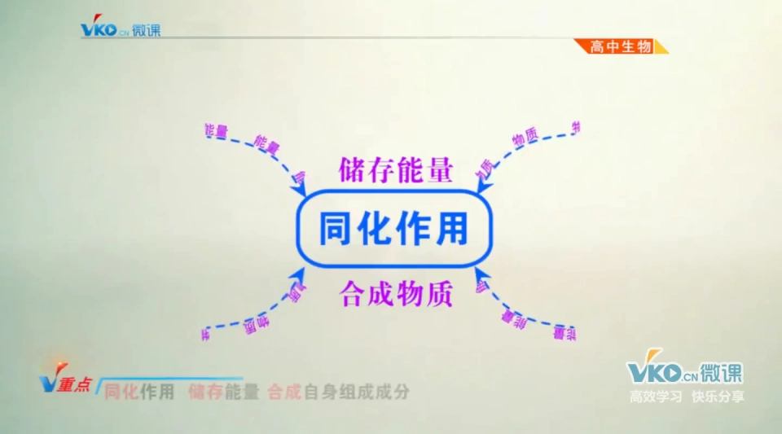
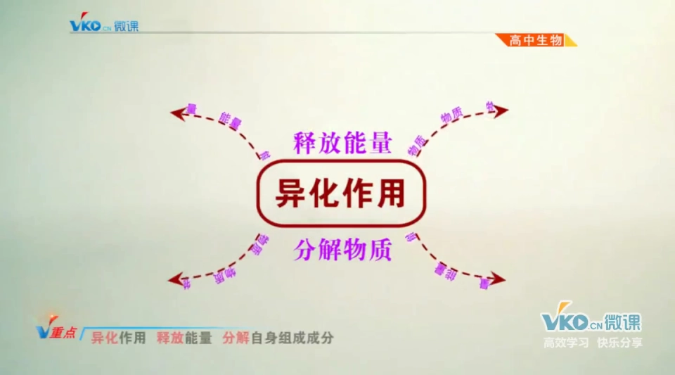
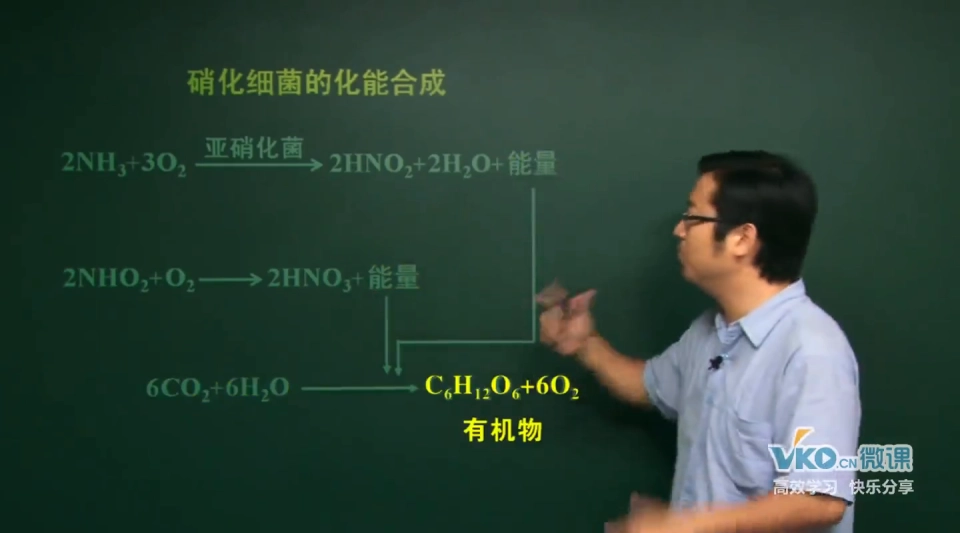
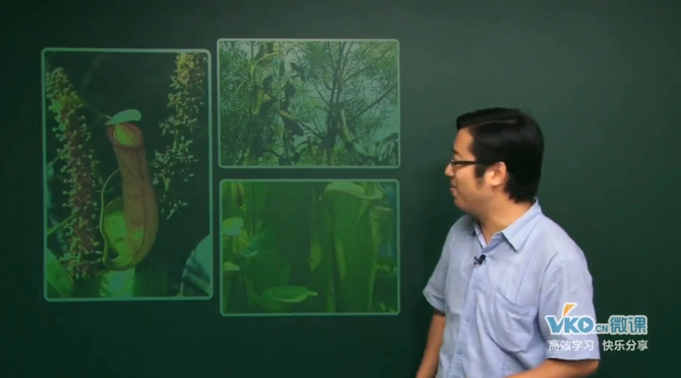
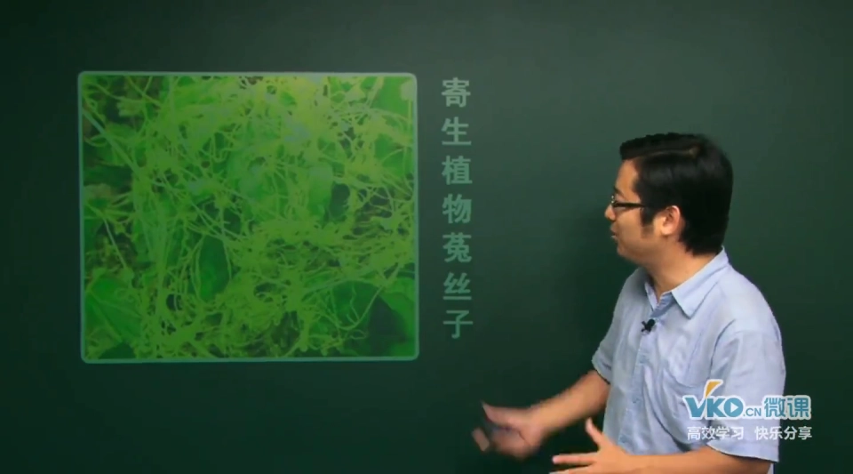

# 合成代谢与分解代谢：同化、异化两条方向与自养异养的位置

> 视频来源：[高质量好课-高中生物 黄森 必修一 5-1 新陈代谢的类型](https://www.bilibili.com/video/BV1ij411u78S/)（Bilibili · 微课网 · 约 23 分钟）。本文按该视频的逐窗口字幕与画面整理，内容均可在原视频中核查。
> 范围说明：该视频 09:45–14:00 讲异化作用的分类（需氧型、厌氧型、兼性厌氧型，以及乳酸菌、破伤风杆菌、酵母菌、蛔虫等例子），讲的是"分解有机物时要不要氧气"，属于细胞呼吸一侧（3.3.2、3.3.3），不是本单元要比较的碳源与能源，本文不展开。
> 导读：上一篇把营养方式拆成"碳从哪来 × 能量从哪来"两条轴。这一篇补上另一半：**细胞里为什么必须同时有合成和分解两条方向**，以及"自养 / 异养"这个分类到底挂在哪个方向上。读完之后，"自养""异养"应该能放回"同化作用"这一格里，而不是一个孤立的标签。

## 本讲要解决的核心问题（SCQA）

**背景**：细胞里每时每刻都在发生成百上千个化学反应。这些反应不是散乱的，它们分成两个相反的方向：一边把外界物质变成自身成分，一边把自身成分拆开、把废物排出去。

**冲突**：如果只记"自养 = 自己造饭、异养 = 吃现成的"，就会把两件事混在一起——**造什么**（物质）和**造的时候能量往哪走**（能量）。而且"自养 / 异养"听起来像是给整个生物分类，实际上它只描述其中一个方向。

**疑问**：合成代谢和分解代谢分别是什么？它们是有先有后还是同时进行？"自养 / 异养"挂在哪一个方向上？自养又分成哪两条不同的路？

**回答（中心思想）**：新陈代谢有两个相反的方向。**同化作用（合成代谢）= 合成物质 + 储存能量**；**异化作用（分解代谢）= 分解物质 + 释放能量**。两者在同一个细胞里**同时进行**，只是在不同生长阶段强度不同。"自养 / 异养"是**对同化作用**的分类，判据是能不能把无机物合成有机物；自养再按能源分成光能合成（光合作用）与化能合成（氧化无机物获能）两条路。所以一个完整的营养描述要同时给出同化类型和异化类型两部分。

---

## 一、新陈代谢的两个方向：合成物质与分解物质

视频给了新陈代谢两个定义，第二个定义才把方向性暴露出来 [【跳转到 00:00】](https://www.bilibili.com/video/BV1ij411u78S/?t=0)：

- **最直接的定义**：发生在细胞当中的一切有序的化学变化——细胞里所有的化学反应就是新陈代谢；
- **带方向的定义**：生物体与外界环境之间物质和能量的交换，以及发生在生物体内的物质和能量的转变过程 [【跳转到 00:55】](https://www.bilibili.com/video/BV1ij411u78S/?t=55)。

为什么要新陈代谢？视频的说法是"为了实现一种自我更新"，保证自己体内的物质永远都是最新的 [【跳转到 00:30】](https://www.bilibili.com/video/BV1ij411u78S/?t=30)。这个说法比"为了活着"更具体：它要求物质不断被替换，而替换必然有进有出，于是就有了两个方向。

### 1.1 同化作用（合成代谢）：合成物质，储存能量

一个方向是：生物体把从外界摄取的物质经过一番转化，变成自身的组成物质，于是生长发育 [【跳转到 01:25】](https://www.bilibili.com/video/BV1ij411u78S/?t=85)。**通过把物质合成，也就同时储存了能量**——这个"合成物质、储存能量"的过程叫合成代谢，也叫同化作用 [【跳转到 01:50】](https://www.bilibili.com/video/BV1ij411u78S/?t=110)。

注意"同时储存能量"这半句：合成反应本身是吸能的，要把能量存进产物里。所以同化作用不只是"造材料"，它同时是"存钱"。

### 1.2 异化作用（分解代谢）：分解物质，释放能量

另一个方向是：生物体把自身的组成物质加以分解，把分解的产物、废物排出体外，同时释放能量——也就是分解物质、释放能量。这个方向叫分解代谢，也叫异化作用 [【跳转到 02:14】](https://www.bilibili.com/video/BV1ij411u78S/?t=134)。

这张图和上一张是镜像的：物质箭头和能量箭头方向全部相反。这就是"两个方向"最直观的样子。

---

## 二、两条方向同时进行，但强度可以不同

视频在这里提了一个很好的问题：这两个相反方向的事情，在细胞里是同时进行，还是有先有后？是不是先合成、再分解？[【跳转到 02:39】](https://www.bilibili.com/video/BV1ij411u78S/?t=159)

答案是不可能分先后：**体内每时每刻既有物质的合成也有物质的分解，既有能量的储存也有能量的释放**，同化作用和异化作用同时进行 [【跳转到 03:02】](https://www.bilibili.com/video/BV1ij411u78S/?t=182)。

但"同时"不等于"等量"。视频用人的一生说明了强度差异：

| 阶段 | 两条方向的相对强度 | 结果 |
| --- | --- | --- |
| 儿童、青春期 | 合成 > 分解 | 有物质积累，能长个儿 |
| 成年 | 同化 ≈ 异化 | 体重稳定 |
| 老年 | 异化 > 同化 | 逐渐消瘦、衰老，出现负氮平衡 |

其中"负氮平衡"这个词值得记住：吃了很多蛋白质类食物，可是合成赶不上分解快 [【跳转到 04:16】](https://www.bilibili.com/video/BV1ij411u78S/?t=256)。它说明"摄入量"和"净合成量"是两回事——这正是同化与异化两条方向各自独立存在的证据。

---

## 三、自养 / 异养挂在"同化作用"这一格

分类必须先给标准。视频给出的标准非常干脆：**对同化作用进行分类，就是看这种生物能不能把无机物合成有机物来组成自身**。能，就叫自养型；不能，就叫异养型 [【跳转到 05:11】](https://www.bilibili.com/video/BV1ij411u78S/?t=311)。

这句话把上一篇的"碳源轴"钉到了具体位置上：**自养 / 异养不是对整个生物的分类，而是对同化作用的分类**。它问的是"碳骨架从哪来"，属于物质一侧。

按这个标准看两边 [【跳转到 05:43】](https://www.bilibili.com/video/BV1ij411u78S/?t=343)：

- **绿色植物**是自养型代表：通过光合作用把二氧化碳和水这些无机物合成有机物，从一棵小树苗长成参天大树，体内的有机物均来自无机物的转变；
- **人和动物**不论食肉食草，都是直接摄取自然界中现成的有机物，只是把有机物变成有机物，没能把无机物合成有机物——这是异养型 [【跳转到 06:06】](https://www.bilibili.com/video/BV1ij411u78S/?t=366)；
- **真菌**也一样。蘑菇长在树上，菌丝插入树干摄取现成有机物；长在地上的蘑菇摄取的是土壤中的腐殖质，要的还是有机物 [【跳转到 06:47】](https://www.bilibili.com/video/BV1ij411u78S/?t=407)。

---

## 四、自养的两条路：光能合成与化能合成

自养这一格里还有分岔：都是"把无机物合成有机物"，但**能量从哪来**可以完全不同。视频用硝化细菌把这条分岔讲清楚了 [【跳转到 08:10】](https://www.bilibili.com/video/BV1ij411u78S/?t=490)。

硝化细菌也能把二氧化碳和水合成糖类等有机物，但要把无机小分子合成有机物需要能量。植物用的是太阳能，硝化细菌用的是另一套 [【跳转到 08:29】](https://www.bilibili.com/video/BV1ij411u78S/?t=509)：它能把土壤溶液中的氨氧化成亚硝酸根，或者把亚硝酸根继续氧化为硝酸根，**利用这些氧化反应过程中释放出来的化学能**，来把无机物合成有机物 [【跳转到 08:39】](https://www.bilibili.com/video/BV1ij411u78S/?t=519)。

黑板上的三步很值得逐行读一遍 [【跳转到 08:56】](https://www.bilibili.com/video/BV1ij411u78S/?t=536)：

| 行 | 反应 | 它在做什么 |
| --- | --- | --- |
| 第一行 | $2\mathrm{NH_3} + 3\mathrm{O_2} \xrightarrow{\text{亚硝化菌}} 2\mathrm{HNO_2} + 2\mathrm{H_2O} + \text{能量}$ | 氧化氨，放出化学能 |
| 第二行 | $2\mathrm{HNO_2} + \mathrm{O_2} \rightarrow 2\mathrm{HNO_3} + \text{能量}$ | 继续氧化亚硝酸，再放能量 |
| 第三行 | $6\mathrm{CO_2} + 6\mathrm{H_2O} \rightarrow \mathrm{C_6H_{12}O_6} + 6\mathrm{O_2}$ | 用前两行放出的能量，把 CO₂ 固定成糖 |

关键在于：**前两行和第三行之间没有物质上的连接，只有能量上的连接**。氨氧化产生的能量被拿去驱动固碳，碳原子则全部来自 CO₂。这就是"化能自养"这个组合的全部含义——能源和碳源来自两种完全不同的无机物。

于是自养分成两条路 [【跳转到 06:01】](https://www.bilibili.com/video/BV1ij411u78S/?t=361)：

- **光能合成作用**，简称光合作用：用光能把无机物合成有机物；
- **化能合成作用**：用化学能把无机物合成有机物。

两者都属于自养，因为都完成了同一件事——把无机物变成有机物。

### 4.1 化能自养也能当生产者

视频接着问了一个有意思的问题：地球上多数生态系统靠绿色植物的光合作用养活，那有没有哪个生态系统是靠化能合成细菌搭建起来的？[【跳转到 06:12】](https://www.bilibili.com/video/BV1ij411u78S/?t=372)

有，只是日常见不到。在约 5 千米的深海，150 米以下就找不到光了，那里一片漆黑，可深潜器在加拉帕戈斯群岛附近发现那里生机勃勃，生活着管虫、鱼、虾 [【跳转到 10:02】](https://www.bilibili.com/video/BV1ij411u78S/?t=602)。维持这个生态系统的，是能氧化深海热泉释放的硫化氢、并利用释放的化学能把无机物合成有机物的硫细菌 [【跳转到 10:52】](https://www.bilibili.com/video/BV1ij411u78S/?t=652)。在那里，它们代替了地面上的绿色植物，成为生态系统的基石生产者 [【跳转到 11:09】](https://www.bilibili.com/video/BV1ij411u78S/?t=669)。

> 范围提示：生态学意义上的生产者、食物网属 4.4.6，本篇只取"化能自养也能独立支撑一个系统"这一句，用来证明化能自养不是边角料。

---

## 五、边界：例外说明分类是抓主流

视频讲完标准之后，立刻自己拆自己的台：植物就一定都是生产者吗？有没有吃现成的植物？[【跳转到 11:43】](https://www.bilibili.com/video/BV1ij411u78S/?t=703)

**猪笼草**：有特化的捕虫叶，能消化虫子。但它整个身体多数部分还是绿色的，主要还是自养，完全可以通过光合作用合成有机物。它捕虫的真正目的是补氮——老家土壤缺氮，而动物体内氮元素含量远高于植物 [【跳转到 13:12】](https://www.bilibili.com/video/BV1ij411u78S/?t=792)。所以视频的结论是：抓主流，猪笼草不能算严格的异养植物。

**菟丝子**：通体金黄，根本没有叶绿体，根本不能进行光合作用。它缠绕其他绿色植物，发出寄生根插进对方体内吸取汁液，甚至自我缠绕来获取更多养料 [【跳转到 14:02】](https://www.bilibili.com/video/BV1ij411u78S/?t=842)。这是真正的异养植物。

视频在这里说了一句相当到位的话：**"生物这块要说最大的真理，就是永远都有例外"** [【跳转到 15:02】](https://www.bilibili.com/video/BV1ij411u78S/?t=902)。这句话的用处不是记住特例，而是提醒：自养 / 异养、光能 / 化能都是**按主要方式归类**的工具，遇到具体物种要问"在什么条件下、以哪条路为主"。

---

## 六、两条方向靠什么接起来（本节串联，非视频内容）

> 以下内容是本节为衔接 3.3.1–3.3.3 而补的串联，视频本身没有讲载体与中间物，故不标时间戳。

同化与异化同时进行，却不会互相打架，靠的是几样**共享的中间物**：

| 连接件 | 分解一侧（异化） | 合成一侧（同化） | 详见 |
| --- | --- | --- | --- |
| ATP | 糖酵解、TCA、氧化磷酸化产生 | 驱动一切吸能反应（含固碳） | [3.3.1 ATP 靠磷酸基转移传递能量](../3.3.1_ATP、氧化还原与反应偶联/ATP%20靠磷酸基转移传递能量：偶联让吸能反应得以进行.md) |
| NADH | 把电子交给呼吸链，折成 ATP | 一般不直接用于合成 | [3.3.1 NADH 与 NADPH](../3.3.1_ATP、氧化还原与反应偶联/NADH%20与%20NADPH：两种还原当量的分工.md) |
| NADPH | 主要由光合光反应等产生 | 提供还原力，把 CO₂ 还原成糖 | [3.3.1 NADH 与 NADPH](../3.3.1_ATP、氧化还原与反应偶联/NADH%20与%20NADPH：两种还原当量的分工.md) |
| 乙酰-CoA、丙酮酸、TCA 中间物 | 被氧化放能 | 被抽走去造脂肪酸、氨基酸 | [3.3.2 糖代谢主线](../3.3.2_分解代谢：糖酵解与三羧酸循环/糖代谢主线：糖酵解、丙酮酸氧化与三羧酸循环的能量账.md) §七 |

这套安排有个专门的说法：**两用代谢（amphibolic）**——同一条通路既参与分解供能，又提供合成原料。三羧酸循环是最好的例子：能量充足时柠檬酸不再往下烧，而是转运到胞质裂解、释放乙酰-CoA 作为脂肪酸合成的原料（见 [3.3.2 糖代谢主线](../3.3.2_分解代谢：糖酵解与三羧酸循环/糖代谢主线：糖酵解、丙酮酸氧化与三羧酸循环的能量账.md) §七）。

所以"分解代谢放能、合成代谢吸能"只是账面上的方向；真实细胞里两者共用同一批载体和同一批中间物，靠**载体的氧化态与还原态比例**来分配流量。这也解释了为什么化能自养必须同时做两件事：氧化无机物（产生 ATP 与还原力）和固定 CO₂（消耗 ATP 与还原力）——两条方向在同一个细胞里同时跑。

---

## 七、小结

- 新陈代谢有两个相反方向：**同化作用（合成代谢）= 合成物质 + 储存能量**；**异化作用（分解代谢）= 分解物质 + 释放能量**。
- 两者**同时进行**，但在不同生长阶段强度不同；儿童期合成占优，老年期分解占优，可出现负氮平衡。
- **自养 / 异养是对同化作用的分类**，判据是能不能把无机物合成有机物——也就是上一篇的"碳源轴"。
- 自养分两条路：**光能合成（光合作用）**与**化能合成（氧化无机物获能后固碳）**；硝化细菌的黑板三步说明能源与碳源可以来自完全不同的无机物。
- 化能自养能独立支撑生态系统（深海热泉硫细菌），所以"生产者"不等于"绿色植物"。
- 分类按主要方式归类，例外真实存在（猪笼草补氮、菟丝子无叶绿体）；遇到具体物种先问条件。
- 两条方向靠 ATP、NADPH 与乙酰-CoA / TCA 中间物连接，同一通路常是两用的。

## 关键术语速查

| 术语 | 一句话解释 |
| --- | --- |
| 新陈代谢 | 细胞中一切有序化学变化；也指生物与外界物质能量的交换与转变 |
| 同化作用 / 合成代谢 | 把外界物质变成自身成分，同时储存能量 |
| 异化作用 / 分解代谢 | 把自身成分分解、排出废物，同时释放能量 |
| 自养型 | 能把无机物合成有机物（同化作用的一个类型） |
| 异养型 | 只能摄取现成有机物（同化作用的另一个类型） |
| 光能合成作用 | 用光能把无机物合成有机物，即光合作用 |
| 化能合成作用 | 用氧化无机物释放的化学能把无机物合成有机物 |
| 负氮平衡 | 蛋白质的分解快于合成，净丢失氮 |
| 两用代谢 | 同一通路既参与分解供能，又提供合成原料 |