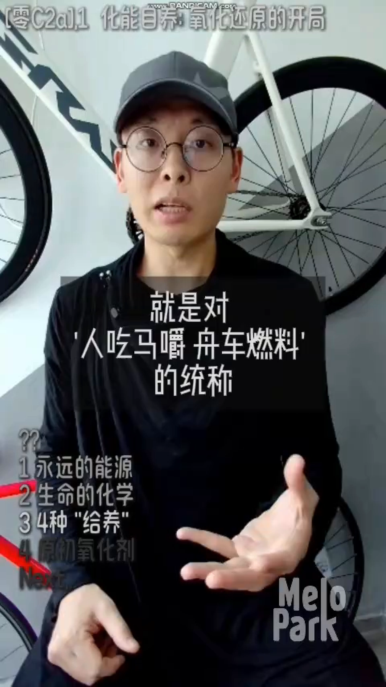
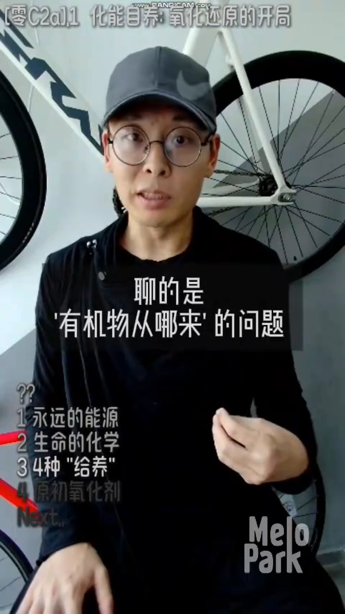
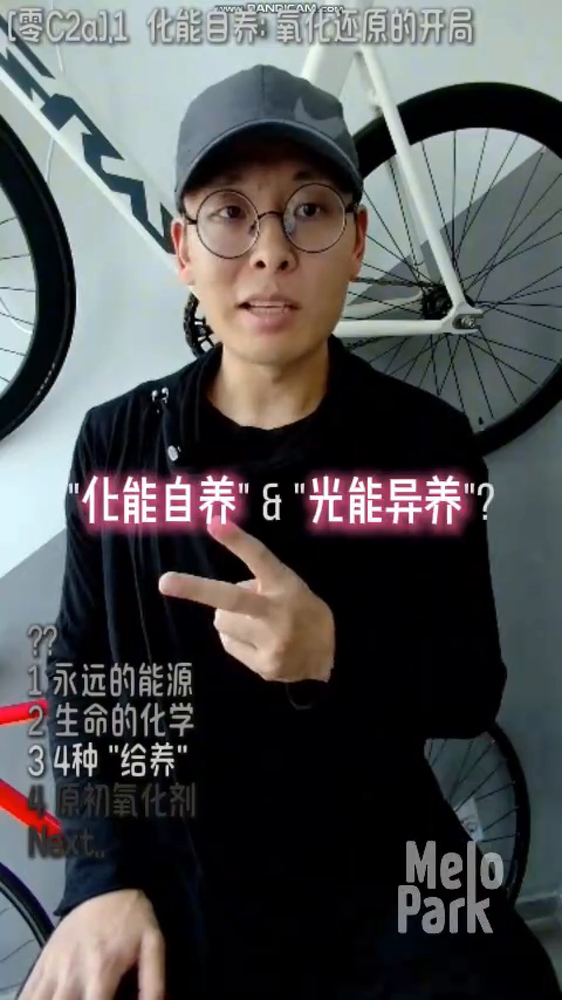
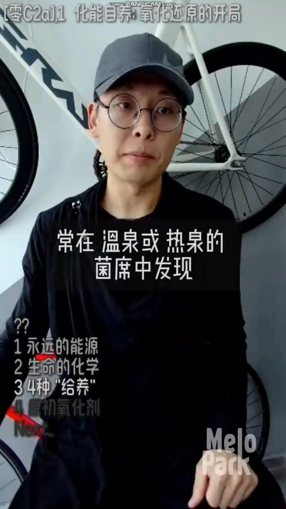
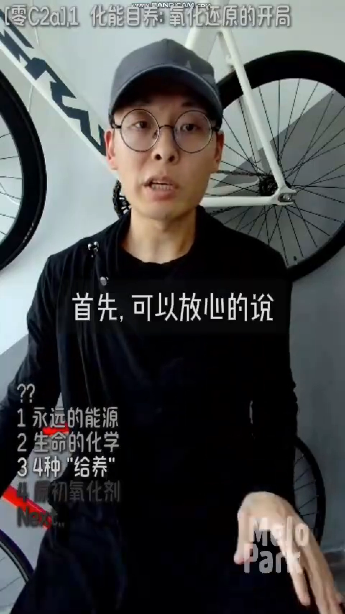

# 四种营养方式：碳源与能源两个问题，四个象限

> 视频来源：[源起 04 | [零C2a] [1] 化能自养: 氧化还原的开局](https://www.bilibili.com/video/BV1AX8c6QEyQ/)（Bilibili · MeloPark · 约 13 分钟）。本文按该视频的逐窗口字幕与画面整理，内容均可在原视频中核查。
> 范围说明：该视频 00:00–05:36 讲能源的终极来源（太阳辐射与地球内部热）与氧化还原、电化学两个核心机制，属于本脉络其他小节的范围（氧化还原见 3.3.1），本文只从 05:38 的"四种给养"起整理分类主线。视频后半段 08:22–13:00 讨论四种营养方式在生命起源中的先后顺序与 LUCA，本文在"边界"一节取用其结论，不展开学派争论。
> 导读：这一篇只回答两个问题——**碳从哪来**、**能量从哪来**。把这两个问题各画一条轴，就得到光能自养、化能自养、光能异养、化能异养四个象限；每个象限认一两个代表生物，记住"碳源"和"能源"是两件独立的事。

## 本讲要解决的核心问题（SCQA）

**背景**：生命是耗散系统，必须持续流入高能物质、排出低能废物。所以任何一个物种都得回答两件事：构成自身的碳骨架从哪来，驱动反应的能源从哪来。

**冲突**：日常语言把这两件事混成一句"吃什么"。于是"植物自己养活自己、动物靠吃"听起来像一条完整的分类，却解释不了硝化细菌——它不吃任何有机物，却也不晒太阳；也解释不了紫色非硫细菌——它晒太阳，却必须外加有机物才能活。

**疑问**：把"碳从哪来"和"能量从哪来"拆成两个独立的问题，会得到几种组合？每种组合真的存在吗？各自的代表生物是谁？

**回答（中心思想）**：这是两条正交的轴。**碳源轴**问"有机物是自己造的，还是摄取现成的"——自养 / 异养；**能源轴**问"最终能源是光辐射，还是化学反应"——光能 / 化能。两条轴交叉出四个象限，四种组合全部存在：光能自养（植物、蓝细菌）、化能自养（硝化细菌、硫细菌、氢细菌）、光能异养（紫色非硫细菌）、化能异养（动物、真菌、多数细菌）。常见的"植物 vs 动物"只是其中两个象限，另外两个不常遇到，但不是例外，是分类表的正常格子。

---

## 一、先拆成两个问题：给养 = 物质 + 能源

视频用"给养"这个词统称"人吃马嚼、车舟燃料"，并直接点明它的本质：**给养就是物质和能源** [【跳转到 05:40】](https://www.bilibili.com/video/BV1AX8c6QEyQ/?t=340)。

于是同一张图里可以并排放两件事。幼儿园门口常见的"太阳、大树、小草、小鸟、爷爷"，正好把两件事都摆出来了 [【跳转到 05:50】](https://www.bilibili.com/video/BV1AX8c6QEyQ/?t=350)：

- **大树和小草是自养（autotrophy）**：自己制造有机物，不靠吃别的有机物 [【跳转到 05:55】](https://www.bilibili.com/video/BV1AX8c6QEyQ/?t=355)；
- **小鸟和爷爷是异养（heterotrophy）**：需要从环境摄取有机碳，比如葡萄糖、乙酸、氨基酸 [【跳转到 06:00】](https://www.bilibili.com/video/BV1AX8c6QEyQ/?t=360)。

字根上，*trophy* 是"营养"，*auto* 是"自己"，*hetero* 是"不同的、外界的" [【跳转到 06:10】](https://www.bilibili.com/video/BV1AX8c6QEyQ/?t=370)。

但有机物之外，生命还需要持续的能量供应，这就引出第二条轴 [【跳转到 06:15】](https://www.bilibili.com/video/BV1AX8c6QEyQ/?t=375)：

- 大树和小草需要晒太阳，以**光**为能源，所以是**光能自养**（photoautotrophy）[【跳转到 06:20】](https://www.bilibili.com/video/BV1AX8c6QEyQ/?t=380)；
- 小鸟和爷爷需要吃饭，以**化能**、即化学能为能源，所以是**化能异养**（chemoheterotrophy）[【跳转到 06:25】](https://www.bilibili.com/video/BV1AX8c6QEyQ/?t=385)。

字根上，*photo* 是光，*chemo* 是化学的 [【跳转到 06:32】](https://www.bilibili.com/video/BV1AX8c6QEyQ/?t=392)。

---

## 二、两条轴各自在问什么

这是本篇最需要记住的一段。视频把两条轴的分工说得非常清楚 [【跳转到 06:37】](https://www.bilibili.com/video/BV1AX8c6QEyQ/?t=397)：

| 轴 | 问的问题 | 两端 | 判据 |
| --- | --- | --- | --- |
| 能源轴 | 最终能源由谁提供 | 光能 / 化能 | 是吃现成的高能有机物（或氧化无机物），还是要晒太阳、用光辐射 |
| 碳源轴 | 有机物从哪来 | 自养 / 异养 | 是自己合成生产有机物，还是摄取现成的有机物 |

注意这里有一个容易犯的错：**"化能"不等于"吃有机物"**。化能只说明能源来自化学反应；这个化学反应可以是有机物的氧化，也可以是无机物的氧化。后者就是化能自养——它的能源和碳源来自完全不同的两处。反过来，"光能"也不等于"自养"：晒太阳只解决能源，不解决碳源。

两条轴一交叉，就是四个象限 [【跳转到 06:48】](https://www.bilibili.com/video/BV1AX8c6QEyQ/?t=408)。

---

## 三、四象限分类表

|  | 能源：光能 | 能源：化能 |
| --- | --- | --- |
| **碳源：自养**（自己固定 CO₂） | **光能自养**：绿色植物、蓝细菌、光合细菌 | **化能自养**：硝化细菌、硫氧化细菌、氢细菌、深海热泉硫细菌 |
| **碳源：异养**（摄取现成有机物） | **光能异养**：紫色非硫细菌、绿色非硫细菌 | **化能异养**：动物、真菌、多数细菌（含我们） |

视频对这张表的说法很直接：除了常见的化能异养（爷爷）和光能自养（树、草），是否还有另外两种——化能自养和光能异养？"答案是 yes and yes，四种都有，虽然后两种不常遇到" [【跳转到 07:04】](https://www.bilibili.com/video/BV1AX8c6QEyQ/?t=424)。

下面四个象限各给 1–2 个代表，每个只说一句"碳从哪来、能量从哪来"。

### 3.1 光能自养：碳来自 CO₂，能量来自光

绿色植物、藻类、蓝细菌都属于这一类。视频以大树、小草为代表（它们需要晒太阳，以光为能源）[【跳转到 06:20】](https://www.bilibili.com/video/BV1AX8c6QEyQ/?t=380)；藻类与蓝细菌不在该视频的举例范围内，按通行分类补入表中。视频还用一句话概括了这类生物的化学：**叶绿素激发电子，经过一系列氧化还原反应，把水氧化为氧气，并将二氧化碳还原为有机物，比如糖** [【跳转到 04:35】](https://www.bilibili.com/video/BV1AX8c6QEyQ/?t=275)。

这句话里其实已经包含了两个交接点：光能被转成化学能（激发电子），CO₂ 被还原成糖（碳进入有机物）。这两步在叶绿体里怎么分工，见同目录另一篇《光合作用的两个交接点》；本篇不再展开。

### 3.2 化能自养：碳来自 CO₂，能量来自氧化无机物

视频把化能自养称为"黑暗世界的能量魔法师"：**通过氧化环境中的无机物（氢气、硫化氢、氨盐等）获得化学能，并用这些能量将二氧化碳转化为有机物**，也就是固碳 [【跳转到 07:39】](https://www.bilibili.com/video/BV1AX8c6QEyQ/?t=459)。

代表生物（视频列举）[【跳转到 07:49】](https://www.bilibili.com/video/BV1AX8c6QEyQ/?t=469)：

- **深海热泉生物**：能量来自硫化氢、氢气，是黑暗深海生态系统的基石；
- **硝化细菌**：能量来自氨的氧化，在土壤和淡水中推动氮循环，把有毒的氨转化为可被吸收的硝酸盐（视频此处简称为"能量来自氨盐、硝酸盐"，实际是氨→亚硝酸盐→硝酸盐的两步氧化，反应式见同目录另一篇《合成代谢与分解代谢》§四）；
- **硫氧化细菌**：能量来自硫化氢、硫代硫酸盐，在有氧或厌氧环境中把硫氧化，常见于硫磺泉、土壤和深海；
- **氢细菌**：能量来自氢气，分布广泛，土壤、水体甚至动物肠道中都有。

这一类最值得停下来想一秒：它的**碳源和能源来自完全不同的物质**。碳来自 CO₂（无机），能量来自氨或硫化氢的氧化（也是无机）。所以"自养"和"化能"在这里是两件互不干扰的事——这正是两条轴正交的最好证据。

### 3.3 光能异养：碳来自现成有机物，能量来自光

视频把光能异养生物称为"会利用阳光的杂食者"：**利用阳光，但必须从外界获得现成的有机物（有机酸和醇类）来构建自身，无法像植物那样自力更生** [【跳转到 07:09】](https://www.bilibili.com/video/BV1AX8c6QEyQ/?t=429)。

代表生物：

- **紫色非硫细菌**：需要有机小分子提供碳源，常见于湖泊、池塘和淤泥污水等有机丰富的环境 [【跳转到 07:19】](https://www.bilibili.com/video/BV1AX8c6QEyQ/?t=439)；
- **绿色非硫细菌**：视频提到其中有嗜热或常温的种类，常在温泉和热泉的菌席中发现 [【跳转到 07:29】](https://www.bilibili.com/video/BV1AX8c6QEyQ/?t=449)。

这一格是最容易被忽略的：它证明"能光合"和"能自养"不是同一件事。有光、有光合色素，仍然可能不会固定 CO₂。

### 3.4 化能异养：碳来自现成有机物，能量来自有机物的氧化

动物、真菌和多数细菌属于这一类——碳源和能源来自同一批有机物。这一类的代谢细节（糖酵解、三羧酸循环、氧化磷酸化）已在 3.3.2 和 3.3.3 展开，本篇不再重复。

> 待核对：视频把紫色非硫细菌的碳源说成"有机的小分子，比如丙酮"。紫色非硫细菌确实以有机酸、醇等小分子作碳源，但"丙酮"并非常见代表；本文按"有机小分子（有机酸、醇类）"记录，不把丙酮写成通例。

---

## 四、边界：分类是人为的，先后顺序仍有争议

### 4.1 四格是分类工具，不是物种的固定标签

视频在讲完四象限后，立刻转向一个不同性质的问题：这四种给养**在演化上谁先谁后** [【跳转到 08:21】](https://www.bilibili.com/video/BV1AX8c6QEyQ/?t=501)。这个转向本身说明一件事：四象限描述的是"现在这种生物靠什么活"，不描述"它在生命之树上的位置"。

视频给出的判断分三层 [【跳转到 08:33】](https://www.bilibili.com/video/BV1AX8c6QEyQ/?t=513)：

1. 学界普遍认为**化能方式早于光能方式**——通过叶绿素捕捉光波能量需要复杂的结构；
2. 光能自养早于光能异养——"先生产、后消费"；
3. 但更早的两个——**化能自养和化能异养谁先**——仍有争议。这个争议换个说法就是：固碳（把 CO₂ 变成有机物）是不是生命最早的动作 [【跳转到 08:59】](https://www.bilibili.com/video/BV1AX8c6QEyQ/?t=539)。

视频随后介绍了 Martin 与 Russell 的化能自养起源学说，以及"LUCA 的能量和营养方式应该就是化能自养"这一（作者明确称为"相当颠覆"的）结论 [【跳转到 10:49】](https://www.bilibili.com/video/BV1AX8c6QEyQ/?t=649)。这些属于生命起源研究的具体学派主张，本文只记录"存在这一主张、且仍有争议"，不当作已定论。

### 4.2 真实生物常常跨格

四象限是"主要营养方式"的归类，不是排他性的身份。同一物种在不同环境下可以切换碳源或能源（例如某些紫色细菌在有光时用光、无光时改用有机物发酵——此为通行认识，不在该视频范围内），环境中的有机物浓度也会改变某一格的实际生态位。视频没有展开混合营养（mixotrophy），本篇同样不展开，只提示：**遇到"某生物属于哪一格"的问题时，先问"在什么条件下"**。

### 4.3 本篇不涉及

- 光合作用的全部反应（光系统、电子传递、卡尔文循环步骤）：学习目标明确不作为本单元覆盖义务，本篇只取"光能→化学能、CO₂→糖"两个交接点，细节见同目录另一篇。
- 生态学层面的生产者、消费者、食物网：属 4.4.6。
- 各类群的具体分类学归属与命名：属 4.4.3。

---

## 五、小结

- 一个物种的营养方式要回答两个独立问题：**碳从哪来**（自养 / 异养）、**能量从哪来**（光能 / 化能）。
- 两条轴交叉出四格，四种组合都存在：光能自养（植物、蓝细菌）、化能自养（硝化细菌、硫细菌、氢细菌）、光能异养（紫色非硫细菌）、化能异养（动物、真菌、多数细菌）。
- **"化能"不等于"吃有机物"，"光能"也不等于"自养"**：化能自养靠氧化无机物获能、靠固定 CO₂ 获碳；光能异养靠光获能、靠现成有机物获碳。
- 四象限是描述"靠什么活"的工具，不描述演化位置；四种方式的出现顺序中，只有"化能早于光能""光能自养早于光能异养"是比较放心的判断，更早的顺序仍有争议。

## 关键术语速查

| 术语 | 一句话解释 |
| --- | --- |
| 自养（autotrophy） | 以 CO₂ 为碳源，自己合成有机物 |
| 异养（heterotrophy） | 以现成有机物为碳源 |
| 光能（photo-） | 最终能源是光辐射 |
| 化能（chemo-） | 最终能源是化学反应释放的化学能 |
| 光能自养 | 光作能源、CO₂ 作碳源（植物、蓝细菌） |
| 化能自养 | 氧化无机物获能、固定 CO₂ 获碳（硝化细菌、硫细菌） |
| 光能异养 | 光作能源、现成有机物作碳源（紫色非硫细菌） |
| 化能异养 | 有机物同时作能源和碳源（动物、真菌） |
| 固碳 | 把 CO₂ 变成有机物的过程，是自养一端的共同动作 |
| LUCA | 所有生命的最后共同祖先，其营养方式仍有争议 |