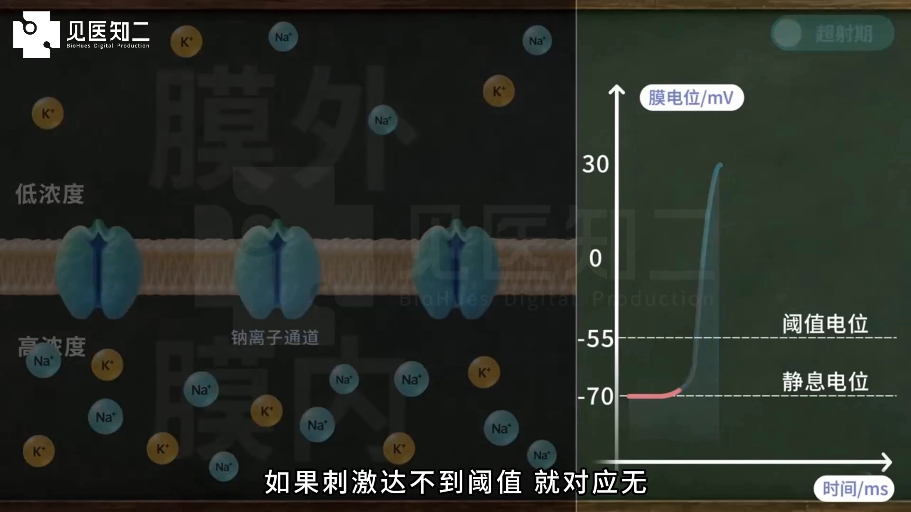
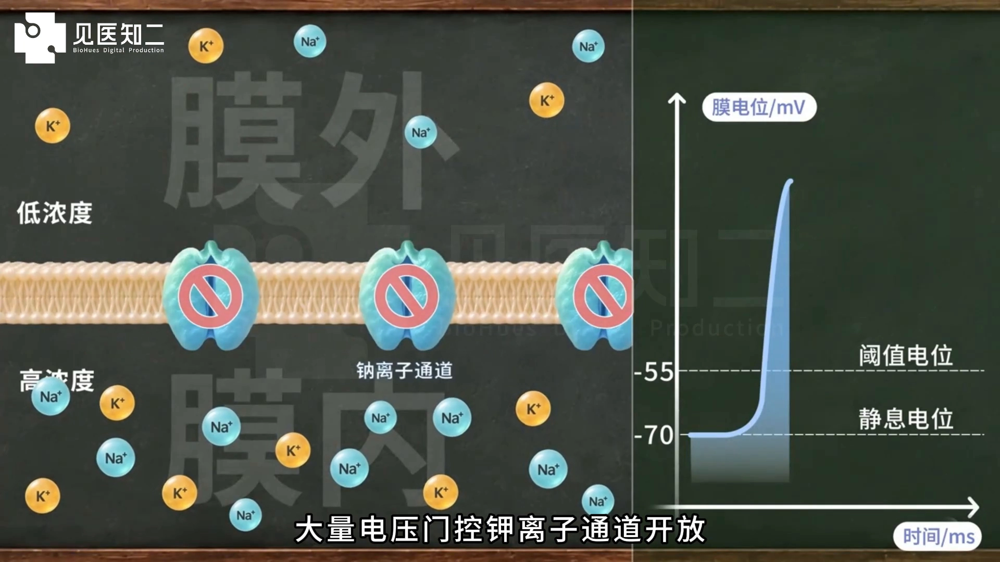
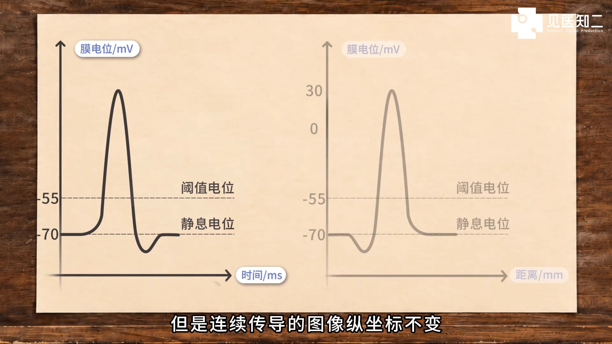

# 动作电位：阈电位、全或无与钠离子内流的正反馈

> 视频来源：[【高中生物】选必一重难点 - 动作电位](https://www.bilibili.com/video/BV1GVsq6xE58/)（Bilibili · 见医知二，约 8 分钟）
> 导读（100 字以内）：这支动画用枪乌贼巨轴突的实验讲清静息电位、阈电位、去极化、复极化和传导。本文只取"阈值 + 自放大 = 开关"这条线，离子梯度的背景见 1.3.2。

## 本讲要解决的核心问题（SCQA）

**背景**：神经元的任务是把刺激的强弱传出去。刺激是连续的——碰得轻一点、重一点，力度可以取任意中间值。

**冲突**：但神经元传出去的信号并不连续。动作电位的幅度是固定的，要么有、要么没有；刺激再强，峰値也不会更高。一个连续的输入，怎么被转换成"全或无"的离散输出？

**疑问**：这个转换发生在哪一步？为什么会有"门槛"？开关一旦打开，靠什么把它关回去？整个过程有多快？

**回答（中心思想）**：动作电位是一个**阈值触发的正反馈开关**。静息时膜电位停在 -70 mV，是一块"待命的电池"；刺激把膜电位推到约 -55 mV 的**阈电位**，电压门控钠通道大量开放，Na⁺ 内流使膜进一步去极化，去极化又打开更多钠通道——这条**自放大回路**（正反馈）把膜电位一路推到 +30 mV，于是输出与刺激强度无关，只分"有"和"无"。开关的关闭不靠刺激撤除，而靠**钠通道失活 + 钾通道开放**这套内建的负反馈，再加上**不应期**保证信号只向前走、不折返。整个过程以**毫秒**计。

---

## 一、静息电位：一块待命的电池

### 1.1 为什么会有电位差

神经元没受刺激时也有电信号。典型神经元的**静息电位**约为 **-70 mV**，即膜内比膜外低约 70 mV。原因是细胞膜把内外隔开，而两侧离子分布不同：

- 膜外 Na⁺ 浓度高，膜内 K⁺ 浓度高；
- 细胞内有很多带负电的蛋白质，不能自由穿膜，被留在里面；
- 静息时电压门控钠通道关闭，膜对 Na⁺ 通透性低；膜对 K⁺ 通透性较高，K⁺ 经钾漏通道顺电化学梯度外流，使膜外更偏正。

所谓"外正内负"，指的是两侧各自的**电荷总和**，不是"外面只有正电荷"。

[【跳转到 02:11】](https://www.bilibili.com/video/BV1GVsq6xE58/?t=131)

[【跳转到 01:35】](https://www.bilibili.com/video/BV1GVsq6xE58/?t=95)

### 1.2 钠钾泵：维持梯度的后勤

K⁺ 一直外漏，细胞内不会越来越负吗？不会，因为**钠钾泵**用 ATP 的能量，把 3 个 Na⁺ 运出、2 个 K⁺ 运入，维持离子浓度差。所以神经元像一块**处于待命状态的电池**：已经准备好了，只差一个足够强的刺激。

[【跳转到 02:48】](https://www.bilibili.com/video/BV1GVsq6xE58/?t=168)

---

## 二、阈电位：开关的门槛

### 2.1 不是所有刺激都能触发动作电位

碰到一个烫的东西，皮肤感受器受刺激，相关神经元的膜电位随之变化。但**只要有刺激就会产生动作电位吗？当然不是**。刺激引起的膜电位变化比较小时，只产生**局部电位**；要触发一次完整的动作电位，必须跨过一个关键门槛——**阈电位**。

以典型神经元为例：静息电位 -70 mV，阈电位约 **-55 mV**。

[【跳转到 03:23】](https://www.bilibili.com/video/BV1GVsq6xE58/?t=203)

### 2.2 门槛前后发生了什么

膜电位逐渐升高、达到 -55 mV 时，**电压门控钠通道大量开放**：大量 Na⁺ 顺着电化学梯度迅速进入细胞，使膜内电位快速升高，这个过程叫**去极化**。膜内电位从负值不断攀升，越过 0，达到正电位（约 +30 mV），这一段叫**超射期**。

[【跳转到 03:48】](https://www.bilibili.com/video/BV1GVsq6xE58/?t=228)

---

## 三、自放大回路：这就是正反馈

### 3.1 回路怎么闭合

把上面几步按因果顺序排一遍：

1. 刺激使膜去极化，膜电位升高；
2. 升高到阈电位，电压门控钠通道开放；
3. Na⁺ 内流，带正电，使膜内电位**进一步升高**；
4. 进一步升高又打开**更多**钠通道，Na⁺ 内流更快；
5. 回到第 3 步。

第 3 步到第 5 步就是一个闭环：**输出的变化（去极化）反过来加强产生它的原因（钠通道开放）**。按上一篇的定义，反馈信号加强控制部分的活动，就是**正反馈**。

> 视频本身没有使用"正反馈"这个词，它描述的是"大量钠离子内流使膜内电位快速升高"这条链。把它命名为正反馈，是把它接回 3.4.2 的主线：**拓扑（正反馈环）决定行为（自放大、全或无）**。

### 3.2 正反馈解释了"为什么这么快"

正反馈的特征是"越快越快"。一旦越过阈值，回路自己推自己，不需要刺激继续加码，膜电位在极短时间内冲到峰值。所以动作电位的上升支非常陡——这不是因为刺激很强，而是因为回路本身在加速。

### 3.3 也解释了"为什么幅度固定"

正反馈把系统推到一个**由离子梯度决定的终点**（Na⁺ 平衡电位附近），而不是由刺激强度决定的终点。刺激只负责"把门推开"，推多用力并不改变门后面的东西。这就是全或无的物理基础。

---

## 四、全或无：连续输入变成离散输出

### 4.1 定义

**全或无**：

- 刺激**达不到**阈值 → 对应"无"：只有局部电位，没有完整的动作电位；
- 刺激**达到或超过**阈电位 → 对应"全"：触发完整的动作电位，而且**峰值固定**。

[【跳转到 04:15】](https://www.bilibili.com/video/BV1GVsq6xE58/?t=255)

### 4.2 这是一个"数字化"的转换

用信息的角度看，这一步把模拟量变成了数字量：输入是连续的（刺激强度可以取任意值），输出是二值的（有/无）。既然幅度不能携带强度信息，强度就只能靠**频率**和**参与纤维的数量**来编码——这正是下一篇要讲的编码问题。

### 4.3 开关型过程的共同结构

把"阈值 + 正反馈"这个组合抽象出来，会得到一个通用模板：

| 部件 | 动作电位里的对应物 | 作用 |
| --- | --- | --- |
| 阈值 | 阈电位 -55 mV | 决定"什么时候开始" |
| 正反馈 | Na⁺ 内流 → 去极化 → 更多钠通道开放 | 决定"开始后多快、多彻底" |
| 内建负反馈 | 钠通道失活、钾通道开放 | 决定"什么时候停" |
| 不应期 | 爆发后一段时间难以再触发 | 决定"能不能倒回去" |

后面会看到，细胞周期进入分裂、凋亡的 caspase 级联、细胞命运决定，用的都是同一套模板：**阈值负责决断，正反馈负责执行到底，负反馈负责收尾**。

---

## 五、关掉开关：不靠撤刺激，靠内建负反馈

### 5.1 钠通道失活与钾通道开放

神经元不会一直保持去极化状态——如果一直维持，就无法连续传递信息了。动作电位产生后：

- **电压门控钠通道快速失活**（不是关闭，是失活，短时间内打不开）；
- **大量电压门控钾通道开放**，K⁺ 顺电化学梯度外流，使膜内电位重新下降，这个过程叫**复极化**；
- 有时 K⁺ 还会持续外流一小段时间，使膜电位短暂低于静息电位，形成**超极化**，之后再恢复。

[【跳转到 04:41】](https://www.bilibili.com/video/BV1GVsq6xE58/?t=281)

### 5.2 钠钾泵事后收尾

Na⁺ 内流、K⁺ 外流确实会破坏原有的离子分布。钠钾泵负责"事后打扫战场"：把钠泵出去、把钾泵进来，使细胞恢复并保持静息电位状态。注意时间分工：**通道负责毫秒级的开关，泵负责秒级到更长的恢复**。

[【跳转到 05:14】](https://www.bilibili.com/video/BV1GVsq6xE58/?t=314)

---

## 六、时间尺度：毫秒级的开关，秒级的恢复

把这条通路上的事件按时间排开，会看到明显的时间分层：

| 事件 | 大致时间尺度 | 机制 |
| --- | --- | --- |
| 去极化（上升支） | 亚毫秒—毫秒 | 电压门控钠通道开放，Na⁺ 内流 |
| 复极化（下降支） | 毫秒 | 钠通道失活、钾通道开放，K⁺ 外流 |
| 超极化后电位 | 数毫秒—数十毫秒 | K⁺ 持续外流 |
| 不应期 | 毫秒—数毫秒 | 钠通道失活状态未恢复 |
| 离子梯度恢复 | 秒级及更长 | 钠钾泵主动转运 |

这张表说明一个要点：**同一个"开关"，打开和关闭是毫秒级的，但把它复位到可以再次使用，需要更长的时间**。这正是"快响应 + 慢恢复"的典型结构，也是后面理解适应现象（响应越来越小）的时间基础。

---

## 七、传导：为什么信号只向前走

### 7.1 逐点触发

动作电位只发生在轴突的一小段区域，为什么能一路向前？某个位置刚发生去极化，这里的电位变化引起相邻区域的局部电流和膜电位变化；如果相邻区域达到阈值，就触发新的动作电位；新的动作电位又去刺激更前方的区域。**信号不是"流过去"，而是一站一站"重新点着"**。

[【跳转到 05:41】](https://www.bilibili.com/video/BV1GVsq6xE58/?t=341)

### 7.2 不应期保证方向性

为什么不折返？因为刚爆发过动作电位的区域会进入**不应期**，在这段时间里很难再次产生新的动作电位。于是冲动只能向前，不能回头。

[【跳转到 05:59】](https://www.bilibili.com/video/BV1GVsq6xE58/?t=359)

### 7.3 时间图与距离图是镜像关系

一个容易混淆的点：经典的完整动作电位图像，横坐标是**时间**；而连续传导的图像，横坐标是**距离**，纵坐标仍是膜电位。两张图是镜像关系——距离图的右边是率先去极化的一端（"进行式"），左边是早已进入超极化的一侧（"过去式"）。

[【跳转到 06:19】](https://www.bilibili.com/video/BV1GVsq6xE58/?t=379)

---

## 八、边界：这个开关不携带"强度"

需要明确两点，避免把动作电位当成模拟信号：

1. **幅度不编码强度**。峰值固定，刺激强弱不改变峰值，只改变**频率**和**被招募的纤维数量**（下一篇详述）。
2. **"全或无"不等于"没有中间状态"**。阈值以下仍有**局部电位**，它是等级性的（幅度随刺激强度变化），只是不能自我放大、不能远距离传播。局部电位与动作电位的区别，正是"有没有正反馈"的区别。

---

## 小结

- 静息电位约 **-70 mV**，由离子梯度、钾漏通道和钠钾泵共同维持；神经元像一块待命的电池。
- **阈电位约 -55 mV**：达到它，电压门控钠通道大量开放，触发动作电位。
- **Na⁺ 内流 → 去极化 → 更多钠通道开放**构成正反馈，把膜电位迅速推到约 +30 mV 的超射期。
- **全或无**：达不到阈值只有局部电位；达到阈值就触发峰值固定的完整动作电位。
- 开关的关闭靠**钠通道失活 + 钾通道开放**（内建负反馈）与**不应期**，之后由**钠钾泵**恢复离子梯度。
- **时间尺度**：去极化/复极化是毫秒级，不应期数毫秒，离子梯度恢复是秒级及更长。
- 传导是逐点重新触发，不应期保证单向；时间图与距离图互为镜像。
- 动作电位的幅度不编码刺激强度，强度靠频率和纤维数量编码。

## 关键术语速查

| 术语 | 一句话解释 |
| --- | --- |
| 静息电位 | 未受刺激时膜两侧的电位差，典型值 -70 mV |
| 阈电位 | 触发动作电位的临界膜电位，典型值 -55 mV |
| 去极化 | 膜内电位向正方向变化的过程 |
| 超射 | 去极化越过 0 mV 的部分，可达 +30 mV |
| 复极化 | 膜内电位回落到静息水平的过程 |
| 超极化 | 膜电位短暂低于静息电位的状态 |
| 全或无 | 达阈值即触发且峰值固定，不达阈值则无 |
| 局部电位 | 等级性、可衰减、不能自我放大的电变化 |
| 不应期 | 动作电位后一段时间内难以再次触发的状态 |
| 电压门控钠通道 | 感受膜电位变化而开放/失活的 Na⁺ 通道 |
| 钾漏通道 | 静息时持续开放的 K⁺ 通道，维持静息电位 |
| 钠钾泵 | 耗 ATP 把 Na⁺ 泵出、K⁺ 泵入，维持离子梯度 |