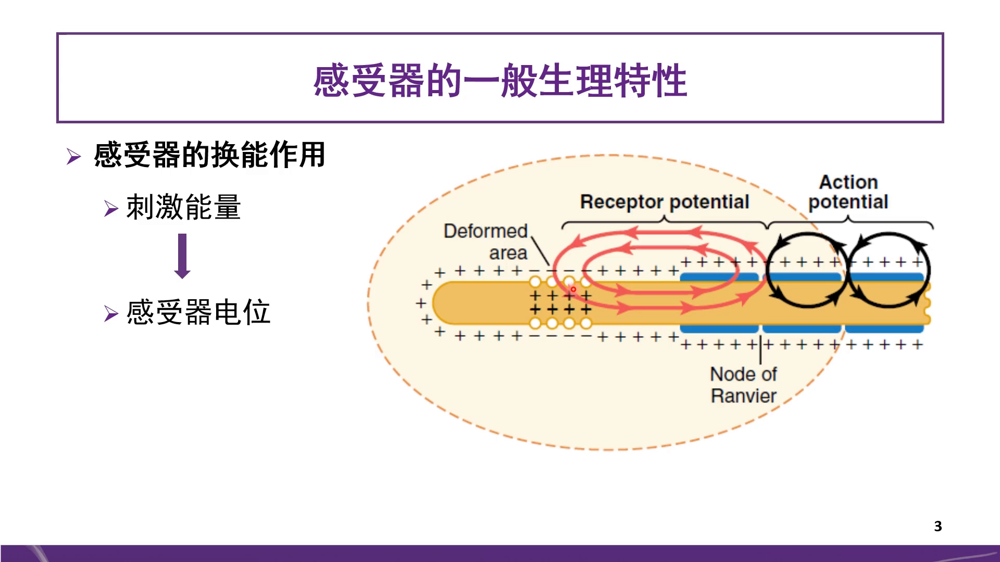
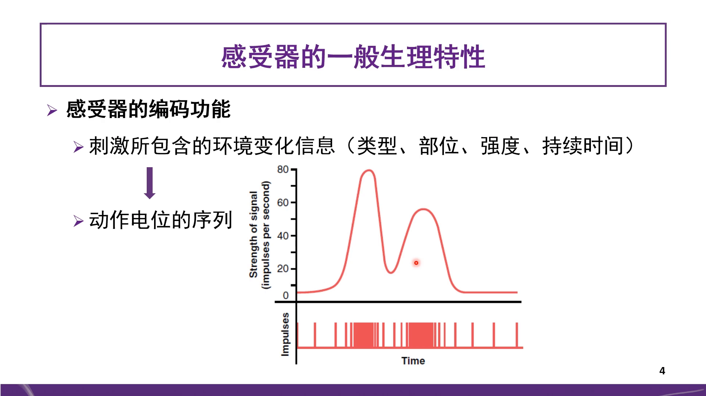
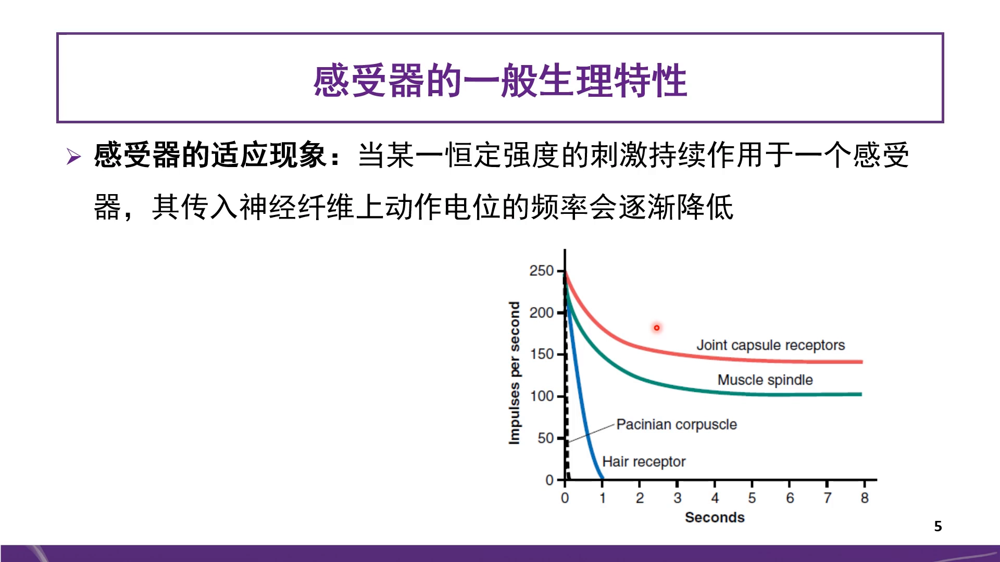

# 感受器适应：恒定刺激下响应为何越来越小

> 视频来源：[感受器的一般生理特性：适宜刺激；换能作用；编码功能；适应现象](https://www.bilibili.com/video/BV14x9yYGEAw/)（Bilibili · 滕旭的生理课，约 15 分钟）
> 导读（100 字以内）：这支生理课把感受器的四个共性讲成一条链：适宜刺激与阈值、换能、编码、适应。本文取"阈值—编码—适应"三段，说明"同样刺激、响应变小"的机制与意义。

## 本讲要解决的核心问题（SCQA）

**背景**：感觉系统要把外界刺激的类型、部位、强度、持续时间送到中枢。但动作电位是"全或无"的，幅度固定，能携带的信息很有限。

**冲突**：同一条传入纤维上，动作电位的形状完全一样，那大脑怎么知道"轻握"还是"紧握"？更奇怪的是，刺激明明一直持续、强度也没变，传入的动作电位却越来越稀，感觉越来越弱——刚戴上的手表很快就"感觉不到"了。

**疑问**：刺激的能量怎么变成电信号？强度靠什么编码？为什么持续刺激会让响应衰减？这种"衰减"是缺陷还是设计？

**回答（中心思想）**：感受器有四个共性——**适宜刺激、换能作用、编码功能、适应现象**。换能把任何形式的刺激能量变成**感受器电位**（等级性局部电位），再在传入神经上转成动作电位；强度不能靠幅度编码（幅度是全或无的），只能靠**频率**和**被招募的纤维数量**。而**适应**就是：恒定强度的刺激持续作用时，传入纤维上的动作电位频率逐渐下降。按适应快慢，感受器分**快适应**与**慢适应**两类：快适应器报告"变化"，慢适应器报告"持续状态"。所以响应衰减不是缺陷，而是把有限的动态范围让给"新信息"的设计。

---

## 一、适宜刺激与阈值：每种感受器都有自己的"最敏感点"

### 1.1 分类依据是适宜刺激

感受器可以按内/外环境分，也可以按刺激性质分（机械、温度、光、化学）。为什么某一个是光感受器、某一个是化学感受器？分类依据就是它的**适宜刺激**：一种感受器通常只对某种特定形式的刺激**最敏感**。温度感受器还可以再分：对低温敏感的叫冷感受器，对高温敏感的叫热感受器。

[【跳转到 00:32】](https://www.bilibili.com/video/BV14x9yYGEAw/?t=32)

### 1.2 "敏感"的定量含义：阈值最低

什么叫敏感？就是**引起这个感受器产生电活动所需的刺激强度最小**。这就引出**感觉阈值**——引起某种感觉所需的最低刺激强度、临界值。对温度感受器来说，让它产生反应所需的温度变化最小；对光感受器来说，让视杆、视锥细胞产生电活动所需阈值最低的是光线。

[【跳转到 01:22】](https://www.bilibili.com/video/BV14x9yYGEAw/?t=82)

### 1.3 适宜刺激不等于唯一刺激

这一点常被忽略：适宜刺激是"阈值最低的那一种"，不是"唯一能起作用的那一种"。除了光，机械刺激也能让视杆、视锥细胞产生反应——闭着眼使劲按压眼球，也会产生光感。所以一个感受器可以接受多种形式的刺激，只是其中一种的阈值最低，那种就是它的适宜刺激。

[【跳转到 02:12】](https://www.bilibili.com/video/BV14x9yYGEAw/?t=132)

---

## 二、换能：把刺激能量变成电信号

### 2.1 感受器是生物换能器

不管刺激是机械的、光的、温度的、化学的，感受器的作用都是把它转变成电活动。**感受器就是一个生物换能器**。

[【跳转到 03:32】](https://www.bilibili.com/video/BV14x9yYGEAw/?t=212)

### 2.2 两步走：先感受器电位，再动作电位

换能不是一步完成的：

1. 刺激作用于感受器，先在感受器上产生一个电活动，叫**感受器电位**；
2. 感受器电位再在传入神经上触发**动作电位**。

两者性质完全不同。感受器电位本质上是**局部电位**：不是全或无，而是**等级性**的——电位幅度跟刺激强度成正比，刺激越强、幅度越大。动作电位则是全或无的。区分二者的核心判据就是"是否全或无"。



[【跳转到 04:22】](https://www.bilibili.com/video/BV14x9yYGEAw/?t=262)

### 2.3 为什么这个分工重要

局部电位可以**分级**地反映刺激强度，但它会衰减、不能远传；动作电位能远传，但幅度固定、丢掉了强度信息。于是系统用两步来解决矛盾：**在感受器端用等级性的局部电位保留强度信息，再把它翻译成动作电位的频率**——这就是下一步"编码"。

---

## 三、编码：强度靠频率，不靠幅度

### 3.1 需要编码哪些信息

刺激包含的环境信息至少有四类：**类型、部位、强度、持续时间**。其中类型主要取决于感受器的种类（适宜刺激），部位主要跟感受器的分布有关，这两项不太依赖动作电位序列；强度和持续时间就必须靠动作电位的**时序**来编码。

[【跳转到 06:52】](https://www.bilibili.com/video/BV14x9yYGEAw/?t=412)

### 3.2 强度怎么编码

动作电位的幅度是全或无的，所以**不可能用幅度编码强度**。可用的手段有两种：

1. **频率**：刺激越强，动作电位发放越密；
2. **被招募的纤维数量**：刺激越强，产生动作电位的神经纤维越多。

握手的例子最直观：轻轻一握和使劲一握，同一块皮肤上的触觉、压力感受器被激活的程度不同，发放频率不同、参与纤维数量不同；大脑皮层把这两路信息翻译过来，主观上就形成"轻"或"重"的感觉。



[【跳转到 07:42】](https://www.bilibili.com/video/BV14x9yYGEAw/?t=462)

### 3.3 还没搞清楚的部分

视频很坦率地承认了边界：触觉这类简单模态的编码方式比较清楚，但视觉这种复杂模态——视杆、视锥细胞如何把光刺激编码成视神经上的动作电位序列，从而让我们看到丰富多彩的世界——具体机制现在还说不清。**"知道它用 0 和 1"和"知道它怎么写出这段代码"是两件事**。

---

## 四、适应：恒定刺激下响应越来越小

### 4.1 现象

刺激持续存在、强度没有太大变化，但产生的动作电位**频率逐渐下降**，于是感觉越来越弱。这个现象叫**适应现象**。

两只手握在一起，刚开始很有感觉，时间长了就没感觉了；刚进一个屋子觉得味道很冲，过一会儿也就那样了。**刺激没变，响应变了**。

[【跳转到 09:22】](https://www.bilibili.com/video/BV14x9yYGEAw/?t=562)

### 4.2 这是"响应衰减"，不是"刺激消失"

要强调：适应发生在**传入纤维的动作电位频率**上，而不是刺激本身。刺激一直存在，是感受器/传入通路把同样的输入翻译成了越来越少的脉冲。用 3.4.2 的语言说，这是一条**负反馈式的调节**：持续的输出反过来削弱了通路的增益（感受器电位变小、或触发频率下降），于是"同样的刺激、更小的响应"。

### 4.3 快适应与慢适应

按适应出现的快慢，感受器可以再分类（这是第三种分类方法：第一种按内/外环境，第二种按刺激性质，第三种按适应快慢）：

| 类型 | 响应曲线 | 代表 | 适合做什么 |
| --- | --- | --- | --- |
| 快适应 | 刺激一开始有密集发放，很快降到很低 | 皮肤触觉（Pacinian 环层小体）、嗅觉、毛发感受器 | 报告**变化**：环境中"哪里变了" |
| 慢适应 | 起始有一个峰值，之后维持较高的持续发放 | 本体感觉（肌梭）、关节囊感受器、压力感受器 | 报告**持续状态**：需要长期盯住的指标 |



[【跳转到 10:12】](https://www.bilibili.com/video/BV14x9yYGEAw/?t=612)

### 4.4 为什么需要两种

- **快适应器**负责"报警"。气味一直难闻但无害，就没必要一直盯着它——只要知道"这个味道对机体不会造成伤害"就够了。它的价值在于**对变化敏感**：刺激不变，就不值得占用注意力。
- **慢适应器**负责"值守"。本体感觉必须持续知道肢体在什么位置、在做什么动作，才能做出相应调节；压力感受器必须持续盯着血管壁的牵拉、盯着血压，不能走神，否则无法对血压做持续调节。还有一类必须持续监测的，是**可能造成伤害的有害刺激**——不管现在有没有造成伤害，都得一直盯着。

[【跳转到 13:07】](https://www.bilibili.com/video/BV14x9yYGEAw/?t=787)

### 4.5 适应的副作用：自己闻不到自己

适应有一个直接后果：**有异常体味的人往往自己闻不见**（比如狐臭），喷香水的人也不觉得自己身上味道有多浓。这不是嗅觉坏了，而是嗅觉是快适应感受器——持续的刺激被系统主动降权了。同理，长期用药后"同样的剂量效果变差"、长期暴露于某种信号后"细胞对同样的配体反应变弱"，都是同一类现象在不同层级上的表现（受体下调、通路脱敏属于细胞层面的版本，见 3.4.1 的受体与信号链）。

---

## 五、把四件事串起来

这四个共性不是并列的知识点，而是一条流水线：

```
刺激（类型/部位/强度/持续时间）
   ↓ 适宜刺激 + 阈值：决定"谁能感知、多强才感知"
感受器电位（等级性局部电位，保留强度信息）
   ↓ 换能
动作电位（全或无，幅度固定）
   ↓ 编码：频率 + 纤维数量
中枢解读
   ↓ 适应：持续刺激下频率逐渐下降
响应变小（把动态范围让给新变化）
```

每一站都在做一次"信息形式的转换"，而每次转换都会丢掉一些东西：阈值丢掉"太弱的信息"，全或无丢掉"幅度里的强度"，适应丢掉"不变的信息"。**丢掉的都是系统判断为"不需要持续关注"的部分**。

---

## 六、与反馈主线的关系

回到 3.4.2 的学习目标，这一篇补的是"响应的第三种命运"：

| 环路结构 | 结果 | 例子 |
| --- | --- | --- |
| 负反馈 | 变量被拉回调定点，维持稳态 | 体温、血压 |
| 正反馈 + 阈值 | 全或无的开关，一次到底 | 动作电位、凝血 |
| 持续输入 + 增益下调 | 响应逐渐变小（适应/脱敏） | 触觉、嗅觉、受体下调 |

三者可以叠加在同一条通路上：动作电位本身是正反馈开关（毫秒级），而感受器适应是叠加在它外面的慢调节（秒级），两者共同决定"传入纤维上到底发出多少脉冲"。**快响应 + 慢适应**，是生物信号系统最常见的组合。

---

## 小结

- 感受器有四个共性：**适宜刺激、换能作用、编码功能、适应现象**。
- **适宜刺激**是阈值最低的那种刺激；但适宜刺激不等于唯一刺激（按压眼球也能产生光感）。
- **换能**分两步：刺激 → 感受器电位（等级性局部电位）→ 传入神经上的动作电位（全或无）。
- **编码**：类型和部位由感受器种类与分布决定；强度靠**动作电位频率**和**被招募的纤维数量**，因为幅度是全或无的、不能编码强度。
- **适应**：恒定刺激持续作用时，传入纤维上的动作电位频率逐渐下降，感觉越来越弱。
- **快适应**感受器报告变化（触觉、嗅觉），**慢适应**感受器报告持续状态（本体感觉、压力感受器、有害刺激）。
- 适应的副作用：自己闻不到自己的体味、喷香水的人不觉得浓。
- 适应是"把动态范围让给新信息"的设计，不是感知缺陷。

## 关键术语速查

| 术语 | 一句话解释 |
| --- | --- |
| 适宜刺激 | 引起某感受器反应所需阈值最低的那种刺激 |
| 感觉阈值 | 引起某种感觉所需的最低刺激强度 |
| 换能作用 | 把各种形式的刺激能量转变成电活动 |
| 感受器电位 | 感受器受刺激后产生的等级性局部电位 |
| 局部电位 | 幅度随刺激强度变化、可衰减、不能自我放大的电位 |
| 编码功能 | 把刺激的类型、部位、强度、持续时间写进动作电位序列 |
| 频率编码 | 用动作电位的发放密度表示刺激强度 |
| 适应现象 | 恒定刺激持续作用时，传入纤维动作电位频率逐渐下降 |
| 快适应感受器 | 响应迅速衰减，适合报告刺激的变化 |
| 慢适应感受器 | 维持持续发放，适合监测需要长期盯住的指标 |