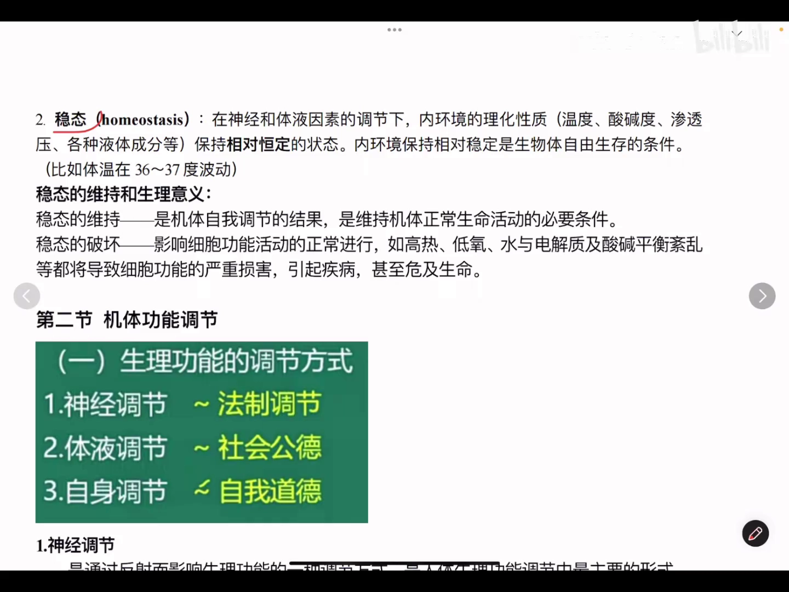
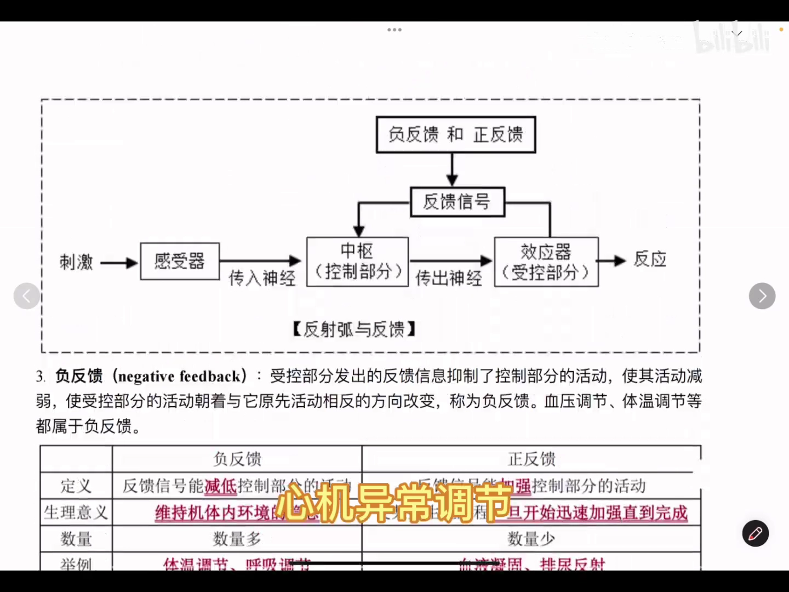
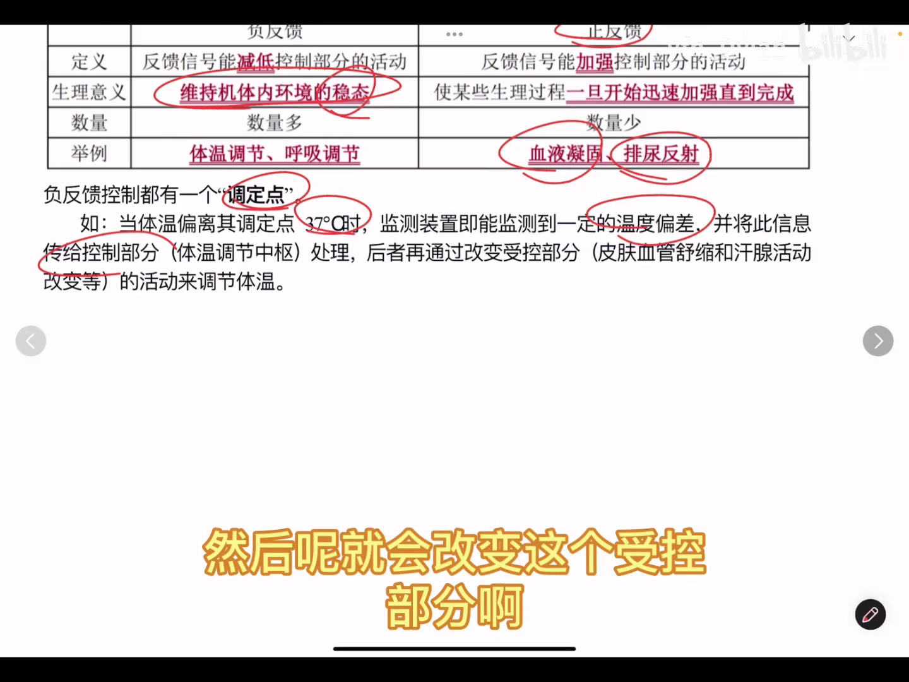

# 稳态与反馈：调定点、负反馈与正反馈

> 视频来源：[生理绪论（内环境，稳态，生理调节，负反馈）【生理学期末速成1】](https://www.bilibili.com/video/BV1pi4y1e7oX/)（Bilibili · 咖啡冻迪笛医学，约 9 分钟）
> 导读（100 字以内）：这支速成课把"内环境 → 稳态 → 调节方式 → 反馈"串成一条线，并给出负反馈与正反馈的对照表和调定点的完整回路。本文按"反馈环的部件"重排；受体与第二信使见 3.4.1。

## 本讲要解决的核心问题（SCQA）

**背景**：细胞泡在细胞外液里，体温、酸碱度、渗透压、血糖这些理化指标必须维持在一个可生存的范围内。机体的做法不是"不动"，而是不停地调。

**冲突**：既然一切都在变，为什么体温能长期停在 36–37 度？为什么有些过程（凝血、排尿）一旦开始就必然进行到底、中途停不下来？同一个"反馈"机制，为什么既能产生稳定，又能产生不可逆的爆发？

**疑问**：维持稳定的回路由哪几个部件组成？"设定值"在哪里？负反馈和正反馈的差别到底在符号上还是在结果上？不同调节方式起效的快慢差多少？

**回答（中心思想）**：反馈环由**感受器（监测装置）→ 控制部分（比较器）→ 受控部分（效应器）→ 反馈信号**四个部件构成，环路里还有一个**调定点**。反馈信号**削弱**控制部分的活动，就是负反馈，作用是**把变量拉回调定点**，因此稳态是"被拉回"而不是"不变"；反馈信号**加强**控制部分的活动，就是正反馈，作用是让过程**一旦开始就迅速加强直到完成**。负反馈数量多、负责维持；正反馈数量少、负责一次性事件的"进行到底"。而调节方式本身有速度差：神经调节快，体液调节慢。

---

## 一、稳态不是"不动"，而是"被拉回一个范围"

### 1.1 内环境：细胞真正泡着的那层液体

内环境（internal environment）就是**细胞外液**，包括组织间隙液和血浆。判断标准是"是否与外界直接相通"：胃液、口腔里的液体和外界相通，不算内环境；血管是密闭的，血管里的液体才算。内环境就是细胞直接接触、赖以生存的环境。

[【跳转到 02:50】](https://www.bilibili.com/video/BV1pi4y1e7oX/?t=170)

### 1.2 稳态：相对恒定，有波动范围

**稳态（homeostasis）**指机体各种理化性质——体温、血液酸碱度、渗透压、各种液体成分——保持**相对恒定**的状态。关键词是"相对"：体温不会天天精准停在 36.5 度，而是在 36.1、36.2、36.5、36.7 度之间过渡，只要不出这个范围就算稳态。

稳态靠机体自我调节维持，主要依靠**反馈**。稳态一旦破坏就会生病；严重破坏会危及生命——体温一会儿 41 度、一会儿 10 度，细胞要么被热死，要么失去活性。

[【跳转到 03:50】](https://www.bilibili.com/video/BV1pi4y1e7oX/?t=230)

> 这里已经埋下了本篇的主线：稳态不是"没有变化"，而是"变化被限制在调定点附近"。要理解这句话，得先看调节回路长什么样。

---

## 二、反馈环的四个部件：监测、比较、执行、回报

### 2.1 从反射弧看回路

神经调节通过反射实现，反射的结构基础是**反射弧**：刺激 → 感受器 → 传入神经 → 中枢 → 传出神经 → 效应器 → 反应。反射弧是**串联**结构，任何一个环节被破坏，反射就断了。

[【跳转到 05:17】](https://www.bilibili.com/video/BV1pi4y1e7oX/?t=317)

### 2.2 加上"回报"这一笔，就成了反馈环

反射弧只画了"去程"。真正让系统稳定的，是从效应器回到控制部分的**回程**——反馈信号。把它补上，回路就变成四个部件：

1. **感受器 / 监测装置**：测量被调变量的实际值；
2. **控制部分（比较器）**：拿实际值和调定点比较，算出偏差；
3. **受控部分 / 效应器**：按指令改变活动；
4. **反馈信号**：把效应器的结果送回控制部分。

这套"监测—比较—执行—回报"的结构，和控制工程里的闭环控制是同一件事，只不过生物体用细胞、神经和激素把它实现出来。

[【跳转到 07:21】](https://www.bilibili.com/video/BV1pi4y1e7oX/?t=441)

### 2.3 调定点：回路里的"目标值"

负反馈控制都有一个**调定点**（set point）。以体温为例：调定点是 37 度；体温偏离 37 度时，监测装置测到温度偏差，把信息传给控制部分（体温调节中枢）；控制部分再改变受控部分的活动（皮肤血管舒缩、汗腺活动等），把体温拉回来。

这解释了为什么体温不会一下子跑到 38 度、一会儿又掉到 36 度。也解释了发烧：**病毒感染、细菌感染会改变调定点**，目标值本身被调高了，于是机体"努力"把体温维持在一个更高的新水平上——发烧不是调温失败，而是调温目标被改写。

[【跳转到 08:21】](https://www.bilibili.com/video/BV1pi4y1e7oX/?t=501)

---

## 三、负反馈：把变量拉回去

### 3.1 定义：反馈信号削弱控制部分

**负反馈（negative feedback）**：受控部分发出的反馈信息**抑制**控制部分的活动，使受控部分的活动朝着与原先活动**相反**的方向改变。血压调节、体温调节都属于负反馈。

[【跳转到 07:43】](https://www.bilibili.com/video/BV1pi4y1e7oX/?t=463)

### 3.2 例子：体温调节的两条腿

体温高了就出汗、把体温降下来；体温低了就打寒颤、减少散热，让体温升回去。这是非常经典的负反馈：**偏差的方向决定纠正的方向**，纠正的方向永远与偏差相反。

[【跳转到 08:03】](https://www.bilibili.com/video/BV1pi4y1e7oX/?t=483)

### 3.3 为什么负反馈是"最重要"的一类

负反馈的生理意义就是**维持机体内环境的稳态**，而且数量多。原因不难理解：生命需要在扰动中保持可用状态，而"抵消扰动"这件事必须天天做、处处做。凡是需要长期稳定在某个值的变量——体温、血压、血糖、渗透压、血钙——背后都有一条负反馈环。

> 血糖的胰岛素/胰高血糖素、血钙的甲状旁腺激素、血浆渗透压的抗利尿激素，都是同一套拓扑在不同变量上的实例；这些内分泌轴的解剖细节属于 4.4.8，本篇只取"负反馈把变量拉回设定点"这一层。

---

## 四、正反馈：把过程推到底

### 4.1 定义：反馈信号加强控制部分

**正反馈**：反馈信号**加强**控制部分的活动，使某些生理过程**一旦开始就迅速加强，直到完成**。典型例子是**血液凝固**和**排尿反射**。

[【跳转到 08:16】](https://www.bilibili.com/video/BV1pi4y1e7oX/?t=496)

### 4.2 正反馈为什么"数量少"却不可缺

对照表里写得很清楚：负反馈数量多、维持稳态；正反馈数量少、让过程"进行到底"。这两句话其实是一体两面——

- 需要**长期稳定**的变量，用负反馈；
- 需要**一次性完成**的事件，用正反馈。凝血必须在天内把伤口封住，排尿必须一次排空，这类过程不能"排到一半又被拉回去"，所以环路符号必须反过来。

### 4.3 正反馈的代价：必须有人踩刹车

正反馈的危险也在这里：它天然不稳定。凝血如果不受限制，就会在血管里到处形成血栓；所以真实的凝血级联外面还套着抗凝系统。**正反馈负责"启动并推到底"，负反馈负责"限定范围"**——这是理解后面动作电位、细胞周期、凋亡等开关型过程的基本框架。

---

## 五、时间尺度：神经快、体液慢

### 5.1 三种调节方式的速度差

机体功能的调节方式有三种，视频用了一个很好记的比喻：

| 调节方式 | 比喻 | 速度与范围 |
| --- | --- | --- |
| 神经调节 | 法制 | 特别强大、特别快，通过反射实现 |
| 体液调节 | 社会公德 | 无处不在，但起效比较慢 |
| 自身调节 | 自我道德 | 作用相对较弱，范围局限 |

[【跳转到 04:55】](https://www.bilibili.com/video/BV1pi4y1e7oX/?t=295)

### 5.2 速度差从哪来

神经调节走的是"电线"：动作电位沿轴突传导、在突触处释放递质，整个过程在**毫秒到秒**的量级完成。体液调节走的是"广播"：激素分泌进血液、随循环到达全身、再作用于靶细胞，必然在**分钟到小时**的量级。

这也意味着同一条负反馈环，如果走神经通路，响应就快；如果走激素通路，响应就慢。**回路的拓扑决定"会不会稳定"，回路的物理载体决定"多快稳定"**——这两件事要分开看。

### 5.3 自身调节：连回路都可以不要

自身调节指不依赖神经或体液、由细胞自身对刺激作出的适应性反应。视频给的例子是**心肌的异长自身调节**：回心血量多，心肌就被拉长、收缩更强、输出更多；回心血量少，输出就少。这里没有传感器、没有比较器，只有"输入多→输出多"的局部关系。

[【跳转到 06:56】](https://www.bilibili.com/video/BV1pi4y1e7oX/?t=416)

---

## 六、把四个部件用到别处：一个检查清单

读完这一篇，遇到任何"某指标为什么能稳定"的问题，可以按这四步拆：

1. **被调变量是什么**？（体温、血糖、细胞内 Ca²⁺ 浓度……）
2. **谁在测它**？（感受器、通道、受体、激酶）
3. **和什么比**？（调定点、阈值、亲和力）
4. **谁去纠正，纠正的信号怎么回到起点**？（效应器与反馈信号）

如果第 4 步的信号让偏差**变小**，就是负反馈，结果是稳态；如果让偏差**变大**，就是正反馈，结果是开关或爆发。下一篇就来看一个具体的正反馈开关：动作电位。

---

## 小结

- **内环境**就是细胞外液；**稳态**是内环境理化性质保持**相对恒定**，有波动范围，不是绝对不变。
- 反馈环有四个部件：**感受器（监测）→ 控制部分（比较）→ 受控部分（效应器）→ 反馈信号**；负反馈环里还有一个**调定点**。
- **负反馈**：反馈信号削弱控制部分，使活动朝相反方向改变，意义是**维持稳态**，数量多；体温、血压调节是例子。
- **正反馈**：反馈信号加强控制部分，使过程**一旦开始就迅速加强直到完成**，数量少；血液凝固、排尿反射是例子。
- 调定点可以被改写：感染时调定点上移，就是发烧。
- **时间尺度**：神经调节快（反射，毫秒—秒），体液调节慢（激素经血液，分钟—小时），自身调节最局部。
- 稳态是"被拉回"，不是"不动"；正反馈天然不稳定，需要负反馈在外面限定范围。

## 关键术语速查

| 术语 | 一句话解释 |
| --- | --- |
| 内环境 | 细胞外液，细胞直接接触、赖以生存的液体环境 |
| 稳态 | 内环境理化性质在调定点附近保持相对恒定 |
| 反射弧 | 感受器→传入神经→中枢→传出神经→效应器的串联结构 |
| 反馈信号 | 从受控部分返回控制部分、反映其结果的信息 |
| 调定点 | 负反馈环里的目标值，如体温 37 度 |
| 负反馈 | 反馈信号削弱控制部分，把变量拉回调定点 |
| 正反馈 | 反馈信号加强控制部分，使过程迅速加强直到完成 |
| 神经调节 | 通过反射实现的快速调节，毫秒—秒量级 |
| 体液调节 | 通过激素等化学物质经体液途径实现的调节，起效较慢 |
| 自身调节 | 不依赖神经与体液、由细胞自身作出的适应性反应 |
| 异长自身调节 | 心肌被拉长后收缩力增强，回心血量多则输出多 |