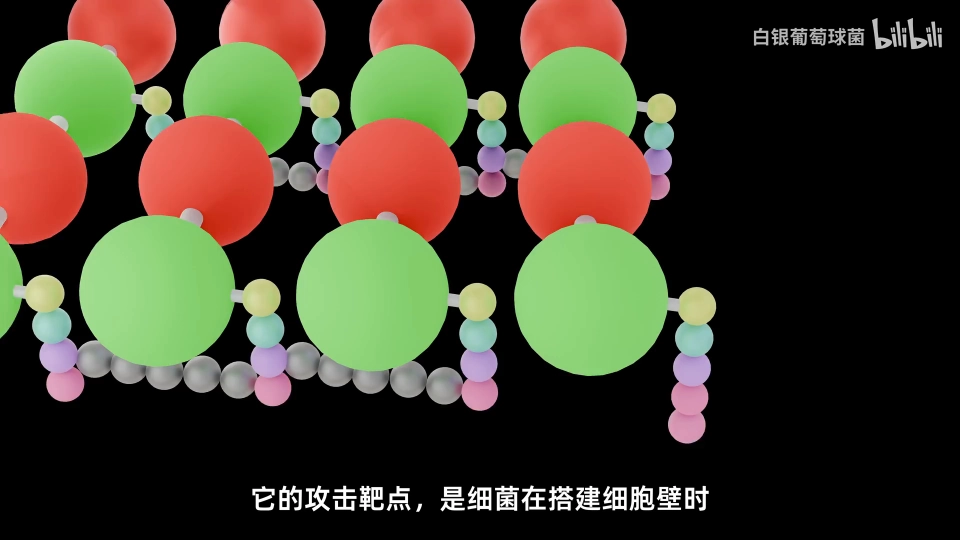
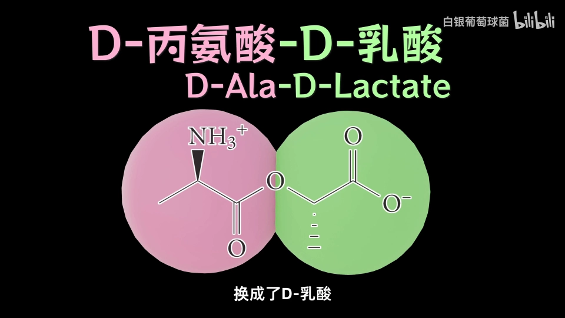
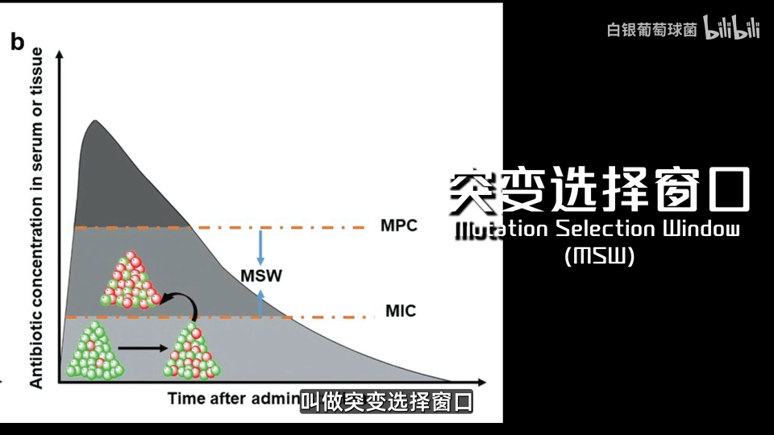
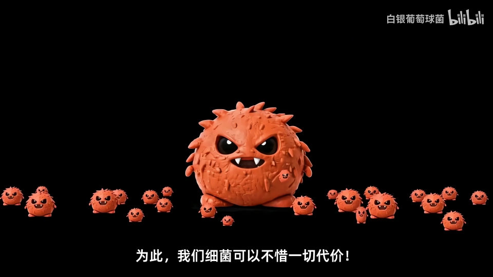
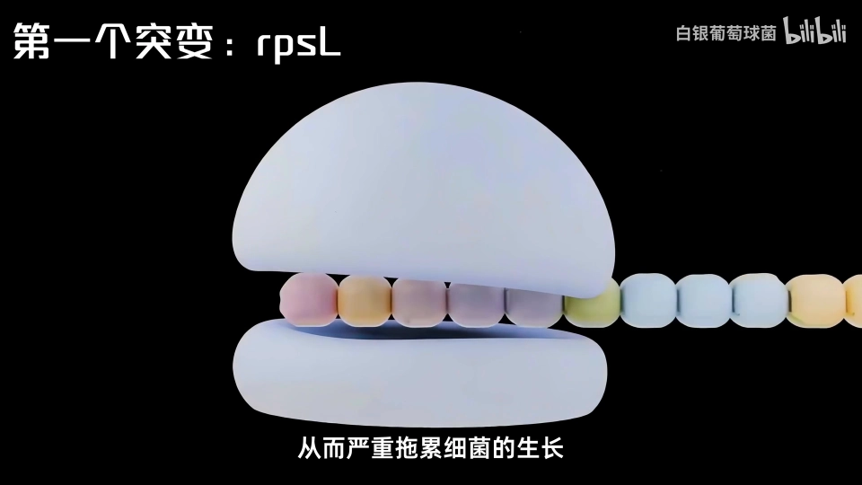
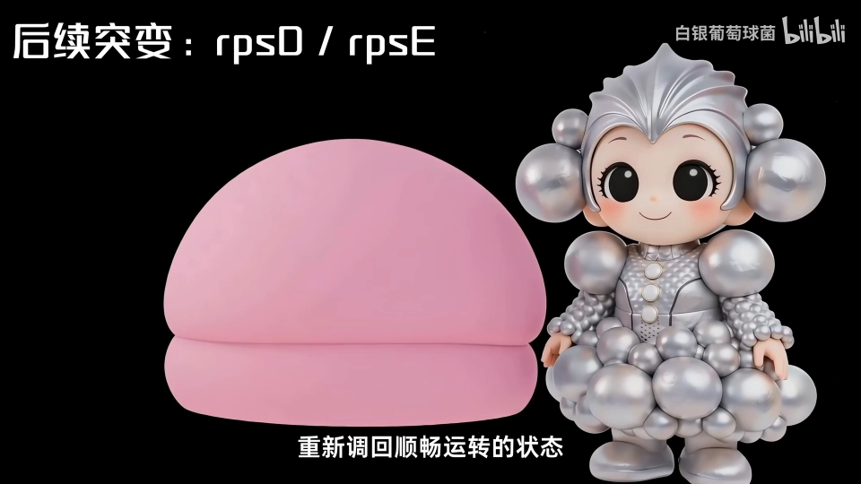
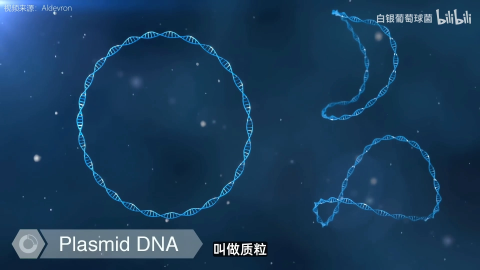

# 抗生素选择压力：耐药基因库、突变选择窗口与适应性代价

> 视频来源：[你在用抗生素杀菌，还是在培养"超级细菌"？【抗生素的故事㉖：耐药性的诞生之选择压力】](https://www.bilibili.com/video/BV1UYdnB2Ekw/)（Bilibili · 白银葡萄球菌，约 13 分钟）
> 导读（100 字以内）：一支以细菌第一人称讲述的科普，用万古霉素与耐万古霉素肠球菌把"变异先存在—环境改变—适合度差异—频率变化"四步走完，并给出突变选择窗口与适应性代价两个量化抓手。

## 本讲要解决的核心问题（SCQA）

**背景**：上世纪 50 年代人类第一次得到万古霉素时，几乎以为自己找到了终极武器，以至于科学家一度断言细菌几乎不可能对它产生耐药。

**冲突**：现实很快打脸——仅仅 30 年后，一种名为耐万古霉素肠球菌的病原体已经在医院中迅速扩散。而破解万古霉素所需的耐药系统，是一整套要额外搭建生产线、制造五种新蛋白质的复杂机制。

[【跳转到 00:00】](https://www.bilibili.com/video/BV1UYdnB2Ekw/?t=0)

**疑问**：这样一套复杂机制，不可能在 30 年里"研发"出来。那它是从哪来的？又是什么让它在医院里迅速铺开？

**回答（中心思想）**：耐药基因**早就存在**——细菌与抗生素的较量可以追溯到 10 亿年前，耐药基因在微生物界"扔得到处都是"。人类使用抗生素只是**改变了环境**，于是原本没有存在感的耐药基因获得了极高的适合度。选择压力负责筛选，不负责创造。

---

## 一、先看这套机制有多"贵"

要理解选择的力度，先得知道被选中的东西有多复杂。万古霉素是一种糖肽类抗生素，攻击靶点是细菌搭建细胞壁时必须用到的一段、由两个 D-丙氨酸组成的关键前体结构。

[【跳转到 00:55】](https://www.bilibili.com/video/BV1UYdnB2Ekw/?t=55)

万古霉素对已经成型的细胞壁无能为力，但它可以通过五个氢键，像一个形状高度适配的大夹子，把这段前体严丝合缝地包裹并锁住，从而阻断新细胞壁的搭建。

细菌的出路是把这个前体里的第二个 D-丙氨酸换成 D-乳酸，通过移除一个最关键的氢键，让万古霉素的结合能力下降约 1000 倍。

[【跳转到 01:40】](https://www.bilibili.com/video/BV1UYdnB2Ekw/?t=100)

听上去只是换一个基团，但要做到这一点，细菌需要额外搭建一整条生产线，制造五种全新的蛋白质：VanS、VanR、VanH、VanA 和 VanX——VanS 是驻守细胞膜的侦察兵，VanR 是传令官，VanH、VanA、VanX 负责合成新前体、拼装、清除旧前体。

[【跳转到 01:48】](https://www.bilibili.com/video/BV1UYdnB2Ekw/?t=108)

这套系统一旦开动，代价是实打实的。这就引出了本节第一个关键区分：**这套机制不是被抗生素"逼"出来的，而是被抗生素"选"出来的**。

---

## 二、耐药基因早已存在：变异先于选择

视频在这里给了一个非常有力的反问：这样一套复杂机制，是用仅仅 30 年就可以"研发"出来的吗？答案是否定的——人类使用抗生素不过是最近 100 年的事，但细菌与抗生素的较量可以追溯到 10 亿年前。

[【跳转到 03:13】](https://www.bilibili.com/video/BV1UYdnB2Ekw/?t=193)

抗生素本质上是微生物之间争夺生存资源时使用的生化武器。据估计，红霉素、链霉素和万古霉素的生物合成通路分别在 8.8 亿年前、6.1 亿年前和 2.4 亿年前就已经出现，即使相对年轻的达托霉素也至少有 3000 万年的历史。微生物界"打生打死"10 亿年，能够对抗抗生素的基因早就扔得到处都是了。

所有与抗生素耐药相关基因的集合，被称为**抗生素耐药基因库**（antibiotic resistome）。

[【跳转到 04:02】](https://www.bilibili.com/video/BV1UYdnB2Ekw/?t=242)

视频把这个库分成四种形态，这个分层本身就是"变异先存在"的证据：

| 形态 | 携带者 | 特点 |
| --- | --- | --- |
| 致病菌携带的耐药基因 | 临床致病菌 | 人类最熟悉，但只占基因库中极小一部分 |
| 抗生素生产菌携带的耐药基因 | 链霉菌、青霉素芽孢杆菌等 | 生产菌至少得保证自己不被自己产的抗生素溶了 |
| 沉默耐药基因 | 细菌染色体 | 平时基本不表达，没什么存在感 |
| 前体基因 | 分布最广、占比最大 | 编码的蛋白只有极微弱耐药能力，但有演化成强耐药基因的潜力 |

所以问题不是"耐药基因怎么突然出现"，而是"这些早已存在的基因，为什么在人类开始使用抗生素之后才集中爆发、并随时间越来越严重"。

---

## 三、选择压力：环境施加的筛选

视频给出的答案只有四个字：**选择压力**。它的定义是——环境对生物体施加的一种筛选作用，会让有利于生存和繁殖的特征被保留下来，不利的被逐渐淘汰，从而改变整个族群的进化方向，也就是常说的"物竞天择，适者生存"。

[【跳转到 05:09】](https://www.bilibili.com/video/BV1UYdnB2Ekw/?t=309)

这个定义里有两个词值得停一下：

- **筛选**，不是"诱导"。环境不告诉细菌该往哪变，它只决定谁留下后代。
- **有利于生存和繁殖**，判据是繁殖，不是"更强"。这与自然选择的通用判据一致。

到这里，本节的种群例子可以按四步走完了：

| 步骤 | 在这个例子里发生了什么 | 谁负责 |
| --- | --- | --- |
| 1. 变异先存在 | 耐药基因库里有前体基因、沉默基因，个别细菌已携带耐药突变 | 突变与既有基因库，随机、无方向 |
| 2. 环境改变 | 人类开始大量使用万古霉素，肠道/医院环境出现药物浓度 | 外部因素，与细菌"需要"无关 |
| 3. 适合度差异 | 敏感菌被抑制或杀死，耐药菌存活并繁殖 | 选择压力 |
| 4. 频率变化 | 耐药菌在族群中的占比上升，临床上表现为耐药性扩散 | 差异繁殖的累积结果 |

四步里唯一带方向的是第 3、4 步，而方向由环境给定。第 1 步如果不存在，后面三步都无从发生——这就是为什么"选择不能创造变异"是理解演化的第一条边界。

---

## 四、筛选力度不同，结果也不同：突变选择窗口

视频接着做了一个很实用的区分：筛选是分力度的，不同力度造成的耐药结果不一样。药效动力学模型里有一个特定的、有利于耐药亚群发展的浓度区间，叫**突变选择窗口**（mutant selection window）。

[【跳转到 05:44】](https://www.bilibili.com/video/BV1UYdnB2Ekw/?t=344)

窗口的下限是敏感菌的最低抑菌浓度（MIC），上限是耐药菌的最低抑菌浓度（MPC）。落在窗口内的浓度可以有效抑制甚至直接杀死敏感菌，但耐药菌却能逃过一劫。

- **强选择压力**（浓度在窗口内或接近）：敏感菌连"临时抱佛脚"的机会都没有。此时活下来是唯一诉求，耐药突变往往直接改变核心靶点——效果强大，但以牺牲自身基本生理功能为代价：生长变慢、代谢受损，在没有抗生素的环境中竞争力显著下降。
- **弱选择压力**（浓度远低于敏感菌 MIC，但仍带来负面影响）：细菌可以生长，只是不太舒服。更能适应这种状态的细菌获得微弱优势，耐药性通过连续累积多个低效应、低代价的突变一点点堆出来。

[【跳转到 06:37】](https://www.bilibili.com/video/BV1UYdnB2Ekw/?t=397)

视频用肠道沙门氏菌在链霉素中逐步提高浓度的实验说明弱压力路径：先微调 16S rRNA 甲基转移酶，降低链霉素与靶点的结合效率；再对呼吸链做小改动，减少耗能的药物进入；然后调高氨基糖苷腺苷酰转移酶的表达，让药物直接失活；最后把这些机制整合协调。这样一步步叠加出来的耐药强度，比起强压力下一步到位的强力突变有过之而无不及，代价却小得多。

[【跳转到 07:27】](https://www.bilibili.com/video/BV1UYdnB2Ekw/?t=447)

---

## 五、适应性代价：耐药不是免费的

视频在这里纠正了一个常见误解：很多人以为耐药菌只能在 ICU 里作威作福，一旦离开那里根本打不过敏感菌。真实情况没有那么简单，需要引入**适应性代价**——细菌为了获得耐药性所付出的生理代价。

[【跳转到 09:22】](https://www.bilibili.com/video/BV1UYdnB2Ekw/?t=562)

这个概念的用处，是把"适合度"从一句口号变成可比较的量。视频给了两个具体机制：

### 5.1 补偿突变：把代价修回来

链霉素攻击的是细菌核糖体的解码中心，也就是校对 tRNA 与 mRNA 密码子是否正确配对的地方。被干扰成功，合成的氨基酸序列就会变成一串乱码。细菌的第一个对策是提高校对准确率，但这会让翻译速度明显变慢，严重拖累生长。

[【跳转到 10:37】](https://www.bilibili.com/video/BV1UYdnB2Ekw/?t=637)

视频给了量化：如果突变前的适合度算作 1，突变之后只剩 0.74。但如果后续再发生一些突变，对核糖体内部零件之间的接触方式做微调，就能把这台过于卡顿的机器重新调顺——修复后的适合度最少也有 0.86，修得好完全可以回到 1。

[【跳转到 10:58】](https://www.bilibili.com/video/BV1UYdnB2Ekw/?t=658)

这就是**补偿突变**：单个突变不能打，但可以组团一起上。它的意义在于——适合度不是某个突变的固定属性，而是"突变 + 遗传背景 + 环境"共同决定的量。

### 5.2 共选择：队友给力也能带飞

有时候一个耐药基因的代价高到补偿突变都修不回来。正常情况下，只要外界抗生素浓度不再维持高位，它很快会被淘汰。但如果它恰好和另一个极其重要的有利基因位于同一个遗传元件上，形成深度绑定，那么只要这个元件整体带来的好处大于把两者一起丢掉，细菌就会大概率把它们一起保留下来。

[【跳转到 11:58】](https://www.bilibili.com/video/BV1UYdnB2Ekw/?t=718)

视频用质粒打比方：一个质粒上同时携带抵御抗生素 A、B、C 的三种耐药基因，各自都有代价。若环境中只有高浓度 A，B 和 C 的基因就是白费资源的负担；但由于三者绑定在同一质粒上，即使其中两个已成累赘，也会被一起保留。

[【跳转到 12:08】](https://www.bilibili.com/video/BV1UYdnB2Ekw/?t=728)

共选择提醒我们：**被选择的单位不一定是一个基因**。当基因在物理上连锁，选择就会"顺带"保留搭便车的部分。这也是为什么单看某个基因的适合度，往往预测不准它在群体里的命运。

---

## 六、本节例子的收尾与边界

视频最后承认，把基因突变和选择压力都算上，仍然解释不了为何短短 30 年耐万古霉素肠球菌就出现了，也解释不了又过十几年金黄色葡萄球菌居然也能对万古霉素耐药——因为细菌虽然是无性繁殖，但不同个体、不同族群之间的基因交流频繁到远超想象，耐药性是可以"分享"的。

[【跳转到 13:01】](https://www.bilibili.com/video/BV1UYdnB2Ekw/?t=781)

这句话正好标出了本节的边界：

- **基因的水平转移与基因流**属于 4.2.2 的范围。本节只把它作为"选择解释不了全部"的提示保留，不展开接合、转化、转导的机制。
- **突变如何产生**（点突变、移码、自发突变与诱变剂）不在本节，本节只用到"耐药基因早已存在、且突变随机"这一层。
- **群体遗传学的定量部分**（选择系数、频率变化的方程、Hardy–Weinberg）本节不推导，只用"浓度窗口"和"适合度 1 / 0.74 / 0.86"这类相对数值做直观比较。
- **临床用药建议**不是本节内容。视频里的"遵医嘱用药"只是用来说明强选择压力的场景，不构成治疗指导。
- **本节未覆盖**：镰刀型细胞贫血的杂合子优势、工业黑化等经典案例。若需要，应另找材料补入。

把整篇压成一句：**抗生素没有教会细菌耐药，它只是让早已存在的耐药基因，第一次变得如此划算。**