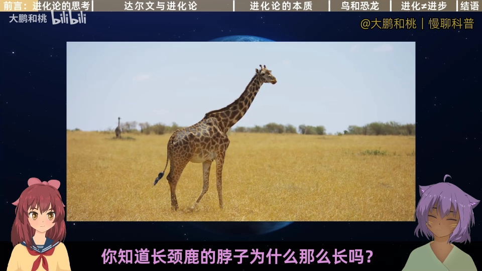
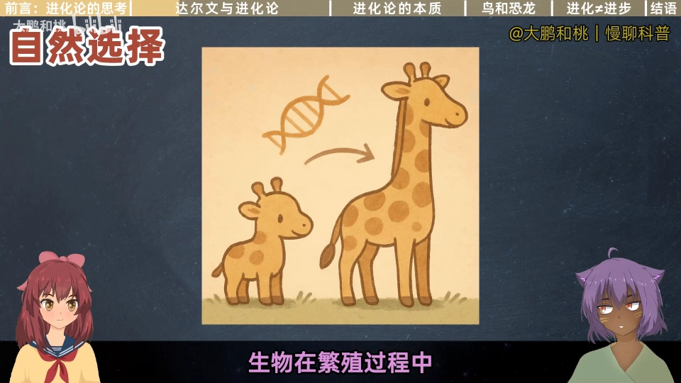
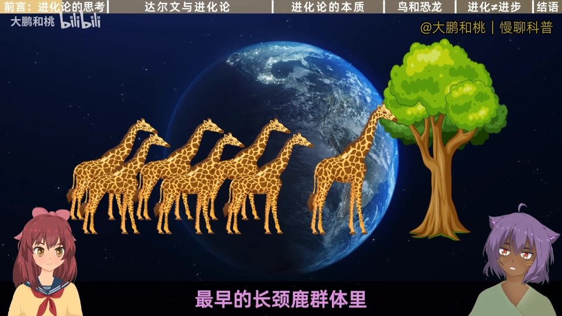
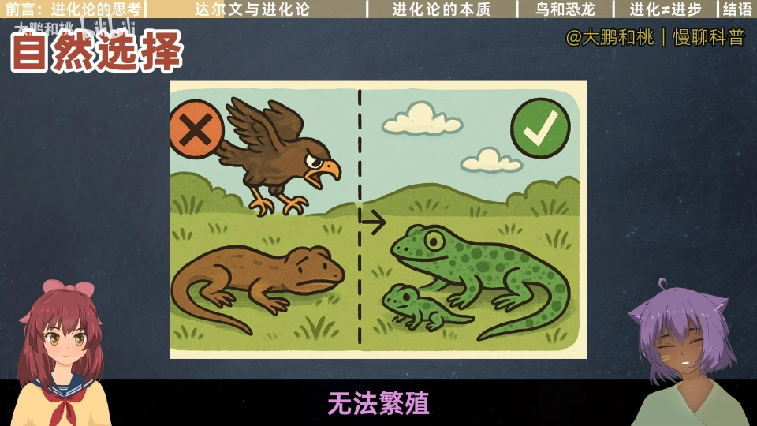
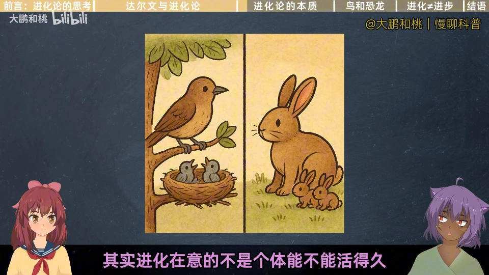
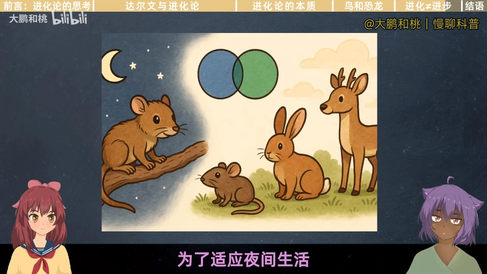
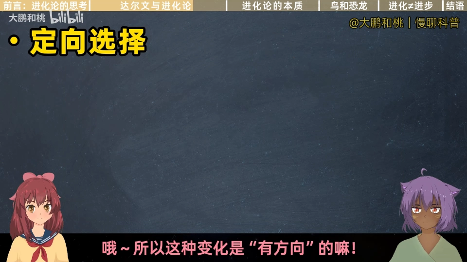
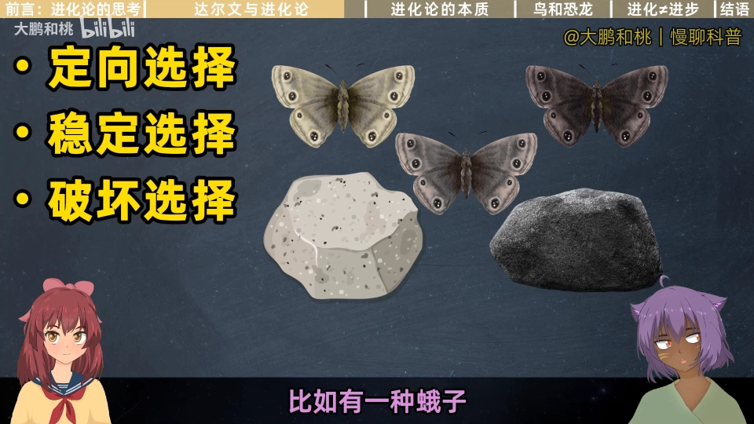

# 自然选择的筛选逻辑：适合度、环境依赖与三种选择类型

> 视频来源：[进化论到底说了什么？10分钟了解自然选择的本质](https://www.bilibili.com/video/BV1YHjAzXEt3/)（Bilibili · 慢聊科普_大鹏和桃，约 11 分钟）
> 导读（100 字以内）：一场双人对谈式科普，用长颈鹿脖子、鸟蛋大小和蛾子体色把"变异先存在、环境来筛选"讲成一条链。本文保留它的对话线索，补上适合度定义与三种选择类型的对照表，并点出它没有展开的边界。

## 本讲要解决的核心问题（SCQA）

**背景**：我们日常说"进化"，往往带着一种目的论的味道——鸟"为了"飞才长出翅膀，长颈鹿"为了"吃高处的树叶才把脖子伸长。这些说法听起来顺理成章，因为它们符合"需要驱动改变"的直觉。

**冲突**：视频开篇就把这个直觉判为"大家对进化最常见的误区之一"：进化并不是为了达到某个目的而发生的，而是一个结果——某些特征碰巧更适应环境，所以被保留下来了。

[【跳转到 00:53】](https://www.bilibili.com/video/BV1YHjAzXEt3/?t=53)

**疑问**：如果改变不是"努力"出来的，那变异从哪里来？"更适应"由谁判定？判定之后又发生了什么，才会让一个种群的样子整体改变？

**回答（中心思想）**：自然选择只做一件事——**筛选**。变异在繁殖过程中随机产生，本身没有方向也没有目的；环境充当筛子，决定哪些变异留下更多后代；被留下的特征再遗传给下一代，一代代累积，种群的样子就变了。所以演化是"事后筛选"，不是"事前设计"。

---

## 一、变异先存在：随机产生，不带目的

视频把变异的来源说得很直白：生物在繁殖过程中，偶尔会出现一些**随机的基因突变**，这些突变本身没有任何目的，完全靠运气发生。

[【跳转到 02:57】](https://www.bilibili.com/video/BV1YHjAzXEt3/?t=177)

这句话里有两个必须分开的成分，混在一起就会滑向目的论：

| 成分 | 谁负责 | 有没有方向 |
| --- | --- | --- |
| 变异产生 | 基因突变（随机、偶然） | 没有，与环境需要无关 |
| 变异保留 | 环境筛选 | 有，偏向当下更能繁殖的那一类 |

长颈鹿的例子把两者串起来：最早的长颈鹿群体里，有些个体脖子可能稍微长一点，这是基因突变造成的，完全是偶然事件；但正好脖子长的那批能吃到别人够不到的树叶，因此活得更好、繁殖得更多。

[【跳转到 01:14】](https://www.bilibili.com/video/BV1YHjAzXEt3/?t=74)

注意这个例子的顺序：**先有高矮不一的个体，后有"高处的树叶"这个筛选条件**。脖子长不是被"需要"召唤出来的，而是本来就存在的那部分个体，在特定环境下留下了更多后代。视频把结论压成一句话：进化其实是筛选的过程，不是努力的成果。

[【跳转到 01:39】](https://www.bilibili.com/video/BV1YHjAzXEt3/?t=99)

---

## 二、环境是筛子：选择的三个必要条件

把上面的例子抽象出来，自然选择要成立需要三件事同时在场。视频用"环境相当于一个筛子，帮忙挑选出更适合的个体"来概括第二、三条：

1. **变异**：群体里个体之间存在差异（来自随机突变）。
2. **遗传**：这些差异能传给下一代（"下一代又遗传这个特征"）。
3. **差异适合度**：不同变异在当下环境里留下后代的数量不同。

[【跳转到 03:19】](https://www.bilibili.com/video/BV1YHjAzXEt3/?t=199)

这张图把"适合度"的判据画得很清楚：左边那只不是"不够强"，而是**没有留下后代**；右边那只不是"更能打"，而是**繁殖成功了**。自然选择记账的科目是后代数量，不是战斗力，也不是寿命。

三条里少任何一条，选择都无从发生：没有变异，筛子无物可筛；变异不能遗传，筛出来的优势下一代就归零；没有差异适合度，所有变异留下的后代一样多，频率就不会变。第三条正是下一节要展开的"适合度"。

---

## 三、适合度：留下更多后代，而不是活得更久

视频用人类老年疾病做了一个反直觉的例子：很多人上了年纪后会因为心脏病、脑血管疾病去世，如果人类能在进化中变得更抗这些病、寿命更长，听起来当然很好；可遗憾的是，这类进化很可能不会发生。

[【跳转到 05:40】](https://www.bilibili.com/video/BV1YHjAzXEt3/?t=340)

原因是时间点：这些疾病大多在老年才出现，而大多数人在年轻还能生孩子的时候，后代就已经有了。就算某个人天生有抗病的基因突变，也不会影响他在年轻时有没有留下后代，所以这种突变很难在整个种群中扩散开来。

由此得到本节对**适合度（fitness）**的操作性理解：

- 适合度衡量的不是"个体有多强、多健康、多长寿"，而是**在特定环境下把基因传给下一代的数量**。
- 因此它是**相对**的：同一个变异，在环境 A 里适合度高，在环境 B 里可能变成负担。
- 生存只是繁殖的前提之一，不是目的本身。视频补了一句：一些昆虫产完卵就会因为体力耗尽而死去，还有一些秋天产卵的昆虫甚至连冬天都熬不过去——它们照样把基因传了下去。

视频把这条讲得很"冷酷"：进化只筛选那些能让物种更容易繁衍后代的特征，至于个体在繁殖后能不能活得更久、更健康，进化并不在意。

[【跳转到 06:24】](https://www.bilibili.com/video/BV1YHjAzXEt3/?t=384)

---

## 四、环境依赖：适应是相对的，不是绝对的

既然适合度由环境定义，那么"适应"就必然是相对的。同一套特征，换一个环境就可能从优势变成劣势。视频用色觉举了一个很干净的例子：脊椎动物的祖先很多原本是四色色觉，后来哺乳动物的祖先为了适应夜间生活，"自觉"退化成了二色色觉，以提升在黑暗环境的适应能力；直到灵长类祖先重新适应白天生活，才又把色觉进化回三色。

[【跳转到 10:15】](https://www.bilibili.com/video/BV1YHjAzXEt3/?t=615)

这个例子的价值在于它同时否掉了两个常见假设：**退化也是演化**（能力变少同样可以是适应），以及**演化不等于进步**（不是一条直线往更高级走，而是随着环境变化不断调整）。视频在这里明确说：进化不代表越来越强，也不等于进步。

[【跳转到 09:38】](https://www.bilibili.com/video/BV1YHjAzXEt3/?t=578)

环境依赖还有一层推论：**环境一变，之前的"好特征"可能立刻变成负担**。这在抗生素场景里最直观——耐药突变在没有抗生素的环境里往往竞争力下降，一旦用药又变成救命特征。这条线索由同小节的另一篇博客展开：[抗生素选择压力：耐药基因库、突变选择窗口与适应性代价](抗生素选择压力：耐药基因库、突变选择窗口与适应性代价.md)。

---

## 五、三种选择类型：方向不同，判据相同

视频把自然选择细分成三种类型，并各给了一个例子。三者的差别只在"筛掉哪一端"，判据仍然是后代数量。

| 类型 | 筛掉谁 | 群体特征怎么变 | 视频给的例子 |
| --- | --- | --- | --- |
| 定向选择 | 分布一端的个体 | 某个特征朝一个方向持续移动 | 北极熊的毛色随着进化越变越白，在冰天雪地里更容易隐藏自己 |
| 稳定选择 | 两端的极端个体 | 特征维持在中间的最优值附近 | 鸟蛋太大太小都不利于孵化，中等大小最容易成功 |
| 分裂选择（视频称"破坏选择"） | 中间状态的个体 | 群体向两端分化，中间变少 | 生活在布满黑白石头环境里的蛾子：黑蛾与白蛾都有保护色，灰蛾最容易被发现 |

[【跳转到 04:38】](https://www.bilibili.com/video/BV1YHjAzXEt3/?t=278)

[【跳转到 05:07】](https://www.bilibili.com/video/BV1YHjAzXEt3/?t=307)

需要留意两处容易被误读的地方：

- **"定向"不等于"有目标"**。定向选择说的是表型分布朝一个方向移动，这个方向由环境当下的筛选结果决定，不是变异本身带着方向。视频对"所以这种变化是有方向的嘛"这句追问只回了一声"嗯"就转到下一种类型；"方向从筛子里来"这一点，在上文"环境相当于一个筛子"处已经给出。
- **分裂选择可以通向分化**。视频说灰蛾越来越少，慢慢可能分化出两个不同的群体，并把这个"一个物种分裂成两个新物种"的过程称为种化。物种形成本身不在本节范围，见 4.2.3。

---

## 六、三个常见误读

把视频里被点名的说法集中列一下，它们都源于把"筛选"错当成"设计"：

| 误读 | 错在哪 | 视频中的对应说法 |
| --- | --- | --- |
| "为了吃到高处的树叶，脖子才变长" | 把结果当成原因；变异先于需求存在 | 进化并不是为了达到某个目的而发生的，而是一个结果 |
| "多锻炼、多使用，后代就会长出相应器官" | 后天锻炼不改变生殖细胞的遗传信息 | 就算你每天跳高跳到天花板，也不会让你的后代长出翅膀 |
| "进化就是越来越强、越来越进步" | 适合度只相对于当下环境，退化也可以是适应 | 进化不代表越来越强，也不等于进步 |

第一条是典型的**拉马克式**（用进废退）叙述，第二条是它在个体层面的版本。视频没有点名"拉马克"，但用"锻炼手臂长出翅膀"这个反例把逻辑讲完了：获得性改变不进入遗传通道，就不会成为下一代的起点。

第三条误读的根源是把"适应"读成"变强"。视频的收尾句可以作为本节的判据：**进化从来不是谁最厉害，而是谁最适合环境**。

[【跳转到 10:41】](https://www.bilibili.com/video/BV1YHjAzXEt3/?t=641)

---

## 七、边界：本节没有覆盖的部分

- **选择的原材料从哪来、有多随机**：本节只用到"突变随机、无目的"这一层。突变的类型（点突变、移码）、自发突变与诱变剂的机制不在本篇，属于分子层面的内容。
- **可遗传与不可遗传**：视频只说到"下一代又遗传这个特征"。严格地说，只有发生在**生殖细胞**（及其前体）里的突变、以及减数分裂时的重组，才能进入下一代；体细胞突变会随个体死亡而消失。这条区分是教材常识，视频未展开，此处作为边界标注，不当作视频结论。
- **随机因素**：种群很小时，基因频率会因为抽样而随机波动（遗传漂变），这与"选择"是两种不同的机制，见 4.2.2。基因流（迁移带来的基因交换）同属 4.2.2。
- **频率怎么算**：本节只用"更多后代 → 频率上升"的定性说法，不推导 Hardy–Weinberg 或选择系数。
- **物种形成**：视频提到的"种化"只作为分裂选择的延伸结果出现，机制见 4.2.3。
- **本节未覆盖的经典案例**：镰刀型细胞贫血的杂合子优势、工业黑化（英国胡椒蛾）在所选视频中没有展开，仅在分裂选择的蛾类例子里出现体色与背景的对应关系。若需要这两个案例的定量细节，应另找材料补入，不以本节替代。