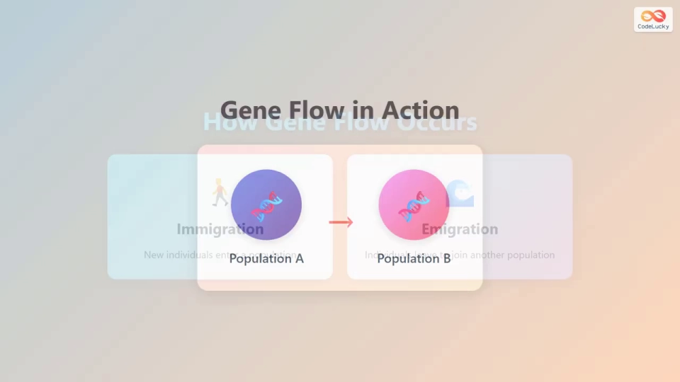
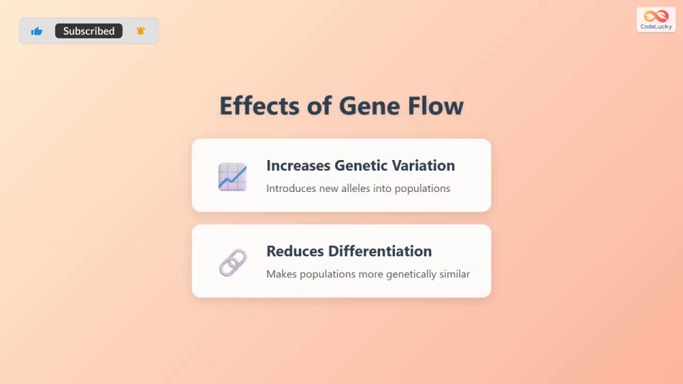
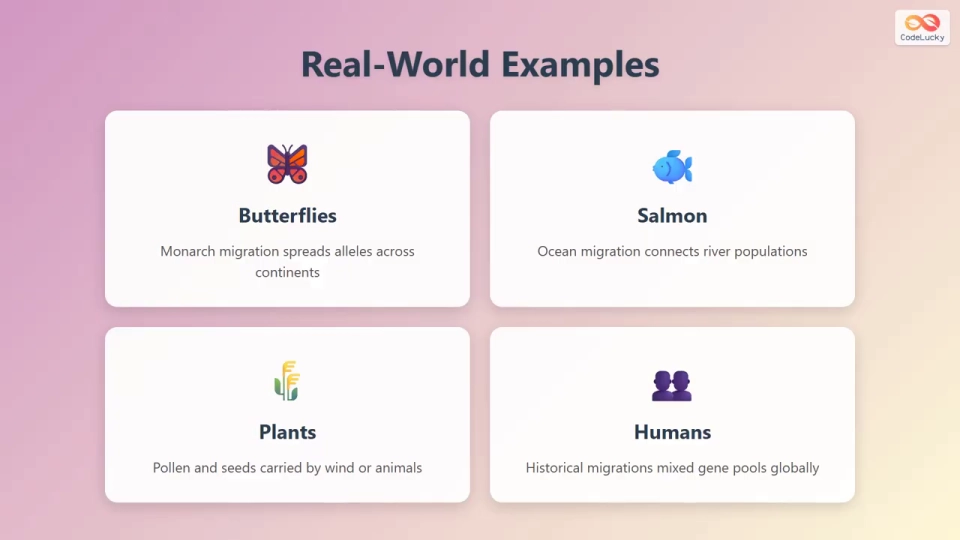
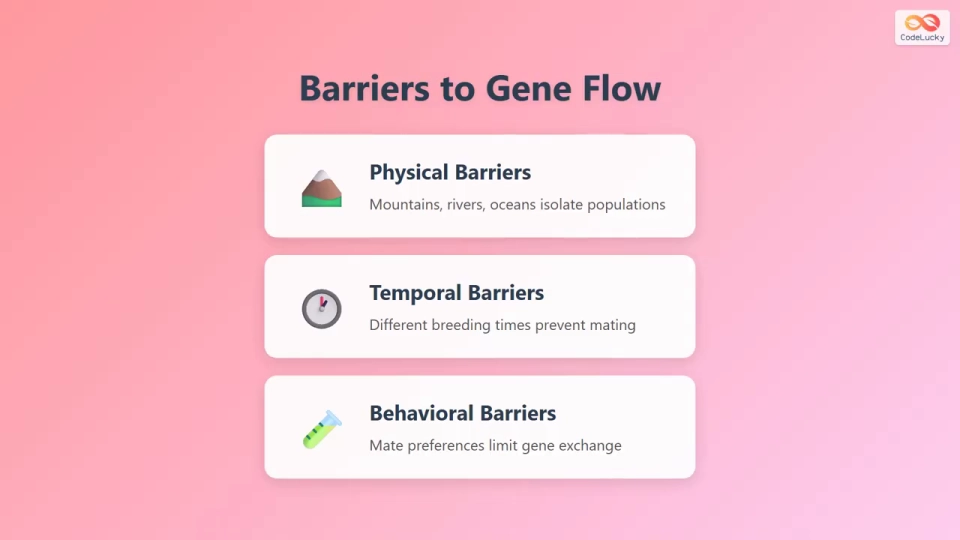

# 基因流：迁移带来的群体内变异与群体间同质化

> 视频来源：[Gene Flow Explained: How Migration Spreads Alleles Between Populations](https://www.youtube.com/watch?v=YCZ91lEifR8)（YouTube · CodeLucky，约 5 分 43 秒）
> 导读（100 字以内）：一支自动配音的图解短片，只讲一件事——等位基因跟着迁移的个体走。本文保留它"定义—两个效应—例子—屏障"的顺序，补上与漂变、选择的对照，并标出它没有展开的部分。

## 本讲要解决的核心问题（SCQA）

**背景**：前面讨论过两种改变等位基因频率的机制：自然选择（与适合度相关的非随机变化）和遗传漂变（与适合度无关的随机变化）。两者都作用在**一个**种群内部。

**冲突**：但种群很少是封闭的。动物会迁往新地域，植物的种子会被风带走，人会迁徙、贸易、旅行。一旦个体在两个种群之间移动并繁殖，基因就不再只在一个池子里搅动。

**疑问**：这种"跨池子"的基因移动叫什么？它怎么发生？它对两个种群各有什么影响？什么时候会停下来？

**回答（中心思想）**：这就是**基因流**（gene flow）——通过个体迁移，把一个种群的等位基因转移到另一个种群。它有**两个方向相反的效应**：向群体内部看，它**增加**遗传变异；向群体之间看，它**减少**遗传分化。物理、时间、行为三类屏障会限制它，而屏障一旦出现，两个种群就开始各自演化。

[【跳转到 00:00】](https://www.youtube.com/watch?v=YCZ91lEifR8&t=0)

---

## 一、定义：等位基因跟着个体走

视频给的定义很短：基因流是**通过个体迁移，把一个种群的等位基因转移到另一个种群**。

拆开看，这句话有三个要件，缺一不可：

| 要件 | 含义 | 为什么必需 |
| --- | --- | --- |
| 个体迁移 | 生物从一个群体搬到另一个群体 | 基因不会自己走过去，需要载体 |
| 成功繁殖 | 迁入者在新群体里留下了后代 | 只是搬过去、没有繁殖，基因就停在个体身上，不进基因库 |
| 等位基因转移 | 接收方种群的等位基因组成改变 | 这才是"流"的结果 |

[【跳转到 00:25】](https://www.youtube.com/watch?v=YCZ91lEifR8&t=25)

视频在这里插了一段术语铺垫：等位基因是基因的不同版本，决定眼睛颜色、身高、抗病性这类性状。这段的作用是把"基因流"从抽象名词落到具体对象上——流动的不是"物种"或"个体"，而是这些版本本身。

[【跳转到 00:50】](https://www.youtube.com/watch?v=YCZ91lEifR8&t=50)

讲者随后点明驱动因素：**迁移是基因流的关键驱动因素**——无论是动物迁往新地域，还是植物种子被风带走，都是同一条机制在起作用。

---

## 二、迁入与迁出：同一枚硬币的两面

基因流通过两个过程发生：

- **迁入**（immigration）：新个体从别处进入一个种群。这些外来者带来它们特有的等位基因，为加入的群体**增加**遗传多样性。
- **迁出**（emigration）：个体离开原来的种群、加入另一个种群。

[【跳转到 01:00】](https://www.youtube.com/watch?v=YCZ91lEifR8&t=60)

关键结论是：**两个过程结果相同**——等位基因在种群之间转移，改变了来源群体和接收群体的遗传组成。所以讨论基因流时，不必纠结"这算迁入还是迁出"，那只是站在哪个种群的角度看；真正要看的是**两个种群之间有没有等位基因交换**。

[【跳转到 01:25】](https://www.youtube.com/watch?v=YCZ91lEifR8&t=85)

---

## 三、两个效应：一个向内，一个向外

视频把基因流的影响归纳为两条，方向刚好相反，这是全片最值得记住的一组：

| 效应 | 作用层面 | 结果 | 视频给的理由 |
| --- | --- | --- | --- |
| 增加遗传变异 | 种群**内部** | 接收方获得更多遗传多样性 | 迁入者带来新的等位基因，为自然选择提供更多原材料，帮助种群适应变化的环境 |
| 减少遗传分化 | 种群**之间** | 两个种群变得更相似 | 等位基因被交换，产生"同质化"效应，抵消原本会让种群分化、变成不同物种的力量 |

[【跳转到 02:13】](https://www.youtube.com/watch?v=YCZ91lEifR8&t=133)

两条效应并不矛盾，因为它们回答的是不同问题：**"这个种群里的变异多不多"和"这两个种群像不像"是两件事**。一个种群可以因为迁入而变异变多，同时因为持续与邻居交换而越来越像邻居。

视频用一个两池子的图景把机制画出来：设想种群 A 和种群 B 生活在不同地区；当 A 的个体迁到 B 并成功繁殖，它们就把自己的等位基因传给了新种群，这次交换改变了 B 的遗传组成，结果是两个种群在遗传上更接近了。

[【跳转到 01:35】](https://www.youtube.com/watch?v=YCZ91lEifR8&t=95)

---

## 四、自然界里的基因流

视频给了四个例子，覆盖动物、植物和人类：

| 例子 | 迁移方式 | 连接了什么 |
| --- | --- | --- |
| 黑脉金斑蝶 | 长距离迁徙 | 不同大陆的种群 |
| 鲑鱼 | 从海洋洄游到河流产卵 | 原本生活在不同河系的种群 |
| 植物 | 花粉被风或动物带到远处授粉；种子被带到新地区 | 相隔较远的植株 |
| 人类 | 迁徙、贸易、旅行 | 全球的基因库 |

[【跳转到 02:57】](https://www.youtube.com/watch?v=YCZ91lEifR8&t=177)

人类这一条值得单独记一下：视频说，人类历史上经历了广泛的基因流，迁徙、贸易和旅行把全球的基因库混合在一起——这也解释了**为什么人类各群体虽然地理上相隔，遗传上却如此相似**。这句话把"减少分化"这条抽象效应落到了一个可观察的现象上。

---

## 五、屏障：基因流什么时候会停

基因流虽然普遍，但可以被限制。视频列了三类屏障：

| 屏障类型 | 具体形式 | 怎么阻止基因流 |
| --- | --- | --- |
| 物理屏障 | 山脉、河流、海洋 | 让迁移变得困难甚至不可能；种群在物理上无法接触，基因流就停止 |
| 时间屏障 | 在一年中或一天中不同时间繁殖 | 即使占据同一片区域，也无法交配 |
| 行为屏障 | 配偶偏好、求偶仪式 | 不把对方当作合适配偶，或求偶行为不兼容，基因交换不会发生 |

[【跳转到 03:47】](https://www.youtube.com/watch?v=YCZ91lEifR8&t=227)

三类屏障的差别在于**拦在哪一步**：物理屏障拦在"能不能到达"，时间屏障拦在"到达了但不同时"，行为屏障拦在"同时同地但不认对方"。三者最终都落到同一个后果上——**基因交换不发生**。

[【跳转到 04:17】](https://www.youtube.com/watch?v=YCZ91lEifR8&t=257)

视频由此给出一个推论：这些屏障可能导致**生殖隔离**，而生殖隔离是形成新物种的第一步。物种形成本身不在本节范围，见 4.2.3；这里只需记住逻辑方向：**基因流停 → 两个种群各自演化 → 分化累积**。

---

## 六、与漂变、选择的对照

视频本身只讲基因流，没有做三方对照。把本小节三篇材料放在一起，可以整理出下面这张表（其中"与漂变方向相反"这一条由本节按两篇视频的结论合成，不是任一视频的原话）：

| 机制 | 变化的来源 | 与适合度的关系 | 对群体内变异 | 对群体间分化 |
| --- | --- | --- | --- | --- |
| 自然选择 | 差异繁殖 | 相关（非随机） | 通常减少（有利型取代其他） | 环境不同则增大 |
| 遗传漂变 | 有限群体的抽样 | 无关（随机） | 减少（等位基因随机丢失） | 各自随机，通常增大 |
| 基因流 | 个体迁移与繁殖 | 与迁移本身无关 | **增加** | **减少** |

[【跳转到 04:35】](https://www.youtube.com/watch?v=YCZ91lEifR8&t=275)

[【跳转到 05:05】](https://www.youtube.com/watch?v=YCZ91lEifR8&t=305)

这张表最有用的地方是最后两行：**漂变与基因流在"群体间分化"这一列方向相反**。漂变让每个小种群各自漂走、彼此越来越不一样；基因流把等位基因来回搬运、把差异抹平。所以一个种群的最终分化程度，取决于这两股力量的相对强弱——迁移多、群体大，分化就慢；迁移断、群体小，分化就快。这一条是本文的整理，视频只分别陈述了两侧的结论。

---

## 七、边界：这篇没有回答的部分

- **基因流有多强，怎么度量**。视频只给定性结论（增加变异、减少分化），没有给出迁移率、$F_{st}$ 或任何分化指数的定义与计算。学习目标明确不要求这部分。
- **基因流与漂变的定量竞争**。第 6 节的对照表是定性整理；"迁移多少才能抵消漂变"需要群体遗传学方程，本篇不展开。
- **基因流不总是好事**。视频把"增加变异"讲成有益的（提供更多原材料、帮助适应），但没有讨论迁入带来的**遗传同化**或**远交衰退**等反面情形。这是视频的取舍，本文不替它补结论。
- **物种形成**。视频结尾提到生殖隔离是形成新物种的第一步，机制见 4.2.3，本篇不展开。
- **基因流的实测案例**。四个例子都是概述性的，没有给出具体研究的数据或时间尺度。若需要定量案例，应另找材料。
- **本片的性质**。这是一支自动配音的图解短片，叙述结构清晰但深度有限；本篇只按它的陈述整理，涉及事实判断处（如"人类群体遗传上相似"）以通行的群体遗传学共识为准，未额外引入视频之外的数字。

---

## 小结

- **基因流 = 等位基因跟着迁移的个体走**，需要三个要件：个体迁移、成功繁殖、接收方基因库改变。
- **迁入与迁出是同一件事的两面**，结果都是等位基因在两个种群之间转移。
- **两个效应方向相反**：向群体内部看增加变异，向群体之间看减少分化。
- **屏障拦在不同步骤**：物理屏障拦"能不能到"，时间屏障拦"是否同时"，行为屏障拦"是否互认配偶"；三者都让基因交换不发生。
- **与漂变方向相反**：漂变让群体间越来越不一样，基因流把差异抹平；最终分化程度取决于两者相对强弱。

## 关键术语速查

| 术语 | 一句话解释 |
| --- | --- |
| 基因流（gene flow） | 通过个体迁移，把一个种群的等位基因转移到另一个种群 |
| 迁入 / 迁出（immigration / emigration） | 个体进入 / 离开一个种群；两者都造成等位基因交换 |
| 等位基因（allele） | 基因的不同版本，决定同一性状的不同表现 |
| 遗传分化 | 两个种群在等位基因频率上的差异程度；基因流减小它，漂变增大它 |
| 同质化效应 | 基因流让种群彼此更相似的效应 |
| 生殖隔离 | 两个群体无法再互相繁殖，是形成新物种的第一步（详见 4.2.3） |