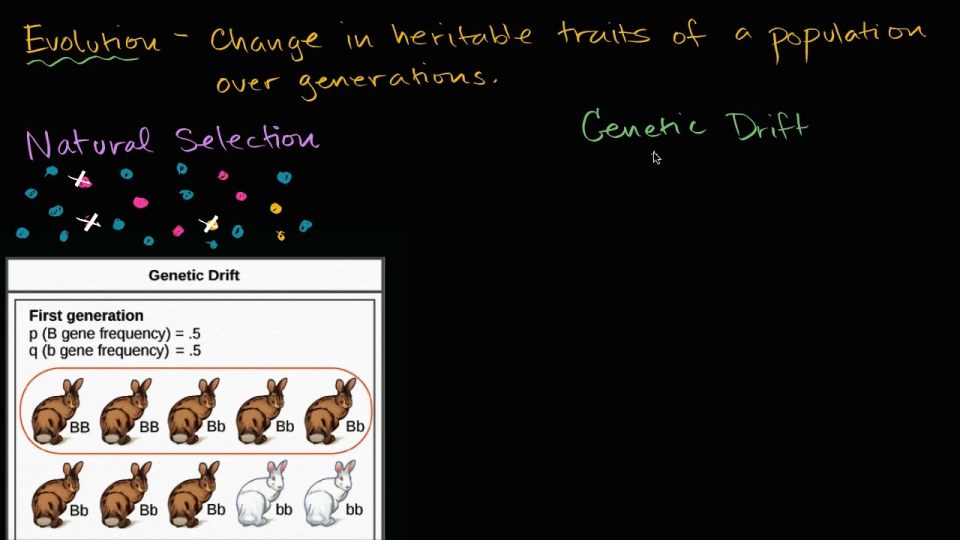
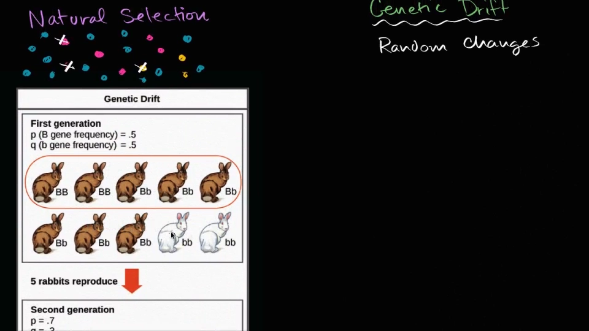
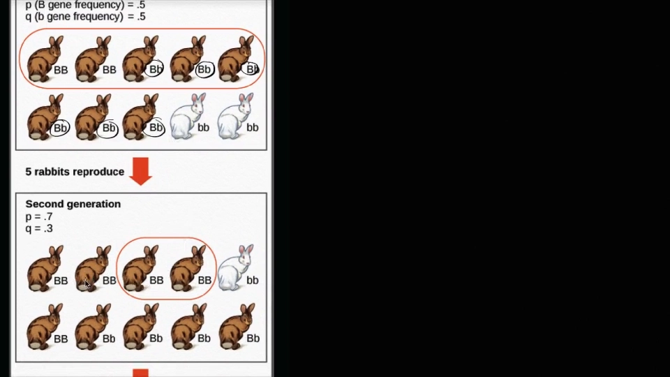
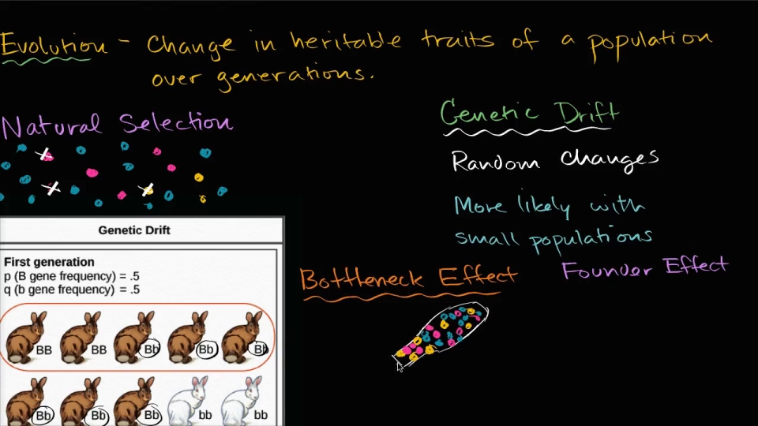
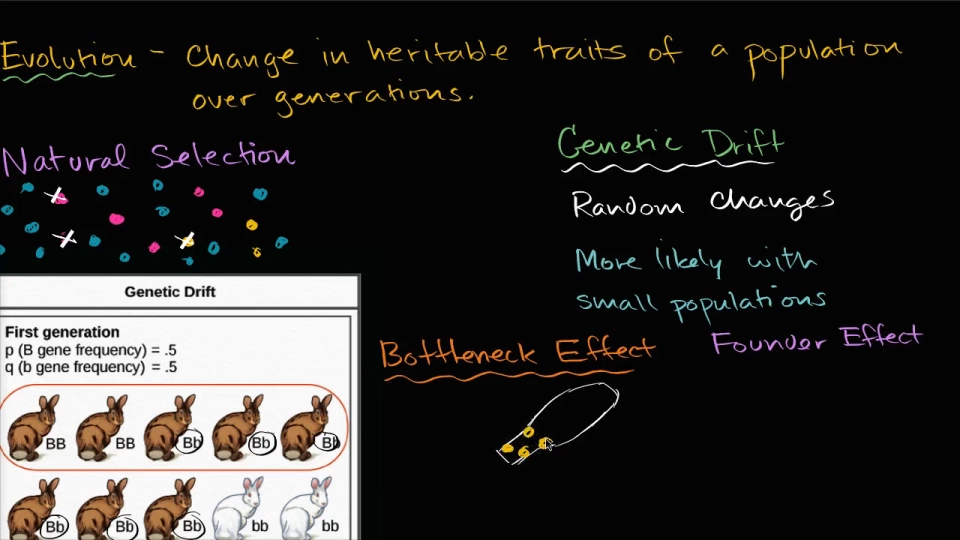
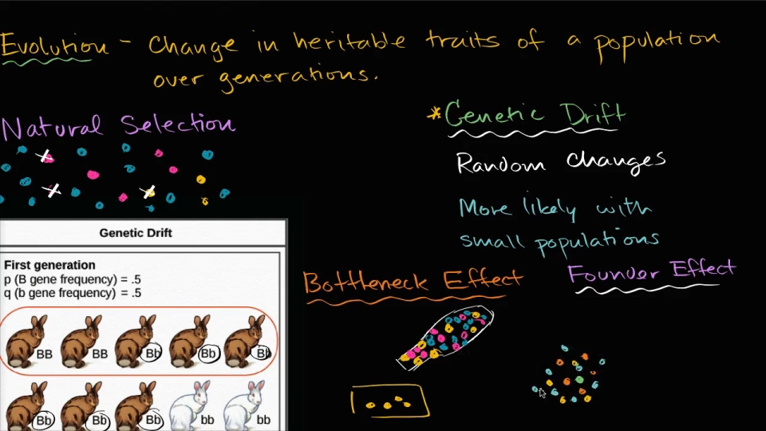
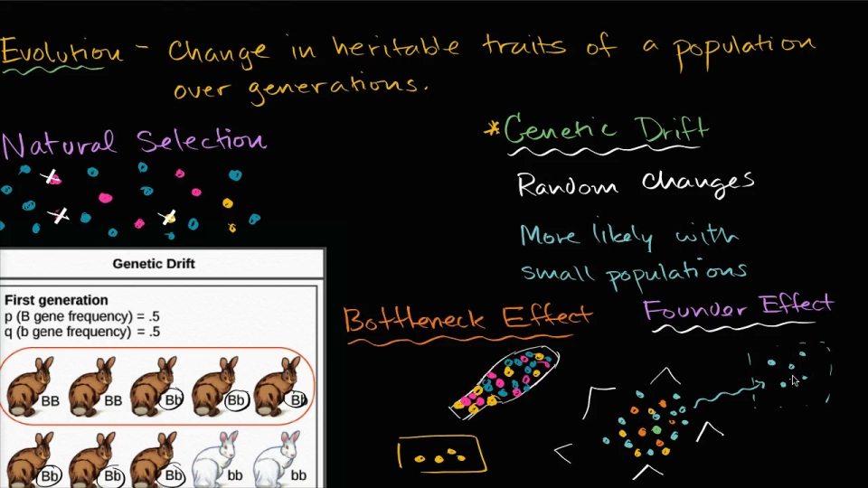

# 遗传漂变的抽样逻辑：小群体、瓶颈效应与奠基者效应

> 视频来源：[Genetic drift, bottleneck effect and founder effect | Biology | Khan Academy](https://www.youtube.com/watch?v=IRTn0iNkAHI)（YouTube · Khan Academy，约 10 分 46 秒）
> 导读（100 字以内）：可汗学院用手绘板和"十只兔子"的教材插图，把漂变讲成一次抽样：谁恰好繁殖，等位基因频率就跟着走。本文保留这条推导链，补上瓶颈与奠基者的对照，并标出它没有回答的问题。

## 本讲要解决的核心问题（SCQA）

**背景**：演化是种群的可遗传性状在世代间发生变化。讲到"变化的原因"，最常被提起的是自然选择：种群里有变异，环境筛出更会繁殖的那一类，于是这类性状的频率上升。

**冲突**：可汗学院开篇就提醒，自然选择只是演化的一种机制，只是因为最常被讨论，才被当成"主要机制"。若把演化和自然选择当成同义词，就会漏掉另一类变化——它同样改变频率，却不看性状好坏。

**疑问**：如果变化不是由"更适合环境"驱动的，那它由什么驱动？这样的变化会把种群带向哪里？它和自然选择怎么区分？

**回答（中心思想）**：另一种机制叫**遗传漂变**（genetic drift），它指的是有限群体里"谁恰好留下后代"带来的随机抽样误差。漂变与适合度无关，方向不可预测，在小群体里作用最强；**瓶颈效应**和**奠基者效应**是它最极端的两种形态，都先把群体变小，再让变异大量流失。

[【跳转到 00:00】](https://www.youtube.com/watch?v=IRTn0iNkAHI&t=0)

---

## 一、漂变是"谁恰好繁殖了"，不是"谁更适合"

自然选择的逻辑链条是：种群内有变异 → 某种变异更能繁殖 → 这种变异在世代间变多。漂变走的是同一条"频率会变"的路，但中间那一步换掉了：

| | 自然选择 | 遗传漂变 |
| --- | --- | --- |
| 变化来源 | 与适合度相关的差异繁殖 | 与适合度无关的随机差异繁殖 |
| 方向 | 朝当下更会繁殖的性状偏 | 不可预测，这一次朝东、下一次可能朝西 |
| 结果 | 有利性状累积 | 频率随机上下波动，等位基因可能凭空消失 |

[【跳转到 01:40】](https://www.youtube.com/watch?v=IRTn0iNkAHI&t=100)

讲者用"活的小圆点"作画：一群圆点有蓝的、洋红的、黄的，自然选择关心的是哪种颜色更能繁殖、更不容易被天敌吃掉。哪怕只是稍微更容易繁殖，经过很多代，这种颜色也会占据主导。漂变则完全不问这个问题——它只问"这一代恰好是谁繁殖了"。

这个区别有个容易漏掉的推论：**漂变可以让有利的等位基因消失，也可以让有害的等位基因固定**。因为决定去留的不是性状好坏，而是抽样。

---

## 二、十只兔子的账本：频率从 50% 走到 70%

讲者借用 OpenStax《College Biology》的插图，用一个很小的种群把漂变算了一遍。设定很简单：

- 种群只有 **10 只兔子**，看的是毛色基因的两个等位基因：大写 $B$（显性，棕色）和小写 $b$（隐性，白色）。
- 基因型 $BB$、$Bb$ 都是棕兔，$bb$ 是白兔。
- 第一代里，数一数等位基因：大写 $B$ 与小写 $b$ **各占 50%**，即 $p = q = 0.5$。虽然表型上棕色兔子多得多，但那六只棕兔都是杂合子，各带一个 $b$。

[【跳转到 02:39】](https://www.youtube.com/watch?v=IRTn0iNkAHI&t=159)

关键的一步是给环境"清零"：假设在这个环境里，棕色和白色**没有任何优劣**，棕兔并不比白兔更容易存活或繁殖。于是接下来发生的事，与适合度无关。

然后，纯粹出于偶然，上面五只兔子繁殖了，下面五只没有。讲者特意堵住了一个追问——"为什么偏偏是上面五只？"答案是：没有理由，这只是个例子，完全可能是下面五只，也可能只有那两只白兔繁殖。

[【跳转到 03:29】](https://www.youtube.com/watch?v=IRTn0iNkAHI&t=209)

下一代由这五只繁殖而来，账本变了：大写 $B$ 的频率从 **50% 升到 70%**。

[【跳转到 04:41】](https://www.youtube.com/watch?v=IRTn0iNkAHI&t=281)

再抽一次，白色等位基因可能就彻底从种群中消失了。讲者在这里补了一句最要紧的话：**它消失不是因为白色让兔子变得不适应**——事实上白色甚至可能带来一点优势，从环境角度看也许是更好的性状，但它还是因为偶然没了。

[【跳转到 05:14】](https://www.youtube.com/watch?v=IRTn0iNkAHI&t=314)

这个例子的数值（50% → 70%）是教材给出的**一次**抽样结果，不是漂变的必然走向。讲者反复强调"它完全可能朝相反方向走"：即使第一次随机已经发生，也可能下一轮那只白兔繁殖得特别多，频率又摆回去。**可重复的是"会波动"，不可预测的是"往哪边波动"**——这条性质在第六节用来区分选择与漂变。

---

## 三、小群体为什么漂得更厉害

同样一次"谁恰好繁殖"的抽样，在 10 只兔子和 1000 万只兔子身上，后果完全不同。

[【跳转到 05:38】](https://www.youtube.com/watch?v=IRTn0iNkAHI&t=338)

讲者的说法很直白：他描述的情形在小种群里发生的可能性要大得多；10 只兔子出现这种结果的可能性，和 1000 万只兔子出现同样结果的可能性，差别非常大。原因就是抽样误差的相对大小——样本越小，一次偶然对整体比例的扰动越大。这跟抛硬币是同一件事：抛 10 次出现 7 次正面毫不稀奇，抛 1000 万次还偏离一半，就几乎不可能。

由此得到一句可以直接用的判断：**讨论漂变，几乎总是在讨论小群体**。讲者还补了现实动机——生物学家常常正是因为漂变而担心小群体：随机的原因会让种群的多样性变少，甚至连有利的性状也可能被随机丢掉。

---

## 四、瓶颈效应：灾难之后，瓶口决定谁留下

讲者把漂变的极端形态分成两类，都先让种群剧烈缩小，只是缩小的原因不同。第一类是**瓶颈效应**（bottleneck effect）：一场大灾难或大事件杀死了种群中的大部分个体，只有一小部分活了下来。

[【跳转到 06:39】](https://www.youtube.com/watch?v=IRTn0iNkAHI&t=399)

"瓶颈"这个比喻来自瓶子：瓶子里装着黄、洋红、蓝各色弹珠，原本变异很丰富；从瓶口倒出来时，只有少数几颗能通过。

[【跳转到 07:29】](https://www.youtube.com/watch?v=IRTn0iNkAHI&t=449)

倒出来之后，事情有两层后果，讲者分得很清楚：

1. **数量骤减**：种群只剩一小撮。
2. **变异骤减**：不只是个体少了，种群内的遗传变异也少了，很多等位基因可能就此消失。

第二层才是漂变的关键。幸存者未必拥有任何更合意、更适应环境的性状——它们只是碰巧因为这场灾难活了下来。所以瓶颈之后，种群的基因库是"幸存者名单"决定的，不是"适应度排行榜"决定的。

[【跳转到 07:54】](https://www.youtube.com/watch?v=IRTn0iNkAHI&t=474)

---

## 五、奠基者效应：少数个体开新局

第二类是**奠基者效应**（founder effect）：同样是种群变得很小，但原因不是自然灾害，而是一小批个体从大种群中分离出去、在别处建立了新种群。

讲者的设想是这样的：一个大种群变异很丰富，个体们待在自己的区域里，周围也许被山围着；某天其中几个个体走了出去，也许发现了一条没人走过的小山口，到别处定居。这几个个体就是新种群的"奠基者"。

[【跳转到 08:44】](https://www.youtube.com/watch?v=IRTn0iNkAHI&t=524)

新种群的特征由两件事叠加而成：

- **抽样偏差**：奠基者只是源种群的一小部分，它们的等位基因比例未必代表源种群。讲者的例子里，这一小撮碰巧几乎全是蓝色，于是新种群的蓝色比例远高于源种群。
- **持续漂变**：新种群本身很小，此后还会更容易继续发生漂变。讲者把这一层单独点出来——"因为种群小，你还会更容易有更多漂变"。

把两者放在一起，就是瓶颈与奠基者的共同点和差别：

| | 瓶颈效应 | 奠基者效应 |
| --- | --- | --- |
| 触发原因 | 灾难 / 环境剧变杀死大部分个体 | 少数个体迁出，建立新种群 |
| 谁活下来 | 灾难中的幸存者 | 迁出的那一小批"奠基者" |
| 共同后果 | 数量骤减、变异骤减、等位基因可能永久消失 | 同左 |
| 后续 | 恢复后仍带着这次抽样留下的频率 | 新种群继续在小规模下漂变 |

---

## 六、选择与漂变怎么分：三个判据

视频结尾把两者的关系收成一句话：演化和自然选择常被一起谈论，但自然选择并不是演化的唯一机制，还有遗传漂变——它讲的不是挑选有利性状，而是随机。

[【跳转到 10:24】](https://www.youtube.com/watch?v=IRTn0iNkAHI&t=624)

把视频里的对照整理成可操作的判据：

1. **看是否与适合度相关**。如果频率变化能对应到"这类个体留下更多后代"，那是选择；如果变化与性状好坏无关、只是"谁恰好繁殖了"，那是漂变。视频里给兔子"清零"适合度差异，就是为了把这一条单独隔离出来。
2. **看方向是否可重复**。选择在同样环境下会朝同一方向反复推动；漂变的方向是一次性的，讲者反复说"它完全可能朝相反方向走"。所以判断一个真实的频率变化，可靠的思路是看**多个相互独立的群体**：如果它们在相同环境下朝同一方向变，选择更可信；如果各走各的，漂变更可信。这一条是本文按视频的随机性叙述整理出的判据，视频本身只给了"方向不可预测"这一半。
3. **看群体大小**。群体越小，漂变的相对作用越强，弱选择越容易被随机波动盖过去；群体越大，抽样误差的相对作用越小，选择的方向性越容易显现。视频只给了"小群体更容易发生"这一层，没有讨论"弱选择被漂变压过"的定量条件。

---

## 七、边界：这篇没有回答的部分

- **漂变有多强，能不能算**。视频只给定性判断（小群体更强），没有给出方差、固定概率或有效群体大小的公式。定量部分见本小节另一篇：[有效群体大小：普查规模、繁殖个体与 50/500 法则](有效群体大小：普查规模、繁殖个体与%2050-500%20法则.md)。
- **基因流**。视频结尾只把漂变与选择并列，没有讲迁移带来的等位基因交换。基因流与漂变方向相反，见 [基因流：迁移带来的群体内变异与群体间同质化](基因流：迁移带来的群体内变异与群体间同质化.md)。
- **漂变不是"进步"**。视频没有讨论这一点，但它的例子已经蕴含：白色等位基因可能更有利却照样消失。漂变只改变频率，不承诺适应，也不承诺变复杂。
- **瓶颈之后能不能恢复**。视频停在"变异骤减、等位基因可能消失"，没有讲恢复期。数量可以回升，但丢失的等位基因不会自己回来（除非突变或迁入补上），这是由"消失"一词直接推出的结论，视频未展开。
- **真实案例**。视频只用教材插图和假设情景，没有给具体物种的瓶颈或奠基者案例。若需要（如猎豹、象海豹、岛屿人群），应另找材料补入，不以本篇替代。
- **物种形成**。奠基者效应常被当作物种形成的起点之一，但那属于 4.2.3 的范围，本篇不展开。

---

## 小结

- **漂变 = 有限群体里的抽样误差**：频率变化来自"谁恰好繁殖"，与适合度无关。
- **它会双向作用**：既能让有利等位基因消失，也能让有害等位基因变多；方向不可预测。
- **小群体漂得更强**：10 只兔子与 1000 万只兔子面对同一次偶然，后果完全不同。
- **瓶颈效应**：灾难杀死大部分个体，幸存者名单决定基因库，数量与变异同时骤减。
- **奠基者效应**：少数个体建立新种群，先有抽样偏差，再因群体小而持续漂变。
- **区分选择与漂变**：看是否与适合度相关、方向是否可重复、群体是否足够小。

## 关键术语速查

| 术语 | 一句话解释 |
| --- | --- |
| 遗传漂变（genetic drift） | 有限群体中等位基因频率的随机波动，与适合度无关 |
| 等位基因频率（$p$、$q$） | 某个等位基因在种群全部拷贝中所占的比例；本篇例子中 $p+q=1$ |
| 适合度（fitness） | 相对留下后代的能力；漂变的定义正是不看这一项 |
| 瓶颈效应（bottleneck effect） | 灾难使种群骤减，变异随之大量丢失的极端漂变 |
| 奠基者效应（founder effect） | 少数个体迁出建立新种群，频率偏离源种群并继续漂变 |
| 固定 / 丢失 | 某等位基因频率变成 100%（固定）或 0%（丢失）；漂变可导致两者 |