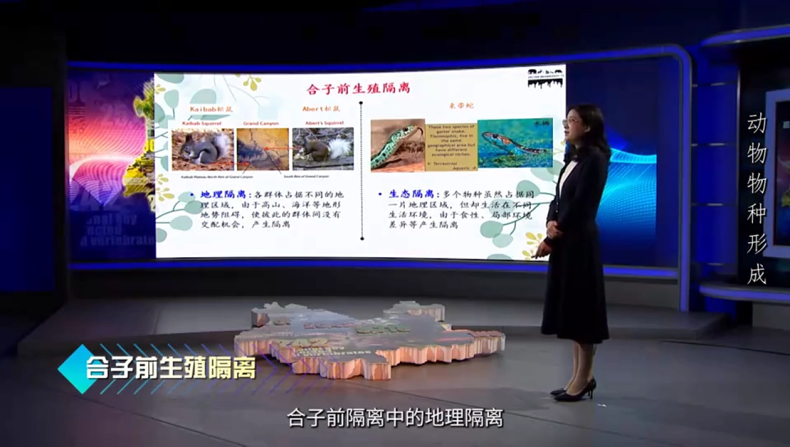
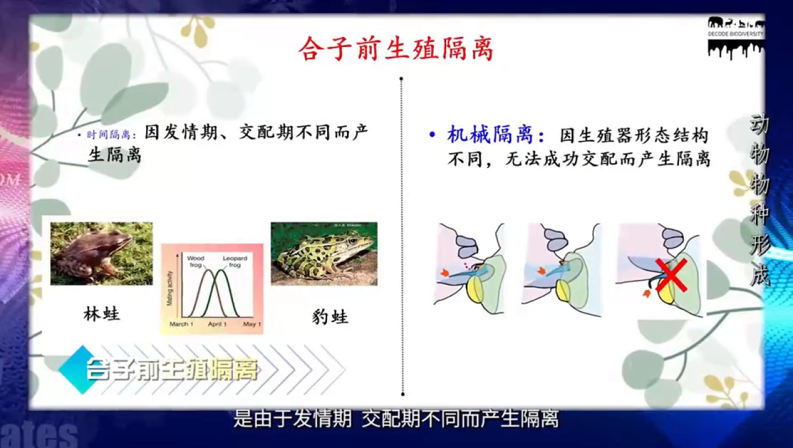
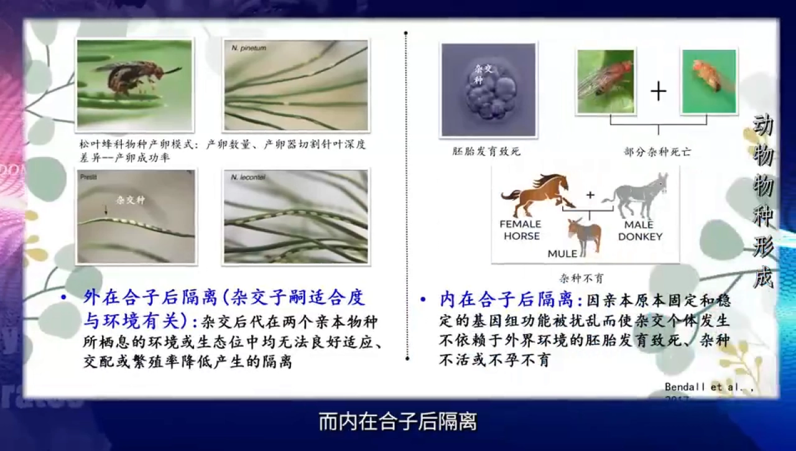
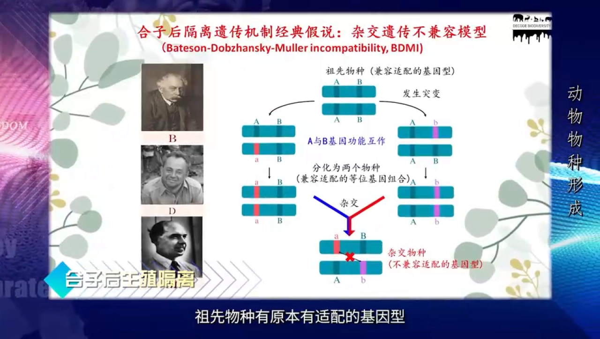
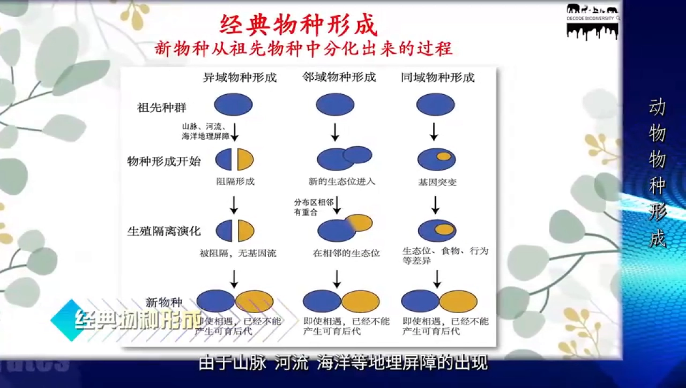
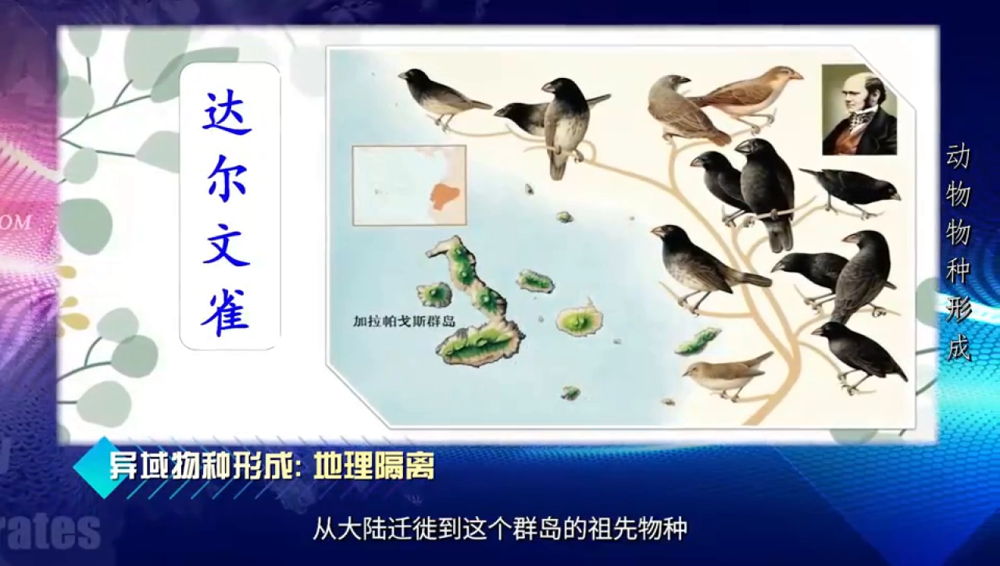
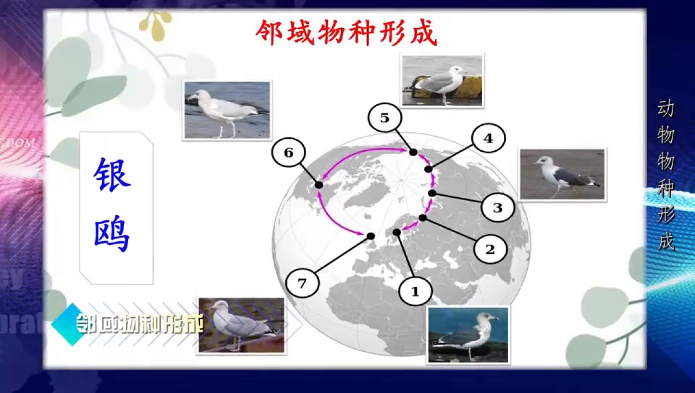
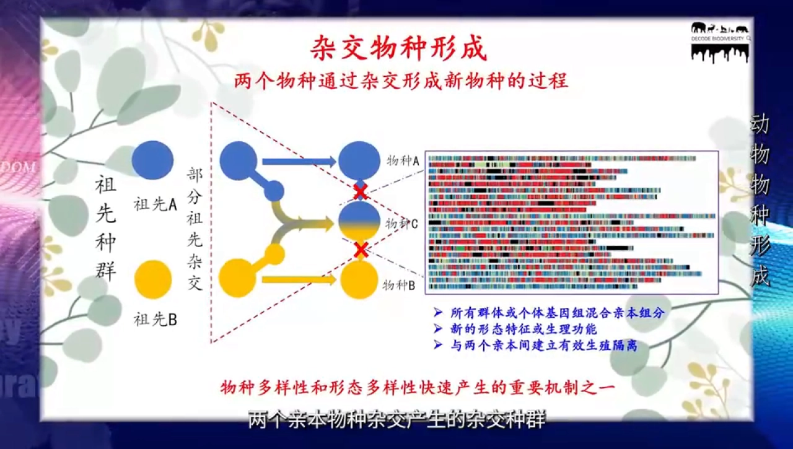

# 物种形成：生殖隔离的类型与异域、邻域、同域成种

> 视频来源：[于黎研究员-物种形成](https://www.bilibili.com/video/BV1sMrdYgEMv/)（Bilibili · 揭秘自然·解码生物多样性公开课，云南大学于黎，约 19 分钟）
> 导读（100 字以内）：一场研究者主讲的公开课，先给出"新物种从祖先物种中分化出来"的一般过程，再按合子前／合子后拆开生殖隔离，最后用达尔文雀、银鸥、青藏高原裸鲤和一系列杂交成种案例说明隔离是怎么攒出来的。

## 本讲要解决的核心问题（SCQA）

**背景**：地球上已经被描述的物种有 200 万种，而这可能只是实际物种数的十分之一。为什么会有这么多物种？它们又是怎么形成的？

**冲突**：这个问题从达尔文时期就困扰着科学家。达尔文把书命名为《物种起源》，却始终没能解释物种多样性和形态多样性是如何形成的，他自己把这称为"谜中之谜"。一个半世纪后，2005 年《科学》杂志把"什么决定了物种的多样性"列为本世纪 125 个科学前沿问题中最突出的重点之一。

[【跳转到 01:26】](https://www.bilibili.com/video/BV1sMrdYgEMv/?t=86)

**疑问**：如果说 4.2.1 和 4.2.2 讲的是物种内部基因频率怎么变，那么"一个物种变成两个物种"这一步多出来的东西是什么？是什么把同一批后代挡在了两条路上？

**回答（中心思想）**：多出来的东西是**生殖隔离**。经典的物种形成是指新物种从祖先物种中分化出来的过程，而无论走哪条路——地理隔离、生态位分化还是杂交——最终都必须在新物种与亲本物种之间建立**有效的生殖隔离**，才能保持遗传稳定性和演化独立性。

[【跳转到 11:53】](https://www.bilibili.com/video/BV1sMrdYgEMv/?t=713)

---

## 一、物种的操作性定义：能互交并产生可育后代

讲形成之前得先说清"形成的是什么"。本讲给出的判据是操作性的，它不问物种"本质"是什么，只问两群生物在自然条件下还能不能交换基因：

> 生殖隔离屏障是指由内在的遗传突变决定的表型差异，或者由外在的环境因素造成的物种间基因交流减少或受阻，导致不同的物种在自然条件下不交配，或者即使交配也不能产生后代或可育的后代。

[【跳转到 12:05】](https://www.bilibili.com/video/BV1sMrdYgEMv/?t=725)

把这句话反过来读，就是**生物学物种概念**（biological species concept）的判据：同一物种的个体在自然条件下能够互交并产生可育后代；不能做到这一点的两群，就是不同的物种。这个定义有三个必须注意的性质：

| 性质 | 含义 | 本讲的对应说法 |
| --- | --- | --- |
| 它是**群体**层面的 | 物种不是个体，也不是单个种群，而是一批能彼此交流基因的群体 | 异域物种形成中被分割的是"子代种群"，不是个体 |
| 它是**生殖**判据，不是形态判据 | 长得像不像只是线索，能不能留下可育后代才是判据 | 骡子能出生，但不可育，所以马和驴仍是两个物种 |
| 它是**操作性**的，不是本质性的 | 它只规定"怎么判定"，不承诺自然界每个类群都能被判得干干净净 | 见本节末尾的边界 |

**这个定义的适用边界**（教材常识，视频未展开，此处作为标注而非视频结论）：生物学物种概念只适用于有性生殖的生物。完全无性生殖的类群没有"互交"这回事，实践中只能退回到形态和生化性状来划分。此外还有若干并行的物种概念（形态种、系统发育种、生态种等），它们各自适用于不同对象；本节只使用生物学物种概念这一种，不展开概念史。

---

## 二、生殖隔离的两层：合子前与合子后

生殖隔离不是一个开关，而是一组发生在不同时间点上的障碍。按"障碍发生在受精之前还是之后"，本讲把它分成两类。

[【跳转到 12:17】](https://www.bilibili.com/video/BV1sMrdYgEMv/?t=737)

### 2.1 合子前隔离：连合子都形不成

合子前隔离是指由于活动区域、生活习性和体态差异等各种因素，导致物种之间根本不发生交配行为，或者交配了也无法形成合子。本讲列出六类：

| 类型 | 阻断在哪一步 | 本讲给的例子 |
| --- | --- | --- |
| 地理隔离 | 群体占据不同地理区域，高山海洋等地形阻碍，彼此没有交配机会 | 被大峡谷分割在南北两端的两种松鼠 |
| 生态隔离 | 占据同一片地理区域，但生活在不同生境，食性、局部环境差异造成隔离 | 同一区域内适应陆地与水生的不同束带蛇 |
| 时间隔离 | 发情期、交配期不同 | 林蛙与豹蛙的繁殖期错开 |
| 行为隔离 | 毛色、鸣叫、体型等差异导致雌雄择偶偏好不同，即性选择造成隔离 | 南美同域分布的两种狮子雀 |
| 机械隔离 | 生殖器官结构和功能不同，无法成功交配 | 不同果蝇物种的生殖器形态不适配 |
| 配子隔离 | 雌性卵细胞与雄性精细胞不相容，无法形成合子 | —— |

[【跳转到 12:53】](https://www.bilibili.com/video/BV1sMrdYgEMv/?t=773)

[【跳转到 13:41】](https://www.bilibili.com/video/BV1sMrdYgEMv/?t=821)

这六类里，**地理隔离的位置有点特殊**：它本身不是生殖隔离，而是"让基因流断掉"的外部条件。地理隔离能不能最终变成生殖隔离，取决于分开之后两群各自积累了什么。

### 2.2 合子后隔离：合子成了，后代不行

合子后隔离是指不同物种之间能交配，但产生的后代生存力或生育力存在缺陷。本讲按"杂交子代的适合度是否与外界环境有关"再分一层：

- **外在合子后隔离**：杂交后代在两个亲本物种所栖息的生态环境或生态位中都无法良好适应，交配或繁殖率降低。例子是松叶蜂科的两个物种寄生在不同的乔松上，产卵数量、产卵器切割针叶的深度都有差异，而这些直接关系到产卵成功率。
- **内在合子后隔离**：两个亲本内部原本固定、稳定的基因组功能被扰乱，使杂交个体发生**不依赖外界环境**的胚胎发育致死、杂种不活或不孕不育。骡子属于这一类。

[【跳转到 14:43】](https://www.bilibili.com/video/BV1sMrdYgEMv/?t=883)

---

## 三、隔离怎么攒出来：遗传不兼容模型

合子后隔离最经典的遗传机制假说是**杂交遗传不兼容模型**（Bateson–Dobzhansky–Muller incompatibility，BDMI）。本讲把它拆成三步：

1. 祖先物种原本有一套**相互适配**的基因型，比如 A 与 B 的功能可以配合。
2. 两个群体分开后各自发生突变：一支变成 aB，另一支变成 Ab。在各自群体内部，a 与 B、A 与 b 仍然是适配的，所以两个群体各自都活得好好的，分别成为两个独立物种。
3. 当这两个物种杂交，a 与 b 第一次在同一个基因组里相遇——这套组合从未被选择检验过，结果是等位基因不兼容，杂交种群生存力衰退或缺陷。

[【跳转到 15:33】](https://www.bilibili.com/video/BV1sMrdYgEMv/?t=933)

这个模型解释了一件关键的事：**隔离不需要被选择"为了隔离"而建立**。每一步突变在各自群体内部都是中性的或有利的，不兼容只是在两者重新相遇时才暴露出来。这正是"隔离是渐进的、可叠加的"这一说法的机制基础——每多一个这样的基因对，杂交后代的适合度就再低一点。

本讲给出了三个层次的实证：

- 剑尾鱼：两个基因间的遗传不兼容，使花斑剑尾鱼与青剑尾鱼杂交产生的杂交种出现致命黑色素瘤，无法存活。
- 小鼠：常染色体上的 PRDM9 与 X 染色体上的 Hstx2 之间的杂交不兼容，导致减数分裂中染色体联会失败，杂交后代雄性不育。
- 染色体重排与表观遗传：亚马逊雨林三种闪蝶在性染色体上发生多次大规模重排，引起同源重组失败和减数分裂异常，导致生育率衰退；非洲爪蟾与热带爪蟾杂交则因缺乏亲本的组蛋白修饰特征，引发信号通路异常激活与发育停滞，杂交后代发育致死。

[【跳转到 16:16】](https://www.bilibili.com/video/BV1sMrdYgEMv/?t=976)

[【跳转到 17:12】](https://www.bilibili.com/video/BV1sMrdYgEMv/?t=1032)

---

## 四、三种物种形成模式：地理隔离在不在

有了"隔离"这个判据，物种形成的几条路线就可以按**地理隔离是否参与**来分类。本讲的总图把三种模式并排画在一起：

[【跳转到 01:50】](https://www.bilibili.com/video/BV1sMrdYgEMv/?t=110)

| 模式 | 地理隔离 | 基因流 | 分化动力 | 本讲例子 |
| --- | --- | --- | --- | --- |
| 异域（allopatric） | 有，山脉河流海洋把群体完全分开 | 完全中断 | 两群在不同环境下独立演化，遗传差异不断累积 | 达尔文雀 |
| 邻域（parapatric） | 有，但只把群体分成几个相邻、分布区重叠的小种群 | 未完全中断 | 分布区两端的种群生态位差异太大 | 银鸥环北极分布链 |
| 同域（sympatric） | 无 | 存在 | 同一区域内不同生态位、食物、行为差异导致独立演化 | 青藏高原错鄂湖的斜口裸鲤与花斑裸鲤 |

### 4.1 异域：最常见的一条路

异域物种形成是自然界最常见的方式。来自同一祖先的子代种群因地理屏障被分割成两个相互隔离的群体，基因交流被阻断，两群朝不同方向演化；随着时间推移，遗传差异不断累积，演化出不同特征。等到两群个体再次相遇，它们已经不能相互交配，或者交配后不能产生后代、产生了也不可育——此时就是两个物种了。

最典型的例子是**达尔文雀**：加拉帕戈斯群岛上十多种雀都来自一个从大陆迁徙到群岛的祖先物种。群岛与大陆的隔离、群岛彼此之间的隔离，让这些雀类分化并适应不同岛屿的环境；不同岛屿上食物种类不同，它们的喙也演化出不同的大小和形状。

[【跳转到 03:37】](https://www.bilibili.com/video/BV1sMrdYgEMv/?t=217)

### 4.2 邻域：隔离不彻底，两端先分化

邻域物种形成发生得不如异域普遍。群体虽然也受到一定地理隔离，被分成几个小种群，但这些种群之间**并没有完全隔离**，分布区相邻、还有重叠。最终是分布区两端的种群因为生态位差异太大、适应了完全不同的环境，形成了新物种。

本讲用的例子是**银鸥**：它是环球分布种，七个不同亚种形成一条环北极分布的链，链上相邻的亚种之间都还有基因交流。但当链两端的第一个和第七个亚种相遇时，它们已经无法杂交产生可育后代，外表也明显不同。所以从地理位置上看，第一和第七个亚种间隔最近，但它们之间已经出现了生殖隔离，已经是不同的物种。

[【跳转到 04:13】](https://www.bilibili.com/video/BV1sMrdYgEMv/?t=253)

这条链值得停一下：它说明"物种"在空间上可以没有一条清晰的界线。相邻的每一对都能杂交，但链的两端不能——判据本身是局部的，把它沿空间铺开就会出现这种连续过渡。

### 4.3 同域：没有地理隔离，就得靠更强的隔离

同域物种形成发生在同一个地域的祖先物种内部：没有地理隔离，但区域内存在不同生态位，食物、行为等差异导致种群独立演化，最终形成新物种。

本讲给的案例来自我国青藏高原错鄂湖的**斜口裸鲤与花斑裸鲤**：两个物种生活在同一区域，但取食食性和繁殖特性都不同——斜口裸鲤以浮游生物为食，花斑裸鲤是杂食性，两者产卵季节也不同。这些差异导致它们分化为不同的物种。

[【跳转到 04:50】](https://www.bilibili.com/video/BV1sMrdYgEMv/?t=290)

同域成种是三种模式里对隔离要求最高的一种：没有地理屏障帮忙，基因流一直在，隔离必须**直接**来自生态位、繁殖时间或行为上的分化，而且这些分化要强到足以抵消持续的同域基因流。

---

## 五、杂交物种形成：跳过积累的另一条路

讲完三种按地理划分的模式，本讲补了一条不按地理划分的路线：**种间杂交**。

这个方向曾被长期低估。生物学家最初认为杂交后代往往表现出生存力或生育力的缺陷和衰退（骡子、狮虎兽），无法形成稳定的可繁殖种群，因而是走进进化死胡同的小概率事件，对物种多样性的塑造没有特殊意义。但越来越多的研究发现，自然界中约 20% 的植物类群和 10% 的动物类群发生过种间杂交。

[【跳转到 05:50】](https://www.bilibili.com/video/BV1sMrdYgEMv/?t=350)

杂交物种形成的逻辑是：两个亲本物种杂交产生的杂交种群，基因组中混合了大量亲本遗传片段；这些片段在重组和选择压力的共同作用下，产生不同于亲本的形态特征和生理功能；新的形态与生理功能促进杂交物种对特殊生态位的适应，从而与两个亲本之间建立有效的生殖隔离，进化为独立物种。

[【跳转到 06:14】](https://www.bilibili.com/video/BV1sMrdYgEMv/?t=374)

它之所以"快"，原因很直接：这种方式不需要长时间积累基因的新突变，也不需要长时间的自然选择来产生生殖隔离性状；杂交子代群体只需从不同亲本继承已有的大量**已经固定**的基因突变，就能与两个亲本快速产生生殖隔离效应。

[【跳转到 06:50】](https://www.bilibili.com/video/BV1sMrdYgEMv/?t=410)

本讲给的两类实现方式：

- **多倍化杂交成种**（植物中普遍）：同时保留两个亲本的染色体，实现遗传物质加倍，从而与亲本产生生殖隔离。四倍体丘园报春来自两个二倍体物种轮叶报春与多花报春的杂交；小麦则是不同物种之间两次天然杂交加染色体加倍产生的。
- **同倍体杂交成种**（动物中为主）：染色体数目不变，两个亲本的遗传物质重组形成马赛克式遗传组成。北美红珠灰蝶属的一个高山物种在约 40 万年前由两个分布区交叠的物种杂交产生，翅色介于两亲本之间，还演化出对高山昼夜极端温差的耐受性；家麻雀与西班牙麻雀在一到两万年内杂交产生意大利麻雀；维多利亚湖 700 多种丽鱼科物种群被认为源自约 15 万年前两支祖先的杂交；哺乳动物中，黔金丝猴、亚洲黑熊、食蟹猴种组等也陆续被报道为杂交起源。

[【跳转到 07:26】](https://www.bilibili.com/video/BV1sMrdYgEMv/?t=446)

[【跳转到 08:14】](https://www.bilibili.com/video/BV1sMrdYgEMv/?t=494)

这些案例共同指向一句话：杂交物种形成可能是哺乳动物物种多样性形成的重要机制。但不论新物种如何产生，最后那道关口是一样的——必须与亲本或祖先物种建立有效的生殖隔离。

---

## 六、把这一节串起来：一条判据，三个入口

回到开篇的问题。物种形成可以在三种地理情形下发生，也可以借杂交跳过漫长的积累，但四种路径的终点都落在同一处：

| 路径 | 起点 | 中间发生什么 | 终点判据 |
| --- | --- | --- | --- |
| 异域 | 一个祖先种群 | 地理屏障阻断基因流 → 独立演化 → 差异累积 | 再相遇也不能产生可育后代 |
| 邻域 | 一个祖先种群 | 部分隔离 + 生态位分化，两端先分化 | 链两端不能杂交 |
| 同域 | 一个祖先种群 | 无地理隔离，生态位／食物／繁殖时间分化 | 同域条件下仍保持隔离 |
| 杂交 | 两个亲本物种 | 基因组混合 + 重组与选择 → 新生态位 | 与两个亲本都隔离 |

所以"物种形成"在操作层面可以压缩成一句话：**基因流被切断或被抵消，差异在隔离中独立积累，直到即使重新接触也无法交换基因。** 这里没有任何"为了变成两个物种而努力"的成分——和 4.2.1 讲的自然选择一样，物种形成是隔离与分化的结果，不是目标。

---

## 七、边界：本节没有覆盖的部分

- **物种概念史**：本节只用生物学物种概念这一种操作性判据，不讨论形态种、生态种、系统发育种等概念的历史争论与各自优劣。这是学习目标明确排除的内容。
- **无性生殖生物与杂交带**：生物学物种概念只适用于有性生殖类群；银鸥那样的环状分布链也说明，判据在空间上铺开时会出现连续过渡，"是不是两个物种"在过渡带里没有唯一答案。这两点视频只以例子呈现，未做方法论讨论。
- **物种形成的速度与模式**：本讲没有讨论渐变式与间断平衡（punctuated equilibrium）的对比，也没有讨论成种速率如何估计。若需要这一层，应另找材料。
- **共同祖先与系统发育树**：本讲反复使用"祖先物种""亲本物种"这些词，但没有讲怎么把多个物种的分化关系画成一棵树、树上的节点和分支怎么读。这部分见同小节的另两篇：[系统发育树怎么读：根、节点、姐妹群与旋转](<../../../../B02_基因组与基因调控基础/5_演化与可比性/5.1_序列同源、比对与系统发育/5.1.6_系统发育树判读：拓扑、分支长度与根/系统发育树怎么读：根、节点、姐妹群与旋转.md>) 与 [系统发育树的刻度与可信度：分支距离、自展值与分化时间](<../../../../B02_基因组与基因调控基础/5_演化与可比性/5.1_序列同源、比对与系统发育/5.1.6_系统发育树判读：拓扑、分支长度与根/系统发育树的刻度与可信度：分支距离、自展值与分化时间.md>)。
- **隔离的定量刻画**：本节只做类型学描述（合子前／合子后、外在／内在），不给隔离指数、基因流估计或成种时间的计算。
- **视频未展开的机制细节**：BDMI 的分子实例（剑尾鱼、小鼠 PRDM9/Hstx2、闪蝶染色体重排、爪蟾表观遗传）在本讲中各占一两句话，本节按原话转述，未追加原始文献的验证。