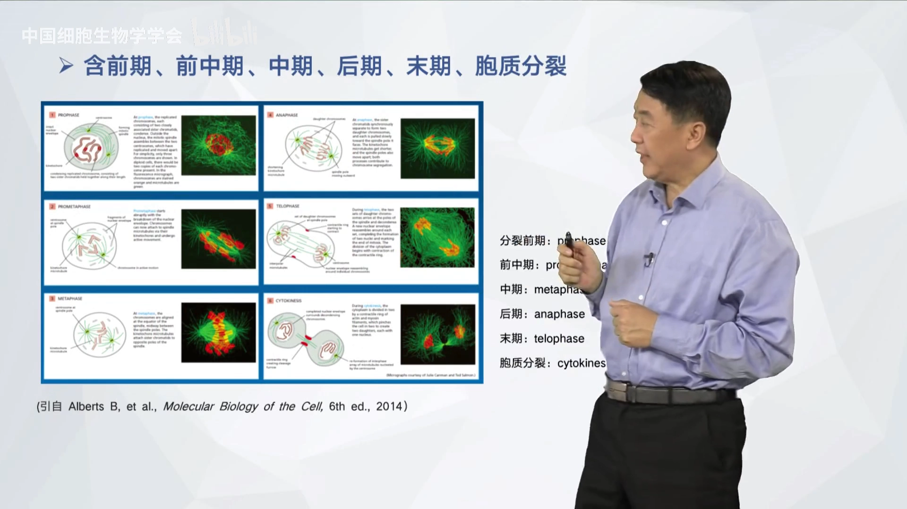
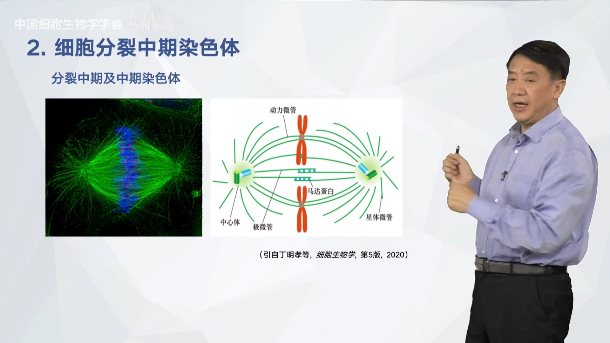
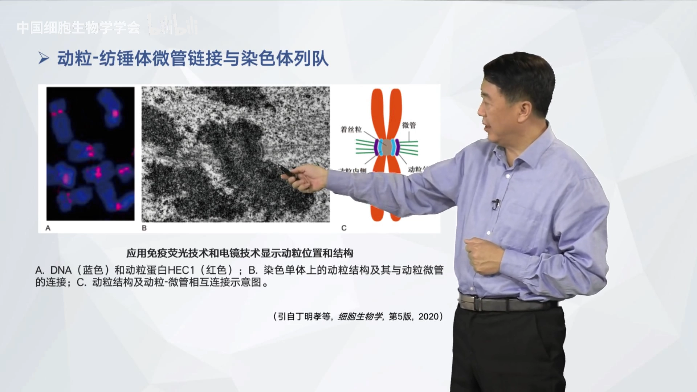
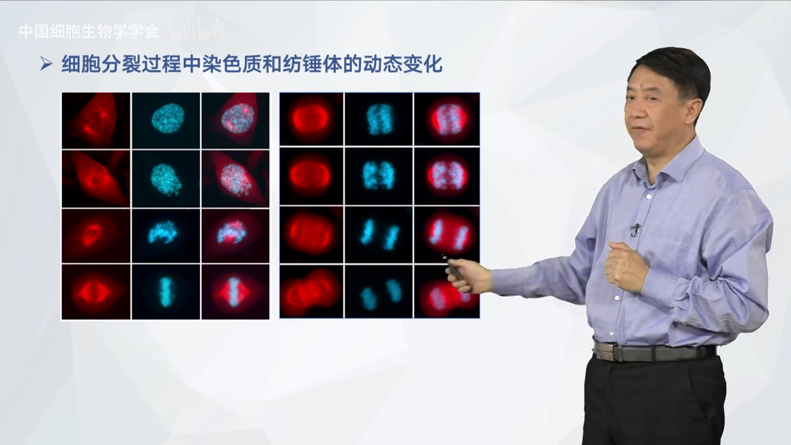

# 有丝分裂的纺锤体：三类微管、动粒与染色体列队

> 视频来源：[【细胞生物学慕课】细胞分裂——北京大学张传茂](https://www.bilibili.com/video/BV1Ht4y167ds/)（Bilibili · 中国细胞生物学学会继续教育工作委员会，15 分 19 秒；本篇只用 00:00–09:45 的有丝分裂部分，09:47 之后进入减数分裂，见 4.3.3）
> 导读：上一篇把名词立住了——染色体数看着丝粒、染色单体看时间窗口。这一篇换到「谁在搬这些东西」：一条染色体要准确落到赤道板上、再被拉向两极，靠的是一台叫纺锤体的机器。讲者是北京大学张传茂，用的是他自己拍的免疫荧光照片和电镜照片，配图里的蓝色是染色体、绿色是微管。

## 本讲要解决的核心问题（SCQA）

**背景**：有丝分裂最容易背成一句口诀——「前期、中期、后期、末期」。但口诀不解释一件事：染色体是**怎么**被搬到赤道板上、又**怎么**被拉开的？如果没有一套力学装置，几十条染色体随机漂在细胞里，平分给两个子细胞只能靠运气。

**冲突**：这套装置就是纺锤体，而纺锤体不是一根绳子，是**三类微管分工**加上**染色体这一侧的接口**共同组成的。三类微管长得一样（都是微管），但接的地方不同、干的事也不同；染色体这一侧的接口叫动粒，它不是一个点，而是有内板、中间层、外板的分层结构。分不清这三类微管和动粒的分层，就说不清「为什么所有染色体都排好了才能往下走」。

**疑问**：纺锤体由哪几部分组成？染色体靠什么接上纺锤体？「排到赤道板上」这个状态为什么值得单独设一个检查点？

**回答（中心思想）**：中期纺锤体是一台**双极**机器：**动粒微管**从两极接到每条染色体的动粒上，**极微管**在两极之间互相交连把两极撑开，**星体微管**从中心体向外辐射负责定位；染色体靠动粒这个分层接口被两侧的动粒微管抓住，经过牵拉与平衡后列队到赤道板。而**中期之所以是分水岭**，是因为在此之前一切都在为「排好队」服务，在此之后才是「分开」。[【跳转到 00:29】](https://www.bilibili.com/video/BV1Ht4y167ds/?t=29)

---

## 一、M 期再细分成六段，中期是分水岭

讲者先给了一张自己做的章图：蓝色染的是细胞核，绿色染的是微管。细胞在分裂过程中，细胞核逐步凝结成染色体，列队到赤道上，微管骨架不停重排，最后变成中期的纺锤体，再往后一个细胞分成两个。[【跳转到 00:29】](https://www.bilibili.com/video/BV1Ht4y167ds/?t=29)

M 期只是细胞周期里的一段（周期本身见 [4.3.1 细胞周期](../../../README.md#b01-4-3-1)），但它自己还能再分。讲者把它拆成**前期、前中期、中期、后期、末期，再加上胞质分裂**；并且提醒：**胞质分裂与前面几个时期有一部分是重合的**，不是排在末期之后独立发生的一段。[【跳转到 01:58】](https://www.bilibili.com/video/BV1Ht4y167ds/?t=118)

为什么把**中期**当作分水岭？讲者的理由很干脆：分裂的进入过程，一直是「微管骨架重排 + 染色质变成染色体」，最后**染色体列队到赤道板上**——到这里为止是 M 期的前半部分；再往后，染色体就要往两侧分开，是后半部分。所以中期既是前半段的目标状态，也是后半段的起点。[【跳转到 02:49】](https://www.bilibili.com/video/BV1Ht4y167ds/?t=169)

这也顺带解释了 M 期里两个并列的过程：**核分裂**（细胞核分成两个）和**细胞质分裂**（细胞质分成两份），两者有一部分重合，最后的结果才是一个细胞变成两个细胞。[【跳转到 01:31】](https://www.bilibili.com/video/BV1Ht4y167ds/?t=91)

## 二、中期纺锤体：双极 + 三类微管

到了中期，纺锤体的形态最有代表性：它有**两级**，一边一极，这种结构叫**双极纺锤体**（bipolar spindle）。[【跳转到 03:25】](https://www.bilibili.com/video/BV1Ht4y167ds/?t=205)

纺锤体最主要的构成是**微管**，而微管按「接在哪」分成三类：[【跳转到 03:30】](https://www.bilibili.com/video/BV1Ht4y167ds/?t=210)

| 类型 | 接在哪 | 干什么 |
| --- | --- | --- |
| **动粒微管**（kinetochore microtubule） | 一端接染色体的动粒，另一端接中心体（极点） | 抓住染色体、把它牵到赤道板，后期再把它拉向两极 |
| **极微管**（polar microtubule） | 两极之间，互相交连 | 把两极撑开、维持双极结构 |
| **星体微管**（astral microtubule） | 从中心体向外辐射，伸向细胞皮层 | 视频只说到「向外发射」；把纺锤体摆到正确位置与朝向是标准教材补充 |

讲者用一张引自《细胞生物学》（丁明孝等，第 5 版）的示意图把三类微管标了出来，左边配的是他自己的免疫荧光照片：蓝色是染色体，绿色是微管。[【跳转到 04:23】](https://www.bilibili.com/video/BV1Ht4y167ds/?t=263)

（示意图上把动粒微管写作「动力微管」，是幻灯片里的笔误，读作动粒微管。）

三类微管的分工可以直接从「后期怎么把染色体拉开」反推：动粒微管必须**变短**才能把染色体拽向极点；同时极微管要**变长、互相滑动**，把两极推得更远。两者一缩一伸，染色体才既靠近极点、又让细胞拉长。**需要说明的是，视频只讲到后期染色体分开、纺锤体形态与中期不同，并没有逐句讲这两条微管各自怎么变；「动粒微管缩短 + 极微管延长」是细胞生物学的标准机制，这里作为补充写入，不作为视频原话。** 讲者在后期那一段的说法是：纺锤体形态与中期相比「有它的特点」。[【跳转到 08:20】](https://www.bilibili.com/video/BV1Ht4y167ds/?t=500)

## 三、动粒：染色体这一侧的接口

微管再长，也得有地方接。接的地方在染色体上：**一条染色体两边各有一个动粒**。讲者用一张双色图说明——蓝色是染色体上的 DNA，红色染的是动粒蛋白；光镜下能看到染色体两侧各有一个红点，电镜下则能看清它的分层结构。[【跳转到 05:45】](https://www.bilibili.com/video/BV1Ht4y167ds/?t=345)

动粒不是一块板，而是**三层**：**外板、中间层、内板**。两侧都有微管通过这个结构与染色体相连。[【跳转到 06:07】](https://www.bilibili.com/video/BV1Ht4y167ds/?t=367) 讲者的评价是：这是**辅助染色体列队必需的结构**。[【跳转到 06:24】](https://www.bilibili.com/video/BV1Ht4y167ds/?t=384)

这张图正好把上一篇的两个词分开：**着丝粒**是染色体上两条臂相连的那个位置（数染色体时的计数点），**动粒**是装配在着丝粒两侧的蛋白结构（微管的接口）。示意图 C 里，着丝粒在中间、动粒内板和外板分居两侧、微管从外面接上来——三个层次一目了然。

## 四、前中期到中期：抓住、牵拉、平衡、列队

从前期到中期，核心事件只有一句：**微管要能和染色体连上**。[【跳转到 04:41】](https://www.bilibili.com/video/BV1Ht4y167ds/?t=281)

讲者把列队的过程拆成三步：两极来的微管**抓住**一条染色体 → 两侧的牵拉**经过平衡** → 染色体**定位到赤道板上**。[【跳转到 04:59】](https://www.bilibili.com/video/BV1Ht4y167ds/?t=299) 这里的关键是「两侧」：一条染色体有两个动粒，只有两个动粒分别被来自**相反两极**的微管抓住，两侧的拉力才能平衡，染色体才会停在正中间。只被一侧抓住的染色体，会被一直拖向那一极（这一句是标准机制的补充，视频只说到「两极来的微管抓住染色体、经过平衡后定位到赤道板」）。

排好队这件事被卡得很死：**所有染色体都必须定位到赤道板上，才算到了中期；只要有任意一条没到，这个细胞就不能分裂，它就一直在等**。[【跳转到 05:11】](https://www.bilibili.com/video/BV1Ht4y167ds/?t=311)

这就是**纺锤体组装检查点**的原则（检查点本身的分子细节见 [4.3.1 细胞周期](../../../README.md#b01-4-3-1)：没连上的动粒会通过 Mad2 扣住 Cdc20，让后期不启动）。本节只留一句话：**「等」不是被动等待，而是一个主动的刹车——没排好队就不许走。**

## 五、核膜的动态：崩解与重建

分裂期里变化最显眼的除了纺锤体，就是核膜。讲者把「进入」和「结束」两端放在一起讲：[【跳转到 06:29】](https://www.bilibili.com/video/BV1Ht4y167ds/?t=389)

- **进入时**：核膜崩解，崩解成膜泡或回到内质网那样的膜成分；同时染色质凝集成染色体。[【跳转到 06:39】](https://www.bilibili.com/video/BV1Ht4y167ds/?t=399)
- **中期**：这些膜成分散在细胞质里，染色体排在赤道上。[【跳转到 06:56】](https://www.bilibili.com/video/BV1Ht4y167ds/?t=416)
- **后期到末期**：膜成分又回到两组染色体的表面，重新装配核膜，形成两个子细胞的核。[【跳转到 07:13】](https://www.bilibili.com/video/BV1Ht4y167ds/?t=433)

核膜下面还有一层**核纤层**，主要成分是**核纤层蛋白**。它的解聚是核膜崩解的直接原因：CDK 激酶让核纤层蛋白**磷酸化**，核纤层解聚，核膜随之变成膜泡分散到细胞质里；到了后期末期，核膜重新装配、核纤层蛋白进入细胞核重新装配核纤层。[【跳转到 09:00】](https://www.bilibili.com/video/BV1Ht4y167ds/?t=540)

（CDK 就是 4.3.1 里讲的 cyclin B–CDK1，也就是 MPF；这里只需要知道它磷酸化核纤层蛋白这一个底物。）

纺锤体的装配也是同步进行的：最初是两个星体，慢慢分开，最后装配成双极纺锤体；与此同时染色质慢慢变成染色体。[【跳转到 07:50】](https://www.bilibili.com/video/BV1Ht4y167ds/?t=470)

## 六、后期：两组染色体分开，纺锤体形态随之改变

到了后期，两组染色体开始向两极分开；纺锤体的形态与中期相比「有它的特点」——中期是双极对称的，后期则被拉长。[【跳转到 08:15】](https://www.bilibili.com/video/BV1Ht4y167ds/?t=495)

这一步的分子开关（APC/C 降解 securin、放开分离酶剪断黏连蛋白）已在 [4.3.1 细胞周期](../../../README.md#b01-4-3-1) 讲过，本篇不重复。本节要记住的是**力学上的两件事**：动粒微管缩短把染色体拽向极点，极微管延长把两极推开——一个「拉」，一个「撑」，合起来才是后期。这两条同样属于标准机制补充，视频只说到「两组染色体开始往下分开」。[【跳转到 08:15】](https://www.bilibili.com/video/BV1Ht4y167ds/?t=495)

## 七、边界：这一段之后是减数分裂

讲者在 09:47 之后转入减数分裂：发生在生殖细胞，特点是 DNA 复制一次、接连两次分裂，最后 DNA 含量减半；其中还有同源染色体的联会与交叉互换。[【跳转到 09:47】](https://www.bilibili.com/video/BV1Ht4y167ds/?t=587)

这一段属于 [4.3.3 减数分裂、有性生殖与遗传重组](../../../README.md#b01-4-3-3) 的范围，本篇只留一句对比：**有丝分裂是复制一次、分裂一次，两个子细胞与亲代相同；减数分裂是复制一次、分裂两次，四个子细胞各拿到一半。** 至于联会、四分体、交叉互换这些只在减数分裂里出现的结构，不要往有丝分裂里搬。

另外两点本节不展开：纺锤体的**组装路径**（中心体分离、微管成核的具体分子）与**纺锤体定位**（决定分裂面朝向的机制），都属于细胞骨架与细胞分裂调控的更深一层；本节只到「三类微管分工 + 动粒接口 + 排好队才走」这一层。

## 小结

- M 期可细分为**前期、前中期、中期、后期、末期、胞质分裂**，胞质分裂与前面几个时期部分重合；**中期是分水岭**——之前为「排好队」，之后是「分开」。
- 中期纺锤体是**双极**的，由**三类微管**组成：动粒微管（接动粒与极点）、极微管（两极之间交连）、星体微管（向外辐射）。
- 染色体这一侧的接口是**动粒**，分**外板、中间层、内板**三层，装配在着丝粒两侧；着丝粒是位置，动粒是蛋白结构。
- 列队的三步是**抓住 → 牵拉平衡 → 定位赤道板**；两个动粒必须连向相反两极，拉力才平衡。
- **所有染色体都排好队才算中期**，只要有一条没到，细胞就停在原地等——这就是纺锤体组装检查点的原则。
- 核膜的崩解与重建由**核纤层蛋白的磷酸化/去磷酸化**驱动；纺锤体从两个星体开始，装配成双极结构。
- 后期靠**动粒微管缩短 + 极微管延长**完成：一个拉，一个撑。

## 关键术语速查

| 术语 | 一句话解释 |
| --- | --- |
| 双极纺锤体 | 有两极、呈双极形状的纺锤体，中期最典型。 |
| 动粒微管 | 一端接染色体动粒、另一端接极点的微管；后期缩短把染色体拉向极点。 |
| 极微管 | 两极之间互相交连的微管；把两极撑开、维持双极结构。 |
| 星体微管 | 从中心体向外辐射的微管，参与纺锤体定位。 |
| 动粒 | 装配在着丝粒两侧的蛋白结构，分外板、中间层、内板，是微管的接口。 |
| 着丝粒 | 染色体上两条臂相连的位置，也是数染色体时的计数点。 |
| 赤道板 | 两极正中间的平面，中期染色体着丝粒排列的位置；是一个位置，不是一种物质。 |
| 前中期 | 核膜已崩解、纺锤体正在捕获染色体的阶段，介于前期与中期之间。 |
| 核纤层 | 核膜内侧的一层蛋白网络，主要成分是核纤层蛋白；其磷酸化解聚导致核膜崩解。 |
| 纺锤体组装检查点 | 只要还有动粒没连上微管，后期就不启动的刹车机制。 |