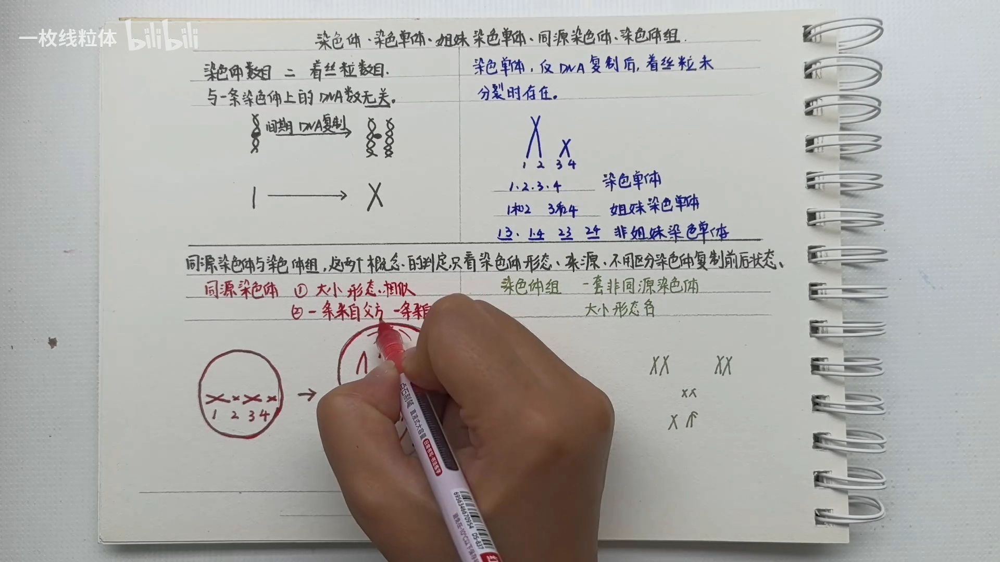
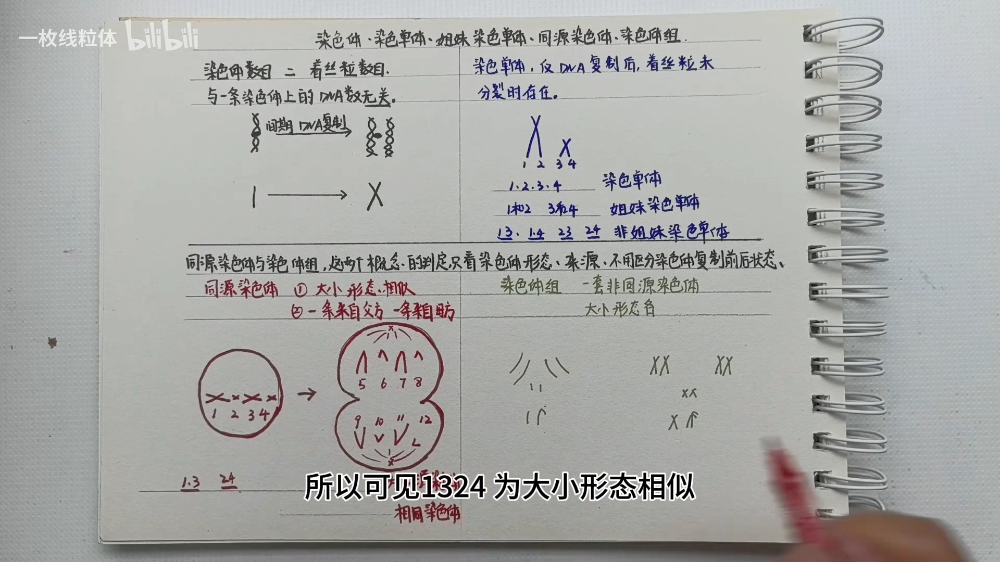
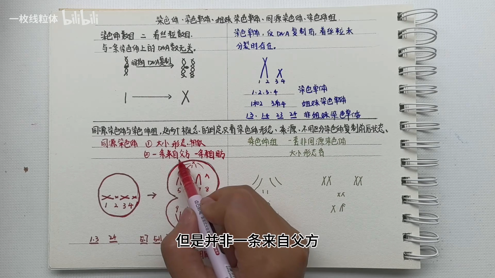

# 染色体、染色单体与同源染色体：数染色体时到底在数什么

> 视频来源：[染色体 染色单体 姐妹染色单体 同源染色体 染色体组概念辨析](https://www.bilibili.com/video/BV1BD7T6AEiQ/)（Bilibili · 豌豆背多分，3 分 39 秒）
> 导读：这一篇不讲分裂过程，只先把名词立住。上一节（4.3.1）讲细胞周期时已经出现过「2C/4C」「姐妹染色单体」这些词；这一节要回答的是更基础也更容易出错的问题——一条染色体、一条染色单体、一对同源染色体，各自在数什么。数错了，后面追踪有丝分裂的每一期都会跟着错。

## 本讲要解决的核心问题（SCQA）

**背景**：讲有丝分裂时，几乎每一句话都在报数：「后期染色体数加倍」「DNA 在间期加倍」「每条染色体有两条姐妹染色单体」。这些数字最后要拼成一张表，而表能不能对上，取决于每个词的定义是否清楚。

**冲突**：这些词在日常语言里都叫「染色体」，含义却分属三个不同的判定标准。染色体数只看着丝粒，DNA 数只看双螺旋，染色单体则是一个**有时间窗口的名词**——同一个细胞，在 S 期前后、在后期前后，能叫「染色单体」的东西完全不一样。更麻烦的是「同源染色体」：它和「姐妹染色单体」长得很像（都是两条并排的棒），但一个看的是**来源**，一个看的是**是否共用一个着丝粒**。

**疑问**：一条染色体到底怎么数？染色单体什么时候存在、什么时候不存在？并排的两条棒，什么时候叫姐妹染色单体，什么时候叫同源染色体？

**回答（中心思想）**：三个词对应三把尺子——**染色体数看「有几个着丝粒」**，**DNA 数看「有几个双螺旋」**，**染色单体看「复制之后、着丝粒分裂之前」这段窗口**；而**同源染色体看「形态大小相似 + 一条来自父方一条来自母方」**，与复制状态无关。把这三把尺子分开，后面所有数量变化都只是同一套规则在不同时相上的取值。[【跳转到 00:04】](https://www.bilibili.com/video/BV1BD7T6AEiQ/?t=4)

---

## 一、染色体数 = 着丝粒数，与「一条染色体上有几个 DNA」无关

讲者开门见山给了第一条规则：**染色体的数目等于着丝粒的数目**，和一条染色体上有多少基因、带几个 DNA 分子都没有关系。[【跳转到 00:11】](https://www.bilibili.com/video/BV1BD7T6AEiQ/?t=11)

这条规则之所以重要，是因为它把「复制」和「染色体数」彻底解耦了。间期 DNA 复制之前，一条细长的染色质丝上结合着一套 DNA 与组蛋白，那是**一条**染色体；S 期完成半保留复制之后，染色体出现分叉结构（一个着丝粒挂着两条臂），DNA 加倍了，但**着丝粒的数量没有变，所以依旧只算一条染色体**。[【跳转到 00:25】](https://www.bilibili.com/video/BV1BD7T6AEiQ/?t=25)

所以「染色体数」和「DNA 数」是两条独立的曲线：DNA 在 S 期就翻倍，染色体数要等到后期着丝粒分裂才翻倍。这两条曲线错开的那一段，正是后面那张数量变化表里最容易记混的地方。

## 二、染色单体是一个有「时间窗口」的名词

第二个概念是染色单体。讲者的措辞很讲究：**染色单体存在有严格的时间窗口**——只在「DNA 复制后、着丝粒尚未分裂」这段时间里存在；**着丝粒一旦分裂，染色单体结构彻底消失，这个名词也就不复存在了**。[【跳转到 00:40】](https://www.bilibili.com/video/BV1BD7T6AEiQ/?t=40)

换句话说，染色单体不是一种可以单独拿出来的零件，而是一种**形态描述**：只有当一条染色体呈现「一个着丝粒 + 两条臂」的叉状时，那两条臂才各自叫一条染色单体。复制前没有单体，后期着丝粒分裂之后也没有单体——虽然 DNA 一直都在。[【跳转到 00:49】](https://www.bilibili.com/video/BV1BD7T6AEiQ/?t=49)

这也解释了一个常见困惑：为什么「染色单体数」在后期会从 4N 直接掉到 0，而不是慢慢减少。因为它不是一个守恒量，而是一个**依赖形态的名词**；形态一变，计数就归零。

## 三、姐妹与非姐妹：判据是「是否共用一个着丝粒」

有了单体，才有姐妹与非姐妹之分。讲者用一张标了 1、2、3、4 的图来说明：1、2、3、4 都是染色单体；其中**1 和 2 共用一个着丝粒，3 和 4 共用一个着丝粒，所以 1&2、3&4 各是一对姐妹染色单体**；而 1&3、1&4、2&3、2&4 之间不共用一个着丝粒，属于**非姐妹染色单体**。[【跳转到 01:13】](https://www.bilibili.com/video/BV1BD7T6AEiQ/?t=73)

判据只有一条：**同一个着丝粒挂着的两条，才叫姐妹**。这一点在减数分裂里会变得关键（同源染色体上的非姐妹染色单体之间可以发生交叉互换），但那是 4.3.3 的内容，这里只需要把「姐妹 = 同一个着丝粒」这条判据记牢。

## 四、同源染色体：只看形态与来源，不看复制状态

第四个概念是同源染色体。讲者特意强调了一个前提：**同源染色体和染色体组的判定只看染色体的形态和来源，不用区分染色体是复制前还是复制后的状态**。[【跳转到 01:43】](https://www.bilibili.com/video/BV1BD7T6AEiQ/?t=103)

同源染色体要同时满足两个条件：

1. **大小、形态相似**——注意是「相似」而不是「相同」，讲者补了一句：X 和 Y 就是一对特殊的同源染色体，大小并不一样。[【跳转到 01:55】](https://www.bilibili.com/video/BV1BD7T6AEiQ/?t=115)
2. **一条来自父方、一条来自母方**。[【跳转到 01:59】](https://www.bilibili.com/video/BV1BD7T6AEiQ/?t=119)

这两个条件里，第二条才是真正的分水岭。讲者把它放到有丝分裂的中期和后期里检验：中期时，1&3、2&4 大小形态相似、一条来自父方一条来自母方，属于同源染色体；其余形态不同的互为非同源染色体。[【跳转到 02:07】](https://www.bilibili.com/video/BV1BD7T6AEiQ/?t=127)

后期更值得看。着丝粒一分为二，染色单体变成独立的染色体，编号从 4 条变成 8 条（5–12）。此时 5&7、5&11、7&9、7&11 依旧是同源染色体——判据没变，仍然只看形态与来源。[【跳转到 02:20】](https://www.bilibili.com/video/BV1BD7T6AEiQ/?t=140)

### 4.1 「同源」和「相同」是两件事

这里有一个非常容易被忽略的陷阱，讲者专门点出来：**5 和 9 大小形态相同，但它们并不是一条来自父方、一条来自母方，所以不能叫同源染色体，只能叫「相同染色体」**——因为这两条是同一个 DNA 复制出来的，遗传来源完全一致。[【跳转到 02:40】](https://www.bilibili.com/video/BV1BD7T6AEiQ/?t=160)

这条区分把三把尺子的关系说透了：

| 比较对象 | 判据 | 典型出现位置 |
| --- | --- | --- |
| 姐妹染色单体 | 同一个着丝粒挂着的两条臂 | S 期后到后期之前 |
| 同源染色体 | 形态大小相似 + 一条父方一条母方 | 整个周期都在，与复制无关 |
| 相同染色体 | 形态相似 + 来源相同（同一 DNA 复制而来） | 后期着丝粒分裂后 |

所以「并排的两条棒」这个视觉印象完全不够用：S 期后并排的两条是姐妹染色单体，后期分开后并排（分居两极）的两条可能是相同染色体，而中期里形态相似的两条才是同源染色体。**看形态之外，必须问一句「它们共用一个着丝粒吗」「它们来自同一条亲代染色体吗」。**

## 五、染色体组与 2n、n、C 的关系

最后一个概念是染色体组：**一套非同源染色体**，大小形态各异。[【跳转到 03:00】](https://www.bilibili.com/video/BV1BD7T6AEiQ/?t=180)

讲者以果蝇体细胞为例：复制前体细胞里含**两个**染色体组；复制以后**仍然是两个**染色体组。[【跳转到 03:18】](https://www.bilibili.com/video/BV1BD7T6AEiQ/?t=198) 理由和第一节完全一样——复制只让每条染色体分叉，没有增加着丝粒，也没有增加「套数」。

把本节的三把尺子和三个记号对上：

- **2n**：体细胞的染色体数（二倍体），n 是配子的染色体数。2n=4 表示体细胞有 4 条染色体、2 对同源染色体、2 个染色体组。
- **C**：DNA 含量的相对单位，配子为 1C，G1 期体细胞为 2C，S 期后为 4C。C 只跟 DNA 走，不跟染色体数走。
- **染色单体数**：只在「复制后、着丝粒分裂前」这段窗口内非零，峰值等于当时的 DNA 分子数。

需要补一句本节视频没讲、但名词系统里绕不开的两个结构：**着丝粒**是染色体上两条臂相连的那个位置（也是本节数染色体时的计数点），**动粒**是装配在着丝粒两侧、供微管连接的蛋白结构——两者的分工见本小节《有丝分裂的纺锤体：三类微管、动粒与染色体列队》；**端粒**是线性染色体末端的特殊结构，解决末端复制问题，已在 [1.3.1 原核与真核细胞、细胞器与分工](../../../README.md#b01-1-3-1) 里作为真核染色体的三类功能元件之一讲过，这里不重复。

## 六、边界：这套数法什么时候会失效

本节给的是一套**计数约定**，不是生物学定律。它默认了三个前提：细胞是二倍体、染色体是完整的、着丝粒只有一个。以下情况需要另作处理：

- **多倍体**：染色体组数大于 2，2n 的写法要改成 4n、6n 等，同源染色体也不止两条（可以有同源三倍体、四倍体），「一对」的说法不再成立。
- **非整倍体与染色体不分离**：后期若某条染色体的两个动粒连向同一极，子细胞会得到 n+1 与 n−1 条染色体。此时「子细胞与亲代相同」的前提被打破，但**计数规则本身不变**——仍然是数着丝粒。
- **染色体结构异常**：着丝粒分裂异常、双着丝粒染色体等情况会让「染色体数 = 着丝粒数」这条对应关系失效。

换句话说，后面追踪有丝分裂时用的那套表，成立的条件是「正常二倍体细胞的一次正常分裂」。异常情况要回到「着丝粒在哪、微管接在哪」去重新判断，而不是套公式。

## 小结

- **染色体数 = 着丝粒数**，与一条染色体上有几个 DNA 无关；复制只让染色体分叉，不增加染色体数。
- **染色单体是一个有时间窗口的名词**：DNA 复制后、着丝粒分裂前才存在；着丝粒一分裂，单体数归零。
- **姐妹染色单体**的判据是「共用一个着丝粒」；**同源染色体**的判据是「形态大小相似 + 一条父方一条母方」，与复制状态无关。
- **相同染色体 ≠ 同源染色体**：后期由同一个 DNA 复制而来的两条，形态相似但来源相同，只能叫相同染色体。
- **染色体组**是一套非同源染色体；复制前后染色体组数不变。
- 三个记号各走各的：2n 跟着丝粒走，C 跟 DNA 走，染色单体数只在特定窗口内非零。

## 关键术语速查

| 术语 | 一句话解释 |
| --- | --- |
| 染色质 / 染色体 | 同一物质的两个形态：间期松散成丝状叫染色质，分裂期高度螺旋化变粗变短叫染色体。 |
| 染色体数 | 等于着丝粒数，与一条染色体上携带几个 DNA 无关。 |
| 染色单体 | 复制后、着丝粒分裂前，叉状染色体上的每一条臂；有严格的时间窗口。 |
| 姐妹染色单体 | 共用一个着丝粒的两条染色单体。 |
| 非姐妹染色单体 | 不共用一个着丝粒的染色单体。 |
| 同源染色体 | 形态大小相似（XY 例外）、一条来自父方一条来自母方的两条染色体。 |
| 相同染色体 | 形态相似但由同一个 DNA 复制而来、来源相同的两条。 |
| 染色体组 | 一套非同源染色体，大小形态各异；二倍体体细胞有 2 组。 |
| 着丝粒 | 染色体上连接两条臂的位置，也是数染色体时的计数点。 |
| 动粒 | 装配在着丝粒两侧、供纺锤体微管连接的蛋白结构。 |
| 端粒 | 线性染色体末端的特殊结构，解决末端复制问题。 |